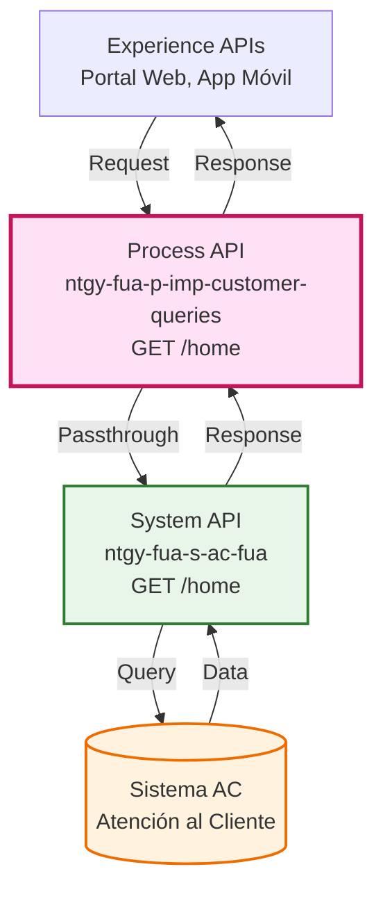
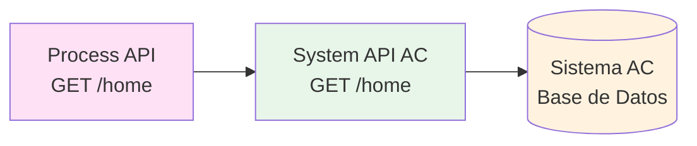
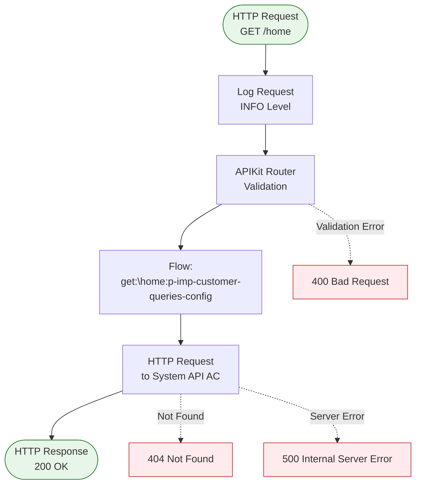
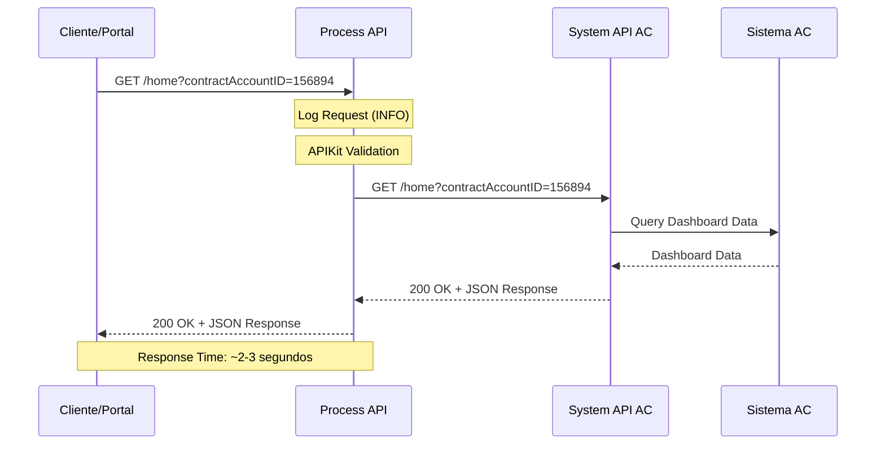
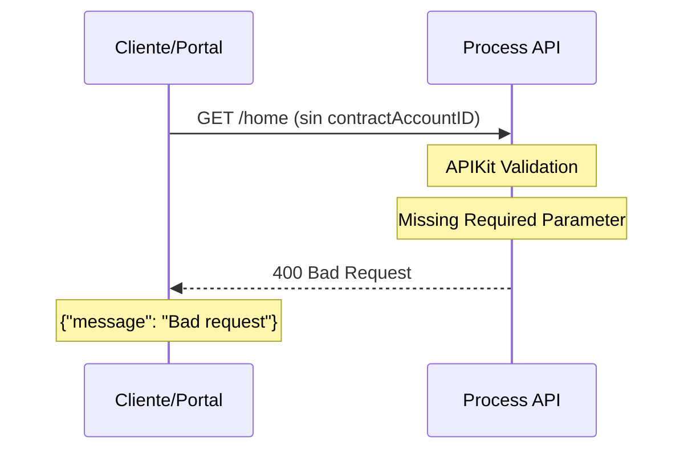
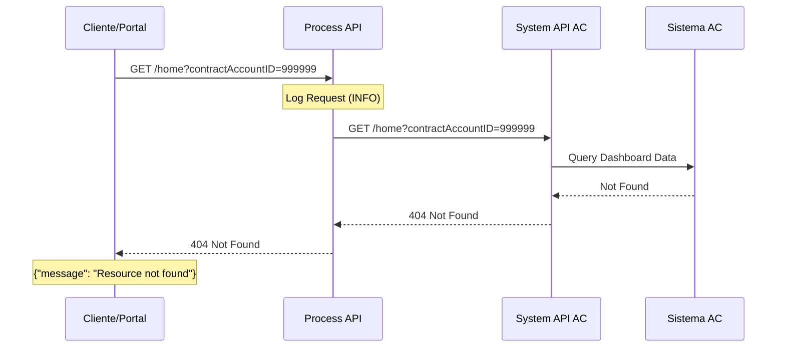
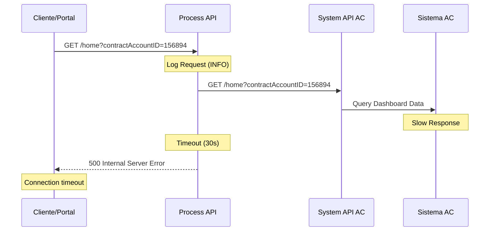

# GET /home

## 📌 Descripción General

### Propósito del Endpoint

Este endpoint proporciona acceso a los datos agregados del dashboard principal (home) del cliente, incluyendo información resumida de contratos, facturas pendientes, consumos recientes y notificaciones importantes. Actúa como punto de entrada principal para la vista de inicio del portal de cliente.

### Tipo de API

**Capa:** Process API (API-Led Connectivity)

**Función:** Proxy/Passthrough hacia System API de Atención al Cliente

### Patrón de Integración

**Tipo:** Pass-Through (Delegación Directa)

**Descripción:** Este endpoint delega completamente la operación al System API `ntgy-fua-s-ac-fua` sin aplicar transformaciones ni lógica de negocio adicional. El Process API actúa como punto de acceso unificado para los canales de experiencia.

### Arquitectura API-Led Connectivity



---

## 💼 Propósito del Negocio

### Casos de Uso Principales

1. **Dashboard Inicial del Cliente**
   - El cliente accede al portal y visualiza su información principal
   - Beneficio: Acceso rápido a información relevante sin navegación compleja

2. **Resumen de Estado de Cuenta**
   - Visualización de facturas pendientes y próximos vencimientos
   - Beneficio: Facilita la gestión proactiva de pagos

3. **Monitoreo de Consumo**
   - Vista rápida de consumos recientes y tendencias
   - Beneficio: Conciencia del uso energético

4. **Notificaciones Importantes**
   - Alertas sobre gestiones pendientes o información relevante
   - Beneficio: Comunicación efectiva con el cliente

### 🔗 Endpoints Dependientes

Este Process API consume el siguiente System API:

| System API | Endpoint | Método | Propósito |
|------------|----------|--------|-----------|
| `ntgy-fua-s-ac-fua` | `/home` | GET | Obtención de datos agregados del dashboard del cliente desde Sistema AC |

### Lógica de Orquestación



**Flujo del Proceso:**

1. **Recepción**: Process API recibe request con `contractAccountID`
2. **Delegación**: Reenvía request directamente al System API de AC
3. **Respuesta**: Retorna respuesta del System API sin modificaciones

### Transformaciones Aplicadas

⚠️ **Este Process API NO transforma la respuesta del System API.**

Este es un endpoint de tipo **passthrough puro**. Los datos se retornan exactamente como los proporciona el System API.

Para el schema completo de la respuesta, consultar:
📖 **System API: `ntgy-fua-s-ac-fua` endpoint `/home`**

### Contexto Empresarial

- **Dominio:** Gestión de Clientes y Autoservicio
- **Sector:** Energía - Utilities (Gas & Electricidad)
- **División:** Naturgy España - Clientes Minoristas
- **Proceso de Negocio:** Portal de Autoservicio del Cliente (FUA - Frontal Único de Atención)

### Stakeholders

- **Clientes Finales**: Acceso a su información principal de forma consolidada
- **Agentes de Call Center**: Vista rápida del estado del cliente durante atención telefónica
- **Equipo de Producto Digital**: Métricas de uso y engagement del portal

### Valor de Negocio

- **Reducción de Llamadas**: Clientes resuelven consultas básicas sin contactar call center
- **Mejora de Experiencia**: Información consolidada en una sola vista
- **Eficiencia Operativa**: Agentes acceden rápidamente a información del cliente
- **Engagement Digital**: Punto de entrada atractivo que fomenta uso del portal

### Consumidores Potenciales

Este endpoint puede ser consumido por:
- Portal web de autoservicio (FUA)
- Aplicación móvil de clientes
- Sistema de agentes de call center
- Aplicaciones de terceros autorizados (partners)

---

## 🔧 Especificación Técnica

### URLs por Ambiente

| Ambiente | URL Base | URL Completa |
|----------|----------|--------------|
| **Local** | `http://localhost:8084` | `http://localhost:8084/api/home?contractAccountID=156894` |
| **Development** | `https://ntgy-fua-p-imp-customer-queries-dev.de-c1.cloudhub.io` | `https://ntgy-fua-p-imp-customer-queries-dev.de-c1.cloudhub.io/api/home?contractAccountID=156894` |
| **UAT** | `https://ntgy-fua-p-imp-customer-queries-uat.de-c1.cloudhub.io` | `https://ntgy-fua-p-imp-customer-queries-uat.de-c1.cloudhub.io/api/home?contractAccountID=156894` |
| **Production** | `https://ntgy-fua-p-imp-customer-queries-pro.de-c1.cloudhub.io` | `https://ntgy-fua-p-imp-customer-queries-pro.de-c1.cloudhub.io/api/home?contractAccountID=156894` |

### Método HTTP

```
GET /api/home
```

### Parámetros de Entrada

#### Query Parameters

| Parámetro | Tipo | Requerido | Descripción | Ejemplo |
|-----------|------|-----------|-------------|---------|
| `contractAccountID` | string | ✅ Sí | Identificador único de la cuenta contrato del cliente | `"156894"` |

**Validaciones:**
- `contractAccountID` debe ser un string no vacío
- Debe corresponder a una cuenta contrato existente en el sistema

### Respuestas

#### 200 OK - Éxito

Retorna un objeto JSON con los datos agregados del dashboard del cliente.

**Estructura de Respuesta:**

```json
{
  "result": {
    "codResult": "string",
    "msgResult": "string"
  },
  "productsResume": [
    {
      "contractAccountId": "string",
      "Address": [
        {
          "addressId": "string",
          "wayId": "string",
          "zipCode": "string",
          "province": "string",
          "city": "string",
          "way": "string",
          "wayType": "string",
          "town": "string"
        }
      ],
      "numPending": "number",
      "numLight": "number",
      "numGas": "number",
      "numSVA": "number",
      "numSolar": "number",
      "numRecharge": "number",
      "numLightInactive": "number",
      "numGasInactive": "number",
      "numSVAInactive": "number",
      "numSolarInactive": "number",
      "numRechargeInactive": "number"
    }
  ],
  "invoicesResume": [
    {
      "contractAccountId": "string",
      "Address": {
        "addressId": "string",
        "wayId": "string",
        "zipCode": "string",
        "province": "string",
        "city": "string",
        "way": "string",
        "wayType": "string",
        "town": "string"
      },
      "invoicesAverage": "string",
      "lastInvoices": [
        {
          "invoiceId": "string",
          "invoiceNum": "string",
          "issuedDate": "string (ISO 8601)",
          "billingDate": "string (ISO 8601)",
          "status": "string",
          "productFamilyIdList": ["string"],
          "amount": "number",
          "interactiveInvoice": "boolean",
          "existPdfInvoice": "boolean",
          "pdfDocumentId": "string"
        }
      ],
      "pendingInvoices": "string"
    }
  ],
  "casesResume": [
    {
      "contractAccountId": "string",
      "withStateChange": "number",
      "inCourse": "string",
      "Address": {
        "addressId": "string",
        "wayId": "string",
        "zipCode": "string",
        "province": "string",
        "city": "string",
        "way": "string",
        "wayType": "string",
        "town": "string"
      },
      "lastCases": [
        {
          "caseCode": "string",
          "typeId": "string",
          "subTypeId": "string",
          "step": "string",
          "subStep": "string",
          "state": "string",
          "contractAccountId": "string",
          "startDate": "string",
          "endDate": "string",
          "channel": "string",
          "hasFiles": "boolean",
          "isCancelable": "boolean"
        }
      ]
    }
  ],
  "engagement": [
    {
      "contractAccountId": "string",
      "consumptionTarget": "boolean"
    }
  ]
}
```

**Descripción de Campos Principales:**

- **result**: Código y mensaje de resultado de la operación
- **productsResume**: Resumen de productos por cuenta contrato (luz, gas, SVA, solar, recarga)
- **invoicesResume**: Resumen de facturas con promedio y últimas facturas emitidas
- **casesResume**: Resumen de casos de gestión con estado y últimos casos
- **engagement**: Indicadores de engagement del cliente

**Nota:** La estructura exacta depende de la implementación del System API `ntgy-fua-s-ac-fua`. Consultar documentación del System API para schema completo.

#### 400 Bad Request - Error de Validación

```json
{
  "message": "Bad request"
}
```

**Causas comunes:**
- Parámetro `contractAccountID` faltante
- Formato de parámetro inválido

#### 404 Not Found - Recurso No Encontrado

```json
{
  "message": "Resource not found"
}
```

**Causas comunes:**
- `contractAccountID` no existe en el sistema
- Cuenta contrato inactiva o eliminada

#### 500 Internal Server Error - Error del Servidor

```json
{
  "message": "Internal server error"
}
```

**Causas comunes:**
- Error en System API de AC
- Timeout en comunicación con backend
- Error de conectividad

### Autenticación

- **Tipo:** OAuth 2.0 (Client Credentials)
- **Headers Requeridos:**
  - `Authorization: Bearer {access_token}`
  - `client_id: {your_client_id}`
  - `client_secret: {your_client_secret}`

### Timeouts

| Tipo | Valor | Configuración |
|------|-------|---------------|
| **Response Timeout** | 30 segundos | `${s-ac.timeout}` |
| **Connection Idle Timeout** | 30 segundos | `${s-ac.timeout}` |

**Nota:** El timeout puede ser ajustado mediante configuración en properties YAML por ambiente.

---

## 🏗️ Implementación Técnica

### Arquitectura del Flow



### Código de Implementación

**Ubicación:** `src/main/mule/p-imp-customer-queries.xml` (línea 159-161)

```xml
<flow name="get:\home:p-imp-customer-queries-config">
    <http:request method="GET" 
                  doc:name="Request" 
                  doc:id="d2d23ce5-e3c8-42da-bc7b-53eba2d04e81" 
                  config-ref="HTTP_API_SistemaAC" 
                  path="/home" />
</flow>
```

### Configuración HTTP

**Archivo:** `src/main/mule/global.xml` (línea 14-16)

```xml
<http:request-config name="HTTP_API_SistemaAC" 
                     doc:name="HTTP Request configuration" 
                     basePath="/api" 
                     responseTimeout="${s-ac.timeout}">
    <http:request-connection host="${s-ac.host}" 
                             port="${s-ac.port}" 
                             connectionIdleTimeout="${s-ac.timeout}" 
                             protocol="${s-ac.protocol}"/>
</http:request-config>
```

### Properties por Ambiente

**Archivo:** `src/main/resources/p-imp-customer-queries-pro-config.yaml` (líneas 5-12)

```yaml
s-ac:
  host: "ntgy-fua-s-ac-fua-bqyi65.internal-6bnlu3.irl-e1.cloudhub.io"
  port: "443"
  protocol: "HTTPS"
  timeout: "30000"
  timeoutOverride: "5000"
```

### Transformaciones DataWeave

⚠️ **No aplica** - Este endpoint no realiza transformaciones DataWeave.

Los query parameters se pasan automáticamente al System API mediante el comportamiento por defecto del HTTP Request connector.

### Patrones de Diseño

**Patrón:** Pass-Through / Proxy Pattern

**Justificación:** 
- El Process API actúa como punto de acceso unificado
- No se requiere lógica de negocio adicional
- El System API ya proporciona los datos en el formato correcto
- Simplifica el mantenimiento al centralizar la lógica en el System API

**Beneficios:**
- Bajo acoplamiento entre capas
- Facilita cambios en el System API sin afectar consumidores
- Permite aplicar políticas de seguridad y rate limiting en la capa de Process
- Simplifica troubleshooting al tener menos puntos de transformación

### Diagramas de Secuencia

#### 1. Flujo Normal de Éxito



#### 2. Flujo con Error de Validación



#### 3. Flujo con Error de Backend



#### 4. Flujo con Timeout



### Manejo de Errores

**Estrategia:** Propagación de errores del System API

El Process API propaga los errores del System API sin transformación adicional, manteniendo los códigos de estado HTTP originales.

**Error Handlers Configurados:**

1. **APIKIT:BAD_REQUEST (400)**
   - Parámetros faltantes o inválidos
   - Validación de RAML fallida

2. **APIKIT:NOT_FOUND (404)**
   - Endpoint no encontrado
   - Recurso no existe

3. **HTTP:TIMEOUT**
   - Timeout de 30 segundos excedido
   - Retorna 500 Internal Server Error

4. **HTTP:CONNECTIVITY**
   - Error de conexión con System API
   - Retorna 503 Service Unavailable

### Logging

**Nivel:** INFO

**Ubicación:** Flow principal `p-imp-customer-queries-main` (línea 15)

**Información Registrada:**
```json
{
  "method": "GET",
  "requestUri": "/api/home",
  "queryParams": {
    "contractAccountID": "156894"
  },
  "x-client-code": "...",
  "x-client-doc-number": "...",
  "x-client-id": "..."
}
```

---

## 💻 Ejemplos de Uso

### Ejemplo 1: Llamada Exitosa con cURL

#### Request

```bash
curl -X GET "https://ntgy-fua-p-imp-customer-queries-dev.de-c1.cloudhub.io/api/home?contractAccountID=156894" \
  -H "Content-Type: application/json" \
  -H "Authorization: Bearer YOUR_ACCESS_TOKEN" \
  -H "client_id: YOUR_CLIENT_ID" \
  -H "client_secret: YOUR_CLIENT_SECRET"
```

#### Response (200 OK)

```json
{
  "result": {
    "codResult": "0000",
    "msgResult": "No hay error"
  },
  "productsResume": [
    {
      "contractAccountId": "156894",
      "Address": [
        {
          "addressId": "1234",
          "wayId": "247558",
          "zipCode": "26001",
          "province": "LA RIOJA",
          "city": "LOGROÑO",
          "way": "MARQUES DE SAN NICOLAS",
          "wayType": "CALLE",
          "town": "LOGROÑO"
        },
        {
          "addressId": "1234",
          "wayId": "247559",
          "zipCode": "26001",
          "province": "LA RIOJA",
          "city": "LOGROÑO",
          "way": "MARQUES DE VALLEJO",
          "wayType": "CALLE",
          "town": "LOGROÑO"
        }
      ],
      "numPending": 1,
      "numLight": 1,
      "numGas": 1,
      "numSVA": 1,
      "numSolar": 1,
      "numRecharge": 1,
      "numLightInactive": 0,
      "numGasInactive": 0,
      "numSVAInactive": 0,
      "numSolarInactive": 0,
      "numRechargeInactive": 0
    }
  ],
  "invoicesResume": [
    {
      "contractAccountId": "156894",
      "Address": {
        "addressId": "1234",
        "wayId": "901287",
        "zipCode": "26001",
        "province": "LA RIOJA",
        "city": "LOGROÑO",
        "way": "MARIA ZAMBRANO",
        "wayType": "CALLE",
        "town": "LOGROÑO"
      },
      "invoicesAverage": "85.50",
      "lastInvoices": [
        {
          "invoiceId": "FE21321371396361",
          "invoiceNum": "FE21321371396361",
          "issuedDate": "2021-11-18T00:00:00Z",
          "billingDate": "2021-11-25T00:00:00Z",
          "status": "01",
          "productFamilyIdList": ["luz"],
          "amount": 75.15,
          "interactiveInvoice": true,
          "existPdfInvoice": false,
          "pdfDocumentId": "FE21321371396361"
        },
        {
          "invoiceId": "FE21321371396358",
          "invoiceNum": "FE21321371396358",
          "issuedDate": "2021-11-18T00:00:00Z",
          "billingDate": "2021-11-25T00:00:00Z",
          "status": "01",
          "productFamilyIdList": ["luz", "gas", "servicios"],
          "amount": 88.46,
          "interactiveInvoice": true,
          "existPdfInvoice": true,
          "pdfDocumentId": "FE21321371396358"
        }
      ],
      "pendingInvoices": "1"
    }
  ],
  "casesResume": [
    {
      "contractAccountId": "156894",
      "withStateChange": 2,
      "inCourse": "2",
      "Address": {
        "addressId": "1234",
        "wayId": "901287",
        "zipCode": "26001",
        "province": "LA RIOJA",
        "city": "LOGROÑO",
        "way": "MARIA ZAMBRANO",
        "wayType": "CALLE",
        "town": "LOGROÑO"
      },
      "lastCases": [
        {
          "caseCode": "A2-26761883715",
          "typeId": "1801A06",
          "subTypeId": "1801A06",
          "step": "01",
          "subStep": "AD-SOLARFV01",
          "state": "Enviada a BackOffice",
          "contractAccountId": "a6L7Y000000sZBs",
          "startDate": "04-11-2021",
          "endDate": "",
          "channel": "Portal GNS",
          "hasFiles": false,
          "isCancelable": false
        },
        {
          "caseCode": "I2-26757293946",
          "typeId": "1801I04",
          "subTypeId": "1801I04",
          "step": "",
          "subStep": "",
          "state": "Cerrada",
          "contractAccountId": "a6L7Y000000sZBs",
          "startDate": "03-11-2021",
          "endDate": "17-11-2021",
          "channel": "Portal GNS",
          "hasFiles": false,
          "isCancelable": false
        }
      ]
    }
  ],
  "engagement": [
    {
      "contractAccountId": "156894",
      "consumptionTarget": true
    }
  ]
}
```

### Ejemplo 2: JavaScript (Fetch API)

```javascript
async function getHomeDashboard(contractAccountID) {
  try {
    const response = await fetch(
      `https://ntgy-fua-p-imp-customer-queries-dev.de-c1.cloudhub.io/api/home?contractAccountID=${contractAccountID}`,
      {
        method: 'GET',
        headers: {
          'Content-Type': 'application/json',
          'Authorization': 'Bearer YOUR_ACCESS_TOKEN',
          'client_id': 'YOUR_CLIENT_ID',
          'client_secret': 'YOUR_CLIENT_SECRET'
        }
      }
    );

    if (!response.ok) {
      throw new Error(`HTTP error! status: ${response.status}`);
    }

    const data = await response.json();
    console.log('Dashboard data:', data);
    return data;
  } catch (error) {
    console.error('Error fetching home dashboard:', error);
    throw error;
  }
}

// Uso
getHomeDashboard('156894')
  .then(data => {
    console.log('Products resume:', data.productsResume);
    console.log('Invoices resume:', data.invoicesResume);
    console.log('Cases resume:', data.casesResume);
  });
```

### Ejemplo 3: Python (requests)

```python
import requests
from typing import Dict, Any

def get_home_dashboard(contract_account_id: str) -> Dict[str, Any]:
    """
    Obtiene los datos del dashboard principal del cliente.
    
    Args:
        contract_account_id: ID de la cuenta contrato
        
    Returns:
        Dict con los datos del dashboard
        
    Raises:
        requests.exceptions.HTTPError: Si la petición falla
    """
    url = "https://ntgy-fua-p-imp-customer-queries-dev.de-c1.cloudhub.io/api/home"
    
    headers = {
        'Content-Type': 'application/json',
        'Authorization': 'Bearer YOUR_ACCESS_TOKEN',
        'client_id': 'YOUR_CLIENT_ID',
        'client_secret': 'YOUR_CLIENT_SECRET'
    }
    
    params = {
        'contractAccountID': contract_account_id
    }
    
    try:
        response = requests.get(url, headers=headers, params=params, timeout=30)
        response.raise_for_status()
        return response.json()
    except requests.exceptions.Timeout:
        print(f"Timeout al consultar dashboard para cuenta {contract_account_id}")
        raise
    except requests.exceptions.HTTPError as e:
        print(f"Error HTTP: {e.response.status_code} - {e.response.text}")
        raise

# Uso
if __name__ == "__main__":
    try:
        dashboard = get_home_dashboard('156894')
        print(f"Resultado: {dashboard['result']['msgResult']}")
        print(f"Productos: {len(dashboard['productsResume'])}")
        print(f"Facturas: {len(dashboard['invoicesResume'])}")
        print(f"Casos: {len(dashboard['casesResume'])}")
    except Exception as e:
        print(f"Error: {e}")
```

### Ejemplo 4: Error - Parámetro Faltante

#### Request

```bash
curl -X GET "https://ntgy-fua-p-imp-customer-queries-dev.de-c1.cloudhub.io/api/home" \
  -H "Content-Type: application/json" \
  -H "Authorization: Bearer YOUR_ACCESS_TOKEN"
```

#### Response (400 Bad Request)

```json
{
  "message": "Bad request"
}
```

### Ejemplo 5: Error - Cuenta No Encontrada

#### Request

```bash
curl -X GET "https://ntgy-fua-p-imp-customer-queries-dev.de-c1.cloudhub.io/api/home?contractAccountID=999999" \
  -H "Content-Type: application/json" \
  -H "Authorization: Bearer YOUR_ACCESS_TOKEN" \
  -H "client_id: YOUR_CLIENT_ID" \
  -H "client_secret: YOUR_CLIENT_SECRET"
```

#### Response (404 Not Found)

```json
{
  "message": "Resource not found"
}
```

### Ejemplo 6: Postman Collection

```json
{
  "info": {
    "name": "GET /home - Dashboard Cliente",
    "schema": "https://schema.getpostman.com/json/collection/v2.1.0/collection.json"
  },
  "item": [
    {
      "name": "Get Home Dashboard",
      "request": {
        "method": "GET",
        "header": [
          {
            "key": "Content-Type",
            "value": "application/json"
          },
          {
            "key": "Authorization",
            "value": "Bearer {{access_token}}"
          },
          {
            "key": "client_id",
            "value": "{{client_id}}"
          },
          {
            "key": "client_secret",
            "value": "{{client_secret}}"
          }
        ],
        "url": {
          "raw": "{{base_url}}/api/home?contractAccountID={{contract_account_id}}",
          "host": ["{{base_url}}"],
          "path": ["api", "home"],
          "query": [
            {
              "key": "contractAccountID",
              "value": "{{contract_account_id}}"
            }
          ]
        }
      }
    }
  ]
}