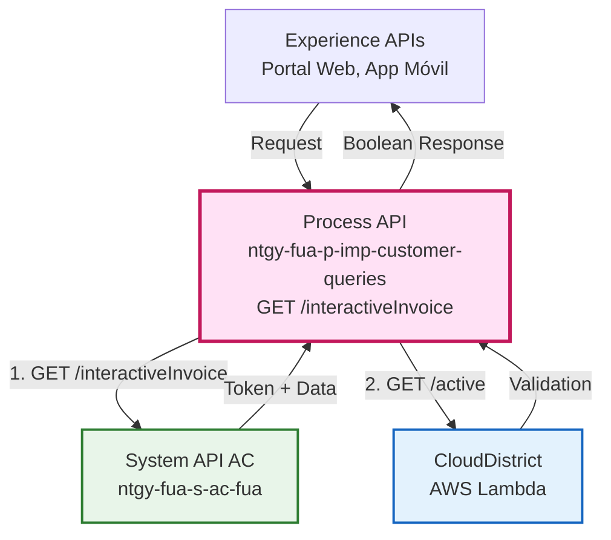
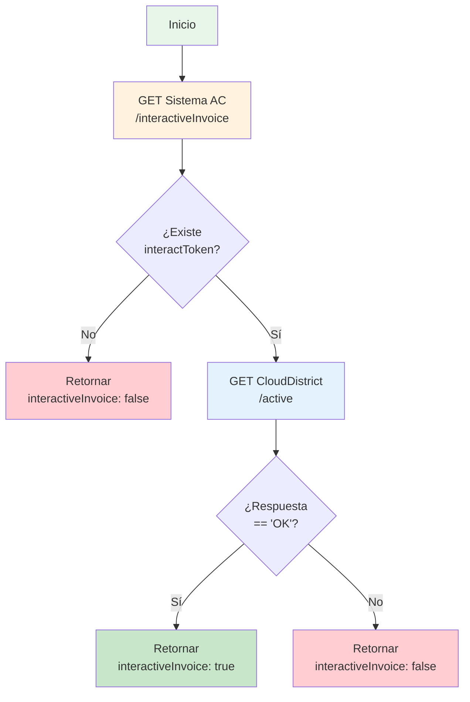
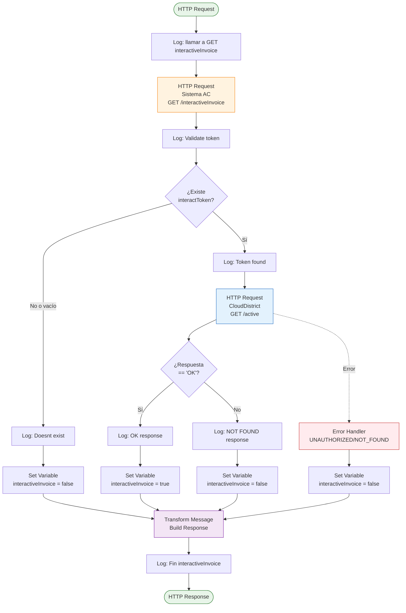
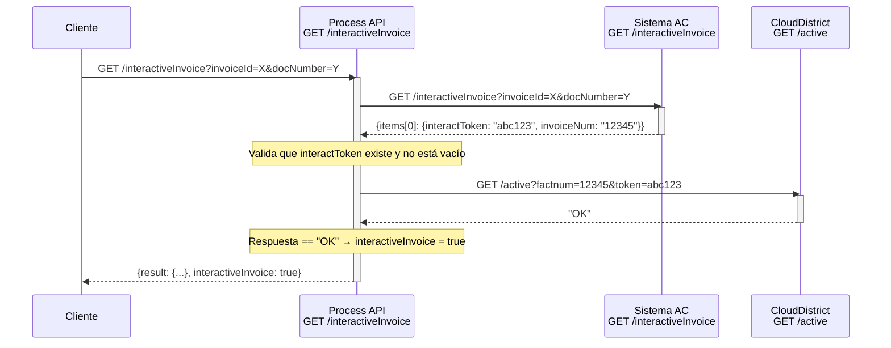
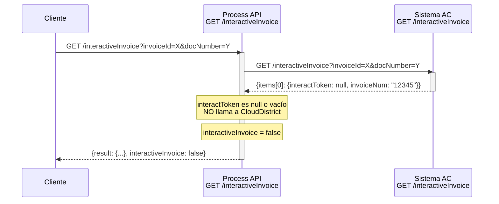
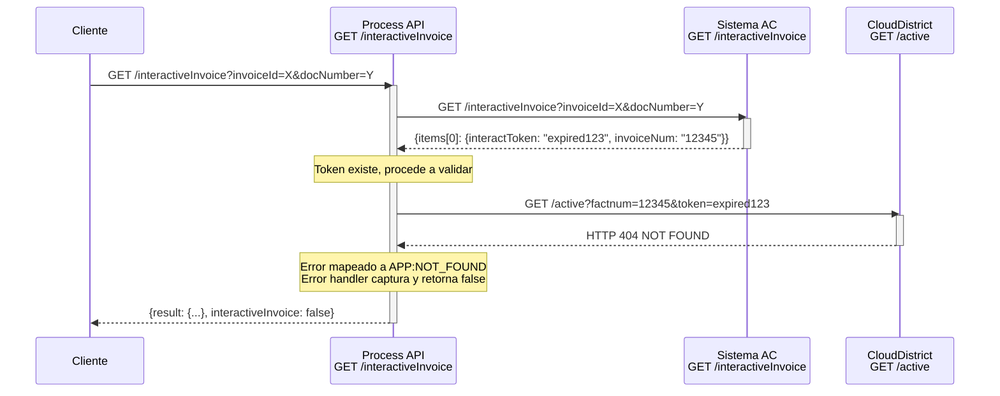
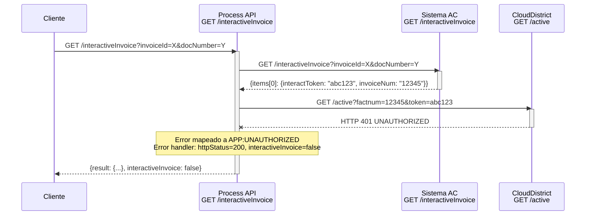

# GET /interactiveInvoice

## 📌 Descripción General

### Propósito del Endpoint

Este endpoint valida si una factura tiene disponible su versión interactiva en formato HTML. Realiza una orquestación de dos servicios: primero consulta los datos de la factura en Sistema AC para obtener el token de interactividad, y luego valida el estado de ese token en CloudDistrict (AWS Lambda).

### Tipo de API

**Capa:** Process API (API-Led Connectivity)

**Función:** Orquestación de validación de disponibilidad de factura interactiva

### Patrón de Integración

**Tipo:** Orquestación con validación condicional

**Descripción:** El endpoint orquesta dos llamadas secuenciales:
1. Consulta inicial a Sistema AC para obtener token de interactividad
2. Validación condicional del token en CloudDistrict (solo si existe token)

### Arquitectura API-Led Connectivity



---

## 💼 Propósito del Negocio

### Casos de Uso Principales

1. **Verificación de Factura Interactiva en Portal Web**
   - El cliente accede a su factura desde el portal web
   - El sistema verifica si existe versión interactiva disponible
   - Si existe, muestra opción de visualización HTML con gráficas

2. **Validación Previa a Renderizado**
   - Antes de intentar generar la factura interactiva
   - Se valida que el token esté activo en CloudDistrict
   - Evita errores de renderizado innecesarios

3. **Experiencia de Usuario Mejorada**
   - Permite mostrar/ocultar opción de factura interactiva
   - Mejora la experiencia al solo ofrecer opciones disponibles
   - Reduce frustración por funcionalidades no disponibles

### 🔗 Endpoints Dependientes

Este Process API consume los siguientes System APIs:

| System API | Endpoint | Método | Propósito |
|------------|----------|--------|-----------|
| `ntgy-fua-s-ac-fua` | `/interactiveInvoice` | GET | Obtener datos de factura y token de interactividad |
| `CloudDistrict` | `/active` | GET | Validar estado del token en AWS Lambda |

### Lógica de Orquestación



**Pasos del Proceso:**

1. **Consulta Inicial**: Obtiene datos de factura desde Sistema AC, incluyendo `interactToken` e `invoiceNum`
2. **Validación Condicional**: Si existe token, valida su estado en CloudDistrict
3. **Respuesta Booleana**: Retorna `true` si el token es válido, `false` en cualquier otro caso

### Transformaciones Aplicadas

**Transformación de Request (Process API → Sistema AC):**

| Campo Process API | Campo Sistema AC | Transformación |
|-------------------|------------------|----------------|
| `invoiceId` | `invoiceId` | Pass-through |
| `docNumber` | `docNumber` | Pass-through |

**Transformación de Request (Process API → CloudDistrict):**

| Campo Origen | Campo CloudDistrict | Transformación |
|--------------|---------------------|----------------|
| `sAc_request.items[0].invoiceNum` | `factnum` | Extracción de respuesta AC |
| `sAc_request.items[0].interactToken` | `token` | Extracción de respuesta AC |

**Transformación de Response:**

El endpoint NO transforma la estructura de respuesta, genera una respuesta estándar:

```json
{
  "result": {
    "codResult": "0000",
    "msgResult": "No hay error"
  },
  "interactiveInvoice": true/false
}
```

### Contexto Empresarial

- **Dominio:** Facturación y Consultas de Cliente
- **Sector:** Energía - Utilities (Gas & Electricidad)
- **División:** Naturgy España - Clientes Minoristas
- **Proceso de Negocio:** Consulta de disponibilidad de factura interactiva

### Stakeholders

- **Clientes Finales**: Necesitan saber si pueden acceder a factura interactiva
- **Agentes de Atención**: Requieren validar disponibilidad antes de ofrecer la opción
- **Equipo de Desarrollo Frontend**: Necesitan endpoint para mostrar/ocultar funcionalidad

### Valor de Negocio

- **Mejora de Experiencia**: Solo muestra opciones disponibles al cliente
- **Reducción de Errores**: Evita intentos de renderizado fallidos
- **Optimización de Recursos**: No genera facturas interactivas innecesariamente
- **Transparencia**: Cliente sabe de antemano qué opciones tiene disponibles

### Consumidores Potenciales

Este endpoint puede ser consumido por:
- Portal web de autoservicio (FUA)
- Aplicaciones móviles de clientes
- Sistemas de agentes de call center
- Integraciones de terceros autorizados

---

## 🔧 Especificación Técnica

### URLs por Ambiente

| Ambiente | URL Base | URL Completa |
|----------|----------|--------------|
| **Local** | `http://localhost:8084` | `http://localhost:8084/api/interactiveInvoice` |
| **Development** | `https://ntgy-fua-p-imp-customer-queries-dev.de-c1.cloudhub.io` | `https://ntgy-fua-p-imp-customer-queries-dev.de-c1.cloudhub.io/api/interactiveInvoice` |
| **UAT** | `https://ntgy-fua-p-imp-customer-queries-uat.de-c1.cloudhub.io` | `https://ntgy-fua-p-imp-customer-queries-uat.de-c1.cloudhub.io/api/interactiveInvoice` |
| **Production** | `https://ntgy-fua-p-imp-customer-queries-pro.de-c1.cloudhub.io` | `https://ntgy-fua-p-imp-customer-queries-pro.de-c1.cloudhub.io/api/interactiveInvoice` |

### Método HTTP

```
GET /api/interactiveInvoice
```

### Parámetros de Entrada

#### Query Parameters

| Parámetro | Tipo | Requerido | Descripción | Ejemplo |
|-----------|------|-----------|-------------|---------|
| `invoiceId` | string | Sí | Identificador único de la factura | `"123456"` |
| `docNumber` | string | Sí | Número de documento del cliente | `"12345678A"` |

**Ejemplo de URL completa:**
```
GET /api/interactiveInvoice?invoiceId=123456&docNumber=12345678A
```

### Respuestas

#### 200 OK - Validación Exitosa (Token Válido)

```json
{
  "result": {
    "codResult": "0000",
    "msgResult": "No hay error"
  },
  "interactiveInvoice": true
}
```

#### 200 OK - Sin Token o Token Inválido

```json
{
  "result": {
    "codResult": "0000",
    "msgResult": "No hay error"
  },
  "interactiveInvoice": false
}
```

**Nota:** El endpoint siempre retorna 200 OK, incluso cuando el token no existe o es inválido. El campo `interactiveInvoice` indica la disponibilidad.

#### Estructura de Respuesta

| Campo | Tipo | Descripción |
|-------|------|-------------|
| `result` | object | Objeto estándar de resultado |
| `result.codResult` | string | Código de resultado (`"0000"` = éxito) |
| `result.msgResult` | string | Mensaje descriptivo del resultado |
| `interactiveInvoice` | boolean | `true` si la factura interactiva está disponible, `false` en caso contrario |

### Códigos de Estado HTTP

| Código | Descripción | Cuándo Ocurre |
|--------|-------------|---------------|
| `200` | OK | Validación completada exitosamente (independiente del resultado) |
| `400` | Bad Request | Parámetros faltantes o inválidos |
| `401` | Unauthorized | Credenciales de autenticación inválidas |
| `500` | Internal Server Error | Error inesperado en el servidor |

### Autenticación

- **Tipo:** Client ID & Client Secret (Anypoint Platform)
- **Headers requeridos:**
  - `client_id`: ID del cliente registrado
  - `client_secret`: Secret del cliente registrado

### Timeouts

| Tipo | Valor | Justificación |
|------|-------|---------------|
| **Request Timeout (Sistema AC)** | 30 segundos | Operación estándar de consulta |
| **Request Timeout (CloudDistrict)** | 300 segundos (5 minutos) | Validación en AWS Lambda puede ser lenta |
| **Connection Timeout** | 30 segundos | Timeout de conexión estándar |

---

## 🏗️ Implementación Técnica

### Arquitectura del Flow



### Código del Flow Principal

**Ubicación:** `src/main/mule/get-interactiveInvoice.xml`

**Flow:** `get-interactiveInvoiceFlow`

```xml
<flow name="get-interactiveInvoiceFlow" doc:id="26b62bdf-9ff4-4c39-b1e1-2a0517547fdf">
    <!-- 1. Log inicial -->
    <logger level="DEBUG" message="llamar a GET interactiveInvoice"/>
    
    <!-- 2. Llamada a Sistema AC -->
    <http:request method="GET" config-ref="HTTP_API_SistemaAC" 
                  path="/interactiveInvoice" target="sAc_request">
        <http:query-params>
            <![CDATA[#[output application/java
            ---
            {
                "invoiceId" : attributes.queryParams.invoiceId,
                "docNumber" : attributes.queryParams.docNumber
            }]]]>
        </http:query-params>
    </http:request>
    
    <!-- 3. Validación de token -->
    <logger level="DEBUG" message="Validate token"/>
    <choice>
        <when expression='vars.sAc_request.items[0].interactToken != null and 
                          vars.sAc_request.items[0].interactToken != ""'>
            <logger level="DEBUG" message="Token found"/>
            
            <!-- 4. Llamada a CloudDistrict -->
            <http:request method="GET" config-ref="HTTPS_Request_CloudDistrict" 
                          path="/active" target="requestResult" 
                          outputMimeType="text/plain">
                <error-mapping sourceType="HTTP:UNAUTHORIZED" targetType="APP:UNAUTHORIZED"/>
                <error-mapping sourceType="HTTP:NOT_FOUND" targetType="APP:NOT_FOUND"/>
                <http:query-params>
                    <![CDATA[#[output application/java
                    ---
                    {
                        "factnum" : vars.sAc_request.items[0].invoiceNum,
                        "token" : vars.sAc_request.items[0].interactToken
                    }]]]>
                </http:query-params>
            </http:request>
            
            <!-- 5. Validación de respuesta CloudDistrict -->
            <choice>
                <when expression='#[vars.requestResult == "OK"]'>
                    <logger level="DEBUG" message="OK response"/>
                    <set-variable value="#[true]" variableName="interactiveInvoice"/>
                </when>
                <otherwise>
                    <logger level="DEBUG" message="NOT FOUND response"/>
                    <set-variable value="#[false]" variableName="interactiveInvoice"/>
                </otherwise>
            </choice>
        </when>
        <otherwise>
            <logger level="DEBUG" message="Doesnt exist"/>
            <set-variable value="#[false]" variableName="interactiveInvoice"/>
        </otherwise>
    </choice>
    
    <!-- 6. Transformación de respuesta -->
    <ee:transform>
        <ee:message>
            <ee:set-payload>
                <![CDATA[%dw 2.0
                output application/json
                ---
                {
                    result: {
                        codResult: "0000",
                        msgResult: "No hay error"
                    },
                    interactiveInvoice : vars.interactiveInvoice
                }]]>
            </ee:set-payload>
        </ee:message>
    </ee:transform>
    
    <logger level="DEBUG" message="Fin interactiveInvoice"/>
    
    <!-- 7. Manejo de errores -->
    <error-handler>
        <on-error-propagate type="APP:UNAUTHORIZED, APP:NOT_FOUND">
            <logger level="ERROR" message="Unauthorized error"/>
            <set-variable value="#[200]" variableName="httpStatus"/>
            <set-variable value="#[false]" variableName="interactiveInvoice"/>
            <ee:transform>
                <ee:message>
                    <ee:set-payload>
                        <![CDATA[%dw 2.0
                        output application/json
                        ---
                        {
                            result: {
                                codResult: "0000",
                                msgResult: "No hay error"
                            },
                            interactiveInvoice : vars.interactiveInvoice
                        }]]>
                    </ee:set-payload>
                </ee:message>
            </ee:transform>
        </on-error-propagate>
        <on-error-propagate>
            <logger level="ERROR" message="Generic Error"/>
            <ee:transform>
                <ee:message>
                    <ee:set-payload>
                        <![CDATA[%dw 2.0
                        output application/java
                        ---
                        {}]]>
                    </ee:set-payload>
                </ee:message>
            </ee:transform>
        </on-error-propagate>
    </error-handler>
</flow>
```

### Configuraciones HTTP

**Archivo:** `src/main/mule/global.xml`

#### Sistema AC Configuration (líneas 14-16)
```xml
<http:request-config name="HTTP_API_SistemaAC" 
                     basePath="/api" 
                     responseTimeout="${s-ac.timeout}">
    <http:request-connection host="${s-ac.host}" 
                             port="${s-ac.port}" 
                             connectionIdleTimeout="${s-ac.timeout}" 
                             protocol="${s-ac.protocol}"/>
</http:request-config>
```

**Properties (Production):**
```yaml
s-ac:
  host: "ntgy-fua-s-ac-fua-bqyi65.internal-6bnlu3.irl-e1.cloudhub.io"
  port: "443"
  protocol: "HTTPS"
  timeout: "30000"
```

#### CloudDistrict Configuration (líneas 35-37)
```xml
<http:request-config name="HTTPS_Request_CloudDistrict" 
                     basePath="${s-cloudDistrict.basePath}">
    <http:request-connection host="${s-cloudDistrict.host}" 
                             port="${s-cloudDistrict.port}" 
                             connectionIdleTimeout="${s-cloudDistrict.timeout}" 
                             protocol="${s-cloudDistrict.protocol}"/>
</http:request-config>
```

**Properties (Production):**
```yaml
s-cloudDistrict:
  host: "oc2g0jrztj.execute-api.eu-west-1.amazonaws.com"
  port: "443"
  basePath: "/invoice"
  protocol: "HTTPS"
  timeout: "300000"
```

### Transformaciones DataWeave

#### Transformación de Query Parameters (Sistema AC)

**Ubicación:** Inline en el flow (líneas 9-15)

```dataweave
%dw 2.0
output application/java
---
{
    "invoiceId" : attributes.queryParams.invoiceId,
    "docNumber" : attributes.queryParams.docNumber
}
```

**Propósito:** Mapea los query parameters del request original a los parámetros esperados por Sistema AC.

#### Transformación de Query Parameters (CloudDistrict)

**Ubicación:** Inline en el flow (líneas 24-30)

```dataweave
%dw 2.0
output application/java
---
{
    "factnum" : vars.sAc_request.items[0].invoiceNum,
    "token" : vars.sAc_request.items[0].interactToken
}
```

**Propósito:** Extrae el número de factura y token de la respuesta de Sistema AC para validar en CloudDistrict.

#### Transformación de Respuesta Final

**Ubicación:** Inline en el flow (líneas 46-56)

```dataweave
%dw 2.0
output application/json
---
{
    result: {
        codResult: "0000",
        msgResult: "No hay error"
    },
    interactiveInvoice : vars.interactiveInvoice
}
```

**Propósito:** Construye la respuesta estándar con el resultado de la validación.

### Patrones de Diseño

**Patrón:** Orquestación con Validación Condicional (Conditional Orchestration)

**Justificación:** 
- La segunda llamada (CloudDistrict) solo se ejecuta si existe token
- Evita llamadas innecesarias a servicios externos
- Optimiza recursos y reduce latencia cuando no hay token

**Patrón:** Graceful Degradation

**Justificación:**
- Si CloudDistrict falla (UNAUTHORIZED, NOT_FOUND), retorna `false` en lugar de error
- Permite que el flujo continúe incluso si el servicio de validación no está disponible
- Mejora la resiliencia del sistema

### Diagramas de Secuencia

#### 1. Flujo Normal de Éxito (Token Válido)



#### 2. Flujo Sin Token (Token No Existe)



#### 3. Flujo con Token Inválido



#### 4. Flujo con Error de CloudDistrict



### Manejo de Errores

#### Estrategia de Error Handling

**Filosofía:** Graceful Degradation - El endpoint siempre retorna 200 OK con un booleano indicando disponibilidad.

#### Errores Capturados

| Error Type | Origen | Acción | Response |
|------------|--------|--------|----------|
| `APP:UNAUTHORIZED` | CloudDistrict 401 | Set `interactiveInvoice = false` | 200 OK con `false` |
| `APP:NOT_FOUND` | CloudDistrict 404 | Set `interactiveInvoice = false` | 200 OK con `false` |
| Generic Error | Cualquier otro | Log error, retorna objeto vacío | 500 Internal Server Error |

#### Error Mapping

```xml
<error-mapping sourceType="HTTP:UNAUTHORIZED" targetType="APP:UNAUTHORIZED"/>
<error-mapping sourceType="HTTP:NOT_FOUND" targetType="APP:NOT_FOUND"/>
```

**Propósito:** Convierte errores HTTP de CloudDistrict en errores de aplicación manejables.

#### Error Handler

```xml
<error-handler>
    <!-- Errores esperados de CloudDistrict -->
    <on-error-propagate type="APP:UNAUTHORIZED, APP:NOT_FOUND">
        <logger level="ERROR" message="Unauthorized error"/>
        <set-variable value="#[200]" variableName="httpStatus"/>
        <set-variable value="#[false]" variableName="interactiveInvoice"/>
        <!-- Retorna respuesta estándar con false -->
    </on-error-propagate>
    
    <!-- Errores inesperados -->
    <on-error-propagate>
        <logger level="ERROR" message="Generic Error"/>
        <!-- Retorna objeto vacío -->
    </on-error-propagate>
</error-handler>
```

### Logging

#### Niveles de Log

| Nivel | Ubicación | Mensaje | Propósito |
|-------|-----------|---------|-----------|
| DEBUG | Inicio | "llamar a GET interactiveInvoice" | Traza inicio del flow |
| DEBUG | Pre-validación | "Validate token" | Indica inicio de validación |
| DEBUG | Token encontrado | "Token found" | Confirma existencia de token |
| DEBUG | Token no existe | "Doesnt exist" | Indica ausencia de token |
| DEBUG | Respuesta OK | "OK response" | Token validado exitosamente |
| DEBUG | Respuesta NOT FOUND | "NOT FOUND response" | Token inválido o expirado |
| DEBUG | Fin | "Fin interactiveInvoice" | Traza fin del flow |
| ERROR | Error handler | "Unauthorized error" | Error de autenticación/autorización |
| ERROR | Error handler | "Generic Error" | Error inesperado |

---

## 💻 Ejemplos de Uso

### Ejemplo 1: Llamada Exitosa con Token Válido

#### cURL

```bash
curl -X GET "https://ntgy-fua-p-imp-customer-queries-pro.de-c1.cloudhub.io/api/interactiveInvoice?invoiceId=123456&docNumber=12345678A" \
  -H "Content-Type: application/json" \
  -H "client_id: YOUR_CLIENT_ID" \
  -H "client_secret: YOUR_CLIENT_SECRET"
```

#### Respuesta (200 OK)

```json
{
  "result": {
    "codResult": "0000",
    "msgResult": "No hay error"
  },
  "interactiveInvoice": true
}
```

**Interpretación:** La factura tiene versión interactiva disponible y el token es válido en CloudDistrict.

### Ejemplo 2: Factura Sin Token de Interactividad

#### cURL

```bash
curl -X GET "https://ntgy-fua-p-imp-customer-queries-pro.de-c1.cloudhub.io/api/interactiveInvoice?invoiceId=789012&docNumber=87654321B" \
  -H "Content-Type: application/json" \
  -H "client_id: YOUR_CLIENT_ID" \
  -H "client_secret: YOUR_CLIENT_SECRET"
```

#### Respuesta (200 OK)

```json
{
  "result": {
    "codResult": "0000",
    "msgResult": "No hay error"
  },
  "interactiveInvoice": false
}
```

**Interpretación:** La factura no tiene token de interactividad, por lo tanto no está disponible en formato interactivo.

### Ejemplo 3: Token Inválido o Expirado

#### cURL

```bash
curl -X GET "https://ntgy-fua-p-imp-customer-queries-pro.de-c1.cloudhub.io/api/interactiveInvoice?invoiceId=345678&docNumber=11223344C" \
  -H "Content-Type: application/json" \
  -H "client_id: YOUR_CLIENT_ID" \
  -H "client_secret: YOUR_CLIENT_SECRET"
```

#### Respuesta (200 OK)

```json
{
  "result": {
    "codResult": "0000",
    "msgResult": "No hay error"
  },
  "interactiveInvoice": false
}
```

**Interpretación:** La factura tiene token pero CloudDistrict lo rechazó (expirado, inválido o no encontrado).

### Ejemplo 4: JavaScript (Fetch API)

```javascript
const checkInteractiveInvoice = async (invoiceId, docNumber) => {
  try {
    const response = await fetch(
      `https://ntgy-fua-p-imp-customer-queries-pro.de-c1.cloudhub.io/api/interactiveInvoice?invoiceId=${invoiceId}&docNumber=${docNumber}`,
      {
        method: 'GET',
        headers: {
          'Content-Type': 'application/json',
          'client_id': 'YOUR_CLIENT_ID',
          'client_secret': 'YOUR_CLIENT_SECRET'
        }
      }
    );

    const data = await response.json();
    
    if (data.interactiveInvoice) {
      console.log('✅ Factura interactiva disponible');
      // Mostrar botón de factura interactiva
    } else {
      console.log('❌ Factura interactiva no disponible');
      // Ocultar botón de factura interactiva
    }
    
    return data;
  } catch (error) {
    console.error('Error al verificar factura interactiva:', error);
    return null;
  }
};

// Uso
checkInteractiveInvoice('123456', '12345678A');
```

### Ejemplo 5: Python (Requests)

```python
import requests

def check_interactive_invoice(invoice_id, doc_number):
    """
    Verifica si una factura tiene versión interactiva disponible
    
    Args:
        invoice_id (str): ID de la factura
        doc_number (str): Número de documento del cliente
        
    Returns:
        bool: True si la factura interactiva está disponible, False en caso contrario
    """
    url = "https://ntgy-fua-p-imp-customer-queries-pro.de-c1.cloudhub.io/api/interactiveInvoice"
    
    params = {
        'invoiceId': invoice_id,
        'docNumber': doc_number
    }
    
    headers = {
        'Content-Type': 'application/json',
        'client_id': 'YOUR_CLIENT_ID',
        'client_secret': 'YOUR_CLIENT_SECRET'
    }
    
    try:
        response = requests.get(url, params=params, headers=headers)
        response.raise_for_status()
        
        data = response.json()
        is_available = data.get('interactiveInvoice', False)
        
        if is_available:
            print(f"✅ Factura {invoice_id} tiene versión interactiva")
        else:
            print(f"❌ Factura {invoice_id} NO tiene versión interactiva")
            
        return is_available
        
    except requests.exceptions.RequestException as e:
        print(f"Error al verificar factura: {e}")
        return False

# Uso
check_interactive_invoice('123456', '12345678A')
```

### Ejemplo 6: Integración en Portal Web (React)

```jsx
import React, { useState, useEffect } from 'react';

const InvoiceViewer = ({ invoiceId, docNumber }) => {
  const [hasInteractive, setHasInteractive] = useState(false);
  const [loading, setLoading] = useState(true);

  useEffect(() => {
    const checkInteractiveAvailability = async () => {
      try {
        const response = await fetch(
          `/api/interactiveInvoice?invoiceId=${invoiceId}&docNumber=${docNumber}`,
          {
            headers: {
              'client_id': process.env.REACT_APP_CLIENT_ID,
              'client_secret': process.env.REACT_APP_CLIENT_SECRET
            }
          }
        );
        
        const data = await response.json();
        setHasInteractive(data.interactiveInvoice);
      } catch (error) {
        console.error('Error checking interactive invoice:', error);
        setHasInteractive(false);
      } finally {
        setLoading(false);
      }
    };

    checkInteractiveAvailability();
  }, [invoiceId, docNumber]);

  if (loading) {
    return <div>Verificando disponibilidad...</div>;
  }

  return (
    <div className="invoice-viewer">
      <h2>Factura #{invoiceId}</h2>
      
      {hasInteractive ? (
        <button 
          className="btn-interactive"
          onClick={() => window.open(`/interactive-invoice/${invoiceId}`, '_blank')}
        >
          📊 Ver Factura Interactiva
        </button>
      ) : (
        <button 
          className="btn-pdf"
          onClick={() => window.open(`/pdf-invoice/${invoiceId}`, '_blank')}
        >
          📄 Descargar PDF
        </button>
      )}
    </div>
  );
};

export default InvoiceViewer;
```

### Ejemplo 7: Error de Autenticación

#### cURL

```bash
curl -X GET "https://ntgy-fua-p-imp-customer-queries-pro.de-c1.cloudhub.io/api/interactiveInvoice?invoiceId=123456&docNumber=12345678A" \
  -H "Content-Type: application/json" \
  -H "client_id: INVALID_CLIENT_ID" \
  -H "client_secret: INVALID_SECRET"
```

#### Respuesta (401 Unauthorized)

```json
{
  "error": "Unauthorized",
  "message": "Invalid client credentials"
}
```

**Interpretación:** Las credenciales de autenticación son inválidas.
