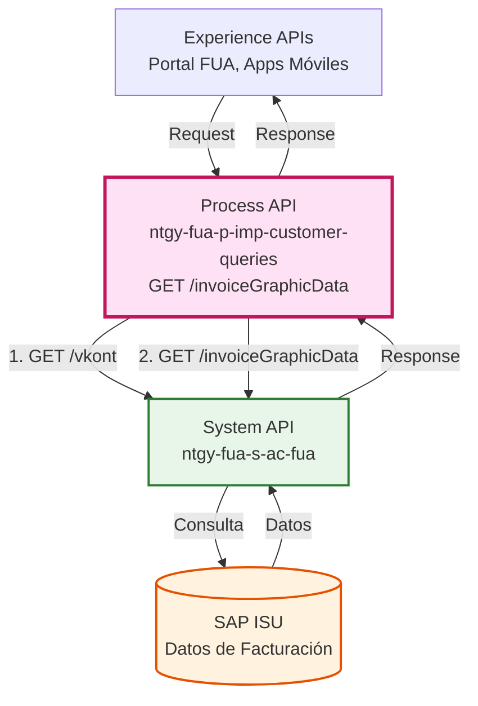
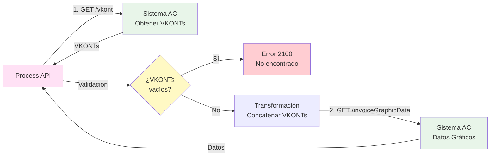
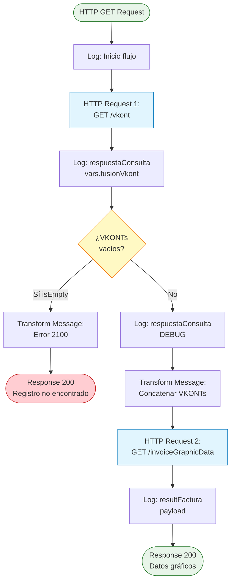
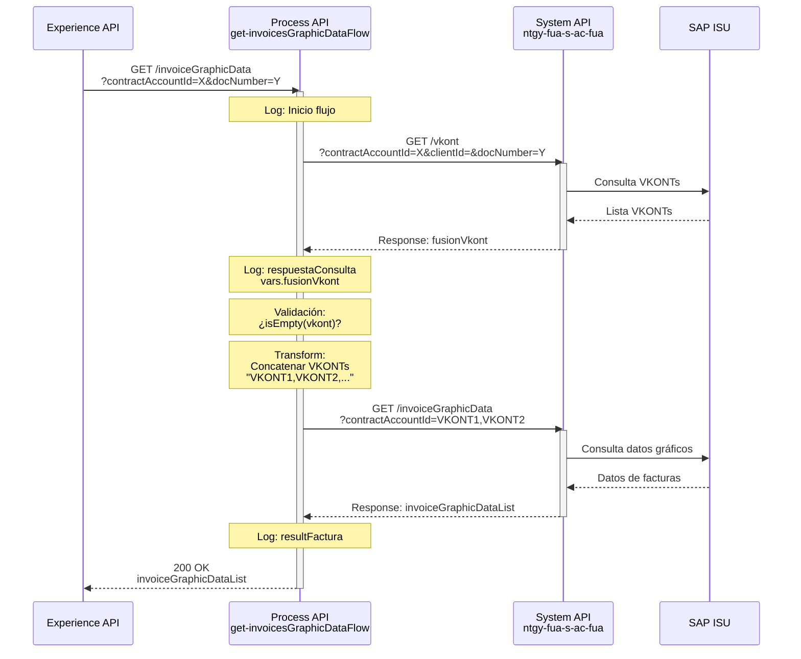
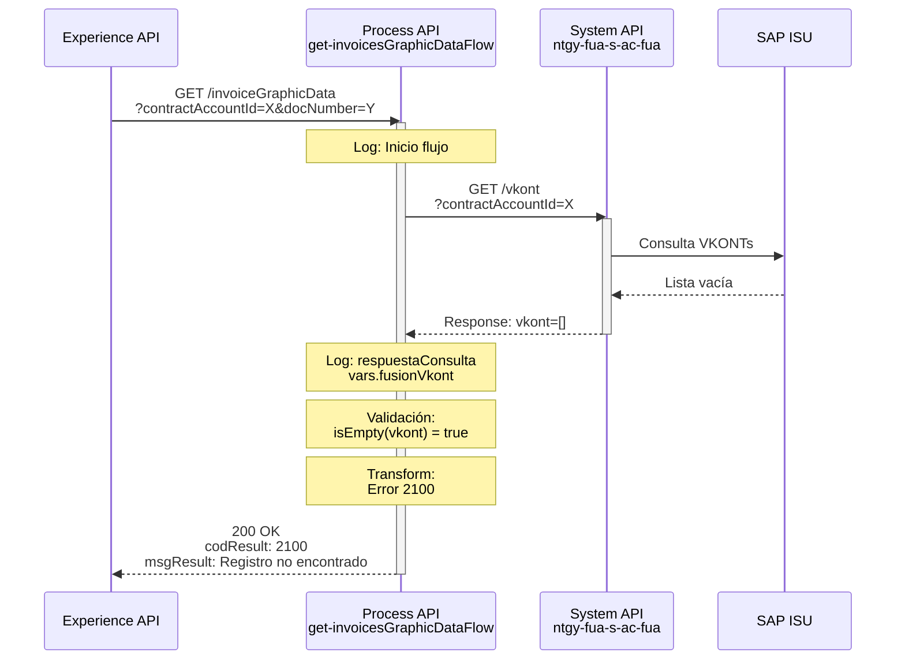
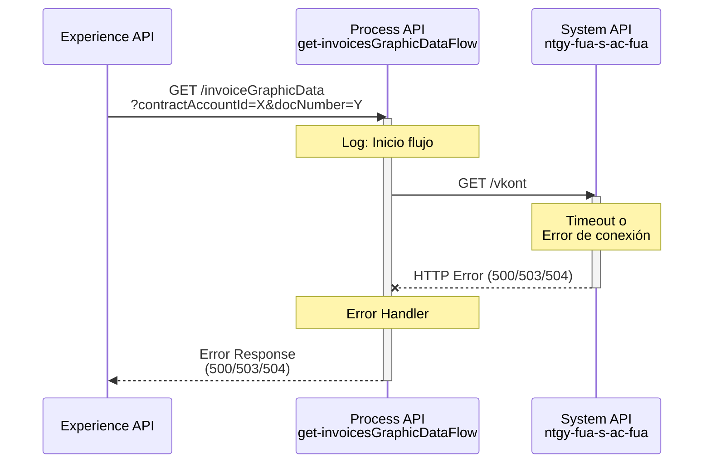

# GET /invoiceGraphicData

## 📌 Descripción General

### Propósito del Endpoint

Este endpoint orquesta dos llamadas secuenciales al System API `ntgy-fua-s-ac-fua` para recuperar información de facturas y consumos destinada a la visualización gráfica en aplicaciones de autoservicio. Primero obtiene todos los VKONTs (cuentas contrato SAP) asociados al cliente, y luego consulta los datos gráficos de facturación para esas cuentas.

### Tipo de API

**Capa:** Process API (API-Led Connectivity)

**Función:** Orquestación de consultas de facturación para visualización gráfica

### Patrón de Integración

**Tipo:** Orquestación Secuencial con Transformación

**Descripción:** 
1. Primera llamada: Obtiene lista de VKONTs del cliente desde Sistema AC
2. Validación: Verifica que existan VKONTs
3. Transformación: Concatena VKONTs con coma para query
4. Segunda llamada: Obtiene datos gráficos de facturas usando los VKONTs

### Arquitectura API-Led Connectivity



---

## 💼 Propósito del Negocio

### Casos de Uso Principales

1. **Visualización de Consumo Facturado**
   - Permite a los clientes ver gráficas de su consumo facturado histórico
   - Facilita la comprensión de patrones de consumo y facturación
   - Beneficio: Mejora la transparencia y autogestión del cliente

2. **Análisis de Tendencias de Facturación**
   - Agentes pueden analizar tendencias de facturación del cliente
   - Identificación de anomalías o cambios significativos
   - Beneficio: Mejor atención al cliente y detección proactiva de problemas

3. **Soporte a Aplicaciones de Autoservicio**
   - Proporciona datos estructurados para dashboards y gráficas
   - Integración con portales web y aplicaciones móviles
   - Beneficio: Reduce llamadas al call center

### 🔗 Endpoints Dependientes

Este Process API consume los siguientes System APIs:

| System API | Endpoint | Método | Propósito |
|------------|----------|--------|-----------|
| `ntgy-fua-s-ac-fua` | `/vkont` | GET | Obtención de VKONTs (cuentas contrato SAP) fusionados del cliente |
| `ntgy-fua-s-ac-fua` | `/invoiceGraphicData` | GET | Consulta de datos de facturas y consumos para gráficas |

### Lógica de Orquestación



**Pasos del Proceso:**

1. **Paso 1**: Llamada a `/vkont` con contractAccountId, clientId y docNumber
2. **Paso 2**: Validación de respuesta - si no hay VKONTs, retorna error 2100
3. **Paso 3**: Transformación DataWeave - concatena VKONTs con coma
4. **Paso 4**: Llamada a `/invoiceGraphicData` con VKONTs concatenados
5. **Paso 5**: Retorna datos gráficos de facturas

### Transformaciones Aplicadas

**Transformación de VKONTs (líneas 38-44):**

```dataweave
%dw 2.0
output application/json
var query = vars.fusionVkont..SAP_FUS_VKONT_VK joinBy ","
---
query
```

| Campo Original (System API) | Campo Transformado | Transformación |
|------------------------------|-------------------|----------------|
| `fusionVkont..SAP_FUS_VKONT_VK` (array) | `query` (string) | Concatenación con coma usando `joinBy` |

**Ejemplo de transformación:**
- Input: `["0001234567", "0001234568", "0001234569"]`
- Output: `"0001234567,0001234568,0001234569"`

### Contexto Empresarial

- **Dominio:** Facturación y Consumo
- **Sector:** Energía - Utilities (Gas & Electricidad)
- **División:** Naturgy España - Clientes Minoristas
- **Proceso de Negocio:** Visualización de datos de facturación para autoservicio

### Stakeholders

- **Clientes Finales**: Necesitan visualizar su historial de facturación de forma clara
- **Agentes de Atención**: Requieren acceso rápido a gráficas de facturación del cliente
- **Equipos de Desarrollo Frontend**: Consumen estos datos para crear visualizaciones

### Valor de Negocio

- **Transparencia**: Clientes pueden ver claramente su historial de facturación
- **Autoservicio**: Reduce necesidad de contactar con call center
- **Eficiencia Operativa**: Agentes acceden rápidamente a información visual
- **Satisfacción del Cliente**: Mejora experiencia con datos claros y accesibles

### Consumidores Potenciales

Este endpoint puede ser consumido por:
- Portal web FUA (Frontal Único de Atención)
- Aplicaciones móviles de autoservicio
- Sistemas de agentes de call center
- Dashboards de análisis de clientes

---

## 🔧 Especificación Técnica

### URLs por Ambiente

| Ambiente | URL Base | URL Completa |
|----------|----------|--------------|
| **Local** | `http://localhost:8084` | `http://localhost:8084/api/invoiceGraphicData` |
| **Development** | `https://ntgy-fua-p-imp-customer-queries-dev.de-c1.cloudhub.io` | `https://ntgy-fua-p-imp-customer-queries-dev.de-c1.cloudhub.io/api/invoiceGraphicData` |
| **UAT** | `https://ntgy-fua-p-imp-customer-queries-uat.de-c1.cloudhub.io` | `https://ntgy-fua-p-imp-customer-queries-uat.de-c1.cloudhub.io/api/invoiceGraphicData` |
| **Production** | `https://ntgy-fua-p-imp-customer-queries-pro.de-c1.cloudhub.io` | `https://ntgy-fua-p-imp-customer-queries-pro.de-c1.cloudhub.io/api/invoiceGraphicData` |

### Método HTTP

```
GET /api/invoiceGraphicData
```

### Parámetros de Entrada

#### Query Parameters

| Parámetro | Tipo | Requerido | Descripción | Ejemplo |
|-----------|------|-----------|-------------|---------|
| `contractAccountId` | string | Sí | ID de la cuenta contrato | `"0001234567"` |
| `docNumber` | string | Sí | Número de documento del cliente (header) | `"12345678X"` |
| `clientId` | string | No | ID del cliente (opcional) | `"CLI123456"` |

**Nota:** Aunque `clientId` aparece en el código (línea 18), es opcional para la primera llamada a `/vkont`.

### Respuestas

#### Respuesta Exitosa (200 OK)

```json
{
  "result": {
    "codResult": "0000",
    "msgResult": "No hay error"
  },
  "invoiceGraphicDataList": [
    {
      "date": "2021-12-01T00:00:00Z"
    },
    {
      "date": "2021-11-01T00:00:00Z",
      "amount": 163.61
    },
    {
      "date": "2021-10-01T00:00:00Z"
    },
    {
      "date": "2021-09-01T00:00:00Z",
      "amount": 79.57
    },
    {
      "date": "2021-08-01T00:00:00Z"
    },
    {
      "date": "2021-07-01T00:00:00Z"
    },
    {
      "date": "2021-06-01T00:00:00Z",
      "amount": 101.47
    }
  ]
}
```

**Estructura del Objeto `invoiceGraphicData`:**

| Campo | Tipo | Requerido | Descripción |
|-------|------|-----------|-------------|
| `date` | string | Sí | Fecha del mes a mostrar (formato ISO 8601) |
| `amount` | number | No | Importe acumulado mensual (puede estar ausente si no hay factura ese mes) |

**Nota:** La estructura es muy simple - solo fecha y opcionalmente el importe. Los meses sin factura solo tienen la fecha sin el campo `amount`.

#### Respuesta Sin Datos (200 OK)

```json
{
  "result": {
    "codResult": "2100",
    "msgResult": "Registro no encontrado"
  }
}
```

**Código de Error:** `2100`  
**Significado:** No se encontraron VKONTs para el contractAccountId proporcionado

#### Respuesta de Error (4xx/5xx)

```json
{
  "error": {
    "code": "ERROR_CODE",
    "message": "Descripción del error"
  }
}
```

### Autenticación

- **Tipo:** OAuth 2.0 (Client ID & Client Secret)
- **Implementación:** Anypoint Platform API Gateway
- **Headers requeridos:**
  - `Authorization: Bearer {token}`
  - `client_id: {your_client_id}`
  - `client_secret: {your_client_secret}`

### Timeouts

| Tipo | Valor | Configuración |
|------|-------|---------------|
| **Request Timeout** | 30 segundos | `${s-ac.timeout}` |
| **Connection Idle Timeout** | 30 segundos | `${s-ac.timeout}` |

**Nota:** Configurado en `global.xml` línea 14-16 para `HTTP_API_SistemaAC`

---

## 🏗️ Implementación Técnica

### Arquitectura del Flow



### Ubicación del Código

**Archivo principal:** `C:\Users\Javi\Documents\Projects\ntgy-fua-p-imp-customer-queries\src\main\mule\p-imp-customer-queries.xml`

**Flow principal:** 
```xml
<flow name="get:\invoiceGraphicData:p-imp-customer-queries-config">
    <flow-ref name="get-invoicesGraphicDataFlow" />
</flow>
```

**Implementación:** `C:\Users\Javi\Documents\Projects\ntgy-fua-p-imp-customer-queries\src\main\mule\global.xml` (líneas 9-67)

**Flow name:** `get-invoicesGraphicDataFlow`

### Configuración HTTP

**HTTP Request Config:** `HTTP_API_SistemaAC` (global.xml líneas 14-16)

```xml
<http:request-config name="HTTP_API_SistemaAC" 
                     basePath="/api" 
                     responseTimeout="${s-ac.timeout}">
    <http:request-connection 
        host="${s-ac.host}" 
        port="${s-ac.port}" 
        connectionIdleTimeout="${s-ac.timeout}" 
        protocol="${s-ac.protocol}"/>
</http:request-config>
```

**Propiedades (Production):**
```yaml
s-ac:
  host: "ntgy-fua-s-ac-fua-bqyi65.internal-6bnlu3.irl-e1.cloudhub.io"
  port: "443"
  protocol: "HTTPS"
  timeout: "30000"
```

### Transformaciones DataWeave

#### Transformación 1: Concatenación de VKONTs (líneas 38-44)

```dataweave
%dw 2.0
output application/json
var query = vars.fusionVkont..SAP_FUS_VKONT_VK joinBy ","
---
query
```

**Propósito:** Convierte array de VKONTs en string separado por comas

**Input:**
```json
{
  "vkont": [
    {"SAP_FUS_VKONT_VK": "0001234567"},
    {"SAP_FUS_VKONT_VK": "0001234568"}
  ]
}
```

**Output:**
```
"0001234567,0001234568"
```

#### Transformación 2: Respuesta de Error (líneas 26-35)

```dataweave
%dw 2.0
output application/json
---
{
    "result": {
        "codResult": "2100",
        "msgResult": "Registro no encontrado"
    }
}
```

### Patrones de Diseño

**Patrón:** Sequential Orchestration with Conditional Logic

**Justificación:** 
- La segunda llamada depende del resultado de la primera
- Necesidad de validar datos intermedios antes de continuar
- Transformación de datos entre llamadas
- Manejo de caso de negocio (sin VKONTs)

### Diagramas de Secuencia

#### 1. Flujo Normal de Éxito



#### 2. Flujo con Error de Negocio (Sin VKONTs)



#### 3. Flujo con Error Técnico



### Manejo de Errores

**Estrategia de Manejo de Errores:**

1. **Error de Negocio (Sin VKONTs):**
   - Código: `2100`
   - Mensaje: `"Registro no encontrado"`
   - HTTP Status: `200 OK` (error de negocio, no técnico)
   - Implementación: Choice router (línea 23)

2. **Errores Técnicos:**
   - Timeout de Sistema AC (30 segundos)
   - Errores de conectividad
   - Errores HTTP del System API
   - Propagación: Error se propaga al consumidor

3. **Logging:**
   - Entrada: Log DEBUG al inicio del flujo (línea 11)
   - Respuesta VKONT: Log INFO (línea 17)
   - Respuesta final: Log INFO (línea 50)
   - Debug adicional: Log DEBUG en rama otherwise (línea 37)

**Códigos de Error Específicos:**

| Código | Descripción | HTTP Status | Acción |
|--------|-------------|-------------|--------|
| `2100` | Registro no encontrado (sin VKONTs) | 200 | Retornar mensaje al usuario |
| `500` | Error interno del servidor | 500 | Revisar logs, contactar soporte |
| `503` | Sistema AC no disponible | 503 | Reintentar más tarde |
| `504` | Timeout en Sistema AC | 504 | Verificar conectividad |

---

## 💻 Ejemplos de Uso

### Ejemplo 1: Llamada Exitosa

#### cURL

```bash
curl -X GET "https://ntgy-fua-p-imp-customer-queries-pro.de-c1.cloudhub.io/api/invoiceGraphicData?contractAccountId=0001234567&docNumber=12345678X" \
  -H "Content-Type: application/json" \
  -H "client_id: YOUR_CLIENT_ID" \
  -H "client_secret: YOUR_CLIENT_SECRET"
```

#### Respuesta (200 OK)

```json
{
  "result": {
    "codResult": "0000",
    "msgResult": "No hay error"
  },
  "invoiceGraphicDataList": [
    {
      "date": "2024-03-01T00:00:00Z",
      "amount": 78.90
    },
    {
      "date": "2024-02-01T00:00:00Z",
      "amount": 92.30
    },
    {
      "date": "2024-01-01T00:00:00Z",
      "amount": 85.50
    },
    {
      "date": "2023-12-01T00:00:00Z"
    },
    {
      "date": "2023-11-01T00:00:00Z",
      "amount": 95.20
    }
  ]
}
```

**Nota:** Cada objeto contiene solo `date` (obligatorio) y `amount` (opcional). Los meses sin factura solo incluyen la fecha.

### Ejemplo 2: Sin Datos (VKONTs vacíos)

#### cURL

```bash
curl -X GET "https://ntgy-fua-p-imp-customer-queries-pro.de-c1.cloudhub.io/api/invoiceGraphicData?contractAccountId=9999999999&docNumber=99999999Z" \
  -H "Content-Type: application/json" \
  -H "client_id: YOUR_CLIENT_ID" \
  -H "client_secret: YOUR_CLIENT_SECRET"
```

#### Respuesta (200 OK)

```json
{
  "result": {
    "codResult": "2100",
    "msgResult": "Registro no encontrado"
  }
}
```

### Ejemplo 3: JavaScript (Fetch API)

```javascript
const getInvoiceGraphicData = async (contractAccountId, docNumber) => {
  try {
    const response = await fetch(
      `https://ntgy-fua-p-imp-customer-queries-pro.de-c1.cloudhub.io/api/invoiceGraphicData?contractAccountId=${contractAccountId}&docNumber=${docNumber}`,
      {
        method: 'GET',
        headers: {
          'Content-Type': 'application/json',
          'client_id': 'YOUR_CLIENT_ID',
          'client_secret': 'YOUR_CLIENT_SECRET'
        }
      }
    );

    const data = await response.json();
    
    if (data.result.codResult === '2100') {
      console.log('No se encontraron datos de facturación');
      return null;
    }
    
    // Filtrar solo los meses con importe (que tienen factura)
    const monthsWithInvoice = data.invoiceGraphicDataList.filter(item => item.amount);
    console.log('Datos gráficos:', monthsWithInvoice);
    return data.invoiceGraphicDataList;
    
  } catch (error) {
    console.error('Error al obtener datos gráficos:', error);
    throw error;
  }
};

// Uso
getInvoiceGraphicData('0001234567', '12345678X')
  .then(data => {
    if (data) {
      // Renderizar gráfica con los datos
      renderChart(data);
    }
  });
```

### Ejemplo 4: Python (Requests)

```python
import requests
from typing import Optional, Dict, List

def get_invoice_graphic_data(
    contract_account_id: str,
    doc_number: str,
    client_id: str,
    client_secret: str
) -> Optional[List[Dict]]:
    """
    Obtiene datos gráficos de facturas para una cuenta contrato.
    
    Args:
        contract_account_id: ID de la cuenta contrato
        doc_number: Número de documento del cliente
        client_id: Client ID para autenticación
        client_secret: Client Secret para autenticación
        
    Returns:
        Lista de datos gráficos o None si no hay datos
    """
    url = 'https://ntgy-fua-p-imp-customer-queries-pro.de-c1.cloudhub.io/api/invoiceGraphicData'
    
    params = {
        'contractAccountId': contract_account_id,
        'docNumber': doc_number
    }
    
    headers = {
        'Content-Type': 'application/json',
        'client_id': client_id,
        'client_secret': client_secret
    }
    
    try:
        response = requests.get(url, params=params, headers=headers, timeout=30)
        response.raise_for_status()
        
        data = response.json()
        
        # Verificar código de resultado
        if data.get('result', {}).get('codResult') == '2100':
            print('No se encontraron datos de facturación')
            return None
            
        return data.get('invoiceGraphicDataList', [])
        
    except requests.exceptions.Timeout:
        print('Error: Timeout al consultar datos gráficos')
        raise
    except requests.exceptions.RequestException as e:
        print(f'Error al consultar datos gráficos: {e}')
        raise

# Uso
if __name__ == '__main__':
    data = get_invoice_graphic_data(
        contract_account_id='0001234567',
        doc_number='12345678X',
        client_id='YOUR_CLIENT_ID',
        client_secret='YOUR_CLIENT_SECRET'
    )
    
    if data:
        # Filtrar solo meses con importe
        months_with_invoice = [item for item in data if 'amount' in item]
        print(f'Se encontraron {len(data)} meses, {len(months_with_invoice)} con factura')
        for item in months_with_invoice:
            print(f"Fecha: {item['date']}, Importe: {item['amount']}€")
```

### Ejemplo 5: Integración con React (Visualización)

```javascript
import React, { useState, useEffect } from 'react';
import { LineChart, Line, XAxis, YAxis, CartesianGrid, Tooltip, Legend } from 'recharts';

const InvoiceGraphicChart = ({ contractAccountId, docNumber }) => {
  const [data, setData] = useState([]);
  const [loading, setLoading] = useState(true);
  const [error, setError] = useState(null);

  useEffect(() => {
    const fetchData = async () => {
      try {
        const response = await fetch(
          `https://ntgy-fua-p-imp-customer-queries-pro.de-c1.cloudhub.io/api/invoiceGraphicData?contractAccountId=${contractAccountId}&docNumber=${docNumber}`,
          {
            headers: {
              'Content-Type': 'application/json',
              'client_id': process.env.REACT_APP_CLIENT_ID,
              'client_secret': process.env.REACT_APP_CLIENT_SECRET
            }
          }
        );

        const result = await response.json();

        if (result.result.codResult === '2100') {
          setError('No se encontraron datos de facturación');
          setData([]);
        } else {
          setData(result.invoiceGraphicDataList);
        }
      } catch (err) {
        setError('Error al cargar datos de facturación');
        console.error(err);
      } finally {
        setLoading(false);
      }
    };

    fetchData();
  }, [contractAccountId, docNumber]);

  if (loading) return <div>Cargando datos de facturación...</div>;
  if (error) return <div className="error">{error}</div>;
  if (data.length === 0) return <div>No hay datos disponibles</div>;

  // Filtrar solo meses con importe y formatear fecha
  const chartData = data
    .filter(item => item.amount)
    .map(item => ({
      date: new Date(item.date).toLocaleDateString('es-ES', { year: 'numeric', month: 'short' }),
      amount: item.amount
    }));

  return (
    <div className="invoice-chart">
      <h3>Evolución de Facturación</h3>
      <LineChart width={800} height={400} data={chartData}>
        <CartesianGrid strokeDasharray="3 3" />
        <XAxis dataKey="date" />
        <YAxis />
        <Tooltip />
        <Legend />
        <Line 
          type="monotone" 
          dataKey="amount" 
          stroke="#8884d8" 
          name="Importe (€)" 
        />
      </LineChart>
      <p className="note">
        Nota: Solo se muestran los meses con factura emitida
      </p>
    </div>
  );
};

export default InvoiceGraphicChart;