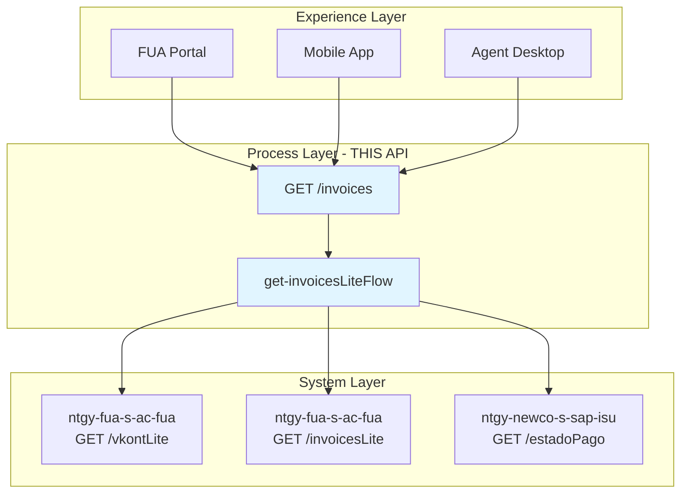
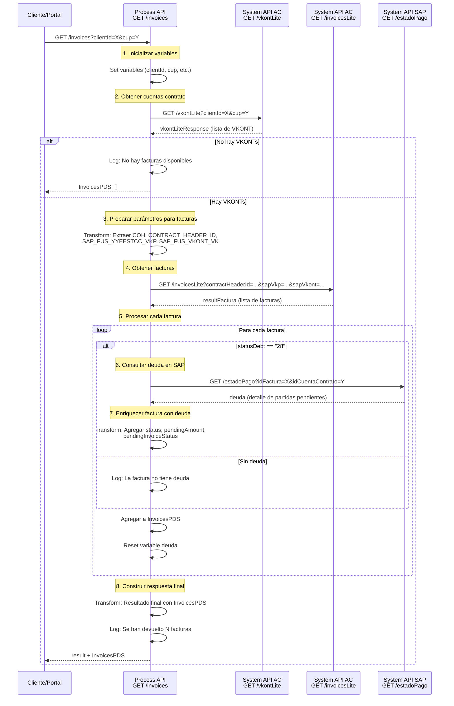

# GET /invoices

## 📌 Descripción General

### Tipo de API
**Process API** - Capa de orquestación que agrega información de facturas desde múltiples System APIs.

### Patrón de Integración
**API Composition + Conditional Routing** - Orquesta llamadas secuenciales a System APIs con lógica condicional para consultar deuda en SAP ISU.

### Propósito
Proporciona una vista unificada del listado de facturas del cliente, enriquecida con información de deuda pendiente cuando aplica. Orquesta la obtención de cuentas contrato, facturas asociadas y estado de pago desde diferentes fuentes.

### Arquitectura de Capas



---

## 💼 Propósito del Negocio

### Problema que Resuelve
Los clientes y agentes necesitan acceder al historial completo de facturas con información actualizada de deuda pendiente, pero esta información está dispersa en múltiples sistemas (Sistema AC para facturas, SAP ISU para estado de deuda).

### Casos de Uso

#### 1. Consulta de Facturas por Cliente
**Actor:** Cliente final o Agente de atención
**Flujo:**
1. Usuario solicita ver sus facturas
2. Sistema obtiene cuentas contrato del cliente
3. Sistema recupera facturas asociadas
4. Para facturas con deuda, consulta estado en SAP ISU
5. Usuario visualiza listado completo con estado de pago

#### 2. Verificación de Deuda Pendiente
**Actor:** Agente de cobranza
**Flujo:**
1. Agente busca facturas de cliente
2. Sistema identifica facturas con statusDebt="28"
3. Sistema consulta deuda detallada en SAP ISU
4. Agente visualiza importe pendiente y estado de cada partida

#### 3. Consulta por Punto de Suministro
**Actor:** Cliente con múltiples contratos
**Flujo:**
1. Cliente filtra por CUPS específico
2. Sistema obtiene facturas del punto de suministro
3. Cliente visualiza solo facturas relevantes

### Valor de Negocio
- **Visibilidad Completa:** Vista unificada de todas las facturas del cliente
- **Información Actualizada:** Estado de deuda en tiempo real desde SAP ISU
- **Eficiencia Operativa:** Reduce tiempo de consulta para agentes
- **Autoservicio:** Permite a clientes consultar sus facturas sin llamar

### Stakeholders
- **Clientes Finales:** Consultan sus facturas y estado de pago
- **Agentes de Atención:** Resuelven consultas sobre facturación
- **Departamento de Cobranza:** Gestionan deuda pendiente
- **Sistemas Backend:** Sistema AC y SAP ISU como fuentes de datos

---

## 🔧 Especificación Técnica

### Método HTTP
```
GET /api/invoices
```

### URLs por Ambiente

| Ambiente | URL Base | URL Completa |
|----------|----------|--------------|
| **Local** | `http://localhost:8084` | `http://localhost:8084/api/invoices` |
| **Development** | `https://ntgy-fua-p-imp-customer-queries-dev.de-c1.cloudhub.io` | `https://ntgy-fua-p-imp-customer-queries-dev.de-c1.cloudhub.io/api/invoices` |
| **UAT** | `https://ntgy-fua-p-imp-customer-queries-uat.de-c1.cloudhub.io` | `https://ntgy-fua-p-imp-customer-queries-uat.de-c1.cloudhub.io/api/invoices` |
| **Production** | `https://ntgy-fua-p-imp-customer-queries-pro.de-c1.cloudhub.io` | `https://ntgy-fua-p-imp-customer-queries-pro.de-c1.cloudhub.io/api/invoices` |

### Parámetros de Consulta (Query Parameters)

| Parámetro | Tipo | Requerido | Descripción | Ejemplo |
|-----------|------|-----------|-------------|---------|
| `clientId` | string | No | Identificador del cliente | `12345678` |
| `contractAccountId` | string | No | ID de la cuenta contrato | `200001234567` |
| `language` | string | No | Idioma de respuesta | `ES`, `EN` |
| `accessToken` | string | No | Token de acceso | `eyJhbGc...` |
| `docNumber` | string | No | Número de documento del cliente | `12345678X` |
| `cup` | string | No | Código Universal de Punto de Suministro | `ES0021000000000001JN` |

**Nota:** Se requiere al menos uno de los siguientes parámetros: `clientId`, `docNumber` o `cup`.

### Estructura de Respuesta

#### Respuesta Exitosa (200 OK)

```json
{
  "result": {
    "codResult": "0000",
    "msgResult": "No hay error"
  },
  "InvoicesPDS": [
    {
      "cuentaContrato": "200001234567",
      "invoiceId": "INV-2024-001",
      "invoiceNum": "2024001234",
      "pdfDownload": "https://...",
      "issuedDate": "2024-01-15",
      "billingDate": "2024-01-01",
      "amount": 125.50,
      "status": "28",
      "pendingAmount": 125.50,
      "pendingInvoiceStatus": [
        {
          "opbel": "0001234567",
          "opupw": "001",
          "opupk": "01",
          "opupz": "001",
          "status": "28"
        }
      ],
      "pdfDocumentId": "DOC-2024-001",
      "productInvoiceRelationList": [
        {
          "productId": "PROD-001",
          "consumption": 150.5,
          "amount": 125.50
        }
      ]
    }
  ]
}
```

#### Respuesta Sin Facturas (200 OK)

```json
{
  "result": {
    "codResult": "0000",
    "msgResult": "No hay error"
  },
  "InvoicesPDS": []
}
```

#### Respuesta de Error (500 Internal Server Error)

```json
{
  "result": {
    "codResult": "0000",
    "msgResult": "No hay error"
  },
  "InvoicesPDS": []
}
```

**Nota:** El endpoint implementa un manejo de errores que devuelve respuesta exitosa con array vacío incluso en caso de error, registrando el problema en logs.

### Códigos de Estado HTTP

| Código | Descripción | Escenario |
|--------|-------------|-----------|
| `200` | OK | Facturas recuperadas exitosamente (incluso si el array está vacío) |
| `400` | Bad Request | Parámetros inválidos o faltantes |
| `500` | Internal Server Error | Error en System APIs (manejado con respuesta 200 + array vacío) |

### Headers

#### Request Headers
```
Content-Type: application/json
Accept: application/json
```

#### Response Headers
```
Content-Type: application/json
```

---

## 🏗️ Implementación Técnica

### Diagrama de Secuencia



### Flujo de Orquestación Detallado

#### Fase 1: Inicialización (Líneas 7-18)
```xml
<ee:transform doc:name="Variables">
    <ee:variables>
        <ee:set-variable variableName="clientId">attributes.queryParams.clientId</ee:set-variable>
        <ee:set-variable variableName="docNumber">attributes.queryParams.docNumber</ee:set-variable>
        <ee:set-variable variableName="cup">attributes.queryParams.cup</ee:set-variable>
        <ee:set-variable variableName="contractAccountId">attributes.queryParams.contractAccountId</ee:set-variable>
        <ee:set-variable variableName="invoicesPDS">[]</ee:set-variable>
        <!-- ... más variables ... -->
    </ee:variables>
</ee:transform>
```

**Propósito:** Extraer y almacenar todos los query parameters en variables para uso posterior.

#### Fase 2: Obtención de Cuentas Contrato (Líneas 19-26)
```xml
<http:request method="GET" 
              doc:name="Sacamos todos los VKONT de SAP" 
              config-ref="HTTP_API_SistemaAC" 
              path="/vkontLite" 
              responseTimeout="${s-ac.timeoutOverride}" 
              target="vkontLiteResponse">
    <http:query-params>
        clientId: vars.clientId,
        docNumber: vars.docNumber,
        cup: vars.cup
    </http:query-params>
</http:request>
```

**Propósito:** Obtener las cuentas contrato (VKONT) asociadas al cliente desde Sistema AC.

**Timeout:** 5000ms (override configurado en properties)

**Target:** `vkontLiteResponse` - Almacena respuesta sin modificar payload

#### Fase 3: Validación de VKONTs (Líneas 28-42)
```xml
<choice doc:name="Choice">
    <when expression='#[vars.vkontLiteResponse.result != "0000" and isEmpty(vars.vkontLiteResponse.vkont)]'>
        <logger level="INFO" 
                message="No hay facturas disponibles para el cliente: #[vars.nif] con cups: #[vars.cup]" />
        <ee:transform doc:name="No existen facturas disponibles">
            <ee:variables>
                <ee:set-variable variableName="invoicesPDS">[]</ee:set-variable>
            </ee:variables>
        </ee:transform>
    </when>
    <otherwise>
        <!-- Continuar con obtención de facturas -->
    </otherwise>
</choice>
```

**Lógica:** Si no hay VKONTs o hay error, devolver array vacío y terminar.

#### Fase 4: Preparación de Parámetros (Líneas 44-56)
```dataweave
%dw 2.0
output application/java
---
{
    "contractHeaderId": (vars.vkontLiteResponse..COH_CONTRACT_HEADER_ID joinBy ","),
    "sapVkp": (vars.vkontLiteResponse..SAP_FUS_YYEESTCC_VKP joinBy ","),
    "sapVkont": vars.vkontLiteResponse..SAP_FUS_VKONT_VK joinBy ","
}
```

**Propósito:** Extraer y concatenar IDs de las cuentas contrato para la siguiente llamada.

**Operador `..`:** Selector recursivo que extrae valores de arrays anidados.

**Operador `joinBy`:** Concatena valores con coma como separador.

#### Fase 5: Obtención de Facturas (Líneas 58-65)
```xml
<http:request method="GET" 
              doc:name="Query facturas y consumos" 
              config-ref="HTTP_API_SistemaAC" 
              path="/invoicesLite" 
              responseTimeout="${s-ac.timeoutOverride}" 
              target="resultFactura">
    <http:query-params>#[vars.invoicesLiteRequest]</http:query-params>
</http:request>
```

**Propósito:** Obtener listado de facturas usando los IDs de cuentas contrato.

**Timeout:** 5000ms (override)

**Target:** `resultFactura` - Lista de facturas sin procesar

#### Fase 6: Transformación Inicial de Facturas (Líneas 67-82)
```dataweave
%dw 2.0
output application/json
fun buscaContrato(num) = vars.vkontLiteResponse.vkont filter (value, index) -> (num == value.SAP_FUS_VKONT_VK)
var pendingFacturas = vars.resultFactura
---
vars.resultFactura map ((item) -> 
    (item - "productInvoiceRelationList") ++
    productInvoiceRelationList: item.productInvoiceRelationList map (
        $ - "contractNumber"
    )
)
```

**Propósito:** Limpiar estructura de facturas eliminando campo `contractNumber` de productos.

**Función `buscaContrato`:** Definida pero no utilizada en esta transformación.

#### Fase 7: Iteración y Enriquecimiento (Líneas 83-120)
```xml
<foreach doc:name="For Each" collection="#[vars.invoices]">
    <choice doc:name="Choice">
        <when expression='#[payload.statusDebt == "28"]'>
            <!-- Consultar deuda en SAP -->
            <http:request method="GET" 
                          doc:name="Request deuda s-sap-isu" 
                          config-ref="HTTP_Request_ntgy-newco-s-sap" 
                          path="/estadoPago" 
                          target="deuda">
                <http:query-params>
                    idFactura: payload.invoiceNum,
                    idCuentaContrato: vars.contractAccountId
                </http:query-params>
            </http:request>
            
            <logger level="INFO" message="Respuesta SAP: #[vars.deuda]" />
        </when>
        <otherwise>
            <logger level="DEBUG" message="No tiene deuda" />
        </otherwise>
    </choice>
    
    <!-- Transformación para agregar a InvoicesPDS -->
    <ee:transform doc:name="InvoicesPDS">
        <ee:variables>
            <ee:set-variable variableName="InvoicesPDS">
                <!-- Agregar factura enriquecida -->
            </ee:set-variable>
        </ee:variables>
    </ee:transform>
    
    <set-variable value="#[0]" variableName="deuda" />
</foreach>
```

**Lógica Condicional:**
- **statusDebt == "28":** Factura con deuda pendiente → Consultar SAP ISU
- **Otros valores:** Factura sin deuda → No consultar SAP

**Reset de Variable:** Después de cada iteración, resetear `deuda` a 0.

#### Fase 8: Enriquecimiento con Datos de Deuda (Líneas 100-118)
```dataweave
%dw 2.0
output application/json
 
var content=vars.deuda.ZFI_FM_CHECK_DOCUMENT.export.ET_DOC_STATUS.*row
---
vars.invoicesPDS ++
[{
    "cuentaContrato": vars.contractAccountId,
    "invoiceId": payload.invoiceId,
    "invoiceNum": payload.invoiceNum,
    "pdfDownload": payload.pdfDownload,
    "issuedDate": payload.issuedDate,
    "billingDate": payload.billingDate,
    "amount": payload.amount,
    "status": (content.STATUS_ID[0]) default "",
    "pendingAmount": sum(content.BETRW_PENDIENTE) as Number default 0,
    "pendingInvoiceStatus": content map ((item, index) -> {
          "opbel": item.OPBEL,
          "opupw": item.ITEMS.row.OPUPW,
          "opupk": item.ITEMS.row.OPUPK,
          "opupz": item.ITEMS.row.OPUPZ,
          "status": item.ITEMS.row.STATUS_ID
    }),
    "pdfDocumentId": payload.pdfDocumentId,
    "productInvoiceRelationList": payload.productInvoiceRelationList map ((item2, index) ->
        item2
    )
}]
```

**Extracción de Deuda SAP:**
- **content:** Extrae array de partidas pendientes de la respuesta SAP
- **status:** Primer STATUS_ID de las partidas
- **pendingAmount:** Suma total de importes pendientes
- **pendingInvoiceStatus:** Array con detalle de cada partida pendiente

**Operador `++`:** Concatena el nuevo elemento al array existente.

**Operador `default`:** Proporciona valor por defecto si el campo es null.

#### Fase 9: Respuesta Final (Líneas 122-135)
```dataweave
%dw 2.0
output application/json
---
{
  "result": {
    "codResult": "0000",
    "msgResult": "No hay error"
  },
  "InvoicesPDS": vars.invoicesPDS
}
```

**Estructura Estándar:** Respuesta con código de resultado y array de facturas.

**Log Final:** Registra cantidad de facturas devueltas.

### Manejo de Errores

#### Error Handler Global (Líneas 137-154)
```xml
<error-handler>
    <on-error-continue enableNotifications="true" 
                       logException="false" 
                       doc:name="On Error Continue">
        <logger level="INFO" 
                message='No se han recuperado facturas para el cliente: #[vars.nif] con cups: #[vars.cup]'/>
        <ee:transform doc:name="Set Respuesta OK">
            <ee:message>
                <ee:set-payload>
                    {
                        "result": {
                            "codResult": "0000",
                            "msgResult": "No hay error" 
                        },
                        "InvoicesPDS": []
                    }
                </ee:set-payload>
            </ee:message>
        </ee:transform>
    </on-error-continue>
</error-handler>
```

**Estrategia:** Graceful degradation - Devolver respuesta exitosa con array vacío en caso de error.

**Logging:** Registrar el error con contexto (nif, cups) para troubleshooting.

**Notificaciones:** Habilitadas para alertar al equipo de operaciones.

### Configuración de Timeouts

#### Timeout Override para Sistema AC
```yaml
# p-imp-customer-queries-pro-config.yaml (línea 12)
s-ac:
  timeout: "30000"        # Timeout estándar: 30 segundos
  timeoutOverride: "5000" # Timeout override: 5 segundos
```

**Uso en el código:**
```xml
responseTimeout="${s-ac.timeoutOverride}"
```

**Rationale:** Las operaciones de vkontLite e invoicesLite son rápidas, se usa timeout reducido para fallar rápido.

#### Timeout para SAP ISU
```yaml
# p-imp-customer-queries-pro-config.yaml (línea 19)
ntgy-newco-s-sap:
  timeout: "30000"  # 30 segundos
```

**Rationale:** Consultas a SAP ISU pueden ser más lentas, se mantiene timeout estándar.

### Dependencias de System APIs

#### 1. ntgy-fua-s-ac-fua (Sistema AC)

**Endpoint 1: GET /vkontLite**
- **Propósito:** Obtener cuentas contrato del cliente
- **Parámetros:** clientId, docNumber, cup
- **Respuesta:** Lista de VKONTs con IDs de contrato
- **Timeout:** 5000ms (override)
- **Ubicación en código:** Línea 19

**Endpoint 2: GET /invoicesLite**
- **Propósito:** Obtener facturas asociadas a cuentas contrato
- **Parámetros:** contractHeaderId, sapVkp, sapVkont (concatenados con comas)
- **Respuesta:** Lista de facturas con detalles
- **Timeout:** 5000ms (override)
- **Ubicación en código:** Línea 58

#### 2. ntgy-newco-s-sap-isu (SAP ISU Newco)

**Endpoint: GET /estadoPago**
- **Propósito:** Consultar estado de deuda pendiente en SAP ISU
- **Parámetros:** idFactura, idCuentaContrato
- **Respuesta:** Detalle de partidas pendientes (RFC ZFI_FM_CHECK_DOCUMENT)
- **Timeout:** 30000ms (estándar)
- **Ubicación en código:** Línea 88
- **Condición:** Solo se invoca si statusDebt == "28"

### Diagrama de Transformación de Datos

```mermaid
graph LR
    subgraph "Input"
        I1[Query Params<br/>clientId, cup, etc.]
    end
    
    subgraph "Transformación 1"
        T1[Variables<br/>Extracción de params]
    end
    
    subgraph "Sistema AC - VKONTs"
        S1[vkontLiteResponse<br/>Lista de cuentas contrato]
    end
    
    subgraph "Transformación 2"
        T2[invoicesLiteRequest<br/>Concatenar IDs]
    end
    
    subgraph "Sistema AC - Facturas"
        S2[resultFactura<br/>Lista de facturas]
    end
    
    subgraph "Transformación 3"
        T3[invoices<br/>Limpiar estructura]
    end
    
    subgraph "Loop + Condicional"
        L1{statusDebt<br/>== '28'?}
        L2[SAP ISU<br/>estadoPago]
        L3[No consultar SAP]
    end
    
    subgraph "Transformación 4"
        T4[InvoicesPDS<br/>Enriquecer con deuda]
    end
    
    subgraph "Output"
        O1[Response<br/>result + InvoicesPDS]
    end
    
    I1 --> T1
    T1 --> S1
    S1 --> T2
    T2 --> S2
    S2 --> T3
    T3 --> L1
    L1 -->|Sí| L2
    L1 -->|No| L3
    L2 --> T4
    L3 --> T4
    T4 --> O1
    
    style T1 fill:#ffe6cc
    style T2 fill:#ffe6cc
    style T3 fill:#ffe6cc
    style T4 fill:#ffe6cc
    style L1 fill:#fff4cc
```



---

## 💻 Ejemplos de Uso

### Ejemplo 1: Consulta por Cliente ID

#### Request
```bash
curl -X GET "https://ntgy-fua-p-imp-customer-queries-pro.de-c1.cloudhub.io/api/invoices?clientId=12345678&language=ES" \
  -H "Content-Type: application/json" \
  -H "Accept: application/json"
```

#### Response (200 OK)
```json
{
  "result": {
    "codResult": "0000",
    "msgResult": "No hay error"
  },
  "InvoicesPDS": [
    {
      "cuentaContrato": "200001234567",
      "invoiceId": "INV-2024-001",
      "invoiceNum": "2024001234",
      "pdfDownload": "https://sistema-ac.naturgy.com/pdf/2024001234",
      "issuedDate": "2024-01-15",
      "billingDate": "2024-01-01",
      "amount": 125.50,
      "status": "28",
      "pendingAmount": 125.50,
      "pendingInvoiceStatus": [
        {
          "opbel": "0001234567",
          "opupw": "001",
          "opupk": "01",
          "opupz": "001",
          "status": "28"
        }
      ],
      "pdfDocumentId": "DOC-2024-001",
      "productInvoiceRelationList": [
        {
          "productId": "PROD-001",
          "consumption": 150.5,
          "amount": 125.50
        }
      ]
    },
    {
      "cuentaContrato": "200001234567",
      "invoiceId": "INV-2023-012",
      "invoiceNum": "2023012345",
      "pdfDownload": "https://sistema-ac.naturgy.com/pdf/2023012345",
      "issuedDate": "2023-12-15",
      "billingDate": "2023-12-01",
      "amount": 98.75,
      "status": "",
      "pendingAmount": 0,
      "pendingInvoiceStatus": [],
      "pdfDocumentId": "DOC-2023-012",
      "productInvoiceRelationList": [
        {
          "productId": "PROD-001",
          "consumption": 120.3,
          "amount": 98.75
        }
      ]
    }
  ]
}
```

### Ejemplo 2: Consulta por CUPS

#### Request
```bash
curl -X GET "https://ntgy-fua-p-imp-customer-queries-pro.de-c1.cloudhub.io/api/invoices?cup=ES0021000000000001JN&docNumber=12345678X" \
  -H "Content-Type: application/json" \
  -H "Accept: application/json"
```

#### Response (200 OK)
```json
{
  "result": {
    "codResult": "0000",
    "msgResult": "No hay error"
  },
  "InvoicesPDS": [
    {
      "cuentaContrato": "200009876543",
      "invoiceId": "INV-2024-002",
      "invoiceNum": "2024002345",
      "pdfDownload": "https://sistema-ac.naturgy.com/pdf/2024002345",
      "issuedDate": "2024-02-15",
      "billingDate": "2024-02-01",
      "amount": 87.30,
      "status": "",
      "pendingAmount": 0,
      "pendingInvoiceStatus": [],
      "pdfDocumentId": "DOC-2024-002",
      "productInvoiceRelationList": [
        {
          "productId": "PROD-002",
          "consumption": 95.8,
          "amount": 87.30
        }
      ]
    }
  ]
}
```

### Ejemplo 3: Cliente Sin Facturas

#### Request
```bash
curl -X GET "https://ntgy-fua-p-imp-customer-queries-pro.de-c1.cloudhub.io/api/invoices?clientId=99999999" \
  -H "Content-Type: application/json" \
  -H "Accept: application/json"
```

#### Response (200 OK)
```json
{
  "result": {
    "codResult": "0000",
    "msgResult": "No hay error"
  },
  "InvoicesPDS": []
}
```

### Ejemplo 4: Consulta con Múltiples Parámetros

#### Request
```bash
curl -X GET "https://ntgy-fua-p-imp-customer-queries-pro.de-c1.cloudhub.io/api/invoices?clientId=12345678&contractAccountId=200001234567&docNumber=12345678X&language=ES" \
  -H "Content-Type: application/json" \
  -H "Accept: application/json"
```

#### Response (200 OK)
```json
{
  "result": {
    "codResult": "0000",
    "msgResult": "No hay error"
  },
  "InvoicesPDS": [
    {
      "cuentaContrato": "200001234567",
      "invoiceId": "INV-2024-003",
      "invoiceNum": "2024003456",
      "pdfDownload": "https://sistema-ac.naturgy.com/pdf/2024003456",
      "issuedDate": "2024-03-15",
      "billingDate": "2024-03-01",
      "amount": 156.80,
      "status": "28",
      "pendingAmount": 156.80,
      "pendingInvoiceStatus": [
        {
          "opbel": "0001234568",
          "opupw": "001",
          "opupk": "01",
          "opupz": "001",
          "status": "28"
        }
      ],
      "pdfDocumentId": "DOC-2024-003",
      "productInvoiceRelationList": [
        {
          "productId": "PROD-001",
          "consumption": 185.2,
          "amount": 156.80
        }
      ]
    }
  ]
}
```

### Ejemplo 5: Uso desde JavaScript

```javascript
// Función para obtener facturas del cliente
async function getInvoices(clientId, cup = null) {
  const baseUrl = 'https://ntgy-fua-p-imp-customer-queries-pro.de-c1.cloudhub.io';
  
  // Construir query parameters
  const params = new URLSearchParams({
    clientId: clientId,
    language: 'ES'
  });
  
  if (cup) {
    params.append('cup', cup);
  }
  
  try {
    const response = await fetch(`${baseUrl}/api/invoices?${params}`, {
      method: 'GET',
      headers: {
        'Content-Type': 'application/json',
        'Accept': 'application/json'
      }
    });
    
    if (!response.ok) {
      throw new Error(`HTTP error! status: ${response.status}`);
    }
    
    const data = await response.json();
    
    // Procesar facturas
    if (data.InvoicesPDS && data.InvoicesPDS.length > 0) {
      console.log(`Se encontraron ${data.InvoicesPDS.length} facturas`);
      
      // Calcular total de deuda pendiente
      const totalPending = data.InvoicesPDS.reduce((sum, invoice) => {
        return sum + (invoice.pendingAmount || 0);
      }, 0);
      
      console.log(`Deuda total pendiente: ${totalPending.toFixed(2)}€`);
      
      return data.InvoicesPDS;
    } else {
      console.log('No se encontraron facturas para este cliente');
      return [];
    }
    
  } catch (error) {
    console.error('Error al obtener facturas:', error);
    throw error;
  }
}

// Ejemplo de uso
getInvoices('12345678', 'ES0021000000000001JN')
  .then(invoices => {
    invoices.forEach(invoice => {
      console.log(`Factura ${invoice.invoiceNum}: ${invoice.amount}€ - Estado: ${invoice.status || 'Pagada'}`);
    });
  })
  .catch(error => {
    console.error('Error:', error);
  });
```

### Ejemplo 6: Uso desde Python

```python
import requests
from typing import List, Dict, Optional

def get_invoices(
    client_id: str,
    cup: Optional[str] = None,
    doc_number: Optional[str] = None,
    language: str = 'ES'
) -> List[Dict]:
    """
    Obtiene el listado de facturas del cliente.
    
    Args:
        client_id: Identificador del cliente
        cup: Código Universal de Punto de Suministro (opcional)
        doc_number: Número de documento del cliente (opcional)
        language: Idioma de respuesta (default: 'ES')
    
    Returns:
        Lista de facturas del cliente
    """
    base_url = 'https://ntgy-fua-p-imp-customer-queries-pro.de-c1.cloudhub.io'
    endpoint = f'{base_url}/api/invoices'
    
    # Construir parámetros
    params = {
        'clientId': client_id,
        'language': language
    }
    
    if cup:
        params['cup'] = cup
    if doc_number:
        params['docNumber'] = doc_number
    
    # Headers
    headers = {
        'Content-Type': 'application/json',
        'Accept': 'application/json'
    }
    
    try:
        response = requests.get(endpoint, params=params, headers=headers)
        response.raise_for_status()
        
        data = response.json()
        invoices = data.get('InvoicesPDS', [])
        
        # Calcular estadísticas
        total_invoices = len(invoices)
        total_pending = sum(inv.get('pendingAmount', 0) for inv in invoices)
        invoices_with_debt = sum(1 for inv in invoices if inv.get('pendingAmount', 0) > 0)
        
        print(f"Total de facturas: {total_invoices}")
        print(f"Facturas con deuda: {invoices_with_debt}")
        print(f"Deuda total pendiente: {total_pending:.2f}€")
        
        return invoices
        
    except requests.exceptions.RequestException as e:
        print(f"Error al obtener facturas: {e}")
        raise

# Ejemplo de uso
if __name__ == "__main__":
    try:
        invoices = get_invoices(
            client_id='12345678',
            cup='ES0021000000000001JN',
            doc_number='12345678X'
        )
        
        for invoice in invoices:
            status = 'CON DEUDA' if invoice.get('pendingAmount', 0) > 0 else 'PAGADA'
            print(f"Factura {invoice['invoiceNum']}: {invoice['amount']}€ - {status}")
            
    except Exception as e:
        print(f"Error: {e}")
```

---

## 📋 Notas de Implementación

### Consideraciones de Performance

1. **Timeout Optimizado:** Se usa timeout de 5 segundos para llamadas a Sistema AC (vkontLite e invoicesLite) para fallar rápido en caso de problemas.

2. **Consulta Condicional a SAP:** Solo se consulta el estado de deuda en SAP ISU para facturas con `statusDebt="28"`, evitando llamadas innecesarias.

3. **Procesamiento Secuencial:** Las facturas se procesan una por una en el foreach, lo que permite manejar errores individuales sin afectar al resto.

4. **Graceful Degradation:** En caso de error, se devuelve respuesta exitosa con array vacío, permitiendo que la aplicación cliente continúe funcionando.

### Consideraciones de Seguridad

1. **Validación de Parámetros:** Se requiere al menos uno de los parámetros de identificación (clientId, docNumber, cup).

2. **Logging Seguro:** Los logs incluyen identificadores pero no información sensible completa.

3. **Manejo de Errores:** Los errores se registran pero no se exponen detalles técnicos al cliente.

### Mejoras Futuras Recomendadas

1. **Implementar Retry Logic:** Agregar reintentos automáticos para errores transitorios en llamadas a System APIs.

2. **Paralelización:** Considerar scatter-gather para consultas a SAP ISU cuando hay múltiples facturas con deuda.

3. **Caching:** Implementar cache de corta duración para VKONTs del cliente.

4. **Circuit Breaker:** Agregar circuit breaker para proteger contra fallos en cascada de System APIs.

5. **Métricas Personalizadas:** Implementar métricas de negocio (cantidad de facturas con deuda, importe total pendiente).

### Troubleshooting

#### Problema: No se devuelven facturas
**Posibles Causas:**
- Cliente no tiene cuentas contrato (VKONTs)
- Error en Sistema AC al obtener VKONTs
- Parámetros de búsqueda incorrectos

**Solución:**
- Verificar logs: "No hay facturas disponibles para el cliente"
- Validar que el cliente existe en Sistema AC
- Probar con diferentes parámetros (clientId, cup, docNumber)

#### Problema: Facturas sin información de deuda
**Posibles Causas:**
- statusDebt diferente de "28"
- Error en llamada a SAP ISU
- Timeout en consulta a SAP

**Solución:**
- Verificar valor de statusDebt en respuesta
- Revisar logs de llamada a SAP ISU
- Verificar conectividad con SAP ISU

#### Problema: Timeout en la respuesta
**Posibles Causas:**
- Sistema AC lento
- SAP ISU lento
- Muchas facturas con deuda (múltiples llamadas a SAP)

**Solución:**
- Revisar performance de System APIs
- Considerar aumentar timeout
- Implementar procesamiento paralelo para SAP ISU
