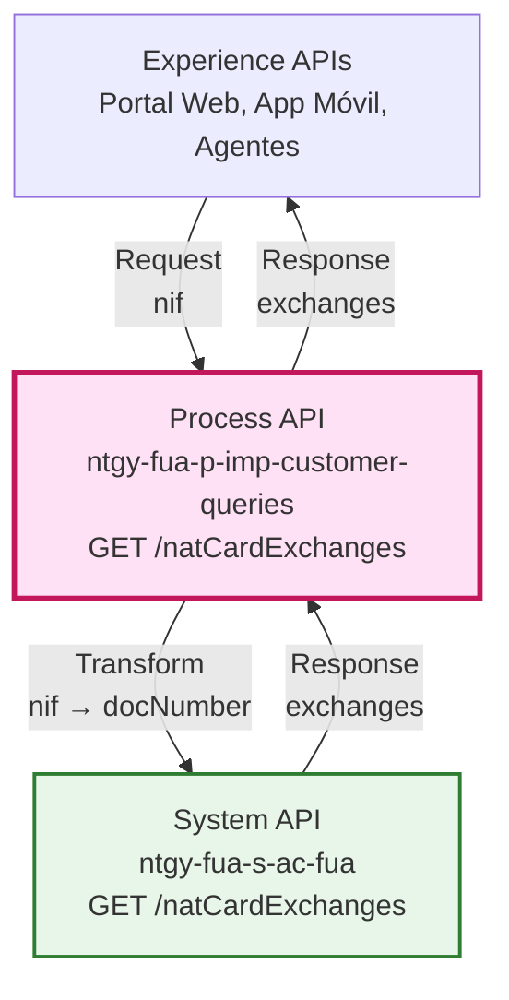
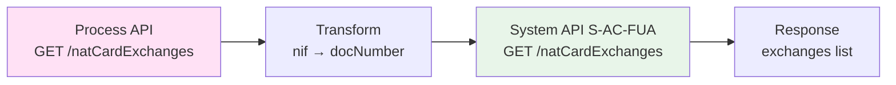
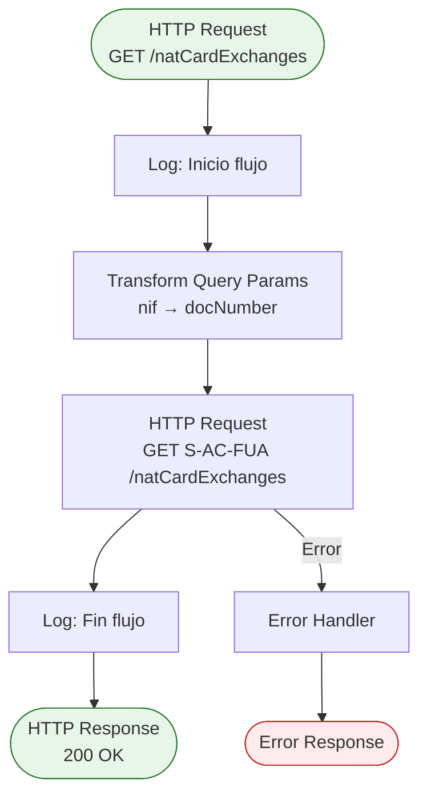
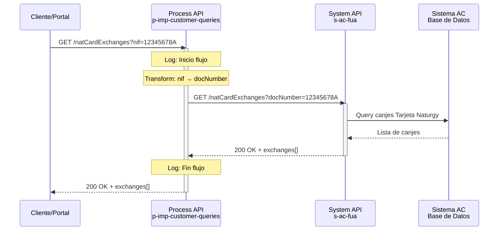
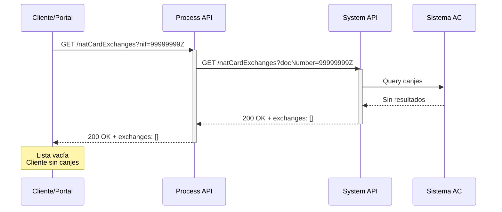
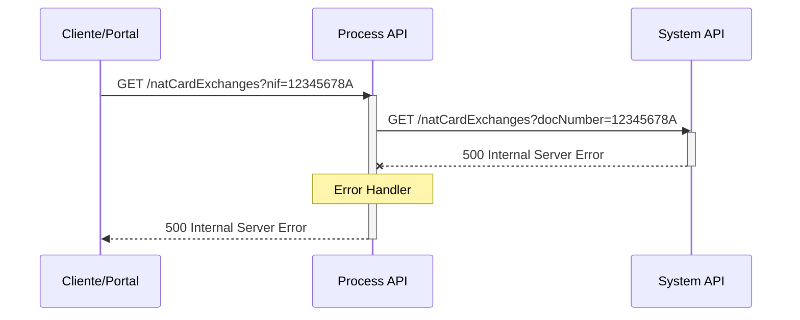

# GET /natCardExchanges

## 📌 Descripción General

### Propósito del Endpoint

Este endpoint obtiene el histórico completo de canjes Amazon realizados por un cliente a través del programa de fidelización Tarjeta Naturgy. Permite consultar todos los canjes efectuados utilizando el NIF del cliente como identificador.

### Tipo de API

**Capa:** Process API (API-Led Connectivity)

**Función:** Orquestación de consulta de canjes del programa de fidelización Tarjeta Naturgy

### Patrón de Integración

**Tipo:** Pass-Through con transformación de parámetro

**Descripción:** El Process API recibe el parámetro `nif` y lo transforma a `docNumber` para la llamada al System API S-AC-FUA. La respuesta del System API se devuelve sin transformaciones adicionales.

### Arquitectura API-Led Connectivity



---

## 💼 Propósito del Negocio

### Casos de Uso Principales

1. **Consulta de Histórico de Canjes por Cliente**
   - El cliente consulta su histórico de canjes Amazon desde el portal web o app móvil
   - Permite visualizar todos los canjes realizados con la Tarjeta Naturgy
   - Beneficio: Transparencia y trazabilidad de los canjes del programa de fidelización

2. **Soporte al Cliente por Agentes**
   - Los agentes de atención al cliente consultan el histórico de canjes durante llamadas
   - Facilita la resolución de consultas sobre canjes realizados
   - Beneficio: Mejor servicio al cliente y resolución rápida de incidencias

3. **Auditoría de Programa de Fidelización**
   - Seguimiento de la actividad de canjes del programa Tarjeta Naturgy
   - Análisis de uso del programa de fidelización
   - Beneficio: Datos para optimización del programa de ventajas

### 🔗 Endpoints Dependientes

Este Process API consume el siguiente System API:

| System API | Endpoint | Método | Propósito |
|------------|----------|--------|-----------|
| `ntgy-fua-s-ac-fua` | `/natCardExchanges` | GET | Obtiene el histórico de canjes Amazon de la Tarjeta Naturgy |

### Lógica de Orquestación



**Pasos del Proceso:**

1. **Paso 1**: Recepción del parámetro `nif` del cliente
2. **Paso 2**: Transformación del parámetro `nif` a `docNumber` para el System API
3. **Paso 3**: Llamada al System API S-AC-FUA con el parámetro transformado
4. **Paso 4**: Devolución de la respuesta sin transformaciones adicionales

### Transformaciones Aplicadas

**Transformación de Parámetros:**

| Parámetro Original (Process API) | Parámetro Transformado (System API) | Transformación |
|----------------------------------|-------------------------------------|----------------|
| `nif` | `docNumber` | Renombrado de parámetro |

⚠️ **Este Process API NO transforma la respuesta del System API.**

Para el schema completo de la respuesta, consultar:
📖 **System API: `ntgy-fua-s-ac-fua` endpoint `/natCardExchanges`**

### Contexto Empresarial

- **Dominio:** Programa de Fidelización y Ventajas
- **Sector:** Energía - Utilities
- **División:** Naturgy España - Clientes Minoristas
- **Proceso de Negocio:** Gestión de canjes del programa Tarjeta Naturgy

### Stakeholders

- **Clientes Finales**: Consultan su histórico de canjes Amazon
- **Agentes de Atención al Cliente**: Verifican canjes durante soporte telefónico
- **Equipo de Marketing**: Analiza efectividad del programa de fidelización

### Valor de Negocio

- **Transparencia**: Los clientes pueden consultar todos sus canjes realizados
- **Trazabilidad**: Registro completo de la actividad del programa de fidelización
- **Satisfacción del Cliente**: Acceso fácil a información de canjes
- **Optimización del Programa**: Datos para mejorar el programa Tarjeta Naturgy

### Consumidores Potenciales

Este endpoint puede ser consumido por:
- Portal web de autoservicio FUA
- Aplicación móvil de clientes
- Sistema de agentes de call center
- Herramientas de análisis de marketing

---

## 🔧 Especificación Técnica

### URLs por Ambiente

| Ambiente | URL Base | URL Completa |
|----------|----------|--------------|
| **Local** | `http://localhost:8084` | `http://localhost:8084/api/natCardExchanges?nif=12345678A` |
| **Development** | `https://ntgy-fua-p-imp-customer-queries-dev.de-c1.cloudhub.io` | `https://ntgy-fua-p-imp-customer-queries-dev.de-c1.cloudhub.io/api/natCardExchanges?nif=12345678A` |
| **UAT** | `https://ntgy-fua-p-imp-customer-queries-uat.de-c1.cloudhub.io` | `https://ntgy-fua-p-imp-customer-queries-uat.de-c1.cloudhub.io/api/natCardExchanges?nif=12345678A` |
| **Production** | `https://ntgy-fua-p-imp-customer-queries-pro.de-c1.cloudhub.io` | `https://ntgy-fua-p-imp-customer-queries-pro.de-c1.cloudhub.io/api/natCardExchanges?nif=12345678A` |

### Método HTTP

```
GET /api/natCardExchanges
```

### Parámetros de Entrada

#### Query Parameters

| Parámetro | Tipo | Requerido | Descripción | Ejemplo |
|-----------|------|-----------|-------------|---------|
| `nif` | string | ✅ Sí | NIF/DNI del cliente | `12345678A` |

**Validaciones:**
- El parámetro `nif` es obligatorio
- Debe ser un NIF/DNI válido español

### Respuestas

#### 200 OK - Consulta Exitosa

**Estructura de Respuesta:**

```json
{
  "result": {
    "codResult": "string",
    "msgResult": "string"
  },
  "exchanges": [
    {
      "exchangeId": "string",
      "date": "2026-09-17",
      "amount": 50.00
    }
  ]
}
```

**Campos de Respuesta:**

| Campo | Tipo | Descripción |
|-------|------|-------------|
| `result.codResult` | string | Código de error |
| `result.msgResult` | string | Mensaje de error |
| `exchanges` | array | Lista de canjes realizados |
| `exchanges[].exchangeId` | string | Id del canje |
| `exchanges[].date` | date-only | Fecha en la que se realizó el canje (formato: YYYY-MM-DD) |
| `exchanges[].amount` | number | Importe canjeado por un cheque Amazon |

#### 400 Bad Request - Parámetros Inválidos

```json
{
  "error": {
    "code": "BAD_REQUEST",
    "message": "El parámetro 'nif' es obligatorio"
  }
}
```

#### 404 Not Found - Cliente No Encontrado

```json
{
  "error": {
    "code": "NOT_FOUND",
    "message": "No se encontraron canjes para el NIF proporcionado"
  }
}
```

#### 500 Internal Server Error - Error del Sistema

```json
{
  "error": {
    "code": "INTERNAL_ERROR",
    "message": "Error al procesar la solicitud"
  }
}
```

### Autenticación

- **Tipo:** OAuth 2.0 (Client Credentials)
- **Headers Requeridos:**
  - `client_id`: ID del cliente de Anypoint Platform
  - `client_secret`: Secret del cliente de Anypoint Platform

### Timeouts

| Tipo | Valor |
|------|-------|
| **Request Timeout** | 30 segundos |
| **Connection Timeout** | 30 segundos |

---

## 🏗️ Implementación Técnica

### Arquitectura del Flow



### Código de Implementación

**Archivo:** `get-natCardExchanges.xml`

```xml
<flow name="natCardExchangesFlow" doc:id="15bc5b95-1492-40ff-8dff-35a977291b6a">
    <logger level="DEBUG" doc:name="Inicio flujo" 
            doc:id="3bbf3cb1-862f-458f-a40c-a62babaa8385" />
    
    <http:request method="GET" 
                  doc:name="Obtener giftCard" 
                  doc:id="1dfe4f44-f9bb-45c4-a410-e49ac515b7b2" 
                  config-ref="HTTP_API_SistemaAC" 
                  path="/natCardExchanges">
        <http:query-params><![CDATA[#[output application/java
---
{
    "docNumber" : attributes.queryParams.nif
}]]]></http:query-params>
    </http:request>
    
    <logger level="DEBUG" doc:name="Fin Flujo" 
            doc:id="0c43b340-a7b3-4798-aa36-cd5a811b54f3" />
</flow>
```

**Archivo Principal:** `p-imp-customer-queries.xml`

```xml
<flow name="get:\natCardExchanges:p-imp-customer-queries-config" 
      doc:id="7034e201-9ead-40bc-aed7-2f86c855e76e">
    <logger level="DEBUG" doc:name="Logger" 
            doc:id="1c7e5b6f-771e-4d63-8564-9beef09481a4" />
    <flow-ref doc:name="Flow Reference" 
              doc:id="bc97edde-bc1d-400e-a675-a630533c7e71" 
              name="natCardExchangesFlow" />
</flow>
```

### Configuración HTTP

**Archivo:** `global.xml`

```xml
<http:request-config name="HTTP_API_SistemaAC" 
                     doc:name="HTTP Request configuration" 
                     basePath="/api" 
                     responseTimeout="${s-ac.timeout}">
    <http:request-connection host="${s-ac.host}" 
                            port="${s-ac.port}" 
                            connectionIdleTimeout="${s-ac.timeout}" 
                            protocol="${s-ac.protocol}"/>
</http:request-config>
```

**Propiedades (Production):**

```yaml
s-ac:
  host: "ntgy-fua-s-ac-fua-bqyi65.internal-6bnlu3.irl-e1.cloudhub.io"
  port: "443"
  protocol: "HTTPS"
  timeout: "30000"
```

### Transformación DataWeave

**Transformación de Query Parameters:**

```dataweave
%dw 2.0
output application/java
---
{
    "docNumber": attributes.queryParams.nif
}
```

**Descripción:**
- Transforma el parámetro `nif` recibido del cliente
- Lo renombra a `docNumber` para el System API
- Mantiene el valor sin modificaciones

### Patrones de Diseño

**Patrón:** Pass-Through con Transformación de Parámetro

**Justificación:** 
- El Process API actúa como capa de abstracción
- Normaliza los nombres de parámetros entre capas
- Permite evolución independiente de las APIs
- Mantiene la simplicidad al no transformar la respuesta

### Diagramas de Secuencia

#### 1. Flujo Normal de Éxito



#### 2. Flujo con Cliente Sin Canjes



#### 3. Flujo con Error Técnico



### Manejo de Errores

**Estrategia:**
- Los errores del System API se propagan al cliente
- Se mantiene el código de estado HTTP original
- Los logs DEBUG registran inicio y fin del flujo
- No se aplican transformaciones a los errores

**Códigos de Error Comunes:**

| Código | Origen | Descripción | Acción |
|--------|--------|-------------|--------|
| 400 | Process API | Parámetro `nif` faltante | Validar parámetros en cliente |
| 404 | System API | Cliente no encontrado | Verificar NIF del cliente |
| 500 | System API | Error en Sistema AC | Reintentar o contactar soporte |
| 503 | System API | Sistema AC no disponible | Reintentar más tarde |

---

## 💻 Ejemplos de Uso

### Ejemplo 1: Consulta Exitosa con Canjes

#### cURL

```bash
curl -X GET "https://ntgy-fua-p-imp-customer-queries-pro.de-c1.cloudhub.io/api/natCardExchanges?nif=12345678A" \
  -H "Content-Type: application/json" \
  -H "client_id: YOUR_CLIENT_ID" \
  -H "client_secret: YOUR_CLIENT_SECRET"
```

#### Respuesta (200 OK)

```json
{
  "result": {
    "codResult": "0",
    "msgResult": ""
  },
  "exchanges": [
    {
      "exchangeId": "EXC-2026-001234",
      "date": "2026-08-15",
      "amount": 50.00
    },
    {
      "exchangeId": "EXC-2026-001189",
      "date": "2026-07-10",
      "amount": 25.00
    },
    {
      "exchangeId": "EXC-2026-000987",
      "date": "2026-06-05",
      "amount": 100.00
    }
  ]
}
```

### Ejemplo 2: Cliente Sin Canjes

#### cURL

```bash
curl -X GET "https://ntgy-fua-p-imp-customer-queries-pro.de-c1.cloudhub.io/api/natCardExchanges?nif=99999999Z" \
  -H "Content-Type: application/json" \
  -H "client_id: YOUR_CLIENT_ID" \
  -H "client_secret: YOUR_CLIENT_SECRET"
```

#### Respuesta (200 OK)

```json
{
  "result": {
    "codResult": "0",
    "msgResult": ""
  },
  "exchanges": []
}
```

### Ejemplo 3: JavaScript (Fetch API)

```javascript
const getNatCardExchanges = async (nif) => {
  try {
    const response = await fetch(
      `https://ntgy-fua-p-imp-customer-queries-pro.de-c1.cloudhub.io/api/natCardExchanges?nif=${nif}`,
      {
        method: 'GET',
        headers: {
          'Content-Type': 'application/json',
          'client_id': 'YOUR_CLIENT_ID',
          'client_secret': 'YOUR_CLIENT_SECRET'
        }
      }
    );

    if (!response.ok) {
      throw new Error(`HTTP error! status: ${response.status}`);
    }

    const data = await response.json();
    
    console.log('Canjes encontrados:', data.exchanges.length);
    data.exchanges.forEach(exchange => {
      console.log(`- ${exchange.date}: Canje ${exchange.exchangeId} (${exchange.amount}€)`);
    });
    
    return data;
  } catch (error) {
    console.error('Error al obtener canjes:', error);
    throw error;
  }
};

// Uso
getNatCardExchanges('12345678A');
```

### Ejemplo 4: Python (Requests)

```python
import requests
from typing import Dict, List

def get_nat_card_exchanges(nif: str) -> Dict:
    """
    Obtiene el histórico de canjes Amazon de la Tarjeta Naturgy.
    
    Args:
        nif: NIF/DNI del cliente
        
    Returns:
        Dict con result y lista de exchanges
    """
    url = "https://ntgy-fua-p-imp-customer-queries-pro.de-c1.cloudhub.io/api/natCardExchanges"
    
    headers = {
        'Content-Type': 'application/json',
        'client_id': 'YOUR_CLIENT_ID',
        'client_secret': 'YOUR_CLIENT_SECRET'
    }
    
    params = {'nif': nif}
    
    try:
        response = requests.get(url, headers=headers, params=params, timeout=30)
        response.raise_for_status()
        
        data = response.json()
        
        print(f"Canjes encontrados: {len(data['exchanges'])}")
        for exchange in data['exchanges']:
            print(f"- {exchange['date']}: Canje {exchange['exchangeId']} ({exchange['amount']}€)")
        
        return data
        
    except requests.exceptions.RequestException as e:
        print(f"Error al obtener canjes: {e}")
        raise

# Uso
exchanges_data = get_nat_card_exchanges('12345678A')
```

### Ejemplo 5: Error - Parámetro Faltante

#### cURL

```bash
curl -X GET "https://ntgy-fua-p-imp-customer-queries-pro.de-c1.cloudhub.io/api/natCardExchanges" \
  -H "Content-Type: application/json" \
  -H "client_id: YOUR_CLIENT_ID" \
  -H "client_secret: YOUR_CLIENT_SECRET"
```

#### Respuesta (400 Bad Request)

```json
{
  "error": {
    "code": "BAD_REQUEST",
    "message": "El parámetro 'nif' es obligatorio"
  }
}