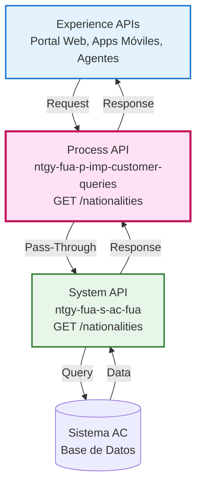
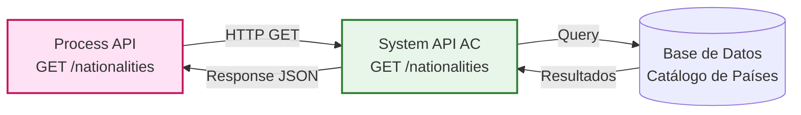
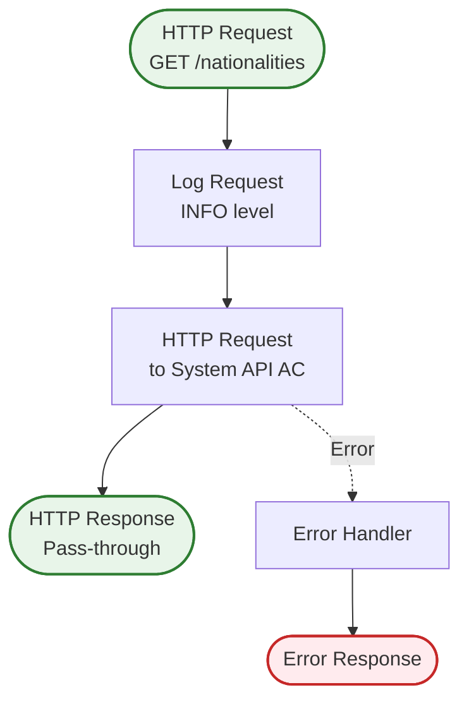
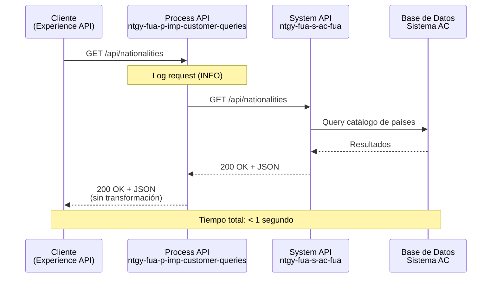
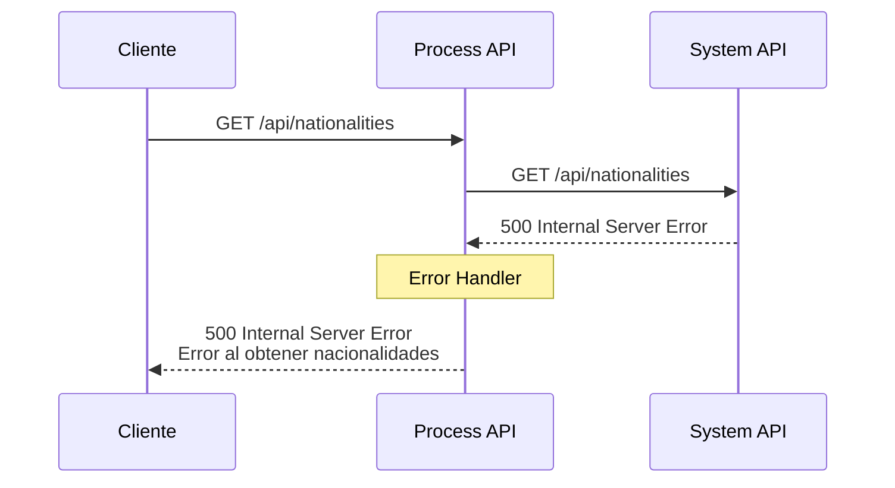
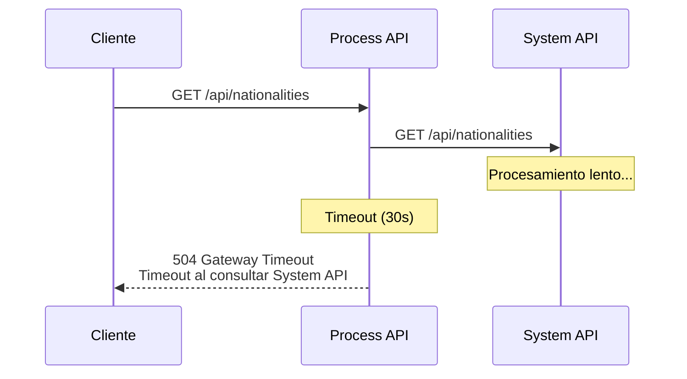

# GET /nationalities

## 📌 Descripción General

### Propósito del Endpoint

Este endpoint proporciona acceso al catálogo completo de nacionalidades/países disponibles en el sistema. Actúa como un **proxy pass-through** hacia el System API de AC (Administración de Clientes), delegando completamente la operación sin aplicar transformaciones ni lógica de negocio adicional.

### Tipo de API

**Capa:** Process API (API-Led Connectivity)

**Función:** Pass-Through / Proxy para acceso a datos de referencia

### Patrón de Integración

**Tipo:** Pass-Through Puro

**Descripción:** El endpoint actúa como un proxy transparente que:
- Recibe la petición del consumidor
- La reenvía directamente al System API de AC
- Devuelve la respuesta sin modificaciones
- No aplica transformaciones DataWeave
- No implementa lógica de negocio

Este patrón es ideal para datos de referencia estáticos que no requieren procesamiento adicional.

### Arquitectura API-Led Connectivity



---

## 💼 Propósito del Negocio

### Casos de Uso Principales

1. **Formularios de Registro de Clientes**
   - Proporcionar lista desplegable de nacionalidades en formularios web y móviles
   - Permitir selección estandarizada de país de origen del cliente
   - **Beneficio:** Consistencia en datos de clientes y cumplimiento normativo

2. **Validación de Datos de Clientes**
   - Validar que la nacionalidad ingresada existe en el catálogo oficial
   - Verificar códigos de país en procesos de alta y modificación
   - **Beneficio:** Integridad de datos y prevención de errores

3. **Reportes y Análisis**
   - Segmentación de clientes por nacionalidad
   - Análisis demográfico de la base de clientes
   - **Beneficio:** Insights de negocio y cumplimiento regulatorio

### 🔗 Endpoints Dependientes

Este Process API consume el siguiente System API:

| System API | Endpoint | Método | Propósito |
|------------|----------|--------|-----------|
| `ntgy-fua-s-ac-fua` | `/nationalities` | GET | Obtener listado de nacionalidades disponibles en el sistema |

### Lógica de Orquestación



**Flujo Simplificado:**

1. **Recepción:** Process API recibe request sin parámetros
2. **Delegación:** Reenvía request al System API de AC
3. **Respuesta:** Devuelve respuesta del System API sin modificaciones

### Transformaciones Aplicadas

⚠️ **Este Process API NO transforma la respuesta del System API.**

**Patrón Pass-Through:**
- El endpoint actúa como proxy transparente
- No modifica la estructura de datos
- No aplica validaciones adicionales
- Retorna la respuesta tal cual del System API

Para el schema completo, consultar:
📖 **System API: `ntgy-fua-s-ac-fua` endpoint `GET /nationalities`**

### Contexto Empresarial

- **Dominio:** Gestión de Datos Maestros
- **Sector:** Energía - Utilities (Gas & Electricidad)
- **División:** Naturgy España - Clientes Minoristas
- **Proceso de Negocio:** Gestión de Información de Clientes

### Stakeholders

- **Equipos de Desarrollo Frontend:** Necesitan lista de nacionalidades para formularios
- **Agentes de Atención al Cliente:** Requieren validación de datos de clientes
- **Equipos de Compliance:** Necesitan datos estandarizados para reportes regulatorios
- **Analistas de Negocio:** Utilizan datos para segmentación y análisis

### Valor de Negocio

- **Estandarización:** Catálogo único de nacionalidades en toda la organización
- **Eficiencia:** Acceso rápido a datos de referencia sin consultas complejas
- **Consistencia:** Misma fuente de verdad para todos los canales
- **Mantenibilidad:** Cambios en el catálogo se reflejan automáticamente en todos los consumidores

### Consumidores Potenciales

Este endpoint puede ser consumido por:
- **Portales web de autoservicio** (FUA Portal)
- **Aplicaciones móviles** (iOS, Android)
- **Sistemas de agentes de call center** (Agent Desktop)
- **Formularios de registro y modificación de clientes**
- **Integraciones de terceros autorizados**

---

## 🔧 Especificación Técnica

### URLs por Ambiente

| Ambiente | URL Base | URL Completa |
|----------|----------|--------------|
| **Local** | `http://localhost:8084` | `http://localhost:8084/api/nationalities` |
| **Development** | `https://ntgy-fua-p-imp-customer-queries-dev.de-c1.cloudhub.io` | `https://ntgy-fua-p-imp-customer-queries-dev.de-c1.cloudhub.io/api/nationalities` |
| **UAT** | `https://ntgy-fua-p-imp-customer-queries-uat.de-c1.cloudhub.io` | `https://ntgy-fua-p-imp-customer-queries-uat.de-c1.cloudhub.io/api/nationalities` |
| **UAT01** | `https://ntgy-fua-p-imp-customer-queries-uat01.de-c1.cloudhub.io` | `https://ntgy-fua-p-imp-customer-queries-uat01.de-c1.cloudhub.io/api/nationalities` |
| **Production** | `https://ntgy-fua-p-imp-customer-queries-pro.de-c1.cloudhub.io` | `https://ntgy-fua-p-imp-customer-queries-pro.de-c1.cloudhub.io/api/nationalities` |

### Método HTTP

```
GET /api/nationalities
```

### Parámetros de Entrada

**Query Parameters:** Ninguno

**Headers Requeridos:**

| Header | Tipo | Obligatorio | Descripción |
|--------|------|-------------|-------------|
| `client_id` | string | ✅ Sí | Client ID de Anypoint Platform |
| `client_secret` | string | ✅ Sí | Client Secret de Anypoint Platform |

**Headers Opcionales:**

| Header | Tipo | Descripción |
|--------|------|-------------|
| `x-correlation-id` | string | ID de correlación para trazabilidad |

### Respuestas

#### ✅ 200 OK - Éxito

**Content-Type:** `application/json`

**Descripción:** Listado de nacionalidades obtenido exitosamente

⚠️ **Este endpoint implementa un patrón de pass-through puro.**

La respuesta es delegada directamente desde el System API `ntgy-fua-s-ac-fua` sin transformaciones.

**Estructura de Respuesta (según RAML):**

```json
{
  "result": {
    "codResult": "0000",
    "msgResult": "No hay error"
  },
  "countries": [
    {
      "nationalityId": "ES",
      "nationalityDesc": "España"
    },
    {
      "nationalityId": "PT",
      "nationalityDesc": "Portugal"
    },
    {
      "nationalityId": "IT",
      "nationalityDesc": "Italia"
    }
  ]
}
```

**Campos de Respuesta:**

| Campo | Tipo | Descripción |
|-------|------|-------------|
| `result` | object | Objeto con información del resultado de la operación |
| `result.codResult` | string | Código de resultado ("0000" = éxito) |
| `result.msgResult` | string | Mensaje descriptivo del resultado |
| `countries` | array | Array de objetos de nacionalidades |
| `countries[].nationalityId` | string | Código identificador de la nacionalidad (ej: "ES", "PT", "IT") |
| `countries[].nationalityDesc` | string | Descripción de la nacionalidad (ej: "España", "Portugal", "Italia") |

📖 **Para el schema completo y actualizado, consultar:**
- **System API:** `ntgy-fua-s-ac-fua`
- **Endpoint:** `GET /nationalities`

#### ❌ 401 Unauthorized

**Descripción:** Credenciales inválidas o ausentes

```json
{
  "error": "Unauthorized",
  "message": "Invalid client credentials"
}
```

#### ❌ 500 Internal Server Error

**Descripción:** Error en el System API o en la infraestructura

```json
{
  "error": "Internal Server Error",
  "message": "Error al obtener nacionalidades"
}
```

#### ❌ 504 Gateway Timeout

**Descripción:** Timeout al comunicarse con el System API

```json
{
  "error": "Gateway Timeout",
  "message": "Timeout al consultar System API"
}
```

### Autenticación

- **Tipo:** Client ID & Client Secret (Anypoint Platform)
- **Método:** Headers HTTP
- **Validación:** Realizada por API Gateway de Anypoint Platform

### Timeouts

| Tipo | Valor | Descripción |
|------|-------|-------------|
| **Request Timeout** | 30 segundos | Timeout para la respuesta del System API |
| **Connection Timeout** | 30 segundos | Timeout para establecer conexión |

### Características de Performance

- **Tiempo de Respuesta Esperado:** < 1 segundo
- **Throughput:** 100+ requests/minuto
- **Cacheable:** ✅ Sí (datos estáticos, TTL recomendado: 24 horas)
- **Idempotente:** ✅ Sí (operación GET sin efectos secundarios)

---

## 🏗️ Implementación Técnica

### Arquitectura del Flow



### Código de Implementación

**Archivo:** `p-imp-customer-queries.xml`

```xml
<flow name="get:\nationalities:p-imp-customer-queries-config">
    <http:request 
        method="GET" 
        doc:name="Request" 
        doc:id="4c1a5487-ed41-4803-b218-37322c7d78f8" 
        config-ref="HTTP_API_SistemaAC" 
        path="/nationalities" />
</flow>
```

**Configuración HTTP:**

**Archivo:** `global.xml`

```xml
<http:request-config 
    name="HTTP_API_SistemaAC" 
    doc:name="HTTP Request configuration" 
    basePath="/api" 
    responseTimeout="${s-ac.timeout}">
    <http:request-connection 
        host="${s-ac.host}" 
        port="${s-ac.port}" 
        connectionIdleTimeout="${s-ac.timeout}" 
        protocol="${s-ac.protocol}"/>
</http:request-config>
```

**Propiedades de Configuración:**

**Archivo:** `p-imp-customer-queries-pro-config.yaml`

```yaml
s-ac:
  host: "ntgy-fua-s-ac-fua-bqyi65.internal-6bnlu3.irl-e1.cloudhub.io"
  port: "443"
  protocol: "HTTPS"
  timeout: "30000"
```

### Transformaciones DataWeave

⚠️ **No aplica** - Este endpoint NO utiliza transformaciones DataWeave.

La respuesta del System API se devuelve directamente al consumidor sin modificaciones.

### Patrones de Diseño

**Patrón:** Pass-Through / Proxy Pattern

**Justificación:**
- Los datos de nacionalidades son estáticos y no requieren transformación
- El System API ya proporciona la estructura correcta
- Minimiza latencia al evitar procesamiento innecesario
- Simplifica mantenimiento al delegar responsabilidad al System API
- Facilita caching en capas superiores

**Ventajas del Pass-Through:**
- ✅ Latencia mínima (< 1 segundo)
- ✅ Código simple y mantenible
- ✅ Sin riesgo de errores de transformación
- ✅ Fácil de testear y debuggear

### Diagramas de Secuencia

#### 1. Flujo Normal de Éxito



#### 2. Flujo con Error del System API



#### 3. Flujo con Timeout



### Manejo de Errores

**Estrategia:** Propagación de errores del System API

| Escenario | Código HTTP | Acción |
|-----------|-------------|--------|
| System API responde exitosamente | 200 | Devolver respuesta sin modificar |
| System API retorna error | 4xx/5xx | Propagar error al cliente |
| Timeout de conexión | 504 | Devolver Gateway Timeout |
| Error de autenticación | 401 | Devolver Unauthorized |
| Error inesperado | 500 | Devolver Internal Server Error |

**Logging:**
- Request entrante: INFO level
- Errores: ERROR level con stack trace
- Timeouts: WARN level

---

## 💻 Ejemplos de Uso

### Ejemplo 1: Llamada Exitosa con cURL

#### Request

```bash
curl -X GET "https://ntgy-fua-p-imp-customer-queries-pro.de-c1.cloudhub.io/api/nationalities" \
  -H "Content-Type: application/json" \
  -H "client_id: YOUR_CLIENT_ID" \
  -H "client_secret: YOUR_CLIENT_SECRET" \
  -H "x-correlation-id: 12345-67890-abcde"
```

#### Response (200 OK)

```json
{
  "result": {
    "code": "OK",
    "message": "Nacionalidades obtenidas exitosamente"
  },
  "countries": [
    {
      "code": "724",
      "name": "España",
      "alpha2Code": "ES",
      "alpha3Code": "ESP"
    },
    {
      "code": "250",
      "name": "Francia",
      "alpha2Code": "FR",
      "alpha3Code": "FRA"
    },
    {
      "code": "276",
      "name": "Alemania",
      "alpha2Code": "DE",
      "alpha3Code": "DEU"
    },
    {
      "code": "380",
      "name": "Italia",
      "alpha2Code": "IT",
      "alpha3Code": "ITA"
    },
    {
      "code": "620",
      "name": "Portugal",
      "alpha2Code": "PT",
      "alpha3Code": "PRT"
    }
  ]
}
```

### Ejemplo 2: Integración en JavaScript (Frontend)

```javascript
/**
 * Obtiene el listado de nacionalidades para un formulario
 */
async function getNationalities() {
  try {
    const response = await fetch(
      'https://ntgy-fua-p-imp-customer-queries-pro.de-c1.cloudhub.io/api/nationalities',
      {
        method: 'GET',
        headers: {
          'Content-Type': 'application/json',
          'client_id': process.env.CLIENT_ID,
          'client_secret': process.env.CLIENT_SECRET,
          'x-correlation-id': generateCorrelationId()
        }
      }
    );

    if (!response.ok) {
      throw new Error(`HTTP error! status: ${response.status}`);
    }

    const data = await response.json();
    
    // Mapear a formato para dropdown
    const nationalityOptions = data.countries.map(country => ({
      value: country.alpha2Code,
      label: country.name,
      code: country.code
    }));

    return nationalityOptions;
  } catch (error) {
    console.error('Error al obtener nacionalidades:', error);
    throw error;
  }
}

// Uso en componente React
function NationalitySelector() {
  const [nationalities, setNationalities] = useState([]);
  const [loading, setLoading] = useState(true);

  useEffect(() => {
    getNationalities()
      .then(data => {
        setNationalities(data);
        setLoading(false);
      })
      .catch(error => {
        console.error(error);
        setLoading(false);
      });
  }, []);

  if (loading) return <div>Cargando nacionalidades...</div>;

  return (
    <select name="nationality">
      <option value="">Seleccione una nacionalidad</option>
      {nationalities.map(nat => (
        <option key={nat.value} value={nat.value}>
          {nat.label}
        </option>
      ))}
    </select>
  );
}
```

### Ejemplo 3: Integración en Python (Backend)

```python
import requests
from typing import List, Dict, Optional
import logging

logger = logging.getLogger(__name__)

class NationalityService:
    """Servicio para obtener nacionalidades del Process API"""
    
    def __init__(self, base_url: str, client_id: str, client_secret: str):
        self.base_url = base_url
        self.client_id = client_id
        self.client_secret = client_secret
        self.timeout = 30  # segundos
    
    def get_nationalities(self, correlation_id: Optional[str] = None) -> List[Dict]:
        """
        Obtiene el listado de nacionalidades
        
        Args:
            correlation_id: ID de correlación para trazabilidad
            
        Returns:
            Lista de diccionarios con información de nacionalidades
            
        Raises:
            requests.exceptions.RequestException: Si hay error en la petición
        """
        url = f"{self.base_url}/api/nationalities"
        
        headers = {
            'Content-Type': 'application/json',
            'client_id': self.client_id,
            'client_secret': self.client_secret
        }
        
        if correlation_id:
            headers['x-correlation-id'] = correlation_id
        
        try:
            logger.info(f"Obteniendo nacionalidades desde {url}")
            
            response = requests.get(
                url,
                headers=headers,
                timeout=self.timeout
            )
            
            response.raise_for_status()
            
            data = response.json()
            countries = data.get('countries', [])
            
            logger.info(f"Obtenidas {len(countries)} nacionalidades")
            
            return countries
            
        except requests.exceptions.Timeout:
            logger.error("Timeout al obtener nacionalidades")
            raise
        except requests.exceptions.RequestException as e:
            logger.error(f"Error al obtener nacionalidades: {str(e)}")
            raise

# Uso
service = NationalityService(
    base_url='https://ntgy-fua-p-imp-customer-queries-pro.de-c1.cloudhub.io',
    client_id='YOUR_CLIENT_ID',
    client_secret='YOUR_CLIENT_SECRET'
)

try:
    nationalities = service.get_nationalities(correlation_id='12345-67890')
    
    # Filtrar solo países europeos
    european_countries = [
        country for country in nationalities 
        if country['alpha2Code'] in ['ES', 'FR', 'DE', 'IT', 'PT']
    ]
    
    print(f"Países europeos: {len(european_countries)}")
    
except Exception as e:
    print(f"Error: {str(e)}")
```

### Ejemplo 4: Manejo de Errores

```javascript
/**
 * Ejemplo completo con manejo de errores y reintentos
 */
async function getNationalitiesWithRetry(maxRetries = 3) {
  let lastError;
  
  for (let attempt = 1; attempt <= maxRetries; attempt++) {
    try {
      const response = await fetch(
        'https://ntgy-fua-p-imp-customer-queries-pro.de-c1.cloudhub.io/api/nationalities',
        {
          method: 'GET',
          headers: {
            'Content-Type': 'application/json',
            'client_id': process.env.CLIENT_ID,
            'client_secret': process.env.CLIENT_SECRET
          },
          signal: AbortSignal.timeout(30000) // 30 segundos
        }
      );

      if (response.status === 401) {
        throw new Error('Credenciales inválidas');
      }

      if (response.status === 504) {
        throw new Error('Timeout del servidor');
      }

      if (!response.ok) {
        throw new Error(`Error HTTP: ${response.status}`);
      }

      const data = await response.json();
      
      // Validar estructura de respuesta
      if (!data.countries || !Array.isArray(data.countries)) {
        throw new Error('Respuesta inválida del servidor');
      }

      console.log(`✅ Nacionalidades obtenidas (intento ${attempt})`);
      return data.countries;

    } catch (error) {
      lastError = error;
      console.error(`❌ Intento ${attempt} falló:`, error.message);
      
      // No reintentar en errores de autenticación
      if (error.message.includes('Credenciales')) {
        throw error;
      }
      
      // Esperar antes de reintentar (backoff exponencial)
      if (attempt < maxRetries) {
        const delay = Math.pow(2, attempt) * 1000; // 2s, 4s, 8s
        console.log(`⏳ Reintentando en ${delay/1000} segundos...`);
        await new Promise(resolve => setTimeout(resolve, delay));
      }
    }
  }
  
  throw new Error(`Falló después de ${maxRetries} intentos: ${lastError.message}`);
}

// Uso con fallback a datos cacheados
async function getNationalitiesWithFallback() {
  try {
    const nationalities = await getNationalitiesWithRetry();
    
    // Cachear en localStorage
    localStorage.setItem('nationalities', JSON.stringify(nationalities));
    localStorage.setItem('nationalities_timestamp', Date.now().toString());
    
    return nationalities;
    
  } catch (error) {
    console.warn('Usando datos cacheados debido a error:', error.message);
    
    // Intentar usar datos cacheados
    const cached = localStorage.getItem('nationalities');
    if (cached) {
      return JSON.parse(cached);
    }
    
    // Si no hay cache, usar lista mínima de fallback
    return [
      { code: '724', name: 'España', alpha2Code: 'ES', alpha3Code: 'ESP' },
      { code: '250', name: 'Francia', alpha2Code: 'FR', alpha3Code: 'FRA' }
    ];
  }
}
```

### Ejemplo 5: Caching en Cliente

```javascript
/**
 * Implementación con cache inteligente
 */
class NationalityCache {
  constructor(ttl = 24 * 60 * 60 * 1000) { // 24 horas por defecto
    this.ttl = ttl;
    this.cacheKey = 'nationalities_cache';
    this.timestampKey = 'nationalities_timestamp';
  }

  isValid() {
    const timestamp = localStorage.getItem(this.timestampKey);
    if (!timestamp) return false;
    
    const age = Date.now() - parseInt(timestamp);
    return age < this.ttl;
  }

  get() {
    if (!this.isValid()) return null;
    
    const cached = localStorage.getItem(this.cacheKey);
    return cached ? JSON.parse(cached) : null;
  }

  set(data) {
    localStorage.setItem(this.cacheKey, JSON.stringify(data));
    localStorage.setItem(this.timestampKey, Date.now().toString());
  }

  clear() {
    localStorage.removeItem(this.cacheKey);
    localStorage.removeItem(this.timestampKey);
  }
}

// Uso
const cache = new NationalityCache();

async function getNationalities() {
  // Intentar obtener del cache primero
  const cached = cache.get();
  if (cached) {
    console.log('✅ Usando nacionalidades del cache');
    return cached;
  }

  // Si no hay cache válido, consultar API
  console.log('🔄 Consultando API...');
  const response = await fetch(
    'https://ntgy-fua-p-imp-customer-queries-pro.de-c1.cloudhub.io/api/nationalities',
    {
      method: 'GET',
      headers: {
        'Content-Type': 'application/json',
        'client_id': process.env.CLIENT_ID,
        'client_secret': process.env.CLIENT_SECRET
      }
    }
  );

  const data = await response.json();
  const nationalities = data.countries;

  // Guardar en cache
  cache.set(nationalities);
  console.log('✅ Nacionalidades cacheadas');

  return nationalities;
}