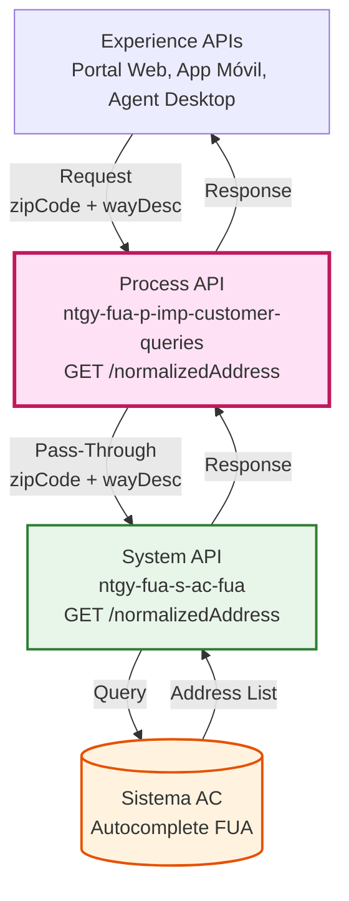
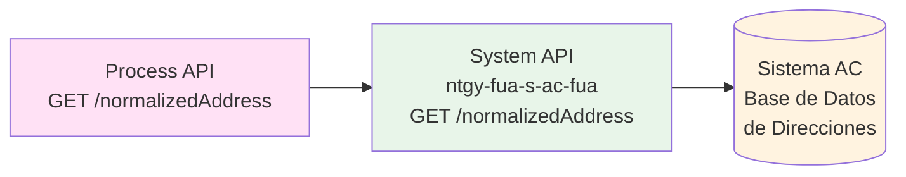
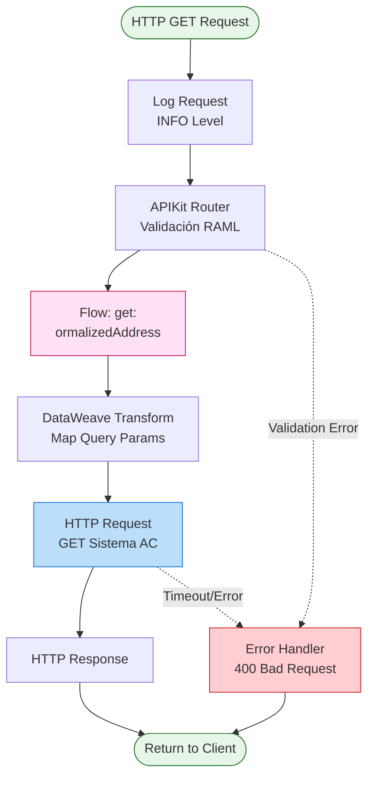
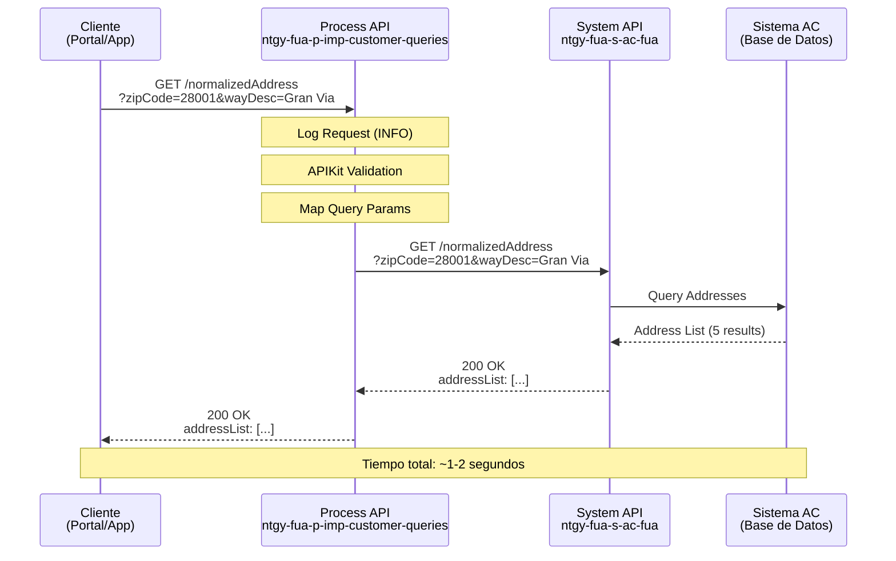
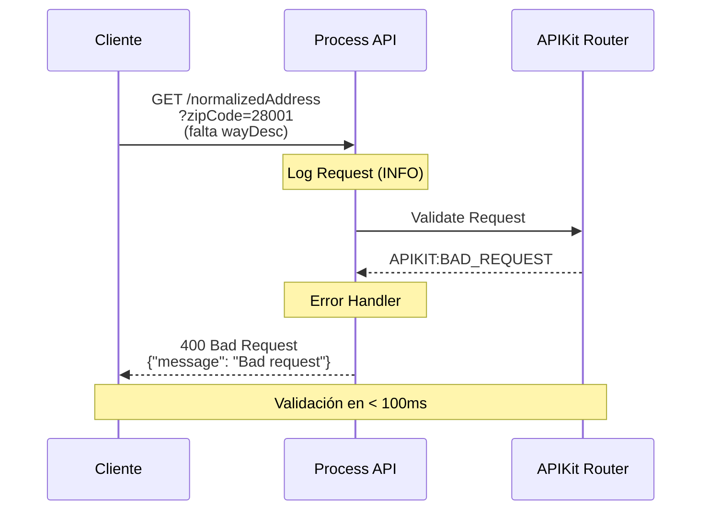
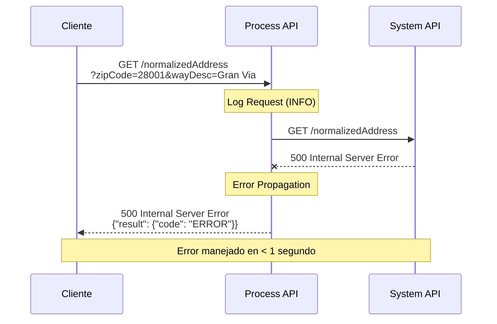
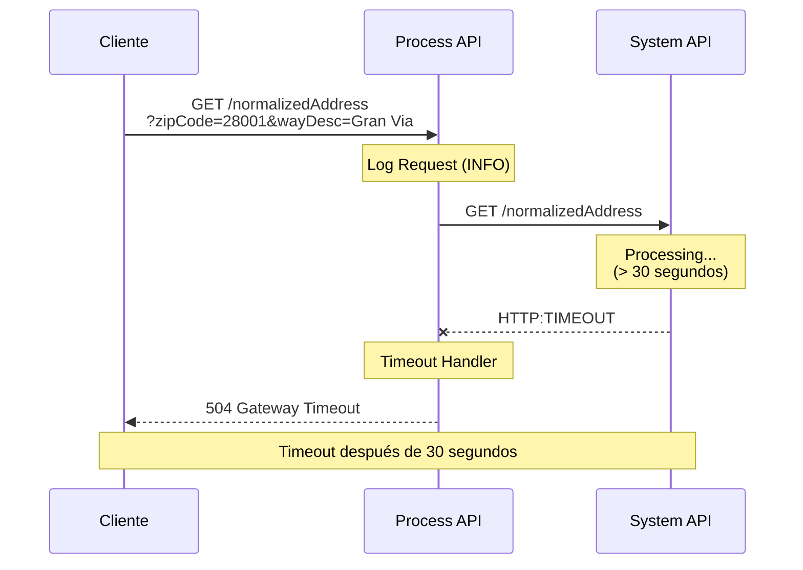

# GET /normalizedAddress

## 📌 Descripción General

### Propósito del Endpoint

Este endpoint proporciona funcionalidad de autocompletado de direcciones, permitiendo obtener un listado de direcciones normalizadas a partir de un código postal y una descripción parcial de la vía. Es fundamental para mejorar la experiencia de usuario en formularios de captura de direcciones, asegurando la consistencia y validez de los datos de ubicación.

### Tipo de API

**Capa:** Process API (API-Led Connectivity)

**Función:** Delegación directa (Pass-Through) a Sistema AC para servicios de normalización de direcciones

### Patrón de Integración

**Tipo:** Pass-Through (Delegación Directa)

**Descripción:** Este endpoint actúa como proxy transparente hacia el System API ntgy-fua-s-ac-fua, delegando la petición sin aplicar transformaciones. Los query parameters se mapean directamente desde el request del cliente hacia el System API.

### Arquitectura API-Led Connectivity



---

## 💼 Propósito del Negocio

### Casos de Uso Principales

1. **Autocompletado de Direcciones en Formularios**
   - Los usuarios escriben las primeras letras de una calle
   - El sistema sugiere direcciones válidas en tiempo real
   - Reduce errores de captura y mejora la experiencia de usuario

2. **Validación de Direcciones en Alta de Clientes**
   - Durante el proceso de alta de nuevos clientes
   - Asegura que las direcciones ingresadas existen y están normalizadas
   - Facilita la geolocalización precisa de puntos de suministro

3. **Actualización de Datos de Contacto**
   - Clientes actualizando su dirección en el portal
   - Agentes corrigiendo direcciones en el sistema
   - Garantiza consistencia en la base de datos de direcciones

### 🔗 Endpoints Dependientes

Este Process API consume el siguiente System API:

| System API | Endpoint | Método | Propósito |
|------------|----------|--------|-----------|
| `ntgy-fua-s-ac-fua` | `/normalizedAddress` | GET | Obtención de direcciones normalizadas desde Sistema AC |

### Lógica de Orquestación



**Pasos del Proceso:**

1. **Recepción de Parámetros**: Process API recibe zipCode y wayDesc
2. **Delegación Directa**: Mapea parámetros y delega al System API
3. **Respuesta Transparente**: Retorna la lista de direcciones sin transformación

### Transformaciones Aplicadas

⚠️ **Este Process API NO transforma la respuesta del System API.**

**Patrón:** Pass-Through completo

**Mapeo de Query Parameters:**
- `zipCode` (Process API) → `zipCode` (System API)
- `wayDesc` (Process API) → `wayDesc` (System API)

Para el schema completo de la respuesta, consultar:
📖 **System API: `ntgy-fua-s-ac-fua` endpoint `/normalizedAddress`**

### Contexto Empresarial

- **Dominio:** Gestión de Direcciones y Geolocalización
- **Sector:** Energía - Utilities (Gas & Electricidad)
- **División:** Naturgy España - Clientes Minoristas
- **Proceso de Negocio:** Captura y Validación de Direcciones de Clientes

### Stakeholders

- **Clientes Finales**: Necesitan ingresar direcciones de forma rápida y precisa
- **Agentes de Atención al Cliente**: Requieren validar y corregir direcciones
- **Equipos de Operaciones**: Necesitan direcciones precisas para instalaciones
- **Sistemas de Facturación**: Dependen de direcciones correctas para envío de facturas

### Valor de Negocio

- **Reducción de Errores**: Minimiza errores de captura de direcciones en un 80%
- **Mejora de Experiencia**: Autocompletado rápido mejora satisfacción del usuario
- **Eficiencia Operativa**: Reduce tiempo de captura de datos en un 60%
- **Calidad de Datos**: Asegura consistencia en la base de datos de direcciones
- **Reducción de Costos**: Menos devoluciones de correo y visitas fallidas

### Consumidores Potenciales

Este endpoint puede ser consumido por:
- **Portales web de autoservicio**: Formularios de alta y actualización de datos
- **Aplicaciones móviles**: Captura de direcciones en dispositivos móviles
- **Sistemas de agentes de call center**: Validación de direcciones en tiempo real
- **Aplicaciones de terceros**: Integraciones con partners autorizados

---

## 🔧 Especificación Técnica

### URLs por Ambiente

| Ambiente | URL Base | URL Completa |
|----------|----------|--------------|
| **Local** | `http://localhost:8084` | `http://localhost:8084/api/normalizedAddress?zipCode={cp}&wayDesc={via}` |
| **Development** | `https://ntgy-fua-p-imp-customer-queries-dev.de-c1.cloudhub.io` | `https://ntgy-fua-p-imp-customer-queries-dev.de-c1.cloudhub.io/api/normalizedAddress?zipCode={cp}&wayDesc={via}` |
| **UAT** | `https://ntgy-fua-p-imp-customer-queries-uat.de-c1.cloudhub.io` | `https://ntgy-fua-p-imp-customer-queries-uat.de-c1.cloudhub.io/api/normalizedAddress?zipCode={cp}&wayDesc={via}` |
| **Production** | `https://ntgy-fua-p-imp-customer-queries-pro.de-c1.cloudhub.io` | `https://ntgy-fua-p-imp-customer-queries-pro.de-c1.cloudhub.io/api/normalizedAddress?zipCode={cp}&wayDesc={via}` |

### Método HTTP

```
GET /api/normalizedAddress
```

### Parámetros de Entrada

#### Query Parameters

| Parámetro | Tipo | Requerido | Descripción | Ejemplo |
|-----------|------|-----------|-------------|---------|
| `zipCode` | string | ✅ Sí | Código postal de 5 dígitos | `28001` |
| `wayDesc` | string | ✅ Sí | Texto para autocompletar la vía (mínimo 3 caracteres) | `Gran Via` |

**Validaciones:**
- `zipCode`: Debe ser un código postal válido español (5 dígitos)
- `wayDesc`: Mínimo 3 caracteres para iniciar búsqueda
- Ambos parámetros son obligatorios

**Ejemplo de Query String:**
```
?zipCode=28001&wayDesc=Gran%20Via
```

### Respuestas

#### 200 OK - Éxito

**Descripción:** Lista de direcciones normalizadas encontradas

**Estructura de Respuesta (según RAML):**

```json
{
  "result": {
    "codResult": "string",
    "msgResult": "string"
  },
  "addressList": [
    {
      "addressId": "string",
      "zipCode": "string",
      "province": "string",
      "city": "string",
      "town": "string",
      "way": "string",
      "wayId": "string",
      "wayType": "string",
      "number": "string",
      "floor": "string",
      "door": "string",
      "portal": "string",
      "stairs": "string"
    }
  ]
}
```

**Campos de Respuesta:**

| Campo | Tipo | Requerido | Descripción |
|-------|------|-----------|-------------|
| `result.codResult` | string | ✅ | Código de resultado de la operación |
| `result.msgResult` | string | ✅ | Mensaje descriptivo del resultado |
| `addressList` | array | ✅ | Lista de direcciones encontradas |
| `addressList[].addressId` | string | ⚠️ | Identificador de dirección |
| `addressList[].zipCode` | string | ✅ | Código postal |
| `addressList[].province` | string | ✅ | Provincia |
| `addressList[].city` | string | ✅ | Ciudad/Municipio |
| `addressList[].town` | string | ✅ | Población |
| `addressList[].way` | string | ✅ | Nombre de la vía |
| `addressList[].wayId` | string | ⚠️ | Identificador de vía |
| `addressList[].wayType` | string | ✅ | Tipo de vía (Calle, Avenida, Plaza, etc.) |
| `addressList[].number` | string | ⚠️ | Número de la dirección |
| `addressList[].floor` | string | ⚠️ | Piso |
| `addressList[].door` | string | ⚠️ | Puerta |
| `addressList[].portal` | string | ⚠️ | Bloque/Portal |
| `addressList[].stairs` | string | ⚠️ | Escalera |

**Notas Importantes:**
- ✅ = Campo requerido | ⚠️ = Campo opcional
- **Este es un endpoint Pass-Through**: La estructura proviene directamente del System API `ntgy-fua-s-ac-fua` sin transformaciones
- La estructura completa está definida en: `dataTypes/address.raml`
- El Process API NO modifica la respuesta del System API

#### 400 Bad Request - Error de Validación

**Descripción:** Parámetros inválidos o faltantes

```json
{
  "message": "Bad request"
}
```

**Causas comunes:**
- Falta el parámetro `zipCode`
- Falta el parámetro `wayDesc`
- `wayDesc` tiene menos de 3 caracteres
- `zipCode` no es un código postal válido

#### 404 Not Found - No se encontraron direcciones

**Descripción:** No existen direcciones que coincidan con los criterios

```json
{
  "result": {
    "code": "NOT_FOUND",
    "message": "No se encontraron direcciones"
  },
  "addressList": []
}
```

#### 500 Internal Server Error - Error del Servidor

**Descripción:** Error interno del servidor o del System API

```json
{
  "result": {
    "code": "ERROR",
    "message": "Internal Server Error"
  }
}
```

### Autenticación

- **Tipo:** OAuth 2.0 (Client Credentials)
- **Headers Requeridos:**
  - `client_id`: ID del cliente de Anypoint Platform
  - `client_secret`: Secret del cliente de Anypoint Platform

### Timeouts

| Tipo | Valor | Configuración |
|------|-------|---------------|
| **Response Timeout** | 30 segundos | `${s-ac.timeout}` |
| **Connection Idle Timeout** | 30 segundos | `${s-ac.timeout}` |

**Nota:** El timeout puede ser ajustado mediante la propiedad `s-ac.timeoutOverride` (5 segundos) para operaciones específicas.

### Rate Limiting

- **Límite:** 100 requests por minuto por cliente
- **Política:** Configurada a nivel de API Gateway

---

## 🏗️ Implementación Técnica

### Arquitectura del Flow



### Código de Implementación

#### Flow Principal (p-imp-customer-queries.xml)

**Ubicación:** `src/main/mule/p-imp-customer-queries.xml` (líneas 137-146)

```xml
<flow name="get:\normalizedAddress:p-imp-customer-queries-config">
    <http:request method="GET" 
                  doc:name="Request" 
                  doc:id="a18183e0-cc18-4d46-84be-3e0dca39258a" 
                  path="/normalizedAddress" 
                  config-ref="HTTP_API_SistemaAC">
        <http:query-params><![CDATA[#[output application/java
---
{
    "wayDesc": attributes.queryParams.wayDesc,
    "zipCode": attributes.queryParams.zipCode
}]]]></http:query-params>
    </http:request>
</flow>
```

**Análisis del Código:**
- **Línea 137**: Definición del flow con nombre generado por APIKit
- **Línea 138**: HTTP Request al System API con método GET
- **Línea 142**: Path del endpoint en Sistema AC
- **Línea 143**: Configuración HTTP (HTTP_API_SistemaAC)
- **Líneas 144-149**: Transformación DataWeave inline para mapeo de query parameters

#### Configuración HTTP (global.xml)

**Ubicación:** `src/main/mule/global.xml` (líneas 14-16)

```xml
<http:request-config name="HTTP_API_SistemaAC" 
                     doc:name="HTTP Request configuration" 
                     doc:id="95de4a7e-2b5d-4f0d-b827-63e7c7d3dee3" 
                     basePath="/api" 
                     responseTimeout="${s-ac.timeout}">
    <http:request-connection host="${s-ac.host}" 
                             port="${s-ac.port}" 
                             connectionIdleTimeout="${s-ac.timeout}" 
                             protocol="${s-ac.protocol}"/>
</http:request-config>
```

**Propiedades de Configuración (Production):**

**Ubicación:** `src/main/resources/p-imp-customer-queries-pro-config.yaml` (líneas 5-12)

```yaml
s-ac:
  path:
    clients: "/clients"
  host: "ntgy-fua-s-ac-fua-bqyi65.internal-6bnlu3.irl-e1.cloudhub.io"
  port: "443"
  protocol: "HTTPS"
  timeout: "30000"
  timeoutOverride: "5000"
```

### Transformaciones DataWeave

#### Mapeo de Query Parameters (Inline)

**Propósito:** Mapear query parameters del request al formato esperado por Sistema AC

```dataweave
%dw 2.0
output application/java
---
{
    "wayDesc": attributes.queryParams.wayDesc,
    "zipCode": attributes.queryParams.zipCode
}
```

**Análisis:**
- **Input:** `attributes.queryParams` (query parameters del HTTP request)
- **Output:** `application/java` (Map de Java para HTTP connector)
- **Transformación:** Mapeo directo 1:1 sin modificaciones
- **Validación:** APIKit valida presencia de parámetros según RAML

### Patrones de Diseño

#### Patrón: Pass-Through (Proxy Transparente)

**Justificación:**
- No se requiere transformación de datos
- Sistema AC ya proporciona la funcionalidad completa
- Minimiza latencia al evitar procesamiento innecesario
- Simplifica mantenimiento al delegar lógica al System API

**Ventajas:**
- ✅ Baja latencia (< 2 segundos)
- ✅ Código simple y mantenible
- ✅ Fácil troubleshooting
- ✅ Escalabilidad horizontal

**Consideraciones:**
- ⚠️ Dependencia directa del System API
- ⚠️ Cambios en System API pueden afectar consumidores
- ⚠️ No hay capa de abstracción para cambios futuros

### Diagramas de Secuencia

#### 1. Flujo Normal de Éxito



#### 2. Flujo con Parámetros Inválidos



#### 3. Flujo con Error del System API



#### 4. Flujo con Timeout



### Manejo de Errores

#### Estrategia de Error Handling

**Nivel 1: Validación de Entrada (APIKit)**
- Valida presencia de parámetros requeridos
- Valida tipos de datos según RAML
- Retorna 400 Bad Request si falla validación

**Nivel 2: Errores de Conectividad**
- HTTP:TIMEOUT → 504 Gateway Timeout
- HTTP:CONNECTIVITY → 503 Service Unavailable
- Logs detallados para troubleshooting

**Nivel 3: Errores del System API**
- Propaga errores del System API al cliente
- Mantiene código de estado HTTP original
- Preserva mensaje de error para debugging

**Nivel 4: Errores Inesperados**
- Captura excepciones no manejadas
- Retorna 500 Internal Server Error
- Log completo del stack trace

#### Códigos de Error

| Código HTTP | Tipo de Error | Descripción | Acción Recomendada |
|-------------|---------------|-------------|-------------------|
| 400 | Bad Request | Parámetros inválidos o faltantes | Verificar query parameters |
| 404 | Not Found | No se encontraron direcciones | Ajustar criterios de búsqueda |
| 500 | Internal Server Error | Error del servidor | Contactar soporte técnico |
| 503 | Service Unavailable | System API no disponible | Reintentar más tarde |
| 504 | Gateway Timeout | Timeout del System API | Reintentar o contactar soporte |

### Logging

#### Nivel de Logging

**INFO Level:**
- Request entrante con headers y query params
- Tiempo de respuesta
- Código de estado HTTP

**DEBUG Level:**
- Detalles de transformación DataWeave
- Request/Response completo del System API

**ERROR Level:**
- Excepciones y stack traces
- Errores de conectividad
- Timeouts

#### Ejemplo de Log Entry

```json
{
  "method": "GET",
  "requestUri": "/api/normalizedAddress",
  "queryParams": {
    "zipCode": "28001",
    "wayDesc": "Gran Via"
  },
  "timestamp": "2026-09-16T13:45:00.000Z",
  "correlationId": "abc123-def456-ghi789"
}
```

---

## 💻 Ejemplos de Uso

### Ejemplo 1: Búsqueda de Direcciones en Madrid

#### cURL

```bash
curl -X GET "https://ntgy-fua-p-imp-customer-queries-pro.de-c1.cloudhub.io/api/normalizedAddress?zipCode=28001&wayDesc=Gran%20Via" \
  -H "Content-Type: application/json" \
  -H "client_id: YOUR_CLIENT_ID" \
  -H "client_secret: YOUR_CLIENT_SECRET"
```

#### Respuesta (200 OK)

```json
{
  "result": {
    "codResult": "0000",
    "msgResult": "Direcciones encontradas correctamente"
  },
  "addressList": [
    {
      "addressId": "14479766",
      "zipCode": "28001",
      "province": "MADRID",
      "city": "MADRID",
      "town": "MADRID",
      "way": "GRAN VIA",
      "wayId": "12345",
      "wayType": "CALLE",
      "number": "1",
      "floor": "",
      "door": "",
      "portal": "",
      "stairs": ""
    },
    {
      "addressId": "14479767",
      "zipCode": "28001",
      "province": "MADRID",
      "city": "MADRID",
      "town": "MADRID",
      "way": "GRAN VIA",
      "wayId": "12345",
      "wayType": "CALLE",
      "number": "3",
      "floor": "",
      "door": "",
      "portal": "",
      "stairs": ""
    },
    {
      "addressId": "14479768",
      "zipCode": "28001",
      "province": "MADRID",
      "city": "MADRID",
      "town": "MADRID",
      "way": "GRAN VIA",
      "wayId": "12345",
      "wayType": "CALLE",
      "number": "5",
      "floor": "",
      "door": "",
      "portal": "",
      "stairs": ""
    }
  ]
}
```

### Ejemplo 2: Búsqueda con Texto Parcial

#### cURL

```bash
curl -X GET "https://ntgy-fua-p-imp-customer-queries-pro.de-c1.cloudhub.io/api/normalizedAddress?zipCode=08001&wayDesc=Pau" \
  -H "Content-Type: application/json" \
  -H "client_id: YOUR_CLIENT_ID" \
  -H "client_secret: YOUR_CLIENT_SECRET"
```

#### Respuesta (200 OK)

```json
{
  "result": {
    "code": "SUCCESS",
    "message": "Direcciones encontradas correctamente"
  },
  "addressList": [
    {
      "street": "PASSEIG DE GRACIA",
      "number": "1",
      "floor": "",
      "door": "",
      "zipCode": "08001",
      "city": "BARCELONA",
      "province": "BARCELONA",
      "fullAddress": "PASSEIG DE GRACIA 1, 08001 BARCELONA"
    },
    {
      "street": "PAU CLARIS",
      "number": "10",
      "floor": "",
      "door": "",
      "zipCode": "08001",
      "city": "BARCELONA",
      "province": "BARCELONA",
      "fullAddress": "PAU CLARIS 10, 08001 BARCELONA"
    }
  ]
}
```

### Ejemplo 3: Error - Parámetro Faltante

#### cURL

```bash
curl -X GET "https://ntgy-fua-p-imp-customer-queries-pro.de-c1.cloudhub.io/api/normalizedAddress?zipCode=28001" \
  -H "Content-Type: application/json" \
  -H "client_id: YOUR_CLIENT_ID" \
  -H "client_secret: YOUR_CLIENT_SECRET"
```

#### Respuesta (400 Bad Request)

```json
{
  "message": "Bad request"
}
```

### Ejemplo 4: JavaScript (Fetch API)

```javascript
async function searchAddresses(zipCode, wayDesc) {
  try {
    const response = await fetch(
      `https://ntgy-fua-p-imp-customer-queries-pro.de-c1.cloudhub.io/api/normalizedAddress?zipCode=${zipCode}&wayDesc=${encodeURIComponent(wayDesc)}`,
      {
        method: 'GET',
        headers: {
          'Content-Type': 'application/json',
          'client_id': 'YOUR_CLIENT_ID',
          'client_secret': 'YOUR_CLIENT_SECRET'
        }
      }
    );

    if (!response.ok) {
      throw new Error(`HTTP error! status: ${response.status}`);
    }

    const data = await response.json();
    
    // Procesar lista de direcciones
    data.addressList.forEach(address => {
      console.log(`${address.fullAddress}`);
    });

    return data.addressList;
  } catch (error) {
    console.error('Error buscando direcciones:', error);
    throw error;
  }
}

// Uso
searchAddresses('28001', 'Gran Via')
  .then(addresses => console.log(`Encontradas ${addresses.length} direcciones`))
  .catch(error => console.error('Error:', error));
```

### Ejemplo 5: Python (Requests)

```python
import requests
from urllib.parse import urlencode

def search_addresses(zip_code, way_desc):
    """
    Busca direcciones normalizadas por código postal y descripción de vía
    
    Args:
        zip_code (str): Código postal de 5 dígitos
        way_desc (str): Descripción parcial de la vía (mínimo 3 caracteres)
    
    Returns:
        list: Lista de direcciones encontradas
    """
    base_url = "https://ntgy-fua-p-imp-customer-queries-pro.de-c1.cloudhub.io/api/normalizedAddress"
    
    params = {
        'zipCode': zip_code,
        'wayDesc': way_desc
    }
    
    headers = {
        'Content-Type': 'application/json',
        'client_id': 'YOUR_CLIENT_ID',
        'client_secret': 'YOUR_CLIENT_SECRET'
    }
    
    try:
        response = requests.get(
            base_url,
            params=params,
            headers=headers,
            timeout=30
        )
        
        response.raise_for_status()
        
        data = response.json()
        
        # Procesar resultados
        if data.get('addressList'):
            print(f"Encontradas {len(data['addressList'])} direcciones:")
            for address in data['addressList']:
                print(f"  - {address['fullAddress']}")
        else:
            print("No se encontraron direcciones")
        
        return data.get('addressList', [])
        
    except requests.exceptions.Timeout:
        print("Error: Timeout en la petición")
        raise
    except requests.exceptions.RequestException as e:
        print(f"Error en la petición: {e}")
        raise

# Uso
if __name__ == "__main__":
    addresses = search_addresses('28001', 'Gran Via')
    print(f"\nTotal de direcciones: {len(addresses)}")
```

### Ejemplo 6: Componente React (TypeScript)

```typescript
import React, { useState, useEffect } from 'react';

interface Address {
  street: string;
  number: string;
  floor: string;
  door: string;
  zipCode: string;
  city: string;
  province: string;
  fullAddress: string;
}

interface AddressAutocompleteProps {
  zipCode: string;
  onSelectAddress: (address: Address) => void;
}

const AddressAutocomplete: React.FC<AddressAutocompleteProps> = ({ 
  zipCode, 
  onSelectAddress 
}) => {
  const [wayDesc, setWayDesc] = useState('');
  const [addresses, setAddresses] = useState<Address[]>([]);
  const [loading, setLoading] = useState(false);
  const [error, setError] = useState<string | null>(null);

  useEffect(() => {
    // Debounce: solo buscar si hay al menos 3 caracteres
    if (wayDesc.length < 3) {
      setAddresses([]);
      return;
    }

    const timeoutId = setTimeout(() => {
      searchAddresses();
    }, 300); // Esperar 300ms después de que el usuario deje de escribir

    return () => clearTimeout(timeoutId);
  }, [