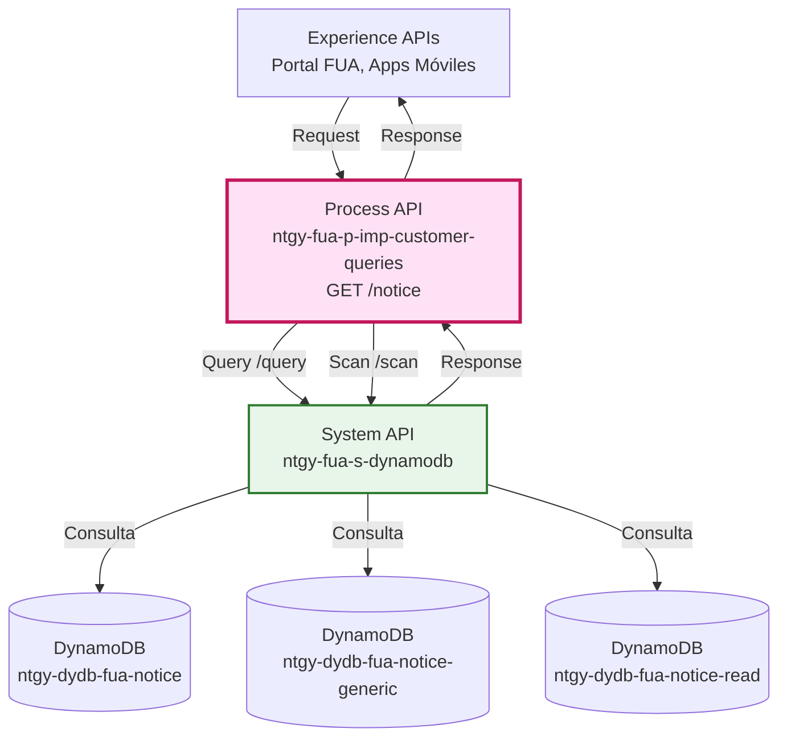
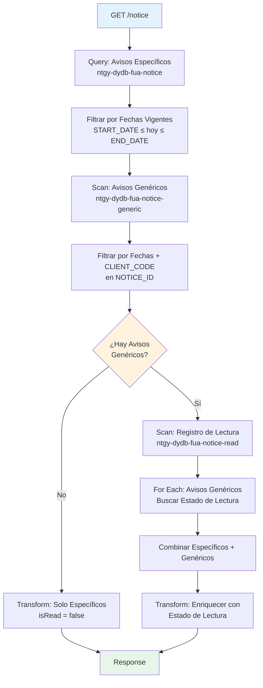
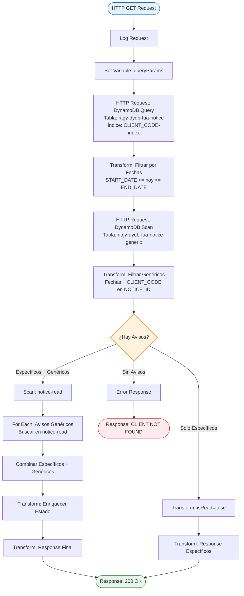
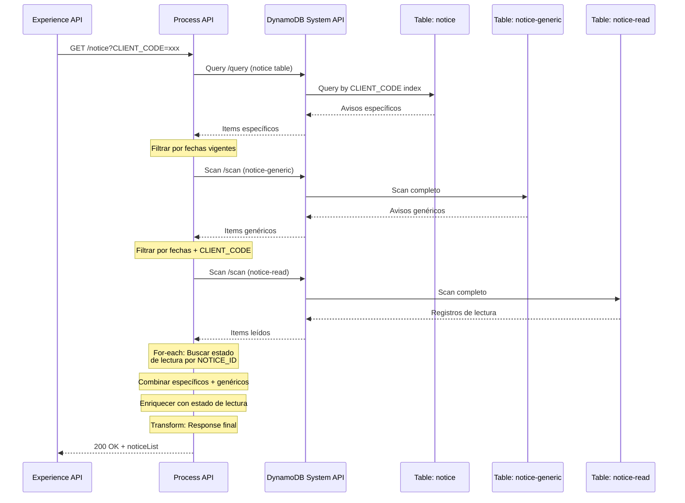
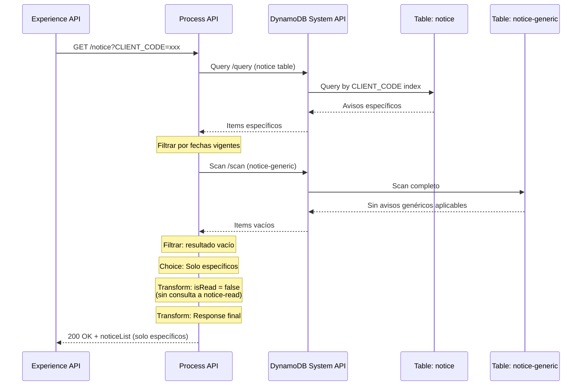
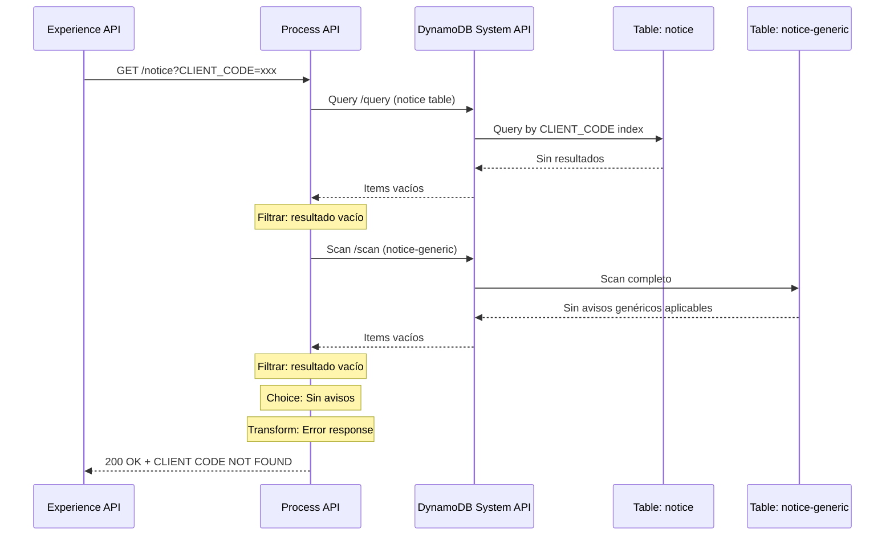

# GET /notice

## 📌 Descripción General

### Propósito del Endpoint

Este endpoint obtiene el listado completo de avisos (notificaciones) activos para un cliente específico, combinando avisos personalizados y avisos genéricos aplicables al cliente. Implementa una lógica compleja de consulta a múltiples tablas de DynamoDB con filtrado por fechas de vigencia y enriquecimiento con estado de lectura.

### Tipo de API

**Capa:** Process API (API-Led Connectivity)

**Función:** Orquestación de consultas a DynamoDB para agregación de avisos del cliente

### Patrón de Integración

**Tipo:** Orquestación con Agregación y Transformación

**Descripción:** Realiza múltiples consultas a DynamoDB (query y scan), filtra por fechas de vigencia, combina resultados de avisos específicos y genéricos, y enriquece con información de estado de lectura mediante transformaciones DataWeave complejas.

### Arquitectura API-Led Connectivity



---

## 💼 Propósito del Negocio

### Casos de Uso Principales

1. **Visualización de Avisos en Portal de Cliente**
   - Cliente accede a su portal y ve avisos importantes personalizados
   - Beneficio: Comunicación proactiva de información relevante

2. **Notificaciones de Campañas Genéricas**
   - Sistema muestra avisos genéricos aplicables al segmento del cliente
   - Beneficio: Difusión eficiente de información masiva segmentada

3. **Seguimiento de Avisos Leídos**
   - Sistema marca avisos como leídos y registra fecha de lectura
   - Beneficio: Control de visualización y métricas de engagement

### 🔗 Endpoints Dependientes

Este Process API consume los siguientes System APIs:

| System API | Endpoint | Método | Propósito |
|------------|----------|--------|-----------|
| `ntgy-fua-s-dynamodb` | `/query` | GET | Consulta de avisos específicos del cliente usando índice CLIENT_CODE-index |
| `ntgy-fua-s-dynamodb` | `/scan` | GET | Escaneo de avisos genéricos y registro de lectura (2 llamadas) |

### Lógica de Orquestación



**Pasos del Proceso:**

1. **Consulta de Avisos Específicos**: Query a tabla `ntgy-dydb-fua-notice` usando índice `CLIENT_CODE-index`
2. **Filtrado por Vigencia**: Aplicar filtro DataWeave para avisos con fechas vigentes (START_DATE &lt;= hoy &lt;= END_DATE)
3. **Escaneo de Avisos Genéricos**: Scan completo de tabla `ntgy-dydb-fua-notice-generic`
4. **Filtrado Genéricos**: Filtrar por fechas vigentes Y validar que CLIENT_CODE esté en NOTICE_ID
5. **Consulta Condicional de Lectura**: Si hay avisos genéricos, consultar tabla `ntgy-dydb-fua-notice-read`
6. **Iteración y Enriquecimiento**: For-each sobre avisos genéricos para buscar estado de lectura
7. **Agregación Final**: Combinar avisos específicos + genéricos con estado de lectura
8. **Transformación de Respuesta**: Estructurar respuesta con campos normalizados

### Transformaciones Aplicadas

**Transformaciones Complejas:**

| Transformación | Descripción | Ubicación |
|----------------|-------------|-----------|
| **Filtrado de Fechas** | Convierte fechas de formato `DD/MM/YYYY_HH:MM:SS` a Date y compara con fecha actual | Inline en flow (líneas 28-30, 42-44) |
| **Extracción de CLIENT_CODE** | Extrae CLIENT_CODE de NOTICE_ID usando split por delimitadores `[-/]` | Inline en flow (línea 44) |
| **Enriquecimiento con Estado** | Busca en array de avisos leídos y marca isRead según coincidencia | Inline en flow (líneas 68-76) |
| **Normalización de Estructura** | Transforma campos DynamoDB a estructura de respuesta estándar | Inline en flow (líneas 68-82) |

**Campos Transformados:**

| Campo DynamoDB | Campo Response | Transformación |
|----------------|----------------|----------------|
| `NOTICE_ID` | `noticeId` | Directo |
| `NOTICE_ID` | `type` | Split por `-` y extraer posición [1] |
| N/A | `isRead` | Calculado: buscar en array de leídos |
| `READ_DATE` | `date` | Condicional: solo si isRead = true |
| `PARAMS_DATE` | `params` | Condicional: solo si no está vacío |
| `ADDRESS` | `address` | Condicional: solo si no está vacío |

### Contexto Empresarial

- **Dominio:** Gestión de Notificaciones y Comunicaciones
- **Sector:** Energía - Utilities
- **División:** Naturgy España - Clientes Minoristas
- **Proceso de Negocio:** Sistema de avisos y notificaciones del portal FUA (Frontal Único de Atención)

### Stakeholders

- **Clientes Finales**: Reciben avisos personalizados y genéricos en su portal
- **Equipo de Marketing**: Gestiona campañas de avisos genéricos segmentados
- **Equipo de Atención al Cliente**: Visualiza avisos del cliente en herramientas de agente
- **Equipo de Producto Digital**: Analiza métricas de lectura y engagement

### Valor de Negocio

- **Comunicación Proactiva**: Notificar al cliente de información relevante antes de que la solicite
- **Segmentación Eficiente**: Avisos genéricos aplicables a grupos de clientes específicos
- **Métricas de Engagement**: Seguimiento de qué avisos son leídos y cuándo
- **Reducción de Llamadas**: Información disponible en portal reduce consultas telefónicas

### Consumidores Potenciales

Este endpoint puede ser consumido por:
- Portal web de autoservicio FUA
- Aplicaciones móviles de clientes
- Sistemas de agentes de call center
- Herramientas de análisis y reporting

---

## 🔧 Especificación Técnica

### URLs por Ambiente

| Ambiente | URL Base | URL Completa |
|----------|----------|--------------|
| **Local** | `http://localhost:8084` | `http://localhost:8084/api/notice?CLIENT_CODE=234567890&docNumber=1784` |
| **Development** | `https://ntgy-fua-p-imp-customer-queries-dev.de-c1.cloudhub.io` | `https://ntgy-fua-p-imp-customer-queries-dev.de-c1.cloudhub.io/api/notice?CLIENT_CODE=234567890&docNumber=1784` |
| **UAT** | `https://ntgy-fua-p-imp-customer-queries-uat.de-c1.cloudhub.io` | `https://ntgy-fua-p-imp-customer-queries-uat.de-c1.cloudhub.io/api/notice?CLIENT_CODE=234567890&docNumber=1784` |
| **Production** | `https://ntgy-fua-p-imp-customer-queries-pro.de-c1.cloudhub.io` | `https://ntgy-fua-p-imp-customer-queries-pro.de-c1.cloudhub.io/api/notice?CLIENT_CODE=234567890&docNumber=1784` |

### Método HTTP

```
GET /api/notice
```

### Parámetros de Entrada

#### Query Parameters

| Parámetro | Tipo | Requerido | Descripción | Ejemplo |
|-----------|------|-----------|-------------|---------|
| `CLIENT_CODE` | string | ✅ Sí | Código único del cliente | `"234567890"` |
| `docNumber` | string | ✅ Sí | Número de documento del cliente (NIF/NIE) - **Solo para trazabilidad** | `"1784"` |

**Validaciones:**
- Ambos parámetros son obligatorios según RAML
- `CLIENT_CODE` se usa para consultar avisos específicos y filtrar genéricos
- ⚠️ **`docNumber` NO se usa en la lógica de negocio** - Solo se captura para trazabilidad/auditoría

**Nota Importante:** El parámetro `docNumber` está definido en el RAML y se captura en el flow, pero **no se utiliza en ninguna consulta a DynamoDB ni en transformaciones**. Solo `CLIENT_CODE` determina qué avisos se retornan.

### Respuestas

#### 200 OK - Avisos Encontrados

**Estructura de Respuesta:**

```json
{
  "result": {
    "codResult": "0000",
    "msgResult": "OK"
  },
  "noticeList": [
    {
      "noticeId": "string",
      "type": "string",
      "isRead": boolean,
      "date": "string (opcional)",
      "params": "string (opcional)",
      "address": "string (opcional)"
    }
  ]
}
```

**Campos de Respuesta:**

| Campo | Tipo | Descripción |
|-------|------|-------------|
| `result.codResult` | string | Código de resultado: `"0000"` = éxito, `"0001"` = cliente no encontrado |
| `result.msgResult` | string | Mensaje descriptivo del resultado |
| `noticeList` | array | Lista de avisos activos del cliente |
| `noticeList[].noticeId` | string | Identificador único del aviso |
| `noticeList[].type` | string | Tipo de aviso (extraído de NOTICE_ID) |
| `noticeList[].isRead` | boolean | Indica si el aviso ha sido leído por el cliente |
| `noticeList[].date` | string | Fecha de lectura (solo si isRead = true) |
| `noticeList[].params` | string | Parámetros adicionales del aviso (opcional) |
| `noticeList[].address` | string | Dirección asociada al aviso (opcional) |

#### 200 OK - Cliente Sin Avisos

```json
{
  "result": {
    "codResult": "0001",
    "msgResult": "CLIENT CODE NOT FOUND"
  }
}
```

**Descripción:** Se retorna cuando no existen avisos específicos ni genéricos para el cliente.

#### 400 Bad Request

```json
{
  "message": "Bad request"
}
```

**Causas:**
- Parámetros requeridos faltantes
- Formato de parámetros inválido

#### 500 Internal Server Error

```json
{
  "message": "Internal server error"
}
```

**Causas:**
- Error en consulta a DynamoDB
- Error en transformación DataWeave
- Timeout en llamadas a System API

### Autenticación

- **Tipo:** OAuth 2.0 (Client Credentials)
- **Headers Requeridos:**
  - `Authorization: Bearer {access_token}`
  - `client_id: {your_client_id}`
  - `client_secret: {your_client_secret}`

### Timeouts

| Tipo | Valor |
|------|-------|
| **Request Timeout** | 30 segundos |
| **Connection Timeout** | 30 segundos |

---

## 🏗️ Implementación Técnica

### Arquitectura del Flow



### Transformaciones DataWeave

#### 1. Filtrado de Avisos Específicos por Fechas (Líneas 28-30)

```dataweave
%dw 2.0
output application/json
---
(payload.items filter ((item, index) -> 
    (((((item.'START_DATE' splitBy (/_/))[0]) replace "/" with ("-")) as Date) <= now() as Date) 
    and 
    (((((item.'END_DATE' splitBy (/_/))[0]) replace "/" with ("-")) as Date) >= now() as Date)
)) default []
```

**Propósito:** Filtrar avisos específicos que estén dentro del rango de fechas vigentes.

**Lógica:**
1. Extrae fecha de `START_DATE` (formato: `DD/MM/YYYY_HH:MM:SS`)
2. Toma solo la parte de fecha con `splitBy (/_/)[0]`
3. Reemplaza `/` por `-` para formato ISO
4. Convierte a tipo Date
5. Compara que START_DATE &lt;= hoy &lt;= END_DATE

#### 2. Filtrado de Avisos Genéricos (Líneas 42-44)

```dataweave
%dw 2.0
output application/json
---
payload.items filter ((item, index) -> 
    (((((item.'START_DATE' splitBy (/_/))[0]) replace "/" with ("-")) as Date) <= now() as Date) 
    and 
    (((((item.'END_DATE' splitBy (/_/))[0]) replace "/" with ("-")) as Date) >= now() as Date) 
    and 
    (((item.NOTICE_ID splitBy(/[-\/]/))[2]) == vars.queryParams.'CLIENT_CODE')
)
```

**Propósito:** Filtrar avisos genéricos vigentes Y aplicables al cliente específico.

**Lógica Adicional:**
- Extrae CLIENT_CODE del NOTICE_ID usando split por `-` o `/`
- Toma posición [2] del array resultante
- Compara con CLIENT_CODE del query parameter

#### 3. Enriquecimiento con Estado de Lectura (Líneas 68-76)

```dataweave
%dw 2.0
output application/json

fun transform(noticeList) = noticeList map (notice, index) -> {
    'noticeId': notice.'NOTICE_ID',
    'type': (notice.'NOTICE_ID' splitBy (/-/))[1],
    'isRead': vars.noticeGenericReadFin.NOTICE_ID contains(notice.NOTICE_ID),
    'date': if((vars.noticeGenericReadFin.NOTICE_ID contains(notice.NOTICE_ID)) == true) 
            (vars.tableNoticeGenericRead.items filter ((item, index) -> (item.NOTICE_ID == notice.NOTICE_ID))) 
            else(""),
    ('params': notice.'PARAMS_DATE') if not isEmpty(notice.'PARAMS_DATE'),
    ('address': notice.'ADDRESS') if not isEmpty(notice.'ADDRESS')
}
---
transform(payload)
```

**Propósito:** Transformar estructura DynamoDB a formato de respuesta con estado de lectura.

**Lógica:**
1. Extrae `type` del NOTICE_ID (posición [1] después de split por `-`)
2. Calcula `isRead` verificando si NOTICE_ID está en array de leídos
3. Si está leído, busca fecha de lectura en tabla notice-read
4. Incluye campos opcionales solo si no están vacíos

#### 4. Transformación Final de Respuesta (Líneas 78-82)

```dataweave
%dw 2.0
output application/json

fun transform(noticeList) = noticeList map (notice, index) -> {
    'noticeId': notice.noticeId,
    'type': notice.'type',
    'isRead': notice.isRead,
    ('date': notice.date[0].'READ_DATE') if not isEmpty(notice.date[0].'READ_DATE')
}
---
{
    "result":{
        "codResult": "0000",
        "msgResult": "OK"
    },
    "noticeList": transform(payload)
}
```

**Propósito:** Estructura final de respuesta con código de resultado.

### Patrones de Diseño

**Patrón 1: Aggregator Pattern**

**Justificación:** Combina datos de múltiples fuentes (avisos específicos + genéricos + estado de lectura) en una sola respuesta coherente.

**Patrón 2: Content Enricher Pattern**

**Justificación:** Enriquece avisos básicos con información de estado de lectura mediante consulta adicional.

**Patrón 3: Filter Pattern**

**Justificación:** Aplica múltiples filtros (fechas, CLIENT_CODE) para obtener solo avisos relevantes.

### Diagramas de Secuencia

#### 1. Flujo Normal de Éxito (Con Avisos Genéricos)



#### 2. Flujo con Solo Avisos Específicos



#### 3. Flujo Sin Avisos (Cliente No Encontrado)



### Manejo de Errores

**Estrategia de Manejo de Errores:**

1. **Error de Parámetros Faltantes:**
   - Validación: APIKit valida parámetros requeridos
   - Respuesta: 400 Bad Request

2. **Error en Consulta a DynamoDB:**
   - Manejo: Try-catch en HTTP request
   - Respuesta: 500 Internal Server Error
   - Log: Error completo con stack trace

3. **Error en Transformación DataWeave:**
   - Manejo: Error handler en flow
   - Respuesta: 500 Internal Server Error
   - Log: Payload que causó el error

4. **Timeout en System API:**
   - Timeout configurado: 30 segundos
   - Respuesta: 504 Gateway Timeout
   - Log: Tiempo transcurrido y endpoint

5. **Cliente Sin Avisos:**
   - NO es un error técnico
   - Respuesta: 200 OK con codResult "0001"
   - Mensaje: "CLIENT CODE NOT FOUND"

**Códigos de Error Personalizados:**

| Código | Mensaje | Descripción |
|--------|---------|-------------|
| `0000` | OK | Operación exitosa con avisos |
| `0001` | CLIENT CODE NOT FOUND | Cliente sin avisos activos |

---

## 💻 Ejemplos de Uso

### Ejemplo 1: Cliente con Avisos Específicos y Genéricos

#### cURL

```bash
curl -X GET "https://ntgy-fua-p-imp-customer-queries-pro.de-c1.cloudhub.io/api/notice?CLIENT_CODE=234567890&docNumber=12345678X" \
  -H "Content-Type: application/json" \
  -H "client_id: YOUR_CLIENT_ID" \
  -H "client_secret: YOUR_CLIENT_SECRET"
```

#### Respuesta (200 OK)

```json
{
  "result": {
    "codResult": "0000",
    "msgResult": "OK"
  },
  "noticeList": [
    {
      "noticeId": "NOT-PROMO-234567890-001",
      "type": "PROMO",
      "isRead": false,
      "params": "2024-12-31",
      "address": "Calle Mayor 123, Madrid"
    },
    {
      "noticeId": "NOT-INFO-234567890-002",
      "type": "INFO",
      "isRead": true,
      "date": "2024-09-15T10:30:00Z"
    },
    {
      "noticeId": "NOT-ALERT-GEN-234567890",
      "type": "ALERT",
      "isRead": true,
      "date": "2024-09-16T14:20:00Z"
    }
  ]
}
```

### Ejemplo 2: Cliente Sin Avisos

#### cURL

```bash
# Nota: docNumber es requerido por RAML pero no afecta el resultado
curl -X GET "https://ntgy-fua-p-imp-customer-queries-pro.de-c1.cloudhub.io/api/notice?CLIENT_CODE=999999999&docNumber=99999999Z" \
  -H "Content-Type: application/json" \
  -H "client_id: YOUR_CLIENT_ID" \
  -H "client_secret: YOUR_CLIENT_SECRET"
```

#### Respuesta (200 OK)

```json
{
  "result": {
    "codResult": "0001",
    "msgResult": "CLIENT CODE NOT FOUND"
  }
}
```

### Ejemplo 3: JavaScript (Fetch API)

```javascript
const getClientNotices = async (clientCode, docNumber) => {
  try {
    const response = await fetch(
      `https://ntgy-fua-p-imp-customer-queries-pro.de-c1.cloudhub.io/api/notice?CLIENT_CODE=${clientCode}&docNumber=${docNumber}`,
      {
        method: 'GET',
        headers: {
          'Content-Type': 'application/json',
          'client_id': 'YOUR_CLIENT_ID',
          'client_secret': 'YOUR_CLIENT_SECRET'
        }
      }
    );

    const data = await response.json();
    
    if (data.result.codResult === '0000') {
      console.log(`Found ${data.noticeList.length} notices`);
      
      // Filtrar avisos no leídos
      const unreadNotices = data.noticeList.filter(notice => !notice.isRead);
      console.log(`Unread notices: ${unreadNotices.length}`);
      
      return data.noticeList;
    } else {
      console.log('No notices found for this client');
      return [];
    }
  } catch (error) {
    console.error('Error fetching notices:', error);
    throw error;
  }
};

// Uso
getClientNotices('234567890', '12345678X')
  .then(notices => {
    notices.forEach(notice => {
      console.log(`${notice.type}: ${notice.noticeId} - Read: ${notice.isRead}`);
    });
  });
```

### Ejemplo 4: Python (Requests)

```python
import requests
from typing import List, Dict, Optional

def get_client_notices(
    client_code: str, 
    doc_number: str,
    client_id: str,
    client_secret: str,
    environment: str = 'pro'
) -> Optional[List[Dict]]:
    """
    Obtiene los avisos activos de un cliente.
    
    Args:
        client_code: Código del cliente
        doc_number: Número de documento del cliente
        client_id: Client ID para autenticación
        client_secret: Client Secret para autenticación
        environment: Ambiente (dev, uat, pro)
    
    Returns:
        Lista de avisos o None si no hay avisos
    """
    base_url = f'https://ntgy-fua-p-imp-customer-queries-{environment}.de-c1.cloudhub.io'
    url = f'{base_url}/api/notice'
    
    params = {
        'CLIENT_CODE': client_code,
        'docNumber': doc_number
    }
    
    headers = {
        'Content-Type': 'application/json',
        'client_id': client_id,
        'client_secret': client_secret
    }
    
    try:
        response = requests.get(url, params=params, headers=headers, timeout=30)
        response.raise_for_status()
        
        data = response.json()
        
        if data['result']['codResult'] == '0000':
            print(f"Found {len(data['noticeList'])} notices for client {client_code}")
            return data['noticeList']
        else:
            print(f"No notices found: {data['result']['msgResult']}")
            return None
            
    except requests.exceptions.RequestException as e:
        print(f"Error fetching notices: {e}")
        raise

# Uso
if __name__ == '__main__':
    notices = get_client_notices(
        client_code='234567890',
        doc_number='12345678X',
        client_id='YOUR_CLIENT_ID',
        client_secret='YOUR_CLIENT_SECRET',
        environment='pro'
    )
    
    if notices:
        # Separar avisos leídos y no leídos
        unread = [n for n in notices if not n['isRead']]
        read = [n for n in notices if n['isRead']]
        
        print(f"\nUnread notices: {len(unread)}")
        for notice in unread:
            print(f"  - {notice['type']}: {notice['noticeId']}")
        
        print(f"\nRead notices: {len(read)}")
        for notice in read:
            print(f"  - {notice['type']}: {notice['noticeId']} (read on {notice.get('date', 'N/A')})")
```
