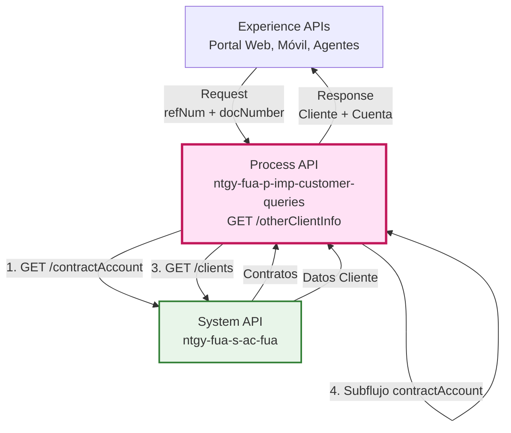
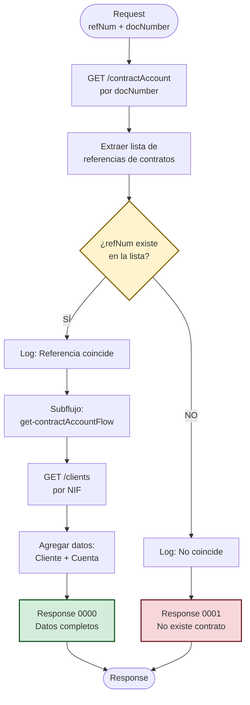
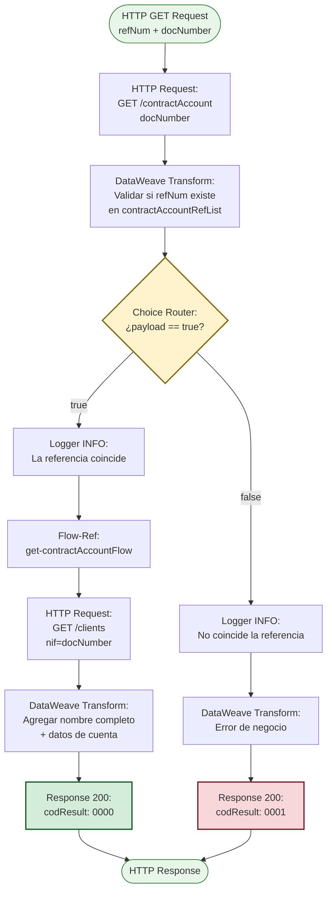
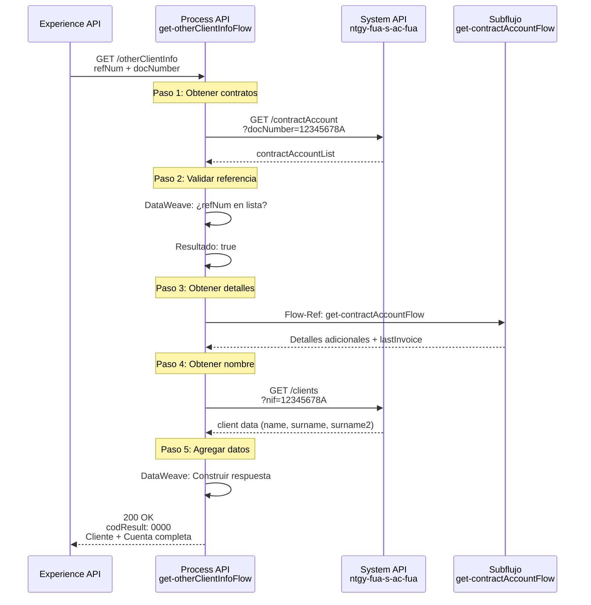
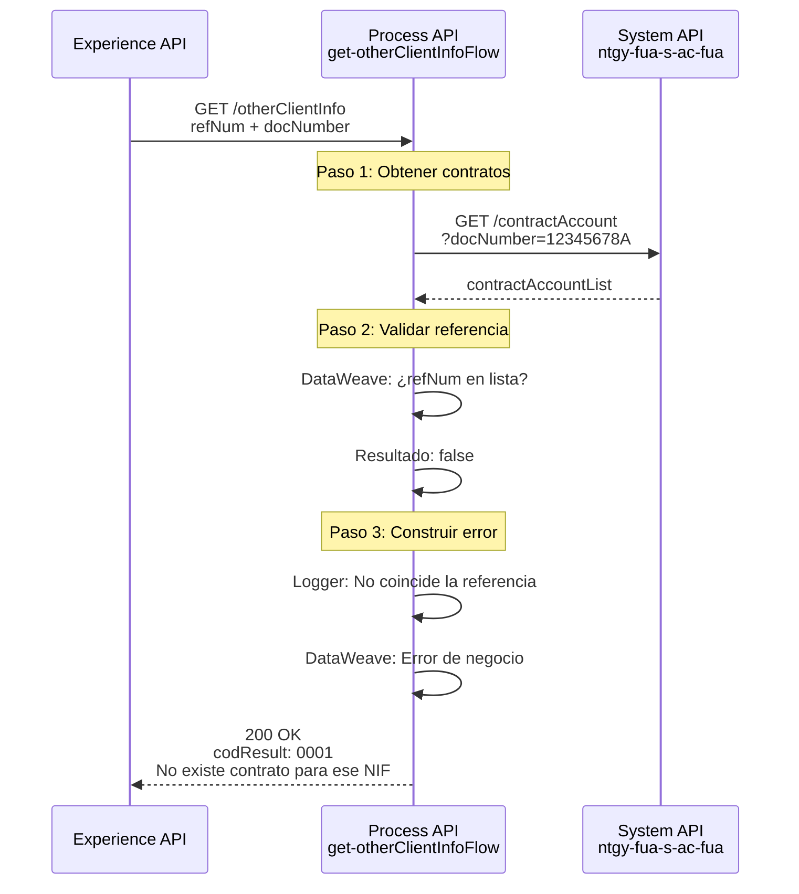
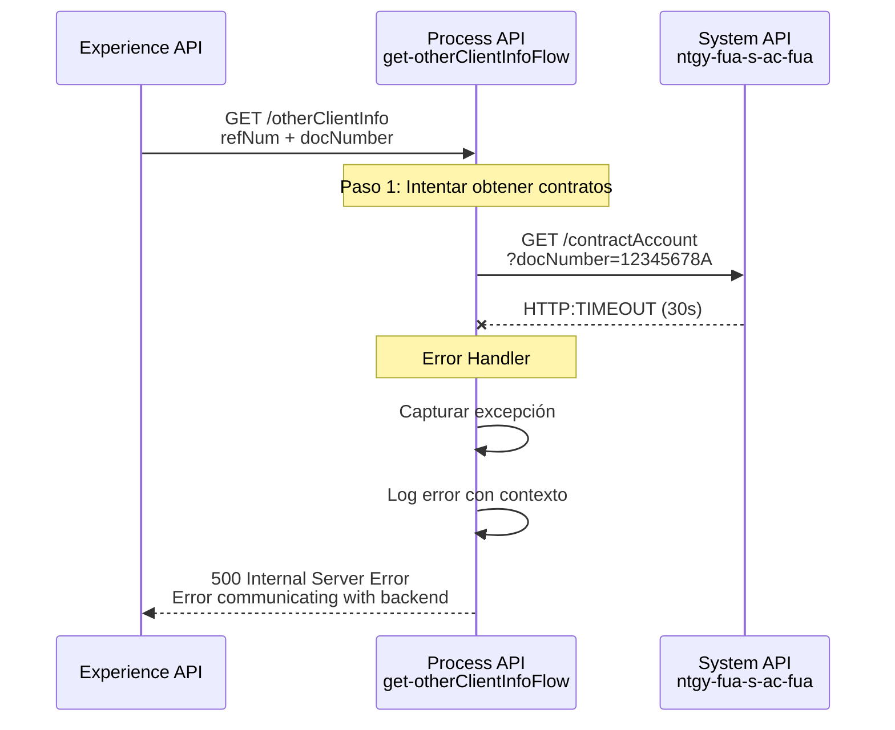

# GET /otherClientInfo

## 📌 Descripción General

### Propósito del Endpoint

Este endpoint valida que un cliente específico (identificado por DNI) tiene acceso a un contrato determinado (identificado por número de referencia). Orquesta múltiples llamadas al System API para verificar la relación cliente-contrato y, si es válida, retorna información completa del cliente y su cuenta contractual.

### Tipo de API

**Capa:** Process API (API-Led Connectivity)

**Función:** Orquestación de validación de relación cliente-contrato con agregación de datos

### Patrón de Integración

**Tipo:** Orquestación con Validación Condicional

**Descripción:** 
1. Obtiene contratos del cliente por DNI
2. Valida si la referencia proporcionada existe en los contratos
3. Si válido: Obtiene datos completos del cliente y cuenta contractual
4. Si inválido: Retorna error de negocio

### Arquitectura API-Led Connectivity



---

## 💼 Propósito del Negocio

### Casos de Uso Principales

1. **Validación de Identidad en Atención al Cliente**
   - Un agente necesita verificar que el cliente tiene acceso al contrato que menciona
   - Previene acceso no autorizado a información de contratos
   - Beneficio: Seguridad y cumplimiento normativo

2. **Autoservicio en Portal Web**
   - Cliente intenta acceder a información de un contrato
   - Sistema valida que el DNI corresponde al titular del contrato
   - Beneficio: Experiencia de usuario segura y fluida

3. **Gestión de Contratos Relacionados**
   - Identificar otros clientes asociados a una dirección o contrato
   - Validar relaciones familiares o comerciales
   - Beneficio: Gestión integral de cuentas relacionadas

### 🔗 Endpoints Dependientes

Este Process API consume los siguientes System APIs:

| System API | Endpoint | Método | Propósito |
|------------|----------|--------|-----------|
| `ntgy-fua-s-ac-fua` | `/contractAccount` | GET | Obtiene lista de contratos del cliente por DNI |
| `ntgy-fua-s-ac-fua` | `/clients` | GET | Obtiene nombre completo del cliente |

**Subflujo Interno:**
- `get-contractAccountFlow`: Obtiene detalles adicionales de la cuenta contractual (última factura, dirección)

### Lógica de Orquestación



**Pasos del Proceso:**

1. **Paso 1 - Obtención de Contratos**: Llama a `/contractAccount` con `docNumber` para obtener todos los contratos del cliente
2. **Paso 2 - Validación**: Verifica si `refNum` existe en la lista de referencias de contratos (`contractAccountRefList..contractRefNum`)
3. **Paso 3a - Si Válido**: 
   - Ejecuta subflujo `get-contractAccountFlow` para obtener detalles adicionales
   - Llama a `/clients` para obtener nombre completo
   - Agrega toda la información en una respuesta unificada
4. **Paso 3b - Si Inválido**: Retorna error de negocio con código 0001

### Transformaciones Aplicadas

**Transformación 1: Validación de Referencia (DataWeave)**

```dataweave
%dw 2.0
output application/json
---
if (vars.otherClientInfo.contractAccountList.contractAccountRefList..contractRefNum
    contains attributes.queryParams.refNum) 
    true
else 
    false
```

**Transformación 2: Agregación de Datos (DataWeave)**

| Campo Original (System API) | Campo Transformado (Process API) | Transformación |
|------------------------------|----------------------------------|----------------|
| `vars.client.name` + `surname` + `surname2` | `otherClientInfo.name` | Concatenación de nombre completo |
| `payload.contractAccountList[0]` | `otherClientInfo.contractAccount` | Extracción del primer elemento |
| `payload.lastInvoice` | `otherClientInfo.contractAccount.lastInvoice` | Agregación de datos del subflujo |

### Contexto Empresarial

- **Dominio:** Gestión de Clientes y Contratos
- **Sector:** Energía - Utilities (Gas & Electricidad)
- **División:** Naturgy España - FUA (Frontal Único de Atención)
- **Proceso de Negocio:** Validación de acceso y seguridad de datos

### Stakeholders

- **Agentes de Atención al Cliente**: Necesitan verificar identidad antes de proporcionar información
- **Clientes Finales**: Acceden a información de contratos de forma segura
- **Equipo de Seguridad**: Requieren trazabilidad de accesos a datos sensibles
- **Equipo de Cumplimiento**: Aseguran cumplimiento de GDPR y LOPD

### Valor de Negocio

- **Seguridad**: Previene acceso no autorizado a información de contratos
- **Cumplimiento Normativo**: Asegura que solo titulares accedan a sus datos
- **Eficiencia Operativa**: Validación automática reduce tiempo de verificación manual
- **Experiencia de Usuario**: Proceso transparente y rápido de validación

### Consumidores Potenciales

Este endpoint puede ser consumido por:
- Portales web de autoservicio (FUA Portal)
- Aplicaciones móviles de clientes
- Sistemas de agentes de call center
- Aplicaciones de gestión de contratos
- Sistemas de validación de identidad

---

## 🔧 Especificación Técnica

### URLs por Ambiente

| Ambiente | URL Base | URL Completa |
|----------|----------|--------------|
| **Local** | `http://localhost:8091` | `http://localhost:8091/api/otherClientInfo?refNum=:refNum&docNumber=:docNumber` |
| **Development** | `https://ntgy-fua-p-imp-customer-queries-dev.de-c1.cloudhub.io` | `https://ntgy-fua-p-imp-customer-queries-dev.de-c1.cloudhub.io/api/otherClientInfo?refNum=:refNum&docNumber=:docNumber` |
| **UAT** | `https://ntgy-fua-p-imp-customer-queries-uat.de-c1.cloudhub.io` | `https://ntgy-fua-p-imp-customer-queries-uat.de-c1.cloudhub.io/api/otherClientInfo?refNum=:refNum&docNumber=:docNumber` |
| **Production** | `https://ntgy-fua-p-imp-customer-queries-pro.de-c1.cloudhub.io` | `https://ntgy-fua-p-imp-customer-queries-pro.de-c1.cloudhub.io/api/otherClientInfo?refNum=:refNum&docNumber=:docNumber` |

### Método HTTP

```
GET /api/otherClientInfo
```

### Parámetros de Entrada

#### Query Parameters (Obligatorios)

| Parámetro | Tipo | Obligatorio | Descripción | Ejemplo |
|-----------|------|-------------|-------------|---------|
| `refNum` | string | ✅ Sí | Número de referencia del contrato a validar | `"1234567"` |
| `docNumber` | string | ✅ Sí | Número de documento del cliente (DNI/NIE) | `"12345678A"` |

**Validaciones:**
- Ambos parámetros son obligatorios
- `docNumber` debe ser un documento válido español (DNI/NIE)
- `refNum` debe ser un número de referencia de contrato válido

### Respuestas

#### ✅ 200 OK - Validación Exitosa

**Descripción:** La referencia coincide con el DNI del cliente

```json
{
  "result": {
    "codResult": "0000",
    "msgResult": "No hay error"
  },
  "otherClientInfo": {
    "name": "Juan García López",
    "contractAccount": {
      "contractAccountId": "123456789",
      "clientId": "987654321",
      "contractAccountRefList": [
        {
          "contractRefNum": "1234567",
          "contractId": "CON123456",
          "status": "ACTIVE"
        }
      ],
      "lastInvoice": {
        "invoiceId": "INV789012",
        "amount": 85.50,
        "date": "2026-08-15"
      },
      "address": {
        "street": "Calle Mayor",
        "number": "123",
        "city": "Madrid",
        "postalCode": "28001"
      }
    }
  }
}
```

**Campos de Respuesta:**

| Campo | Tipo | Descripción |
|-------|------|-------------|
| `result.codResult` | string | Código de resultado (`"0000"` = éxito) |
| `result.msgResult` | string | Mensaje descriptivo del resultado |
| `otherClientInfo.name` | string | Nombre completo del cliente (nombre + apellidos) |
| `otherClientInfo.contractAccount.contractAccountId` | string | ID de la cuenta contractual |
| `otherClientInfo.contractAccount.clientId` | string | ID del cliente |
| `otherClientInfo.contractAccount.contractAccountRefList` | array | Lista de referencias de contratos asociados |
| `otherClientInfo.contractAccount.lastInvoice` | object | Información de la última factura |
| `otherClientInfo.contractAccount.address` | object | Dirección de la cuenta contractual |

#### ❌ 200 OK - Validación Fallida (Error de Negocio)

**Descripción:** La referencia NO coincide con el DNI del cliente

```json
{
  "result": {
    "codResult": "0001",
    "msgResult": "No existe contrato para ese NIF"
  }
}
```

**Campos de Respuesta:**

| Campo | Tipo | Descripción |
|-------|------|-------------|
| `result.codResult` | string | Código de error (`"0001"` = no existe relación) |
| `result.msgResult` | string | Mensaje descriptivo del error |

#### ⚠️ 400 Bad Request

**Descripción:** Parámetros faltantes o inválidos

```json
{
  "error": {
    "code": "BAD_REQUEST",
    "message": "Missing required query parameters: refNum, docNumber"
  }
}
```

#### ⚠️ 500 Internal Server Error

**Descripción:** Error en la comunicación con System APIs

```json
{
  "error": {
    "code": "INTERNAL_ERROR",
    "message": "Error communicating with backend system"
  }
}
```

### Autenticación

- **Tipo:** Client ID & Client Secret (Anypoint Platform)
- **Headers Requeridos:**
  - `client_id`: ID de la aplicación cliente
  - `client_secret`: Secret de la aplicación cliente

### Timeouts

| Tipo | Valor | Descripción |
|------|-------|-------------|
| **Request Timeout** | 30 segundos | Timeout para llamadas a System API |
| **Connection Timeout** | 30 segundos | Timeout de conexión idle |

---

## 🏗️ Implementación Técnica

### Arquitectura del Flow



### Código de Implementación

**Flow Principal (get-otherClientInfoFlow):**

```xml
<flow name="get-otherClientInfoFlow" doc:id="9344a582-327e-47f7-aa3f-7353dafef2c1">
    <!-- Paso 1: Obtener contratos del cliente -->
    <http:request method="GET" 
                  doc:name="Se buscan contratos activos en base al docNumber" 
                  config-ref="HTTP_API_SistemaAC" 
                  path="/contractAccount" 
                  target="otherClientInfo" 
                  responseTimeout="30000">
        <http:query-params>
            <![CDATA[#[output application/java
            ---
            {
                "docNumber" : attributes.queryParams.docNumber
            }]]]>
        </http:query-params>
    </http:request>
    
    <!-- Paso 2: Validar si refNum existe en la lista -->
    <ee:transform doc:name="Transform Message">
        <ee:message>
            <ee:set-payload>
                <![CDATA[%dw 2.0
                output application/json
                ---
                if (vars.otherClientInfo.contractAccountList.contractAccountRefList..contractRefNum
                    contains attributes.queryParams.refNum) 
                    true
                else 
                    false]]>
            </ee:set-payload>
        </ee:message>
    </ee:transform>
    
    <!-- Paso 3: Decisión basada en validación -->
    <choice doc:name="Choice">
        <when expression="#[payload == true]">
            <!-- Rama de éxito -->
            <logger level="INFO" 
                    doc:name="La referencia coincide con el docNumber"/>
            
            <flow-ref doc:name="Flow Reference" 
                      name="get-contractAccountFlow"/>
            
            <http:request method="GET" 
                          doc:name="Se obtiene el nombre del cliente" 
                          config-ref="HTTP_API_SistemaAC" 
                          path="/clients" 
                          target="client" 
                          targetValue="#[payload.client]">
                <http:query-params>
                    <![CDATA[#[output application/java
                    ---
                    {
                        "nif" : attributes.queryParams.docNumber
                    }]]]>
                </http:query-params>
            </http:request>
            
            <ee:transform doc:name="Transform Message">
                <ee:message>
                    <ee:set-payload>
                        <![CDATA[%dw 2.0
                        output application/json
                        ---
                        {
                          result: {
                            codResult: "0000",
                            msgResult: "No hay error"
                          },
                          otherClientInfo: {
                            name: vars.client.name ++ " " ++ vars.client.surname ++ " " ++ vars.client.surname2,
                            contractAccount: {
                                contractAccountId: payload.contractAccountList[0].contractAccountId,
                                clientId: payload.contractAccountList[0].clientId,
                                contractAccountRefList: payload.contractAccountList[0].contractAccountRefList,
                                lastInvoice: payload.lastInvoice,
                                address: payload.contractAccountList[0].address
                            }	
                          }
                        }]]>
                    </ee:set-payload>
                </ee:message>
            </ee:transform>
        </when>
        <otherwise>
            <!-- Rama de error de negocio -->
            <logger level="INFO" 
                    doc:name="No coincide la referencia con el NIF"/>
            
            <ee:transform doc:name="Transform Message">
                <ee:message>
                    <ee:set-payload>
                        <![CDATA[%dw 2.0
                        output application/json
                        ---
                        {
                          "result": {
                            "codResult": "0001",
                            "msgResult": "No existe contrato para ese NIF"
                          }
                        }]]>
                    </ee:set-payload>
                </ee:message>
            </ee:transform>
        </otherwise>
    </choice>
</flow>
```

### Transformaciones DataWeave

**Transformación 1: Validación de Referencia**

```dataweave
%dw 2.0
output application/json
---
if (vars.otherClientInfo.contractAccountList.contractAccountRefList..contractRefNum
    contains attributes.queryParams.refNum) 
    true
else 
    false
```

**Propósito:** Verifica si el `refNum` proporcionado existe en la lista de referencias de contratos del cliente.

**Transformación 2: Construcción de Respuesta Exitosa**

```dataweave
%dw 2.0
output application/json
---
{
  result: {
    codResult: "0000",
    msgResult: "No hay error"
  },
  otherClientInfo: {
    name: vars.client.name ++ " " ++ vars.client.surname ++ " " ++ vars.client.surname2,
    contractAccount: {
        contractAccountId: payload.contractAccountList[0].contractAccountId,
        clientId: payload.contractAccountList[0].clientId,
        contractAccountRefList: payload.contractAccountList[0].contractAccountRefList,
        lastInvoice: payload.lastInvoice,
        address: payload.contractAccountList[0].address
    }	
  }
}
```

**Propósito:** Agrega datos del cliente (nombre completo) con información de la cuenta contractual.

**Transformación 3: Construcción de Respuesta de Error**

```dataweave
%dw 2.0
output application/json
---
{
  "result": {
    "codResult": "0001",
    "msgResult": "No existe contrato para ese NIF"
  }
}
```

**Propósito:** Retorna error de negocio cuando la validación falla.

### Patrones de Diseño

**Patrón:** Content-Based Router (Choice Pattern)

**Justificación:** 
- Permite bifurcar el flujo basándose en el resultado de la validación
- Implementa lógica de negocio condicional de forma clara
- Facilita el mantenimiento al separar flujos de éxito y error

**Patrón:** Aggregation Pattern

**Justificación:**
- Combina datos de múltiples fuentes (contratos + cliente)
- Proporciona una vista unificada al consumidor
- Reduce el número de llamadas que debe hacer el cliente

### Diagramas de Secuencia

#### 1. Flujo Normal de Éxito



#### 2. Flujo con Error de Negocio (Referencia No Válida)



#### 3. Flujo con Error Técnico



### Manejo de Errores

**Estrategia de Manejo de Errores:**

1. **Errores de Validación (400)**
   - Parámetros faltantes o inválidos
   - Validación en APIKit Router
   - Respuesta inmediata sin llamar a backend

2. **Errores de Negocio (200 con codResult != 0000)**
   - Referencia no coincide con DNI
   - Respuesta controlada con código de error específico
   - Logging para auditoría

3. **Errores Técnicos (500)**
   - Timeout en llamadas a System API
   - Errores de conectividad
   - Errores de transformación DataWeave
   - Logging detallado para troubleshooting

4. **Errores de Backend (502)**
   - System API retorna error
   - Se propaga el error al consumidor
   - Logging con contexto completo

**Configuración de Timeouts:**
- Request Timeout: 30 segundos (configurado en `HTTP_API_SistemaAC`)
- Connection Idle Timeout: 30 segundos
- Ubicación: `global.xml` línea 14-16

---

## 💻 Ejemplos de Uso

### Ejemplo 1: Validación Exitosa

#### cURL

```bash
curl -X GET "https://ntgy-fua-p-imp-customer-queries-pro.de-c1.cloudhub.io/api/otherClientInfo?refNum=1234567&docNumber=12345678A" \
  -H "Content-Type: application/json" \
  -H "client_id: YOUR_CLIENT_ID" \
  -H "client_secret: YOUR_CLIENT_SECRET"
```

#### Respuesta (200 OK)

```json
{
  "result": {
    "codResult": "0000",
    "msgResult": "No hay error"
  },
  "otherClientInfo": {
    "name": "Juan García López",
    "contractAccount": {
      "contractAccountId": "123456789",
      "clientId": "987654321",
      "contractAccountRefList": [
        {
          "contractRefNum": "1234567",
          "contractId": "CON123456",
          "status": "ACTIVE",
          "product": "Electricidad"
        },
        {
          "contractRefNum": "7654321",
          "contractId": "CON789012",
          "status": "ACTIVE",
          "product": "Gas"
        }
      ],
      "lastInvoice": {
        "invoiceId": "INV789012",
        "amount": 85.50,
        "date": "2026-08-15",
        "status": "PAID"
      },
      "address": {
        "street": "Calle Mayor",
        "number": "123",
        "floor": "2",
        "door": "A",
        "city": "Madrid",
        "province": "Madrid",
        "postalCode": "28001",
        "country": "España"
      }
    }
  }
}
```

### Ejemplo 2: Validación Fallida (Referencia No Válida)

#### cURL

```bash
curl -X GET "https://ntgy-fua-p-imp-customer-queries-pro.de-c1.cloudhub.io/api/otherClientInfo?refNum=9999999&docNumber=12345678A" \
  -H "Content-Type: application/json" \
  -H "client_id: YOUR_CLIENT_ID" \
  -H "client_secret: YOUR_CLIENT_SECRET"
```

#### Respuesta (200 OK - Error de Negocio)

```json
{
  "result": {
    "codResult": "0001",
    "msgResult": "No existe contrato para ese NIF"
  }
}
```

### Ejemplo 3: JavaScript (Fetch API)

```javascript
const validateClientContract = async (refNum, docNumber) => {
  try {
    const response = await fetch(
      `https://ntgy-fua-p-imp-customer-queries-pro.de-c1.cloudhub.io/api/otherClientInfo?refNum=${refNum}&docNumber=${docNumber}`,
      {
        method: 'GET',
        headers: {
          'Content-Type': 'application/json',
          'client_id': 'YOUR_CLIENT_ID',
          'client_secret': 'YOUR_CLIENT_SECRET'
        }
      }
    );

    const data = await response.json();
    
    if (data.result.codResult === '0000') {
      console.log('✅ Validación exitosa');
      console.log('Cliente:', data.otherClientInfo.name);
      console.log('Cuenta:', data.otherClientInfo.contractAccount.contractAccountId);
      return data.otherClientInfo;
    } else {
      console.log('❌ Validación fallida:', data.result.msgResult);
      return null;
    }
  } catch (error) {
    console.error('Error en la validación:', error);
    throw error;
  }
};

// Uso
validateClientContract('1234567', '12345678A')
  .then(clientInfo => {
    if (clientInfo) {
      console.log('Información del cliente:', clientInfo);
    }
  });
```

### Ejemplo 4: Python (Requests)

```python
import requests

def validate_client_contract(ref_num, doc_number):
    """
    Valida la relación entre un cliente y un contrato
    
    Args:
        ref_num (str): Número de referencia del contrato
        doc_number (str): Número de documento del cliente (DNI/NIE)
    
    Returns:
        dict: Información del cliente si la validación es exitosa, None si falla
    """
    url = 'https://ntgy-fua-p-imp-customer-queries-pro.de-c1.cloudhub.io/api/otherClientInfo'
    
    params = {
        'refNum': ref_num,
        'docNumber': doc_number
    }
    
    headers = {
        'Content-Type': 'application/json',
        'client_id': 'YOUR_CLIENT_ID',
        'client_secret': 'YOUR_CLIENT_SECRET'
    }
    
    try:
        response = requests.get(url, params=params, headers=headers)
        response.raise_for_status()
        
        data = response.json()
        
        if data['result']['codResult'] == '0000':
            print('✅ Validación exitosa')
            print(f"Cliente: {data['otherClientInfo']['name']}")
            print(f"Cuenta: {data['otherClientInfo']['contractAccount']['contractAccountId']}")
            return data['otherClientInfo']
        else:
            print(f"❌ Validación fallida: {data['result']['msgResult']}")
            return None
            
    except requests.exceptions.RequestException as e:
        print(f'Error en la validación: {e}')
        raise

# Uso
client_info = validate_client_contract('1234567', '12345678A')
if client_info:
    print(f"Información del cliente: {client_info}")
```

### Ejemplo 5: Error de Parámetros Faltantes

#### cURL

```bash
curl -X GET "https://ntgy-fua-p-imp-customer-queries-pro.de-c1.cloudhub.io/api/otherClientInfo?refNum=1234567" \
  -H "Content-Type: application/json" \
  -H "client_id: YOUR_CLIENT_ID" \
  -H "client_secret: YOUR_CLIENT_SECRET"
```

#### Respuesta (400 Bad Request)

```json
{
  "error": {
    "code": "BAD_REQUEST",
    "message": "Missing required query parameter: docNumber"
  }
}
```
