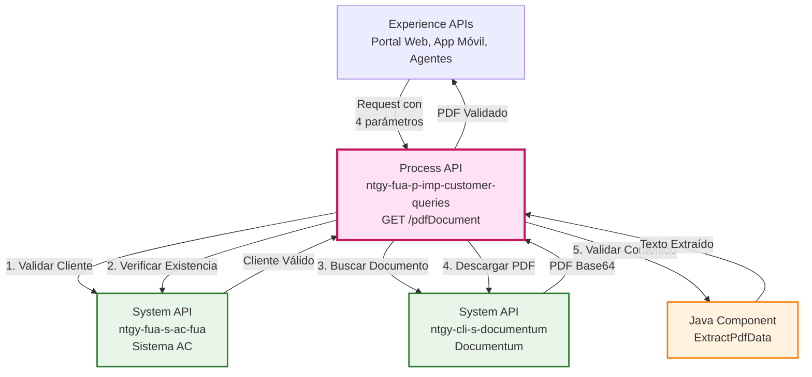
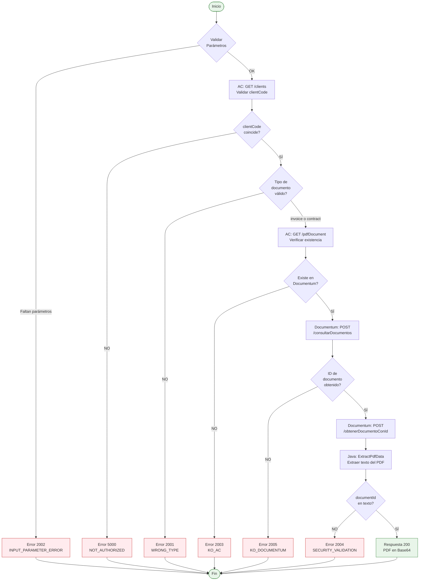
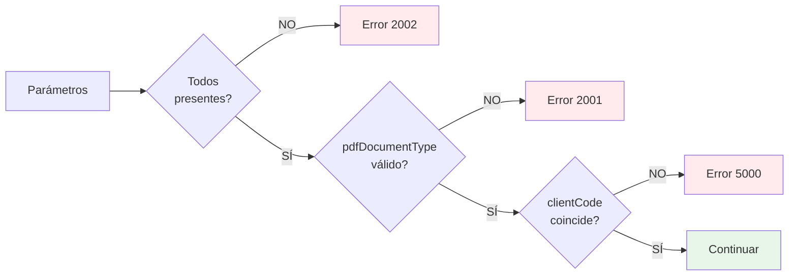
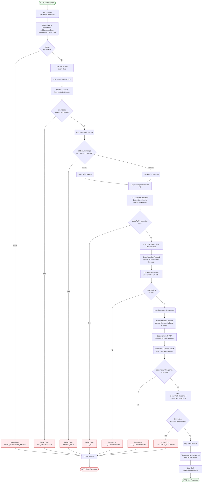
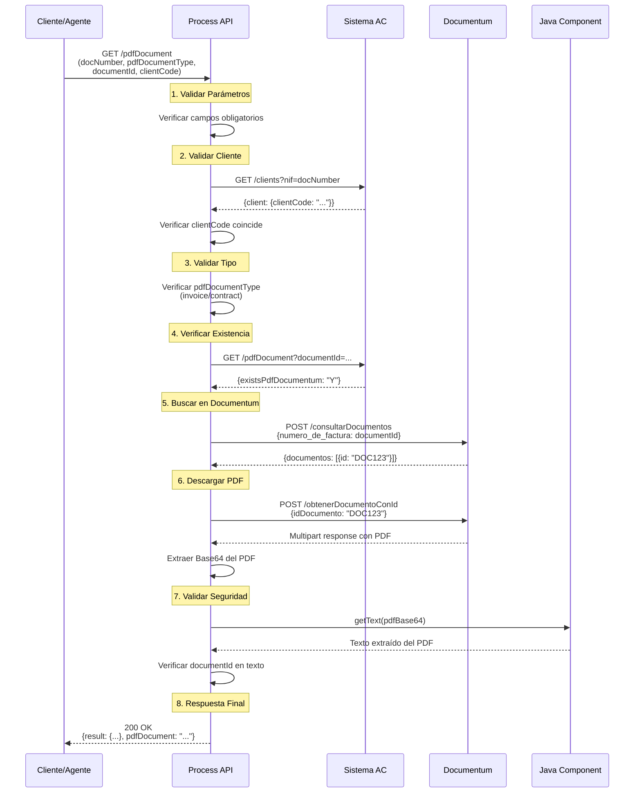
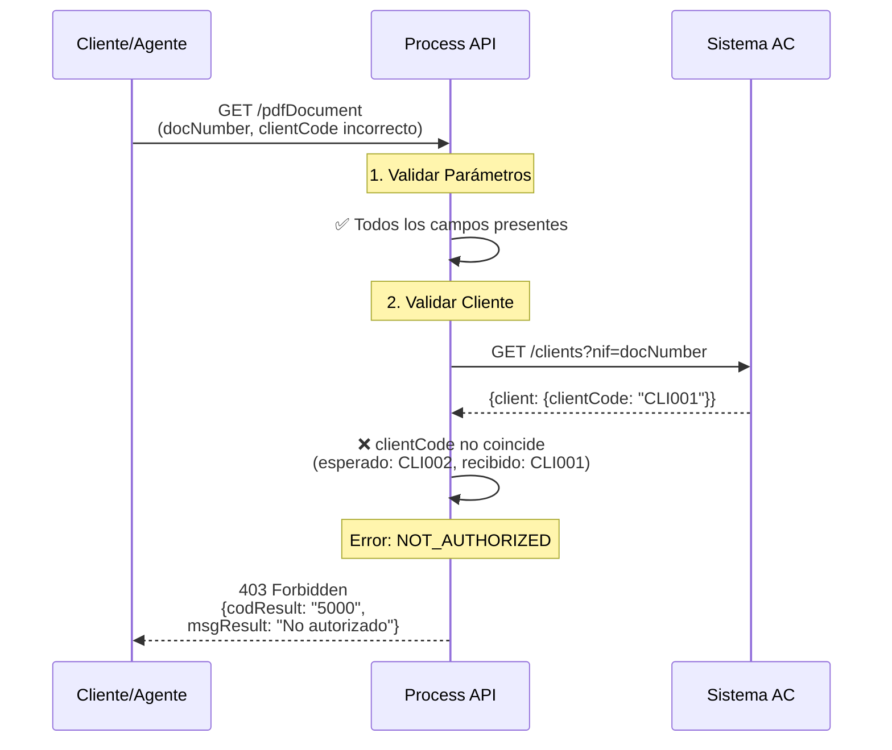
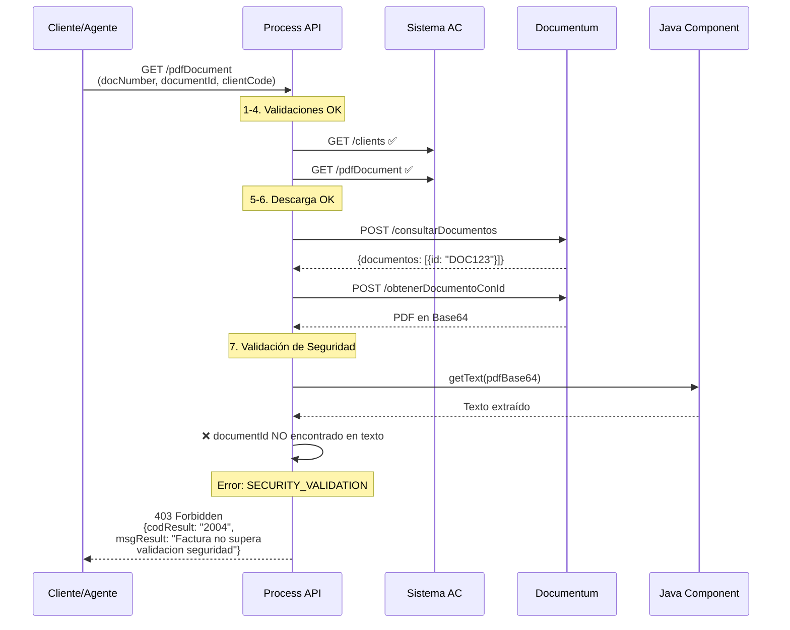
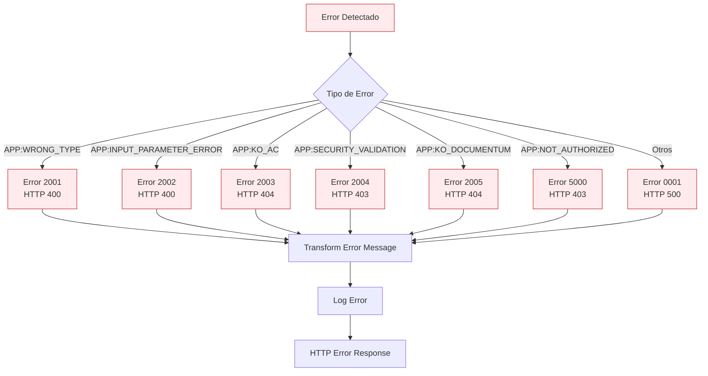

# GET /pdfDocument

## 📌 Descripción General

### Propósito del Endpoint

Este endpoint proporciona acceso seguro a documentos PDF (facturas o contratos) almacenados en el sistema de gestión documental Documentum. Implementa un proceso de orquestación multi-sistema con **tres niveles de validación de seguridad** para garantizar que solo usuarios autorizados puedan acceder a sus documentos.

### Tipo de API

**Capa:** Process API (API-Led Connectivity)

**Función:** Orquestación de recuperación segura de documentos con validación multi-nivel

### Patrón de Integración

**Tipo:** Orquestación con Validación de Seguridad

**Descripción:** El endpoint orquesta llamadas a Sistema AC para validación de cliente y a Documentum para recuperación del documento, aplicando validaciones de seguridad en cada paso del proceso.

### Arquitectura API-Led Connectivity



---

## 💼 Propósito del Negocio

### Casos de Uso Principales

1. **Descarga de Facturas por Cliente**
   - Cliente accede a sus facturas desde portal web o app móvil
   - Agente descarga factura para envío por email al cliente
   - **Beneficio:** Autoservicio 24/7 sin necesidad de contactar call center

2. **Descarga de Contratos**
   - Cliente descarga copia de su contrato de suministro
   - Agente obtiene contrato para verificación o gestión
   - **Beneficio:** Acceso inmediato a documentación legal

3. **Validación de Documentos**
   - Sistema verifica que el documento pertenece al cliente solicitante
   - Prevención de acceso no autorizado a documentos de terceros
   - **Beneficio:** Cumplimiento GDPR y protección de datos personales

### 🔗 Endpoints Dependientes

Este Process API consume los siguientes System APIs:

| System API | Endpoint | Método | Propósito |
|------------|----------|--------|-----------|
| `ntgy-fua-s-ac-fua` | `/clients` | GET | Validación de cliente por NIF |
| `ntgy-fua-s-ac-fua` | `/pdfDocument` | GET | Verificación de existencia en BD |
| `ntgy-cli-s-documentum` | `/consultarDocumentos` | POST | Búsqueda de documento en Documentum |
| `ntgy-cli-s-documentum` | `/obtenerDocumentoConId` | POST | Descarga del archivo PDF |

### Lógica de Orquestación



**Pasos del Proceso:**

1. **Validación de Parámetros**: Verifica que todos los parámetros obligatorios estén presentes
2. **Validación de Cliente**: Consulta AC para verificar que el clientCode coincide con el NIF
3. **Validación de Tipo**: Verifica que pdfDocumentType sea "invoice" o "contract"
4. **Verificación de Existencia**: Consulta AC para confirmar que el documento existe en BD
5. **Búsqueda en Documentum**: Obtiene el ID del documento en Documentum
6. **Descarga del PDF**: Descarga el archivo PDF en Base64
7. **Validación de Seguridad**: Extrae texto del PDF y verifica que contiene el documentId
8. **Respuesta**: Retorna el PDF validado en Base64

### Transformaciones Aplicadas

| Transformación | Descripción | Ubicación |
|----------------|-------------|-----------|
| **Query Parameters → AC Request** | Mapeo de parámetros de entrada a formato AC | Líneas 28-38 (global.xml) |
| **AC Response → Variables** | Almacenamiento de respuesta de cliente | Línea 30 (target="client") |
| **Variables → Documentum Request** | Construcción de payload para Documentum | Líneas 60-73 |
| **Documentum Response → Base64** | Extracción de contenido PDF en Base64 | Líneas 89-107 |
| **Base64 → Texto** | Extracción de texto para validación | Línea 167 (Java) |
| **Variables → Final Response** | Construcción de respuesta final | Líneas 115-127 |

### Contexto Empresarial

- **Dominio:** Gestión Documental y Facturación
- **Sector:** Energía - Utilities
- **División:** Naturgy España - Clientes Minoristas
- **Proceso de Negocio:** Autoservicio de documentos y atención al cliente

### Stakeholders

- **Clientes Finales**: Necesitan acceso a sus facturas y contratos
- **Agentes de Call Center**: Requieren descargar documentos para gestiones
- **Equipo de Seguridad**: Garantiza protección de datos personales
- **Equipo de Cumplimiento**: Asegura cumplimiento GDPR

### Valor de Negocio

- **Reducción de Costos**: Menos llamadas al call center por solicitud de documentos
- **Mejora de Experiencia**: Acceso inmediato 24/7 a documentos
- **Cumplimiento Normativo**: Validación multi-nivel protege datos personales
- **Eficiencia Operativa**: Automatización de proceso de entrega de documentos

### Consumidores Potenciales

Este endpoint puede ser consumido por:
- Portales web de autoservicio (FUA Portal)
- Aplicaciones móviles de clientes
- Sistemas de agentes de call center
- Aplicaciones de back office para gestiones

---

## 🔧 Especificación Técnica

### URLs por Ambiente

| Ambiente | URL Base | URL Completa |
|----------|----------|--------------|
| **Local** | `http://localhost:8084` | `http://localhost:8084/api/pdfDocument` |
| **Development** | `https://ntgy-fua-p-imp-customer-queries-dev.de-c1.cloudhub.io` | `https://ntgy-fua-p-imp-customer-queries-dev.de-c1.cloudhub.io/api/pdfDocument` |
| **UAT** | `https://ntgy-fua-p-imp-customer-queries-uat.de-c1.cloudhub.io` | `https://ntgy-fua-p-imp-customer-queries-uat.de-c1.cloudhub.io/api/pdfDocument` |
| **Production** | `https://ntgy-fua-p-imp-customer-queries-pro.de-c1.cloudhub.io` | `https://ntgy-fua-p-imp-customer-queries-pro.de-c1.cloudhub.io/api/pdfDocument` |

### Método HTTP

```
GET /api/pdfDocument
```

### Parámetros de Entrada

#### Query Parameters (Todos Obligatorios)

| Parámetro | Tipo | Obligatorio | Descripción | Ejemplo |
|-----------|------|-------------|-------------|---------|
| `docNumber` | string | ✅ Sí | NIF/NIE del cliente | "12345678A" |
| `pdfDocumentType` | string | ✅ Sí | Tipo de documento: "invoice" o "contract" | "invoice" |
| `documentId` | string | ✅ Sí | ID del documento PDF a descargar | "1234567890" |
| `clientCode` | string | ✅ Sí | Código de cliente en el sistema | "CLI001234" |

#### Validaciones de Parámetros



### Respuestas

#### Respuesta Exitosa (200 OK)

```json
{
  "result": {
    "codResult": "0000",
    "msgResult": "No hay error"
  },
  "pdfDocument": "JVBERi0xLjQKJeLjz9MKMyAwIG9iago8PC9UeXBlL1BhZ2UvUGFyZW50IDIgMCBSL1Jlc291cmNlczw8L0ZvbnQ8PC9GMSA1IDAgUj4+L1Byb2NTZXRbL1BERi9UZXh0L0ltYWdlQi9JbWFnZUMvSW1hZ2VJXT4+L01lZGlhQm94WzAgMCA1OTUuMzIgODQxLjkyXS9Db250ZW50cyA0IDAgUi9Hcm91cDw8L1R5cGUvR3JvdXAvUy9UcmFuc3BhcmVuY3kvQ1MvRGV2aWNlUkdCPj4vVGFicz..."
}
```

**Campos de Respuesta:**

| Campo | Tipo | Descripción |
|-------|------|-------------|
| `result.codResult` | string | Código de resultado: "0000" = éxito |
| `result.msgResult` | string | Mensaje descriptivo del resultado |
| `pdfDocument` | string | Contenido del PDF codificado en Base64 |

#### Códigos de Error

| Código | Tipo de Error | HTTP Status | Descripción |
|--------|---------------|-------------|-------------|
| `2001` | WRONG_TYPE | 400 | Tipo de documento incorrecto (debe ser "invoice" o "contract") |
| `2002` | INPUT_PARAMETER_ERROR | 400 | Faltan campos obligatorios |
| `2003` | KO_AC | 404 | Documento no existe en base de datos AC |
| `2004` | SECURITY_VALIDATION | 403 | Factura no supera validación de seguridad |
| `2005` | KO_DOCUMENTUM | 404 | No existe documento PDF en Documentum |
| `5000` | NOT_AUTHORIZED | 403 | Cliente no autorizado (clientCode no coincide) |
| `0001` | GENERIC_ERROR | 500 | Error genérico no controlado |

#### Ejemplo de Error (403 Forbidden)

```json
{
  "result": {
    "codResult": "5000",
    "msgResult": "No autorizado"
  }
}
```

#### Ejemplo de Error (400 Bad Request)

```json
{
  "result": {
    "codResult": "2002",
    "msgResult": "Faltan campos obligatorios"
  }
}
```

### Autenticación

- **Tipo:** OAuth 2.0 (Client Credentials)
- **Headers Requeridos:**
  - `client_id`: Client ID de Anypoint Platform
  - `client_secret`: Client Secret de Anypoint Platform

### Timeouts

| Tipo | Valor | Justificación |
|------|-------|---------------|
| **Request Timeout** | 30 segundos | Operaciones de consulta a AC |
| **Documentum Timeout** | 30 segundos | Descarga de documentos PDF |
| **Connection Timeout** | 30 segundos | Tiempo máximo de conexión |

---

## 🏗️ Implementación Técnica

### Arquitectura del Flow



### Componentes Técnicos

#### 1. Validación de Parámetros (Líneas 13-27)

```xml
<set-variable value="#[attributes.queryParams.docNumber]" 
              variableName="docNumber"/>
<set-variable value="#[attributes.queryParams.pdfDocumentType]" 
              variableName="pdfDocumentType"/>
<set-variable value="#[attributes.queryParams.documentId]" 
              variableName="documentId"/>
<set-variable value="#[attributes.queryParams.clientCode]" 
              variableName="clientCode"/>

<choice>
    <when expression="#[!isEmpty(vars.docNumber) and !isEmpty(vars.documentId) 
                       and !isEmpty(vars.pdfDocumentType) and !isEmpty(vars.clientCode)]">
        <logger message='#["No missing input parameters"]'/>
    </when>
    <otherwise>
        <raise-error type="APP:INPUT_PARAMETER_ERROR" 
                     description="Faltan campos obligatorios"/>
    </otherwise>
</choice>
```

#### 2. Validación de Cliente en AC (Líneas 28-38)

```xml
<http:request method="GET" 
              config-ref="HTTP_API_SistemaAC" 
              path="/clients" 
              target="client" 
              targetValue="#[payload.client]">
    <http:query-params>
        #[output application/java
        ---
        {
            "nif" : vars.docNumber
        }]
    </http:query-params>
</http:request>

<choice>
    <when expression="#[vars.client.clientCode == vars.clientCode]">
        <logger message='#["clientCode is correct"]'/>
    </when>
    <otherwise>
        <raise-error type="APP:NOT_AUTHORIZED" 
                     description="No autorizado"/>
    </otherwise>
</choice>
```

#### 3. Validación de Tipo de Documento (Líneas 39-49)

```xml
<choice>
    <when expression='#[vars.pdfDocumentType == "invoice"]'>
        <logger message='#["The PDF document is an Invoice"]'/>
    </when>
    <when expression='#[vars.pdfDocumentType == "contract"]'>
        <logger message='#["The PDF document is a contract"]'/>
    </when>
    <otherwise>
        <raise-error type="APP:WRONG_TYPE" 
                     description="pdfDocumentType incorrecto"/>
    </otherwise>
</choice>
```

#### 4. Consulta a Documentum (Líneas 60-88)

**Transformación para consultarDocumentos:**

```dataweave
%dw 2.0
output application/json
---
{
    "login": {
        "usuario": p('s-documentum.usuario'),
        "password": p('s-documentum.password'),
        "docBase": p('s-documentum.invoices.docBase')
    },
    "from": p('s-documentum.invoices.from'),
    "where": [{
        "campo": "numero_de_factura",
        "operacion": "=",
        "valor": vars.documentId
    }]
}
```

**Propiedades de Configuración (p-imp-customer-queries-pro-config.yaml):**

```yaml
s-documentum:
  usuario: "generic_user"
  password: ""
  invoices:
    docBase: "GASNATURAL"
    from: "FACTDOME"
```

#### 5. Descarga del PDF (Líneas 89-107)

**Transformación para obtenerDocumentoConId:**

```dataweave
%dw 2.0
output application/json
---
{
    "login": {
        "usuario": p('s-documentum.usuario'),
        "password": p('s-documentum.password'),
        "docBase": p('s-documentum.invoices.docBase')
    },
    "idDocumento": payload.documentos[0].id
}
```

**Extracción de Base64 del multipart response:**

```dataweave
%dw 2.0
input payload application/json
import * from dw::core::Binaries
var myPDF = read(vars.documentumResponse.parts..content[0], "application/octet-stream")
output text/plain
---
toBase64(myPDF as Binary)
```

#### 6. Validación de Seguridad con Java (Líneas 165-182)

**Clase Java: ExtractPdfData.java**

```java
package com.pdf;
import org.apache.pdfbox.pdmodel.PDDocument;
import org.apache.pdfbox.text.PDFTextStripper;
import java.io.IOException;
import java.util.Base64;

public class ExtractPdfData {
    public static String getText(String data) throws IOException {
        byte[] decoder = Base64.getDecoder().decode(data);
        PDDocument doc = PDDocument.load(decoder);
        String text = new PDFTextStripper().getText(doc);
        doc.close();
        return text;
    }
}
```

**Invocación en Flow:**

```xml
<java:invoke-static method="getText(java.lang.String)" 
                    class="com.pdf.ExtractPdfData" 
                    target="fileContent">
    <java:args>#[{ "data": vars.documentumResponse}]</java:args>
</java:invoke-static>

<choice>
    <when expression="#[(vars.fileContent as String) contains vars.documentId as String]">
        <logger message='#["This invoice is valid"]'/>
    </when>
    <otherwise>
        <raise-error type="APP:SECURITY_VALIDATION" 
                     description="Factura no supera validacion seguridad"/>
    </otherwise>
</choice>
```

### Patrones de Diseño

**Patrón:** Chain of Responsibility + Validation Pipeline

**Justificación:** 
- Cada validación es un eslabón en la cadena
- Si una validación falla, se detiene el proceso
- Permite agregar/quitar validaciones fácilmente
- Mejora la seguridad con múltiples puntos de control

### Diagramas de Secuencia

#### 1. Flujo Normal de Éxito



#### 2. Flujo con Error de Autorización



#### 3. Flujo con Error de Validación de Seguridad



### Manejo de Errores

#### Estrategia de Error Handling

El endpoint implementa un **error handler centralizado** con 6 tipos de errores específicos:



#### Configuración de Error Handlers

Cada error handler transforma el error a un formato estándar:

```dataweave
%dw 2.0
output application/json
---
{
    "result": {
        "codResult": "[CÓDIGO]",
        "msgResult": error.description as String replace /\"/ with("")
    }
}
```

---

## 💻 Ejemplos de Uso

### Ejemplo 1: Descarga Exitosa de Factura

#### cURL

```bash
curl -X GET "https://ntgy-fua-p-imp-customer-queries-pro.de-c1.cloudhub.io/api/pdfDocument?docNumber=12345678A&pdfDocumentType=invoice&documentId=1234567890&clientCode=CLI001234" \
  -H "Content-Type: application/json" \
  -H "client_id: YOUR_CLIENT_ID" \
  -H "client_secret: YOUR_CLIENT_SECRET"
```

#### Respuesta (200 OK)

```json
{
  "result": {
    "codResult": "0000",
    "msgResult": "No hay error"
  },
  "pdfDocument": "JVBERi0xLjQKJeLjz9MKMyAwIG9iago8PC9UeXBlL1BhZ2UvUGFyZW50IDIgMCBSL1Jlc291cmNlczw8L0ZvbnQ8PC9GMSA1IDAgUj4+L1Byb2NTZXRbL1BERi9UZXh0L0ltYWdlQi9JbWFnZUMvSW1hZ2VJXT4+L01lZGlhQm94WzAgMCA1OTUuMzIgODQxLjkyXS9Db250ZW50cyA0IDAgUi9Hcm91cDw8L1R5cGUvR3JvdXAvUy9UcmFuc3BhcmVuY3kvQ1MvRGV2aWNlUkdCPj4vVGFicz..."
}
```

**Nota:** El campo `pdfDocument` contiene el PDF completo codificado en Base64. Para usarlo:

```javascript
// Decodificar y descargar en navegador
const base64Data = response.pdfDocument;
const byteCharacters = atob(base64Data);
const byteNumbers = new Array(byteCharacters.length);
for (let i = 0; i < byteCharacters.length; i++) {
    byteNumbers[i] = byteCharacters.charCodeAt(i);
}
const byteArray = new Uint8Array(byteNumbers);
const blob = new Blob([byteArray], { type: 'application/pdf' });
const url = window.URL.createObjectURL(blob);
window.open(url);
```

### Ejemplo 2: Descarga de Contrato

#### cURL

```bash
curl -X GET "https://ntgy-fua-p-imp-customer-queries-pro.de-c1.cloudhub.io/api/pdfDocument?docNumber=87654321B&pdfDocumentType=contract&documentId=9876543210&clientCode=CLI005678" \
  -H "Content-Type: application/json" \
  -H "client_id: YOUR_CLIENT_ID" \
  -H "client_secret: YOUR_CLIENT_SECRET"
```

#### Respuesta (200 OK)

```json
{
  "result": {
    "codResult": "0000",
    "msgResult": "No hay error"
  },
  "pdfDocument": "JVBERi0xLjQKJeLjz9MKMyAwIG9iago..."
}
```

### Ejemplo 3: Error - Cliente No Autorizado

#### cURL

```bash
curl -X GET "https://ntgy-fua-p-imp-customer-queries-pro.de-c1.cloudhub.io/api/pdfDocument?docNumber=12345678A&pdfDocumentType=invoice&documentId=1234567890&clientCode=CLI999999" \
  -H "Content-Type: application/json" \
  -H "client_id: YOUR_CLIENT_ID" \
  -H "client_secret: YOUR_CLIENT_SECRET"
```

#### Respuesta (403 Forbidden)

```json
{
  "result": {
    "codResult": "5000",
    "msgResult": "No autorizado"
  }
}
```

**Causa:** El `clientCode` proporcionado no coincide con el cliente asociado al `docNumber`.

### Ejemplo 4: Error - Parámetros Faltantes

#### cURL

```bash
curl -X GET "https://ntgy-fua-p-imp-customer-queries-pro.de-c1.cloudhub.io/api/pdfDocument?docNumber=12345678A&pdfDocumentType=invoice" \
  -H "Content-Type: application/json" \
  -H "client_id: YOUR_CLIENT_ID" \
  -H "client_secret: YOUR_CLIENT_SECRET"
```

#### Respuesta (400 Bad Request)

```json
{
  "result": {
    "codResult": "2002",
    "msgResult": "Faltan campos obligatorios"
  }
}
```

**Causa:** Faltan los parámetros `documentId` y `clientCode`.

### Ejemplo 5: JavaScript (Fetch API)

```javascript
async function downloadPdfDocument(docNumber, documentId, clientCode, pdfDocumentType = 'invoice') {
  const baseUrl = 'https://ntgy-fua-p-imp-customer-queries-pro.de-c1.cloudhub.io';
  const params = new URLSearchParams({
    docNumber,
    pdfDocumentType,
    documentId,
    clientCode
  });
  
  try {
    const response = await fetch(`${baseUrl}/api/pdfDocument?${params}`, {
      method: 'GET',
      headers: {
        'Content-Type': 'application/json',
        'client_id': 'YOUR_CLIENT_ID',
        'client_secret': 'YOUR_CLIENT_SECRET'
      }
    });
    
    if (!response.ok) {
      const error = await response.json();
      throw new Error(`Error ${error.result.codResult}: ${error.result.msgResult}`);
    }
    
    const data = await response.json();
    
    // Decodificar Base64 y crear Blob
    const byteCharacters = atob(data.pdfDocument);
    const byteNumbers = new Array(byteCharacters.length);
    for (let i = 0; i < byteCharacters.length; i++) {
      byteNumbers[i] = byteCharacters.charCodeAt(i);
    }
    const byteArray = new Uint8Array(byteNumbers);
    const blob = new Blob([byteArray], { type: 'application/pdf' });
    
    // Descargar archivo
    const url = window.URL.createObjectURL(blob);
    const a = document.createElement('a');
    a.href = url;
    a.download = `${pdfDocumentType}_${documentId}.pdf`;
    document.body.appendChild(a);
    a.click();
    window.URL.revokeObjectURL(url);
    document.body.removeChild(a);
    
    return data;
  } catch (error) {
    console.error('Error downloading PDF:', error);
    throw error;
  }
}

// Uso
downloadPdfDocument('12345678A', '1234567890', 'CLI001234', 'invoice')
  .then(() => console.log('PDF descargado exitosamente'))
  .catch(error => console.error('Error:', error.message));
```

### Ejemplo 6: Python (Requests)

```python
import requests
import base64
from pathlib import Path

def download_pdf_document(doc_number, document_id, client_code, pdf_document_type='invoice'):
    """
    Descarga un documento PDF (factura o contrato) desde el API.
    
    Args:
        doc_number (str): NIF/NIE del cliente
        document_id (str): ID del documento
        client_code (str): Código de cliente
        pdf_document_type (str): Tipo de documento ('invoice' o 'contract')
    
    Returns:
        str: Ruta del archivo PDF descargado
    """
    base_url = 'https://ntgy-fua-p-imp-customer-queries-pro.de-c1.cloudhub.io'
    
    params = {
        'docNumber': doc_number,
        'pdfDocumentType': pdf_document_type,
        'documentId': document_id,
        'clientCode': client_code
    }
    
    headers = {
        'Content-Type': 'application/json',
        'client_id': 'YOUR_CLIENT_ID',
        'client_secret': 'YOUR_CLIENT_SECRET'
    }
    
    try:
        response = requests.get(
            f'{base_url}/api/pdfDocument',
            params=params,
            headers=headers,
            timeout=30
        )
        
        response.raise_for_status()
        
        data = response.json()
        
        # Decodificar Base64
        pdf_content = base64.b64decode(data['pdfDocument'])
        
        # Guardar archivo
        filename = f'{pdf_document_type}_{document_id}.pdf'
        filepath = Path(filename)
        filepath.write_bytes(pdf_content)
        
        print(f'PDF descargado exitosamente: {filepath}')
        return str(filepath)
        
    except requests.exceptions.HTTPError as e:
        error_data = e.response.json()
        print(f"Error {error_data['result']['codResult']}: {error_data['result']['msgResult']}")
        raise
    except Exception as e:
        print(f'Error descargando PDF: {str(e)}')
        raise

# Uso
try:
    filepath = download_pdf_document(
        doc_number='12345678A',
        document_id='1234567890',
        client_code='CLI001234',
        pdf_document_type='invoice'
    )
    print(f'Archivo guardado en: {filepath}')
except Exception as e:
    print(f'Error: {e}')
```

### Ejemplo 7: Postman Collection

```json
{
  "info": {
    "name": "GET /pdfDocument",
    "description": "Descarga de documentos PDF (facturas o contratos)"
  },
  "item": [
    {
      "name": "Descargar Factura",
      "request": {
        "method": "GET",
        "header": [
          {
            "key": "Content-Type",
            "value": "application/json"
          },
          {
            "key": "client_id",
            "value": "{{client_id}}"
          },
          {
            "key": "client_secret",
            "value": "{{client_secret}}"
          }
        ],
        "url": {
          "raw": "{{base_url}}/api/pdfDocument?docNumber=12345678A&pdfDocumentType=invoice&documentId=1234567890&clientCode=CLI001234",
          "host": ["{{base_url}}"],
          "path": ["api", "pdfDocument"],
          "query": [
            {
              "key": "docNumber",
              "value": "12345678A"
            },
            {
              "key": "pdfDocumentType",
              "value": "invoice"
            },
            {
              "key": "documentId",
              "value": "1234567890"
            },
            {
              "key": "clientCode",
              "value": "CLI001234"
            }
          ]
        }
      }
    }
  ]
}
```

### Consideraciones de Seguridad

1. **Validación Multi-Nivel**: El endpoint implementa 3 niveles de validación para garantizar seguridad
2. **Protección GDPR**: Solo el cliente autorizado puede acceder a sus documentos
3. **Validación de Contenido**: El PDF se valida para confirmar que contiene el documentId solicitado
4. **Timeout Apropiado**: 30 segundos para evitar operaciones colgadas
5. **Error Handling Robusto**: 6 tipos de errores específicos para troubleshooting

### Mejores Prácticas

1. **Siempre validar parámetros** antes de llamar al endpoint
2. **Manejar errores específicos** según el código de error retornado
3. **Implementar retry logic** solo para errores 500 (no para 400/403/404)
4. **Cachear credenciales OAuth** para evitar múltiples autenticaciones
5. **Decodificar Base64 correctamente** según el lenguaje de programación
6. **Guardar PDFs con nombres descriptivos** (tipo_documentId.pdf)
