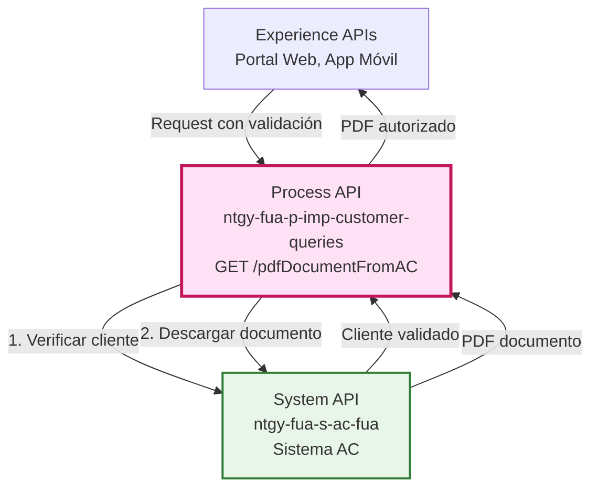
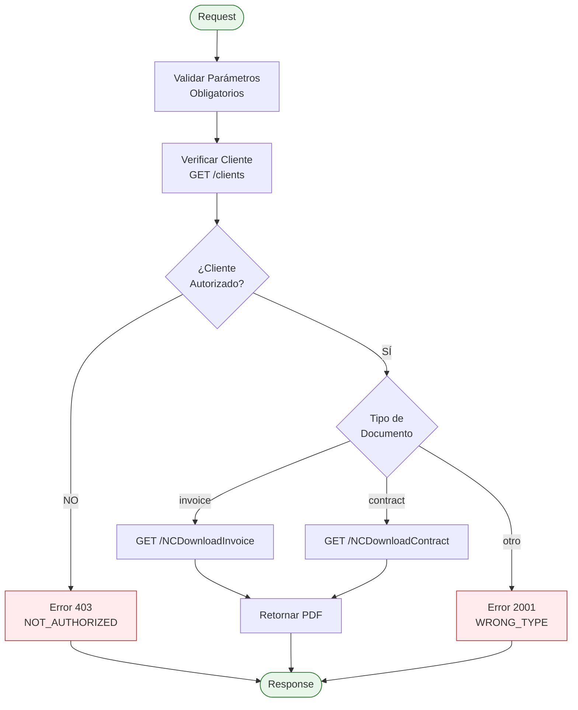
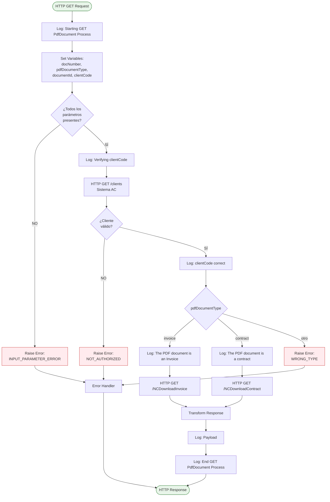
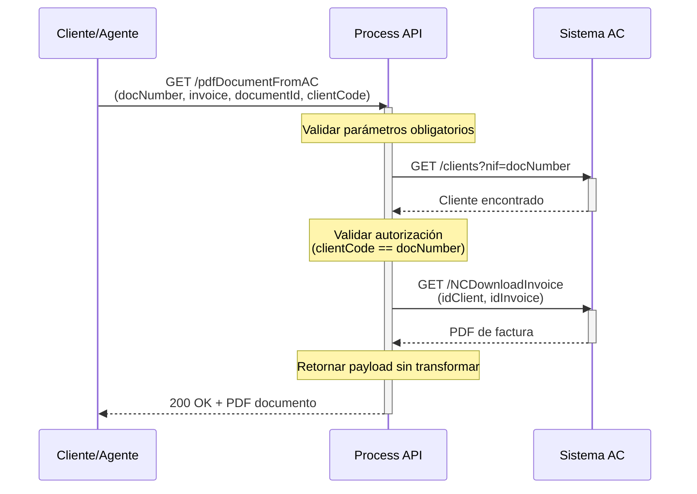
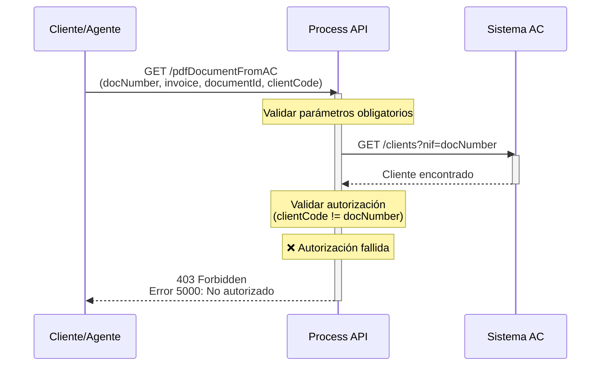
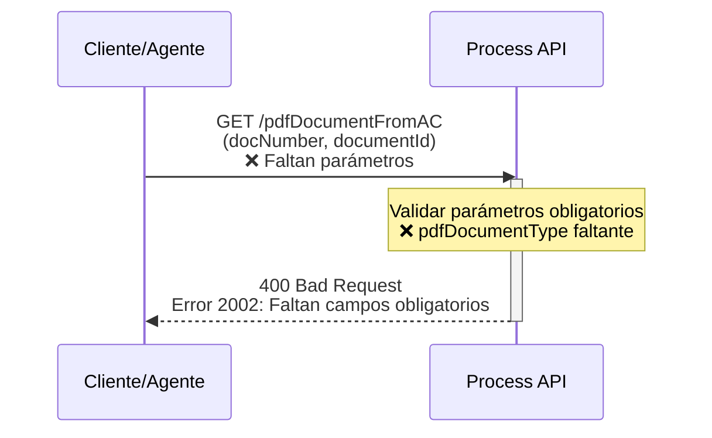

# GET /pdfDocumentFromAC

## 📌 Descripción General

### Propósito del Endpoint

Este endpoint permite la descarga segura de documentos PDF (facturas o contratos) desde el Sistema AC, implementando un proceso de validación de autorización previo a la descarga. Orquesta múltiples llamadas al Sistema AC para verificar la identidad del cliente y obtener el documento solicitado.

### Tipo de API

**Capa:** Process API (API-Led Connectivity)

**Función:** Orquestación de descarga de documentos con validación de seguridad

### Patrón de Integración

**Tipo:** Orquestación con Validación de Seguridad

**Descripción:** El endpoint implementa un flujo de validación en dos fases:
1. **Fase de Autorización**: Verifica que el cliente tiene derecho a acceder al documento
2. **Fase de Descarga**: Obtiene el documento PDF del Sistema AC según el tipo solicitado

### Arquitectura API-Led Connectivity



---

## 💼 Propósito del Negocio

### Casos de Uso Principales

1. **Descarga de Facturas por Cliente**
   - Cliente accede a su portal web o app móvil
   - Solicita descarga de una factura específica
   - Sistema valida identidad y autoriza descarga
   - **Beneficio**: Autoservicio seguro sin necesidad de contactar call center

2. **Descarga de Contratos por Cliente**
   - Cliente necesita consultar términos de su contrato
   - Solicita descarga del contrato en PDF
   - Sistema verifica autorización y proporciona documento
   - **Beneficio**: Acceso inmediato a documentación contractual

3. **Validación de Autorización de Agente**
   - Agente de call center necesita enviar documento a cliente
   - Sistema valida que el agente tiene acceso al cliente correcto
   - Descarga documento para envío o consulta
   - **Beneficio**: Seguridad en el acceso a información sensible

### 🔗 Endpoints Dependientes

Este Process API consume los siguientes System APIs:

| System API | Endpoint | Método | Propósito |
|------------|----------|--------|-----------|
| `ntgy-fua-s-ac-fua` | `/clients` | GET | Verificación de identidad del cliente mediante NIF |
| `ntgy-fua-s-ac-fua` | `/NCDownloadInvoice` | GET | Descarga de factura en formato PDF |
| `ntgy-fua-s-ac-fua` | `/NCDownloadContract` | GET | Descarga de contrato en formato PDF |

### Lógica de Orquestación



**Pasos del Proceso:**

1. **Validación de Parámetros**: Verifica que todos los parámetros obligatorios estén presentes
2. **Verificación de Cliente**: Consulta al Sistema AC para validar la identidad del cliente
3. **Validación de Autorización**: Compara el clientCode con el docNumber del cliente
4. **Enrutamiento por Tipo**: Dirige la solicitud al endpoint correcto según el tipo de documento
5. **Descarga de Documento**: Obtiene el PDF del Sistema AC
6. **Respuesta**: Retorna el documento PDF al consumidor

### Transformaciones Aplicadas

⚠️ **Este Process API NO transforma la respuesta del System API.**

**Implementación actual (líneas 174-181 del código del Process API):**
```xml
<ee:transform doc:name="Set Response1">
    <ee:message>
        <ee:set-payload><![CDATA[%dw 2.0
output application/json
---
payload]]></ee:set-payload>
    </ee:message>
</ee:transform>
```

El endpoint retorna el `payload` **exactamente como viene del Sistema AC**, sin ninguna transformación adicional.

**Estructura retornada por el Sistema AC (confirmada del código fuente):**

Ambos endpoints del Sistema AC (`/NCDownloadInvoice` y `/NCDownloadContract`) retornan la misma estructura:

```json
{
  "result": {
    "codResult": "0000",
    "msgResult": "No hay error"
  },
  "pdf": "[Base64 encoded PDF]"
}
```

**Evidencia del System API (líneas 28-40 de ambos archivos):**
```xml
<ee:set-payload><![CDATA[%dw 2.0
output application/json
---
{
    result: {
        codResult: "0000",
        msgResult: "No hay error"
    },
    "pdf": payload.pdf default ""
}
]]></ee:set-payload>
```

**Flujo completo:**
1. Process API recibe request
2. Process API valida autorización
3. Process API llama a Sistema AC (`/NCDownloadInvoice` o `/NCDownloadContract`)
4. Sistema AC retorna `{ result: {...}, pdf: "..." }`
5. Process API retorna el payload sin modificar

**Nota sobre código comentado:**
Existe código comentado (líneas 160-173) que mostraba una implementación anterior con campo `pdfDocument`, pero este código **NO está activo** y **NO se está usando**.

### Contexto Empresarial

- **Dominio:** Gestión Documental y Facturación
- **Sector:** Energía - Utilities (Gas & Electricidad)
- **División:** Naturgy España - Clientes Minoristas
- **Proceso de Negocio:** Autoservicio de documentos con validación de seguridad

### Stakeholders

- **Clientes Finales**: Necesitan acceso rápido y seguro a sus documentos
- **Agentes de Call Center**: Requieren validación de autorización antes de acceder a documentos
- **Equipo de Seguridad**: Aseguran que solo usuarios autorizados accedan a información sensible
- **Equipo de Cumplimiento**: Garantizan trazabilidad de accesos a documentos

### Valor de Negocio

- **Seguridad**: Validación obligatoria de identidad antes de permitir descarga
- **Autoservicio**: Clientes pueden descargar documentos sin asistencia
- **Trazabilidad**: Registro completo de accesos a documentos sensibles
- **Cumplimiento**: Cumple con requisitos de protección de datos (GDPR/LOPD)

### Consumidores Potenciales

Este endpoint puede ser consumido por:
- Portales web de autoservicio de clientes
- Aplicaciones móviles de clientes
- Sistemas de agentes de call center
- Aplicaciones de back office con autorización

---

## 🔧 Especificación Técnica

### URLs por Ambiente

| Ambiente | URL Base | URL Completa |
|----------|----------|--------------|
| **Local** | `http://localhost:8084` | `http://localhost:8084/api/pdfDocumentFromAC` |
| **Development** | `https://ntgy-fua-p-imp-customer-queries-dev.de-c1.cloudhub.io` | `https://ntgy-fua-p-imp-customer-queries-dev.de-c1.cloudhub.io/api/pdfDocumentFromAC` |
| **UAT** | `https://ntgy-fua-p-imp-customer-queries-uat.de-c1.cloudhub.io` | `https://ntgy-fua-p-imp-customer-queries-uat.de-c1.cloudhub.io/api/pdfDocumentFromAC` |
| **Production** | `https://ntgy-fua-p-imp-customer-queries-pro.de-c1.cloudhub.io` | `https://ntgy-fua-p-imp-customer-queries-pro.de-c1.cloudhub.io/api/pdfDocumentFromAC` |

### Método HTTP

```
GET /api/pdfDocumentFromAC
```

### Parámetros de Entrada

#### Query Parameters (Todos Obligatorios)

| Parámetro | Tipo | Obligatorio | Descripción | Ejemplo |
|-----------|------|-------------|-------------|---------|
| `docNumber` | string | ✅ Sí | NIF/DNI del cliente | "12345678A" |
| `pdfDocumentType` | string | ✅ Sí | Tipo de documento: "invoice" o "contract" | "invoice" |
| `documentId` | string | ✅ Sí | ID del documento a descargar (número de factura o CUPS) | "FAC123456" |
| `clientCode` | string | ✅ Sí | Código del cliente para validación | "CLI789" |

#### Validaciones

- **Todos los parámetros son obligatorios**: Si falta alguno, retorna error 2002
- **pdfDocumentType**: Solo acepta valores "invoice" o "contract", otros valores retornan error 2001
- **Validación de Autorización**: El clientCode debe corresponder al docNumber del cliente

### Respuestas

#### Respuesta Exitosa (200 OK)

**Content-Type:** `application/json`

✅ **Estructura confirmada del Sistema AC:**

```json
{
  "result": {
    "codResult": "0000",
    "msgResult": "No hay error"
  },
  "pdf": "[Base64 encoded PDF content]"
}
```

**Campos de la respuesta:**

| Campo | Tipo | Descripción |
|-------|------|-------------|
| `result.codResult` | string | Código de resultado: "0000" para éxito |
| `result.msgResult` | string | Mensaje descriptivo del resultado |
| `pdf` | string | Contenido del PDF codificado en Base64 |

**Nota:** Esta estructura es retornada por el Sistema AC y el Process API la pasa sin transformar.

#### Errores de Negocio

##### Error 2001 - Tipo de Documento Incorrecto (Process API)

```json
{
  "result": {
    "codResult": "2001",
    "msgResult": "pdfDocumentType incorrecto"
  }
}
```

**Causa:** El parámetro `pdfDocumentType` no es "invoice" ni "contract"

##### Error 2002 - Parámetros Faltantes (Process API)

```json
{
  "result": {
    "codResult": "2002",
    "msgResult": "Faltan campos obligatorios"
  }
}
```

**Causa:** Uno o más parámetros obligatorios no fueron proporcionados

##### Error 5000 - No Autorizado (Process API)

**HTTP Status:** 403 Forbidden

```json
{
  "result": {
    "codResult": "5000",
    "msgResult": "No autorizado"
  }
}
```

**Causa:** El clientCode no coincide con el docNumber del cliente verificado

##### Errores del Sistema AC - Facturas (Invoice)

**Error 0001 - Error de Sistema**
```json
{
  "result": {
    "codResult": "0001",
    "msgResult": "Error de Sistema"
  }
}
```

**Error 0006 - Factura No Encontrada**
```json
{
  "result": {
    "codResult": "0006",
    "msgResult": "Factura no encontrada asociada al cliente"
  }
}
```

**Error 0008 - Factura Retirada**
```json
{
  "result": {
    "codResult": "0008",
    "msgResult": "Factura retirada"
  }
}
```

##### Errores del Sistema AC - Contratos (Contract)

**Error 0001 - Error de Sistema**
```json
{
  "result": {
    "codResult": "0001",
    "msgResult": "Error de Sistema"
  }
}
```

**Error 0002 - Sin PDF**
```json
{
  "result": {
    "codResult": "0002",
    "msgResult": "El contrato no tiene contratos PDF"
  }
}
```

**Error 0003 - Contrato No Encontrado**
```json
{
  "result": {
    "codResult": "0003",
    "msgResult": "El contrato no se ha encontrado"
  }
}
```

#### Errores Técnicos

##### Error 0001 - Error General

```json
{
  "result": {
    "codResult": "0001",
    "msgResult": "[Descripción del error técnico]"
  }
}
```

**Causa:** Error no controlado durante el procesamiento

### Autenticación

- **Tipo:** OAuth 2.0 (Client ID & Client Secret)
- **Implementación:** Anypoint Platform API Gateway
- **Headers Requeridos:**
  - `Authorization: Bearer [token]`
  - `client_id: [your_client_id]`
  - `client_secret: [your_client_secret]`

### Timeouts

| Tipo | Valor | Justificación |
|------|-------|---------------|
| **Request Timeout** | 30 segundos | Tiempo suficiente para validación y descarga |
| **Connection Timeout** | 30 segundos | Alineado con timeout del Sistema AC |

### Rate Limiting

- **Límite:** 100 requests/minuto por cliente
- **Implementación:** API Gateway de Anypoint Platform

---

## 🏗️ Implementación Técnica

### Arquitectura del Flow



### Componentes Principales del Flow

#### 1. Validación de Parámetros (Líneas 42-50)

```xml
<choice doc:name="Choice">
    <when expression="#[!isEmpty(vars.docNumber) and !isEmpty(vars.documentId) and !isEmpty(vars.pdfDocumentType) and !isEmpty(vars.clientCode)]">
        <logger level="DEBUG" message='#["No missing input parameters"]' />
    </when>
    <otherwise>
        <raise-error type="APP:INPUT_PARAMETER_ERROR" description="Faltan campos obligatorios" />
    </otherwise>
</choice>
```

**Propósito:** Asegurar que todos los parámetros obligatorios están presentes antes de continuar

#### 2. Verificación de Cliente (Líneas 52-68)

```xml
<http:request method="GET" config-ref="HTTP_API_SistemaAC" path="/clients" target="client" targetValue="#[payload.client]">
    <http:query-params><![CDATA[#[output application/java
---
{
    "nif" : vars.docNumber
}]]]></http:query-params>
</http:request>
```

**Propósito:** Obtener información del cliente desde Sistema AC para validar autorización

#### 3. Validación de Autorización (Líneas 69-77)

```xml
<choice doc:name="Choice">
    <when expression="#[vars.client.docNumber == vars.docNumber]">
        <logger level="DEBUG" message='#["clientCode is correct"]'/>
    </when>
    <otherwise>
        <raise-error type="APP:NOT_AUTHORIZED" description="No autorizado"/>
    </otherwise>
</choice>
```

**Propósito:** Verificar que el cliente tiene derecho a acceder al documento solicitado

#### 4. Enrutamiento por Tipo de Documento (Líneas 78-100)

```xml
<choice doc:name="Choice">
    <when expression='#[vars.pdfDocumentType == "invoice"]'>
        <logger level="DEBUG" message='#["The PDF document is an Invoice"]' />
        <http:request method="GET" config-ref="HTTP_API_SistemaAC" path="/NCDownloadInvoice">
            <http:query-params><![CDATA[#[output application/java
---
{
    idClient : vars.docNumber,
    idInvoice : vars.documentId
}]]]></http:query-params>
        </http:request>
    </when>
    <when expression='#[vars.pdfDocumentType == "contract"]'>
        <logger level="DEBUG" message='#["The PDF document is a contract"]' />
        <http:request method="GET" config-ref="HTTP_API_SistemaAC" path="/NCDownloadContract">
            <http:query-params><![CDATA[#[output application/java
---
{
    idClient : vars.docNumber,
    cups : vars.documentId
}]]]></http:query-params>
        </http:request>
    </when>
    <otherwise>
        <raise-error type="APP:WRONG_TYPE" description="pdfDocumentType incorrecto" />
    </otherwise>
</choice>
```

**Propósito:** Dirigir la solicitud al endpoint correcto del Sistema AC según el tipo de documento

### Configuración HTTP

**Configuración del Sistema AC** (global.xml, líneas 14-16):

```xml
<http:request-config name="HTTP_API_SistemaAC" basePath="/api" responseTimeout="${s-ac.timeout}">
    <http:request-connection host="${s-ac.host}" port="${s-ac.port}" 
                            connectionIdleTimeout="${s-ac.timeout}" 
                            protocol="${s-ac.protocol}"/>
</http:request-config>
```

**Propiedades de Configuración** (p-imp-customer-queries-pro-config.yaml):

```yaml
s-ac:
  host: "ntgy-fua-s-ac-fua-bqyi65.internal-6bnlu3.irl-e1.cloudhub.io"
  port: "443"
  protocol: "HTTPS"
  timeout: "30000"
```

### Patrones de Diseño

**Patrón:** Request-Reply con Validación de Seguridad

**Justificación:** 
- Garantiza que solo usuarios autorizados accedan a documentos sensibles
- Implementa defensa en profundidad con múltiples capas de validación
- Proporciona trazabilidad completa de accesos a documentos

### Diagramas de Secuencia

#### 1. Flujo Normal de Éxito - Descarga de Factura



#### 2. Flujo con Error de Autorización



#### 3. Flujo con Parámetros Faltantes



### Manejo de Errores

El endpoint implementa un sistema robusto de manejo de errores con 6 tipos de error específicos:

#### Error Handlers Implementados (Líneas 122-213)

1. **APP:WRONG_TYPE** (Código 2001)
   - Tipo de documento incorrecto
   - HTTP Status: 400 Bad Request

2. **APP:INPUT_PARAMETER_ERROR** (Código 2002)
   - Parámetros obligatorios faltantes
   - HTTP Status: 400 Bad Request

3. **APP:NOT_AUTHORIZED** (Código 5000)
   - Cliente no autorizado para acceder al documento
   - HTTP Status: 403 Forbidden

4. **Error General** (Código 0001)
   - Errores no controlados
   - HTTP Status: 500 Internal Server Error

**Estrategia de Logging:**
- Todos los errores se registran con nivel ERROR
- Se incluye la descripción del error en el log
- Se enmascara información sensible en los logs

---

## 💻 Ejemplos de Uso

### Ejemplo 1: Descarga de Factura Exitosa

#### cURL

```bash
curl -X GET "https://ntgy-fua-p-imp-customer-queries-pro.de-c1.cloudhub.io/api/pdfDocumentFromAC?docNumber=12345678A&pdfDocumentType=invoice&documentId=FAC123456&clientCode=CLI789" \
  -H "Content-Type: application/json" \
  -H "client_id: YOUR_CLIENT_ID" \
  -H "client_secret: YOUR_CLIENT_SECRET"
```

#### Respuesta (200 OK)

```json
{
  "result": {
    "codResult": "0000",
    "msgResult": "No hay error"
  },
  "pdf": "JVBERi0xLjQKJeLjz9MKMyAwIG9iago8PC9UeXBlL1BhZ2UvUGFyZW50IDIgMCBSL1Jlc291cmNlczw8L0ZvbnQ8PC9GMSA1IDAgUj4+L1Byb2NTZXRbL1BERi9UZXh0L0ltYWdlQi9JbWFnZUMvSW1hZ2VJXT4+L01lZGlhQm94WzAgMCA1OTUuMzIgODQxLjkyXS9Db250ZW50cyA0IDAgUi9Hcm91cDw8L1R5cGUvR3JvdXAvUy9UcmFuc3BhcmVuY3kvQ1MvRGV2aWNlUkdCPj4vVGFicz..."
}
```

**Nota:** El campo `pdf` contiene el PDF codificado en Base64

### Ejemplo 2: Descarga de Contrato

#### cURL

```bash
curl -X GET "https://ntgy-fua-p-imp-customer-queries-pro.de-c1.cloudhub.io/api/pdfDocumentFromAC?docNumber=98765432B&pdfDocumentType=contract&documentId=ES0021000000000001AB&clientCode=CLI456" \
  -H "Content-Type: application/json" \
  -H "client_id: YOUR_CLIENT_ID" \
  -H "client_secret: YOUR_CLIENT_SECRET"
```

#### Respuesta (200 OK)

```json
{
  "result": {
    "codResult": "0000",
    "msgResult": "No hay error"
  },
  "pdf": "[Base64 encoded contract PDF]"
}
```

### Ejemplo 3: Error - Cliente No Autorizado

#### cURL

```bash
curl -X GET "https://ntgy-fua-p-imp-customer-queries-pro.de-c1.cloudhub.io/api/pdfDocumentFromAC?docNumber=12345678A&pdfDocumentType=invoice&documentId=FAC123456&clientCode=WRONG_CODE" \
  -H "Content-Type: application/json" \
  -H "client_id: YOUR_CLIENT_ID" \
  -H "client_secret: YOUR_CLIENT_SECRET"
```

#### Respuesta (403 Forbidden)

```json
{
  "result": {
    "codResult": "5000",
    "msgResult": "No autorizado"
  }
}
```

### Ejemplo 4: Error - Tipo de Documento Incorrecto

#### cURL

```bash
curl -X GET "https://ntgy-fua-p-imp-customer-queries-pro.de-c1.cloudhub.io/api/pdfDocumentFromAC?docNumber=12345678A&pdfDocumentType=receipt&documentId=REC123&clientCode=CLI789" \
  -H "Content-Type: application/json" \
  -H "client_id: YOUR_CLIENT_ID" \
  -H "client_secret: YOUR_CLIENT_SECRET"
```

#### Respuesta (400 Bad Request)

```json
{
  "result": {
    "codResult": "2001",
    "msgResult": "pdfDocumentType incorrecto"
  }
}
```

### Ejemplo 5: JavaScript (Fetch API)

```javascript
async function downloadPdfDocument(docNumber, documentType, documentId, clientCode) {
  try {
    const params = new URLSearchParams({
      docNumber: docNumber,
      pdfDocumentType: documentType,
      documentId: documentId,
      clientCode: clientCode
    });

    const response = await fetch(
      `https://ntgy-fua-p-imp-customer-queries-pro.de-c1.cloudhub.io/api/pdfDocumentFromAC?${params}`,
      {
        method: 'GET',
        headers: {
          'Content-Type': 'application/json',
          'client_id': 'YOUR_CLIENT_ID',
          'client_secret': 'YOUR_CLIENT_SECRET'
        }
      }
    );

    if (!response.ok) {
      throw new Error(`HTTP error! status: ${response.status}`);
    }

    const data = await response.json();
    
    // Extraer el PDF en Base64 del campo 'pdf'
    const pdfBase64 = data.pdf;
    
    // Decodificar Base64 y crear blob para descarga
    const pdfBlob = base64ToBlob(pdfBase64, 'application/pdf');
    const url = window.URL.createObjectURL(pdfBlob);
    
    // Crear enlace de descarga
    const a = document.createElement('a');
    a.href = url;
    a.download = `${documentType}_${documentId}.pdf`;
    document.body.appendChild(a);
    a.click();
    document.body.removeChild(a);
    window.URL.revokeObjectURL(url);
    
    return data;
  } catch (error) {
    console.error('Error downloading PDF:', error);
    throw error;
  }
}

// Función auxiliar para convertir Base64 a Blob
function base64ToBlob(base64, contentType) {
  const byteCharacters = atob(base64);
  const byteArrays = [];
  
  for (let offset = 0; offset < byteCharacters.length; offset += 512) {
    const slice = byteCharacters.slice(offset, offset + 512);
    const byteNumbers = new Array(slice.length);
    
    for (let i = 0; i < slice.length; i++) {
      byteNumbers[i] = slice.charCodeAt(i);
    }
    
    const byteArray = new Uint8Array(byteNumbers);
    byteArrays.push(byteArray);
  }
  
  return new Blob(byteArrays, { type: contentType });
}

// Uso
downloadPdfDocument('12345678A', 'invoice', 'FAC123456', 'CLI789');
```

### Ejemplo 6: Python

```python
import requests
import base64
from pathlib import Path

def download_pdf_document(doc_number, document_type, document_id, client_code, 
                         client_id, client_secret, output_path=None):
    """
    Descarga un documento PDF desde el API de Naturgy
    
    Args:
        doc_number: NIF/DNI del cliente
        document_type: 'invoice' o 'contract'
        document_id: ID del documento (número de factura o CUPS)
        client_code: Código del cliente
        client_id: Client ID para autenticación
        client_secret: Client Secret para autenticación
        output_path: Ruta donde guardar el PDF (opcional)
    
    Returns:
        dict: Respuesta del API
    """
    url = "https://ntgy-fua-p-imp-customer-queries-pro.de-c1.cloudhub.io/api/pdfDocumentFromAC"
    
    params = {
        'docNumber': doc_number,
        'pdfDocumentType': document_type,
        'documentId': document_id,
        'clientCode': client_code
    }
    
    headers = {
        'Content-Type': 'application/json',
        'client_id': client_id,
        'client_secret': client_secret
    }
    
    try:
        response = requests.get(url, params=params, headers=headers)
        response.raise_for_status()
        
        data = response.json()
        
        # Extraer el PDF en Base64 del campo 'pdf'
        pdf_base64 = data['pdf']
        
        # Si se proporciona ruta de salida, guardar el PDF
        if output_path:
            pdf_content = base64.b64decode(pdf_base64)
            output_file = Path(output_path)
            output_file.write_bytes(pdf_content)
            print(f"PDF guardado en: {output_file}")
        
        return data
        
    except requests.exceptions.HTTPError as e:
        if e.response.status_code == 403:
            print(f"Error de autorización: {e.response.json()}")
        elif e.response.status_code == 400:
            print(f"Error en parámetros: {e.response.json()}")
        else:
            print(f"Error HTTP: {e}")
        raise
    except Exception as e:
        print(f"Error descargando PDF: {e}")
        raise

# Ejemplo de uso
if __name__ == "__main__":
    # Descarga de factura
    download_pdf_document(
        doc_number='12345678A',
        document_type='invoice',
        document_id='FAC123456',
        client_code='CLI789',
        client_id='YOUR_CLIENT_ID',
        client_secret='YOUR_CLIENT_SECRET',
        output_path='factura_FAC123456.pdf'
    )
    
    # Descarga de contrato
    download_pdf_document(
        doc_number='98765432B',
        document_type='contract',
        document_id='ES0021000000000001AB',
        client_code='CLI456',
        client_id='YOUR_CLIENT_ID',
        client_secret='YOUR_CLIENT_SECRET',
        output_path='contrato_ES0021000000000001AB.pdf'
    )
```
