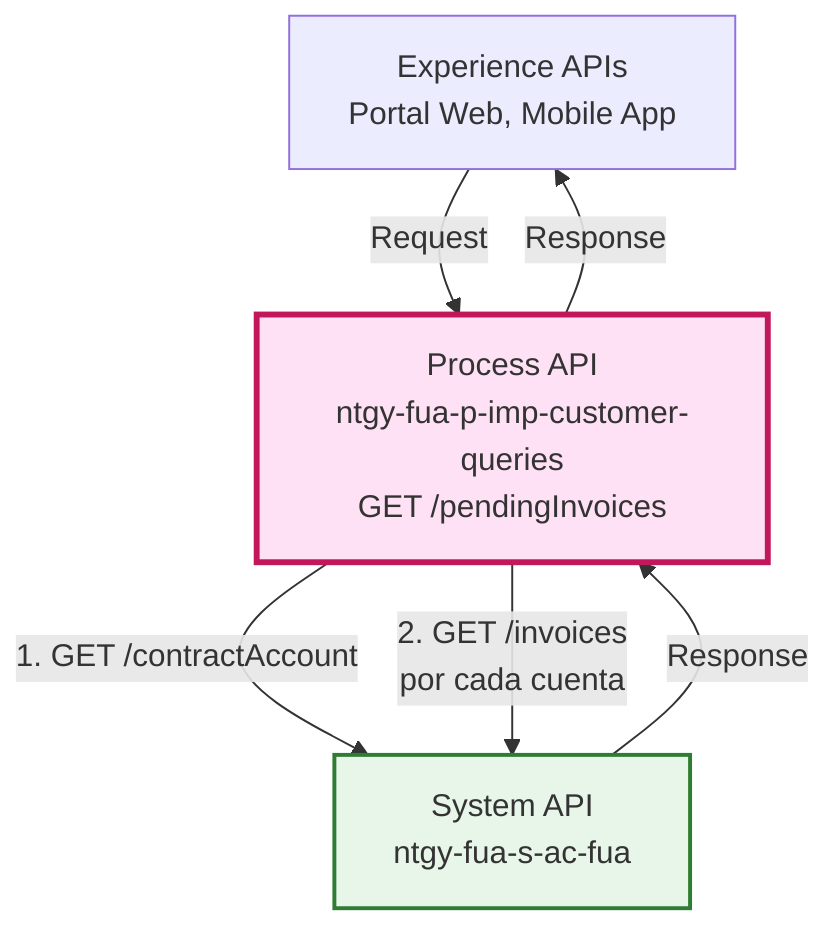
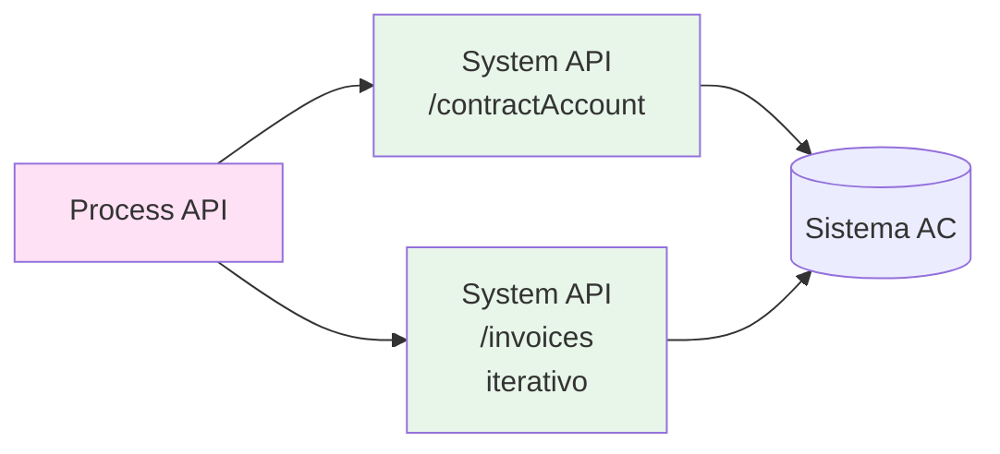
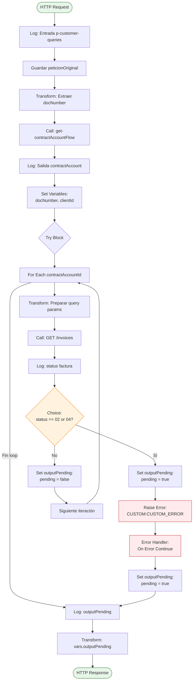
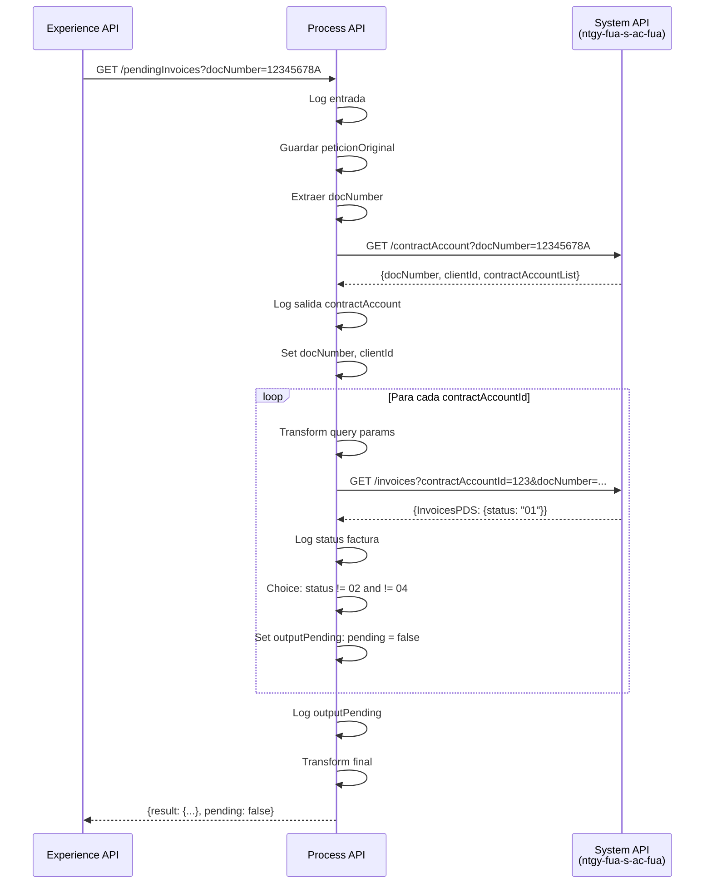
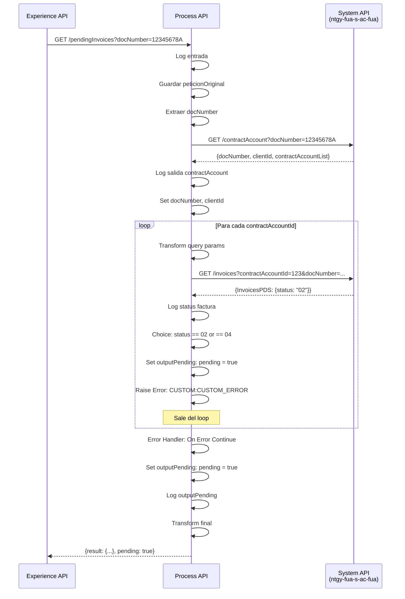
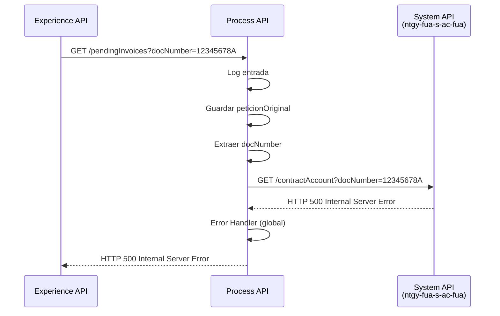

# GET /pendingInvoices

## 📌 Descripción General

### Propósito del Endpoint

Este endpoint verifica si un cliente tiene facturas pendientes de pago mediante la orquestación de dos System APIs. Primero obtiene las cuentas de contrato del cliente y luego itera sobre cada una para consultar sus facturas y validar sus estados. Si encuentra facturas con estados "02" (impagada) o "04" (impagada), retorna `pending: true`.

### Tipo de API

**Capa:** Process API (API-Led Connectivity)

**Función:** Orquestación de validación de facturas pendientes

### Patrón de Integración

**Tipo:** Orquestación con Iteración

**Descripción:** El endpoint orquesta dos llamadas secuenciales al System API `ntgy-fua-s-ac-fua`:
1. Obtiene las cuentas de contrato del cliente
2. Itera sobre cada cuenta para consultar sus facturas
3. Valida el estado de cada factura
4. Retorna resultado agregado (pending: true/false)

### Arquitectura API-Led Connectivity



---

## 💼 Propósito del Negocio

### Casos de Uso Principales

1. **Validación Pre-Operación**
   - Verificar si un cliente tiene deuda antes de permitir operaciones
   - Prevenir nuevas contrataciones con clientes morosos
   - **Beneficio:** Reduce riesgo de impago

2. **Portal de Autoservicio**
   - Mostrar alerta de facturas pendientes al cliente
   - Bloquear ciertas funcionalidades hasta regularizar pagos
   - **Beneficio:** Mejora gestión de cobros

3. **Atención al Cliente**
   - Agentes pueden verificar rápidamente estado de pagos
   - Información inmediata para gestión de reclamaciones
   - **Beneficio:** Reduce tiempo de atención

### 🔗 Endpoints Dependientes

Este Process API consume el siguiente System API:

| System API | Endpoint | Método | Propósito |
|------------|----------|--------|-----------|
| `ntgy-fua-s-ac-fua` | `/contractAccount` | GET | Obtiene información del cliente y lista de cuentas de contrato |
| `ntgy-fua-s-ac-fua` | `/invoices` | GET | Consulta facturas de una cuenta específica (llamadas iterativas) |

### Lógica de Orquestación



**Pasos del Proceso:**

1. **Paso 1**: Obtener cuentas de contrato del cliente mediante `/contractAccount`
2. **Paso 2**: Iterar sobre cada `contractAccountId` obtenido
3. **Paso 3**: Para cada cuenta, consultar facturas mediante `/invoices`
4. **Paso 4**: Validar estado de cada factura (02 o 04 = pendiente)
5. **Paso 5**: Si encuentra alguna pendiente, lanzar error custom y retornar `pending: true`
6. **Paso 6**: Si no hay pendientes, retornar `pending: false`

### Transformaciones Aplicadas

**Transformación de Request:**

| Campo Original | Campo Transformado | Transformación |
|----------------|-------------------|----------------|
| `docNumber` (query param) | `docNumber` (variable) | Extracción directa |
| `contractAccountId[]` (query param) | No usado | Opcional, se obtiene de `/contractAccount` |

**Transformación de Response:**

| Campo Original (System API) | Campo Transformado (Process API) | Transformación |
|------------------------------|----------------------------------|----------------|
| `InvoicesPDS.status` | `pending` (boolean) | Evaluación: "02" o "04" → true, otros → false |
| N/A | `result.codResult` | Generado: "0000" |
| N/A | `result.msgResult` | Generado: "No hay error" |

### Contexto Empresarial

- **Dominio:** Gestión de Facturación y Cobros
- **Sector:** Energía - Utilities
- **División:** Naturgy España - FUA (Frontal Único de Atención)
- **Proceso de Negocio:** Validación de Estado de Pagos

### Stakeholders

- **Agentes de Atención al Cliente**: Necesitan verificar rápidamente si un cliente tiene deuda
- **Clientes Finales**: Reciben alertas sobre facturas pendientes en portal web/móvil
- **Departamento de Cobros**: Utiliza esta información para gestión de morosos

### Valor de Negocio

- **Prevención de Riesgo**: Evita operaciones con clientes morosos
- **Mejora de Cobros**: Facilita identificación de clientes con deuda
- **Eficiencia Operativa**: Reduce tiempo de validación manual de estados de pago

### Consumidores Potenciales

Este endpoint puede ser consumido por:
- Portales web de autoservicio (FUA Portal)
- Aplicaciones móviles
- Sistemas de agentes de call center
- Procesos de validación pre-contratación

---

## 🔧 Especificación Técnica

### URLs por Ambiente

| Ambiente | URL Base | URL Completa |
|----------|----------|--------------|
| **Local** | `http://localhost:8091` | `http://localhost:8091/api/pendingInvoices` |
| **Development** | `https://ntgy-fua-p-imp-customer-queries-dev.de-c1.cloudhub.io` | `https://ntgy-fua-p-imp-customer-queries-dev.de-c1.cloudhub.io/api/pendingInvoices` |
| **UAT** | `https://ntgy-fua-p-imp-customer-queries-uat.de-c1.cloudhub.io` | `https://ntgy-fua-p-imp-customer-queries-uat.de-c1.cloudhub.io/api/pendingInvoices` |
| **Production** | `https://ntgy-fua-p-imp-customer-queries-pro.de-c1.cloudhub.io` | `https://ntgy-fua-p-imp-customer-queries-pro.de-c1.cloudhub.io/api/pendingInvoices` |

### Método HTTP

```
GET /api/pendingInvoices
```

### Parámetros de Entrada

#### Query Parameters

| Parámetro | Tipo | Requerido | Descripción | Ejemplo |
|-----------|------|-----------|-------------|---------|
| `docNumber` | string | Sí | Número de documento del cliente (NIF/NIE) | "12345678A" |
| `contractAccountId` | string[] | No | Array de IDs de cuentas de contrato (opcional, se obtiene automáticamente si no se proporciona) | ["123", "456"] |

**Nota:** Si no se proporciona `contractAccountId`, el endpoint lo obtiene automáticamente mediante la llamada a `/contractAccount`.

### Respuestas

#### 200 OK - Sin Facturas Pendientes

```json
{
  "result": {
    "codResult": "0000",
    "msgResult": "No hay error"
  },
  "pending": false
}
```

#### 200 OK - Con Facturas Pendientes

```json
{
  "result": {
    "codResult": "0000",
    "msgResult": "No hay error"
  },
  "pending": true
}
```

#### 400 Bad Request

```json
{
  "message": "Bad request"
}
```

**Causa:** Falta el parámetro requerido `docNumber`.

#### 500 Internal Server Error

```json
{
  "message": "Internal server error"
}
```

**Causa:** Error en la comunicación con System APIs o error interno del servidor.

### Autenticación

- **Tipo:** Client ID & Client Secret (Anypoint Platform)
- **Headers requeridos:**
  - `client_id`: ID del cliente de la aplicación
  - `client_secret`: Secret del cliente de la aplicación

### Timeouts

| Tipo | Valor |
|------|-------|
| **Request Timeout** | 30 segundos (por llamada a System API) |
| **Connection Timeout** | 30 segundos |
| **Timeout Total Estimado** | Variable (depende del número de cuentas de contrato) |

**Nota:** El timeout total puede variar según el número de cuentas de contrato que tenga el cliente, ya que se realiza una llamada iterativa por cada cuenta.

---

## 🏗️ Implementación Técnica

### Arquitectura del Flow



### Transformaciones DataWeave

#### 1. Extracción de docNumber

```dataweave
%dw 2.0
output application/java
---
vars.peticionOriginal.docNumber
```

**Propósito:** Extraer el número de documento de los query parameters originales.

#### 2. Preparación de Query Params para /invoices

```dataweave
%dw 2.0
output application/json
---
{
  "queryParams": {
    "docNumber": vars.docNumber,
    "contractAccountId": payload,
    "clientId": vars.clientId,
    "language": "",
    "accessToken": ""
  }
}
```

**Propósito:** Construir los query parameters para cada llamada iterativa a `/invoices`.

#### 3. Construcción de Response con Pending = True

```dataweave
%dw 2.0
output application/json
---
{
  result: {
    codResult: "0000",
    msgResult: "No hay error"
  },
  pending: true
}
```

#### 4. Construcción de Response con Pending = False

```dataweave
%dw 2.0
output application/json
---
{
  result: {
    codResult: "0000",
    msgResult: "No hay error"
  },
  pending: false
}
```

#### 5. Transformación Final

```dataweave
%dw 2.0
output application/json
---
vars.outputPending
```

**Propósito:** Retornar el resultado almacenado en la variable `outputPending`.

### Patrones de Diseño

**Patrón 1: Iteración con Validación Temprana (Early Exit)**

**Justificación:** Se itera sobre las cuentas de contrato y al encontrar la primera factura pendiente (estados 02 o 04), se lanza un error custom que es capturado por el error handler. Esto permite salir del loop inmediatamente sin procesar el resto de cuentas, optimizando el rendimiento.

**Patrón 2: Error Handler como Mecanismo de Control de Flujo**

**Justificación:** Se utiliza un error custom (`CUSTOM:CUSTOM_ERROR`) y un error handler (`on-error-continue`) para controlar el flujo cuando se encuentra una factura pendiente. Esto permite mantener un código limpio y evitar flags booleanos complejos.

**Patrón 3: Variable de Estado (outputPending)**

**Justificación:** Se utiliza una variable `outputPending` para almacenar el resultado final, que puede ser modificada tanto en el flujo normal como en el error handler, garantizando que siempre haya una respuesta consistente.

### Diagramas de Secuencia

#### 1. Flujo Normal - Sin Facturas Pendientes



#### 2. Flujo con Facturas Pendientes



#### 3. Flujo con Error Técnico



### Manejo de Errores

#### Error Handler Específico (CUSTOM:CUSTOM_ERROR)

**Tipo:** `on-error-continue`

**Propósito:** Capturar el error custom lanzado cuando se encuentra una factura pendiente.

**Acción:**
1. Establece `outputPending` con `pending: true`
2. Continúa el flujo normalmente (no propaga el error)
3. Retorna respuesta exitosa (200 OK) con `pending: true`

**Código:**
```xml
<on-error-continue type="CUSTOM:CUSTOM_ERROR">
    <ee:transform>
        <ee:variables>
            <ee:set-variable variableName="outputPending">
                {
                  result: {
                    codResult: "0000",
                    msgResult: "No hay error"
                  },
                  pending: true
                }
            </ee:set-variable>
        </ee:variables>
    </ee:transform>
</on-error-continue>
```

#### Error Handler Global (APIKit)

**Tipos manejados:**
- `APIKIT:BAD_REQUEST` (400)
- `APIKIT:NOT_FOUND` (404)
- `APIKIT:METHOD_NOT_ALLOWED` (405)
- `APIKIT:NOT_ACCEPTABLE` (406)
- `APIKIT:UNSUPPORTED_MEDIA_TYPE` (415)
- `APIKIT:NOT_IMPLEMENTED` (501)

**Acción:** Retorna mensaje de error estándar con código HTTP apropiado.

### Estados de Factura

| Código | Descripción | Considerado Pendiente |
|--------|-------------|----------------------|
| `"02"` | Factura impagada | ✅ Sí |
| `"04"` | Factura impagada | ✅ Sí |
| Otros | Factura pagada u otro estado | ❌ No |

**Lógica de Validación:**
```dataweave
(payload.InvoicesPDS..'status' contains "02") or 
(payload.InvoicesPDS..'status' contains "04")
```

### Configuración de System APIs

**Sistema AC (ntgy-fua-s-ac-fua):**
```yaml
s-ac:
  host: "ntgy-fua-s-ac-fua-bqyi65.internal-6bnlu3.irl-e1.cloudhub.io"
  port: "443"
  protocol: "HTTPS"
  timeout: "30000"
```

---

## 💻 Ejemplos de Uso

### Ejemplo 1: Cliente Sin Facturas Pendientes

#### cURL

```bash
curl -X GET "https://ntgy-fua-p-imp-customer-queries-pro.de-c1.cloudhub.io/api/pendingInvoices?docNumber=12345678A" \
  -H "Content-Type: application/json" \
  -H "client_id: YOUR_CLIENT_ID" \
  -H "client_secret: YOUR_CLIENT_SECRET"
```

#### Respuesta (200 OK)

```json
{
  "result": {
    "codResult": "0000",
    "msgResult": "No hay error"
  },
  "pending": false
}
```

### Ejemplo 2: Cliente Con Facturas Pendientes

#### cURL

```bash
curl -X GET "https://ntgy-fua-p-imp-customer-queries-pro.de-c1.cloudhub.io/api/pendingInvoices?docNumber=98765432B" \
  -H "Content-Type: application/json" \
  -H "client_id: YOUR_CLIENT_ID" \
  -H "client_secret: YOUR_CLIENT_SECRET"
```

#### Respuesta (200 OK)

```json
{
  "result": {
    "codResult": "0000",
    "msgResult": "No hay error"
  },
  "pending": true
}
```

### Ejemplo 3: Con contractAccountId Específico

#### cURL

```bash
curl -X GET "https://ntgy-fua-p-imp-customer-queries-pro.de-c1.cloudhub.io/api/pendingInvoices?docNumber=12345678A&contractAccountId=123&contractAccountId=456" \
  -H "Content-Type: application/json" \
  -H "client_id: YOUR_CLIENT_ID" \
  -H "client_secret: YOUR_CLIENT_SECRET"
```

#### Respuesta (200 OK)

```json
{
  "result": {
    "codResult": "0000",
    "msgResult": "No hay error"
  },
  "pending": false
}
```

### Ejemplo 4: JavaScript (Fetch API)

```javascript
const checkPendingInvoices = async (docNumber) => {
  const response = await fetch(
    `https://ntgy-fua-p-imp-customer-queries-pro.de-c1.cloudhub.io/api/pendingInvoices?docNumber=${docNumber}`,
    {
      method: 'GET',
      headers: {
        'Content-Type': 'application/json',
        'client_id': 'YOUR_CLIENT_ID',
        'client_secret': 'YOUR_CLIENT_SECRET'
      }
    }
  );

  const data = await response.json();
  
  if (data.pending) {
    console.log('⚠️ El cliente tiene facturas pendientes');
  } else {
    console.log('✅ El cliente no tiene facturas pendientes');
  }
  
  return data;
};

// Uso
checkPendingInvoices('12345678A');
```

### Ejemplo 5: Python (Requests)

```python
import requests

def check_pending_invoices(doc_number):
    url = f"https://ntgy-fua-p-imp-customer-queries-pro.de-c1.cloudhub.io/api/pendingInvoices"
    
    params = {
        'docNumber': doc_number
    }
    
    headers = {
        'Content-Type': 'application/json',
        'client_id': 'YOUR_CLIENT_ID',
        'client_secret': 'YOUR_CLIENT_SECRET'
    }
    
    response = requests.get(url, params=params, headers=headers)
    data = response.json()
    
    if data['pending']:
        print(f"⚠️ El cliente {doc_number} tiene facturas pendientes")
    else:
        print(f"✅ El cliente {doc_number} no tiene facturas pendientes")
    
    return data

# Uso
check_pending_invoices('12345678A')
```

### Ejemplo 6: Error - Parámetro Faltante

#### cURL

```bash
curl -X GET "https://ntgy-fua-p-imp-customer-queries-pro.de-c1.cloudhub.io/api/pendingInvoices" \
  -H "Content-Type: application/json" \
  -H "client_id: YOUR_CLIENT_ID" \
  -H "client_secret: YOUR_CLIENT_SECRET"
```

#### Respuesta (400 Bad Request)

```json
{
  "message": "Bad request"
}