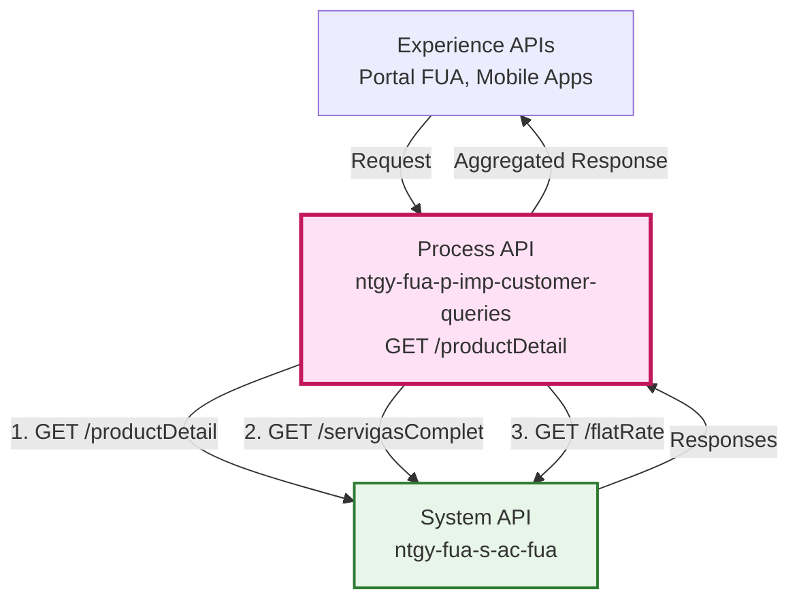
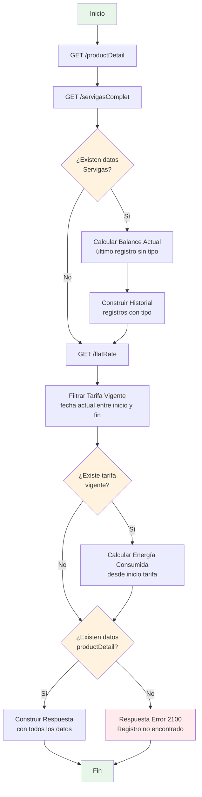
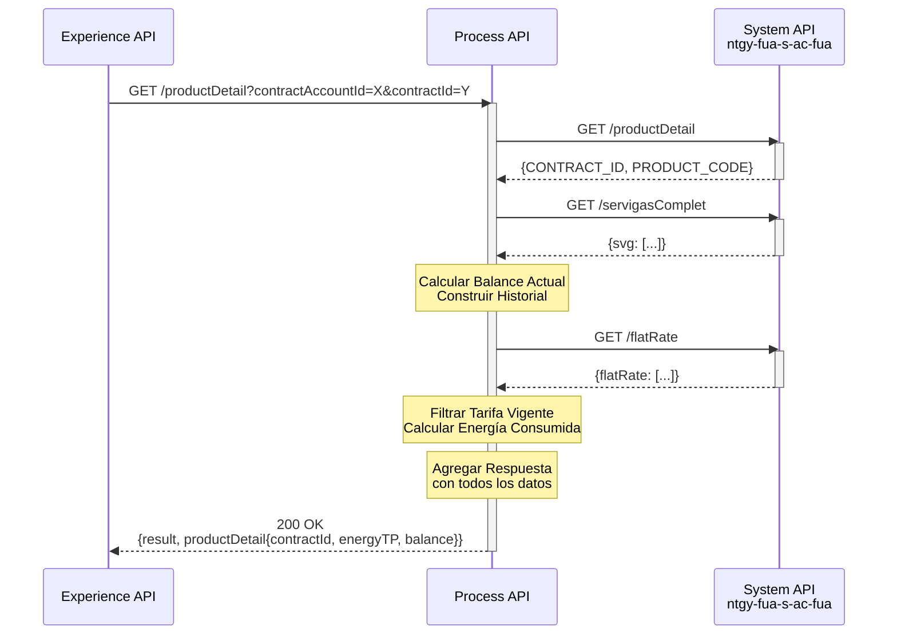
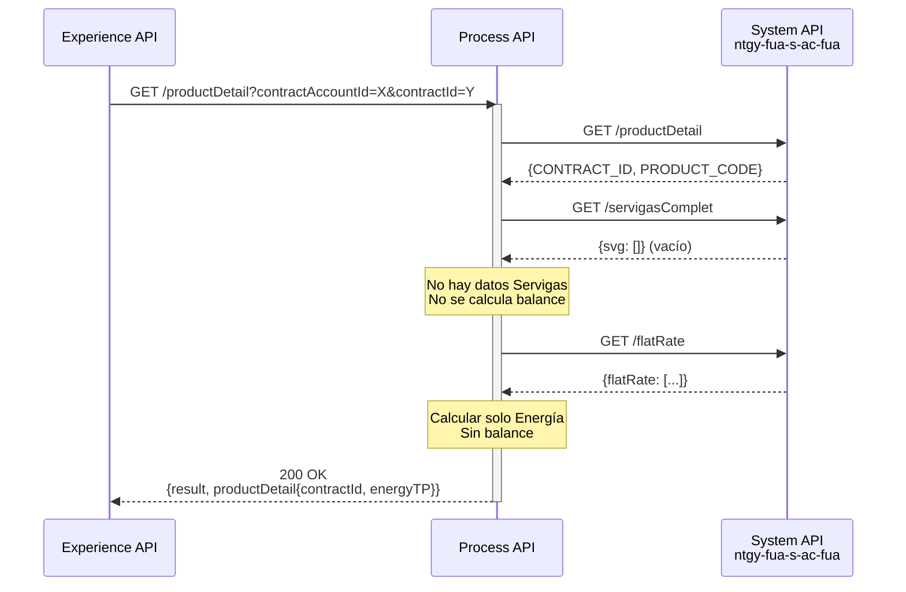
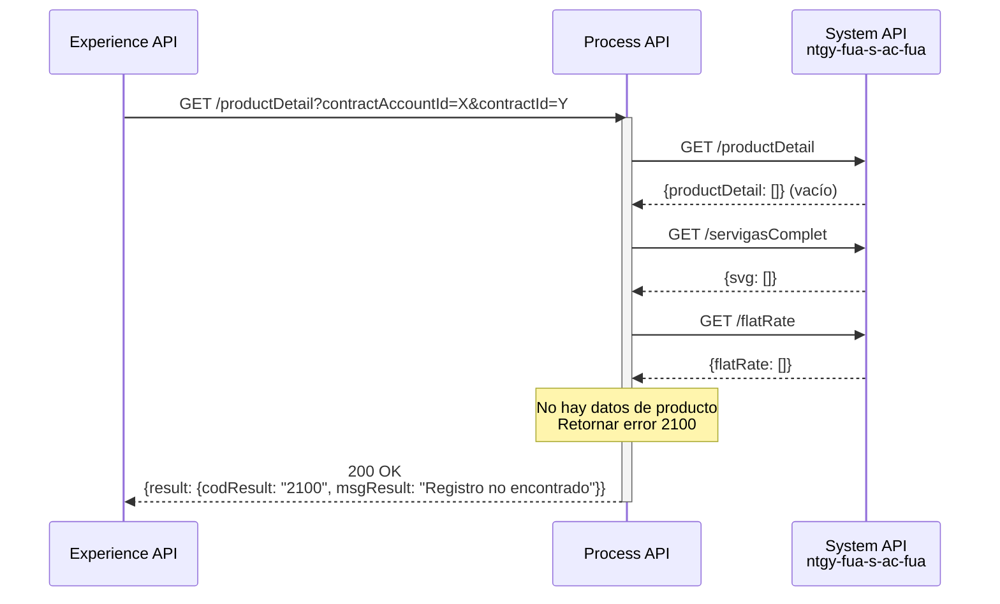
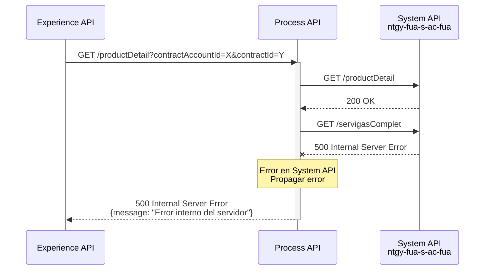

# GET /productDetail

## 📌 Descripción General

### Propósito del Endpoint

Este endpoint orquesta tres llamadas al System API `ntgy-fua-s-ac-fua` para construir una vista completa del detalle de un contrato, incluyendo:
- Información básica del producto/contrato
- Balance de Servigas (SVG) con historial de actividades
- Información de Tarifa Plana de Energía (consumo vs contratado)

### Tipo de API

**Capa:** Process API (API-Led Connectivity)

**Función:** Orquestación y agregación de datos de contrato desde múltiples endpoints del System API

### Patrón de Integración

**Tipo:** Orquestación con Transformación Condicional

**Descripción:** 
- Realiza 3 llamadas REST secuenciales al System API
- Aplica lógica de negocio para calcular balance actual de Servigas
- Calcula energía consumida vs contratada para tarifas vigentes
- Construye respuesta condicional según disponibilidad de datos

### Arquitectura API-Led Connectivity



---

## 💼 Propósito del Negocio

### Casos de Uso Principales

1. **Consulta de Detalle de Contrato**
   - Agentes de atención al cliente necesitan ver información completa del contrato
   - Clientes consultan detalles de su producto contratado en portal web/móvil
   - **Beneficio:** Vista unificada de toda la información del contrato

2. **Gestión de Balance Servigas**
   - Clientes con producto Servigas consultan su balance disponible
   - Visualización del historial de actividades (consumos, recargas)
   - **Beneficio:** Transparencia en el uso del servicio prepago

3. **Seguimiento de Tarifa Plana de Energía**
   - Clientes con tarifa plana consultan energía consumida vs contratada
   - Identificación de proximidad al límite de consumo
   - **Beneficio:** Control del consumo para evitar sobrecostos

### 🔗 Endpoints Dependientes

Este Process API consume los siguientes endpoints del System API:

| System API | Endpoint | Método | Propósito |
|------------|----------|--------|-----------|
| `ntgy-fua-s-ac-fua` | `/productDetail` | GET | Obtiene datos básicos del contrato (ID, código de producto) |
| `ntgy-fua-s-ac-fua` | `/servigasComplet` | GET | Obtiene balance completo de Servigas con historial |
| `ntgy-fua-s-ac-fua` | `/flatRate` | GET | Obtiene información de tarifas planas de energía |

### Lógica de Orquestación



**Pasos del Proceso:**

1. **Obtención de Datos Básicos**: Llamada a `/productDetail` para obtener CONTRACT_ID y PRODUCT_CODE
2. **Obtención de Balance Servigas**: Llamada a `/servigasComplet` para obtener datos SVG
3. **Cálculo de Balance Actual**: Si existen datos Servigas, extrae el último registro sin tipo de actividad
4. **Construcción de Historial**: Filtra registros con tipo de actividad para construir historial
5. **Obtención de Tarifas**: Llamada a `/flatRate` para obtener información de tarifas planas
6. **Validación de Tarifa Vigente**: Filtra tarifa donde fecha actual está entre inicio y fin
7. **Cálculo de Energía**: Si hay tarifa vigente, suma consumos desde fecha de inicio
8. **Agregación Final**: Construye respuesta con todos los datos disponibles

### Transformaciones Aplicadas

**Transformación 1: Balance Servigas**

| Campo Original (System API) | Campo Transformado (Process API) | Transformación |
|------------------------------|----------------------------------|----------------|
| `SVG_AVAILABLE_BALANCE` | `balance.availableBalance` | Último registro sin tipo de actividad |
| `SVG_CONSUMED_BALANCE` | `balance.consumedBalance` | Último registro sin tipo de actividad |
| `SVG_INITIAL_BALANCE` | `balance.initialBalance` | Último registro sin tipo de actividad |
| `SVG_RENOVATION_NUMBER` | `balance.actualValidity` | Último registro sin tipo de actividad |
| `svg[]` (con tipo) | `balance.history[]` | Array de registros con tipo de actividad |

**Transformación 2: Tarifa Plana de Energía**

| Campo Original (System API) | Campo Transformado (Process API) | Transformación |
|------------------------------|----------------------------------|----------------|
| `FL_CONSUMPTION` (tipo "D_TP_COAC") | `energyTP.consumedEnergy` | Suma de consumos desde inicio tarifa vigente |
| `FL_CONSUMPTION` (tipo "D_TP_EXCL") | `energyTP.contractedEnergy` | Límite de tarifa más reciente |

**Lógica de Negocio:**

- **Balance Actual**: Se obtiene del último registro de `servigasComplet` donde `SVG_ACTIVITY_TYPE == null`
- **Historial**: Se construye con registros donde `SVG_ACTIVITY_TYPE != null`
- **Tarifa Vigente**: Se filtra por `FL_TYPE contains "D_TP_VIGE"` y fecha actual entre `FL_INI_DATE` y `FL_END_DATE`
- **Energía Consumida**: Se suma `FL_CONSUMPTION` de registros tipo "D_TP_COAC" desde `FL_INI_DATE` de tarifa vigente

### Contexto Empresarial

- **Dominio:** Gestión de Productos y Contratos
- **Sector:** Energía - Utilities (Gas & Electricidad)
- **División:** Naturgy España - Clientes Minoristas
- **Proceso de Negocio:** Consulta de información de contratos y productos

### Stakeholders

- **Agentes de Atención al Cliente**: Necesitan información completa del contrato para resolver consultas
- **Clientes Finales**: Consultan detalles de su contrato, balance Servigas y consumo de tarifa plana
- **Equipo de Facturación**: Utilizan información de consumo para procesos de facturación

### Valor de Negocio

- **Transparencia**: Clientes tienen visibilidad completa de su contrato y consumos
- **Autoservicio**: Reduce llamadas al call center al proporcionar información detallada en portal
- **Control de Consumo**: Clientes pueden monitorear su consumo vs límite contratado
- **Eficiencia Operativa**: Agentes acceden a toda la información en una sola consulta

### Consumidores Potenciales

Este endpoint puede ser consumido por:
- Portal web de autoservicio FUA (Frontal Único de Atención)
- Aplicaciones móviles de clientes
- Sistemas de agentes de call center
- Aplicaciones de escritorio para agentes

---

## 🔧 Especificación Técnica

### URLs por Ambiente

| Ambiente | URL Base | URL Completa |
|----------|----------|--------------|
| **Local** | `http://localhost:8084` | `http://localhost:8084/api/productDetail` |
| **Development** | `https://ntgy-fua-p-imp-customer-queries-dev.de-c1.cloudhub.io` | `https://ntgy-fua-p-imp-customer-queries-dev.de-c1.cloudhub.io/api/productDetail` |
| **UAT** | `https://ntgy-fua-p-imp-customer-queries-uat.de-c1.cloudhub.io` | `https://ntgy-fua-p-imp-customer-queries-uat.de-c1.cloudhub.io/api/productDetail` |
| **Production** | `https://ntgy-fua-p-imp-customer-queries-pro.de-c1.cloudhub.io` | `https://ntgy-fua-p-imp-customer-queries-pro.de-c1.cloudhub.io/api/productDetail` |

### Método HTTP

```
GET /api/productDetail
```

### Parámetros de Entrada

#### Query Parameters

| Parámetro | Tipo | Requerido | Descripción | Ejemplo |
|-----------|------|-----------|-------------|---------|
| `contractAccountId` | string | Opcional | Identificador de cuenta contrato | "1234567890" |
| `contractId` | string | Opcional | Identificador de contrato | "9876543210" |
| `CUO` | string | Opcional | Código Único de Operación | "CUO123" |
| `language` | string | Opcional | Idioma de respuesta | "es" |
| `clientId` | string | Opcional | Identificador de cliente | "CLI123" |
| `NIF` | string | Opcional | NIF del cliente | "12345678A" |
| `docNumber` | string | Requerido | Número de documento | "1784" |

**Nota:** Aunque varios parámetros son opcionales, se recomienda proporcionar al menos `contractAccountId` y `contractId` para obtener información completa.

### Respuestas

#### 200 OK - Éxito con Datos

```json
{
  "result": {
    "codResult": "0000",
    "msgResult": "No hay error"
  },
  "productDetail": {
    "contractId": "9876543210",
    "productTypeId": "PROD001",
    "promotionDesc": "",
    "energyTP": {
      "consumedEnergy": 1250.5,
      "contractedEnergy": 2000.0
    },
    "balance": {
      "availableBalance": 150.75,
      "consumedBalance": 49.25,
      "initialBalance": 200.0,
      "actualValidity": 3,
      "history": [
        {
          "activityDate": "2026-09-01T10:30:00",
          "activityType": "CONSUMO",
          "amount": -25.50,
          "availableBalance": 174.50,
          "validity": 3
        },
        {
          "activityDate": "2026-08-15T14:20:00",
          "activityType": "RECARGA",
          "amount": 50.00,
          "availableBalance": 200.00,
          "validity": 3
        }
      ]
    }
  }
}
```

#### 200 OK - Sin Datos (Registro No Encontrado)

```json
{
  "result": {
    "codResult": "2100",
    "msgResult": "Registro no encontrado"
  }
}
```

#### 400 Bad Request

```json
{
  "message": "Bad request - Parámetros inválidos"
}
```

#### 500 Internal Server Error

```json
{
  "message": "Error interno del servidor"
}
```

### Códigos de Estado HTTP

| Código | Descripción |
|--------|-------------|
| 200 | Solicitud exitosa (con o sin datos) |
| 400 | Parámetros de entrada inválidos |
| 401 | No autorizado - credenciales inválidas |
| 500 | Error interno del servidor |
| 503 | Servicio no disponible |

### Autenticación

- **Tipo:** Client ID & Client Secret (Anypoint Platform)
- **Headers requeridos:**
  - `client_id`: ID de cliente de Anypoint Platform
  - `client_secret`: Secret de cliente de Anypoint Platform

### Timeouts

| Tipo | Valor |
|------|-------|
| **Request Timeout** | 30 segundos (por llamada a System API) |
| **Connection Timeout** | 30 segundos |
| **Timeout Total Estimado** | ~90 segundos (3 llamadas secuenciales) |

---

## 🏗️ Implementación Técnica

### Arquitectura del Flow

```mermaid
flowchart TD
    Start([HTTP GET Request]) --> Log1[Log: Inicio flujo GET ProductDetail]
    Log1 --> Call1[HTTP Request: GET /productDetail]
    Call1 --> Store1[Store: vars.productDetail]
    Store1 --> Call2[HTTP Request: GET /servigasComplet]
    Call2 --> Store2[Store: vars.svgComplet]
    Store2 --> Choice1{¿Existen datos<br/>Servigas?}
    
    Choice1 -->|Sí: sizeOf > 0| Log2[Log: Existen datos servigas complet]
    Choice1 -->|No| Log3[Log: No existen datos servigas complet]
    
    Log2 --> Transform1[Transform: Calcular Balance<br/>- Balance actual último registro<br/>- Historial con tipo actividad]
    Transform1 --> Store3[Store: vars.balance]
    
    Log3 --> Call3[HTTP Request: GET /flatRate]
    Store3 --> Call3
    
    Call3 --> Store4[Store: vars.flatRate]
    Store4 --> SetVar1[Set Variable: Filtrar Tarifa Vigente<br/>D_TP_VIGE + fechas]
    SetVar1 --> Store5[Store: vars.tarifaVigente]
    Store5 --> Choice2{¿Existe tarifa<br/>vigente?}
    
    Choice2 -->|Sí: sizeOf > 0| Log4[Log: Existe tarifa vigente]
    Choice2 -->|No| Log5[Log: No hay tarifa vigente]
    
    Log4 --> Transform2[Transform: Calcular Energía<br/>- Consumida desde inicio<br/>- Contratada límite]
    Transform2 --> Store6[Store: vars.energyTP]
    
    Log5 --> Choice3{¿Existen datos<br/>productDetail?}
    Store6 --> Choice3
    
    Choice3 -->|Sí: sizeOf > 0| Transform3[Transform: Respuesta Exitosa<br/>- result: 0000<br/>- productDetail completo]
    Choice3 -->|No| Transform4[Transform: Respuesta Error<br/>- result: 2100<br/>- Registro no encontrado]
    
    Transform3 --> Log6[Log: Fin flujo GET ProductDetail]
    Transform4 --> Log6
    Log6 --> End([HTTP Response])
    
    style Start fill:#e8f5e9,stroke:#2e7d32
    style End fill:#e8f5e9,stroke:#2e7d32
    style Choice1 fill:#fff3e0,stroke:#f57c00
    style Choice2 fill:#fff3e0,stroke:#f57c00
    style Choice3 fill:#fff3e0,stroke:#f57c00
    style Transform1 fill:#e3f2fd,stroke:#1976d2
    style Transform2 fill:#e3f2fd,stroke:#1976d2
    style Transform3 fill:#e8f5e9,stroke:#388e3c
    style Transform4 fill:#ffebee,stroke:#d32f2f
```



### Transformaciones DataWeave

#### Transformación 1: Cálculo de Balance Servigas

```dataweave
%dw 2.0
output application/json
var currentSvgBalance = (vars.svgComplet.svg filter ($.SVG_ACTIVITY_TYPE == null) orderBy $.SVG_ACTIVITY_DATE) [-1 to 0] [0]
---
{
  availableBalance: currentSvgBalance.SVG_AVAILABLE_BALANCE,
  consumedBalance: currentSvgBalance.SVG_CONSUMED_BALANCE,
  initialBalance: currentSvgBalance.SVG_INITIAL_BALANCE,
  actualValidity: currentSvgBalance.SVG_RENOVATION_NUMBER,
  history: vars.svgComplet.svg filter ($.SVG_ACTIVITY_TYPE != null) map {
    activityDate: $.SVG_ACTIVITY_DATE,
    activityType: $.SVG_ACTIVITY_TYPE,
    amount: $.SVG_ACTIVITY_AMOUNT,
    availableBalance: $.SVG_AVAILABLE_BALANCE,
    validity: $.SVG_RENOVATION_NUMBER
  }
}
```

**Lógica:**
- Filtra registros sin tipo de actividad (`SVG_ACTIVITY_TYPE == null`)
- Ordena por fecha y toma el último registro (balance actual)
- Construye historial con registros que tienen tipo de actividad

#### Transformación 2: Filtrado de Tarifa Vigente

```dataweave
%dw 2.0
output application/json
var tarifaVigente = "D_TP_VIGE"
---
vars.flatRate.flatRate filter (
  ($.FL_TYPE contains tarifaVigente) and 
  $.FL_END_DATE > now() and 
  $.FL_INI_DATE < now()
)
```

**Lógica:**
- Filtra por tipo "D_TP_VIGE" (tarifa vigente)
- Valida que fecha actual esté entre inicio y fin
- Retorna array de tarifas vigentes

#### Transformación 3: Cálculo de Energía Consumida

```dataweave
%dw 2.0
output application/json
var limite = "D_TP_EXCL"
var tipoConsumo = "D_TP_COAC"
var fechaInicioTarifaVigente = (vars.tarifaVigente.FL_INI_DATE)[0]
var limiteTarifa = vars.flatRate.flatRate filter (
  ($.FL_TYPE contains limite) and 
  $.FL_INI_DATE < now()
)
var consumido = vars.flatRate.flatRate filter (
  ($.FL_TYPE contains tipoConsumo) and 
  $.FL_INI_DATE >= fechaInicioTarifaVigente
) map $.FL_CONSUMPTION reduce ($ + $$)
---
{
  consumedEnergy: consumido,
  contractedEnergy: limiteTarifa[0].FL_CONSUMPTION
}
```

**Lógica:**
- Extrae fecha de inicio de tarifa vigente
- Filtra registros de consumo desde esa fecha
- Suma todos los consumos (reduce)
- Obtiene límite contratado de tarifa más reciente

#### Transformación 4: Respuesta Final

```dataweave
%dw 2.0
output application/json
---
{
  "result": {
    "codResult": "0000",
    "msgResult": "No hay error"
  },
  "productDetail": {
    ("contractId": vars.productDetail.productDetail[0].CONTRACT_ID) 
      if not isEmpty(vars.productDetail.productDetail[0].CONTRACT_ID),
    ("productTypeId": vars.productDetail.productDetail[0].PRODUCT_CODE) 
      if not isEmpty(vars.productDetail.productDetail[0].PRODUCT_CODE),
    "promotionDesc": "",
    (energyTP: vars.energyTP) if (!isEmpty(vars.energyTP)),
    (balance: vars.balance) if (!isEmpty(vars.balance))
  }
}
```

**Lógica:**
- Incluye campos solo si no están vacíos (condicional)
- Agrega `energyTP` solo si existe
- Agrega `balance` solo si existe
- Siempre incluye `promotionDesc` (vacío por defecto)

### Patrones de Diseño

**Patrón:** Aggregator Pattern (Agregación Secuencial)

**Justificación:** 
- Necesidad de combinar datos de 3 fuentes diferentes
- Cada llamada es independiente pero los datos se agregan al final
- Permite construcción condicional de respuesta según disponibilidad de datos

**Patrón:** Conditional Enrichment

**Justificación:**
- No todos los contratos tienen Servigas o Tarifa Plana
- La respuesta se enriquece solo con datos disponibles
- Evita errores por datos faltantes

### Diagramas de Secuencia

#### 1. Flujo Normal de Éxito (Con Todos los Datos)



#### 2. Flujo Sin Datos de Servigas



#### 3. Flujo Sin Datos de Producto (Error 2100)



#### 4. Flujo con Error Técnico



### Manejo de Errores

**Estrategia:** Propagación de errores del System API con logging

**Errores Manejados:**

1. **Error de Conectividad (HTTP:TIMEOUT)**
   - Timeout de 30 segundos por llamada
   - Se propaga error 503 Service Unavailable
   - Se registra en logs para troubleshooting

2. **Error del System API (5xx)**
   - Se propaga el error al consumidor
   - Se registra contexto completo en logs
   - No se intenta retry (responsabilidad del consumidor)

3. **Datos No Encontrados (2100)**
   - No es un error técnico
   - Se retorna código 200 con codResult "2100"
   - Indica que el contrato no existe o no tiene datos

4. **Parámetros Inválidos (400)**
   - Validación de parámetros requeridos
   - Se retorna 400 Bad Request
   - Mensaje descriptivo del error

**Logging:**
- Inicio y fin de flujo
- Cada decisión condicional (existen datos Servigas, existe tarifa vigente)
- Errores con contexto completo

---

## 💻 Ejemplos de Uso

### Ejemplo 1: Consulta Completa con Todos los Datos

#### cURL

```bash
curl -X GET "https://ntgy-fua-p-imp-customer-queries-pro.de-c1.cloudhub.io/api/productDetail?contractAccountId=1234567890&contractId=9876543210&docNumber=1784" \
  -H "Content-Type: application/json" \
  -H "client_id: YOUR_CLIENT_ID" \
  -H "client_secret: YOUR_CLIENT_SECRET"
```

#### Respuesta (200 OK)

```json
{
  "result": {
    "codResult": "0000",
    "msgResult": "No hay error"
  },
  "productDetail": {
    "contractId": "9876543210",
    "productTypeId": "SERVIGAS_PLUS",
    "promotionDesc": "",
    "energyTP": {
      "consumedEnergy": 1250.5,
      "contractedEnergy": 2000.0
    },
    "balance": {
      "availableBalance": 150.75,
      "consumedBalance": 49.25,
      "initialBalance": 200.0,
      "actualValidity": 3,
      "history": [
        {
          "activityDate": "2026-09-15T10:30:00",
          "activityType": "CONSUMO",
          "amount": -25.50,
          "availableBalance": 174.50,
          "validity": 3
        },
        {
          "activityDate": "2026-09-01T14:20:00",
          "activityType": "RECARGA",
          "amount": 50.00,
          "availableBalance": 200.00,
          "validity": 3
        },
        {
          "activityDate": "2026-08-20T09:15:00",
          "activityType": "CONSUMO",
          "amount": -30.00,
          "availableBalance": 150.00,
          "validity": 2
        }
      ]
    }
  }
}
```

### Ejemplo 2: Consulta Sin Datos de Servigas

#### cURL

```bash
curl -X GET "https://ntgy-fua-p-imp-customer-queries-pro.de-c1.cloudhub.io/api/productDetail?contractAccountId=1111111111&contractId=2222222222&docNumber=1784" \
  -H "Content-Type: application/json" \
  -H "client_id: YOUR_CLIENT_ID" \
  -H "client_secret: YOUR_CLIENT_SECRET"
```

#### Respuesta (200 OK)

```json
{
  "result": {
    "codResult": "0000",
    "msgResult": "No hay error"
  },
  "productDetail": {
    "contractId": "2222222222",
    "productTypeId": "TARIFA_PLANA",
    "promotionDesc": "",
    "energyTP": {
      "consumedEnergy": 850.0,
      "contractedEnergy": 1500.0
    }
  }
}
```

### Ejemplo 3: Contrato No Encontrado (Error 2100)

#### cURL

```bash
curl -X GET "https://ntgy-fua-p-imp-customer-queries-pro.de-c1.cloudhub.io/api/productDetail?contractAccountId=9999999999&contractId=0000000000&docNumber=1784" \
  -H "Content-Type: application/json" \
  -H "client_id: YOUR_CLIENT_ID" \
  -H "client_secret: YOUR_CLIENT_SECRET"
```

#### Respuesta (200 OK)

```json
{
  "result": {
    "codResult": "2100",
    "msgResult": "Registro no encontrado"
  }
}
```

### Ejemplo 4: JavaScript (Fetch API)

```javascript
const getProductDetail = async (contractAccountId, contractId, docNumber) => {
  try {
    const params = new URLSearchParams({
      contractAccountId,
      contractId,
      docNumber
    });

    const response = await fetch(
      `https://ntgy-fua-p-imp-customer-queries-pro.de-c1.cloudhub.io/api/productDetail?${params}`,
      {
        method: 'GET',
        headers: {
          'Content-Type': 'application/json',
          'client_id': 'YOUR_CLIENT_ID',
          'client_secret': 'YOUR_CLIENT_SECRET'
        }
      }
    );

    if (!response.ok) {
      throw new Error(`HTTP error! status: ${response.status}`);
    }

    const data = await response.json();
    
    // Verificar si hay datos
    if (data.result.codResult === '0000') {
      console.log('Contrato encontrado:', data.productDetail);
      
      // Verificar balance Servigas
      if (data.productDetail.balance) {
        console.log('Balance disponible:', data.productDetail.balance.availableBalance);
      }
      
      // Verificar tarifa plana
      if (data.productDetail.energyTP) {
        const porcentajeConsumo = (data.productDetail.energyTP.consumedEnergy / 
                                   data.productDetail.energyTP.contractedEnergy) * 100;
        console.log(`Consumo: ${porcentajeConsumo.toFixed(2)}% de la tarifa contratada`);
      }
    } else {
      console.log('Contrato no encontrado');
    }

    return data;
  } catch (error) {
    console.error('Error al consultar producto:', error);
    throw error;
  }
};

// Uso
getProductDetail('1234567890', '9876543210', '1784');
```

### Ejemplo 5: Python (Requests)

```python
import requests
from typing import Dict, Optional

def get_product_detail(
    contract_account_id: str,
    contract_id: str,
    doc_number: str,
    client_id: str,
    client_secret: str
) -> Dict:
    """
    Obtiene el detalle de un contrato incluyendo balance Servigas y tarifa plana.
    
    Args:
        contract_account_id: ID de cuenta contrato
        contract_id: ID de contrato
        doc_number: Número de documento
        client_id: Client ID de Anypoint Platform
        client_secret: Client Secret de Anypoint Platform
    
    Returns:
        Dict con la información del contrato
    """
    url = "https://ntgy-fua-p-imp-customer-queries-pro.de-c1.cloudhub.io/api/productDetail"
    
    params = {
        'contractAccountId': contract_account_id,
        'contractId': contract_id,
        'docNumber': doc_number
    }
    
    headers = {
        'Content-Type': 'application/json',
        'client_id': client_id,
        'client_secret': client_secret
    }
    
    try:
        response = requests.get(url, params=params, headers=headers, timeout=30)
        response.raise_for_status()
        
        data = response.json()
        
        # Verificar resultado
        if data['result']['codResult'] == '0000':
            print(f"✓ Contrato encontrado: {data['productDetail'].get('contractId')}")
            
            # Mostrar balance Servigas si existe
            if 'balance' in data['productDetail']:
                balance = data['productDetail']['balance']
                print(f"  Balance disponible: {balance['availableBalance']}")
                print(f"  Historial de actividades: {len(balance['history'])} registros")
            
            # Mostrar tarifa plana si existe
            if 'energyTP' in data['productDetail']:
                energy = data['productDetail']['energyTP']
                porcentaje = (energy['consumedEnergy'] / energy['contractedEnergy']) * 100
                print(f"  Consumo: {energy['consumedEnergy']} / {energy['contractedEnergy']} ({porcentaje:.2f}%)")
        else:
            print(f"✗ Contrato no encontrado: {data['result']['msgResult']}")
        
        return data
        
    except requests.exceptions.Timeout:
        print("Error: Timeout al consultar el servicio")
        raise
    except requests.exceptions.RequestException as e:
        print(f"Error en la petición: {e}")
        raise

# Uso
if __name__ == "__main__":
    result = get_product_detail(
        contract_account_id='1234567890',
        contract_id='9876543210',
        doc_number='1784',
        client_id='YOUR_CLIENT_ID',
        client_secret='YOUR_CLIENT_SECRET'
    )
    
    print("\nRespuesta completa:")
    print(result)
```

### Ejemplo 6: Postman Collection

```json
{
  "info": {
    "name": "GET /productDetail",
    "description": "Obtiene detalle completo de contrato con balance Servigas y tarifa plana",
    "schema": "https://schema.getpostman.com/json/collection/v2.1.0/collection.json"
  },
  "item": [
    {
      "name": "Get Product Detail - Completo",
      "request": {
        "method": "GET",
        "header": [
          {
            "key": "Content-Type",
            "value": "application/json"
          },
          {
            "key": "client_id",
            "value": "{{client_id}}"
          },
          {
            "key": "client_secret",
            "value": "{{client_secret}}"
          }
        ],
        "url": {
          "raw": "{{base_url}}/api/productDetail?contractAccountId={{contractAccountId}}&contractId={{contractId}}&docNumber={{docNumber}}",
          "host": ["{{base_url}}"],
          "path": ["api", "productDetail"],
          "query": [
            {
              "key": "contractAccountId",
              "value": "{{contractAccountId}}"
            },
            {
              "key": "contractId",
              "value": "{{contractId}}"
            },
            {
              "key": "docNumber",
              "value": "{{docNumber}}"
            }
          ]
        }
      }
    }
  ]
}
```

**Variables de entorno sugeridas:**
- `base_url`: `https://ntgy-fua-p-imp-customer-queries-pro.de-c1.cloudhub.io`
- `client_id`: Tu Client ID de Anypoint Platform
- `client_secret`: Tu Client Secret de Anypoint Platform
- `contractAccountId`: `1234567890`
- `contractId`: `9876543210`
- `docNumber`: `1784`
