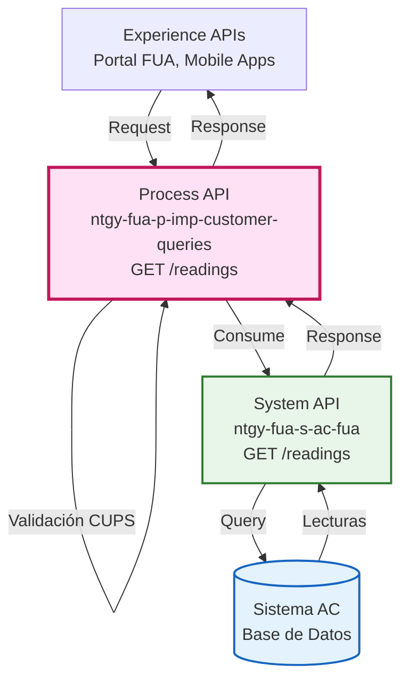
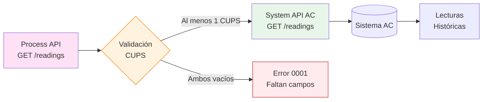
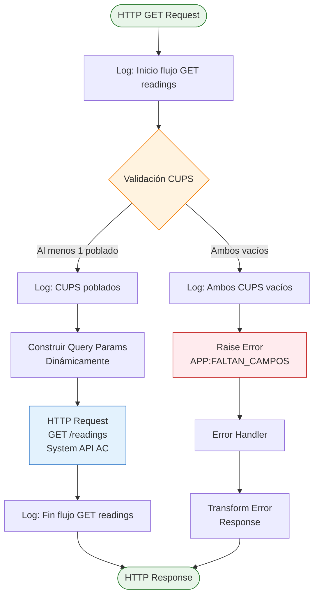
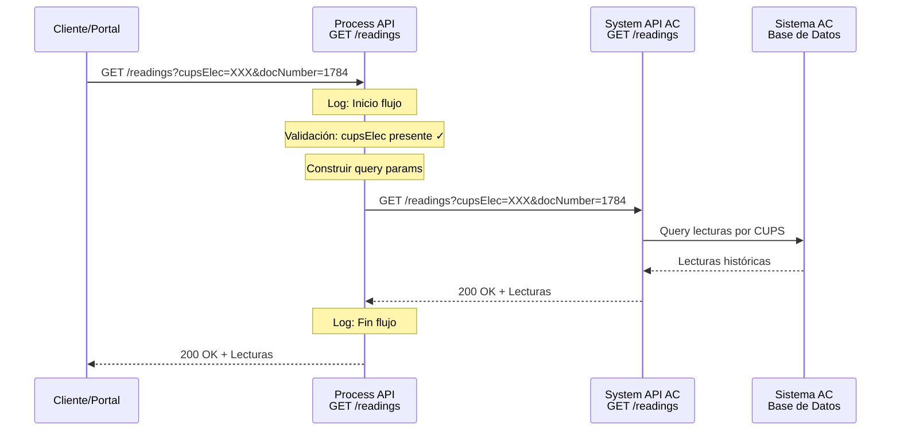
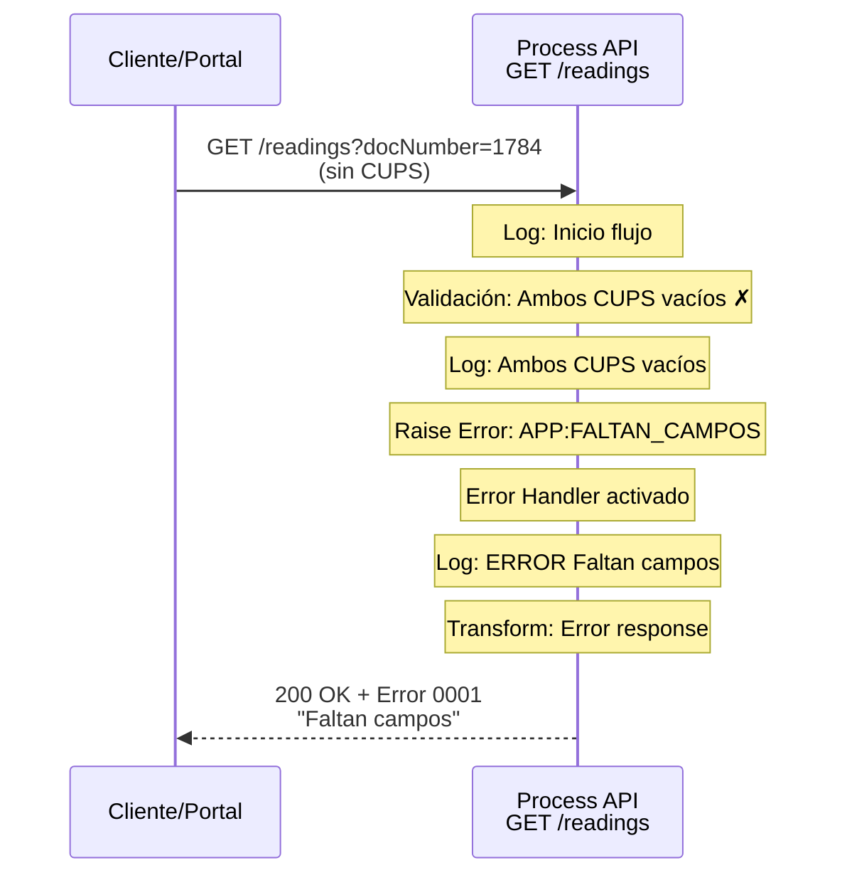
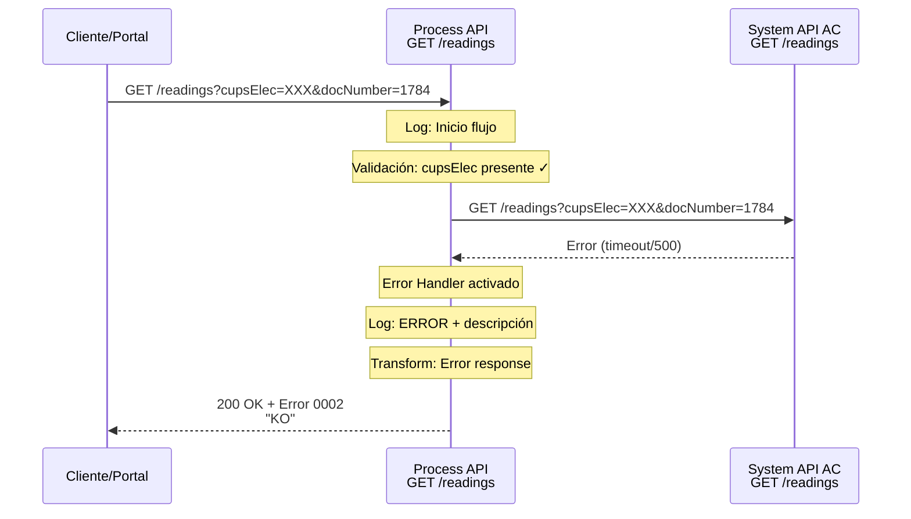

# GET /readings

## 📌 Descripción General

### Propósito del Endpoint

Este endpoint obtiene las lecturas históricas de los contadores de gas y/o electricidad asociados a un cliente, identificados por sus códigos CUPS (Código Universal de Punto de Suministro). Permite consultar el historial de lecturas para análisis de consumo y facturación.

### Tipo de API

**Capa:** Process API (API-Led Connectivity)

**Función:** Orquestación de consulta de lecturas históricas con validación de parámetros obligatorios

### Patrón de Integración

**Tipo:** Pass-Through con Validación

**Descripción:** El endpoint valida que al menos un CUPS (electricidad o gas) esté presente en la petición, y luego delega la consulta al System API AC sin transformar la respuesta.

### Arquitectura API-Led Connectivity



---

## 💼 Propósito del Negocio

### Casos de Uso Principales

1. **Consulta de Historial de Lecturas**
   - Permite a clientes y agentes consultar el historial completo de lecturas de contadores
   - Facilita el análisis de consumo histórico para identificar patrones
   - **Beneficio:** Transparencia en el consumo energético

2. **Validación de Facturación**
   - Proporciona las lecturas reales utilizadas para calcular facturas
   - Permite verificar la exactitud de los consumos facturados
   - **Beneficio:** Confianza del cliente en la facturación

3. **Análisis de Consumo**
   - Base de datos para generar gráficas y reportes de consumo
   - Identificación de anomalías o picos de consumo
   - **Beneficio:** Optimización del consumo energético

### 🔗 Endpoints Dependientes

Este Process API consume el siguiente System API:

| System API | Endpoint | Método | Propósito |
|------------|----------|--------|-----------|
| `ntgy-fua-s-ac-fua` | `/readings` | GET | Obtener lecturas históricas de contadores por CUPS (electricidad y/o gas) |

### Lógica de Orquestación



**Pasos del Proceso:**

1. **Validación de Entrada**: Verifica que al menos uno de los CUPS (electricidad o gas) esté poblado
2. **Construcción de Query Params**: Incluye dinámicamente solo los CUPS que no son null
3. **Delegación**: Llama al System API AC con los parámetros validados
4. **Pass-Through**: Retorna la respuesta sin transformación

### Regla de Negocio Crítica

⚠️ **Validación Obligatoria de CUPS**

Al menos uno de los siguientes parámetros debe estar presente:
- `cupsElec` (CUPS de electricidad)
- `cupsGas` (CUPS de gas)

Si ambos están vacíos, el endpoint retorna error `APP:FALTAN_CAMPOS` con código `0001`.

### Transformaciones Aplicadas

⚠️ **Este Process API NO transforma la respuesta del System API.**

Para el schema completo de la respuesta, consultar:
📖 **System API: `ntgy-fua-s-ac-fua` endpoint `/readings`**

**Transformación de Query Parameters:**

El endpoint construye dinámicamente los query parameters, incluyendo solo los CUPS que no son null:

```dataweave
{
  ("cupsElec" : attributes.queryParams.cupsElec) if (attributes.queryParams.cupsElec != null),
  "docNumber" : attributes.queryParams.docNumber,
  ("cupsGas" : attributes.queryParams.cupsGas) if (attributes.queryParams.cupsGas != null)
}
```

### Contexto Empresarial

- **Dominio:** Gestión de Consumo y Facturación
- **Sector:** Energía - Utilities (Gas & Electricidad)
- **División:** Naturgy España - Clientes Minoristas
- **Proceso de Negocio:** Consulta de Lecturas Históricas

### Stakeholders

- **Clientes Finales**: Consultan su historial de lecturas para entender su consumo
- **Agentes de Atención al Cliente**: Verifican lecturas para resolver consultas de facturación
- **Sistemas de Facturación**: Utilizan las lecturas para cálculos de consumo

### Valor de Negocio

- **Transparencia**: Clientes pueden verificar las lecturas utilizadas en su facturación
- **Autoservicio**: Reduce llamadas al call center por consultas de lecturas
- **Confianza**: Mejora la confianza del cliente en la exactitud de la facturación

### Consumidores Potenciales

Este endpoint puede ser consumido por:
- Portal web FUA (Frontal Único de Atención)
- Aplicaciones móviles de clientes
- Sistemas de agentes de call center
- Aplicaciones de análisis de consumo

---

## 🔧 Especificación Técnica

### URLs por Ambiente

| Ambiente | URL Base | URL Completa |
|----------|----------|--------------|
| **Local** | `http://localhost:8084` | `http://localhost:8084/api/readings` |
| **Development** | `https://ntgy-fua-p-imp-customer-queries-dev.de-c1.cloudhub.io` | `https://ntgy-fua-p-imp-customer-queries-dev.de-c1.cloudhub.io/api/readings` |
| **UAT** | `https://ntgy-fua-p-imp-customer-queries-uat.de-c1.cloudhub.io` | `https://ntgy-fua-p-imp-customer-queries-uat.de-c1.cloudhub.io/api/readings` |
| **Production** | `https://ntgy-fua-p-imp-customer-queries-pro.de-c1.cloudhub.io` | `https://ntgy-fua-p-imp-customer-queries-pro.de-c1.cloudhub.io/api/readings` |

### Método HTTP

```
GET /api/readings
```

### Parámetros de Entrada

#### Query Parameters

| Parámetro | Tipo | Requerido | Descripción | Ejemplo |
|-----------|------|-----------|-------------|---------|
| `cupsElec` | string | Condicional* | CUPS del punto de suministro de electricidad | `"ES0021000000000001JN"` |
| `cupsGas` | string | Condicional* | CUPS del punto de suministro de gas | `"ES0021000000000002JN"` |
| `docNumber` | string | Sí | Número de documento del cliente | `"1784"` |
| `contractAccountId` | string | No | ID de la cuenta contrato (definido en RAML pero no usado en implementación) | `"156894"` |

**\* Condicional:** Al menos uno de `cupsElec` o `cupsGas` debe estar presente.

#### Validaciones

1. **Validación de CUPS Obligatorio**
   - Al menos uno de `cupsElec` o `cupsGas` debe tener valor
   - Si ambos están vacíos → Error `APP:FALTAN_CAMPOS`

2. **Validación de docNumber**
   - Campo obligatorio
   - Debe ser un string válido

### Estructura de Respuesta

#### Respuesta Exitosa (200 OK)

```json
{
  "dateReads": "2024-01-15",
  "adviseGasAllowed": false,
  "reads": [
    {
      "readId": "READ-2024-001",
      "productTypeFamily": "ELECTRICITY",
      "readingDate": "2024-01-15",
      "type": "REAL",
      "data": {
        "subType": "ACTIVE",
        "value": "15234"
      },
      "hasFiles": false,
      "invoiceId": "INV-2024-001"
    },
    {
      "readId": "READ-2023-012",
      "productTypeFamily": "ELECTRICITY",
      "readingDate": "2023-12-15",
      "type": "REAL",
      "data": {
        "subType": "ACTIVE",
        "value": "14890"
      },
      "hasFiles": false,
      "invoiceId": "INV-2023-012"
    }
  ]
}
```

**Campos de Respuesta Principal:**

| Campo | Tipo | Descripción |
|-------|------|-------------|
| `dateReads` | date-only | Fecha de las lecturas consultadas |
| `adviseGasAllowed` | boolean | Indica si se permite avisar sobre lecturas de gas |
| `reads` | array | Array de objetos de lectura histórica |

**Estructura del Objeto Reading (elemento del array `reads`):**

| Campo | Tipo | Descripción | Ejemplo |
|-------|------|-------------|---------|
| `readId` | string | Identificador único de la lectura | `"READ-2024-001"` |
| `productTypeFamily` | string | Familia del producto (ELECTRICITY, GAS) | `"ELECTRICITY"` |
| `readingDate` | date-only | Fecha de la lectura | `"2024-01-15"` |
| `type` | string | Tipo de lectura (REAL, ESTIMADA, etc.) | `"REAL"` |
| `data` | object | Objeto con detalles de la lectura (ver estructura abajo) | Ver ejemplo |
| `hasFiles` | boolean | Indica si la lectura tiene archivos adjuntos | `false` |
| `invoiceId` | string | ID de la factura asociada a esta lectura | `"INV-2024-001"` |

**Estructura del Objeto `data` (según RAML readingsDetail.raml):**

| Campo | Tipo | Descripción | Ejemplo |
|-------|------|-------------|---------|
| `subType` | string | Subtipo de la lectura | `"ACTIVE"` |
| `value` | string | Valor de la lectura como string | `"15234"` |

⚠️ **Nota:** La estructura del objeto `data` está definida en el RAML con solo 2 campos (`subType` y `value`). Para información adicional sobre lecturas, consultar la documentación del System API `ntgy-fua-s-ac-fua`.

#### Respuesta de Error - Campos Faltantes (200 OK con error)

```json
{
  "result": {
    "codResult": "0001",
    "msgResult": "Faltan campos"
  }
}
```

#### Respuesta de Error General (200 OK con error)

```json
{
  "result": {
    "codResult": "0002",
    "msgResult": "KO"
  }
}
```

### Códigos de Respuesta

| Código | Descripción | Escenario |
|--------|-------------|-----------|
| `200` | OK | Lecturas obtenidas exitosamente |
| `200` | OK (con error 0001) | Faltan campos obligatorios (CUPS) |
| `200` | OK (con error 0002) | Error general en el procesamiento |
| `400` | Bad Request | Parámetros inválidos (validación APIKit) |
| `404` | Not Found | Endpoint no encontrado |
| `500` | Internal Server Error | Error interno del servidor |

### Autenticación

- **Tipo:** OAuth 2.0 (definido en RAML)
- **Header:** `Authorization: Bearer {token}`
- **Gestión:** Anypoint Platform API Gateway

### Timeouts

| Tipo | Valor |
|------|-------|
| **Request Timeout** | 30 segundos (System API AC) |
| **Connection Timeout** | 30 segundos |

---

## 🏗️ Implementación Técnica

### Arquitectura del Flow



### Código de Implementación

**Ubicación:** `src/main/mule/global.xml` (líneas 8-67)

```xml
<flow name="get-readingsFlow" doc:id="8e4997c8-21c7-439d-a52d-05a595dfda45">
    <!-- Log de inicio -->
    <logger level="DEBUG" doc:name="Inicio flujo" 
            message='#["Inicio flujo GET readings"]'/>
    
    <!-- Validación de CUPS -->
    <choice doc:name="Choice">
        <when expression="#[(isEmpty(attributes.queryParams.cupsElec) and isEmpty(attributes.queryParams.cupsGas))]">
            <logger level="DEBUG" doc:name="Al menos un CUPS debe de venir poblado" 
                    message='#["Ambos CUPS vacíos"]'/>
            <raise-error doc:name="Raise error" 
                         type="APP:FALTAN_CAMPOS"/>
        </when>
        <otherwise>
            <logger level="DEBUG" doc:name="CUPS poblados" 
                    message='#["CUPS poblados"]'/>
        </otherwise>
    </choice>
    
    <!-- Llamada al System API AC -->
    <http:request method="GET" 
                  doc:name="Se obtienen las lecturas" 
                  config-ref="HTTP_API_SistemaAC" 
                  path="/readings">
        <http:query-params><![CDATA[#[output application/java
---
{
    ("cupsElec" : attributes.queryParams.cupsElec) if (attributes.queryParams.cupsElec != null),
    "docNumber" : attributes.queryParams.docNumber,
    ("cupsGas" : attributes.queryParams.cupsGas) if (attributes.queryParams.cupsGas != null)
}]]]></http:query-params>
    </http:request>
    
    <!-- Log de fin -->
    <logger level="DEBUG" doc:name="Fin flujo" 
            message='#["Fin flujo GET readings"]'/>
    
    <!-- Manejo de errores -->
    <error-handler>
        <!-- Error: Faltan campos -->
        <on-error-propagate enableNotifications="true" 
                           logException="true" 
                           type="APP:FALTAN_CAMPOS">
            <logger level="ERROR" doc:name="Faltan campos" 
                    message='#["ERROR: Faltan campos"]'/>
            <ee:transform doc:name="Transform Message">
                <ee:message>
                    <ee:set-payload><![CDATA[%dw 2.0
output application/json
---
{
    "result":{
        "codResult": "0001",
        "msgResult": "Faltan campos"
    }
}]]></ee:set-payload>
                </ee:message>
            </ee:transform>
        </on-error-propagate>
        
        <!-- Error general -->
        <on-error-propagate enableNotifications="true" 
                           logException="true">
            <logger level="ERROR" doc:name="Error general" 
                    message='#["ERROR: " ++ error.description as String replace /\"/ with("")]'/>
            <ee:transform doc:name="Transform Message">
                <ee:message>
                    <ee:set-payload><![CDATA[%dw 2.0
output application/json
---
{
    "result":{
        "codResult": "0002",
        "msgResult": "KO"
    }
}]]></ee:set-payload>
                </ee:message>
            </ee:transform>
        </on-error-propagate>
    </error-handler>
</flow>
```

### Configuración HTTP

**Archivo:** `src/main/mule/global.xml` (líneas 14-16)

```xml
<http:request-config name="HTTP_API_SistemaAC" 
                     doc:name="HTTP Request configuration" 
                     basePath="/api" 
                     responseTimeout="${s-ac.timeout}">
    <http:request-connection host="${s-ac.host}" 
                            port="${s-ac.port}" 
                            connectionIdleTimeout="${s-ac.timeout}" 
                            protocol="${s-ac.protocol}"/>
</http:request-config>
```

**Properties (Production):** `p-imp-customer-queries-pro-config.yaml`

```yaml
s-ac:
  host: "ntgy-fua-s-ac-fua-bqyi65.internal-6bnlu3.irl-e1.cloudhub.io"
  port: "443"
  protocol: "HTTPS"
  timeout: "30000"
```

### Transformación de Query Parameters

**Lógica DataWeave Inline:**

```dataweave
%dw 2.0
output application/java
---
{
    ("cupsElec" : attributes.queryParams.cupsElec) 
        if (attributes.queryParams.cupsElec != null),
    "docNumber" : attributes.queryParams.docNumber,
    ("cupsGas" : attributes.queryParams.cupsGas) 
        if (attributes.queryParams.cupsGas != null)
}
```

**Comportamiento:**
- Solo incluye `cupsElec` si no es null
- Siempre incluye `docNumber`
- Solo incluye `cupsGas` si no es null

### Patrones de Diseño

**Patrón:** Pass-Through con Validación de Entrada

**Justificación:** 
- El Process API no necesita transformar la respuesta del System API
- La validación de CUPS es una regla de negocio que debe aplicarse antes de la delegación
- Mantiene la simplicidad y reduce la latencia

### Diagramas de Secuencia

#### 1. Flujo Normal de Éxito



#### 2. Flujo con Error de Validación (CUPS Vacíos)



#### 3. Flujo con Error Técnico



### Manejo de Errores

#### Estrategia de Error Handling

1. **Errores de Validación (APP:FALTAN_CAMPOS)**
   - Código: `0001`
   - Mensaje: `"Faltan campos"`
   - HTTP Status: `200 OK` (con error en body)
   - Log Level: `ERROR`

2. **Errores Generales**
   - Código: `0002`
   - Mensaje: `"KO"`
   - HTTP Status: `200 OK` (con error en body)
   - Log Level: `ERROR`
   - Incluye descripción del error en logs

#### Error Response Format

```json
{
  "result": {
    "codResult": "XXXX",
    "msgResult": "Mensaje descriptivo"
  }
}
```

---

## 💻 Ejemplos de Uso

### Ejemplo 1: Consulta con CUPS de Electricidad

#### cURL

```bash
curl -X GET "https://ntgy-fua-p-imp-customer-queries-pro.de-c1.cloudhub.io/api/readings?cupsElec=ES0021000000000001JN&docNumber=12345678A" \
  -H "Content-Type: application/json" \
  -H "Authorization: Bearer YOUR_ACCESS_TOKEN"
```

#### Respuesta (200 OK)

```json
{
  "dateReads": "2024-01-15",
  "adviseGasAllowed": false,
  "reads": [
    {
      "readId": "READ-2024-001",
      "productTypeFamily": "ELECTRICITY",
      "readingDate": "2024-01-15",
      "type": "REAL",
      "data": {
        "subType": "ACTIVE",
        "value": "15234"
      },
      "hasFiles": false,
      "invoiceId": "INV-2024-001"
    },
    {
      "readId": "READ-2023-012",
      "productTypeFamily": "ELECTRICITY",
      "readingDate": "2023-12-15",
      "type": "REAL",
      "data": {
        "subType": "ACTIVE",
        "value": "14890"
      },
      "hasFiles": false,
      "invoiceId": "INV-2023-012"
    }
  ]
}
```

### Ejemplo 2: Consulta con CUPS de Gas

#### cURL

```bash
curl -X GET "https://ntgy-fua-p-imp-customer-queries-pro.de-c1.cloudhub.io/api/readings?cupsGas=ES0021000000000002JN&docNumber=12345678A" \
  -H "Content-Type: application/json" \
  -H "Authorization: Bearer YOUR_ACCESS_TOKEN"
```

#### Respuesta (200 OK)

```json
{
  "dateReads": "2024-01-15",
  "adviseGasAllowed": true,
  "reads": [
    {
      "readId": "READ-2024-GAS-001",
      "productTypeFamily": "GAS",
      "readingDate": "2024-01-15",
      "type": "REAL",
      "data": {
        "subType": "ACTIVE",
        "value": "8456"
      },
      "hasFiles": false,
      "invoiceId": "INV-2024-GAS-001"
    },
    {
      "readId": "READ-2023-GAS-011",
      "productTypeFamily": "GAS",
      "readingDate": "2023-11-15",
      "type": "REAL",
      "data": {
        "subType": "ACTIVE",
        "value": "8120"
      },
      "hasFiles": false,
      "invoiceId": "INV-2023-GAS-011"
    }
  ]
}
```

### Ejemplo 3: Consulta con Ambos CUPS

#### cURL

```bash
curl -X GET "https://ntgy-fua-p-imp-customer-queries-pro.de-c1.cloudhub.io/api/readings?cupsElec=ES0021000000000001JN&cupsGas=ES0021000000000002JN&docNumber=12345678A" \
  -H "Content-Type: application/json" \
  -H "Authorization: Bearer YOUR_ACCESS_TOKEN"
```

#### Respuesta (200 OK)

```json
{
  "dateReads": "2024-01-15",
  "adviseGasAllowed": true,
  "reads": [
    {
      "readId": "READ-2024-001",
      "productTypeFamily": "ELECTRICITY",
      "readingDate": "2024-01-15",
      "type": "REAL",
      "data": {
        "subType": "ACTIVE",
        "value": "15234"
      },
      "hasFiles": false,
      "invoiceId": "INV-2024-001"
    },
    {
      "readId": "READ-2024-GAS-001",
      "productTypeFamily": "GAS",
      "readingDate": "2024-01-15",
      "type": "REAL",
      "data": {
        "subType": "ACTIVE",
        "value": "8456"
      },
      "hasFiles": false,
      "invoiceId": "INV-2024-GAS-001"
    }
  ]
}
```

### Ejemplo 4: Error - CUPS Vacíos

#### cURL

```bash
curl -X GET "https://ntgy-fua-p-imp-customer-queries-pro.de-c1.cloudhub.io/api/readings?docNumber=12345678A" \
  -H "Content-Type: application/json" \
  -H "Authorization: Bearer YOUR_ACCESS_TOKEN"
```

#### Respuesta (200 OK con error)

```json
{
  "result": {
    "codResult": "0001",
    "msgResult": "Faltan campos"
  }
}
```

### Ejemplo 5: JavaScript (Fetch API)

```javascript
const getReadings = async (cupsElec, cupsGas, docNumber, accessToken) => {
  const params = new URLSearchParams();
  if (cupsElec) params.append('cupsElec', cupsElec);
  if (cupsGas) params.append('cupsGas', cupsGas);
  params.append('docNumber', docNumber);

  const response = await fetch(
    `https://ntgy-fua-p-imp-customer-queries-pro.de-c1.cloudhub.io/api/readings?${params}`,
    {
      method: 'GET',
      headers: {
        'Content-Type': 'application/json',
        'Authorization': `Bearer ${accessToken}`
      }
    }
  );

  const data = await response.json();
  
  // Verificar si hay error en la respuesta
  if (data.result && data.result.codResult !== '0000') {
    throw new Error(`Error ${data.result.codResult}: ${data.result.msgResult}`);
  }
  
  return data;
};

// Uso
try {
  const readings = await getReadings(
    'ES0021000000000001JN',  // cupsElec
    null,                      // cupsGas
    '12345678A',              // docNumber
    'your_access_token'
  );
  console.log('Lecturas:', readings);
} catch (error) {
  console.error('Error al obtener lecturas:', error.message);
}
```

### Ejemplo 6: Python (Requests)

```python
import requests

def get_readings(cups_elec=None, cups_gas=None, doc_number=None, access_token=None):
    """
    Obtiene lecturas históricas de contadores
    
    Args:
        cups_elec (str, optional): CUPS de electricidad
        cups_gas (str, optional): CUPS de gas
        doc_number (str): Número de documento del cliente
        access_token (str): Token de acceso OAuth
    
    Returns:
        dict: Lecturas históricas
    
    Raises:
        ValueError: Si no se proporciona al menos un CUPS
        requests.HTTPError: Si hay error en la petición
    """
    if not cups_elec and not cups_gas:
        raise ValueError("Debe proporcionar al menos un CUPS (electricidad o gas)")
    
    url = "https://ntgy-fua-p-imp-customer-queries-pro.de-c1.cloudhub.io/api/readings"
    
    params = {}
    if cups_elec:
        params['cupsElec'] = cups_elec
    if cups_gas:
        params['cupsGas'] = cups_gas
    params['docNumber'] = doc_number
    
    headers = {
        'Content-Type': 'application/json',
        'Authorization': f'Bearer {access_token}'
    }
    
    response = requests.get(url, params=params, headers=headers)
    response.raise_for_status()
    
    data = response.json()
    
    # Verificar si hay error en la respuesta
    if 'result' in data and data['result'].get('codResult') != '0000':
        raise Exception(f"Error {data['result']['codResult']}: {data['result']['msgResult']}")
    
    return data

# Uso
try:
    readings = get_readings(
        cups_elec='ES0021000000000001JN',
        doc_number='12345678A',
        access_token='your_access_token'
    )
    print(f"Fecha de lecturas: {readings['dateReads']}")
    print(f"Número de lecturas: {len(readings['reads'])}")
    for reading in readings['reads']:
        print(f"  - {reading['readingDate']}: {reading['readingValue']} ({reading['meterType']})")
except Exception as e:
    print(f"Error: {e}")
```

### Ejemplo 7: Error General

#### cURL

```bash
curl -X GET "https://ntgy-fua-p-imp-customer-queries-pro.de-c1.cloudhub.io/api/readings?cupsElec=INVALID_CUPS&docNumber=12345678A" \
  -H "Content-Type: application/json" \
  -H "Authorization: Bearer YOUR_ACCESS_TOKEN"
```

#### Respuesta (200 OK con error)

```json
{
  "result": {
    "codResult": "0002",
    "msgResult": "KO"
  }
}