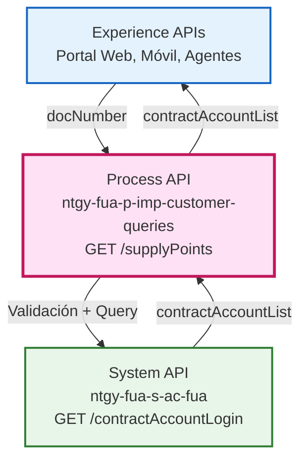
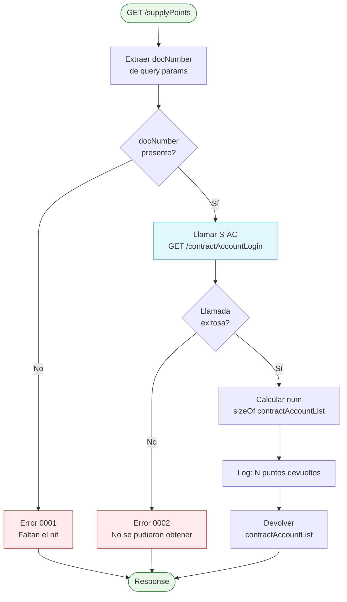
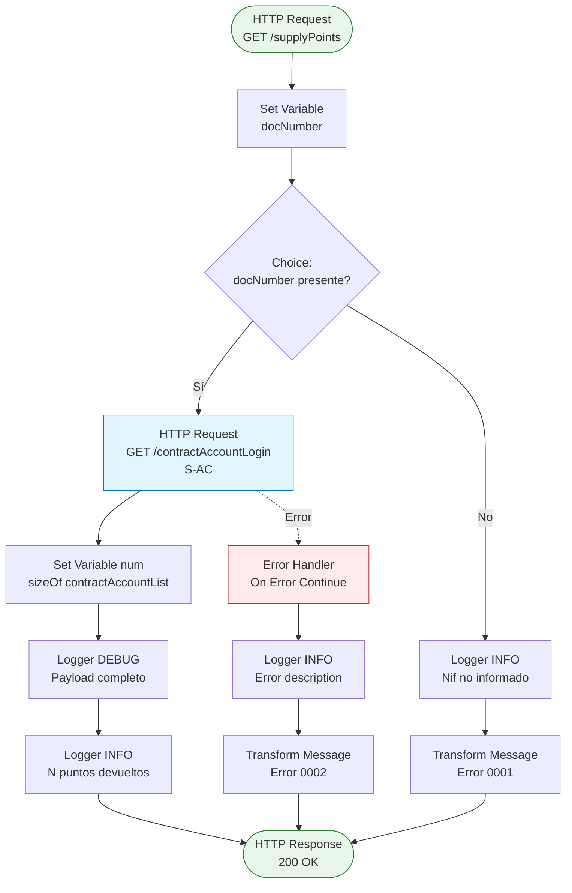
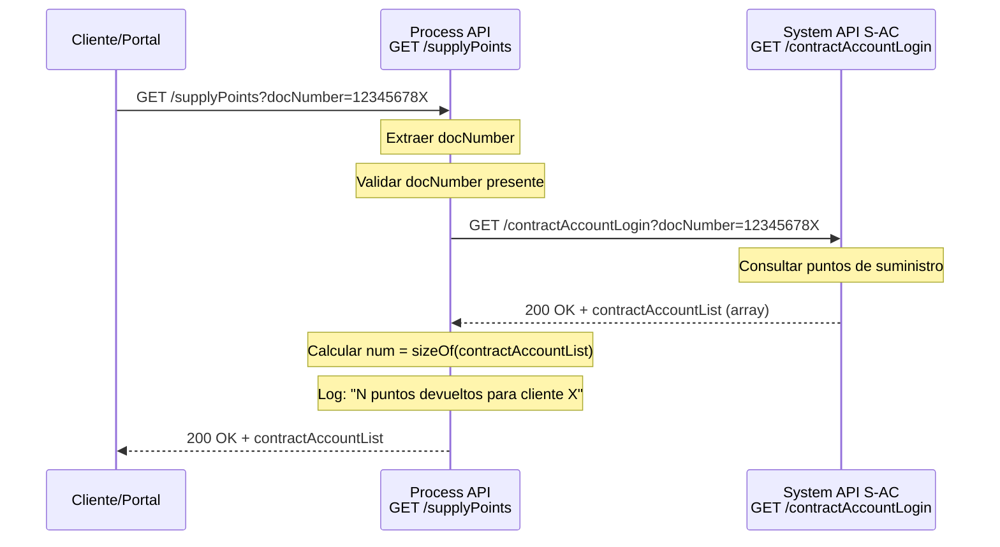
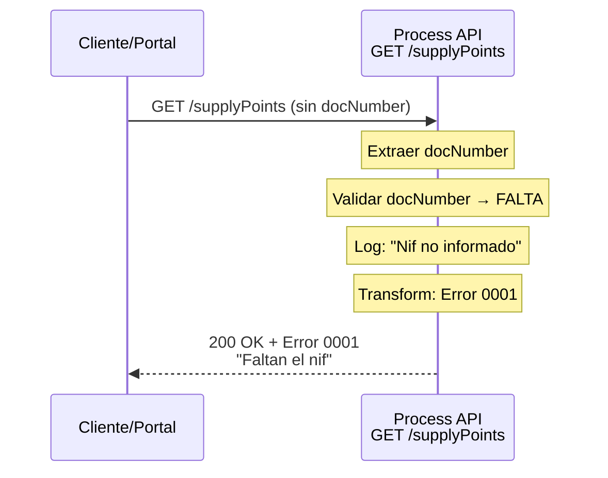
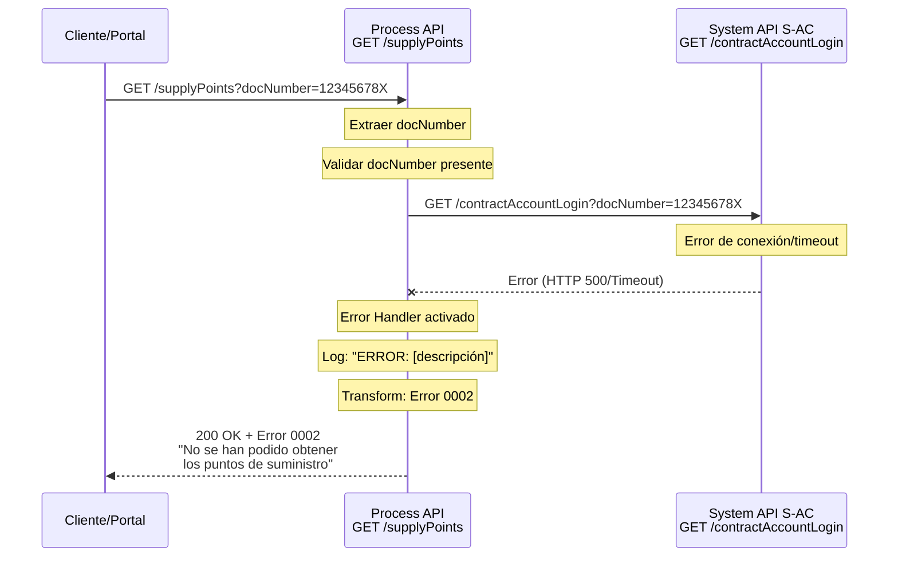

# GET /supplyPoints

## 📌 Descripción General

### Propósito del Endpoint

Este endpoint obtiene la lista de puntos de suministro (supply points) asociados a un cliente mediante su número de documento (NIF/NIE). Actúa como un orquestador simple que valida la entrada y delega la consulta al System API S-AC, devolviendo la información de las cuentas de contrato del cliente.

### Tipo de API

**Capa:** Process API (API-Led Connectivity)

**Función:** Orquestación de consulta de puntos de suministro con validación de entrada

### Patrón de Integración

**Tipo:** Pass-Through con Validación

**Descripción:** El endpoint valida que el parámetro `docNumber` esté presente y luego realiza una llamada directa al System API S-AC sin transformar la respuesta. Incluye manejo de errores para casos de validación y errores técnicos.

### Arquitectura API-Led Connectivity



---

## 💼 Propósito del Negocio

### Casos de Uso Principales

1. **Consulta de Puntos de Suministro por Agentes**
   - Los agentes de atención al cliente necesitan ver todos los puntos de suministro asociados a un cliente
   - Permite identificar rápidamente todas las direcciones donde el cliente tiene contratos activos
   - Facilita la gestión de múltiples contratos del mismo cliente

2. **Autoservicio en Portal Web**
   - Los clientes pueden consultar sus propios puntos de suministro desde el portal
   - Visualización de todas las direcciones con servicio de gas/electricidad
   - Base para navegación a detalles de cada contrato

3. **Validación de Direcciones en Procesos de Gestión**
   - Verificar si un cliente tiene puntos de suministro antes de iniciar gestiones
   - Identificar direcciones elegibles para nuevos servicios
   - Soporte para procesos de alta, baja y modificación de contratos

### 🔗 Endpoints Dependientes

Este Process API consume el siguiente System API:

| System API | Endpoint | Método | Propósito |
|------------|----------|--------|-----------|
| `ntgy-fua-s-ac-fua` | `/contractAccountLogin` | GET | Obtiene la lista de puntos de suministro (contractAccountList) asociados al número de documento del cliente |

### Lógica de Orquestación



**Pasos del Proceso:**

1. **Validación de Entrada**: Verifica que el parámetro `docNumber` esté presente
2. **Llamada al System API**: Si válido, consulta S-AC `/contractAccountLogin` con el `docNumber`
3. **Cálculo de Resultados**: Cuenta el número de puntos de suministro en la respuesta
4. **Logging**: Registra el número de puntos devueltos para el cliente
5. **Respuesta**: Devuelve la lista completa sin transformaciones

### Transformaciones Aplicadas

⚠️ **Este Process API NO transforma la respuesta del System API.**

La respuesta del System API S-AC se devuelve tal cual al consumidor. Solo se realiza:
- Validación de entrada (presencia de `docNumber`)
- Cálculo del tamaño de la lista para logging (no afecta la respuesta)
- Manejo de errores con códigos estandarizados

Para el schema completo de la respuesta, consultar:
📖 **System API: `ntgy-fua-s-ac-fua` endpoint `/contractAccountLogin`**

### Contexto Empresarial

- **Dominio:** Gestión de Clientes y Contratos
- **Sector:** Energía - Utilities (Gas & Electricidad)
- **División:** Naturgy España - FUA (Frontal Único de Atención)
- **Proceso de Negocio:** Consulta de información de cliente para atención y autoservicio

### Stakeholders

- **Agentes de Atención al Cliente**: Necesitan ver todos los puntos de suministro del cliente para gestionar consultas y solicitudes
- **Clientes Finales**: Consultan sus propios puntos de suministro desde portal web o app móvil
- **Equipos de Back Office**: Utilizan esta información para procesos de gestión de contratos

### Valor de Negocio

- **Visibilidad Completa**: Vista unificada de todos los puntos de suministro del cliente
- **Eficiencia Operativa**: Reduce tiempo de búsqueda de información en múltiples sistemas
- **Mejor Experiencia de Cliente**: Autoservicio efectivo sin necesidad de contactar call center
- **Soporte a Procesos**: Base para gestiones de alta, baja, modificación de contratos

### Consumidores Potenciales

Este endpoint puede ser consumido por:
- Portal web de autoservicio FUA
- Aplicaciones móviles de clientes
- Sistemas de agentes de call center
- Aplicaciones de back office para gestión de contratos
- Integraciones con sistemas de terceros autorizados

---

## 🔧 Especificación Técnica

### URLs por Ambiente

| Ambiente | URL Base | URL Completa |
|----------|----------|--------------|
| **Local** | `http://localhost:8084` | `http://localhost:8084/api/supplyPoints?docNumber=:docNumber` |
| **Development** | `https://ntgy-fua-p-imp-customer-queries-dev.de-c1.cloudhub.io` | `https://ntgy-fua-p-imp-customer-queries-dev.de-c1.cloudhub.io/api/supplyPoints?docNumber=:docNumber` |
| **UAT** | `https://ntgy-fua-p-imp-customer-queries-uat.de-c1.cloudhub.io` | `https://ntgy-fua-p-imp-customer-queries-uat.de-c1.cloudhub.io/api/supplyPoints?docNumber=:docNumber` |
| **Production** | `https://ntgy-fua-p-imp-customer-queries-pro.de-c1.cloudhub.io` | `https://ntgy-fua-p-imp-customer-queries-pro.de-c1.cloudhub.io/api/supplyPoints?docNumber=:docNumber` |

### Método HTTP

```
GET /api/supplyPoints
```

### Parámetros de Entrada

#### Query Parameters

| Parámetro | Tipo | Obligatorio | Descripción | Ejemplo |
|-----------|------|-------------|-------------|---------|
| `docNumber` | string | ✅ Sí | Número de documento del cliente (NIF/NIE) | `12345678X` |

**Validaciones:**
- El parámetro `docNumber` debe estar presente
- Si no se proporciona, se devuelve error de validación (código 0001)

### Respuestas

#### 200 OK - Éxito

**Descripción:** Lista de puntos de suministro obtenida correctamente

**Estructura de Respuesta:**

El System API S-AC devuelve una estructura compleja con información detallada de cuentas de servicio, direcciones, cuentas de facturación y productos. La respuesta se estructura de la siguiente manera:

```json
{
  "result": {
    "codResult": "0000",
    "msgResult": "No hay error"
  },
  "docNumber": "string",
  "clientId": "string",
  "clientCode": "string",
  "serviceAccountList": [
    {
      "supplyPointId": "string",
      "serviceAccountId": "string",
      "clientId": "string",
      "supplyAddress": {
        "fullAddress": "string",
        "addressId": "string",
        "zipCode": "string",
        "province": "string",
        "city": "string",
        "town": "string",
        "way": "string",
        "wayId": "string",
        "wayType": "string",
        "number": "string",
        "floor": "string",
        "door": "string",
        "portal": "string",
        "stairs": "string"
      },
      "billingAccountList": [
        {
          "refNum": "string",
          "billingAccountId": "string",
          "isDirectPayment": boolean,
          "isOnlineBill": boolean,
          "bankAccount": {
            "bankAccountId": "string",
            "contactId": "string",
            "holderName": "string",
            "holderType": "string",
            "iban": "string"
          },
          "products": [
            {
              "contractId": "string",
              "contractNumber": "string",
              "isActive": boolean,
              "startDate": "string",
              "endDate": "string",
              "dropOutDate": "string",
              "contractSignatureDate": "string",
              "isPending": boolean,
              "productType": {
                "isEco": boolean,
                "productTypeId": "string",
                "productTypeName": "string",
                "svaFamily": "string",
                "productTypeFamily": "string",
                "productTypeRealName": "string"
              },
              "adviseGas": boolean,
              "techData": {
                "cups": "string",
                "distribution": "string",
                "rate": "string",
                "rateId": "string",
                "voltage": "string",
                "selfConsumption": null,
                "installation": "string",
                "changePower": null,
                "isValidCIE": null,
                "powerPlain": "string",
                "powerValley": "string",
                "powerP3": "string",
                "powerP4": "string",
                "powerP5": "string",
                "powerP6": "string",
                "recommendedPowerPlain": "string",
                "recommendedPowerValley": "string",
                "IPDate": "string",
                "remoteManagement": null,
                "cnae": "string"
              }
            }
          ],
          "mailingAddress": [
            {
              "addressId": "string",
              "zipCode": "string",
              "province": "string",
              "city": "string",
              "town": "string",
              "way": "string",
              "wayId": "string",
              "wayType": "string",
              "number": "string",
              "floor": "string",
              "door": "string",
              "portal": "string",
              "stairs": "string"
            }
          ]
        }
      ]
    }
  ]
}
```

**Campos Principales:**

| Campo | Tipo | Descripción |
|-------|------|-------------|
| `result` | object | Resultado de la operación |
| `result.codResult` | string | Código de resultado ("0000" = éxito) |
| `result.msgResult` | string | Mensaje de resultado |
| `docNumber` | string | Número de documento del cliente |
| `clientId` | string | ID del cliente |
| `clientCode` | string | Código del cliente |
| `serviceAccountList` | array | Lista de cuentas de servicio (puntos de suministro) |

**Estructura de serviceAccountList:**

Cada elemento representa un punto de suministro con:
- **supplyPointId**: ID del punto de suministro (igual a serviceAccountId)
- **serviceAccountId**: ID de la cuenta de servicio
- **supplyAddress**: Dirección completa del punto de suministro
- **billingAccountList**: Lista de cuentas de facturación asociadas

**Estructura de billingAccountList:**

Cada cuenta de facturación contiene:
- **refNum**: Número de referencia del contrato
- **isDirectPayment**: Indica si tiene domiciliación bancaria
- **isOnlineBill**: Indica si tiene factura online
- **bankAccount**: Datos de la cuenta bancaria
- **products**: Lista de productos/contratos (gas, electricidad, servicios)
- **mailingAddress**: Direcciones de envío de correspondencia

**Estructura de products:**

Cada producto contiene:
- **contractId**: ID del contrato
- **isActive**: Estado del contrato (activo/inactivo)
- **productType**: Tipo de producto (gas, luz, servicios)
- **techData**: Datos técnicos (CUPS, tarifa, potencias, etc.)

**Nota:** Este Process API devuelve la respuesta del System API S-AC sin transformaciones. La estructura completa está definida en la transformación DataWeave del System API (líneas 177-305 de `s-ac-contractAccountLogin.xml`).

#### 200 OK - Error de Validación

**Descripción:** El parámetro `docNumber` no fue proporcionado

**Estructura de Respuesta:**
```json
{
  "result": {
    "codResult": "0001",
    "msgResult": "Faltan el nif"
  }
}
```

#### 200 OK - Error Técnico

**Descripción:** Error al obtener los puntos de suministro del System API

**Estructura de Respuesta:**
```json
{
  "result": {
    "codResult": "0002",
    "msgResult": "No se han podido obtener los puntos de suministro"
  }
}
```

### Códigos de Error

| Código | Descripción | Causa |
|--------|-------------|-------|
| `0001` | Faltan el nif | El parámetro `docNumber` no fue proporcionado en la petición |
| `0002` | No se han podido obtener los puntos de suministro | Error técnico al consultar el System API S-AC |

### Autenticación

- **Tipo:** Client ID & Client Secret (Anypoint Platform)
- **Headers requeridos:**
  - `client_id`: ID del cliente registrado en Anypoint Platform
  - `client_secret`: Secret del cliente registrado en Anypoint Platform

### Timeouts

| Tipo | Valor | Notas |
|------|-------|-------|
| **Request Timeout** | 5 segundos | Timeout override específico para esta operación (más rápido que el estándar de 30s) |
| **Connection Timeout** | 5 segundos | Mismo valor que request timeout |

**Nota:** Este endpoint utiliza un timeout reducido (`s-ac.timeoutOverride: 5000ms`) en lugar del timeout estándar de 30 segundos, ya que se espera una respuesta rápida del System API S-AC.

---

## 🏗️ Implementación Técnica

### Arquitectura del Flow



### Componentes del Flow

#### 1. Set Variable - docNumber (Línea 9)
```xml
<set-variable value="#[attributes.queryParams.docNumber]" 
              variableName="docNumber"/>
```
**Propósito:** Extrae el parámetro `docNumber` de los query parameters y lo almacena en una variable para uso posterior.

#### 2. Choice - Validación (Líneas 10-39)
```xml
<choice>
    <when expression="#[(!isEmpty(attributes.queryParams.docNumber))]">
        <!-- Flujo principal -->
    </when>
    <otherwise>
        <!-- Error de validación -->
    </otherwise>
</choice>
```
**Propósito:** Valida que el parámetro `docNumber` esté presente antes de proceder con la llamada al System API.

#### 3. HTTP Request - Sistema AC (Líneas 12-18)
```xml
<http:request method="GET" 
              config-ref="HTTP_API_SistemaAC" 
              path="/contractAccountLogin" 
              responseTimeout="${s-ac.timeoutOverride}">
    <http:query-params><![CDATA[#[output application/java
    ---
    {
        "docNumber" : attributes.queryParams.docNumber
    }]]]></http:query-params>
</http:request>
```

**Configuración:**
- **Config:** `HTTP_API_SistemaAC`
- **Host:** `ntgy-fua-s-ac-fua-bqyi65.internal-6bnlu3.irl-e1.cloudhub.io` (producción)
- **Port:** 443 (HTTPS)
- **Base Path:** `/api`
- **Timeout:** 5000ms (override)

**Query Parameters:**
- `docNumber`: Número de documento del cliente

#### 4. Set Variable - num (Línea 19)
```dataweave
#[(if(sizeOf(payload.contractAccountList) != null) 
    sizeOf(payload.contractAccountList) 
    else 0)]
```
**Propósito:** Calcula el número de puntos de suministro en la respuesta para logging. Maneja el caso de lista nula devolviendo 0.

#### 5. Loggers (Líneas 20-21)
- **Logger DEBUG:** Registra el payload completo de la respuesta
- **Logger INFO:** Registra mensaje con el número de puntos devueltos y el docNumber

#### 6. Error Handler (Líneas 40-57)
```xml
<on-error-continue>
    <logger level="INFO" 
            message='#["ERROR: " ++ error.description as String replace /\"/ with("")]'/>
    <ee:transform>
        <!-- Error 0002 -->
    </ee:transform>
</on-error-continue>
```
**Propósito:** Captura cualquier error técnico durante la llamada al System API y devuelve un error estandarizado.

### Transformaciones DataWeave

#### Transformación de Error de Validación (Líneas 27-35)
```dataweave
%dw 2.0
output application/json
---
{
    "result": {
        "codResult": "0001",
        "msgResult": "Faltan el nif"
    }
}
```
**Propósito:** Genera respuesta de error cuando el parámetro `docNumber` no está presente.

#### Transformación de Error Técnico (Líneas 45-53)
```dataweave
%dw 2.0
output application/json
---
{
    "result": {
        "codResult": "0002",
        "msgResult": "No se han podido obtener los puntos de suministro"
    }
}
```
**Propósito:** Genera respuesta de error cuando ocurre un problema técnico al consultar el System API.

### Patrones de Diseño

**Patrón:** Pass-Through con Validación y Logging

**Justificación:** 
- El endpoint no necesita transformar la respuesta del System API
- La validación de entrada previene llamadas innecesarias al backend
- El logging proporciona trazabilidad para troubleshooting
- El manejo de errores estandariza las respuestas de error

### Diagramas de Secuencia

#### 1. Flujo Normal de Éxito



#### 2. Flujo con Error de Validación



#### 3. Flujo con Error Técnico



### Manejo de Errores

#### Estrategia de Error Handling

1. **Validación de Entrada (Choice)**
   - **Condición:** `docNumber` ausente o vacío
   - **Acción:** Devolver error 0001 sin llamar al backend
   - **HTTP Status:** 200 OK (error de negocio, no técnico)

2. **Error Técnico (Error Handler)**
   - **Condición:** Cualquier excepción durante la llamada al System API
   - **Acción:** Capturar error, loggear descripción, devolver error 0002
   - **HTTP Status:** 200 OK (error manejado)
   - **Tipo:** `on-error-continue` (no propaga el error)

3. **Logging de Errores**
   - Todos los errores se registran con nivel INFO
   - Se incluye la descripción del error para troubleshooting
   - Los caracteres especiales (comillas) se eliminan del mensaje

#### Tabla de Códigos de Error

| Código | Tipo | Descripción | Acción Recomendada |
|--------|------|-------------|-------------------|
| `0001` | Validación | Falta el parámetro `docNumber` | Proporcionar el número de documento en la petición |
| `0002` | Técnico | Error al consultar System API | Verificar disponibilidad del System API S-AC, revisar logs |

---

## 💻 Ejemplos de Uso

### Ejemplo 1: Consulta Exitosa

#### cURL

```bash
curl -X GET "https://ntgy-fua-p-imp-customer-queries-pro.de-c1.cloudhub.io/api/supplyPoints?docNumber=12345678X" \
  -H "Content-Type: application/json" \
  -H "client_id: YOUR_CLIENT_ID" \
  -H "client_secret: YOUR_CLIENT_SECRET"
```

#### Respuesta (200 OK)

```json
{
  "result": {
    "codResult": "0000",
    "msgResult": "No hay error"
  },
  "docNumber": "12345678X",
  "clientId": "0001234567",
  "clientCode": "CLI123456",
  "serviceAccountList": [
    {
      "supplyPointId": "200001234567",
      "serviceAccountId": "200001234567",
      "clientId": "0001234567",
      "supplyAddress": {
        "fullAddress": "Calle Mayor 123 1 A 28001 Madrid Madrid",
        "addressId": "ADDR001",
        "zipCode": "28001",
        "province": "Madrid",
        "city": "Madrid",
        "town": "Madrid",
        "way": "Calle Mayor",
        "wayId": "",
        "wayType": "Calle",
        "number": "123",
        "floor": "1",
        "door": "A",
        "portal": "",
        "stairs": ""
      },
      "billingAccountList": [
        {
          "refNum": "REF123456789",
          "billingAccountId": "REF123456789",
          "isDirectPayment": true,
          "isOnlineBill": true,
          "bankAccount": {
            "bankAccountId": "BANK001",
            "contactId": "",
            "holderName": "Juan Pérez García",
            "holderType": "Titular",
            "iban": "ES1234567890123456789012"
          },
          "products": [
            {
              "contractId": "CONT001",
              "contractNumber": "CONT001",
              "isActive": true,
              "startDate": "2023-01-15",
              "endDate": "",
              "dropOutDate": "",
              "contractSignatureDate": "",
              "isPending": false,
              "productType": {
                "isEco": false,
                "productTypeId": "PROD_LUZ_001",
                "productTypeName": "Tarifa Luz Estable",
                "svaFamily": "luz",
                "productTypeFamily": "luz",
                "productTypeRealName": "Electricidad"
              },
              "adviseGas": false,
              "techData": {
                "cups": "ES0021000000000001JN",
                "distribution": "",
                "rate": "2.0TD",
                "rateId": "2.0TD",
                "voltage": "",
                "selfConsumption": null,
                "installation": "",
                "changePower": null,
                "isValidCIE": null,
                "powerPlain": "3.45",
                "powerValley": "3.45",
                "powerP3": "",
                "powerP4": "",
                "powerP5": "",
                "powerP6": "",
                "recommendedPowerPlain": "",
                "recommendedPowerValley": "",
                "IPDate": "",
                "remoteManagement": null,
                "cnae": "9820"
              }
            }
          ],
          "mailingAddress": [
            {
              "addressId": "MAIL001",
              "zipCode": "28002",
              "province": "Madrid",
              "city": "Madrid",
              "town": "Madrid",
              "way": "Avenida Principal",
              "wayId": "",
              "wayType": "Avenida",
              "number": "45",
              "floor": "2",
              "door": "B",
              "portal": "1",
              "stairs": "Izquierda"
            }
          ]
        }
      ]
    }
  ]
}
```

### Ejemplo 2: Error de Validación (docNumber faltante)

#### cURL

```bash
curl -X GET "https://ntgy-fua-p-imp-customer-queries-pro.de-c1.cloudhub.io/api/supplyPoints" \
  -H "Content-Type: application/json" \
  -H "client_id: YOUR_CLIENT_ID" \
  -H "client_secret: YOUR_CLIENT_SECRET"
```

#### Respuesta (200 OK)

```json
{
  "result": {
    "codResult": "0001",
    "msgResult": "Faltan el nif"
  }
}
```

### Ejemplo 3: Error Técnico

#### cURL

```bash
curl -X GET "https://ntgy-fua-p-imp-customer-queries-pro.de-c1.cloudhub.io/api/supplyPoints?docNumber=12345678X" \
  -H "Content-Type: application/json" \
  -H "client_id: YOUR_CLIENT_ID" \
  -H "client_secret: YOUR_CLIENT_SECRET"
```

#### Respuesta (200 OK) - Cuando System API no disponible

```json
{
  "result": {
    "codResult": "0002",
    "msgResult": "No se han podido obtener los puntos de suministro"
  }
}
```

### Ejemplo 4: JavaScript (Fetch API)

```javascript
const getSupplyPoints = async (docNumber) => {
  try {
    const response = await fetch(
      `https://ntgy-fua-p-imp-customer-queries-pro.de-c1.cloudhub.io/api/supplyPoints?docNumber=${docNumber}`,
      {
        method: 'GET',
        headers: {
          'Content-Type': 'application/json',
          'client_id': 'YOUR_CLIENT_ID',
          'client_secret': 'YOUR_CLIENT_SECRET'
        }
      }
    );

    const data = await response.json();
    
    // Verificar si es respuesta exitosa o error de negocio
    if (data.result && data.result.codResult === '0000') {
      const numSupplyPoints = data.serviceAccountList?.length || 0;
      console.log(`Encontrados ${numSupplyPoints} puntos de suministro para ${data.docNumber}`);
      
      // Iterar sobre los puntos de suministro
      data.serviceAccountList?.forEach(serviceAccount => {
        console.log(`\nPunto de Suministro: ${serviceAccount.supplyPointId}`);
        console.log(`Dirección: ${serviceAccount.supplyAddress.fullAddress}`);
        
        // Iterar sobre las cuentas de facturación
        serviceAccount.billingAccountList?.forEach(billing => {
          console.log(`  Cuenta: ${billing.refNum}`);
          
          // Iterar sobre los productos
          billing.products?.forEach(product => {
            console.log(`    - ${product.productType.productTypeRealName}: ${product.contractId}`);
            console.log(`      CUPS: ${product.techData.cups}`);
            console.log(`      Estado: ${product.isActive ? 'Activo' : 'Inactivo'}`);
          });
        });
      });
      
      return data.serviceAccountList;
    } else if (data.result) {
      console.error(`Error ${data.result.codResult}: ${data.result.msgResult}`);
      return null;
    }
  } catch (error) {
    console.error('Error al consultar puntos de suministro:', error);
    throw error;
  }
};

// Uso
getSupplyPoints('12345678X')
  .then(serviceAccounts => {
    if (serviceAccounts) {
      console.log(`\nTotal de puntos de suministro: ${serviceAccounts.length}`);
    }
  });
```

### Ejemplo 5: Python (Requests)

```python
import requests

def get_supply_points(doc_number):
    """
    Obtiene los puntos de suministro de un cliente
    
    Args:
        doc_number (str): Número de documento del cliente (NIF/NIE)
    
    Returns:
        list: Lista de cuentas de servicio (puntos de suministro) o None si hay error
    """
    url = "https://ntgy-fua-p-imp-customer-queries-pro.de-c1.cloudhub.io/api/supplyPoints"
    
    headers = {
        'Content-Type': 'application/json',
        'client_id': 'YOUR_CLIENT_ID',
        'client_secret': 'YOUR_CLIENT_SECRET'
    }
    
    params = {
        'docNumber': doc_number
    }
    
    try:
        response = requests.get(url, headers=headers, params=params, timeout=10)
        response.raise_for_status()
        
        data = response.json()
        
        # Verificar si es respuesta exitosa o error de negocio
        if 'result' in data and data['result']['codResult'] == '0000':
            service_accounts = data.get('serviceAccountList', [])
            print(f"Encontrados {len(service_accounts)} puntos de suministro para {data.get('docNumber')}")
            
            # Iterar sobre los puntos de suministro
            for service_account in service_accounts:
                print(f"\nPunto de Suministro: {service_account['supplyPointId']}")
                print(f"Dirección: {service_account['supplyAddress']['fullAddress']}")
                
                # Iterar sobre las cuentas de facturación
                for billing in service_account.get('billingAccountList', []):
                    print(f"  Cuenta: {billing['refNum']}")
                    
                    # Iterar sobre los productos
                    for product in billing.get('products', []):
                        product_type = product['productType']['productTypeRealName']
                        contract_id = product['contractId']
                        cups = product['techData']['cups']
                        status = 'Activo' if product['isActive'] else 'Inactivo'
                        
                        print(f"    - {product_type}: {contract_id}")
                        print(f"      CUPS: {cups}")
                        print(f"      Estado: {status}")
            
            return service_accounts
        elif 'result' in data:
            print(f"Error {data['result']['codResult']}: {data['result']['msgResult']}")
            return None
            
    except requests.exceptions.RequestException as e:
        print(f"Error al consultar puntos de suministro: {e}")
        return None

# Uso
service_accounts = get_supply_points('12345678X')
if service_accounts:
    print(f"\nTotal de puntos de suministro: {len(service_accounts)}")
```

### Ejemplo 6: Postman Collection

```json
{
  "info": {
    "name": "GET Supply Points",
    "schema": "https://schema.getpostman.com/json/collection/v2.1.0/collection.json"
  },
  "item": [
    {
      "name": "Get Supply Points - Success",
      "request": {
        "method": "GET",
        "header": [
          {
            "key": "Content-Type",
            "value": "application/json"
          },
          {
            "key": "client_id",
            "value": "{{client_id}}"
          },
          {
            "key": "client_secret",
            "value": "{{client_secret}}"
          }
        ],
        "url": {
          "raw": "{{base_url}}/api/supplyPoints?docNumber=12345678X",
          "host": ["{{base_url}}"],
          "path": ["api", "supplyPoints"],
          "query": [
            {
              "key": "docNumber",
              "value": "12345678X"
            }
          ]
        }
      }
    }
  ]
}