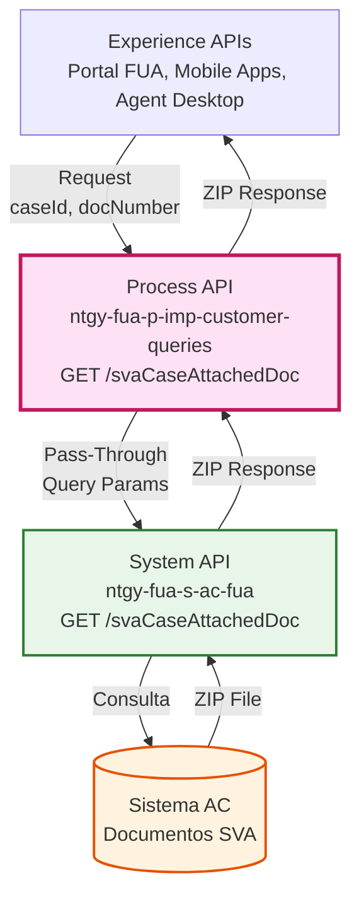
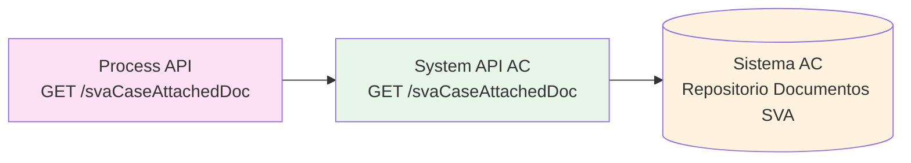
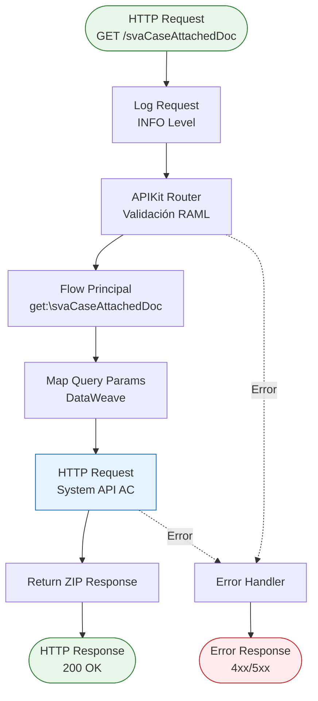
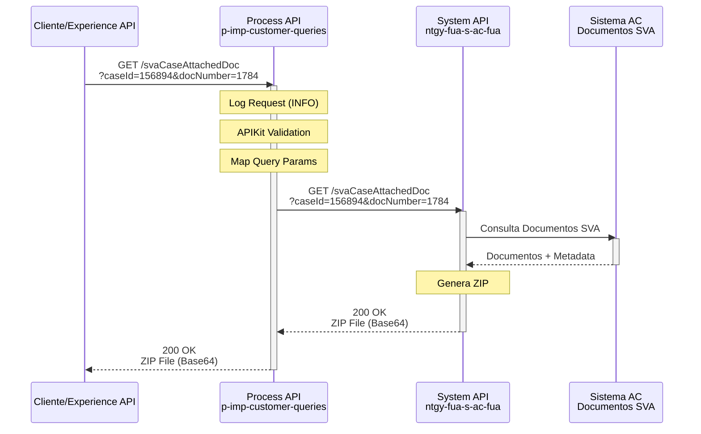
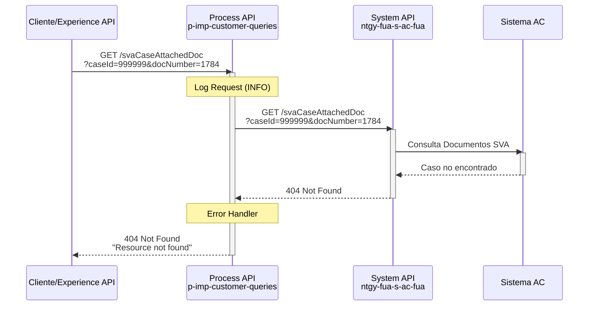
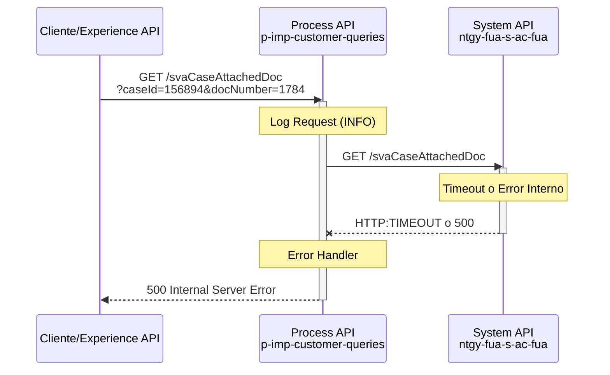

# GET /svaCaseAttachedDoc

## 📌 Descripción General

### Propósito del Endpoint

Este endpoint permite obtener un archivo ZIP que contiene todos los documentos adjuntos asociados a una gestión específica de SVA (Servicios de Valor Añadido). Actúa como un proxy directo hacia el System API de AC, facilitando el acceso a la documentación de gestiones SVA desde cualquier canal de experiencia.

### Tipo de API

**Capa:** Process API (API-Led Connectivity)

**Función:** Orquestación de consulta de documentos de gestiones SVA

### Patrón de Integración

**Tipo:** Pass-Through (Delegación Directa)

**Descripción:** Este endpoint implementa un patrón de pass-through puro, delegando la petición directamente al System API de AC sin aplicar transformaciones. Los query parameters se mapean directamente desde el request del cliente hacia el backend.

### Arquitectura API-Led Connectivity



---

## 💼 Propósito del Negocio

### Casos de Uso Principales

1. **Consulta de Documentación de Gestiones SVA por Agentes**
   - Agentes de atención al cliente necesitan acceder a documentos adjuntos en gestiones SVA
   - Permite revisar evidencias, contratos o documentación soporte de servicios de valor añadido
   - Facilita la resolución de consultas y reclamaciones relacionadas con SVA

2. **Descarga de Documentos SVA en Portal de Cliente**
   - Clientes pueden descargar documentación relacionada con sus servicios de valor añadido
   - Acceso self-service a contratos, facturas especiales o documentación de SVA
   - Mejora la experiencia del cliente al proporcionar acceso inmediato a documentos

3. **Auditoría y Seguimiento de Gestiones SVA**
   - Equipos de back-office pueden revisar documentación histórica de gestiones SVA
   - Soporte para procesos de auditoría y compliance
   - Trazabilidad completa de documentación asociada a servicios de valor añadido

### 🔗 Endpoints Dependientes

Este Process API consume el siguiente System API:

| System API | Endpoint | Método | Propósito |
|------------|----------|--------|-----------|
| `ntgy-fua-s-ac-fua` | `/svaCaseAttachedDoc` | GET | Obtención de archivo ZIP con documentos adjuntos a gestiones SVA desde Sistema AC |

### Lógica de Orquestación



**Pasos del Proceso:**

1. **Recepción de Request**: Process API recibe petición con `caseId` y `docNumber`
2. **Delegación Directa**: Mapea query parameters y delega al System API de AC
3. **Obtención de ZIP**: System API consulta Sistema AC y genera archivo ZIP con documentos
4. **Respuesta Transparente**: Retorna el archivo ZIP directamente al consumidor

### Transformaciones Aplicadas

⚠️ **Este Process API NO transforma la respuesta del System API.**

Este endpoint implementa un patrón de **pass-through puro**:
- Los query parameters se mapean directamente sin modificación
- La respuesta (archivo ZIP) se retorna sin transformación
- No hay agregación de datos de múltiples fuentes

Para el schema completo y estructura del archivo ZIP, consultar:
📖 **System API: `ntgy-fua-s-ac-fua` endpoint `/svaCaseAttachedDoc`**

### Contexto Empresarial

- **Dominio:** Gestión Documental y Servicios de Valor Añadido
- **Sector:** Energía - Utilities (Gas & Electricidad)
- **División:** Naturgy España - Clientes Minoristas
- **Proceso de Negocio:** Consulta y descarga de documentación asociada a gestiones SVA

### Stakeholders

- **Agentes de Atención al Cliente**: Necesitan acceder rápidamente a documentos de gestiones SVA para resolver consultas
- **Clientes Finales**: Requieren acceso self-service a documentación de sus servicios de valor añadido
- **Equipos de Back-Office**: Necesitan revisar documentación para auditoría y seguimiento de gestiones
- **Equipos de Compliance**: Requieren acceso a documentación para procesos de auditoría

### Valor de Negocio

- **Acceso Centralizado**: Punto único de acceso a documentos SVA desde cualquier canal
- **Mejora de Eficiencia**: Reduce tiempo de búsqueda de documentación por parte de agentes
- **Experiencia de Cliente**: Permite autoservicio en descarga de documentos SVA
- **Trazabilidad**: Facilita auditoría y seguimiento de documentación de servicios de valor añadido

### Consumidores Potenciales

Este endpoint puede ser consumido por:
- Portal FUA (Frontal Único de Atención)
- Aplicaciones móviles de clientes
- Sistemas de agentes de call center (Agent Desktop)
- Aplicaciones web de autoservicio
- Sistemas de back-office para auditoría

---

## 🔧 Especificación Técnica

### URLs por Ambiente

| Ambiente | URL Base | URL Completa |
|----------|----------|--------------|
| **Local** | `http://localhost:8084` | `http://localhost:8084/api/svaCaseAttachedDoc?caseId={caseId}&docNumber={docNumber}` |
| **Development** | `https://ntgy-fua-p-imp-customer-queries-dev.de-c1.cloudhub.io` | `https://ntgy-fua-p-imp-customer-queries-dev.de-c1.cloudhub.io/api/svaCaseAttachedDoc?caseId={caseId}&docNumber={docNumber}` |
| **UAT** | `https://ntgy-fua-p-imp-customer-queries-uat.de-c1.cloudhub.io` | `https://ntgy-fua-p-imp-customer-queries-uat.de-c1.cloudhub.io/api/svaCaseAttachedDoc?caseId={caseId}&docNumber={docNumber}` |
| **Production** | `https://ntgy-fua-p-imp-customer-queries-pro.de-c1.cloudhub.io` | `https://ntgy-fua-p-imp-customer-queries-pro.de-c1.cloudhub.io/api/svaCaseAttachedDoc?caseId={caseId}&docNumber={docNumber}` |

### Método HTTP

```
GET /api/svaCaseAttachedDoc
```

### Parámetros de Entrada

#### Query Parameters

| Parámetro | Tipo | Requerido | Descripción | Ejemplo |
|-----------|------|-----------|-------------|---------|
| `caseId` | string | ✅ Sí | Identificador único del caso SVA | `"156894"` |
| `docNumber` | string | ✅ Sí | Número de documento del cliente | `"1784"` |

**Validaciones:**
- Ambos parámetros son obligatorios
- `caseId` debe ser un identificador válido de caso SVA
- `docNumber` debe corresponder a un documento de cliente válido

### Respuestas

#### 200 OK - Éxito

**Content-Type:** `application/json`

**Descripción:** Archivo ZIP con documentos adjuntos obtenido exitosamente

⚠️ **Este endpoint implementa un patrón de pass-through puro.**

**Estructura de Respuesta (del ejemplo RAML):**

```json
{
  "result": {
    "codResult": "0000",
    "msgResult": "No hay error"
  },
  "documents": "Vamos a recibir .zip. Pendiente revision tipo del campo"
}
```

**Campos de Respuesta:**

| Campo | Tipo | Descripción |
|-------|------|-------------|
| `result` | object | Objeto con información del resultado de la operación |
| `result.codResult` | string | Código de resultado ("0000" = éxito) |
| `result.msgResult` | string | Mensaje descriptivo del resultado |
| `documents` | string/binary | Archivo ZIP con documentos adjuntos (tipo pendiente de revisión) |

**⚠️ Nota Importante:**
- La estructura exacta del campo `documents` está pendiente de revisión en el RAML
- Este Process API retorna la respuesta del System API sin transformación
- Para el schema completo y actualizado, consultar:
  📖 **System API: `ntgy-fua-s-ac-fua` endpoint `/svaCaseAttachedDoc`**

#### 400 Bad Request - Parámetros Inválidos

```json
{
  "message": "Bad request",
  "errors": [
    {
      "field": "caseId",
      "message": "El parámetro caseId es requerido"
    }
  ]
}
```

#### 404 Not Found - Caso No Encontrado

```json
{
  "message": "Resource not found",
  "details": "No se encontró el caso SVA con ID: 156894"
}
```

#### 500 Internal Server Error - Error del Sistema

```json
{
  "message": "Internal server error",
  "details": "Error al generar archivo ZIP de documentos SVA"
}
```

### Autenticación

- **Tipo:** OAuth 2.0 (Client Credentials)
- **Headers Requeridos:**
  - `client_id`: Client ID de Anypoint Platform
  - `client_secret`: Client Secret de Anypoint Platform

### Headers Adicionales

| Header | Tipo | Requerido | Descripción |
|--------|------|-----------|-------------|
| `x-client-code` | string | ⚠️ Opcional | Código del cliente para trazabilidad |
| `x-client-doc-number` | string | ⚠️ Opcional | Número de documento para trazabilidad |
| `x-client-id` | string | ⚠️ Opcional | ID del cliente para trazabilidad |

### Timeouts

| Tipo | Valor | Justificación |
|------|-------|---------------|
| **Request Timeout** | 30 segundos | Tiempo estándar para operaciones de consulta |
| **Connection Timeout** | 30 segundos | Mismo valor que request timeout (configuración actual) |

**Nota:** El timeout puede extenderse dependiendo del tamaño y cantidad de documentos en el ZIP.

---

## 🏗️ Implementación Técnica

### Arquitectura del Flow



### Código de Implementación

#### Flow Principal (p-imp-customer-queries.xml)

**Ubicación:** Líneas 183-192

```xml
<flow name="get:\svaCaseAttachedDoc:p-imp-customer-queries-config">
    <http:request method="GET" 
                  doc:name="Request" 
                  doc:id="d6194ef2-8396-4c97-b476-9b5eae64a703" 
                  config-ref="HTTP_API_SistemaAC" 
                  path="/svaCaseAttachedDoc">
        <http:query-params><![CDATA[#[output application/java
---
{
    "docNumber" : attributes.queryParams.docNumber,
    "caseId" : attributes.queryParams.caseId
}]]]></http:query-params>
    </http:request>
</flow>
```

**Análisis del Código:**
- **Línea 183**: Definición del flow con nombre generado por APIKit
- **Línea 184**: HTTP Request al System API de AC
- **Línea 185**: Config-ref apunta a `HTTP_API_SistemaAC` (configurado en global.xml)
- **Línea 186**: Path `/svaCaseAttachedDoc` (mismo que el endpoint del Process API)
- **Líneas 187-192**: Mapeo de query parameters usando DataWeave inline

#### Configuración HTTP (global.xml)

**Ubicación:** Líneas 14-16

```xml
<http:request-config name="HTTP_API_SistemaAC" 
                     doc:name="HTTP Request configuration" 
                     doc:id="95de4a7e-2b5d-4f0d-b827-63e7c7d3dee3" 
                     basePath="/api" 
                     responseTimeout="${s-ac.timeout}">
    <http:request-connection host="${s-ac.host}" 
                             port="${s-ac.port}" 
                             connectionIdleTimeout="${s-ac.timeout}" 
                             protocol="${s-ac.protocol}"/>
</http:request-config>
```

#### Configuración de Propiedades (p-imp-customer-queries-pro-config.yaml)

**Ubicación:** Líneas 5-12

```yaml
s-ac:
  path:
    clients: "/clients"
  host: "ntgy-fua-s-ac-fua-bqyi65.internal-6bnlu3.irl-e1.cloudhub.io"
  port: "443"
  protocol: "HTTPS"
  timeout: "30000"
  timeoutOverride: "5000"
```

### Transformaciones DataWeave

#### Mapeo de Query Parameters

```dataweave
%dw 2.0
output application/java
---
{
    "docNumber" : attributes.queryParams.docNumber,
    "caseId" : attributes.queryParams.caseId
}
```

**Análisis:**
- **Input:** `attributes.queryParams` del request HTTP
- **Output:** Objeto Java para query parameters del HTTP request
- **Transformación:** Mapeo directo 1:1 sin modificaciones
- **Campos:**
  - `docNumber`: Número de documento del cliente
  - `caseId`: Identificador del caso SVA

### Patrones de Diseño

**Patrón:** Pass-Through (Proxy Transparente)

**Justificación:** 
- No se requiere transformación de datos
- El System API ya proporciona la respuesta en el formato correcto
- Minimiza latencia al evitar procesamiento innecesario
- Simplifica mantenimiento al delegar lógica al System API

**Características:**
- ✅ Delegación directa al System API
- ✅ Mapeo simple de query parameters
- ✅ Sin transformación de respuesta
- ✅ Bajo acoplamiento con lógica de negocio

### Diagramas de Secuencia

#### 1. Flujo Normal de Éxito



#### 2. Flujo con Caso No Encontrado



#### 3. Flujo con Error Técnico



### Manejo de Errores

#### Estrategia de Error Handling

**Errores de APIKit (Validación RAML):**

| Error Type | HTTP Status | Descripción | Acción |
|------------|-------------|-------------|--------|
| `APIKIT:BAD_REQUEST` | 400 | Parámetros faltantes o inválidos | Retornar mensaje de error descriptivo |
| `APIKIT:NOT_FOUND` | 404 | Endpoint no encontrado | Retornar "Resource not found" |
| `APIKIT:METHOD_NOT_ALLOWED` | 405 | Método HTTP no permitido | Retornar "Method not allowed" |

**Errores de Conectividad:**

| Error Type | HTTP Status | Descripción | Acción |
|------------|-------------|-------------|--------|
| `HTTP:TIMEOUT` | 504 | Timeout al System API | Retornar "Gateway Timeout" |
| `HTTP:CONNECTIVITY` | 503 | Error de conexión | Retornar "Service Unavailable" |

**Logging:**
- **INFO**: Request de entrada con headers y query params
- **ERROR**: Errores de conectividad o del System API
- **DEBUG**: Detalles de transformaciones (si se habilita)

---

## 💻 Ejemplos de Uso

### Ejemplo 1: Descarga Exitosa de Documentos SVA

#### cURL

```bash
curl -X GET "https://ntgy-fua-p-imp-customer-queries-pro.de-c1.cloudhub.io/api/svaCaseAttachedDoc?caseId=156894&docNumber=1784" \
  -H "Content-Type: application/json" \
  -H "client_id: YOUR_CLIENT_ID" \
  -H "client_secret: YOUR_CLIENT_SECRET" \
  -H "x-client-code: CLI001" \
  -H "x-client-doc-number: 1784" \
  -o sva_documents.zip
```

#### Respuesta (200 OK)

```json
{
  "result": {
    "codResult": "0000",
    "msgResult": "No hay error"
  },
  "documents": "Vamos a recibir .zip. Pendiente revision tipo del campo"
}
```

**Nota:** La estructura exacta del campo `documents` está pendiente de revisión. Consultar System API para detalles actualizados.

### Ejemplo 2: JavaScript (Fetch API)

```javascript
async function downloadSVADocuments(caseId, docNumber) {
  try {
    const response = await fetch(
      `https://ntgy-fua-p-imp-customer-queries-pro.de-c1.cloudhub.io/api/svaCaseAttachedDoc?caseId=${caseId}&docNumber=${docNumber}`,
      {
        method: 'GET',
        headers: {
          'Content-Type': 'application/json',
          'client_id': 'YOUR_CLIENT_ID',
          'client_secret': 'YOUR_CLIENT_SECRET',
          'x-client-code': 'CLI001',
          'x-client-doc-number': docNumber
        }
      }
    );

    if (!response.ok) {
      throw new Error(`HTTP error! status: ${response.status}`);
    }

    const data = await response.json();
    
    // Verificar resultado
    if (data.result.codResult === '0000') {
      console.log('✅ Documentos SVA obtenidos exitosamente');
      console.log('Mensaje:', data.result.msgResult);
      console.log('Documentos:', data.documents);
      return data;
    } else {
      throw new Error(`Error del servidor: ${data.result.msgResult}`);
    }
  } catch (error) {
    console.error('Error al descargar documentos SVA:', error);
    throw error;
  }
}

// Uso
downloadSVADocuments('156894', '1784');
```

### Ejemplo 3: Python (Requests)

```python
import requests
import base64
import os

def download_sva_documents(case_id, doc_number, output_path='sva_documents.zip'):
    """
    Descarga documentos SVA y guarda el archivo ZIP
    
    Args:
        case_id (str): ID del caso SVA
        doc_number (str): Número de documento del cliente
        output_path (str): Ruta donde guardar el archivo ZIP
    
    Returns:
        dict: Información de los documentos descargados
    """
    url = 'https://ntgy-fua-p-imp-customer-queries-pro.de-c1.cloudhub.io/api/svaCaseAttachedDoc'
    
    params = {
        'caseId': case_id,
        'docNumber': doc_number
    }
    
    headers = {
        'Content-Type': 'application/json',
        'client_id': 'YOUR_CLIENT_ID',
        'client_secret': 'YOUR_CLIENT_SECRET',
        'x-client-code': 'CLI001',
        'x-client-doc-number': doc_number
    }
    
    try:
        response = requests.get(url, params=params, headers=headers, timeout=30)
        response.raise_for_status()
        
        data = response.json()
        
        # Verificar resultado
        if data['result']['codResult'] == '0000':
            print(f"✅ {data['result']['msgResult']}")
            print(f"📄 Documentos: {data['documents']}")
            
            # Nota: La estructura del campo 'documents' está pendiente de revisión
            # Consultar System API para el formato actualizado
            
            return data
        else:
            print(f"❌ Error: {data['result']['msgResult']}")
            raise Exception(f"Error del servidor: {data['result']['msgResult']}")
        
    except requests.exceptions.HTTPError as e:
        print(f"❌ Error HTTP: {e}")
        print(f"Respuesta: {e.response.text}")
        raise
    except requests.exceptions.Timeout:
        print("❌ Timeout: El servidor tardó demasiado en responder")
        raise
    except Exception as e:
        print(f"❌ Error inesperado: {e}")
        raise

# Uso
if __name__ == "__main__":
    download_sva_documents(
        case_id='156894',
        doc_number='1784',
        output_path='documentos_sva_156894.zip'
    )
```

### Ejemplo 4: Error - Caso No Encontrado

#### cURL

```bash
curl -X GET "https://ntgy-fua-p-imp-customer-queries-pro.de-c1.cloudhub.io/api/svaCaseAttachedDoc?caseId=999999&docNumber=1784" \
  -H "Content-Type: application/json" \
  -H "client_id: YOUR_CLIENT_ID" \
  -H "client_secret: YOUR_CLIENT_SECRET"
```

#### Respuesta (404 Not Found)

```json
{
  "message": "Resource not found",
  "details": "No se encontró el caso SVA con ID: 999999",
  "timestamp": "2026-09-16T14:30:00Z",
  "path": "/api/svaCaseAttachedDoc"
}
```

### Ejemplo 5: Error - Parámetros Faltantes

#### cURL

```bash
curl -X GET "https://ntgy-fua-p-imp-customer-queries-pro.de-c1.cloudhub.io/api/svaCaseAttachedDoc?caseId=156894" \
  -H "Content-Type: application/json" \
  -H "client_id: YOUR_CLIENT_ID" \
  -H "client_secret: YOUR_CLIENT_SECRET"
```

#### Respuesta (400 Bad Request)

```json
{
  "message": "Bad request",
  "errors": [
    {
      "field": "docNumber",
      "message": "El parámetro docNumber es requerido"
    }
  ],
  "timestamp": "2026-09-16T14:35:00Z",
  "path": "/api/svaCaseAttachedDoc"
}