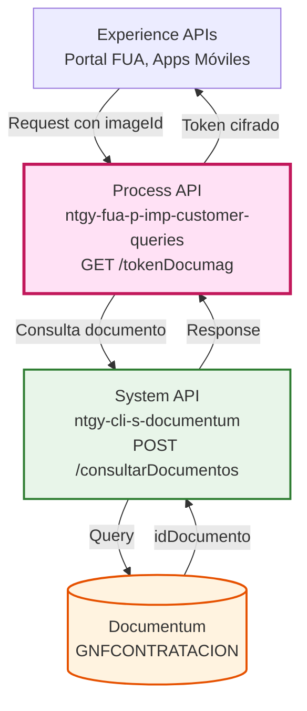
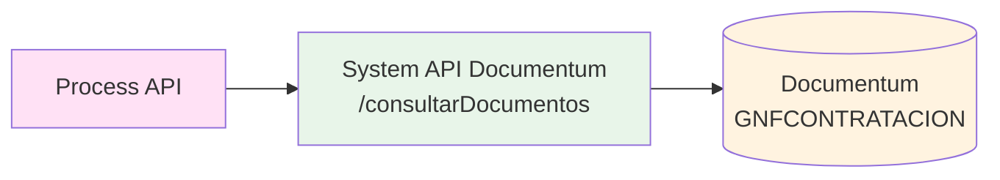
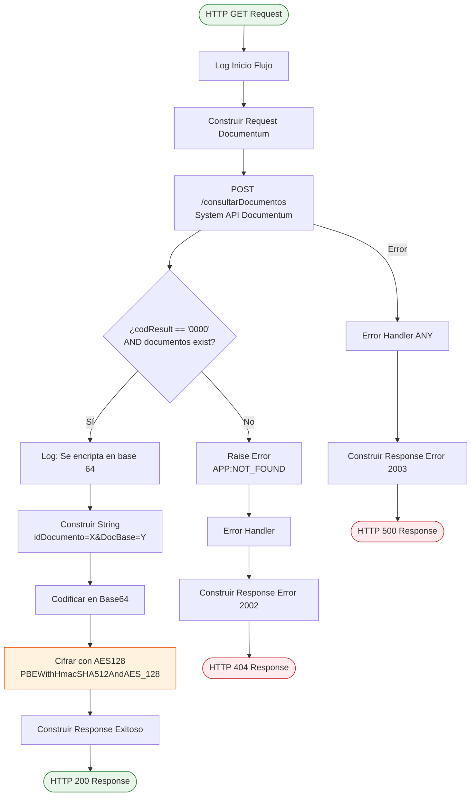
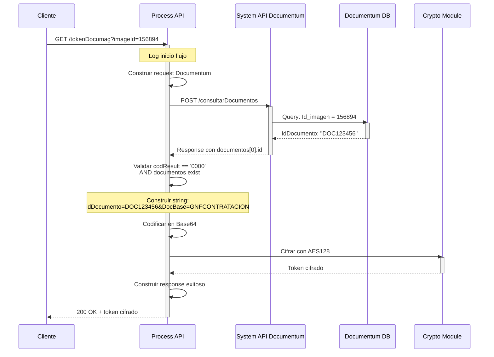
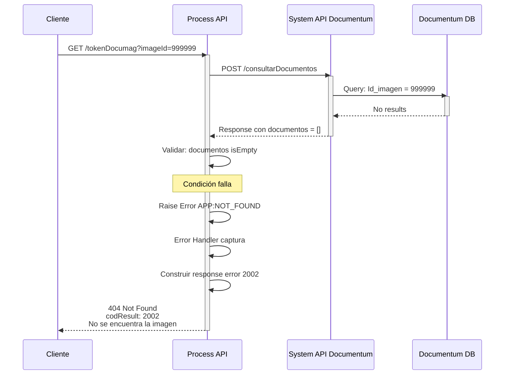
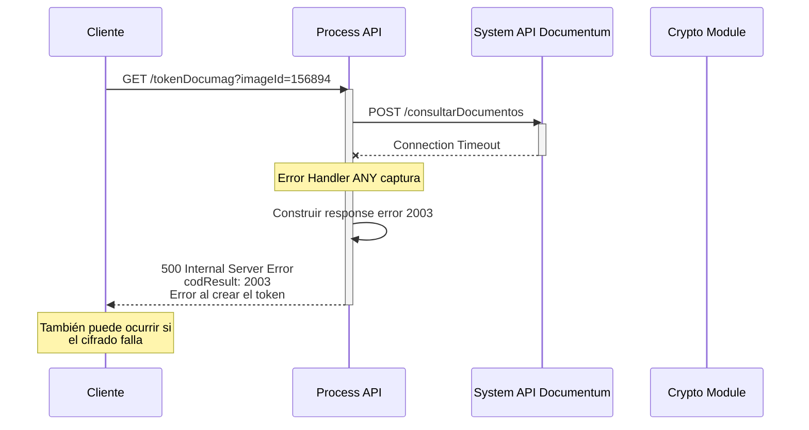

# GET /tokenDocumag

## 📌 Descripción General

### Propósito del Endpoint

Este endpoint genera un token cifrado que permite el acceso seguro a imágenes almacenadas en el sistema Documag. El proceso consiste en consultar el sistema Documentum para obtener el identificador del documento asociado a una imagen específica, y luego generar un token cifrado que encapsula esta información de forma segura.

### Tipo de API

**Capa:** Process API (API-Led Connectivity)

**Función:** Orquestación de consulta a Documentum y generación de token de seguridad

### Patrón de Integración

**Tipo:** Orquestación con Transformación y Cifrado

**Descripción:** El endpoint orquesta una llamada al System API de Documentum para localizar el documento, y luego aplica un proceso de cifrado en dos fases (Base64 + AES128) para generar un token seguro.

### Arquitectura API-Led Connectivity



---

## 💼 Propósito del Negocio

### Casos de Uso Principales

1. **Acceso Seguro a Documentos Escaneados**
   - Los agentes de atención al cliente necesitan visualizar documentos escaneados asociados a gestiones
   - El token permite acceso temporal y controlado sin exponer identificadores internos
   - Beneficio: Seguridad en el acceso a información sensible

2. **Integración con Sistema de Gestión Documental**
   - Las aplicaciones frontend necesitan acceder a imágenes almacenadas en Documag
   - El token actúa como credencial temporal para la descarga de imágenes
   - Beneficio: Abstracción de la complejidad del sistema documental

3. **Trazabilidad de Acceso a Documentos**
   - Cada token generado está asociado a un imageId específico
   - Permite auditoría de accesos a documentos sensibles
   - Beneficio: Cumplimiento de normativas de protección de datos

### 🔗 Endpoints Dependientes

Este Process API consume el siguiente System API:

| System API | Endpoint | Método | Propósito |
|------------|----------|--------|-----------|
| `ntgy-cli-s-documentum` | `/consultarDocumentos` | POST | Consulta de documento en Documentum por imageId para obtener el idDocumento real |

### Lógica de Orquestación



**Pasos del Proceso:**

1. **Consulta a Documentum**: Busca el documento por imageId en la base documental GNFCONTRATACION
2. **Validación de Existencia**: Verifica que el documento existe y la respuesta es exitosa (codResult == '0000')
3. **Generación de Token**: Construye string con idDocumento y DocBase, lo codifica en Base64 y lo cifra con AES128

### Transformaciones Aplicadas

**Proceso de Cifrado del Token:**

| Fase | Entrada | Salida | Transformación |
|------|---------|--------|----------------|
| 1. Construcción | `idDocumento` del response | `"idDocumento=[id]&DocBase=GNFCONTRATACION"` | Concatenación de string |
| 2. Codificación | String construido | String en Base64 | Codificación Base64 |
| 3. Cifrado | String Base64 | Token cifrado | Cifrado AES128 con password |

**Algoritmo de Cifrado:**
- **Método**: PBEWithHmacSHA512AndAES_128
- **Password**: GzNz5n34m3v7twrK (configurado en el flow)
- **Propósito**: Proteger el idDocumento y DocBase de accesos no autorizados

### Contexto Empresarial

- **Dominio:** Gestión Documental
- **Sector:** Energía - Utilities
- **División:** Naturgy España - Clientes Minoristas
- **Proceso de Negocio:** Acceso seguro a documentación digitalizada

### Stakeholders

- **Agentes de Atención al Cliente**: Necesitan visualizar documentos asociados a casos y gestiones
- **Desarrolladores de Aplicaciones Frontend**: Requieren tokens para integrar visualización de documentos
- **Equipo de Seguridad**: Responsables de garantizar acceso controlado a información sensible

### Valor de Negocio

- **Seguridad**: Protección de identificadores internos mediante cifrado robusto
- **Trazabilidad**: Cada token está asociado a un imageId específico para auditoría
- **Simplicidad**: Abstrae la complejidad del sistema Documentum para los consumidores
- **Cumplimiento**: Facilita el cumplimiento de normativas de protección de datos (GDPR, LOPD)

### Consumidores Potenciales

Este endpoint puede ser consumido por:
- Portal FUA (Frontal Único de Atención)
- Aplicaciones móviles de agentes
- Sistemas de gestión de casos
- Aplicaciones de back office que requieran acceso a documentación

---

## 🔧 Especificación Técnica

### URLs por Ambiente

| Ambiente | URL Base | URL Completa |
|----------|----------|--------------|
| **Local** | `http://localhost:8084` | `http://localhost:8084/api/tokenDocumag?imageId=:imageId` |
| **Development** | `https://ntgy-fua-p-imp-customer-queries-dev.de-c1.cloudhub.io` | `https://ntgy-fua-p-imp-customer-queries-dev.de-c1.cloudhub.io/api/tokenDocumag?imageId=:imageId` |
| **UAT** | `https://ntgy-fua-p-imp-customer-queries-uat.de-c1.cloudhub.io` | `https://ntgy-fua-p-imp-customer-queries-uat.de-c1.cloudhub.io/api/tokenDocumag?imageId=:imageId` |
| **Production** | `https://ntgy-fua-p-imp-customer-queries-pro.de-c1.cloudhub.io` | `https://ntgy-fua-p-imp-customer-queries-pro.de-c1.cloudhub.io/api/tokenDocumag?imageId=:imageId` |

### Método HTTP

```
GET /api/tokenDocumag
```

### Parámetros de Entrada

#### Query Parameters

| Parámetro | Tipo | Requerido | Usado en Implementación | Descripción | Ejemplo |
|-----------|------|-----------|-------------------------|-------------|---------|
| `imageId` | string | ✅ Sí | ✅ Sí | Identificador de la imagen en Documag | `"156894"` |
| `nif` | string | ⚠️ En RAML | ❌ No | NIF del cliente (definido en RAML pero no usado en el código) | `"12345678A"` |

**⚠️ Nota Importante sobre el parámetro `nif`:**
- El parámetro `nif` está definido en el RAML del endpoint pero **NO se utiliza** en la implementación actual.
- La consulta a Documentum solo utiliza el `imageId` para localizar el documento (campo `Id_imagen` en la query).
- Este es un caso común donde el RAML puede contener parámetros legacy o planificados que no están implementados en el código.

**Validaciones:**
- `imageId`: Debe ser un string no vacío (OBLIGATORIO)
- `nif`: Opcional, no se procesa en el backend

### Respuestas

#### 200 OK - Token Generado Exitosamente

```json
{
  "result": {
    "codResult": "0000",
    "msgResult": "OK"
  },
  "token": "U2FsdGVkX1+vupppZksvRf5pq5g5XjFRIFlcQ0FRlVKM8xDU+WjbWv9JY2KQWSI3"
}
```

**Campos de Respuesta:**

| Campo | Tipo | Descripción |
|-------|------|-------------|
| `result.codResult` | string | Código de resultado: "0000" para éxito |
| `result.msgResult` | string | Mensaje descriptivo: "OK" |
| `token` | string | Token cifrado en Base64 que contiene el idDocumento y DocBase |

#### 404 Not Found - Imagen No Encontrada

```json
{
  "result": {
    "codResult": "2002",
    "msgResult": "No se encuentra la imagen"
  }
}
```

**Causa:** El imageId proporcionado no existe en Documentum o no tiene documentos asociados.

#### 500 Internal Server Error - Error al Crear Token

```json
{
  "result": {
    "codResult": "2003",
    "msgResult": "Error al crear el token"
  }
}
```

**Causas Posibles:**
- Error en el proceso de cifrado
- Error de conexión con Documentum
- Error en la transformación de datos

### Códigos de Estado HTTP

| Código | Descripción | Cuándo Ocurre |
|--------|-------------|---------------|
| `200` | OK | Token generado exitosamente |
| `404` | Not Found | Imagen no encontrada en Documentum |
| `500` | Internal Server Error | Error en el proceso de generación del token |

### Autenticación

- **Tipo:** OAuth 2.0 (Client ID & Client Secret)
- **Scope:** Definido en Anypoint Platform
- **Header:** `Authorization: Bearer {token}`

### Timeouts

| Tipo | Valor | Descripción |
|------|-------|-------------|
| **Request Timeout** | 30 segundos | Timeout para la llamada a Documentum |
| **Connection Timeout** | 30 segundos | Timeout de conexión idle |

---

## 🏗️ Implementación Técnica

### Arquitectura del Flow



### Configuración del System API

**Archivo:** `global.xml` (líneas 32-34)

```xml
<http:request-config name="HTTPS_Request_s-documentum" 
                     doc:name="HTTP Request configuration" 
                     basePath="/api" 
                     responseTimeout="${s-documentum.timeout}">
    <http:request-connection host="${s-documentum.host}" 
                            port="${s-documentum.port}" 
                            connectionIdleTimeout="${s-documentum.timeout}" 
                            protocol="${s-documentum.protocol}"/>
</http:request-config>
```

**Propiedades (Production):**

```yaml
s-documentum:
  host: "mule-worker-internal-ntgy-cli-s-documentum-ws.de-c1.cloudhub.io"
  port: "8091"
  basePath: "/api"
  protocol: "HTTP"
  timeout: "30000"
  usuario: "generic_user"
  password: ""
  contratacion:
    docBase: "GNFCONTRATACION"
    from: "CNTFOTOIMP01"
```

### Transformaciones DataWeave

#### 1. Request a Documentum (Inline en XML)

**Ubicación:** `global.xml` (líneas ~13-30)

```dataweave
%dw 2.0
output application/json
---
{ 
  "login": {
    "usuario": p("s-documentum.usuario"),
    "password": p("s-documentum.password"),
    "docBase": p("s-documentum.contratacion.docBase")
  },
  "from": p("s-documentum.contratacion.from"),
  "where": [
    {
      "campo": "Id_imagen",
      "operacion": "=",
      "valor": attributes.queryParams.imageId
    }
  ]
}
```

**Propósito:** Construye el payload para consultar Documentum filtrando por Id_imagen.

#### 2. Construcción del String para Cifrado (Inline en XML)

**Ubicación:** `global.xml` (líneas ~32-45)

```dataweave
%dw 2.0
output application/java
import toBase64 from dw::core::Binaries
---
toBase64("idDocumento=" ++ vars.documents.documentos[0].id ++ "&DocBase=GNFCONTRATACION")
```

**Propósito:** 
- Extrae el `id` del primer documento encontrado
- Construye el string: `idDocumento=[id]&DocBase=GNFCONTRATACION`
- Lo codifica en Base64

#### 3. Response Exitoso (Inline en XML)

**Ubicación:** `global.xml` (líneas ~51-62)

```dataweave
%dw 2.0
output application/json
---
{
    "result": {
        "codResult": "0000",
        "msgResult": "OK"	
    },
    "token": vars.cifrado
}
```

**Propósito:** Construye la respuesta exitosa con el token cifrado.

#### 4. Response Error 2002 (Inline en XML)

**Ubicación:** `global.xml` (error handler APP:NOT_FOUND)

```dataweave
%dw 2.0
output application/json
---
{
    "result": {
        "codResult": "2002",
        "msgResult": "No se encuentra la imagen"	
    }
}
```

#### 5. Response Error 2003 (Inline en XML)

**Ubicación:** `global.xml` (error handler ANY)

```dataweave
%dw 2.0
output application/json
---
{
    "result": {
        "codResult": "2003",
        "msgResult": "Error al crear el token"	
    }
}
```

### Proceso de Cifrado

**Componente:** Cryptography Module (Mule 4)

```xml
<crypto:jce-encrypt-pbe 
    doc:name="Se cifrará el string en base64 con AES128" 
    password="GzNz5n34m3v7twrK" 
    algorithm="PBEWithHmacSHA512AndAES_128">
    <crypto:content>#[vars.cifrado]</crypto:content>
</crypto:jce-encrypt-pbe>
```

**Detalles del Cifrado:**
- **Algoritmo:** PBEWithHmacSHA512AndAES_128
- **Password:** GzNz5n34m3v7twrK (hardcoded en el flow)
- **Input:** String en Base64 con formato `idDocumento=X&DocBase=Y`
- **Output:** Token cifrado en formato Base64

### Patrones de Diseño

**Patrón:** Request-Reply con Transformación y Cifrado

**Justificación:** 
- El endpoint necesita consultar un sistema externo (Documentum) de forma síncrona
- Requiere transformar la respuesta aplicando cifrado para seguridad
- El token generado debe ser inmediatamente utilizable por el consumidor

**Patrón de Seguridad:** Token Opaco

**Justificación:**
- El token cifrado oculta los identificadores internos del sistema
- Previene manipulación de parámetros por parte de usuarios maliciosos
- Permite auditoría centralizada de accesos a documentos

### Diagramas de Secuencia

#### 1. Flujo Normal de Éxito



#### 2. Flujo con Imagen No Encontrada



#### 3. Flujo con Error Técnico



### Manejo de Errores

**Estrategia:** Error Handlers específicos por tipo de error

#### Error Handler 1: APP:NOT_FOUND

**Trigger:** Imagen no encontrada en Documentum

**Condición:** `codResult != '0000' OR isEmpty(documentos)`

**Response:**
```json
{
  "result": {
    "codResult": "2002",
    "msgResult": "No se encuentra la imagen"
  }
}
```

**HTTP Status:** 404 Not Found

#### Error Handler 2: ANY

**Trigger:** Cualquier otro error (conexión, cifrado, etc.)

**Response:**
```json
{
  "result": {
    "codResult": "2003",
    "msgResult": "Error al crear el token"
  }
}
```

**HTTP Status:** 500 Internal Server Error

**Errores Comunes:**
- Timeout de conexión con Documentum
- Error en el proceso de cifrado
- Error en transformación DataWeave
- Credenciales inválidas para Documentum

---

## 💻 Ejemplos de Uso

### Ejemplo 1: Generación Exitosa de Token

#### cURL

```bash
curl -X GET "https://ntgy-fua-p-imp-customer-queries-pro.de-c1.cloudhub.io/api/tokenDocumag?imageId=156894" \
  -H "Content-Type: application/json" \
  -H "client_id: YOUR_CLIENT_ID" \
  -H "client_secret: YOUR_CLIENT_SECRET"
```

#### Respuesta (200 OK)

```json
{
  "result": {
    "codResult": "0000",
    "msgResult": "OK"
  },
  "token": "U2FsdGVkX1+vupppZksvRf5pq5g5XjFRIFlcQ0FRlVKM8xDU+WjbWv9JY2KQWSI3"
}
```

**Uso del Token:**
El token generado puede ser utilizado posteriormente para acceder a la imagen en Documag.

### Ejemplo 2: Imagen No Encontrada

#### cURL

```bash
curl -X GET "https://ntgy-fua-p-imp-customer-queries-pro.de-c1.cloudhub.io/api/tokenDocumag?imageId=999999" \
  -H "Content-Type: application/json" \
  -H "client_id: YOUR_CLIENT_ID" \
  -H "client_secret: YOUR_CLIENT_SECRET"
```

#### Respuesta (404 Not Found)

```json
{
  "result": {
    "codResult": "2002",
    "msgResult": "No se encuentra la imagen"
  }
}
```

### Ejemplo 3: JavaScript (Frontend)

```javascript
async function getDocumagToken(imageId) {
  try {
    const response = await fetch(
      `https://ntgy-fua-p-imp-customer-queries-pro.de-c1.cloudhub.io/api/tokenDocumag?imageId=${imageId}`,
      {
        method: 'GET',
        headers: {
          'Content-Type': 'application/json',
          'client_id': 'YOUR_CLIENT_ID',
          'client_secret': 'YOUR_CLIENT_SECRET'
        }
      }
    );

    if (!response.ok) {
      const error = await response.json();
      throw new Error(`Error ${error.result.codResult}: ${error.result.msgResult}`);
    }

    const data = await response.json();
    console.log('Token generado:', data.token);
    return data.token;
    
  } catch (error) {
    console.error('Error al obtener token:', error);
    throw error;
  }
}

// Uso
getDocumagToken('156894')
  .then(token => {
    // Usar el token para acceder a la imagen
    console.log('Token obtenido exitosamente');
  })
  .catch(error => {
    console.error('Fallo al obtener token:', error);
  });
```

### Ejemplo 4: Python

```python
import requests

def get_documag_token(image_id, client_id, client_secret):
    """
    Genera un token de Documag para acceder a una imagen específica.
    
    Args:
        image_id (str): ID de la imagen en Documag
        client_id (str): Client ID para autenticación
        client_secret (str): Client Secret para autenticación
    
    Returns:
        str: Token cifrado para acceso a la imagen
    
    Raises:
        requests.exceptions.HTTPError: Si la petición falla
    """
    url = "https://ntgy-fua-p-imp-customer-queries-pro.de-c1.cloudhub.io/api/tokenDocumag"
    
    params = {
        'imageId': image_id
    }
    
    headers = {
        'Content-Type': 'application/json',
        'client_id': client_id,
        'client_secret': client_secret
    }
    
    try:
        response = requests.get(url, params=params, headers=headers)
        response.raise_for_status()
        
        data = response.json()
        
        if data['result']['codResult'] == '0000':
            print(f"Token generado exitosamente")
            return data['token']
        else:
            print(f"Error: {data['result']['msgResult']}")
            return None
            
    except requests.exceptions.HTTPError as e:
        if e.response.status_code == 404:
            print(f"Imagen no encontrada: {image_id}")
        elif e.response.status_code == 500:
            print(f"Error al crear el token")
        raise

# Uso
if __name__ == "__main__":
    token = get_documag_token(
        image_id='156894',
        client_id='YOUR_CLIENT_ID',
        client_secret='YOUR_CLIENT_SECRET'
    )
    
    if token:
        print(f"Token: {token}")
```

### Ejemplo 5: Java (Spring Boot)

```java
import org.springframework.http.*;
import org.springframework.web.client.RestTemplate;
import org.springframework.web.client.HttpClientErrorException;
import org.springframework.web.util.UriComponentsBuilder;

public class DocumagTokenService {
    
    private final RestTemplate restTemplate;
    private final String baseUrl = "https://ntgy-fua-p-imp-customer-queries-pro.de-c1.cloudhub.io";
    private final String clientId;
    private final String clientSecret;
    
    public DocumagTokenService(String clientId, String clientSecret) {
        this.restTemplate = new RestTemplate();
        this.clientId = clientId;
        this.clientSecret = clientSecret;
    }
    
    public String getDocumagToken(String imageId, String nif) {
        // Construir URL con parámetros
        String url = UriComponentsBuilder
            .fromHttpUrl(baseUrl + "/api/tokenDocumag")
            .queryParam("imageId", imageId)
            .queryParam("nif", nif)
            .toUriString();
        
        // Configurar headers
        HttpHeaders headers = new HttpHeaders();
        headers.setContentType(MediaType.APPLICATION_JSON);
        headers.set("client_id", clientId);
        headers.set("client_secret", clientSecret);
        
        HttpEntity<String> entity = new HttpEntity<>(headers);
        
        try {
            // Realizar petición
            ResponseEntity<TokenResponse> response = restTemplate.exchange(
                url,
                HttpMethod.GET,
                entity,
                TokenResponse.class
            );
            
            TokenResponse body = response.getBody();
            if (body != null && "0000".equals(body.getResult().getCodResult())) {
                return body.getToken();
            }
            
            return null;
            
        } catch (HttpClientErrorException.NotFound e) {
            System.err.println("Imagen no encontrada: " + imageId);
            throw new RuntimeException("Imagen no encontrada", e);
        } catch (HttpClientErrorException e) {
            System.err.println("Error al obtener token: " + e.getMessage());
            throw new RuntimeException("Error al crear token", e);
        }
    }
    
    // Clases DTO
    public static class TokenResponse {
        private Result result;
        private String token;
        
        // Getters y setters
        public Result getResult() { return result; }
        public void setResult(Result result) { this.result = result; }
        public String getToken() { return token; }
        public void setToken(String token) { this.token = token; }
    }
    
    public static class Result {
        private String codResult;
        private String msgResult;
        
        // Getters y setters
        public String getCodResult() { return codResult; }
        public void setCodResult(String codResult) { this.codResult = codResult; }
        public String getMsgResult() { return msgResult; }
        public void setMsgResult(String msgResult) { this.msgResult = msgResult; }
    }
}
```

### Notas de Implementación

**Seguridad:**
- El token generado tiene una validez temporal (definida por el sistema Documag)
- No almacenar tokens en caché por