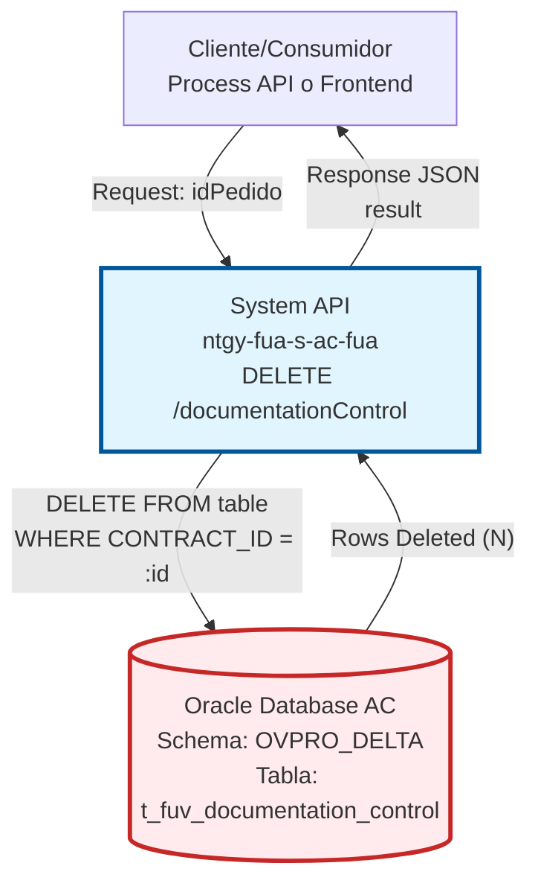
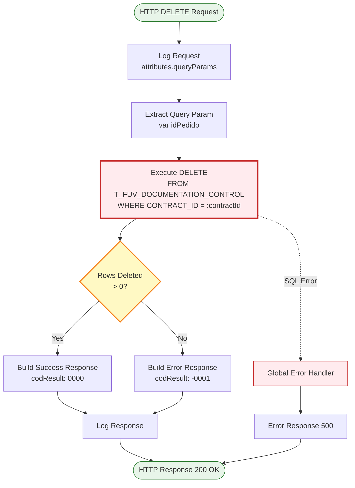
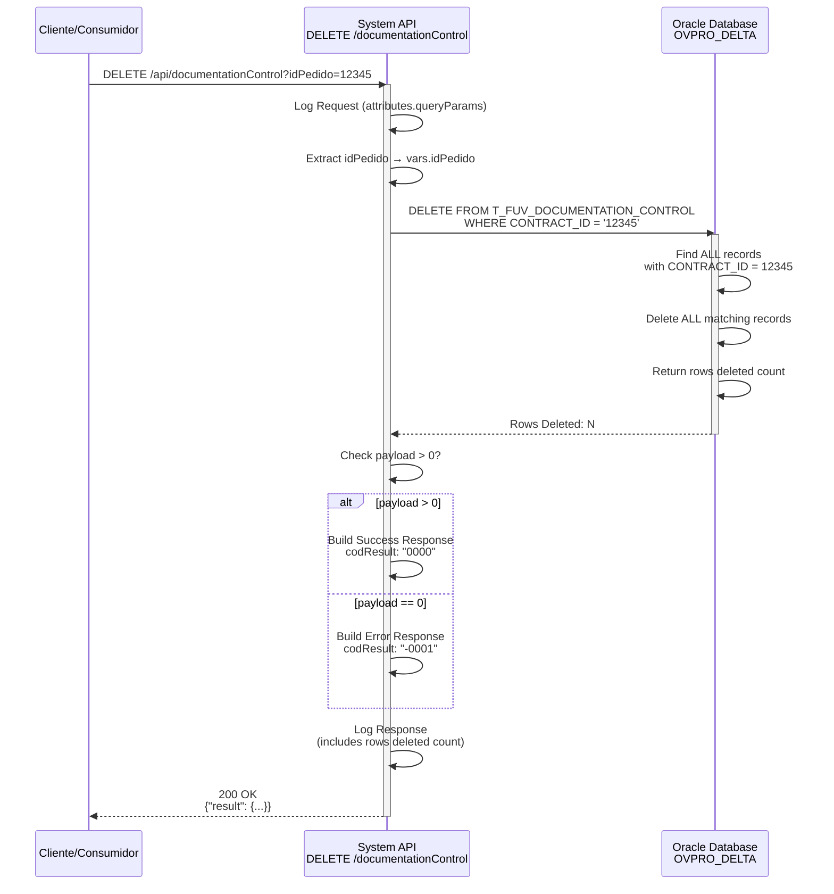

# DELETE /documentationControl

:::danger OPERACIÓN DESTRUCTIVA
Este endpoint elimina **TODOS** los registros de control de documentación asociados a un contrato. La operación es **IRREVERSIBLE** y no requiere confirmación adicional. Use con extrema precaución.
:::

## 📌 Descripción General

### Propósito del Endpoint

Este endpoint elimina **TODOS** los registros de control de documentación asociados a un contrato FUV de la base de datos Oracle AC. A diferencia de los endpoints GET (que lee el más reciente) y PUT (que actualiza el más reciente), este endpoint realiza una eliminación completa de **TODOS** los registros históricos del contrato especificado.

El endpoint soporta:
- **Eliminación Completa**: Borra todos los registros asociados al CONTRACT_ID
- **Operación Irreversible**: No hay forma de recuperar los datos eliminados sin backup
- **Validación Automática**: Verifica que al menos 1 registro fue eliminado
- **Sin Confirmación**: No requiere confirmación adicional (implementar en cliente si es necesario)

### Tipo de API

**Capa:** System API (API-Led Connectivity)

**Función:** Integración directa con Oracle Database AC para eliminación de registros de control de documentación de contratos FUV.

### Patrón de Integración

**Tipo:** Request-Reply Síncrono con DELETE SQL

**Descripción:** El endpoint recibe un query parameter con el ID del pedido, ejecuta una query SQL DELETE que elimina todos los registros donde CONTRACT_ID coincide con el valor proporcionado, y retorna el resultado indicando cuántos registros fueron eliminados.

### Arquitectura API-Led Connectivity



---

## 💼 Propósito del Negocio

### Casos de Uso Principales

1. **Cancelación de Contrato**
   - Un contrato es cancelado y se requiere eliminar todo su historial documental
   - Se eliminan todos los registros de control asociados
   - Beneficio: Limpieza completa de datos del contrato cancelado

2. **Limpieza de Datos de Prueba**
   - Durante pruebas se crean registros que deben ser eliminados
   - Se borran todos los registros de contratos de prueba
   - Beneficio: Mantener base de datos limpia de datos de testing

3. **Corrección de Errores Masivos**
   - Se detectan registros erróneos que deben ser eliminados completamente
   - Se borran todos los registros del contrato para reiniciar el proceso
   - Beneficio: Permite reiniciar el control documental desde cero

4. **Cumplimiento de GDPR (Derecho al Olvido)**
   - Un cliente ejerce su derecho al olvido
   - Se eliminan todos los registros de documentación asociados
   - Beneficio: Cumplimiento de normativa de protección de datos

5. **Proceso de Purga de Datos Históricos**
   - Eliminación de registros antiguos según políticas de retención
   - Se borran registros de contratos finalizados hace tiempo
   - Beneficio: Optimización de espacio en base de datos

### Contexto Empresarial

- **Dominio:** Gestión Documental - Frontal de Ventas (FUV)
- **Sector:** Energía - Utilities
- **División:** Naturgy España - Área Cliente
- **Proceso de Negocio:** Eliminación de registros de control de documentación
- **Sistema Backend:** Oracle Database AC (Área Cliente)

### Stakeholders

- **Administradores de Sistema**: Ejecutan limpiezas de datos
- **Equipo de Cumplimiento**: Gestionan solicitudes de derecho al olvido
- **Equipo de Operaciones**: Corrigen errores masivos en datos
- **DBA Team**: Ejecutan procesos de purga de datos históricos

### Valor de Negocio

- **Cumplimiento Normativo**: Permite cumplir con GDPR y derecho al olvido
- **Limpieza de Datos**: Mantiene base de datos libre de datos obsoletos o erróneos
- **Optimización**: Reduce espacio ocupado por registros innecesarios
- **Corrección de Errores**: Permite reiniciar procesos documentales desde cero

### Consumidores Potenciales

Este endpoint puede ser consumido por:
- Process APIs de gestión de ciclo de vida de contratos
- Herramientas administrativas de limpieza de datos
- Sistemas de cumplimiento normativo (GDPR)
- Scripts de mantenimiento y purga de datos
- Herramientas de corrección de errores masivos

:::warning RESTRICCIÓN DE USO
Este endpoint NO debe ser expuesto directamente a usuarios finales. Debe ser consumido únicamente por sistemas administrativos con permisos especiales y auditoría completa.
:::

---

## 🔧 Especificación Técnica

### URLs por Ambiente

| Ambiente | URL Base | URL Completa |
|----------|----------|--------------|
| **Local** | `http://localhost:8081` | `http://localhost:8081/api/documentationControl?idPedido={id}` |
| **Development** | `https://ntgy-fua-s-ac-fua-dev.us-e2.cloudhub.io` | `https://ntgy-fua-s-ac-fua-dev.us-e2.cloudhub.io/api/documentationControl?idPedido={id}` |
| **UAT** | `https://ntgy-fua-s-ac-fua-uat.us-e2.cloudhub.io` | `https://ntgy-fua-s-ac-fua-uat.us-e2.cloudhub.io/api/documentationControl?idPedido={id}` |
| **Production** | `https://ntgy-fua-s-ac-fua-pro.us-e2.cloudhub.io` | `https://ntgy-fua-s-ac-fua-pro.us-e2.cloudhub.io/api/documentationControl?idPedido={id}` |

### Método HTTP

```
DELETE /api/documentationControl
```

### Parámetros de Entrada

#### Headers HTTP

| Header | Tipo | Requerido | Descripción | Ejemplo |
|--------|------|-----------|-------------|---------|
| `Accept` | string | ❌ No | Tipo de contenido esperado en response | `application/json` |

#### Query Parameters

| Parámetro | Tipo | Requerido | Descripción | Ejemplo |
|-----------|------|-----------|-------------|---------|
| `idPedido` | string | ✅ Sí | ID del contrato/pedido (CONTRACT_ID) cuyos registros se eliminarán | `"12345"` |

**⚠️ Validaciones Críticas:**

1. **idPedido no puede estar vacío**
2. **Verificar existencia antes de eliminar** (usar GET primero)
3. **Implementar confirmación en cliente** (doble verificación)
4. **Auditar todas las eliminaciones** (logging completo)

### Respuestas

#### Respuesta Exitosa - Registros Eliminados (200 OK)

```json
{
  "result": {
    "codResult": "0000",
    "msgResult": "No hay error"
  }
}
```

**Condición:** Se eliminó al menos 1 registro (`payload > 0`)

**Nota:** El número exacto de registros eliminados NO se retorna en la respuesta, pero está disponible en logs.

#### Respuesta de Error - Ningún Registro Eliminado (200 OK)

```json
{
  "result": {
    "codResult": "-0001",
    "msgResult": "El registro que intenta borrar no existe"
  }
}
```

**Condiciones:**
- No existe ningún registro para el `idPedido` especificado
- El CONTRACT_ID no tiene registros en la tabla
- `payload == 0` (ninguna fila afectada)

#### Respuesta de Error Técnico (500)

```json
{
  "result": {
    "codResult": "0001",
    "msgResult": "Error interno del servidor al eliminar control de documentación"
  }
}
```

### Autenticación y Autorización

- **Tipo:** Client ID & Client Secret (Anypoint Platform)
- **Autorización Oracle:** El usuario de base de datos debe tener permisos para:
  - Ejecutar DELETE en tabla `t_fuv_documentation_control`
  - Acceso al schema `OVPRO_DELTA`
- **Recomendación:** Restringir este endpoint a roles administrativos únicamente

### Timeouts

| Tipo | Valor | Descripción |
|------|-------|-------------|
| **Query Timeout** | 15 segundos | Tiempo máximo de ejecución de la query DELETE |
| **Connection Timeout** | 3600 segundos | Tiempo máximo para establecer conexión con Oracle |
| **Response Timeout** | 30 segundos | Tiempo máximo de espera para la respuesta completa |

---

## 🏗️ Implementación Técnica

### Arquitectura del Flow



### Detalles de Implementación

#### 1. Extracción de Parámetro (Líneas 254-262)

```dataweave
%dw 2.0
output application/java
---
attributes.queryParams.idPedido
```

**Propósito:** Extraer el parámetro `idPedido` del query string y almacenarlo en la variable `idPedido`.

**Ejemplo:**
```
Request: DELETE /api/documentationControl?idPedido=12345
Variable: vars.idPedido = "12345"
```

#### 2. Ejecución de DELETE (Líneas 264-267)

```sql
DELETE FROM T_FUV_DOCUMENTATION_CONTROL 
WHERE CONTRACT_ID = :contractId
```

**Características:**
- **Operación:** `db:delete` (retorna número de filas eliminadas)
- **Filtro:** Por CONTRACT_ID usando prepared statement
- **Sin LIMIT:** Elimina **TODOS** los registros que coincidan
- **Parámetro:** `:contractId` mapeado desde `vars.idPedido`

**⚠️ IMPORTANTE:**
- NO usa ORDER BY (no es necesario)
- NO usa LIMIT (elimina todos)
- NO usa subquery MAX (elimina todos, no solo el más reciente)

**Configuración de Base de Datos:**
- **Config:** `Database_Config`
- **Driver:** Oracle JDBC 19.13.0.0.1
- **Schema:** OVPRO_DELTA
- **Connection Pool:** MaxPoolSize=15, MaxWaitTime=300s
- **Query Timeout:** 15 segundos

**Resultado:**
```
payload = N  (número de filas eliminadas)
```

Ejemplos:
- `payload = 1`: Se eliminó 1 registro
- `payload = 5`: Se eliminaron 5 registros
- `payload = 0`: No se eliminó ningún registro (no existe)

#### 3. Construcción de Respuesta (Líneas 268-279)

```dataweave
%dw 2.0
output application/json
---
{
    "result": {
        "codResult": if (payload > 0) "0000" else "-0001",
        "msgResult": if (payload > 0) 
                        "No hay error" 
                     else 
                        "El registro que intenta borrar no existe"
    }
}
```

**Lógica:**
- **Si payload > 0:** Éxito (al menos 1 registro eliminado)
- **Si payload == 0:** Error (ningún registro encontrado)

**Nota:** El número exacto de registros eliminados NO se incluye en la respuesta JSON, pero está disponible en los logs.

### Diagrama de Secuencia Detallado



### Comparación con Otros Métodos

| Aspecto | GET | PUT | DELETE |
|---------|-----|-----|--------|
| **Operación** | SELECT | UPDATE | DELETE |
| **Alcance** | Registro más reciente | Registro más reciente | **TODOS los registros** |
| **Filtro** | ORDER BY create_date DESC | MAX(ID) subquery | WHERE CONTRACT_ID |
| **Resultado** | 1 registro | 1 registro actualizado | N registros eliminados |
| **Reversible** | ✅ Sí (solo lectura) | ⚠️ Parcial (con backup) | ❌ **NO (irreversible)** |

### Manejo de Errores

El endpoint utiliza el **Global Error Handler** (`s-ac-globalErrorHandler.xml`) para manejar excepciones:

**Errores Comunes:**

1. **Database Connection Error**
   - Causa: No se puede conectar a Oracle Database
   - Código: DB_CONNECTION_ERROR
   - Acción: Retry automático (3 intentos)

2. **Query Timeout**
   - Causa: DELETE excede 15 segundos
   - Código: DB_QUERY_TIMEOUT
   - Acción: Retornar error al cliente

3. **Ningún Registro Encontrado**
   - Causa: No existe registro para el idPedido
   - Resultado: `payload = 0`
   - Respuesta: codResult "-0001"

4. **Foreign Key Constraint**
   - Causa: Registros referenciados por otras tablas
   - Código: ORA-02292 (integrity constraint violated)
   - Acción: Retornar error, no se puede eliminar

5. **Permission Denied**
   - Causa: Usuario sin permisos DELETE
   - Código: ORA-01031 (insufficient privileges)
   - Acción: Retornar error de autorización

### Logging

**Puntos de Logging:**

1. **Request Log (Línea 253):**
   ```
   STARTING deleteDocumentationControl METHOD. REQUEST: {"idPedido": "12345"}
   ```

2. **Response Log (Línea 280):**
   ```
   FINISHED deleteDocumentationControl METHOD. RESPONSE: {"result": {...}}
   ```

**Información Logged:**
- Query parameters normalizados
- Payload de respuesta normalizado
- **Número de filas eliminadas** (implícito en payload)
- Correlation ID (si está disponible)
- Timestamp de inicio y fin

**⚠️ IMPORTANTE:** Implementar logging adicional para auditoría:
```
AUDIT: User [username] deleted [N] records for CONTRACT_ID [12345] at [timestamp]
```

### Configuración de Base de Datos

```xml
<db:config name="Database_Config">
    <db:oracle-connection 
        host="${dbAC.host1}" 
        port="${dbAC.port}"
        user="${dbAC.user}"
        password="${dbAC.pass}"
        serviceName="${dbAC.serviceName}">
        <db:pooling-profile 
            maxPoolSize="15"
            maxWait="300000"
            maxIdle="300000"/>
        <db:connection-properties>
            <db:connection-property key="oracle.net.CONNECT_TIMEOUT" value="6000000"/>
        </db:connection-properties>
    </db:oracle-connection>
</db:config>
```

---

## 💻 Ejemplos de Uso

### Ejemplo 1: Eliminación Exitosa

```bash
curl -X DELETE "https://ntgy-fua-s-ac-fua-pro.us-e2.cloudhub.io/api/documentationControl?idPedido=12345" \
  -H "Accept: application/json"
```

**Response (200 OK):**

```json
{
  "result": {
    "codResult": "0000",
    "msgResult": "No hay error"
  }
}
```

**Nota:** Esto eliminó TODOS los registros asociados al contrato 12345 (podrían ser 1, 2, 5, 10... registros).

### Ejemplo 2: Contrato No Existe

```bash
curl -X DELETE "https://ntgy-fua-s-ac-fua-pro.us-e2.cloudhub.io/api/documentationControl?idPedido=99999" \
  -H "Accept: application/json"
```

**Response (200 OK):**

```json
{
  "result": {
    "codResult": "-0001",
    "msgResult": "El registro que intenta borrar no existe"
  }
}
```

### Ejemplo 3: JavaScript con Confirmación (Recomendado)

```javascript
async function deleteDocumentationControl(orderId) {
  // 1. Verificar existencia primero
  const checkResponse = await fetch(
    `https://ntgy-fua-s-ac-fua-pro.us-e2.cloudhub.io/api/documentationControl?idPedido=${orderId}`
  );
  
  if (checkResponse.ok) {
    const data = await checkResponse.json();
    
    // 2. Mostrar confirmación al usuario
    const confirmed = confirm(
      `¿Está seguro de eliminar TODOS los registros del contrato ${orderId}?\n` +
      `Esta operación es IRREVERSIBLE.`
    );
    
    if (confirmed) {
      // 3. Ejecutar eliminación
      const deleteResponse = await fetch(
        `https://ntgy-fua-s-ac-fua-pro.us-e2.cloudhub.io/api/documentationControl?idPedido=${orderId}`,
        {
          method: 'DELETE',
          headers: {
            'Accept': 'application/json'
          }
        }
      );
      
      const result = await deleteResponse.json();
      
      if (result.result.codResult === '0000') {
        console.log('✅ Registros eliminados exitosamente');
        return true;
      } else {
        console.error('❌ Error:', result.result.msgResult);
        return false;
      }
    }
  } else {
    console.error('❌ Contrato no encontrado');
    return false;
  }
}

// Uso
deleteDocumentationControl('12345');
```

### Ejemplo 4: Python con Verificación Previa

```python
import requests

def delete_documentation_control(order_id, force=False):
    """
    Elimina todos los registros de documentación de un contrato.
    
    Args:
        order_id: ID del contrato
        force: Si es True, elimina sin verificar existencia
    
    Returns:
        True si se eliminó, False si no
    """
    base_url = "https://ntgy-fua-s-ac-fua-pro.us-e2.cloudhub.io/api/documentationControl"
    
    # 1. Verificar existencia (a menos que force=True)
    if not force:
        check_response = requests.get(f"{base_url}?idPedido={order_id}")
        
        if check_response.status_code != 200:
            print(f"❌ Contrato {order_id} no encontrado")
            return False
        
        # Mostrar advertencia
        print(f"⚠️  ADVERTENCIA: Se eliminarán TODOS los registros del contrato {order_id}")
        confirmation = input("Escriba 'CONFIRMAR' para continuar: ")
        
        if confirmation != "CONFIRMAR":
            print("Operación cancelada")
            return False
    
    # 2. Ejecutar eliminación
    delete_response = requests.delete(
        f"{base_url}?idPedido={order_id}",
        headers={"Accept": "application/json"}
    )
    
    if delete_response.status_code == 200:
        data = delete_response.json()
        
        if data['result']['codResult'] == '0000':
            print(f"✅ Registros del contrato {order_id} eliminados exitosamente")
            return True
        else:
            print(f"❌ Error: {data['result']['msgResult']}")
            return False
    else:
        print(f"❌ Error HTTP: {delete_response.status_code}")
        return False

# Uso con verificación
delete_documentation_control('12345')

# Uso forzado (sin verificación)
delete_documentation_control('12345', force=True)
```

### Ejemplo 5: Script de Limpieza Masiva

```python
import requests
import time

def bulk_delete_documentation(order_ids, dry_run=True):
    """
    Elimina registros de múltiples contratos.
    
    Args:
        order_ids: Lista de IDs de contratos
        dry_run: Si es True, solo simula (no elimina)
    
    Returns:
        Diccionario con resultados
    """
    base_url = "https://ntgy-fua-s-ac-fua-pro.us-e2.cloudhub.io/api/documentationControl"
    results = {
        'success': [],
        'not_found': [],
        'errors': []
    }
    
    for order_id in order_ids:
        print(f"Procesando contrato {order_id}...")
        
        if dry_run:
            print(f"  [DRY RUN] Se eliminarían registros de {order_id}")
            continue
        
        try:
            response = requests.delete(
                f"{base_url}?idPedido={order_id}",
                headers={"Accept": "application/json"},
                timeout=30
            )
            
            if response.status_code == 200:
                data = response.json()
                
                if data['result']['codResult'] == '0000':
                    results['success'].append(order_id)
                    print(f"  ✅ Eliminado")
                elif data['result']['codResult'] == '-0001':
                    results['not_found'].append(order_id)
                    print(f"  ⚠️  No encontrado")
                else:
                    results['errors'].append(order_id)
                    print(f"  ❌ Error: {data['result']['msgResult']}")
            else:
                results['errors'].append(order_id)
                print(f"  ❌ Error HTTP: {response.status_code}")
        
        except Exception as e:
            results['errors'].append(order_id)
            print(f"  ❌ Excepción: {e}")
        
        # Pausa para no saturar el sistema
        time.sleep(0.5)
    
    # Resumen
    print("\n" + "="*50)
    print("RESUMEN DE ELIMINACIÓN")
    print("="*50)
    print(f"✅ Eliminados: {len(results['success'])}")
    print(f"⚠️  No encontrados: {len(results['not_found'])}")
    print(f"❌ Errores: {len(results['errors'])}")
    
    return results

# Uso
contratos_a_eliminar = ['12345', '12346', '12347']

# Primero hacer dry run
print("=== DRY RUN ===")
bulk_delete_documentation(contratos_a_eliminar, dry_run=True)

# Luego ejecutar real
print("\n=== EJECUCIÓN REAL ===")
input("Presione ENTER para continuar con la eliminación real...")
bulk_delete_documentation(contratos_a_eliminar, dry_run=False)
```

### Ejemplo 6: Integración con Postman

**Request:**
- **Method:** DELETE
- **URL:** `{{baseUrl}}/api/documentationControl`
- **Query Params:**
  - `idPedido`: `12345`
- **Headers:**
  - `Accept`: `application/json`

**Pre-request Script (Confirmación):**

```javascript
// Mostrar advertencia antes de ejecutar
const orderId = pm.request.url.query.get('idPedido');

const confirmed = confirm(
    `⚠️ ADVERTENCIA ⚠️\n\n` +
    `Está a punto de ELIMINAR TODOS los registros del contrato ${orderId}.\n\n` +
    `Esta operación es IRREVERSIBLE.\n\n` +
    `¿Desea continuar?`
);

if (!confirmed) {
    throw new Error('Operación cancelada por el usuario');
}
```

**Tests (Postman):**

```javascript
pm.test("Status code is 200", function () {
    pm.response.to.have.status(200);
});

pm.test("Response has result", function () {
    var jsonData = pm.response.json();
    pm.expect(jsonData).to.have.property('result');
});

pm.test("Result code is success or not found", function () {
    var jsonData = pm.response.json();
    pm.expect(['0000', '-0001']).to.include(jsonData.result.codResult);
});

// Log resultado
const jsonData = pm.response.json();
if (jsonData.result.codResult === '0000') {
    console.log('✅ Registros eliminados exitosamente');
} else {
    console.log('⚠️ No se encontraron registros para eliminar');
}
```

### Ejemplo 7: Error - Parámetro Faltante

```bash
curl -X DELETE "https://ntgy-fua-s-ac-fua-pro.us-e2.cloudhub.io/api/documentationControl" \
  -H "Accept: application/json"
```

**Response (400 Bad Request):**

```json
{
  "result": {
    "codResult": "0001",
    "msgResult": "El parámetro idPedido es requerido"
  }
}
```
