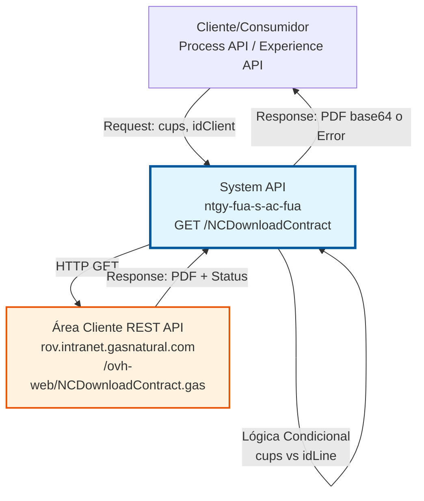
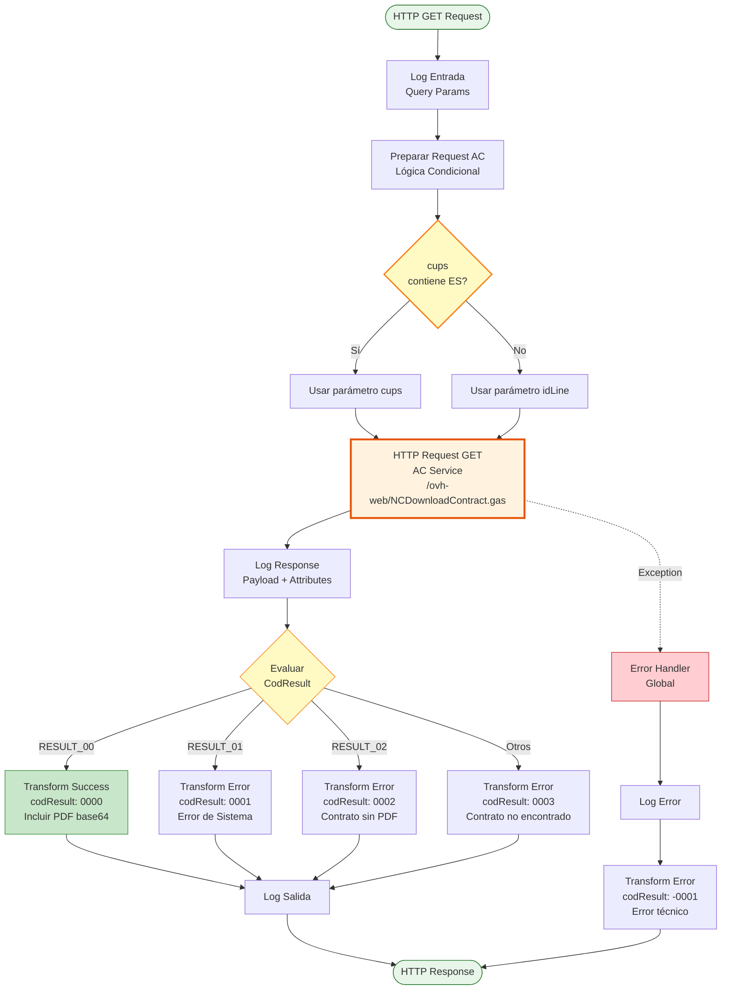
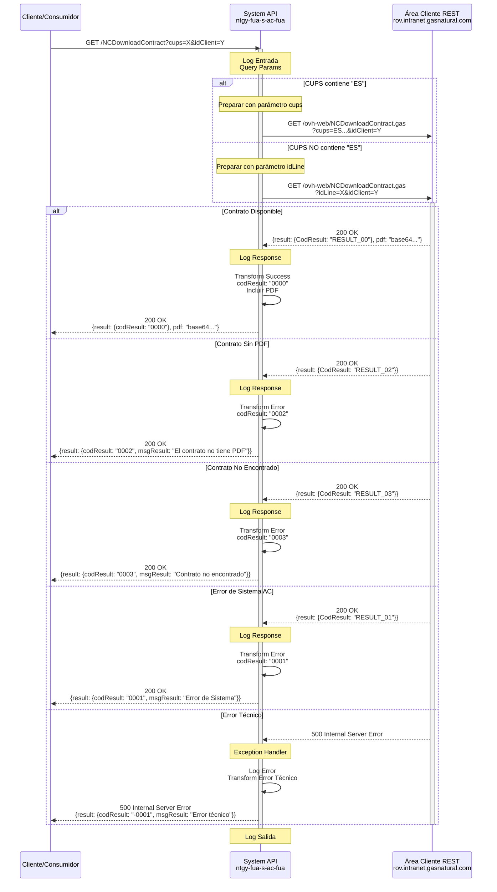

# GET /NCDownloadContract

## 📌 Descripción General

### Propósito del Endpoint

Este endpoint permite descargar el archivo PDF de un contrato específico desde el sistema Área Cliente (AC) de Naturgy. Actúa como intermediario entre los consumidores (Process APIs, Experience APIs) y el servicio REST del Área Cliente, proporcionando acceso estandarizado a los documentos contractuales.

El endpoint soporta:
- **Descarga de PDF de Contratos**: Obtiene el documento PDF de un contrato específico en formato base64
- **Identificación Flexible**: Acepta CUPS (Código Universal del Punto de Suministro) o ID de línea
- **Lógica Condicional**: Transforma automáticamente el parámetro según el formato del CUPS
- **Validación de Permisos**: Verifica que el cliente tenga acceso al contrato solicitado
- **Manejo de Estados**: Gestiona diferentes estados de contratos (disponible, sin PDF, no encontrado)
- **Transformación de Respuestas**: Normaliza las respuestas del sistema AC a formato estándar

### Tipo de API

**Capa:** System API (API-Led Connectivity)

**Función:** Integración directa con el servicio REST del Área Cliente (AC) para descarga de documentos contractuales.

### Patrón de Integración

**Tipo:** Request-Reply Síncrono con REST API Externa

**Descripción:** El endpoint recibe una solicitud con el CUPS (o ID de línea) y el ID de cliente, aplica lógica condicional para determinar el tipo de parámetro a enviar al AC, realiza una llamada HTTP GET al servicio AC, transforma la respuesta según el código de resultado, y retorna el PDF en base64 o un mensaje de error apropiado.

### Arquitectura API-Led Connectivity



---

## 💼 Propósito del Negocio

### Casos de Uso Principales

1. **Descarga de Contrato para Cliente Final**
   - Un cliente accede a su portal web o app móvil
   - Solicita descargar su contrato de suministro
   - El sistema valida permisos y retorna el PDF
   - **Beneficio:** Acceso inmediato a documentación contractual

2. **Consulta de Contrato por Agente de Ventas**
   - Un agente de ventas necesita revisar un contrato con el cliente
   - Solicita la descarga usando el CUPS o ID de línea
   - Obtiene el PDF para visualización o envío
   - **Beneficio:** Soporte eficiente en proceso de venta

3. **Archivo Legal y Cumplimiento**
   - El departamento legal necesita almacenar contratos
   - Solicita la descarga masiva de contratos
   - Almacena los PDFs para cumplimiento normativo
   - **Beneficio:** Cumplimiento de obligaciones legales

4. **Onboarding de Nuevos Clientes**
   - Un nuevo cliente necesita revisar su contrato antes de firmar
   - El sistema descarga el contrato generado
   - Cliente puede revisar términos y condiciones
   - **Beneficio:** Transparencia en el proceso de contratación

### Contexto Empresarial

- **Dominio:** Gestión de Contratos y Documentación Legal
- **Sector:** Energía - Utilities (Gas y Electricidad)
- **División:** Naturgy España - Área Cliente
- **Proceso de Negocio:** Consulta y descarga de documentación contractual
- **Sistema Backend:** Área Cliente (AC) - Sistema de gestión de clientes y contratos

### Stakeholders

- **Clientes Finales**: Necesitan acceso a sus contratos para consulta y archivo personal
- **Agentes de Ventas**: Requieren acceso rápido a contratos para proceso comercial
- **Departamento Legal**: Necesitan almacenar contratos para cumplimiento legal y auditoría
- **Equipo de Atención al Cliente**: Monitorea disponibilidad y acceso a documentos contractuales
- **Sistemas de Archivo**: Requieren almacenamiento de contratos para retención documental

### Valor de Negocio

- **Autoservicio Digital**: Reduce llamadas al call center al permitir descarga autónoma de contratos
- **Cumplimiento Legal**: Facilita el cumplimiento de obligaciones de conservación documental
- **Transparencia Contractual**: Mejora la confianza al proporcionar acceso inmediato a términos
- **Eficiencia Operativa**: Reduce tiempo de atención en consultas contractuales
- **Trazabilidad**: Permite seguimiento de accesos a documentos contractuales

### Consumidores Potenciales

Este endpoint puede ser consumido por:
- Process APIs de gestión de contratos y onboarding
- Experience APIs de portales web y aplicaciones móviles
- Sistemas de agentes de ventas y call center
- Plataformas de gestión documental y archivo legal
- Sistemas de CRM y gestión de clientes
- Integraciones con sistemas de terceros autorizados

---

## 🔧 Especificación Técnica

### URLs por Ambiente

| Ambiente | URL Base | URL Completa |
|----------|----------|--------------|
| **Local** | `http://localhost:8081` | `http://localhost:8081/api/NCDownloadContract` |
| **Development** | `https://ntgy-fua-s-ac-fua-dev.us-e2.cloudhub.io` | `https://ntgy-fua-s-ac-fua-dev.us-e2.cloudhub.io/api/NCDownloadContract` |
| **Production** | `https://ntgy-fua-s-ac-fua-pro.us-e2.cloudhub.io` | `https://ntgy-fua-s-ac-fua-pro.us-e2.cloudhub.io/api/NCDownloadContract` |

### Método HTTP

```
GET /api/NCDownloadContract
```

### Parámetros de Entrada

#### Headers HTTP

| Header | Tipo | Requerido | Descripción | Ejemplo |
|--------|------|-----------|-------------|---------|
| `Accept` | string | ❌ No | Tipo de contenido esperado en response | `application/json` |

#### Query Parameters

| Parámetro | Tipo | Requerido | Descripción | Ejemplo |
|-----------|------|-----------|-------------|---------|
| `cups` | string | ✅ Sí | CUPS (Código Universal del Punto de Suministro) o ID de línea del contrato | `"ES0021000000000001JN"` o `"12345678"` |
| `idClient` | string | ✅ Sí | Identificador del cliente propietario del contrato | `"87654321"` |

**Validaciones:**
- Ambos parámetros son obligatorios
- `cups` puede ser:
  - **CUPS español**: Formato `ES` + 16 dígitos + 2 letras (ej: `ES0021000000000001JN`)
  - **ID de línea**: Identificador numérico cuando no es CUPS español
- `idClient` debe corresponder al propietario del contrato para validación de permisos

**⚠️ Lógica Condicional Importante:**

El endpoint aplica la siguiente lógica al parámetro `cups`:

```dataweave
{
  ("cups" : attributes.queryParams.cups) if attributes.queryParams.cups contains "ES",
  ("idLine" : attributes.queryParams.cups) if (!(attributes.queryParams.cups contains "ES")),
  "idClient" : attributes.queryParams.idClient
}
```

**Comportamiento:**
- Si `cups` **contiene "ES"** → Se envía como parámetro `cups` al AC
- Si `cups` **NO contiene "ES"** → Se envía como parámetro `idLine` al AC
- Siempre se envía `idClient`

**Ejemplos:**
- Input: `cups=ES0021000000000001JN` → AC recibe: `cups=ES0021000000000001JN`
- Input: `cups=12345678` → AC recibe: `idLine=12345678`

### Respuestas

#### Respuesta Exitosa (200 OK)

**Código de Resultado:** `0000`

```json
{
  "result": {
    "codResult": "0000",
    "msgResult": "No hay error"
  },
  "pdf": "JVBERi0xLjQKJeLjz9MKMyAwIG9iago8PC9UeXBlL1BhZ2UvUGFyZW50IDIgMCBSL1Jlc291cmNlczw8L0ZvbnQ8PC9GMSA1IDAgUj4+L1Byb2NTZXRbL1BERi9UZXh0L0ltYWdlQi9JbWFnZUMvSW1hZ2VJXT4+L01lZGlhQm94WzAgMCA1OTUuMzIgODQxLjkyXS9Db250ZW50cyA0IDAgUi9Hcm91cDw8L1R5cGUvR3JvdXAvUy9UcmFuc3BhcmVuY3kvQ1MvRGV2aWNlUkdCPj4vVGFicz..."
}
```

**Descripción de Campos:**
- `result.codResult`: Código de resultado `"0000"` indica éxito
- `result.msgResult`: Mensaje descriptivo del resultado
- `pdf`: Contenido del PDF del contrato codificado en base64

#### Respuesta de Error de Negocio - Error de Sistema (200 OK)

**Código de Resultado:** `0001`

```json
{
  "result": {
    "codResult": "0001",
    "msgResult": "Error de Sistema"
  }
}
```

**Descripción:** Error interno del sistema AC al procesar la solicitud.

#### Respuesta de Error de Negocio - Contrato Sin PDF (200 OK)

**Código de Resultado:** `0002`

```json
{
  "result": {
    "codResult": "0002",
    "msgResult": "El contrato no tiene contratos PDF"
  }
}
```

**Descripción:** El contrato existe pero no tiene un PDF asociado disponible para descarga.

#### Respuesta de Error de Negocio - Contrato No Encontrado (200 OK)

**Código de Resultado:** `0003`

```json
{
  "result": {
    "codResult": "0003",
    "msgResult": "El contrato no se ha encontrado"
  }
}
```

**Descripción:** El contrato solicitado no existe o no está asociado al cliente especificado.

#### Respuesta de Error Técnico (500 Internal Server Error)

**Código de Resultado:** `-0001`

```json
{
  "result": {
    "codResult": "-0001",
    "msgResult": "Error técnico"
  }
}
```

**Descripción:** Error técnico en la comunicación con el sistema AC o error interno del API.

### Códigos de Estado HTTP

| Código | Descripción | Escenario |
|--------|-------------|-----------|
| `200` | OK | Respuesta exitosa o error de negocio controlado |
| `400` | Bad Request | Parámetros faltantes o inválidos |
| `401` | Unauthorized | Credenciales inválidas o token expirado |
| `500` | Internal Server Error | Error técnico no controlado |

### Autenticación y Autorización

- **Tipo:** Client ID & Client Secret (Anypoint Platform)
- **Autorización AC:** El sistema AC valida internamente que:
  - El `idClient` tenga permisos para acceder al contrato
  - El contrato exista y esté disponible
  - El CUPS o ID de línea sea válido
  - El cliente esté autorizado para descargar documentos

### Timeouts

| Tipo | Valor | Descripción |
|------|-------|-------------|
| **Request Timeout** | 15 segundos | Tiempo máximo de espera para la respuesta del AC |
| **Connection Timeout** | 15 segundos | Tiempo máximo para establecer conexión con AC |

---

## 🏗️ Implementación Técnica

### Arquitectura del Flow



### Diagrama de Secuencia Completo



### Transformación de Datos

#### Preparación de Query Parameters con Lógica Condicional (Líneas 11-18)

```dataweave
%dw 2.0
output application/json
---
{
  ("cups" : attributes.queryParams.cups) if attributes.queryParams.cups contains "ES",
  ("idLine" : attributes.queryParams.cups) if (!(attributes.queryParams.cups contains "ES")),
  "idClient" : attributes.queryParams.idClient
}
```

**Propósito:** Aplicar lógica condicional para determinar si se envía `cups` o `idLine` al servicio AC.

**Lógica:**
1. **Si `cups` contiene "ES"**: 
   - Envía parámetro `cups` con el valor original
   - Típicamente para CUPS españoles (formato: ES + 16 dígitos + 2 letras)

2. **Si `cups` NO contiene "ES"**:
   - Envía parámetro `idLine` con el valor de `cups`
   - Para identificadores de línea no españoles o IDs numéricos

3. **Siempre**:
   - Envía parámetro `idClient`

**Ejemplos de Transformación:**

| Input `cups` | Contiene "ES"? | Parámetro AC | Valor AC |
|--------------|----------------|--------------|----------|
| `ES0021000000000001JN` | ✅ Sí | `cups` | `ES0021000000000001JN` |
| `ES1234567890123456AB` | ✅ Sí | `cups` | `ES1234567890123456AB` |
| `12345678` | ❌ No | `idLine` | `12345678` |
| `PT0021000000000001JN` | ❌ No | `idLine` | `PT0021000000000001JN` |

#### Transformación de Respuesta Exitosa (Líneas 26-40)

```dataweave
%dw 2.0
output application/json
---
{
  result: {
    codResult: "0000",
    msgResult: "No hay error"
  },
  "pdf": payload.pdf default ""
}
```

**Propósito:** Normalizar respuesta exitosa del AC a formato estándar, incluyendo el PDF en base64.

**Lógica:**
- Mapea `RESULT_00` del AC a código `0000` (éxito)
- Extrae el campo `pdf` del payload del AC
- Usa `default ""` para manejar casos donde el PDF no esté presente

#### Transformación de Errores de Negocio (Líneas 48-62)

```dataweave
%dw 2.0
output application/json
---
{
  result: {
    codResult: payload.result.CodResult match {
      case "RESULT_01" -> "0001"
      case "RESULT_02" -> "0002"
      else -> "0003"
    },
    msgResult: payload.result.CodResult match {
      case "RESULT_01" -> "Error de Sistema"
      case "RESULT_02" -> "El contrato no tiene contratos PDF"
      else -> "El contrato no se ha encontrado"
    }
  }
}
```

**Propósito:** Mapear códigos de error del AC a códigos estándar con mensajes descriptivos.

**Mapeo de Códigos:**
- `RESULT_01` → `0001`: Error interno del sistema AC
- `RESULT_02` → `0002`: Contrato existe pero no tiene PDF disponible
- Otros códigos → `0003`: Contrato no encontrado o no accesible

**Diferencia con NCDownloadInvoice:**
- Invoice usa códigos `0006` (no encontrada) y `0008` (retirada)
- Contract usa códigos `0002` (sin PDF) y `0003` (no encontrado)

#### Transformación de Error Técnico (Líneas 70-79)

```dataweave
%dw 2.0
output application/json
---
{
  "result": {
    "codResult": "-0001",
    "msgResult": "Error técnico"
  }
}
```

**Propósito:** Respuesta estándar para errores técnicos no controlados (excepciones, timeouts, errores de conexión).

### Configuración HTTP

#### HTTP Request Configuration (global.xml, líneas 16-22)

```xml
<http:request-config 
  name="HTTP_Request_configuration_AC" 
  responseTimeout="${ac.timeout}" 
  enableCookies="false">
  <http:request-connection 
    protocol="HTTPS" 
    host="${ac.host}" 
    port="${ac.port}" 
    connectionIdleTimeout="${ac.timeout}">
    <tls:context>
      <tls:trust-store 
        path="ntgy-fua-s-ac-fua-keystore.jks" 
        password="changeit" 
        type="jks" 
        insecure="true"/>
    </tls:context>
  </http:request-connection>
</http:request-config>
```

**Configuración de Producción (ntgy-fua-s-ac-fua-pro-config.yaml, líneas 22-33):**
- **Host:** `rov.intranet.gasnatural.com`
- **Port:** `443` (HTTPS)
- **Path:** `/ovh-web/NCDownloadContract.gas` (línea 29)
- **Timeout:** `15000` ms (15 segundos)
- **TLS:** Configurado con keystore para comunicación segura

#### HTTP Response Validator (Líneas 19-21)

```xml
<http:response-validator>
  <http:success-status-code-validator values="200,400,401" />
</http:response-validator>
```

**Propósito:** Considera como exitosos los códigos 200, 400 y 401 para permitir manejo personalizado de errores del AC.

### Manejo de Errores

#### Error Handler Global (Líneas 66-80)

```xml
<error-handler>
  <on-error-propagate enableNotifications="true" logException="true">
    <logger level="ERROR" 
      message='#["s-ac-NCDownloadInvoice.logErrorGenerico error: " ++ 
               error.description as String replace /\"/ with("")]' />
    <ee:transform>
      <ee:message>
        <ee:set-payload><![CDATA[
          %dw 2.0
          output application/json
          ---
          {
            "result": {
              "codResult": "-0001",
              "msgResult": "Error técnico"
            }
          }
        ]]></ee:set-payload>
      </ee:message>
    </ee:transform>
  </on-error-propagate>
</error-handler>
```

**Tipos de Errores Capturados:**
- **HTTP:TIMEOUT**: Timeout en la conexión con AC
- **HTTP:CONNECTIVITY**: Error de conectividad con AC
- **MULE:EXPRESSION**: Error en expresiones DataWeave
- **ANY**: Cualquier otro error no controlado

**Estrategia:**
1. Log del error con nivel ERROR
2. Transformación a respuesta estándar con código `-0001`
3. Propagación del error con respuesta formateada

### Logging

#### Puntos de Logging

1. **Log Entrada (Línea 10):**
   ```
   s-ac-NCDownloadContract.logEntrada #[attributes.queryParams]
   ```
   - Nivel: DEBUG
   - Contenido: Query parameters recibidos (cups, idClient)

2. **Log Response (Línea 23):**
   ```
   s-ac-NCDownloadContract.log ## payload: #[payload] attributes: #[attributes]
   ```
   - Nivel: DEBUG
   - Contenido: Payload y attributes de la respuesta del AC

3. **Log Salida (Línea 65):**
   ```
   NCDownloadContract - Respuesta #[payload.result]
   ```
   - Nivel: INFO
   - Contenido: Resultado de la operación

4. **Log Error (Línea 68):**
   ```
   s-ac-NCDownloadInvoice.logErrorGenerico error: [error.description]
   ```
   - Nivel: ERROR
   - Contenido: Descripción del error capturado

---

## 💻 Ejemplos de Uso

### Ejemplo 1: Descarga Exitosa con CUPS Español

#### Request

```bash
curl -X GET "https://ntgy-fua-s-ac-fua-pro.us-e2.cloudhub.io/api/NCDownloadContract?cups=ES0021000000000001JN&idClient=87654321" \
  -H "Accept: application/json"
```

**Nota:** El parámetro `cups` contiene "ES", por lo que se enviará como `cups` al AC.

#### Response (200 OK)

```json
{
  "result": {
    "codResult": "0000",
    "msgResult": "No hay error"
  },
  "pdf": "JVBERi0xLjQKJeLjz9MKMyAwIG9iago8PC9UeXBlL1BhZ2UvUGFyZW50IDIgMCBSL1Jlc291cmNlczw8L0ZvbnQ8PC9GMSA1IDAgUj4+L1Byb2NTZXRbL1BERi9UZXh0L0ltYWdlQi9JbWFnZUMvSW1hZ2VJXT4+L01lZGlhQm94WzAgMCA1OTUuMzIgODQxLjkyXS9Db250ZW50cyA0IDAgUi9Hcm91cDw8L1R5cGUvR3JvdXAvUy9UcmFuc3BhcmVuY3kvQ1MvRGV2aWNlUkdCPj4vVGFicz..."
}
```

**Descripción:** El contrato se descargó exitosamente. El campo `pdf` contiene el documento completo codificado en base64.

### Ejemplo 2: Descarga con ID de Línea (No CUPS Español)

#### Request

```bash
curl -X GET "https://ntgy-fua-s-ac-fua-pro.us-e2.cloudhub.io/api/NCDownloadContract?cups=12345678&idClient=87654321" \
  -H "Accept: application/json"
```

**Nota:** El parámetro `cups` NO contiene "ES", por lo que se enviará como `idLine` al AC.

**Transformación interna:**
```
Input: cups=12345678
AC recibe: idLine=12345678
```

#### Response (200 OK)

```json
{
  "result": {
    "codResult": "0000",
    "msgResult": "No hay error"
  },
  "pdf": "JVBERi0xLjQKJeLjz9MKMyAwIG9iago8PC9UeXBlL1BhZ2UvUGFyZW50IDIgMCBSL1Jlc291cmNlczw8L0ZvbnQ8PC9GMSA1IDAgUj4+L1Byb2NTZXRbL1BERi9UZXh0L0ltYWdlQi9JbWFnZUMvSW1hZ2VJXT4+L01lZGlhQm94WzAgMCA1OTUuMzIgODQxLjkyXS9Db250ZW50cyA0IDAgUi9Hcm91cDw8L1R5cGUvR3JvdXAvUy9UcmFuc3BhcmVuY3kvQ1MvRGV2aWNlUkdCPj4vVGFicz..."
}
```

**Descripción:** El contrato se descargó exitosamente usando ID de línea.

### Ejemplo 3: Contrato Sin PDF

#### Request

```bash
curl -X GET "https://ntgy-fua-s-ac-fua-pro.us-e2.cloudhub.io/api/NCDownloadContract?cups=ES0021000000000001JN&idClient=87654321" \
  -H "Accept: application/json"
```

#### Response (200 OK)

```json
{
  "result": {
    "codResult": "0002",
    "msgResult": "El contrato no tiene contratos PDF"
  }
}
```

**Descripción:** El contrato existe en el sistema pero no tiene un PDF asociado disponible para descarga.

**Manejo Recomendado:**
- Informar al usuario que el contrato no tiene PDF disponible
- Verificar si el contrato está en proceso de generación
- Sugerir contactar con atención al cliente si necesita el documento

### Ejemplo 4: Contrato No Encontrado

#### Request

```bash
curl -X GET "https://ntgy-fua-s-ac-fua-pro.us-e2.cloudhub.io/api/NCDownloadContract?cups=ES9999999999999999XX&idClient=87654321" \
  -H "Accept: application/json"
```

#### Response (200 OK)

```json
{
  "result": {
    "codResult": "0003",
    "msgResult": "El contrato no se ha encontrado"
  }
}
```

**Descripción:** El contrato con el CUPS especificado no existe o no está asociado al cliente.

**Manejo Recomendado:**
- Verificar que el CUPS sea correcto
- Confirmar que el cliente tenga acceso a ese contrato
- Mostrar mensaje al usuario indicando que el contrato no está disponible

### Ejemplo 5: Error de Sistema AC

#### Request

```bash
curl -X GET "https://ntgy-fua-s-ac-fua-pro.us-e2.cloudhub.io/api/NCDownloadContract?cups=ES0021000000000001JN&idClient=87654321" \
  -H "Accept: application/json"
```

#### Response (200 OK)

```json
{
  "result": {
    "codResult": "0001",
    "msgResult": "Error de Sistema"
  }
}
```

**Descripción:** Error interno del sistema Área Cliente al procesar la solicitud.

**Manejo Recomendado:**
- Implementar retry con backoff exponencial (máximo 3 intentos)
- Si persiste, registrar el error y notificar al equipo de soporte
- Mostrar mensaje genérico al usuario y sugerir intentar más tarde

### Ejemplo 6: Error Técnico (Timeout)

#### Request

```bash
curl -X GET "https://ntgy-fua-s-ac-fua-pro.us-e2.cloudhub.io/api/NCDownloadContract?cups=ES0021000000000001JN&idClient=87654321" \
  -H "Accept: application/json"
```

#### Response (500 Internal Server Error)

```json
{
  "result": {
    "codResult": "-0001",
    "msgResult": "Error técnico"
  }
}
```

**Descripción:** Error técnico en la comunicación con el sistema AC (timeout, error de conexión, etc.).

**Causas Posibles:**
- Timeout en la conexión con AC (> 15 segundos)
- Error de red o conectividad
- Sistema AC no disponible
- Error interno del API

**Manejo Recomendado:**
- Implementar retry automático (máximo 3 intentos)
- Registrar el error para análisis
- Notificar al equipo de operaciones si el error persiste
- Mostrar mensaje al usuario sugiriendo intentar más tarde

### Ejemplo 7: Uso en JavaScript/TypeScript

```typescript
// Función para descargar contrato
async function downloadContract(cups: string, idClient: string): Promise<void> {
  try {
    const response = await fetch(
      `https://ntgy-fua-s-ac-fua-pro.us-e2.cloudhub.io/api/NCDownloadContract?cups=${cups}&idClient=${idClient}`,
      {
        method: 'GET',
        headers: {
          'Accept': 'application/json'
        }
      }
    );

    const data = await response.json();

    if (data.result.codResult === '0000') {
      // Éxito - descargar PDF
      const pdfBase64 = data.pdf;
      const byteCharacters = atob(pdfBase64);
      const byteNumbers = new Array(byteCharacters.length);
      
      for (let i = 0; i < byteCharacters.length; i++) {
        byteNumbers[i] = byteCharacters.charCodeAt(i);
      }
      
      const byteArray = new Uint8Array(byteNumbers);
      const blob = new Blob([byteArray], { type: 'application/pdf' });
      const url = URL.createObjectURL(blob);
      
      // Abrir en nueva ventana
      window.open(url);
      
      // O forzar descarga
      const link = document.createElement('a');
      link.href = url;
      link.download = `contrato_${cups}.pdf`;
      link.click();
      
    } else if (data.result.codResult === '0002') {
      console.error('Contrato sin PDF');
      alert('El contrato no tiene PDF disponible');
      
    } else if (data.result.codResult === '0003') {
      console.error('Contrato no encontrado');
      alert('El contrato solicitado no existe o no está asociado a este cliente');
      
    } else if (data.result.codResult === '0001') {
      console.error('Error de sistema AC');
      alert('Error del sistema. Por favor, intente más tarde');
      
    } else {
      console.error('Error técnico:', data.result.msgResult);
      alert('Error técnico. Por favor, contacte con soporte');
    }
    
  } catch (error) {
    console.error('Error en la petición:', error);
    alert('Error de conexión. Por favor, verifique su conexión a internet');
  }
}

// Uso con CUPS español
downloadContract('ES0021000000000001JN', '87654321');

// Uso con ID de línea
downloadContract('12345678', '87654321');
```

### Ejemplo 8: Uso en Python

```python
import requests
import base64
from typing import Dict, Optional

def download_contract(cups: str, id_client: str) -> Optional[bytes]:
    """
    Descarga un contrato desde el API de Naturgy
    
    Args:
        cups: CUPS o ID de línea del contrato
        id_client: ID del cliente
        
    Returns:
        Contenido del PDF en bytes o None si hay error
    """
    url = "https://ntgy-fua-s-ac-fua-pro.us-e2.cloudhub.io/api/NCDownloadContract"
    params = {
        "cups": cups,
        "idClient": id_client
    }
    headers = {
        "Accept": "application/json"
    }
    
    try:
        response = requests.get(url, params=params, headers=headers, timeout=30)
        response.raise_for_status()
        
        data = response.json()
        
        if data["result"]["codResult"] == "0000":
            # Éxito - decodificar PDF
            pdf_base64 = data["pdf"]
            pdf_bytes = base64.b64decode(pdf_base64)
            
            # Guardar archivo
            filename = f"contrato_{cups}.pdf"
            with open(filename, "wb") as f:
                f.write(pdf_bytes)
            
            print(f"Contrato descargado: {filename}")
            return pdf_bytes
            
        elif data["result"]["codResult"] == "0002":
            print("Error: Contrato sin PDF disponible")
            return None
            
        elif data["result"]["codResult"] == "0003":
            print("Error: Contrato no encontrado")
            return None
            
        elif data["result"]["codResult"] == "0001":
            print("Error: Error de sistema AC")
            return None
            
        else:
            print(f"Error técnico: {data['result']['msgResult']}")
            return None
            
    except requests.exceptions.Timeout:
        print("Error: Timeout en la petición")
        return None
        
    except requests.exceptions.RequestException as e:
        print(f"Error en la petición: {e}")
        return None
        
    except Exception as e:
        print(f"Error inesperado: {e}")
        return None

# Uso con CUPS español
pdf_content = download_contract("ES0021000000000001JN", "87654321")
if pdf_content:
    print(f"PDF descargado correctamente ({len(pdf_content)} bytes)")

# Uso con ID de línea
pdf_content = download_contract("12345678", "87654321")
if pdf_content:
    print(f"PDF descargado correctamente ({len(pdf_content)} bytes)")
```
