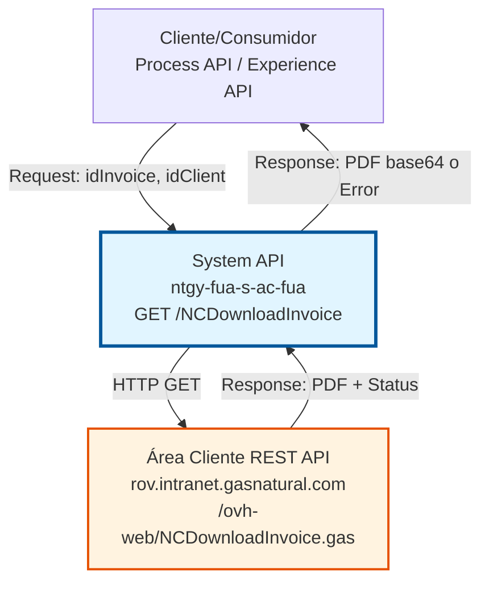
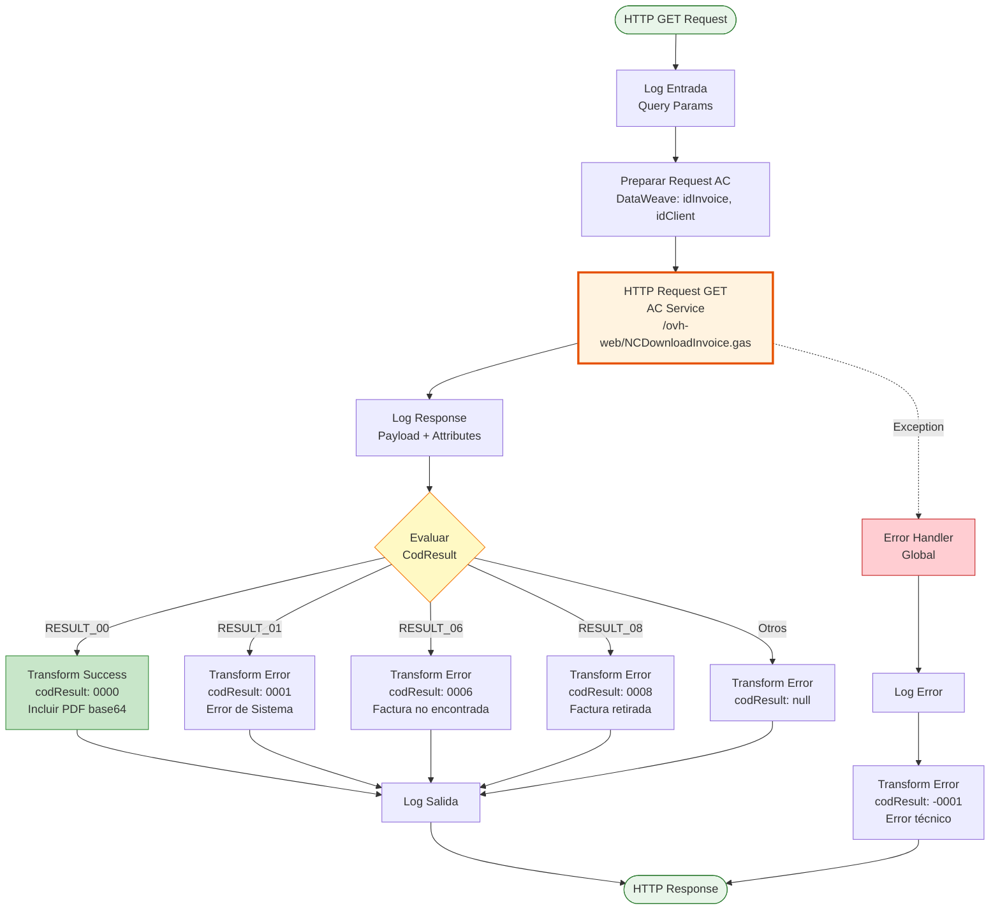
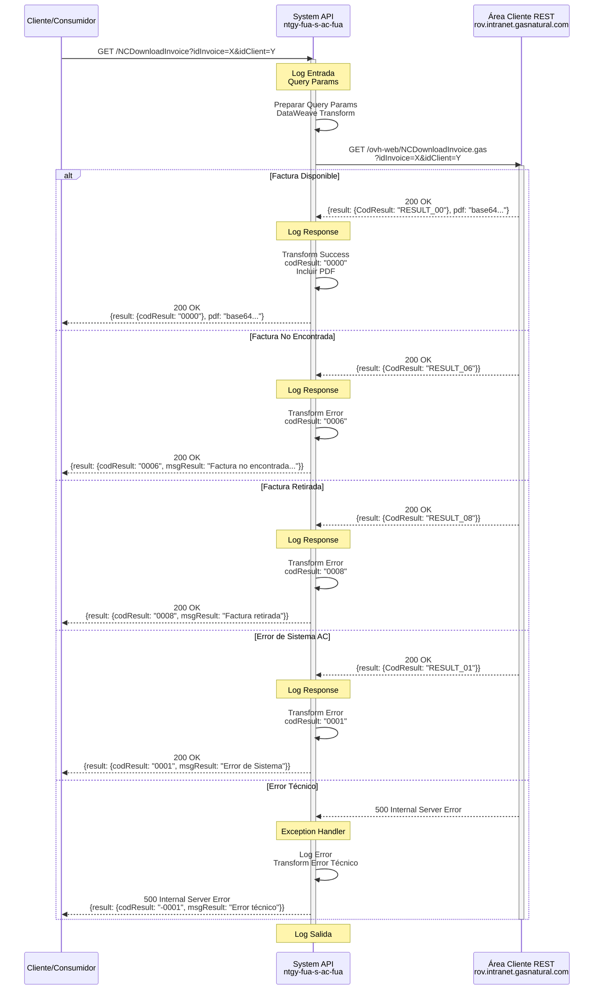

# GET /NCDownloadInvoice

## 📌 Descripción General

### Propósito del Endpoint

Este endpoint permite descargar el archivo PDF de una factura específica desde el sistema Área Cliente (AC) de Naturgy. Actúa como intermediario entre los consumidores (Process APIs, Experience APIs) y el servicio REST del Área Cliente, proporcionando acceso estandarizado a los documentos de facturación.

El endpoint soporta:
- **Descarga de PDF de Facturas**: Obtiene el documento PDF de una factura específica en formato base64
- **Validación de Permisos**: Verifica que el cliente tenga acceso a la factura solicitada
- **Manejo de Estados**: Gestiona diferentes estados de facturas (disponible, no encontrada, retirada)
- **Transformación de Respuestas**: Normaliza las respuestas del sistema AC a formato estándar

### Tipo de API

**Capa:** System API (API-Led Connectivity)

**Función:** Integración directa con el servicio REST del Área Cliente (AC) para descarga de documentos de facturación.

### Patrón de Integración

**Tipo:** Request-Reply Síncrono con REST API Externa

**Descripción:** El endpoint recibe una solicitud con el ID de factura y cliente, realiza una llamada HTTP GET al servicio AC, transforma la respuesta según el código de resultado, y retorna el PDF en base64 o un mensaje de error apropiado.

### Arquitectura API-Led Connectivity



---

## 💼 Propósito del Negocio

### Casos de Uso Principales

1. **Descarga de Factura para Cliente Final**
   - Un cliente accede a su portal web o app móvil
   - Solicita descargar una factura específica
   - El sistema valida permisos y retorna el PDF
   - **Beneficio:** Acceso inmediato a documentación fiscal

2. **Consulta de Factura por Agente de Atención**
   - Un agente de call center necesita revisar una factura con el cliente
   - Solicita la descarga usando el ID de factura y cliente
   - Obtiene el PDF para visualización o envío
   - **Beneficio:** Soporte eficiente al cliente

3. **Integración con Sistemas de Gestión Documental**
   - Un sistema de archivo documental necesita almacenar facturas
   - Solicita la descarga masiva de facturas
   - Almacena los PDFs para cumplimiento normativo
   - **Beneficio:** Cumplimiento de retención documental

### Contexto Empresarial

- **Dominio:** Gestión de Facturación y Documentación
- **Sector:** Energía - Utilities (Gas y Electricidad)
- **División:** Naturgy España - Área Cliente
- **Proceso de Negocio:** Consulta y descarga de documentación de facturación
- **Sistema Backend:** Área Cliente (AC) - Sistema de gestión de clientes y facturación

### Stakeholders

- **Clientes Finales**: Necesitan acceso a sus facturas para consulta, pago y archivo personal
- **Agentes de Atención al Cliente**: Requieren acceso rápido a facturas para soporte telefónico
- **Sistemas de Archivo**: Necesitan almacenar facturas para cumplimiento legal y auditoría
- **Equipo de Facturación**: Monitorea disponibilidad y acceso a documentos de facturación

### Valor de Negocio

- **Autoservicio Digital**: Reduce llamadas al call center al permitir descarga autónoma de facturas
- **Cumplimiento Normativo**: Facilita el cumplimiento de obligaciones de conservación documental
- **Experiencia de Cliente**: Mejora la satisfacción al proporcionar acceso inmediato a documentación
- **Eficiencia Operativa**: Reduce tiempo de atención al cliente en consultas de facturación

### Consumidores Potenciales

Este endpoint puede ser consumido por:
- Process APIs de facturación y gestión documental
- Experience APIs de portales web y aplicaciones móviles
- Sistemas de agentes de call center
- Plataformas de gestión documental y archivo
- Integraciones con sistemas de terceros autorizados

---

## 🔧 Especificación Técnica

### URLs por Ambiente

| Ambiente | URL Base | URL Completa |
|----------|----------|--------------|
| **Local** | `http://localhost:8081` | `http://localhost:8081/api/NCDownloadInvoice` |
| **Development** | `https://ntgy-fua-s-ac-fua-dev.us-e2.cloudhub.io` | `https://ntgy-fua-s-ac-fua-dev.us-e2.cloudhub.io/api/NCDownloadInvoice` |
| **Production** | `https://ntgy-fua-s-ac-fua-pro.us-e2.cloudhub.io` | `https://ntgy-fua-s-ac-fua-pro.us-e2.cloudhub.io/api/NCDownloadInvoice` |

### Método HTTP

```
GET /api/NCDownloadInvoice
```

### Parámetros de Entrada

#### Headers HTTP

| Header | Tipo | Requerido | Descripción | Ejemplo |
|--------|------|-----------|-------------|---------|
| `Accept` | string | ❌ No | Tipo de contenido esperado en response | `application/json` |

#### Query Parameters

| Parámetro | Tipo | Requerido | Descripción | Ejemplo |
|-----------|------|-----------|-------------|---------|
| `idInvoice` | string | ✅ Sí | Identificador único de la factura a descargar | `"12345678"` |
| `idClient` | string | ✅ Sí | Identificador del cliente propietario de la factura | `"87654321"` |

**Validaciones:**
- Ambos parámetros son obligatorios
- `idInvoice` debe ser un identificador válido de factura en el sistema AC
- `idClient` debe corresponder al propietario de la factura para validación de permisos

### Respuestas

#### Respuesta Exitosa (200 OK)

**Código de Resultado:** `0000`

```json
{
  "result": {
    "codResult": "0000",
    "msgResult": "No hay error"
  },
  "pdf": "JVBERi0xLjQKJeLjz9MKMyAwIG9iago8PC9UeXBlL1BhZ2UvUGFyZW50IDIgMCBSL1Jlc291cmNlczw8L0ZvbnQ8PC9GMSA1IDAgUj4+L1Byb2NTZXRbL1BERi9UZXh0L0ltYWdlQi9JbWFnZUMvSW1hZ2VJXT4+L01lZGlhQm94WzAgMCA1OTUuMzIgODQxLjkyXS9Db250ZW50cyA0IDAgUi9Hcm91cDw8L1R5cGUvR3JvdXAvUy9UcmFuc3BhcmVuY3kvQ1MvRGV2aWNlUkdCPj4vVGFicz..."
}
```

**Descripción de Campos:**
- `result.codResult`: Código de resultado `"0000"` indica éxito
- `result.msgResult`: Mensaje descriptivo del resultado
- `pdf`: Contenido del PDF codificado en base64

#### Respuesta de Error de Negocio - Error de Sistema (200 OK)

**Código de Resultado:** `0001`

```json
{
  "result": {
    "codResult": "0001",
    "msgResult": "Error de Sistema"
  }
}
```

**Descripción:** Error interno del sistema AC al procesar la solicitud.

#### Respuesta de Error de Negocio - Factura No Encontrada (200 OK)

**Código de Resultado:** `0006`

```json
{
  "result": {
    "codResult": "0006",
    "msgResult": "Factura no encontrada asociada al cliente"
  }
}
```

**Descripción:** La factura solicitada no existe o no está asociada al cliente especificado.

#### Respuesta de Error de Negocio - Factura Retirada (200 OK)

**Código de Resultado:** `0008`

```json
{
  "result": {
    "codResult": "0008",
    "msgResult": "Factura retirada"
  }
}
```

**Descripción:** La factura ha sido retirada del sistema y no está disponible para descarga.

#### Respuesta de Error Técnico (500 Internal Server Error)

**Código de Resultado:** `-0001`

```json
{
  "result": {
    "codResult": "-0001",
    "msgResult": "Error técnico"
  }
}
```

**Descripción:** Error técnico en la comunicación con el sistema AC o error interno del API.

### Códigos de Estado HTTP

| Código | Descripción | Escenario |
|--------|-------------|-----------|
| `200` | OK | Respuesta exitosa o error de negocio controlado |
| `400` | Bad Request | Parámetros faltantes o inválidos |
| `401` | Unauthorized | Credenciales inválidas o token expirado |
| `500` | Internal Server Error | Error técnico no controlado |

### Autenticación y Autorización

- **Tipo:** Client ID & Client Secret (Anypoint Platform)
- **Autorización AC:** El sistema AC valida internamente que:
  - El `idClient` tenga permisos para acceder a la factura
  - La factura exista y esté disponible
  - El cliente esté autorizado para descargar documentos

### Timeouts

| Tipo | Valor | Descripción |
|------|-------|-------------|
| **Request Timeout** | 15 segundos | Tiempo máximo de espera para la respuesta del AC |
| **Connection Timeout** | 15 segundos | Tiempo máximo para establecer conexión con AC |

---

## 🏗️ Implementación Técnica

### Arquitectura del Flow



### Diagrama de Secuencia Completo



### Transformación de Datos

#### Preparación de Query Parameters (Líneas 10-16)

```dataweave
%dw 2.0
output application/java
---
{
  "idInvoice": attributes.queryParams.idInvoice,
  "idClient": attributes.queryParams.idClient
}
```

**Propósito:** Extraer y pasar los query parameters al servicio AC.

#### Transformación de Respuesta Exitosa (Líneas 20-32)

```dataweave
%dw 2.0
output application/json
---
{
  result: {
    codResult: "0000",
    msgResult: "No hay error"
  },
  "pdf": payload.pdf default ""
}
```

**Propósito:** Normalizar respuesta exitosa del AC a formato estándar, incluyendo el PDF en base64.

**Lógica:**
- Mapea `RESULT_00` del AC a código `0000` (éxito)
- Extrae el campo `pdf` del payload del AC
- Usa `default ""` para manejar casos donde el PDF no esté presente

#### Transformación de Errores de Negocio (Líneas 35-54)

```dataweave
%dw 2.0
output application/json
---
{
  result: {
    codResult: payload.result.CodResult match {
      case "RESULT_01" -> "0001"
      case "RESULT_06" -> "0006"
      case "RESULT_08" -> "0008"
      else -> null
    },
    msgResult: payload.result.CodResult match {
      case "RESULT_01" -> "Error de Sistema"
      case "RESULT_06" -> "Factura no encontrada asociada al cliente"
      case "RESULT_08" -> "Factura retirada"
      else -> null
    }
  }
}
```

**Propósito:** Mapear códigos de error del AC a códigos estándar con mensajes descriptivos.

**Mapeo de Códigos:**
- `RESULT_01` → `0001`: Error interno del sistema AC
- `RESULT_06` → `0006`: Factura no existe o no pertenece al cliente
- `RESULT_08` → `0008`: Factura ha sido retirada del sistema
- Otros códigos → `null`: Códigos no reconocidos

#### Transformación de Error Técnico (Líneas 64-73)

```dataweave
%dw 2.0
output application/json
---
{
  "result": {
    "codResult": "-0001",
    "msgResult": "Error técnico"
  }
}
```

**Propósito:** Respuesta estándar para errores técnicos no controlados (excepciones, timeouts, errores de conexión).

### Configuración HTTP

#### HTTP Request Configuration (global.xml, líneas 16-22)

```xml
<http:request-config 
  name="HTTP_Request_configuration_AC" 
  responseTimeout="${ac.timeout}" 
  enableCookies="false">
  <http:request-connection 
    protocol="HTTPS" 
    host="${ac.host}" 
    port="${ac.port}" 
    connectionIdleTimeout="${ac.timeout}">
    <tls:context>
      <tls:trust-store 
        path="ntgy-fua-s-ac-fua-keystore.jks" 
        password="changeit" 
        type="jks" 
        insecure="true"/>
    </tls:context>
  </http:request-connection>
</http:request-config>
```

**Configuración de Producción (ntgy-fua-s-ac-fua-pro-config.yaml, líneas 22-33):**
- **Host:** `rov.intranet.gasnatural.com`
- **Port:** `443` (HTTPS)
- **Path:** `/ovh-web/NCDownloadInvoice.gas` (línea 28)
- **Timeout:** `15000` ms (15 segundos)
- **TLS:** Configurado con keystore para comunicación segura

#### HTTP Response Validator (Líneas 14-16)

```xml
<http:response-validator>
  <http:success-status-code-validator values="200,400,401" />
</http:response-validator>
```

**Propósito:** Considera como exitosos los códigos 200, 400 y 401 para permitir manejo personalizado de errores del AC.

### Manejo de Errores

#### Error Handler Global (Líneas 59-73)

```xml
<error-handler>
  <on-error-propagate enableNotifications="true" logException="true">
    <logger level="ERROR" 
      message='#["s-ac-NCDownloadInvoice.logErrorGenerico error: " ++ 
               error.description as String replace /\"/ with("")]' />
    <ee:transform>
      <ee:message>
        <ee:set-payload><![CDATA[
          %dw 2.0
          output application/json
          ---
          {
            "result": {
              "codResult": "-0001",
              "msgResult": "Error técnico"
            }
          }
        ]]></ee:set-payload>
      </ee:message>
    </ee:transform>
  </on-error-propagate>
</error-handler>
```

**Tipos de Errores Capturados:**
- **HTTP:TIMEOUT**: Timeout en la conexión con AC
- **HTTP:CONNECTIVITY**: Error de conectividad con AC
- **MULE:EXPRESSION**: Error en expresiones DataWeave
- **ANY**: Cualquier otro error no controlado

**Estrategia:**
1. Log del error con nivel ERROR
2. Transformación a respuesta estándar con código `-0001`
3. Propagación del error con respuesta formateada

### Logging

#### Puntos de Logging

1. **Log Entrada (Línea 9):**
   ```
   s-ac-NCDownloadInvoice.logEntrada #[attributes.queryParams]
   ```
   - Nivel: DEBUG
   - Contenido: Query parameters recibidos

2. **Log Response (Línea 18):**
   ```
   s-ac-NCDownloadInvoice.log ## payload: #[payload] attributes: #[attributes]
   ```
   - Nivel: DEBUG
   - Contenido: Payload y attributes de la respuesta del AC

3. **Log Salida (Líneas 56-57):**
   ```
   s-ac-NCDownloadInvoice.logSalida ## payload: #[payload] attributes: #[attributes]
   s-ac-NCDownloadInvoice.logSalida
   ```
   - Nivel: DEBUG
   - Contenido: Payload y attributes de la respuesta final

4. **Log Error (Línea 61):**
   ```
   s-ac-NCDownloadInvoice.logErrorGenerico error: [error.description]
   ```
   - Nivel: ERROR
   - Contenido: Descripción del error capturado

---

## 💻 Ejemplos de Uso

### Ejemplo 1: Descarga Exitosa de Factura

#### Request

```bash
curl -X GET "https://ntgy-fua-s-ac-fua-pro.us-e2.cloudhub.io/api/NCDownloadInvoice?idInvoice=12345678&idClient=87654321" \
  -H "Accept: application/json"
```

#### Response (200 OK)

```json
{
  "result": {
    "codResult": "0000",
    "msgResult": "No hay error"
  },
  "pdf": "JVBERi0xLjQKJeLjz9MKMyAwIG9iago8PC9UeXBlL1BhZ2UvUGFyZW50IDIgMCBSL1Jlc291cmNlczw8L0ZvbnQ8PC9GMSA1IDAgUj4+L1Byb2NTZXRbL1BERi9UZXh0L0ltYWdlQi9JbWFnZUMvSW1hZ2VJXT4+L01lZGlhQm94WzAgMCA1OTUuMzIgODQxLjkyXS9Db250ZW50cyA0IDAgUi9Hcm91cDw8L1R5cGUvR3JvdXAvUy9UcmFuc3BhcmVuY3kvQ1MvRGV2aWNlUkdCPj4vVGFicz..."
}
```

**Descripción:** La factura se descargó exitosamente. El campo `pdf` contiene el documento completo codificado en base64.

**Uso del PDF:**
```javascript
// Decodificar y descargar en navegador
const pdfBase64 = response.pdf;
const pdfBlob = base64ToBlob(pdfBase64, 'application/pdf');
const url = URL.createObjectURL(pdfBlob);
window.open(url);
```

### Ejemplo 2: Factura No Encontrada

#### Request

```bash
curl -X GET "https://ntgy-fua-s-ac-fua-pro.us-e2.cloudhub.io/api/NCDownloadInvoice?idInvoice=99999999&idClient=87654321" \
  -H "Accept: application/json"
```

#### Response (200 OK)

```json
{
  "result": {
    "codResult": "0006",
    "msgResult": "Factura no encontrada asociada al cliente"
  }
}
```

**Descripción:** La factura con ID `99999999` no existe en el sistema o no está asociada al cliente `87654321`.

**Manejo Recomendado:**
- Verificar que el `idInvoice` sea correcto
- Confirmar que el cliente tenga acceso a esa factura
- Mostrar mensaje al usuario indicando que la factura no está disponible

### Ejemplo 3: Factura Retirada

#### Request

```bash
curl -X GET "https://ntgy-fua-s-ac-fua-pro.us-e2.cloudhub.io/api/NCDownloadInvoice?idInvoice=11111111&idClient=87654321" \
  -H "Accept: application/json"
```

#### Response (200 OK)

```json
{
  "result": {
    "codResult": "0008",
    "msgResult": "Factura retirada"
  }
}
```

**Descripción:** La factura ha sido retirada del sistema y ya no está disponible para descarga.

**Manejo Recomendado:**
- Informar al usuario que la factura no está disponible
- Sugerir contactar con atención al cliente si necesita el documento
- Verificar si existe una versión alternativa o rectificativa

### Ejemplo 4: Error de Sistema AC

#### Request

```bash
curl -X GET "https://ntgy-fua-s-ac-fua-pro.us-e2.cloudhub.io/api/NCDownloadInvoice?idInvoice=12345678&idClient=87654321" \
  -H "Accept: application/json"
```

#### Response (200 OK)

```json
{
  "result": {
    "codResult": "0001",
    "msgResult": "Error de Sistema"
  }
}
```

**Descripción:** Error interno del sistema Área Cliente al procesar la solicitud.

**Manejo Recomendado:**
- Implementar retry con backoff exponencial (máximo 3 intentos)
- Si persiste, registrar el error y notificar al equipo de soporte
- Mostrar mensaje genérico al usuario y sugerir intentar más tarde

### Ejemplo 5: Error Técnico (Timeout)

#### Request

```bash
curl -X GET "https://ntgy-fua-s-ac-fua-pro.us-e2.cloudhub.io/api/NCDownloadInvoice?idInvoice=12345678&idClient=87654321" \
  -H "Accept: application/json"
```

#### Response (500 Internal Server Error)

```json
{
  "result": {
    "codResult": "-0001",
    "msgResult": "Error técnico"
  }
}
```

**Descripción:** Error técnico en la comunicación con el sistema AC (timeout, error de conexión, etc.).

**Causas Posibles:**
- Timeout en la conexión con AC (> 15 segundos)
- Error de red o conectividad
- Sistema AC no disponible
- Error interno del API

**Manejo Recomendado:**
- Implementar retry automático (máximo 3 intentos)
- Registrar el error para análisis
- Notificar al equipo de operaciones si el error persiste
- Mostrar mensaje al usuario sugiriendo intentar más tarde

### Ejemplo 6: Parámetros Faltantes

#### Request

```bash
curl -X GET "https://ntgy-fua-s-ac-fua-pro.us-e2.cloudhub.io/api/NCDownloadInvoice?idInvoice=12345678" \
  -H "Accept: application/json"
```

#### Response (400 Bad Request)

```json
{
  "message": "Bad request"
}
```

**Descripción:** Falta el parámetro requerido `idClient`.

**Validación:**
- Ambos parámetros `idInvoice` e `idClient` son obligatorios
- El API retorna 400 Bad Request si falta alguno

### Ejemplo 7: Uso en JavaScript/TypeScript

```typescript
// Función para descargar factura
async function downloadInvoice(idInvoice: string, idClient: string): Promise<void> {
  try {
    const response = await fetch(
      `https://ntgy-fua-s-ac-fua-pro.us-e2.cloudhub.io/api/NCDownloadInvoice?idInvoice=${idInvoice}&idClient=${idClient}`,
      {
        method: 'GET',
        headers: {
          'Accept': 'application/json'
        }
      }
    );

    const data = await response.json();

    if (data.result.codResult === '0000') {
      // Éxito - descargar PDF
      const pdfBase64 = data.pdf;
      const byteCharacters = atob(pdfBase64);
      const byteNumbers = new Array(byteCharacters.length);
      
      for (let i = 0; i < byteCharacters.length; i++) {
        byteNumbers[i] = byteCharacters.charCodeAt(i);
      }
      
      const byteArray = new Uint8Array(byteNumbers);
      const blob = new Blob([byteArray], { type: 'application/pdf' });
      const url = URL.createObjectURL(blob);
      
      // Abrir en nueva ventana o descargar
      window.open(url);
      
      // O forzar descarga
      const link = document.createElement('a');
      link.href = url;
      link.download = `factura_${idInvoice}.pdf`;
      link.click();
      
    } else if (data.result.codResult === '0006') {
      console.error('Factura no encontrada');
      alert('La factura solicitada no existe o no está asociada a este cliente');
      
    } else if (data.result.codResult === '0008') {
      console.error('Factura retirada');
      alert('La factura ha sido retirada del sistema');
      
    } else if (data.result.codResult === '0001') {
      console.error('Error de sistema AC');
      alert('Error del sistema. Por favor, intente más tarde');
      
    } else {
      console.error('Error técnico:', data.result.msgResult);
      alert('Error técnico. Por favor, contacte con soporte');
    }
    
  } catch (error) {
    console.error('Error en la petición:', error);
    alert('Error de conexión. Por favor, verifique su conexión a internet');
  }
}

// Uso
downloadInvoice('12345678', '87654321');
```

### Ejemplo 8: Uso en Python

```python
import requests
import base64
from typing import Dict, Optional

def download_invoice(id_invoice: str, id_client: str) -> Optional[bytes]:
    """
    Descarga una factura desde el API de Naturgy
    
    Args:
        id_invoice: ID de la factura
        id_client: ID del cliente
        
    Returns:
        Contenido del PDF en bytes o None si hay error
    """
    url = "https://ntgy-fua-s-ac-fua-pro.us-e2.cloudhub.io/api/NCDownloadInvoice"
    params = {
        "idInvoice": id_invoice,
        "idClient": id_client
    }
    headers = {
        "Accept": "application/json"
    }
    
    try:
        response = requests.get(url, params=params, headers=headers, timeout=30)
        response.raise_for_status()
        
        data = response.json()
        
        if data["result"]["codResult"] == "0000":
            # Éxito - decodificar PDF
            pdf_base64 = data["pdf"]
            pdf_bytes = base64.b64decode(pdf_base64)
            
            # Guardar archivo
            filename = f"factura_{id_invoice}.pdf"
            with open(filename, "wb") as f:
                f.write(pdf_bytes)
            
            print(f"Factura descargada: {filename}")
            return pdf_bytes
            
        elif data["result"]["codResult"] == "0006":
            print("Error: Factura no encontrada")
            return None
            
        elif data["result"]["codResult"] == "0008":
            print("Error: Factura retirada")
            return None
            
        elif data["result"]["codResult"] == "0001":
            print("Error: Error de sistema AC")
            return None
            
        else:
            print(f"Error técnico: {data['result']['msgResult']}")
            return None
            
    except requests.exceptions.Timeout:
        print("Error: Timeout en la petición")
        return None
        
    except requests.exceptions.RequestException as e:
        print(f"Error en la petición: {e}")
        return None
        
    except Exception as e:
        print(f"Error inesperado: {e}")
        return None

# Uso
pdf_content = download_invoice("12345678", "87654321")
if pdf_content:
    print(f"PDF descargado correctamente ({len(pdf_content)} bytes)")
```
