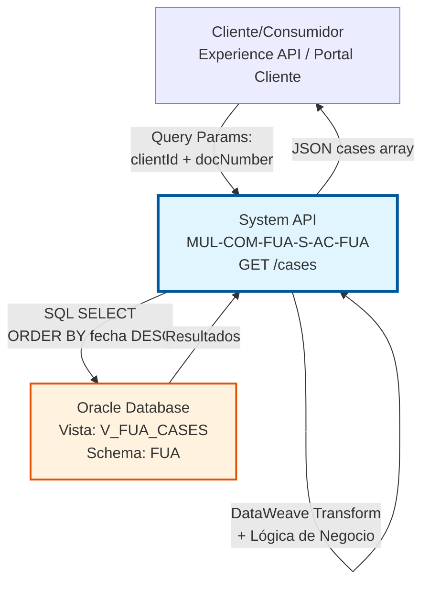
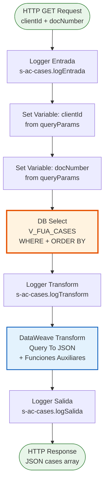
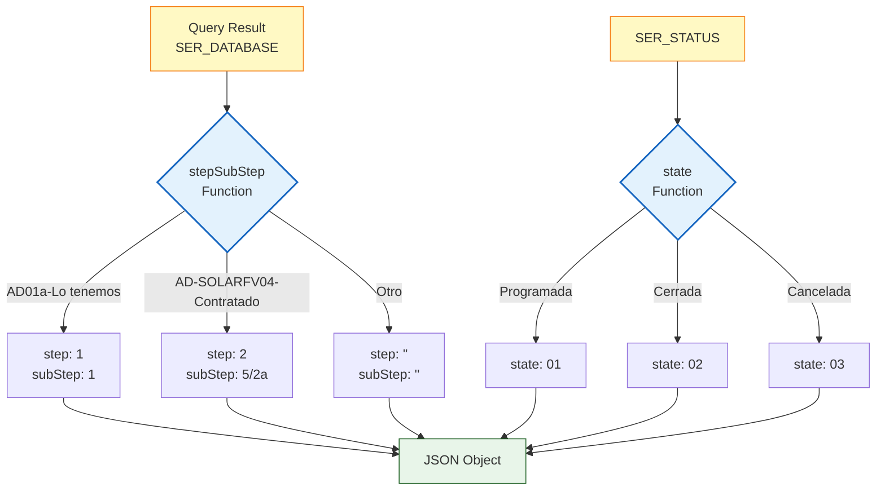

# GET /cases

## 📌 Descripción General

### Propósito del Endpoint

Este endpoint proporciona acceso a la información de casos y solicitudes de clientes almacenada en Oracle Database. Permite consultar el histórico completo de casos de un cliente específico, incluyendo información detallada sobre el estado, progreso y tipo de cada solicitud. Implementa lógica de negocio compleja para transformar códigos internos de base de datos en información estructurada de pasos y subpasos del proceso.

El endpoint soporta:
- **Consulta por Cliente y Documento**: Búsqueda mediante ID de cliente y número de documento
- **Histórico Completo**: Retorna todos los casos del cliente ordenados por fecha
- **Seguimiento de Progreso**: Información de pasos y subpasos del proceso
- **Múltiples Tipos de Casos**: Soporta casos de alta estándar y casos de instalación solar
- **Transformación de Estados**: Mapea estados descriptivos a códigos estandarizados
- **Lógica de Negocio Avanzada**: Funciones DataWeave para cálculo de progreso

### Tipo de API

**Capa:** System API (API-Led Connectivity)

**Función:** Integración directa con Oracle Database para consulta de casos de clientes con transformación avanzada de datos de negocio.

### Patrón de Integración

**Tipo:** Request-Reply Síncrono con Transformación Compleja

**Descripción:** El endpoint recibe ID de cliente y número de documento como query parameters, ejecuta una consulta SQL contra la vista `V_FUA_CASES` ordenada por fecha de creación descendente, aplica transformaciones DataWeave complejas con funciones auxiliares para calcular pasos y estados, y retorna una lista estructurada de casos en formato JSON.

### Arquitectura API-Led Connectivity



---

## 💼 Propósito del Negocio

### Casos de Uso Principales

1. **Seguimiento de Solicitudes de Alta de Cliente**
   - Cliente consulta el estado de su solicitud de alta de servicio
   - Sistema muestra progreso en pasos visuales (paso 1, 2, 3)
   - Cliente puede ver en qué fase se encuentra su solicitud
   - Proporciona transparencia en el proceso de alta

2. **Gestión de Casos de Instalación Solar**
   - Cliente con instalación solar fotovoltaica consulta progreso
   - Sistema muestra pasos específicos del proceso solar (9 subpasos)
   - Incluye fases: preoferta, visita, oferta, contratación, permisos, instalación
   - Cliente puede hacer seguimiento detallado de su instalación

3. **Histórico de Casos del Cliente**
   - Agente de atención al cliente consulta histórico completo
   - Visualiza todos los casos previos del cliente
   - Casos ordenados por fecha (más recientes primero)
   - Facilita resolución de consultas y seguimiento

4. **Identificación de Casos Activos vs Cerrados**
   - Sistema diferencia entre casos en progreso, cerrados y cancelados
   - Estados estandarizados: "01" (activo), "02" (cerrado), "03" (cancelado)
   - Permite filtrado y gestión de casos según estado
   - Facilita reportes y análisis de casos

### Contexto Empresarial

- **Dominio:** Gestión de Casos y Solicitudes de Clientes
- **Sector:** Energía - Utilities
- **División:** Naturgy España - Área Cliente (AC)
- **Proceso de Negocio:** Gestión de Altas de Clientes y Servicios Adicionales (Solar)
- **Fuente de Datos:** Oracle Database (Sistema de Gestión de Casos FUA)

### Stakeholders

- **Clientes Finales**: Necesitan consultar el estado de sus solicitudes y casos
- **Agentes de Atención al Cliente**: Requieren acceso al histórico de casos para soporte
- **Equipos de Ventas**: Consultan estado de procesos de alta en curso
- **Equipos de Instalación Solar**: Gestionan casos de instalaciones fotovoltaicas
- **Sistemas de Notificaciones**: Envían actualizaciones basadas en cambios de estado

### Valor de Negocio

- **Transparencia**: Cliente puede hacer seguimiento de sus solicitudes en tiempo real
- **Eficiencia Operativa**: Agentes acceden rápidamente al histórico de casos
- **Experiencia de Cliente**: Reduce llamadas de consulta sobre estado de solicitudes
- **Gestión de Procesos**: Facilita seguimiento de workflows complejos (solar)
- **Trazabilidad**: Mantiene histórico completo de interacciones con el cliente

### Consumidores Potenciales

Este endpoint puede ser consumido por:
- Experience APIs de portales de autoservicio de clientes
- Aplicaciones móviles de clientes
- Process APIs de gestión de casos
- Sistemas de CRM (Salesforce) para visualización de casos
- Aplicaciones de call center para soporte al cliente
- Sistemas de notificaciones automáticas

---

## 🔧 Especificación Técnica

### URLs por Ambiente

| Ambiente | URL Base | URL Completa |
|----------|----------|--------------|
| **Local** | `http://localhost:8081` | `http://localhost:8081/api/cases?clientId=12345&docNumber=12345678A` |
| **Development** | `https://mul-com-fua-s-ac-fua-dev.us-e2.cloudhub.io` | `https://mul-com-fua-s-ac-fua-dev.us-e2.cloudhub.io/api/cases?clientId=12345&docNumber=12345678A` |
| **UAT** | `https://mul-com-fua-s-ac-fua-uat.us-e2.cloudhub.io` | `https://mul-com-fua-s-ac-fua-uat.us-e2.cloudhub.io/api/cases?clientId=12345&docNumber=12345678A` |
| **Production** | `https://mul-com-fua-s-ac-fua-pro.us-e2.cloudhub.io` | `https://mul-com-fua-s-ac-fua-pro.us-e2.cloudhub.io/api/cases?clientId=12345&docNumber=12345678A` |

### Método HTTP

```
GET /api/cases
```

### Parámetros de Entrada

#### Headers HTTP

| Header | Tipo | Requerido | Descripción | Ejemplo |
|--------|------|-----------|-------------|---------|
| `Accept` | string | ❌ No | Tipo de contenido esperado en response | `application/json` |

#### Query Parameters

| Parámetro | Tipo | Requerido | Descripción | Ejemplo | Validación |
|-----------|------|-----------|-------------|---------|------------|
| `clientId` | string | ✅ Sí | Identificador único del cliente | `"12345"` | Numérico |
| `docNumber` | string | ✅ Sí | Número de documento del cliente (DNI/NIE) | `"12345678A"` | Alfanumérico |

**Nota:** Ambos parámetros son obligatorios y se usan en conjunto para identificar de forma única al cliente.

### Respuestas

#### Respuesta Exitosa (200 OK)

```json
{
  "result": {
    "codResult": "0000",
    "msgResult": "No hay error"
  },
  "cases": [
    {
      "caseId": "CASE-2024-001",
      "caseCode": "CASE-2024-001",
      "typeId": "ALTA_CLIENTE",
      "contractId": "",
      "state": "01",
      "contractAccountId": "",
      "startDate": "2024-01-15T10:30:00",
      "endDate": "",
      "channel": "WEB",
      "hasFiles": false,
      "isSva": "",
      "updateDate": "",
      "isCancelable": false,
      "addressId": "ADR-12345",
      "idDocumentum": "",
      "step": "2",
      "subStep": "2a"
    }
  ]
}
```

**Estructura de la Respuesta:**

| Campo | Tipo | Descripción |
|-------|------|-------------|
| `result` | object | Objeto con información del resultado de la operación |
| `result.codResult` | string | Código de resultado ("0000" = éxito) |
| `result.msgResult` | string | Mensaje descriptivo del resultado |
| `cases` | array | Lista de casos del cliente |
| `cases[].caseId` | string | Identificador único del caso |
| `cases[].caseCode` | string | Código del caso (mismo que caseId) |
| `cases[].typeId` | string | Tipo de solicitud/caso |
| `cases[].contractId` | string | ID del contrato asociado (vacío si no aplica) |
| `cases[].state` | string | Estado del caso: "01" (activo), "02" (cerrado), "03" (cancelado) |
| `cases[].contractAccountId` | string | ID de cuenta contrato (vacío si no aplica) |
| `cases[].startDate` | string | Fecha de creación del caso (ISO 8601) |
| `cases[].endDate` | string | Fecha de finalización (vacío si no finalizado) |
| `cases[].channel` | string | Canal de origen del caso (WEB, TELEFONO, etc.) |
| `cases[].hasFiles` | boolean | Indica si el caso tiene archivos adjuntos |
| `cases[].isSva` | string | Indica si es servicio de valor añadido |
| `cases[].updateDate` | string | Fecha de última actualización |
| `cases[].isCancelable` | boolean | Indica si el caso puede ser cancelado |
| `cases[].addressId` | string | ID de la dirección asociada |
| `cases[].idDocumentum` | string | ID en sistema documental |
| `cases[].step` | string | Paso actual del proceso (calculado) |
| `cases[].subStep` | string | Subpaso actual del proceso (calculado) |

**Campos Calculados:**
- `step` y `subStep`: Calculados dinámicamente según el código de base de datos
- `state`: Transformado de estado descriptivo a código numérico

#### Respuesta con Múltiples Casos (200 OK)

```json
{
  "result": {
    "codResult": "0000",
    "msgResult": "No hay error"
  },
  "cases": [
    {
      "caseId": "CASE-2024-002",
      "caseCode": "CASE-2024-002",
      "typeId": "SOLAR_FV",
      "contractId": "",
      "state": "01",
      "contractAccountId": "",
      "startDate": "2024-02-20T14:15:00",
      "endDate": "",
      "channel": "TELEFONO",
      "hasFiles": false,
      "isSva": "",
      "updateDate": "",
      "isCancelable": false,
      "addressId": "ADR-67890",
      "idDocumentum": "",
      "step": "3",
      "subStep": "6/3a"
    },
    {
      "caseId": "CASE-2024-001",
      "caseCode": "CASE-2024-001",
      "typeId": "ALTA_CLIENTE",
      "contractId": "",
      "state": "02",
      "contractAccountId": "",
      "startDate": "2024-01-15T10:30:00",
      "endDate": "",
      "channel": "WEB",
      "hasFiles": false,
      "isSva": "",
      "updateDate": "",
      "isCancelable": false,
      "addressId": "ADR-12345",
      "idDocumentum": "",
      "step": "3",
      "subStep": "3a"
    }
  ]
}
```

**Nota:** Los casos se retornan ordenados por fecha de creación descendente (más recientes primero).

#### Respuesta sin Resultados (200 OK)

```json
{
  "result": {
    "codResult": "0000",
    "msgResult": "No hay error"
  },
  "cases": []
}
```

#### Respuesta de Error Técnico (400 Bad Request)

```json
{
  "result": {
    "codResult": "0001",
    "msgResult": "Parámetros clientId y docNumber son requeridos"
  }
}
```

#### Respuesta de Error Técnico (500 Internal Server Error)

```json
{
  "result": {
    "codResult": "0002",
    "msgResult": "Error al consultar base de datos"
  }
}
```

### Autenticación y Autorización

- **Tipo:** Client ID & Client Secret (Anypoint Platform)
- **Autorización Oracle:** El usuario de base de datos debe tener permisos para:
  - Ejecutar SELECT sobre la vista `V_FUA_CASES`
  - Acceso de lectura al schema `FUA`

### Timeouts

| Tipo | Valor | Descripción |
|------|-------|-------------|
| **Query Timeout** | Configurado en `${dbAC.queryTimeout}` | Tiempo máximo de espera para la consulta SQL |
| **Connection Timeout** | 10 segundos | Tiempo máximo para establecer conexión con Oracle |

---

## 🏗️ Implementación Técnica

### Arquitectura del Flow



### Componentes del Flow

#### 1. Logger de Entrada
```xml
<logger level="INFO" doc:name="Logger Entrada" 
        message="s-ac-cases.logEntrada ## payload: #[payload]"/>
```
- **Propósito:** Registra el inicio de la ejecución del flow
- **Nivel:** INFO
- **Contenido:** Payload de entrada (query parameters)

#### 2. Set Variables - Extracción de Parámetros

```xml
<set-variable value='#[attributes.queryParams["clientId"]]' 
              doc:name="clientNumber" 
              variableName="clientId"/>

<set-variable value='#[attributes.queryParams["docNumber"]]' 
              doc:name="docNumber" 
              variableName="docNumber"/>
```

- **Propósito:** Extrae los query parameters y los almacena en variables
- **Variables creadas:**
  - `clientId`: ID del cliente
  - `docNumber`: Número de documento

#### 3. Database Select - Consulta SQL

```xml
<db:select doc:name="Select" 
           config-ref="Database_Config" 
           queryTimeout="${dbAC.queryTimeout}">
    <db:sql><![CDATA[
        SELECT * FROM V_FUA_CASES 
        WHERE CLI_DOCUMENT = :docNumber 
        AND CLI_CLIENT_ID = :clientId 
        ORDER BY SER_CREATION_DATE DESC
    ]]></db:sql>
    <db:input-parameters><![CDATA[
        #[{
            'docNumber': vars.docNumber,
            'clientId': vars.clientId
        }]
    ]]></db:input-parameters>
</db:select>
```

**Detalles de la Consulta:**
- **Vista:** `V_FUA_CASES`
- **Filtros:** 
  - `CLI_DOCUMENT = :docNumber`
  - `CLI_CLIENT_ID = :clientId`
- **Ordenamiento:** `ORDER BY SER_CREATION_DATE DESC` (más recientes primero)
- **Timeout:** Configurado mediante property `${dbAC.queryTimeout}`

**Estructura de la Vista:**

| Campo Oracle | Tipo | Descripción |
|--------------|------|-------------|
| `SER_CODE` | VARCHAR2 | Código único del caso |
| `SRT_SR_CODE` | VARCHAR2 | Tipo de solicitud |
| `SER_STATUS` | VARCHAR2 | Estado descriptivo del caso |
| `SER_CREATION_DATE` | TIMESTAMP | Fecha de creación |
| `SER_CHANNEL` | VARCHAR2 | Canal de origen |
| `SER_SUPPLY_ID` | VARCHAR2 | ID del punto de suministro |
| `ADR_ADDRESS_ID` | VARCHAR2 | ID de la dirección |
| `SER_DATABASE` | VARCHAR2 | Código de base de datos (para step/subStep) |
| `CLI_DOCUMENT` | VARCHAR2 | Número de documento del cliente |
| `CLI_CLIENT_ID` | VARCHAR2 | ID del cliente |

#### 4. Logger Transform
```xml
<logger level="DEBUG" doc:name="Logger Transform" 
        message="s-ac-cases.logTransform"/>
```
- **Propósito:** Registra el punto antes de la transformación
- **Nivel:** DEBUG

#### 5. DataWeave Transformation - Query To JSON con Lógica de Negocio

Esta es la transformación más compleja del endpoint, con 4 funciones auxiliares:

##### Función 1: step()
```dataweave
fun step(aString) = 
    ((aString splitBy ("-")) filter (value, index) -> (value contains (/[0-9]/)))[0] 
    splitBy ("0")
```
**Propósito:** Extrae el número de paso de un string
**Ejemplo:** `"AD01a-Lo tenemos"` → extrae `"1"`

##### Función 2: subStep()
```dataweave
fun subStep(aString) = 
    if (sizeOf(aString splitBy ("-")) >= 3) 
        (aString splitBy ("-"))[0] ++ "-" ++ (aString splitBy ("-"))[1] 
    else 
        (aString splitBy ("-"))[0]
```
**Propósito:** Extrae el código de subpaso
**Ejemplo:** `"AD01a-Lo-tenemos"` → `"AD01a-Lo"`

##### Función 3: stepSubStep()
```dataweave
fun stepSubStep(aString) = aString match {
    case literalMatch: "AD01a-Lo tenemos" -> {"step": "1","subStep": "1"}
    case literalMatch: "AD01b-A un paso de ser cliente" -> {"step": "1","subStep": "1"}
    case literalMatch: "AD02a-Empezamos" -> {"step": "2","subStep": "2a"}
    case literalMatch: "AD02b-Vamos con retraso" -> {"step": "2","subStep": "2b"}
    case literalMatch: "AD03a-Fin" -> {"step": "3","subStep": "3a"}
    case literalMatch: "AD03b-Queremos contactar" -> {"step": "3","subStep": "3b"}
    case literalMatch: "AD03C-Gracias" -> {"step": "3","subStep": "3c"}
    case literalMatch: "AD-SOLARFV00-Lo tenemos" -> {"step": "1","subStep": "1/1a"}
    case literalMatch: "AD-SOLARFV01-Preoferta" -> {"step": "1","subStep": "2/1b"}
    case literalMatch: "AD-SOLARFV02-Visita en curso" -> {"step": "1","subStep": "3/1c"}
    case literalMatch: "AD-SOLARFV03-Oferta definitiva" -> {"step": "1","subStep": "4/1d"}
    case literalMatch: "AD-SOLARFV04-Contratado" -> {"step": "2","subStep": "5/2a"}
    case literalMatch: "AD-SOLARFV05-Permisos en curso" -> {"step": "3","subStep": "6/3a"}
    case literalMatch: "AD-SOLARFV06-Placas en camino" -> {"step": "3","subStep": "7/3b"}
    case literalMatch: "AD-SOLARFV07a-Inst. Finalizada" -> {"step": "4","subStep": "8/4a"}
    case literalMatch: "AD-SOLARFV07b-Gracias" -> {"step": "4","subStep": "9/4a"}
    else -> {"step": "","subStep": ""}
}
```

**Propósito:** Mapea códigos de base de datos a pasos y subpasos del proceso

**Tabla Completa de Mapeo:**

| Código Base de Datos | Step | SubStep | Descripción | Tipo de Proceso |
|----------------------|------|---------|-------------|-----------------|
| `AD01a-Lo tenemos` | 1 | 1 | Solicitud recibida | Alta Estándar |
| `AD01b-A un paso de ser cliente` | 1 | 1 | Casi cliente | Alta Estándar |
| `AD02a-Empezamos` | 2 | 2a | Proceso iniciado | Alta Estándar |
| `AD02b-Vamos con retraso` | 2 | 2b | Proceso con retraso | Alta Estándar |
| `AD03a-Fin` | 3 | 3a | Proceso finalizado | Alta Estándar |
| `AD03b-Queremos contactar` | 3 | 3b | Pendiente contacto | Alta Estándar |
| `AD03C-Gracias` | 3 | 3c | Proceso completado | Alta Estándar |
| `AD-SOLARFV00-Lo tenemos` | 1 | 1/1a | Solicitud solar recibida | Solar FV |
| `AD-SOLARFV01-Preoferta` | 1 | 2/1b | Preoferta generada | Solar FV |
| `AD-SOLARFV02-Visita en curso` | 1 | 3/1c | Visita técnica en curso | Solar FV |
| `AD-SOLARFV03-Oferta definitiva` | 1 | 4/1d | Oferta definitiva | Solar FV |
| `AD-SOLARFV04-Contratado` | 2 | 5/2a | Contrato firmado | Solar FV |
| `AD-SOLARFV05-Permisos en curso` | 3 | 6/3a | Tramitación permisos | Solar FV |
| `AD-SOLARFV06-Placas en camino` | 3 | 7/3b | Material en tránsito | Solar FV |
| `AD-SOLARFV07a-Inst. Finalizada` | 4 | 8/4a | Instalación completada | Solar FV |
| `AD-SOLARFV07b-Gracias` | 4 | 9/4a | Proceso finalizado | Solar FV |

**Patrones Identificados:**
- **Alta Estándar (AD):** 3 pasos principales con subpasos a, b, c
- **Solar FV (AD-SOLARFV):** 4 pasos principales con 9 subpasos detallados
- **Caso por defecto:** Retorna step y subStep vacíos si no coincide

##### Función 4: state()
```dataweave
fun state(astring) = 
    if(astring == "Programada" 
        or astring == "Enviada a Campo" 
        or astring == "Enviada a BackOffice"
    ) "01" 
    else if (astring == "Cerrada") "02" 
    else if (astring == "Cancelada") "03" 
    else astring
```

**Propósito:** Transforma estados descriptivos a códigos numéricos

**Mapeo de Estados:**

| Estado Descriptivo | Código | Significado |
|-------------------|--------|-------------|
| `Programada` | `01` | Caso activo/en progreso |
| `Enviada a Campo` | `01` | Caso activo/en progreso |
| `Enviada a BackOffice` | `01` | Caso activo/en progreso |
| `Cerrada` | `02` | Caso finalizado |
| `Cancelada` | `03` | Caso cancelado |
| Otros | Sin cambio | Mantiene valor original |

##### Transformación Principal

```dataweave
%dw 2.0
output application/json
---
{
    result: {
        codResult: "0000",
        msgResult: "No hay error"
    },
    cases: payload map (payload01, indexOfPayload01) -> {
        caseId: payload01.SER_CODE,
        caseCode: payload01.SER_CODE,
        typeId: payload01.SRT_SR_CODE default "",
        contractId: "",
        state: state(payload01.SER_STATUS),
        contractAccountId: "",
        startDate: payload01.SER_CREATION_DATE default "",
        endDate: "",
        channel: payload01.SER_CHANNEL default "",
        hasFiles: false,
        isSva: "",
        updateDate: "",
        isCancelable: false,
        addressId: payload01.SER_SUPPLY_ID default "",
        idDocumentum: "",
        hasFiles: false,
        addressId: payload01.ADR_ADDRESS_ID default ""
    } ++ stepSubStep(payload01.SER_DATABASE)
}
```

**Mapeo de Campos:**

| Campo Oracle | Campo JSON | Transformación |
|--------------|------------|----------------|
| `SER_CODE` | `caseId` | Directo |
| `SER_CODE` | `caseCode` | Directo (duplicado) |
| `SRT_SR_CODE` | `typeId` | Con default "" |
| N/A | `contractId` | Vacío (hardcoded) |
| `SER_STATUS` | `state` | Función `state()` |
| N/A | `contractAccountId` | Vacío (hardcoded) |
| `SER_CREATION_DATE` | `startDate` | Con default "" |
| N/A | `endDate` | Vacío (hardcoded) |
| `SER_CHANNEL` | `channel` | Con default "" |
| N/A | `hasFiles` | false (hardcoded) |
| N/A | `isSva` | Vacío (hardcoded) |
| N/A | `updateDate` | Vacío (hardcoded) |
| N/A | `isCancelable` | false (hardcoded) |
| `SER_SUPPLY_ID` | `addressId` | Con default "" (primera vez) |
| N/A | `idDocumentum` | Vacío (hardcoded) |
| `ADR_ADDRESS_ID` | `addressId` | Con default "" (sobrescribe) |
| `SER_DATABASE` | `step` + `subStep` | Función `stepSubStep()` |

**Nota sobre addressId:** El campo se define dos veces, la segunda definición sobrescribe la primera.

**Operador ++:** Combina el objeto base con el resultado de `stepSubStep()`, añadiendo los campos `step` y `subStep` dinámicamente.

#### 6. Logger de Salida
```xml
<logger level="INFO" doc:name="Logger Salida" 
        message="s-ac-cases.logSalida ## payload: #[payload]"/>
```
- **Propósito:** Registra la respuesta final del flow
- **Nivel:** INFO
- **Contenido:** Payload transformado (JSON response)

### Diagrama de Transformación de Datos



### Configuración de Base de Datos

**Database Config Reference:** `Database_Config`

```xml
<db:config name="Database_Config">
    <db:oracle-connection 
        host="${dbAC.host}" 
        port="${dbAC.port}" 
        user="${dbAC.user}" 
        password="${dbAC.password}" 
        serviceName="${dbAC.serviceName}"/>
</db:config>
```

**Properties Utilizadas:**
- `${dbAC.host}` - Host del servidor Oracle
- `${dbAC.port}` - Puerto de conexión (típicamente 1521)
- `${dbAC.user}` - Usuario de base de datos
- `${dbAC.password}` - Contraseña (encriptada)
- `${dbAC.serviceName}` - Nombre del servicio Oracle
- `${dbAC.queryTimeout}` - Timeout para queries SQL

### Manejo de Errores

El flow implementa manejo de errores estándar de MuleSoft:

1. **Error de Conexión a BD:**
   - Se captura mediante error handler global
   - Retorna código 500 con mensaje de error técnico

2. **Error de Query SQL:**
   - Se captura mediante error handler
   - Retorna código 500 con detalles del error

3. **Parámetros Faltantes:**
   - Si `clientId` o `docNumber` no están presentes
   - Las variables serán null y la query fallará
   - Validación debe implementarse en capa superior

4. **Sin Resultados:**
   - No es un error, retorna lista vacía `cases: []`
   - Código de resultado sigue siendo "0000"

### Consideraciones de Performance

- **Ordenamiento:** Query ordenada por fecha descendente puede ser costosa
- **Índices Recomendados:**
  - Índice compuesto en `(CLI_CLIENT_ID, CLI_DOCUMENT, SER_CREATION_DATE)`
  - Mejora performance de filtrado y ordenamiento
- **Volumen:** Típicamente retorna 1-10 casos por cliente
- **Caché:** Considerar caché de corta duración para casos cerrados
- **Transformación Compleja:** Las funciones DataWeave añaden overhead mínimo

### Logging

El flow implementa logging en 3 puntos:

1. **Entrada:** Registra query parameters recibidos
2. **Transform:** Marca el punto antes de transformación (DEBUG)
3. **Salida:** Registra respuesta JSON final

---

## 💻 Ejemplos de Uso

### Ejemplo 1: Consulta de Casos de Cliente

#### Request

```bash
curl -X GET "https://mul-com-fua-s-ac-fua-dev.us-e2.cloudhub.io/api/cases?clientId=12345&docNumber=12345678A" \
  -H "Accept: application/json" \
  -H "client_id: YOUR_CLIENT_ID" \
  -H "client_secret: YOUR_CLIENT_SECRET"
```

#### Response (200 OK) - Alta Estándar

```json
{
  "result": {
    "codResult": "0000",
    "msgResult": "No hay error"
  },
  "cases": [
    {
      "caseId": "CASE-2024-001",
      "caseCode": "CASE-2024-001",
      "typeId": "ALTA_CLIENTE",
      "contractId": "",
      "state": "01",
      "contractAccountId": "",
      "startDate": "2024-01-15T10:30:00",
      "endDate": "",
      "channel": "WEB",
      "hasFiles": false,
      "isSva": "",
      "updateDate": "",
      "isCancelable": false,
      "addressId": "ADR-12345",
      "idDocumentum": "",
      "step": "2",
      "subStep": "2a"
    }
  ]
}
```

### Ejemplo 2: Caso de Instalación Solar

#### Request

```bash
curl -X GET "https://mul-com-fua-s-ac-fua-dev.us-e2.cloudhub.io/api/cases?clientId=67890&docNumber=98765432B" \
  -H "Accept: application/json" \
  -H "client_id: YOUR_CLIENT_ID" \
  -H "client_secret: YOUR_CLIENT_SECRET"
```

#### Response (200 OK) - Solar FV

```json
{
  "result": {
    "codResult": "0000",
    "msgResult": "No hay error"
  },
  "cases": [
    {
      "caseId": "SOLAR-2024-045",
      "caseCode": "SOLAR-2024-045",
      "typeId": "INSTALACION_SOLAR",
      "contractId": "",
      "state": "01",
      "contractAccountId": "",
      "startDate": "2024-02-20T14:15:00",
      "endDate": "",
      "channel": "TELEFONO",
      "hasFiles": false,
      "isSva": "",
      "updateDate": "",
      "isCancelable": false,
      "addressId": "ADR-67890",
      "idDocumentum": "",
      "step": "3",
      "subStep": "6/3a"
    }
  ]
}
```

**Interpretación del Progreso Solar:**
- **Step 3:** Fase de permisos e instalación
- **SubStep 6/3a:** "Permisos en curso" - Tramitación de permisos administrativos

### Ejemplo 3: Múltiples Casos (Histórico)

#### Request

```bash
curl -X GET "https://mul-com-fua-s-ac-fua-dev.us-e2.cloudhub.io/api/cases?clientId=11111&docNumber=11111111C" \
  -H "Accept: application/json" \
  -H "client_id: YOUR_CLIENT_ID" \
  -H "client_secret: YOUR_CLIENT_SECRET"
```

#### Response (200 OK) - Histórico Completo

```json
{
  "result": {
    "codResult": "0000",
    "msgResult": "No hay error"
  },
  "cases": [
    {
      "caseId": "CASE-2024-150",
      "caseCode": "CASE-2024-150",
      "typeId": "CAMBIO_TITULAR",
      "contractId": "",
      "state": "01",
      "contractAccountId": "",
      "startDate": "2024-03-10T09:00:00",
      "endDate": "",
      "channel": "WEB",
      "hasFiles": false,
      "isSva": "",
      "updateDate": "",
      "isCancelable": false,
      "addressId": "ADR-11111",
      "idDocumentum": "",
      "step": "1",
      "subStep": "1"
    },
    {
      "caseId": "CASE-2024-100",
      "caseCode": "CASE-2024-100",
      "typeId": "ALTA_CLIENTE",
      "contractId": "",
      "state": "02",
      "contractAccountId": "",
      "startDate": "2024-01-05T11:20:00",
      "endDate": "",
      "channel": "PRESENCIAL",
      "hasFiles": false,
      "isSva": "",
      "updateDate": "",
      "isCancelable": false,
      "addressId": "ADR-11111",
      "idDocumentum": "",
      "step": "3",
      "subStep": "3a"
    }
  ]
}
```

**Nota:** Casos ordenados por fecha descendente (más reciente primero).

### Ejemplo 4: Sin Resultados

#### Request

```bash
curl -X GET "https://mul-com-fua-s-ac-fua-dev.us-e2.cloudhub.io/api/cases?clientId=99999&docNumber=99999999Z" \
  -H "Accept: application/json" \
  -H "client_id: YOUR_CLIENT_ID" \
  -H "client_secret: YOUR_CLIENT_SECRET"
```

#### Response (200 OK)

```json
{
  "result": {
    "codResult": "0000",
    "msgResult": "No hay error"
  },
  "cases": []
}
```

### Ejemplo 5: Error - Parámetros Faltantes

#### Request

```bash
curl -X GET "https://mul-com-fua-s-ac-fua-dev.us-e2.cloudhub.io/api/cases?clientId=12345" \
  -H "Accept: application/json" \
  -H "client_id: YOUR_CLIENT_ID" \
  -H "client_secret: YOUR_CLIENT_SECRET"
```

#### Response (400 Bad Request)

```json
{
  "result": {
    "codResult": "0001",
    "msgResult": "Parámetro docNumber es requerido"
  }
}
```

### Ejemplo 6: Uso desde JavaScript

```javascript
class CasesClient {
  constructor(baseUrl, clientId, clientSecret) {
    this.baseUrl = baseUrl;
    this.clientId = clientId;
    this.clientSecret = clientSecret;
  }

  async getCases(clientId, docNumber) {
    const url = `${this.baseUrl}/cases?clientId=${clientId}&docNumber=${encodeURIComponent(docNumber)}`;
    
    try {
      const response = await fetch(url, {
        method: 'GET',
        headers: {
          'Accept': 'application/json',
          'client_id': this.clientId,
          'client_secret': this.clientSecret
        }
      });

      if (!response.ok) {
        throw new Error(`HTTP error! status: ${response.status}`);
      }

      const data = await response.json();
      
      if (data.result.codResult === "0000") {
        return data.cases;
      } else {
        throw new Error(data.result.msgResult);
      }
    } catch (error) {
      console.error('Error al consultar casos:', error);
      throw error;
    }
  }

  formatCaseProgress(caseItem) {
    const stateNames = {
      '01': 'En Progreso',
      '02': 'Cerrado',
      '03': 'Cancelado'
    };

    return {
      id: caseItem.caseId,
      type: caseItem.typeId,
      state: stateNames[caseItem.state] || caseItem.state,
      progress: `Paso ${caseItem.step} - ${caseItem.subStep}`,
      date: new Date(caseItem.startDate).toLocaleDateString('es-ES'),
      channel: caseItem.channel
    };
  }

  async displayCases(clientId, docNumber) {
    try {
      const cases = await this.getCases(clientId, docNumber);
      
      console.log(`Encontrados ${cases.length} casos:`);
      cases.forEach(caseItem => {
        const formatted = this.formatCaseProgress(caseItem);
        console.log(`
          ID: ${formatted.id}
          Tipo: ${formatted.type}
          Estado: ${formatted.state}
          Progreso: ${formatted.progress}
          Fecha: ${formatted.date}
          Canal: ${formatted.channel}
        `);
      });
      
      return cases;
    } catch (error) {
      console.error('Error:', error.message);
      return [];
    }
  }
}

// Uso
const client = new CasesClient(
  'https://mul-com-fua-s-ac-fua-pro.us-e2.cloudhub.io/api',
  'YOUR_CLIENT_ID',
  'YOUR_CLIENT_SECRET'
);

client.displayCases('12345', '12345678A');
```

### Ejemplo 7: Uso desde Python

```python
import requests
from typing import List, Dict, Optional
from datetime import datetime

class CasesClient:
    """Cliente para consulta de casos de clientes"""
    
    STATE_NAMES = {
        '01': 'En Progreso',
        '02': 'Cerrado',
        '03': 'Cancelado'
    }
    
    def __init__(self, base_url: str, client_id: str, client_secret: str):
        self.base_url = base_url
        self.session = requests.Session()
        self.session.headers.update({
            'Accept': 'application/json',
            'client_id': client_id,
            'client_secret': client_secret
        })
    
    def get_cases(self, client_id: str, doc_number: str) -> List[Dict]:
        """
        Obtiene los casos de un cliente
        
        Args:
            client_id: ID del cliente
            doc_number: Número de documento (DNI/NIE)
            
        Returns:
            Lista de casos del cliente
            
        Raises:
            requests.exceptions.RequestException: Si hay error en la petición
            ValueError: Si la respuesta indica error
        """
        url = f"{self.base_url}/cases"
        params = {
            'clientId': client_id,
            'docNumber': doc_number
        }
        
        response = self.session.get(url, params=params)
        response.raise_for_status()
        
        data = response.json()
        
        if data['result']['codResult'] == "0000":
            return data['cases']
        else:
            raise ValueError(f"Error: {data['result']['msgResult']}")
    
    def format_case(self, case: Dict) -> str:
        """Formatea un caso para mostrar"""
        state = self.STATE_NAMES.get(case['state'], case['state'])
        date = datetime.fromisoformat(case['startDate'].replace('Z', '+00:00'))
        
        return f"""
        ID: {case['caseId']}
        Tipo: {case['typeId']}
        Estado: {state}
        Progreso: Paso {case['step']} - {case['subStep']}
        Fecha: {date.strftime('%d/%m/%Y %H:%M')}
        Canal: {case['channel']}
        """
    
    def get_active_cases(self, client_id: str, doc_number: str) -> List[Dict]:
        """Obtiene solo los casos activos (estado 01)"""
        all_cases = self.get_cases(client_id, doc_number)
        return [case for case in all_cases if case['state'] == '01']
    
    def get_solar_cases(self, client_id: str, doc_number: str) -> List[Dict]:
        """Obtiene solo los casos de instalación solar"""
        all_cases = self.get_cases(client_id, doc_number)
        return [case for case in all_cases if '/' in case.get('subStep', '')]

# Uso
if __name__ == "__main__":
    client = CasesClient(
        base_url="https://mul-com-fua-s-ac-fua-pro.us-e2.cloudhub.io/api",
        client_id="YOUR_CLIENT_ID",
        client_secret="YOUR_CLIENT_SECRET"
    )
    
    try:
        # Obtener todos los casos
        cases = client.get_cases("12345", "12345678A")
        print(f"Total de casos: {len(cases)}")
        
        for case in cases:
            print(client.format_case(case))
        
        # Obtener solo casos activos
        active = client.get_active_cases("12345", "12345678A")
        print(f"\nCasos activos: {len(active)}")
        
        # Obtener solo casos solares
        solar = client.get_solar_cases("12345", "12345678A")
        print(f"Casos solares: {len(solar)}")
        
    except Exception as e:
        print(f"Error: {e}")
```

### Notas de Implementación

1. **Interpretación de Progreso:**
   - **Alta Estándar:** 3 pasos (1, 2, 3) con subpasos alfabéticos
   - **Solar FV:** 4 pasos con subpasos numéricos (formato: número/letra)
   - **Paso vacío:** Indica código de base de datos no reconocido

2. **Estados de Casos:**
   - **"01":** Caso activo, en progreso
   - **"02":** Caso cerrado, completado
   - **"03":** Caso cancelado
   - Otros valores se mantienen sin transformar

3. **Ordenamiento:**
   - Casos siempre ordenados por fecha descendente
   - Caso más reciente aparece primero
   - Útil para mostrar estado actual al cliente

4. **Campos Vacíos:**
   - Varios campos retornan vacíos (contractId, endDate, etc.)
   - Preparados para futuras extensiones
   - No deben usarse para lógica de negocio actual

5. **Performance:**
   - Considerar paginación si cliente tiene muchos casos
   - Implementar caché para casos cerrados (inmutables)
   - Filtrar por estado en cliente si solo se necesitan activos

6. **Visualización de Progreso:**
   - Usar step/subStep para barra de progreso visual
   - Mostrar descripción amigable según código
   - Diferenciar visualmente entre tipos de proceso (estándar vs solar)
