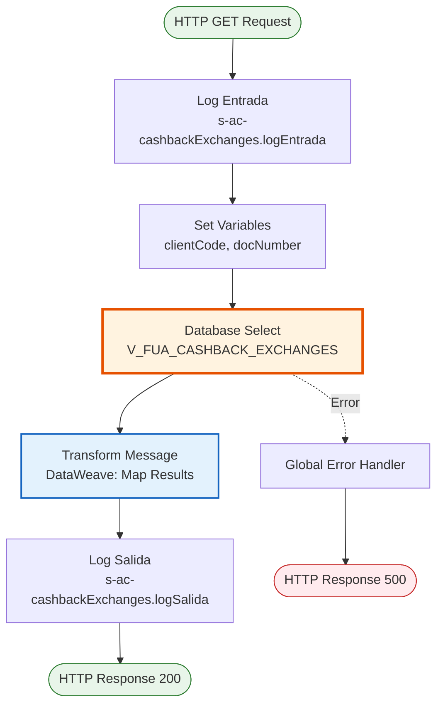
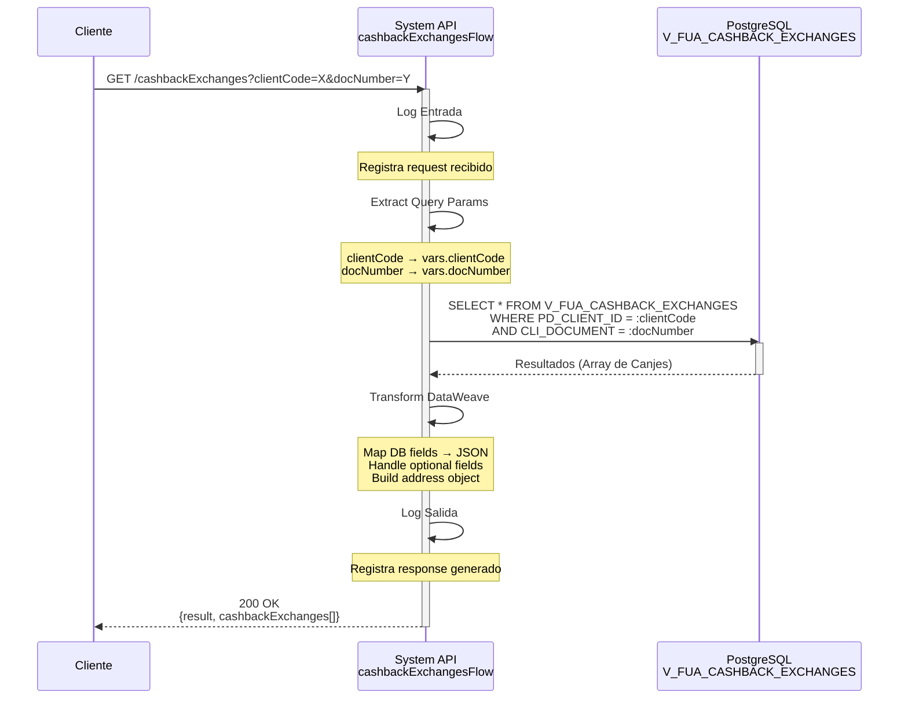
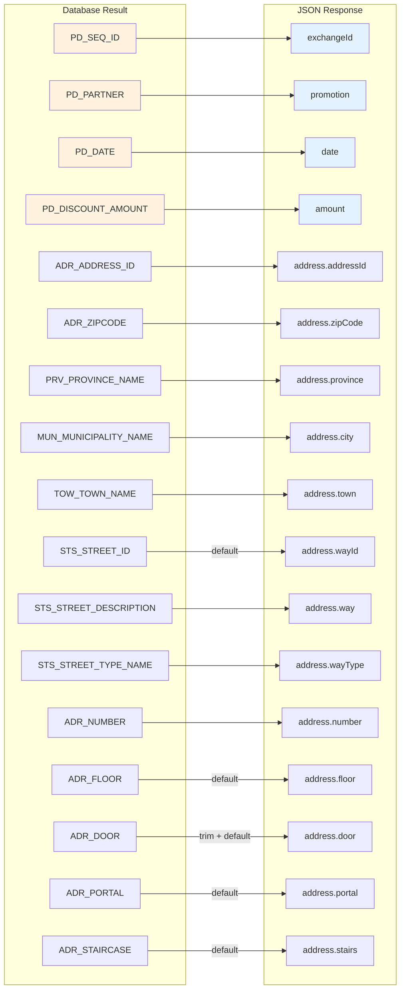

## 💼 Propósito del Negocio

### Casos de Uso Principales

1. **Consulta de Historial de Canjes**
   - El cliente accede a su portal web o app móvil para revisar su historial de canjes de cashback
   - El sistema muestra todos los canjes realizados con detalles de promoción, monto y fecha
   - Beneficio: Transparencia total sobre el uso del cashback acumulado

2. **Validación de Transacciones**
   - El servicio al cliente necesita verificar un canje específico reportado por el cliente
   - El sistema proporciona información detallada incluyendo dirección y promoción aplicada
   - Beneficio: Resolución rápida de consultas y reclamaciones

3. **Análisis de Uso de Promociones**
   - El equipo de marketing analiza qué promociones son más utilizadas por los clientes
   - El sistema proporciona datos históricos de canjes por partner/promoción
   - Beneficio: Optimización de estrategias de fidelización

### Contexto Empresarial

- **Dominio:** Gestión de Fidelización y Cashback
- **Sector:** Energía - Utilities
- **División:** Naturgy España - Área Cliente
- **Proceso de Negocio:** Programa de Fidelización - Gestión de Canjes de Cashback
- **Programa:** Tarjeta Naturgy / Programa de Puntos

### Stakeholders

- **Clientes Finales**: Consultan su historial de canjes y verifican descuentos aplicados
- **Servicio al Cliente**: Validan transacciones y resuelven consultas sobre canjes
- **Equipo de Marketing**: Analizan efectividad de promociones y partners comerciales
- **Equipo de Fidelización**: Gestionan el programa de cashback y monitorean su uso

### Valor de Negocio

- **Transparencia**: Los clientes pueden ver claramente cómo han utilizado su cashback
- **Confianza**: Trazabilidad completa de todas las transacciones de canje
- **Fidelización**: Visibilidad del valor obtenido incentiva el uso continuo del programa
- **Eficiencia Operativa**: Reducción de consultas al call center sobre canjes realizados

### Consumidores Potenciales

Este endpoint puede ser consumido por:
- Process APIs de gestión de clientes y fidelización
- Portales web de autoservicio de clientes
- Aplicaciones móviles de Naturgy
- Sistemas de atención al cliente (CRM)
- Herramientas de análisis y reporting de marketing

---

## 🔧 Especificación Técnica

### URLs por Ambiente

| Ambiente | URL Base | URL Completa |
|----------|----------|--------------|
| **Local** | `http://localhost:8081` | `http://localhost:8081/api/cashbackExchanges?clientCode={code}&docNumber={doc}` |
| **Development** | `https://ntgy-fua-s-ac-fua-dev.us-e2.cloudhub.io` | `https://ntgy-fua-s-ac-fua-dev.us-e2.cloudhub.io/api/cashbackExchanges?clientCode={code}&docNumber={doc}` |
| **UAT** | `https://ntgy-fua-s-ac-fua-uat.us-e2.cloudhub.io` | `https://ntgy-fua-s-ac-fua-uat.us-e2.cloudhub.io/api/cashbackExchanges?clientCode={code}&docNumber={doc}` |
| **Production** | `https://ntgy-fua-s-ac-fua-pro.us-e2.cloudhub.io` | `https://ntgy-fua-s-ac-fua-pro.us-e2.cloudhub.io/api/cashbackExchanges?clientCode={code}&docNumber={doc}` |

### Método HTTP

```
GET /api/cashbackExchanges
```

### Parámetros de Entrada

#### Headers HTTP

| Header | Tipo | Requerido | Descripción | Ejemplo |
|--------|------|-----------|-------------|---------|
| `Accept` | string | ❌ No | Tipo de contenido esperado en response | `application/json` |

#### Query Parameters

| Parámetro | Tipo | Requerido | Descripción | Ejemplo |
|-----------|------|-----------|-------------|---------|
| `clientCode` | string | ✅ Sí | Código único del cliente en el sistema | `"CLI123456"` |
| `docNumber` | string | ✅ Sí | Número de documento del cliente (NIF/NIE) | `"12345678A"` |

**Validaciones:**
- Ambos parámetros son obligatorios
- `clientCode`: Debe ser un código válido de cliente existente
- `docNumber`: Debe ser un documento válido (formato NIF/NIE español)

### Respuestas

#### Respuesta Exitosa (200 OK)

```json
{
  "result": {
    "codResult": "0000",
    "msgResult": "No hay error"
  },
  "cashbackExchanges": [
    {
      "exchangeId": "EXC001",
      "promotion": "Partner Comercial XYZ",
      "date": "2026-07-15",
      "amount": 25.50,
      "address": {
        "addressId": "ADR12345",
        "zipCode": "28001",
        "province": "Madrid",
        "city": "Madrid",
        "town": "Centro",
        "wayId": "ST001",
        "way": "Gran Vía",
        "wayType": "Calle",
        "number": "28",
        "floor": "3",
        "door": "A",
        "portal": "1",
        "stairs": "Izquierda"
      }
    },
    {
      "exchangeId": "EXC002",
      "promotion": "Descuento Energía Verde",
      "date": "2026-06-20",
      "amount": 15.00,
      "address": {
        "addressId": "ADR12346",
        "zipCode": "28002",
        "province": "Madrid",
        "city": "Madrid",
        "town": "Chamberí",
        "wayId": "",
        "way": "Calle de Fuencarral",
        "wayType": "Calle",
        "number": "45",
        "floor": "",
        "door": "",
        "portal": "",
        "stairs": ""
      }
    }
  ]
}
```

**Estructura de Respuesta:**

| Campo | Tipo | Descripción |
|-------|------|-------------|
| `result.codResult` | string | Código de resultado ("0000" = éxito) |
| `result.msgResult` | string | Mensaje descriptivo del resultado |
| `cashbackExchanges` | array | Lista de canjes de cashback |
| `cashbackExchanges[].exchangeId` | string | Identificador único del canje |
| `cashbackExchanges[].promotion` | string | Nombre de la promoción o partner comercial |
| `cashbackExchanges[].date` | string | Fecha del canje (formato: YYYY-MM-DD) |
| `cashbackExchanges[].amount` | number | Monto del descuento aplicado |
| `cashbackExchanges[].address` | object | Dirección completa asociada al canje |
| `address.addressId` | string | Identificador único de la dirección |
| `address.zipCode` | string | Código postal |
| `address.province` | string | Nombre de la provincia |
| `address.city` | string | Nombre del municipio |
| `address.town` | string | Nombre de la localidad |
| `address.wayId` | string | Identificador de la vía (puede estar vacío) |
| `address.way` | string | Nombre de la vía |
| `address.wayType` | string | Tipo de vía (Calle, Avenida, Plaza, etc.) |
| `address.number` | string | Número de la dirección |
| `address.floor` | string | Piso (opcional, puede estar vacío) |
| `address.door` | string | Puerta (opcional, puede estar vacío) |
| `address.portal` | string | Portal (opcional, puede estar vacío) |
| `address.stairs` | string | Escalera (opcional, puede estar vacío) |

#### Respuesta Sin Datos (200 OK)

```json
{
  "result": {
    "codResult": "0000",
    "msgResult": "No hay error"
  },
  "cashbackExchanges": []
}
```

**Descripción:** Se retorna cuando el cliente no tiene canjes de cashback registrados.

#### Respuesta de Error Técnico (500)

```json
{
  "result": {
    "codResult": "0001",
    "msgResult": "Error interno del servidor"
  }
}
```

### Autenticación y Autorización

- **Tipo:** Client ID & Client Secret (Anypoint Platform)
- **Autorización DB:** El usuario de base de datos debe tener permisos de:
  - Lectura (SELECT) sobre la vista `V_FUA_CASHBACK_EXCHANGES`
  - Acceso al schema `public` de PostgreSQL

### Timeouts

| Tipo | Valor | Descripción |
|------|-------|-------------|
| **Request Timeout** | 15 segundos | Tiempo máximo de espera para la respuesta |
| **Query Timeout** | 15 segundos | Tiempo máximo de ejecución de la query SQL |
| **Connection Timeout** | 10 segundos | Tiempo máximo para establecer conexión con DB |

---

## 🏗️ Implementación Técnica

### Arquitectura del Flow



### Componentes del Flow

#### 1. Logger de Entrada (Línea 6)
```xml
<logger level="INFO" doc:name="Logger entrada" 
        message="s-ac-cashbackExchanges.logEntrada ## payload: #[payload]"/>
```
**Propósito:** Registra el inicio de la ejecución del flow con el payload recibido.

#### 2. Set Variables (Líneas 7-9)
```xml
<set-variable value="#[attributes.queryParams.clientCode]" 
              doc:name="Set clientCode Variable" 
              variableName='clientCode'/>
<set-variable value="#[attributes.queryParams.docNumber]" 
              doc:name="Set docNumber variable" 
              variableName="docNumber"/>
```
**Propósito:** Extrae los query parameters y los almacena en variables para su uso en la query SQL.

#### 3. Database Select (Líneas 10-18)
```xml
<db:select doc:name="Select" config-ref="Database_Config" 
           queryTimeout="${dbAC.queryTimeout}">
    <db:sql><![CDATA[
        SELECT * FROM V_FUA_CASHBACK_EXCHANGES 
        WHERE PD_CLIENT_ID = :clientCode 
        AND CLI_DOCUMENT = :docNumber
    ]]></db:sql>
    <db:input-parameters><![CDATA[#[{
        'clientCode': vars.clientCode,
        'docNumber': vars.docNumber
    }]]]></db:input-parameters>
</db:select>
```
**Propósito:** Ejecuta la consulta SQL contra la vista consolidada de canjes de cashback.

**Query SQL Real:**
```sql
SELECT * FROM V_FUA_CASHBACK_EXCHANGES 
WHERE PD_CLIENT_ID = :clientCode 
AND CLI_DOCUMENT = :docNumber
```

**Parámetros:**
- `:clientCode` - Código del cliente
- `:docNumber` - Número de documento del cliente

#### 4. Transform Message (Líneas 19-44)
```dataweave
%dw 2.0
output application/json
---
{
    result: {
        codResult: "0000",
        msgResult: "No hay error"
    },
    "cashbackExchanges": payload map((item,index) -> {
        "exchangeId": item.PD_SEQ_ID,
        "promotion": item.PD_PARTNER,
        "date": item.PD_DATE,
        "amount": item.PD_DISCOUNT_AMOUNT,
        "address": {
            "addressId": item.ADR_ADDRESS_ID,
            "zipCode": item.ADR_ZIPCODE,
            "province": item.PRV_PROVINCE_NAME,
            "city": item.MUN_MUNICIPALITY_NAME,
            "town": item.TOW_TOWN_NAME,
            "wayId": item.STS_STREET_ID default "",
            "way": item.STS_STREET_DESCRIPTION,
            "wayType": item.STS_STREET_TYPE_NAME,
            "number": item.ADR_NUMBER,
            "floor": item.ADR_FLOOR default "",
            "door": trim(item.ADR_DOOR) default "",
            "portal": item.ADR_PORTAL default "",
            "stairs": item.ADR_STAIRCASE default ""
        }
    })
}
```

**Propósito:** Transforma los resultados de la base de datos a formato JSON estándar.

**Mapeo de Campos:**

| Campo DB | Campo JSON | Transformación |
|----------|------------|----------------|
| `PD_SEQ_ID` | `exchangeId` | Directo |
| `PD_PARTNER` | `promotion` | Directo |
| `PD_DATE` | `date` | Directo |
| `PD_DISCOUNT_AMOUNT` | `amount` | Directo |
| `ADR_ADDRESS_ID` | `address.addressId` | Directo |
| `ADR_ZIPCODE` | `address.zipCode` | Directo |
| `PRV_PROVINCE_NAME` | `address.province` | Directo |
| `MUN_MUNICIPALITY_NAME` | `address.city` | Directo |
| `TOW_TOWN_NAME` | `address.town` | Directo |
| `STS_STREET_ID` | `address.wayId` | Default "" si null |
| `STS_STREET_DESCRIPTION` | `address.way` | Directo |
| `STS_STREET_TYPE_NAME` | `address.wayType` | Directo |
| `ADR_NUMBER` | `address.number` | Directo |
| `ADR_FLOOR` | `address.floor` | Default "" si null |
| `ADR_DOOR` | `address.door` | trim() + Default "" si null |
| `ADR_PORTAL` | `address.portal` | Default "" si null |
| `ADR_STAIRCASE` | `address.stairs` | Default "" si null |

**Nota:** Los campos opcionales de dirección (floor, door, portal, stairs, wayId) se manejan con `default ""` para evitar valores null en la respuesta.

#### 5. Logger de Salida (Línea 45)
```xml
<logger level="INFO" doc:name="Logger salida" 
        message="s-ac-cashbackExchanges.logSalida ## payload: #[payload]"/>
```
**Propósito:** Registra la respuesta final antes de retornarla al cliente.

### Diagrama de Secuencia Detallado



### Configuración de Base de Datos

**Database Config Reference:** `Database_Config`

**Propiedades de Conexión:**
```yaml
dbAC:
  host1: "oc-pro-exa-04-clu-02-hdfdi-scan.prodb03.ocpro.oraclevcn.com"
  host2: "oc-pro-exa-03-clu-02-dfhl9-scan.prodb03.ocpro.oraclevcn.com"
  port: "1521"
  serviceName: "s_areapriv_online_pro.prodb03.ocpro.oraclevcn.com"
  user: "OVPRO_DELTA"
  pass: "![encrypted]"
  queryTimeout: "15000"
  MaxPoolSize: "15"
  MaxWaitTime: "300000"
  MaxIdleTime: "300000"
```

**Connection Pooling:**
- Max Pool Size: 15 conexiones
- Max Wait Time: 300 segundos
- Max Idle Time: 300 segundos
- Query Timeout: 15 segundos

### Vista de Base de Datos

**Vista:** `V_FUA_CASHBACK_EXCHANGES`

**Descripción:** Vista consolidada que une información de canjes de cashback con datos de direcciones normalizadas.

**Tablas Subyacentes (estimadas):**
- Tabla de canjes de cashback (transacciones)
- Tabla de direcciones (ADR_*)
- Tabla de provincias (PRV_*)
- Tabla de municipios (MUN_*)
- Tabla de localidades (TOW_*)
- Tabla de calles (STS_*)

**Campos Principales:**
- `PD_SEQ_ID`: ID secuencial del canje
- `PD_CLIENT_ID`: Código del cliente
- `CLI_DOCUMENT`: Documento del cliente
- `PD_PARTNER`: Partner o promoción aplicada
- `PD_DATE`: Fecha del canje
- `PD_DISCOUNT_AMOUNT`: Monto del descuento
- `ADR_*`: Campos de dirección normalizada
- `PRV_*`: Campos de provincia
- `MUN_*`: Campos de municipio
- `TOW_*`: Campos de localidad
- `STS_*`: Campos de calle

### Manejo de Errores

**Global Error Handler:** `s-ac-globalErrorHandler.xml`

**Errores Manejados:**
1. **DB:CONNECTIVITY**: Error de conexión a base de datos
2. **DB:QUERY_EXECUTION**: Error en ejecución de query
3. **DB:TIMEOUT**: Timeout de query
4. **TRANSFORMATION**: Error en transformación DataWeave

**Respuesta de Error Estándar:**
```json
{
  "result": {
    "codResult": "0001",
    "msgResult": "Error interno del servidor"
  }
}
```

### Diagrama de Transformación de Datos



---

## 💻 Ejemplos de Uso

### Ejemplo 1: Consulta Exitosa con Múltiples Canjes

#### Request

```bash
curl -X GET "https://ntgy-fua-s-ac-fua-pro.us-e2.cloudhub.io/api/cashbackExchanges?clientCode=CLI123456&docNumber=12345678A" \
  -H "Accept: application/json" \
  -H "client_id: YOUR_CLIENT_ID" \
  -H "client_secret: YOUR_CLIENT_SECRET"
```

#### Response (200 OK)

```json
{
  "result": {
    "codResult": "0000",
    "msgResult": "No hay error"
  },
  "cashbackExchanges": [
    {
      "exchangeId": "EXC001234",
      "promotion": "Descuento Carrefour",
      "date": "2026-07-15",
      "amount": 25.50,
      "address": {
        "addressId": "ADR789012",
        "zipCode": "28001",
        "province": "Madrid",
        "city": "Madrid",
        "town": "Centro",
        "wayId": "ST12345",
        "way": "Gran Vía",
        "wayType": "Calle",
        "number": "28",
        "floor": "3",
        "door": "A",
        "portal": "1",
        "stairs": "Izquierda"
      }
    },
    {
      "exchangeId": "EXC001235",
      "promotion": "Descuento Repsol",
      "date": "2026-06-20",
      "amount": 15.00,
      "address": {
        "addressId": "ADR789013",
        "zipCode": "28002",
        "province": "Madrid",
        "city": "Madrid",
        "town": "Chamberí",
        "wayId": "",
        "way": "Calle de Fuencarral",
        "wayType": "Calle",
        "number": "45",
        "floor": "",
        "door": "",
        "portal": "",
        "stairs": ""
      }
    },
    {
      "exchangeId": "EXC001236",
      "promotion": "Cashback Energía Verde",
      "date": "2026-05-10",
      "amount": 30.00,
      "address": {
        "addressId": "ADR789014",
        "zipCode": "28010",
        "province": "Madrid",
        "city": "Madrid",
        "town": "Salamanca",
        "wayId": "ST12346",
        "way": "Calle de Serrano",
        "wayType": "Calle",
        "number": "100",
        "floor": "5",
        "door": "B",
        "portal": "2",
        "stairs": "Derecha"
      }
    }
  ]
}
```

### Ejemplo 2: Cliente Sin Canjes

#### Request

```bash
curl -X GET "https://ntgy-fua-s-ac-fua-pro.us-e2.cloudhub.io/api/cashbackExchanges?clientCode=CLI999999&docNumber=98765432Z" \
  -H "Accept: application/json" \
  -H "client_id: YOUR_CLIENT_ID" \
  -H "client_secret: YOUR_CLIENT_SECRET"
```

#### Response (200 OK)

```json
{
  "result": {
    "codResult": "0000",
    "msgResult": "No hay error"
  },
  "cashbackExchanges": []
}
```

**Interpretación:** El cliente existe pero no ha realizado ningún canje de cashback.

### Ejemplo 3: Error de Parámetros Faltantes

#### Request

```bash
curl -X GET "https://ntgy-fua-s-ac-fua-pro.us-e2.cloudhub.io/api/cashbackExchanges?clientCode=CLI123456" \
  -H "Accept: application/json" \
  -H "client_id: YOUR_CLIENT_ID" \
  -H "client_secret: YOUR_CLIENT_SECRET"
```

#### Response (400 Bad Request)

```json
{
  "result": {
    "codResult": "0001",
    "msgResult": "Parámetro requerido faltante: docNumber"
  }
}
```

### Ejemplo 4: Error de Conexión a Base de Datos

#### Request

```bash
curl -X GET "https://ntgy-fua-s-ac-fua-pro.us-e2.cloudhub.io/api/cashbackExchanges?clientCode=CLI123456&docNumber=12345678A" \
  -H "Accept: application/json" \
  -H "client_id: YOUR_CLIENT_ID" \
  -H "client_secret: YOUR_CLIENT_SECRET"
```

#### Response (500 Internal Server Error)

```json
{
  "result": {
    "codResult": "0001",
    "msgResult": "Error interno del servidor"
  }
}
```

**Interpretación:** Error de conectividad con la base de datos. El sistema reintentará automáticamente según la política de retry configurada.

### Ejemplo 5: Uso desde JavaScript (Frontend)

```javascript
// Función para obtener canjes de cashback
async function getCashbackExchanges(clientCode, docNumber) {
  const baseUrl = 'https://ntgy-fua-s-ac-fua-pro.us-e2.cloudhub.io';
  const endpoint = `/api/cashbackExchanges?clientCode=${clientCode}&docNumber=${docNumber}`;
  
  try {
    const response = await fetch(baseUrl + endpoint, {
      method: 'GET',
      headers: {
        'Accept': 'application/json',
        'client_id': 'YOUR_CLIENT_ID',
        'client_secret': 'YOUR_CLIENT_SECRET'
      }
    });
    
    if (!response.ok) {
      throw new Error(`HTTP error! status: ${response.status}`);
    }
    
    const data = await response.json();
    
    if (data.result.codResult === "0000") {
      console.log(`Encontrados ${data.cashbackExchanges.length} canjes`);
      return data.cashbackExchanges;
    } else {
      console.error('Error en respuesta:', data.result.msgResult);
      return [];
    }
  } catch (error) {
    console.error('Error al consultar canjes:', error);
    throw error;
  }
}

// Uso
getCashbackExchanges('CLI123456', '12345678A')
  .then(exchanges => {
    exchanges.forEach(exchange => {
      console.log(`Canje ${exchange.exchangeId}: ${exchange.promotion} - €${exchange.amount}`);
    });
  })
  .catch(error => {
    console.error('Error:', error);
  });
```

### Ejemplo 6: Uso desde Python

```python
import requests
from typing import List, Dict, Optional

def get_cashback_exchanges(
    client_code: str, 
    doc_number: str,
    client_id: str,
    client_secret: str
) -> Optional[List[Dict]]:
    """
    Consulta los canjes de cashback de un cliente.
    
    Args:
        client_code: Código del cliente
        doc_number: Número de documento del cliente
        client_id: Client ID de Anypoint
        client_secret: Client Secret de Anypoint
        
    Returns:
        Lista de canjes o None si hay error
    """
    base_url = "https://ntgy-fua-s-ac-fua-pro.us-e2.cloudhub.io"
    endpoint = f"/api/cashbackExchanges"
    
    params = {
        "clientCode": client_code,
        "docNumber": doc_number
    }
    
    headers = {
        "Accept": "application/json",
        "client_id": client_id,
        "client_secret": client_secret
    }
    
    try:
        response = requests.get(
            f"{base_url}{endpoint}",
            params=params,
            headers=headers,
            timeout=30
        )
        response.raise_for_status()
        
        data = response.json()
        
        if data["result"]["codResult"] == "0000":
            print(f"✓ Encontrados {len(data['cashbackExchanges'])} canjes")
            return data["cashbackExchanges"]
        else:
            print(f"✗ Error: {data['result']['msgResult']}")
            return None
            
    except requests.exceptions.RequestException as e:
        print(f"✗ Error de conexión: {e}")
        return None

# Uso
if __name__ == "__main__":
    exchanges = get_cashback_exchanges(
        client_code="CLI123456",
        doc_number="12345678A",
        client_id="YOUR_CLIENT_ID",
        client_secret="YOUR_CLIENT_SECRET"
    )
    
    if exchanges:
        for exchange in exchanges:
            print(f"\nCanje ID: {exchange['exchangeId']}")
            print(f"Promoción: {exchange['promotion']}")
            print(f"Fecha: {exchange['date']}")
            print(f"Monto: €{exchange['amount']}")
            print(f"Dirección: {exchange['address']['way']} {exchange['address']['number']}, {exchange['address']['city']}")
```
