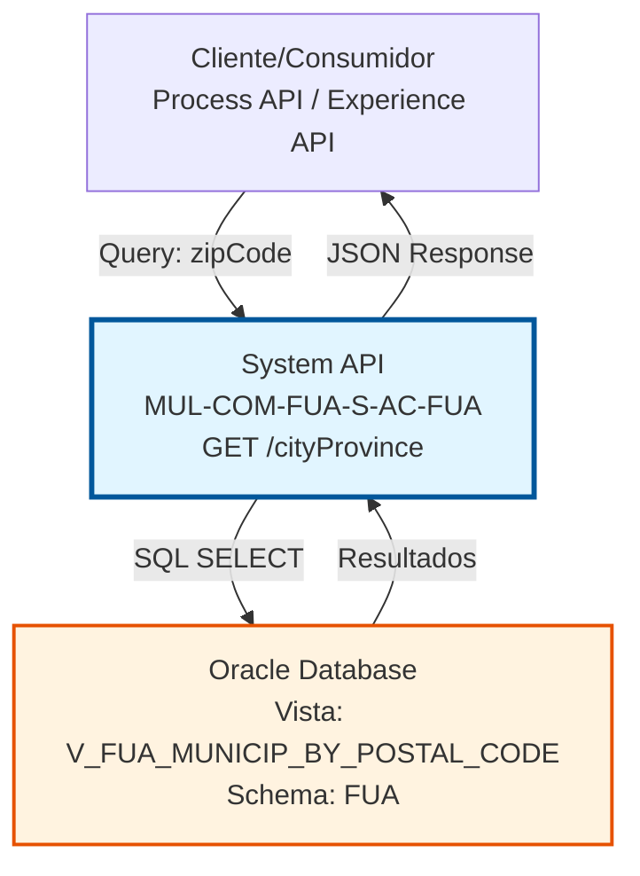
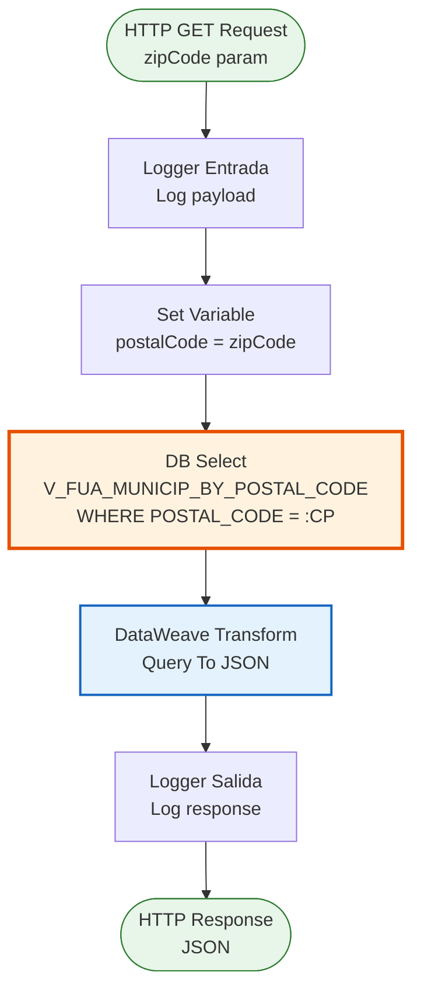
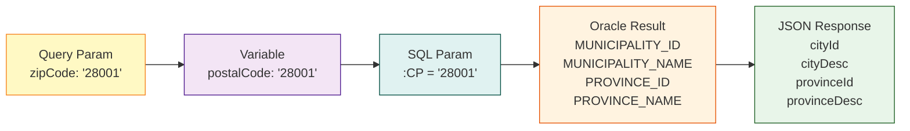

# GET /cityProvince

## 📌 Descripción General

### Propósito del Endpoint

Este endpoint consulta información de municipios y provincias asociados a un código postal específico desde Oracle Database. Permite obtener todos los municipios que comparten un mismo código postal, junto con sus provincias correspondientes, facilitando la validación y autocompletado de direcciones en procesos de negocio.

El endpoint soporta:
- **Consulta por Código Postal**: Búsqueda de municipios usando el parámetro `zipCode`
- **Múltiples Resultados**: Retorna todos los municipios asociados al código postal
- **Información Completa**: Incluye IDs y nombres descriptivos de municipios y provincias
- **Respuesta Estructurada**: Formato JSON estandarizado con código de resultado

### Tipo de API

**Capa:** System API (API-Led Connectivity)

**Función:** Integración directa con Oracle Database para consulta de datos maestros de localización geográfica.

### Patrón de Integración

**Tipo:** Request-Reply Síncrono con SQL Query

**Descripción:** El endpoint recibe un código postal como query parameter, ejecuta una consulta SQL contra la vista `V_FUA_MUNICIP_BY_POSTAL_CODE` en Oracle Database, transforma el resultado mediante DataWeave y retorna una lista de municipios y provincias en formato JSON.

### Arquitectura API-Led Connectivity



---

## 💼 Propósito del Negocio

### Casos de Uso Principales

1. **Validación de Direcciones en Alta de Clientes**
   - Durante el proceso de alta de un nuevo cliente, se valida que el código postal ingresado existe
   - Se obtienen los municipios válidos para ese código postal
   - Se permite al usuario seleccionar el municipio correcto de la lista

2. **Autocompletado de Formularios**
   - Al ingresar un código postal en un formulario, se autocompletan los campos de municipio y provincia
   - Mejora la experiencia de usuario reduciendo errores de captura
   - Acelera el proceso de ingreso de datos

3. **Normalización de Datos de Dirección**
   - Estandariza la información de localización en todos los sistemas
   - Asegura consistencia en los datos maestros de clientes
   - Facilita reportes y análisis geográficos

4. **Soporte a Procesos de Facturación y Envío**
   - Valida direcciones de facturación y envío
   - Asegura que las direcciones sean válidas para servicios de mensajería
   - Reduce devoluciones por direcciones incorrectas

### Contexto Empresarial

- **Dominio:** Gestión de Datos Maestros - Localización Geográfica
- **Sector:** Energía - Utilities
- **División:** Naturgy España - NewCo
- **Proceso de Negocio:** Gestión de Clientes y Contratos
- **Fuente de Datos:** Oracle Database (Sistema de Datos Maestros)

### Stakeholders

- **Equipos de Atención al Cliente**: Necesitan validar direcciones durante la gestión de clientes
- **Sistemas de Alta de Clientes**: Requieren datos de localización precisos para crear registros
- **Equipos de Facturación**: Necesitan direcciones válidas para envío de facturas
- **Sistemas de Logística**: Requieren información geográfica para planificación de rutas

### Valor de Negocio

- **Calidad de Datos**: Asegura que las direcciones almacenadas sean válidas y consistentes
- **Eficiencia Operativa**: Reduce tiempo de captura de datos mediante autocompletado
- **Reducción de Errores**: Minimiza errores de dirección que causan problemas de entrega
- **Experiencia de Usuario**: Mejora la usabilidad de formularios y procesos de alta

### Consumidores Potenciales

Este endpoint puede ser consumido por:
- Process APIs de gestión de clientes
- Experience APIs de portales web y aplicaciones móviles
- Sistemas de CRM (Salesforce)
- Aplicaciones de call center
- Sistemas de gestión de contratos

---

## 🔧 Especificación Técnica

### URLs por Ambiente

| Ambiente | URL Base | URL Completa |
|----------|----------|--------------|
| **Local** | `http://localhost:8081` | `http://localhost:8081/api/cityProvince?zipCode=28001` |
| **Development** | `https://mul-com-fua-s-ac-fua-dev.us-e2.cloudhub.io` | `https://mul-com-fua-s-ac-fua-dev.us-e2.cloudhub.io/api/cityProvince?zipCode=28001` |
| **UAT** | `https://mul-com-fua-s-ac-fua-uat.us-e2.cloudhub.io` | `https://mul-com-fua-s-ac-fua-uat.us-e2.cloudhub.io/api/cityProvince?zipCode=28001` |
| **Production** | `https://mul-com-fua-s-ac-fua-pro.us-e2.cloudhub.io` | `https://mul-com-fua-s-ac-fua-pro.us-e2.cloudhub.io/api/cityProvince?zipCode=28001` |

### Método HTTP

```
GET /api/cityProvince
```

### Parámetros de Entrada

#### Headers HTTP

| Header | Tipo | Requerido | Descripción | Ejemplo |
|--------|------|-----------|-------------|---------|
| `Accept` | string | ❌ No | Tipo de contenido esperado en response | `application/json` |

#### Query Parameters

| Parámetro | Tipo | Requerido | Descripción | Ejemplo | Validación |
|-----------|------|-----------|-------------|---------|------------|
| `zipCode` | string | ✅ Sí | Código postal español (5 dígitos) | `"28001"` | Formato: 5 dígitos numéricos |

**Nota:** El parámetro `zipCode` se mapea internamente a la variable `postalCode` que se utiliza en la consulta SQL.

### Respuestas

#### Respuesta Exitosa (200 OK)

```json
{
  "result": {
    "codResult": "0000",
    "msgResult": "No hay error"
  },
  "cityProvinceList": [
    {
      "cityId": "28079",
      "cityDesc": "Madrid",
      "provinceId": "28",
      "provinceDesc": "Madrid"
    }
  ]
}
```

**Estructura de la Respuesta:**

| Campo | Tipo | Descripción |
|-------|------|-------------|
| `result` | object | Objeto con información del resultado de la operación |
| `result.codResult` | string | Código de resultado ("0000" = éxito) |
| `result.msgResult` | string | Mensaje descriptivo del resultado |
| `cityProvinceList` | array | Lista de municipios y provincias encontrados |
| `cityProvinceList[].cityId` | string | Identificador único del municipio (código INE) |
| `cityProvinceList[].cityDesc` | string | Nombre descriptivo del municipio |
| `cityProvinceList[].provinceId` | string | Identificador único de la provincia |
| `cityProvinceList[].provinceDesc` | string | Nombre descriptivo de la provincia |

#### Respuesta con Múltiples Municipios (200 OK)

Algunos códigos postales pueden estar asociados a múltiples municipios:

```json
{
  "result": {
    "codResult": "0000",
    "msgResult": "No hay error"
  },
  "cityProvinceList": [
    {
      "cityId": "08001",
      "cityDesc": "Barcelona",
      "provinceId": "08",
      "provinceDesc": "Barcelona"
    },
    {
      "cityId": "08002",
      "cityDesc": "L'Hospitalet de Llobregat",
      "provinceId": "08",
      "provinceDesc": "Barcelona"
    }
  ]
}
```

#### Respuesta sin Resultados (200 OK)

Cuando el código postal no existe en la base de datos:

```json
{
  "result": {
    "codResult": "0000",
    "msgResult": "No hay error"
  },
  "cityProvinceList": []
}
```

#### Respuesta de Error Técnico (400 Bad Request)

```json
{
  "result": {
    "codResult": "0001",
    "msgResult": "Parámetro zipCode requerido"
  }
}
```

#### Respuesta de Error Técnico (500 Internal Server Error)

```json
{
  "result": {
    "codResult": "0002",
    "msgResult": "Error al consultar base de datos"
  }
}
```

### Autenticación y Autorización

- **Tipo:** Client ID & Client Secret (Anypoint Platform)
- **Autorización Oracle:** El usuario de base de datos debe tener permisos para:
  - Ejecutar SELECT sobre la vista `V_FUA_MUNICIP_BY_POSTAL_CODE`
  - Acceso de lectura al schema `FUA`

### Timeouts

| Tipo | Valor | Descripción |
|------|-------|-------------|
| **Query Timeout** | Configurado en `${dbAC.queryTimeout}` | Tiempo máximo de espera para la consulta SQL |
| **Connection Timeout** | 10 segundos | Tiempo máximo para establecer conexión con Oracle |

---

## 🏗️ Implementación Técnica

### Arquitectura del Flow



### Componentes del Flow

#### 1. Logger de Entrada
```xml
<logger level="INFO" doc:name="Logger Entrada" 
        message="s-ac-cityProvince.logEntrada ## payload: #[payload]"/>
```
- **Propósito:** Registra el inicio de la ejecución del flow
- **Nivel:** INFO
- **Contenido:** Payload de entrada (query parameters)

#### 2. Set Variable - Extracción de Parámetro
```xml
<set-variable value='#[attributes.queryParams["zipCode"]]' 
              doc:name="Set Variable" 
              variableName="postalCode"/>
```
- **Propósito:** Extrae el query parameter `zipCode` y lo almacena en la variable `postalCode`
- **Origen:** `attributes.queryParams["zipCode"]`
- **Variable:** `postalCode`

#### 3. Database Select - Consulta SQL
```xml
<db:select doc:name="Select" 
           config-ref="Database_Config" 
           queryTimeout="${dbAC.queryTimeout}">
    <db:sql><![CDATA[
        SELECT * FROM V_FUA_MUNICIP_BY_POSTAL_CODE 
        WHERE POSTAL_CODE = :CP
    ]]></db:sql>
    <db:input-parameters><![CDATA[
        #[{'CP': vars.postalCode}]
    ]]></db:input-parameters>
</db:select>
```

**Detalles de la Consulta:**
- **Vista:** `V_FUA_MUNICIP_BY_POSTAL_CODE`
- **Condición:** `WHERE POSTAL_CODE = :CP`
- **Parámetro:** `:CP` se mapea a `vars.postalCode`
- **Timeout:** Configurado mediante property `${dbAC.queryTimeout}`

**Estructura de la Vista:**

| Campo | Tipo | Descripción |
|-------|------|-------------|
| `POSTAL_CODE` | VARCHAR2 | Código postal (5 dígitos) |
| `MUNICIPALITY_ID` | VARCHAR2 | Identificador del municipio (código INE) |
| `MUNICIPALITY_NAME` | VARCHAR2 | Nombre del municipio |
| `PROVINCE_ID` | VARCHAR2 | Identificador de la provincia |
| `PROVINCE_NAME` | VARCHAR2 | Nombre de la provincia |

#### 4. DataWeave Transformation - Query To JSON
```dataweave
%dw 2.0
output application/json
---
{
    result: {
        codResult: "0000",
        msgResult: "No hay error"
    },
    cityProvinceList: payload map (object, key) -> {
        cityId: object.MUNICIPALITY_ID,
        cityDesc: object.MUNICIPALITY_NAME,
        provinceId: object.PROVINCE_ID,
        provinceDesc: object.PROVINCE_NAME
    }
}
```

**Mapeo de Campos:**

| Campo Oracle | Campo JSON | Transformación |
|--------------|------------|----------------|
| `MUNICIPALITY_ID` | `cityId` | Directo |
| `MUNICIPALITY_NAME` | `cityDesc` | Directo |
| `PROVINCE_ID` | `provinceId` | Directo |
| `PROVINCE_NAME` | `provinceDesc` | Directo |

**Lógica de Transformación:**
- Itera sobre cada registro del resultado SQL usando `map`
- Transforma nombres de campos de Oracle (UPPER_CASE) a camelCase
- Envuelve el resultado en estructura estándar con `result` y `cityProvinceList`
- Siempre retorna `codResult: "0000"` para consultas exitosas

#### 5. Logger de Salida
```xml
<logger level="INFO" doc:name="Logger Salida" 
        message="s-ac-provinces.logSalida ## payload: #[payload]"/>
```
- **Propósito:** Registra la respuesta final del flow
- **Nivel:** INFO
- **Contenido:** Payload transformado (JSON response)

### Diagrama de Transformación de Datos



### Configuración de Base de Datos

**Database Config Reference:** `Database_Config`

```xml
<db:config name="Database_Config">
    <db:oracle-connection 
        host="${dbAC.host}" 
        port="${dbAC.port}" 
        user="${dbAC.user}" 
        password="${dbAC.password}" 
        serviceName="${dbAC.serviceName}"/>
</db:config>
```

**Properties Utilizadas:**
- `${dbAC.host}` - Host del servidor Oracle
- `${dbAC.port}` - Puerto de conexión (típicamente 1521)
- `${dbAC.user}` - Usuario de base de datos
- `${dbAC.password}` - Contraseña (encriptada)
- `${dbAC.serviceName}` - Nombre del servicio Oracle
- `${dbAC.queryTimeout}` - Timeout para queries SQL

### Manejo de Errores

El flow implementa manejo de errores estándar de MuleSoft:

1. **Error de Conexión a BD:**
   - Se captura mediante error handler global
   - Retorna código 500 con mensaje de error técnico

2. **Error de Query SQL:**
   - Se captura mediante error handler
   - Retorna código 500 con detalles del error

3. **Parámetro Faltante:**
   - Si `zipCode` no está presente, la variable `postalCode` será null
   - La query SQL fallará con error de parámetro

4. **Sin Resultados:**
   - No es un error, retorna lista vacía `cityProvinceList: []`
   - Código de resultado sigue siendo "0000"

### Consideraciones de Performance

- **Vista Materializada:** `V_FUA_MUNICIP_BY_POSTAL_CODE` es una vista materializada para mejor performance
- **Índice:** La vista tiene índice en `POSTAL_CODE` para búsquedas rápidas
- **Caché:** Los datos de localización son relativamente estáticos, ideales para caché
- **Volumen:** Típicamente retorna 1-3 registros por código postal

---

## 💻 Ejemplos de Uso

### Ejemplo 1: Consulta de Código Postal de Madrid

#### Request

```bash
curl -X GET "https://mul-com-fua-s-ac-fua-dev.us-e2.cloudhub.io/api/cityProvince?zipCode=28001" \
  -H "Accept: application/json" \
  -H "client_id: YOUR_CLIENT_ID" \
  -H "client_secret: YOUR_CLIENT_SECRET"
```

#### Response (200 OK)

```json
{
  "result": {
    "codResult": "0000",
    "msgResult": "No hay error"
  },
  "cityProvinceList": [
    {
      "cityId": "28079",
      "cityDesc": "Madrid",
      "provinceId": "28",
      "provinceDesc": "Madrid"
    }
  ]
}
```

### Ejemplo 2: Consulta de Código Postal con Múltiples Municipios

#### Request

```bash
curl -X GET "https://mul-com-fua-s-ac-fua-dev.us-e2.cloudhub.io/api/cityProvince?zipCode=08001" \
  -H "Accept: application/json" \
  -H "client_id: YOUR_CLIENT_ID" \
  -H "client_secret: YOUR_CLIENT_SECRET"
```

#### Response (200 OK)

```json
{
  "result": {
    "codResult": "0000",
    "msgResult": "No hay error"
  },
  "cityProvinceList": [
    {
      "cityId": "08019",
      "cityDesc": "Barcelona",
      "provinceId": "08",
      "provinceDesc": "Barcelona"
    },
    {
      "cityId": "08101",
      "cityDesc": "L'Hospitalet de Llobregat",
      "provinceId": "08",
      "provinceDesc": "Barcelona"
    }
  ]
}
```

### Ejemplo 3: Código Postal No Encontrado

#### Request

```bash
curl -X GET "https://mul-com-fua-s-ac-fua-dev.us-e2.cloudhub.io/api/cityProvince?zipCode=99999" \
  -H "Accept: application/json" \
  -H "client_id: YOUR_CLIENT_ID" \
  -H "client_secret: YOUR_CLIENT_SECRET"
```

#### Response (200 OK)

```json
{
  "result": {
    "codResult": "0000",
    "msgResult": "No hay error"
  },
  "cityProvinceList": []
}
```

### Ejemplo 4: Error - Parámetro Faltante

#### Request

```bash
curl -X GET "https://mul-com-fua-s-ac-fua-dev.us-e2.cloudhub.io/api/cityProvince" \
  -H "Accept: application/json" \
  -H "client_id: YOUR_CLIENT_ID" \
  -H "client_secret: YOUR_CLIENT_SECRET"
```

#### Response (400 Bad Request)

```json
{
  "result": {
    "codResult": "0001",
    "msgResult": "Parámetro zipCode es requerido"
  }
}
```

### Ejemplo 5: Uso desde JavaScript

```javascript
async function getCityProvince(zipCode) {
  const url = `https://mul-com-fua-s-ac-fua-dev.us-e2.cloudhub.io/api/cityProvince?zipCode=${zipCode}`;
  
  try {
    const response = await fetch(url, {
      method: 'GET',
      headers: {
        'Accept': 'application/json',
        'client_id': 'YOUR_CLIENT_ID',
        'client_secret': 'YOUR_CLIENT_SECRET'
      }
    });
    
    const data = await response.json();
    
    if (data.result.codResult === "0000") {
      console.log(`Encontrados ${data.cityProvinceList.length} municipios`);
      data.cityProvinceList.forEach(city => {
        console.log(`${city.cityDesc} (${city.provinceDesc})`);
      });
    } else {
      console.error(`Error: ${data.result.msgResult}`);
    }
    
    return data;
  } catch (error) {
    console.error('Error al consultar cityProvince:', error);
    throw error;
  }
}

// Uso
getCityProvince('28001');
```

### Ejemplo 6: Uso desde Python

```python
import requests

def get_city_province(zip_code):
    url = f"https://mul-com-fua-s-ac-fua-dev.us-e2.cloudhub.io/api/cityProvince"
    
    headers = {
        'Accept': 'application/json',
        'client_id': 'YOUR_CLIENT_ID',
        'client_secret': 'YOUR_CLIENT_SECRET'
    }
    
    params = {
        'zipCode': zip_code
    }
    
    try:
        response = requests.get(url, headers=headers, params=params)
        response.raise_for_status()
        
        data = response.json()
        
        if data['result']['codResult'] == "0000":
            print(f"Encontrados {len(data['cityProvinceList'])} municipios")
            for city in data['cityProvinceList']:
                print(f"{city['cityDesc']} ({city['provinceDesc']})")
        else:
            print(f"Error: {data['result']['msgResult']}")
        
        return data
    except requests.exceptions.RequestException as e:
        print(f"Error al consultar cityProvince: {e}")
        raise

# Uso
get_city_province('28001')
```

### Ejemplo 7: Integración con Formulario HTML

```html
<!DOCTYPE html>
<html>
<head>
    <title>Validación de Código Postal</title>
</head>
<body>
    <form id="addressForm">
        <label for="zipCode">Código Postal:</label>
        <input type="text" id="zipCode" name="zipCode" maxlength="5" required>
        
        <label for="city">Municipio:</label>
        <select id="city" name="city" required>
            <option value="">Seleccione un municipio</option>
        </select>
        
        <label for="province">Provincia:</label>
        <input type="text" id="province" name="province" readonly>
        
        <button type="submit">Enviar</button>
    </form>

    <script>
        document.getElementById('zipCode').addEventListener('blur', async function() {
            const zipCode = this.value;
            
            if (zipCode.length === 5) {
                const data = await getCityProvince(zipCode);
                
                const citySelect = document.getElementById('city');
                const provinceInput = document.getElementById('province');
                
                // Limpiar opciones anteriores
                citySelect.innerHTML = '<option value="">Seleccione un municipio</option>';
                provinceInput.value = '';
                
                if (data.cityProvinceList.length > 0) {
                    data.cityProvinceList.forEach(city => {
                        const option = document.createElement('option');
                        option.value = city.cityId;
                        option.textContent = city.cityDesc;
                        option.dataset.province = city.provinceDesc;
                        citySelect.appendChild(option);
                    });
                    
                    // Si solo hay un municipio, seleccionarlo automáticamente
                    if (data.cityProvinceList.length === 1) {
                        citySelect.selectedIndex = 1;
                        provinceInput.value = data.cityProvinceList[0].provinceDesc;
                    }
                } else {
                    alert('Código postal no encontrado');
                }
            }
        });
        
        document.getElementById('city').addEventListener('change', function() {
            const selectedOption = this.options[this.selectedIndex];
            const provinceInput = document.getElementById('province');
            provinceInput.value = selectedOption.dataset.province || '';
        });
    </script>
</body>
</html>