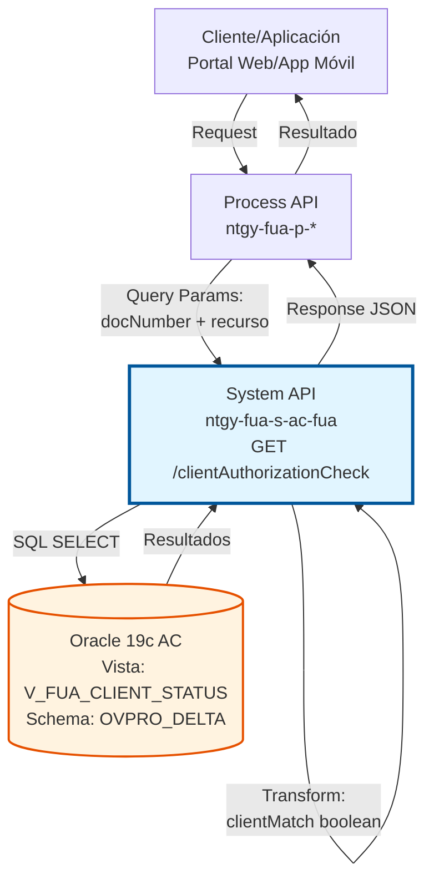
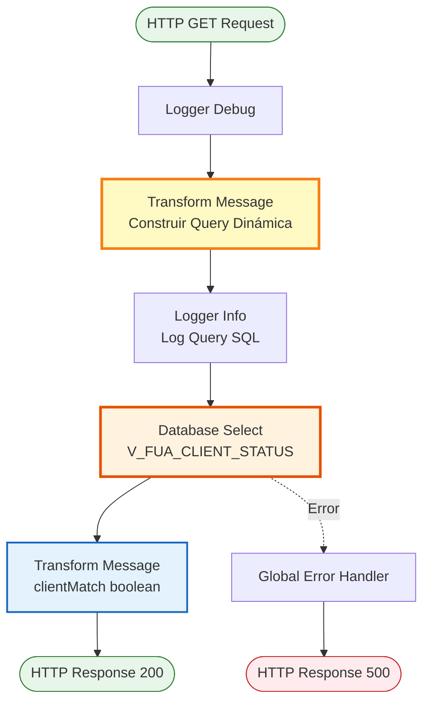
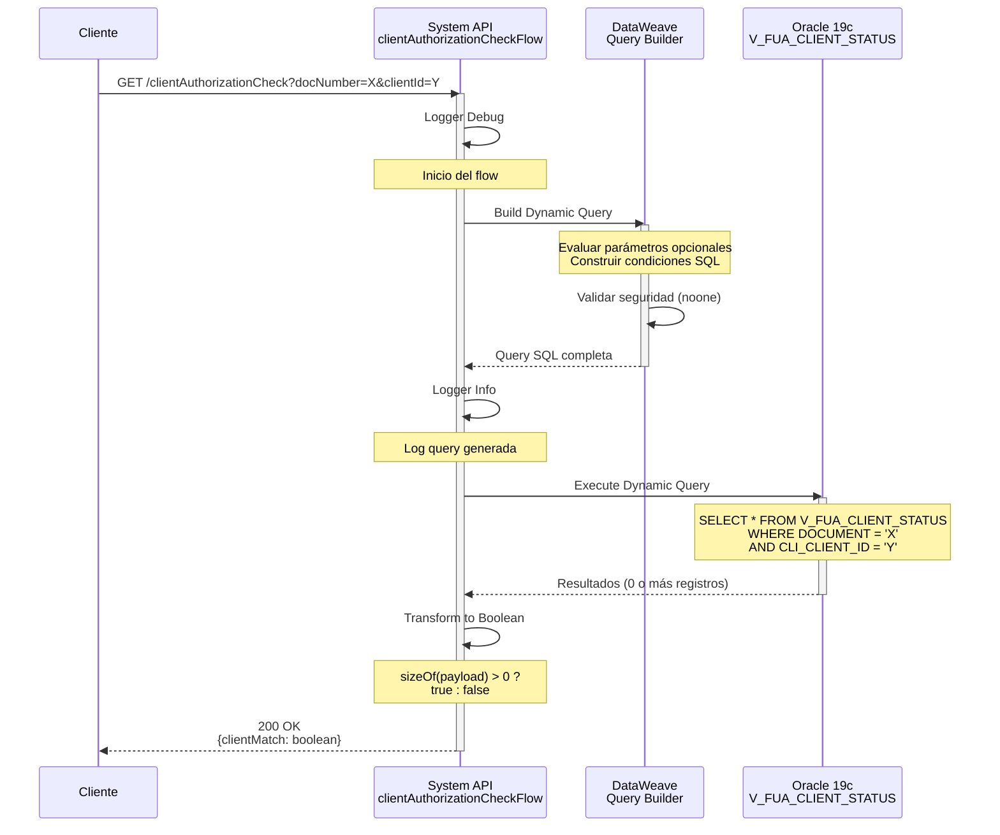
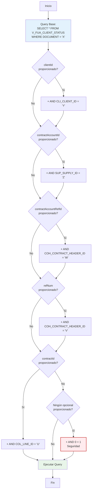

# GET /clientAuthorizationCheck

## 📌 Descripción General

### Propósito del Endpoint

Este endpoint realiza una verificación de autorización para determinar si un cliente específico (identificado por su número de documento) tiene relación válida con un recurso determinado (cliente, cuenta contrato, referencia de contrato o contrato específico). Retorna una respuesta booleana simple indicando si existe coincidencia (`clientMatch: true/false`).

El endpoint soporta:
- **Validación de Autorización**: Verifica relación cliente-recurso antes de permitir acceso
- **Múltiples Criterios**: Soporta validación por clientId, contractAccountId, contractAccountRefId, refNum o contractId
- **Construcción Dinámica de Query**: Genera query SQL según parámetros proporcionados
- **Seguridad por Diseño**: Requiere al menos un parámetro opcional para evitar consultas sin filtros

### Tipo de API

**Capa:** System API (API-Led Connectivity)

**Función:** Integración directa con base de datos Oracle del Área Cliente (AC) para validar autorización de acceso a recursos específicos mediante verificación de relación cliente-recurso.

### Patrón de Integración

**Tipo:** Request-Reply Síncrono con SQL Query Dinámica

**Descripción:** El endpoint recibe el número de documento del cliente (obligatorio) y al menos un identificador de recurso (opcional), construye dinámicamente una query SQL según los parámetros proporcionados, ejecuta la consulta contra la vista de validación, y retorna una respuesta booleana simple indicando si existe coincidencia.

### Arquitectura API-Led Connectivity



---

## 💼 Propósito del Negocio

### Casos de Uso Principales

1. **Validación de Acceso a Información Sensible**
   - Antes de mostrar datos de un contrato, el sistema verifica que el cliente tenga autorización
   - El endpoint valida la relación cliente-contrato en tiempo real
   - Beneficio: Prevención de acceso no autorizado a información confidencial

2. **Control de Acceso en Portales de Autoservicio**
   - El portal web valida que el usuario autenticado pueda ver información de una cuenta específica
   - El sistema verifica la relación antes de permitir operaciones
   - Beneficio: Seguridad robusta en aplicaciones de autoservicio

3. **Validación en Procesos de Atención al Cliente**
   - Los agentes de call center verifican que el cliente tiene relación con el recurso consultado
   - El sistema previene errores de asociación incorrecta
   - Beneficio: Mejora en la calidad del servicio y prevención de errores

### Contexto Empresarial

- **Dominio:** Seguridad y Control de Acceso
- **Sector:** Energía - Utilities
- **División:** Naturgy España - Área Cliente
- **Proceso de Negocio:** Validación de Autorización y Control de Acceso
- **Compliance:** GDPR - Protección de Datos Personales

### Stakeholders

- **Clientes Finales**: Acceden solo a su información autorizada
- **Desarrolladores de Frontend**: Implementan validaciones de seguridad
- **Equipo de Seguridad**: Garantizan cumplimiento de políticas de acceso
- **Servicio al Cliente**: Validan relaciones cliente-recurso antes de operar

### Valor de Negocio

- **Seguridad**: Prevención de acceso no autorizado a información sensible
- **Compliance**: Cumplimiento de normativas de protección de datos (GDPR, LOPD)
- **Confianza**: Los clientes confían en que su información está protegida
- **Eficiencia**: Validación automática sin intervención manual

### Consumidores Potenciales

Este endpoint puede ser consumido por:
- Process APIs de gestión de clientes y contratos
- Portales web de autoservicio (validación previa a mostrar datos)
- Aplicaciones móviles de Naturgy
- Sistemas de atención al cliente (CRM)
- Middleware de autorización y seguridad

---

## 🔧 Especificación Técnica

### URLs por Ambiente

| Ambiente | URL Base | URL Completa |
|----------|----------|--------------|
| **Local** | `http://localhost:8081` | `http://localhost:8081/api/clientAuthorizationCheck?docNumber={doc}&clientId={id}` |
| **Development** | `https://ntgy-fua-s-ac-fua-dev.us-e2.cloudhub.io` | `https://ntgy-fua-s-ac-fua-dev.us-e2.cloudhub.io/api/clientAuthorizationCheck?docNumber={doc}&clientId={id}` |
| **UAT** | `https://ntgy-fua-s-ac-fua-uat.us-e2.cloudhub.io` | `https://ntgy-fua-s-ac-fua-uat.us-e2.cloudhub.io/api/clientAuthorizationCheck?docNumber={doc}&clientId={id}` |
| **Production** | `https://ntgy-fua-s-ac-fua-pro.us-e2.cloudhub.io` | `https://ntgy-fua-s-ac-fua-pro.us-e2.cloudhub.io/api/clientAuthorizationCheck?docNumber={doc}&clientId={id}` |

### Método HTTP

```
GET /api/clientAuthorizationCheck
```

### Parámetros de Entrada

#### Headers HTTP

| Header | Tipo | Requerido | Descripción | Ejemplo |
|--------|------|-----------|-------------|---------|
| `Accept` | string | ❌ No | Tipo de contenido esperado en response | `application/json` |

#### Query Parameters

| Parámetro | Tipo | Requerido | Descripción | Ejemplo |
|-----------|------|-----------|-------------|---------|
| `docNumber` | string | ✅ Sí | Número de documento del cliente (NIF/NIE) | `"12345678A"` |
| `clientId` | string | ⚠️ Opcional* | Código único del cliente en el sistema | `"CLI123456"` |
| `contractAccountId` | string | ⚠️ Opcional* | ID de la cuenta contrato (suministro) | `"SUP789012"` |
| `contractAccountRefId` | string | ⚠️ Opcional* | ID de referencia de cuenta contrato | `"COH456789"` |
| `refNum` | string | ⚠️ Opcional* | Número de referencia de contrato | `"REF123456"` |
| `contractId` | string | ⚠️ Opcional* | ID del contrato específico | `"COL987654"` |

**⚠️ Importante:** 
- `docNumber` es **obligatorio**
- **Al menos uno** de los parámetros opcionales debe ser proporcionado
- Si no se proporciona ningún parámetro opcional, el endpoint retornará `clientMatch: false`

**Validaciones:**
- `docNumber`: Debe ser un documento válido (formato NIF/NIE español)
- Al menos un parámetro opcional debe tener valor
- Los parámetros opcionales se añaden dinámicamente a la query SQL

### Respuestas

#### Respuesta Exitosa - Cliente Autorizado (200 OK)

```json
{
  "clientMatch": true
}
```

**Descripción:** El cliente tiene relación válida con el recurso especificado.

#### Respuesta Exitosa - Cliente NO Autorizado (200 OK)

```json
{
  "clientMatch": false
}
```

**Descripción:** El cliente NO tiene relación con el recurso especificado, o no se proporcionó ningún parámetro opcional.

#### Respuesta de Error Técnico (500)

```json
{
  "result": {
    "codResult": "0001",
    "msgResult": "Error interno del servidor"
  }
}
```

### Autenticación y Autorización

- **Tipo:** Client ID & Client Secret (Anypoint Platform)
- **Autorización DB:** El usuario de base de datos debe tener permisos de:
  - Lectura (SELECT) sobre la vista `V_FUA_CLIENT_STATUS`
  - Acceso al schema `OVPRO_DELTA` de Oracle

### Timeouts

| Tipo | Valor | Descripción |
|------|-------|-------------|
| **Request Timeout** | 15 segundos | Tiempo máximo de espera para la respuesta |
| **Query Timeout** | 15 segundos | Tiempo máximo de ejecución de la query SQL |
| **Connection Timeout** | 10 segundos | Tiempo máximo para establecer conexión con DB |

---

## 🏗️ Implementación Técnica

### Arquitectura del Flow



### Componentes del Flow

#### 1. Logger Debug (Línea 7)
```xml
<logger level="DEBUG" doc:name="Logger"/>
```
**Propósito:** Registra el inicio de la ejecución del flow en modo debug.

#### 2. Transform Message - Construcción Dinámica de Query (Líneas 8-17)
```dataweave
%dw 2.0
output application/json
var clientId = if ( attributes.queryParams.clientId != null ) 
    " AND CLI_CLIENT_ID = '" ++ attributes.queryParams.clientId ++ "'" 
    else ""
var contractAccountId = if ( attributes.queryParams.contractAccountId != null ) 
    " AND SUP_SUPPLY_ID = '" ++ attributes.queryParams.contractAccountId ++ "'" 
    else ""
var contractAccountRefId = if ( attributes.queryParams.contractAccountRefId != null ) 
    " AND COH_CONTRACT_HEADER_ID = '" ++ attributes.queryParams.contractAccountRefId ++ "'" 
    else ""
var refNum = if ( attributes.queryParams.refNum != null ) 
    " AND COH_CONTRACT_HEADER_ID = '" ++ attributes.queryParams.refNum ++ "'" 
    else ""
var contractId = if ( attributes.queryParams.contractId != null ) 
    " AND COL_LINE_ID = '" ++ attributes.queryParams.contractId ++ "'" 
    else ""
var noone = if ( attributes.queryParams.clientId == null 
    and attributes.queryParams.contractAccountId == null 
    and attributes.queryParams.contractAccountRefId == null 
    and attributes.queryParams.refNum == null 
    and attributes.queryParams.contractId == null ) 
    " AND 0 = 1" 
    else ""
---
"SELECT * FROM V_FUA_CLIENT_STATUS WHERE DOCUMENT = '" 
    ++ attributes.queryParams.docNumber ++ "'" 
    ++ clientId 
    ++ contractAccountId 
    ++ contractAccountRefId 
    ++ refNum 
    ++ contractId 
    ++ noone
```

**Propósito:** Construye dinámicamente la query SQL según los parámetros proporcionados.

**Lógica de Construcción:**

1. **Base de la Query:**
   ```sql
   SELECT * FROM V_FUA_CLIENT_STATUS WHERE DOCUMENT = '[docNumber]'
   ```

2. **Condiciones Opcionales (se añaden si el parámetro existe):**
   - `clientId` → `AND CLI_CLIENT_ID = '[valor]'`
   - `contractAccountId` → `AND SUP_SUPPLY_ID = '[valor]'`
   - `contractAccountRefId` → `AND COH_CONTRACT_HEADER_ID = '[valor]'`
   - `refNum` → `AND COH_CONTRACT_HEADER_ID = '[valor]'`
   - `contractId` → `AND COL_LINE_ID = '[valor]'`

3. **Validación de Seguridad (variable `noone`):**
   ```dataweave
   var noone = if (todos los opcionales son null) " AND 0 = 1" else ""
   ```
   **Propósito:** Si no se proporciona ningún parámetro opcional, añade `AND 0 = 1` para que la query no retorne resultados. Esto previene consultas sin filtros específicos.

**Ejemplo de Query Generada:**

Con `docNumber="12345678A"` y `clientId="CLI123"`:
```sql
SELECT * FROM V_FUA_CLIENT_STATUS 
WHERE DOCUMENT = '12345678A' 
AND CLI_CLIENT_ID = 'CLI123'
```

Con solo `docNumber="12345678A"` (sin opcionales):
```sql
SELECT * FROM V_FUA_CLIENT_STATUS 
WHERE DOCUMENT = '12345678A' 
AND 0 = 1
```
*(No retorna resultados por diseño)*

#### 3. Logger Info - Log Query (Línea 18)
```xml
<logger level="INFO" doc:name="Logger" 
        message='#["query: " ++ payload as String]'/>
```
**Propósito:** Registra la query SQL generada para auditoría y troubleshooting.

#### 4. Database Select (Líneas 19-21)
```xml
<db:select doc:name="Select" config-ref="Database_Config" 
           queryTimeout="${dbAC.queryTimeout}">
    <db:sql><![CDATA[#[payload]]]></db:sql>
</db:select>
```
**Propósito:** Ejecuta la query SQL dinámica contra la vista de validación.

**Nota:** La query se pasa como payload desde la transformación anterior.

#### 5. Transform Message - Respuesta Booleana (Líneas 22-27)
```dataweave
%dw 2.0
output application/json
---
if (sizeOf(payload) > 0) 
    {clientMatch: true}
else 
    {clientMatch: false}
```

**Propósito:** Transforma el resultado de la base de datos a una respuesta booleana simple.

**Lógica:**
- Si la query retorna al menos un registro → `clientMatch: true`
- Si la query no retorna registros → `clientMatch: false`

### Diagrama de Secuencia Detallado



### Configuración de Base de Datos

**Database Config Reference:** `Database_Config`

**Propiedades de Conexión:**
```yaml
dbAC:
  host1: "oc-pro-exa-04-clu-02-hdfdi-scan.prodb03.ocpro.oraclevcn.com"
  host2: "oc-pro-exa-03-clu-02-dfhl9-scan.prodb03.ocpro.oraclevcn.com"
  port: "1521"
  serviceName: "s_areapriv_online_pro.prodb03.ocpro.oraclevcn.com"
  user: "OVPRO_DELTA"
  pass: "![encrypted]"
  queryTimeout: "15000"
  MaxPoolSize: "15"
  MaxWaitTime: "300000"
  MaxIdleTime: "300000"
```

**Connection Pooling:**
- Max Pool Size: 15 conexiones
- Max Wait Time: 300 segundos
- Max Idle Time: 300 segundos
- Query Timeout: 15 segundos

### Vista de Base de Datos

**Vista:** `V_FUA_CLIENT_STATUS`
**Schema:** `OVPRO_DELTA`

**Descripción:** Vista de validación que relaciona clientes con sus recursos (contratos, cuentas, suministros).

**Campos Principales:**
- `DOCUMENT`: Número de documento del cliente (NIF/NIE)
- `CLI_CLIENT_ID`: Código del cliente
- `SUP_SUPPLY_ID`: ID del suministro/cuenta contrato
- `COH_CONTRACT_HEADER_ID`: ID de referencia de contrato
- `COL_LINE_ID`: ID del contrato específico

**Propósito:** Centralizar la lógica de validación de relaciones cliente-recurso en una vista optimizada.

### Manejo de Errores

**Global Error Handler:** `s-ac-globalErrorHandler.xml`

**Errores Manejados:**
1. **DB:CONNECTIVITY**: Error de conexión a base de datos Oracle
2. **DB:QUERY_EXECUTION**: Error en ejecución de query
3. **DB:TIMEOUT**: Timeout de query
4. **TRANSFORMATION**: Error en transformación DataWeave

**Respuesta de Error Estándar:**
```json
{
  "result": {
    "codResult": "0001",
    "msgResult": "Error interno del servidor"
  }
}
```

### Diagrama de Lógica de Construcción de Query



### ⚠️ Nota de Seguridad

**Posible Vulnerabilidad de SQL Injection:**

El código actual construye la query SQL mediante **concatenación de strings**, lo cual presenta un riesgo potencial de SQL injection.

**Código ACTUAL (Implementación Real):**
```dataweave
%dw 2.0
output application/json
var clientId = if ( attributes.queryParams.clientId != null ) 
    " AND CLI_CLIENT_ID = '" ++ attributes.queryParams.clientId ++ "'" 
    else ""
---
"SELECT * FROM V_FUA_CLIENT_STATUS WHERE DOCUMENT = '" 
    ++ attributes.queryParams.docNumber ++ "'" 
    ++ clientId
```

**Problema:** Los valores de los parámetros se concatenan directamente en la query SQL como strings, sin usar parámetros bind.

**Riesgo:** Si los parámetros de entrada no son validados adecuadamente en capas superiores, podría existir riesgo de SQL injection.

---

**RECOMENDACIÓN para Mejora Futura:**

Migrar a **prepared statements con parámetros bind** en lugar de concatenación:

```xml
<db:select doc:name="Select" config-ref="Database_Config">
    <db:sql><![CDATA[
        SELECT * FROM V_FUA_CLIENT_STATUS 
        WHERE DOCUMENT = :docNumber 
        AND CLI_CLIENT_ID = :clientId
    ]]></db:sql>
    <db:input-parameters><![CDATA[#[{
        docNumber: attributes.queryParams.docNumber,
        clientId: attributes.queryParams.clientId
    }]]]></db:input-parameters>
</db:select>
```

**Beneficios de Prepared Statements:**
- Prevención automática de SQL injection
- Mejor performance (query plan caching)
- Código más limpio y mantenible
- Validación de tipos automática

---

**Mitigación ACTUAL (Mientras se implementa la mejora):**
- ✅ Los parámetros provienen de query params HTTP validados por APIKit
- ✅ La vista `V_FUA_CLIENT_STATUS` limita el alcance de la consulta
- ✅ El acceso requiere autenticación Client ID/Secret (Anypoint Platform)
- ✅ Rate limiting aplicado en API Manager
- ⚠️ Se recomienda implementar validación adicional de formato de parámetros

---

## 💻 Ejemplos de Uso

### Ejemplo 1: Validación con Client ID - Autorizado

#### Request

```bash
curl -X GET "https://ntgy-fua-s-ac-fua-pro.us-e2.cloudhub.io/api/clientAuthorizationCheck?docNumber=12345678A&clientId=CLI123456" \
  -H "Accept: application/json" \
  -H "client_id: YOUR_CLIENT_ID" \
  -H "client_secret: YOUR_CLIENT_SECRET"
```

#### Response (200 OK)

```json
{
  "clientMatch": true
}
```

**Interpretación:** El cliente con documento `12345678A` tiene relación válida con el clientId `CLI123456`.

### Ejemplo 2: Validación con Contract Account ID - NO Autorizado

#### Request

```bash
curl -X GET "https://ntgy-fua-s-ac-fua-pro.us-e2.cloudhub.io/api/clientAuthorizationCheck?docNumber=98765432Z&contractAccountId=SUP999999" \
  -H "Accept: application/json" \
  -H "client_id: YOUR_CLIENT_ID" \
  -H "client_secret: YOUR_CLIENT_SECRET"
```

#### Response (200 OK)

```json
{
  "clientMatch": false
}
```

**Interpretación:** El cliente con documento `98765432Z` NO tiene relación con la cuenta contrato `SUP999999`.

### Ejemplo 3: Sin Parámetros Opcionales - Retorna False

#### Request

```bash
curl -X GET "https://ntgy-fua-s-ac-fua-pro.us-e2.cloudhub.io/api/clientAuthorizationCheck?docNumber=12345678A" \
  -H "Accept: application/json" \
  -H "client_id: YOUR_CLIENT_ID" \
  -H "client_secret: YOUR_CLIENT_SECRET"
```

#### Response (200 OK)

```json
{
  "clientMatch": false
}
```

**Interpretación:** No se proporcionó ningún parámetro opcional. Por seguridad, la query incluye `AND 0 = 1` y retorna false.

### Ejemplo 4: Múltiples Parámetros Opcionales

#### Request

```bash
curl -X GET "https://ntgy-fua-s-ac-fua-pro.us-e2.cloudhub.io/api/clientAuthorizationCheck?docNumber=12345678A&clientId=CLI123&contractAccountId=SUP456" \
  -H "Accept: application/json" \
  -H "client_id: YOUR_CLIENT_ID" \
  -H "client_secret: YOUR_CLIENT_SECRET"
```

#### Response (200 OK)

```json
{
  "clientMatch": true
}
```

**Interpretación:** El cliente tiene relación válida con ambos recursos (clientId Y contractAccountId).

**Query Generada:**
```sql
SELECT * FROM V_FUA_CLIENT_STATUS 
WHERE DOCUMENT = '12345678A' 
AND CLI_CLIENT_ID = 'CLI123' 
AND SUP_SUPPLY_ID = 'SUP456'
```

### Ejemplo 5: Uso desde JavaScript (Frontend)

```javascript
// Función para verificar autorización de cliente
async function checkClientAuthorization(docNumber, resourceId, resourceType) {
  const baseUrl = 'https://ntgy-fua-s-ac-fua-pro.us-e2.cloudhub.io';
  
  // Construir query params según tipo de recurso
  const params = new URLSearchParams({
    docNumber: docNumber
  });
  
  // Añadir parámetro específico según tipo de recurso
  switch(resourceType) {
    case 'client':
      params.append('clientId', resourceId);
      break;
    case 'contractAccount':
      params.append('contractAccountId', resourceId);
      break;
    case 'contract':
      params.append('contractId', resourceId);
      break;
    default:
      throw new Error('Tipo de recurso no válido');
  }
  
  try {
    const response = await fetch(`${baseUrl}/api/clientAuthorizationCheck?${params}`, {
      method: 'GET',
      headers: {
        'Accept': 'application/json',
        'client_id': 'YOUR_CLIENT_ID',
        'client_secret': 'YOUR_CLIENT_SECRET'
      }
    });
    
    if (!response.ok) {
      throw new Error(`HTTP error! status: ${response.status}`);
    }
    
    const data = await response.json();
    return data.clientMatch;
    
  } catch (error) {
    console.error('Error al verificar autorización:', error);
    return false; // Por seguridad, denegar acceso en caso de error
  }
}

// Uso en aplicación
async function showContractDetails(docNumber, contractId) {
  // Verificar autorización antes de mostrar datos
  const isAuthorized = await checkClientAuthorization(
    docNumber, 
    contractId, 
    'contract'
  );
  
  if (isAuthorized) {
    console.log('✓ Cliente autorizado - Mostrando detalles del contrato');
    // Proceder a mostrar información
    loadContractDetails(contractId);
  } else {
    console.log('✗ Cliente NO autorizado - Acceso denegado');
    showAccessDeniedMessage();
  }
}

// Ejemplo de uso
showContractDetails('12345678A', 'COL987654');
```

### Ejemplo 6: Uso desde Python (Backend)

```python
import requests
from typing import Optional, Literal

ResourceType = Literal['client', 'contractAccount', 'contractAccountRef', 'refNum', 'contract']

def check_client_authorization(
    doc_number: str,
    resource_id: str,
    resource_type: ResourceType,
    client_id: str,
    client_secret: str
) -> bool:
    """
    Verifica si un cliente tiene autorización para acceder a un recurso.
    
    Args:
        doc_number: Número de documento del cliente
        resource_id: ID del recurso a validar
        resource_type: Tipo de recurso (client, contractAccount, etc.)
        client_id: Client ID de Anypoint
        client_secret: Client Secret de Anypoint
        
    Returns:
        True si el cliente está autorizado, False en caso contrario
    """
    base_url = "https://ntgy-fua-s-ac-fua-pro.us-e2.cloudhub.io"
    endpoint = "/api/clientAuthorizationCheck"
    
    # Mapeo de tipos de recurso a parámetros de query
    resource_param_map = {
        'client': 'clientId',
        'contractAccount': 'contractAccountId',
        'contractAccountRef': 'contractAccountRefId',
        'refNum': 'refNum',
        'contract': 'contractId'
    }
    
    # Construir parámetros de query
    params = {
        "docNumber": doc_number,
        resource_param_map[resource_type]: resource_id
    }
    
    headers = {
        "Accept": "application/json",
        "client_id": client_id,
        "client_secret": client_secret
    }
    
    try:
        response = requests.get(
            f"{base_url}{endpoint}",
            params=params,
            headers=headers,
            timeout=30
        )
        response.raise_for_status()
        
        data = response.json()
        return data.get("clientMatch", False)
        
    except requests.exceptions.RequestException as e:
        print(f"✗ Error al verificar autorización: {e}")
        return False  # Por seguridad, denegar acceso en caso de error

# Uso en aplicación
if __name__ == "__main__":
    # Verificar autorización antes de mostrar datos sensibles
    is_authorized = check_client_authorization(
        doc_number="12345678A",
        resource_id="CLI123456",
        resource_type="client",
        client_id="YOUR_CLIENT_ID",
        client_secret="YOUR_CLIENT_SECRET"
    )
    
    if is_authorized:
        print("✓ Cliente autorizado - Acceso permitido")
        # Proceder con la operación
    else:
        print("✗ Cliente NO autorizado - Acceso denegado")
        # Denegar acceso
```
