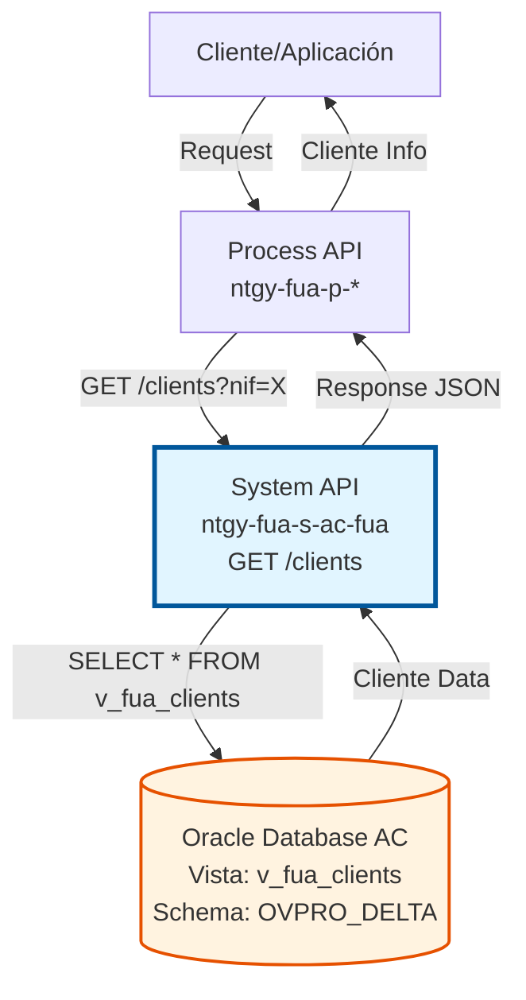
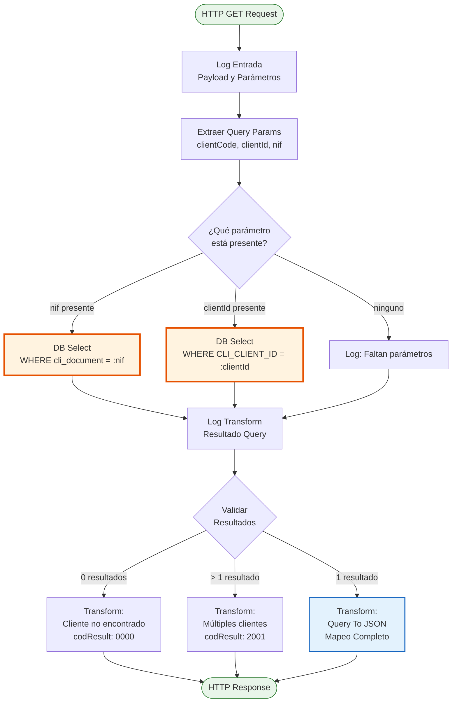
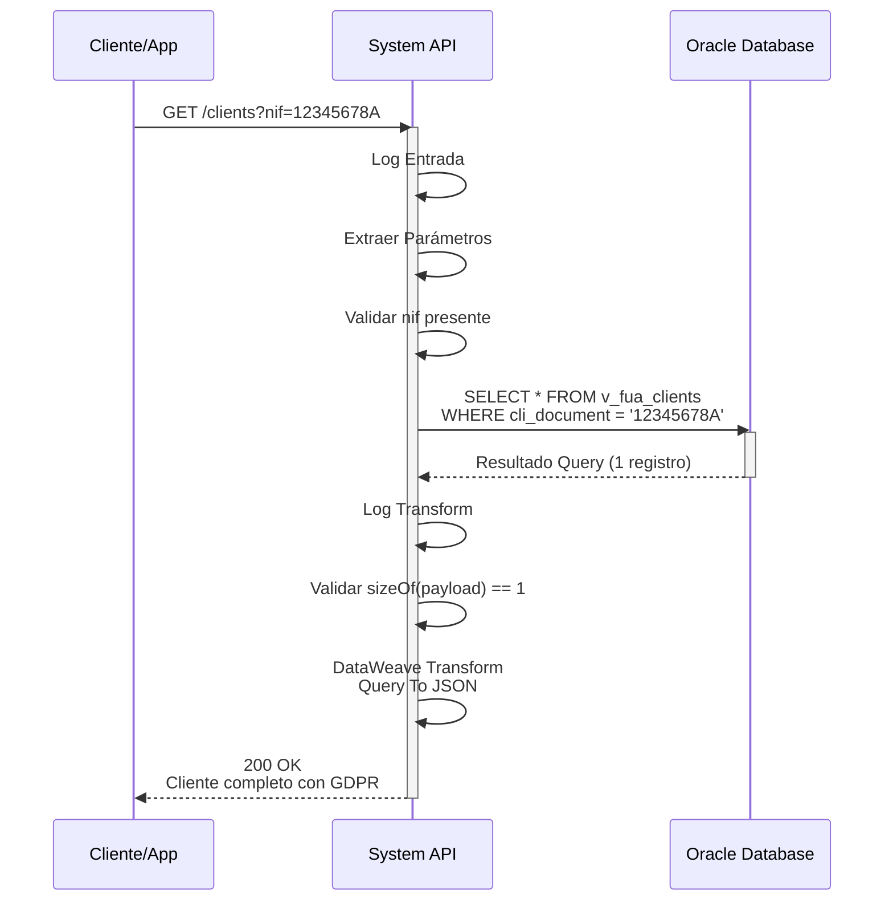

# GET /clients

## 📌 Descripción General

### Propósito del Endpoint

Endpoint de consulta de información completa de clientes en el sistema Área Cliente (AC) de Naturgy. Permite recuperar datos detallados de un cliente mediante múltiples criterios de búsqueda (NIF/NIE, ID de cliente), incluyendo información personal, preferencias GDPR, datos de contacto y estado de validación.

El endpoint soporta:
- **Búsqueda por Documento**: Consulta de cliente por NIF/NIE/CIF
- **Búsqueda por ID**: Consulta de cliente por identificador interno
- **Validación de Unicidad**: Detecta y reporta casos de múltiples clientes con el mismo documento
- **Datos GDPR**: Incluye todas las preferencias de consentimiento del cliente
- **Información de Contacto**: Datos completos de contacto y preferencias de comunicación

### Tipo de API

**Capa:** System API (API-Led Connectivity)

**Función:** Integración directa con base de datos Oracle del Área Cliente para consulta de información de clientes.

### Patrón de Integración

**Tipo:** Request-Reply Síncrono con Query SQL

**Descripción:** Recibe parámetros de búsqueda (NIF o clientId), ejecuta query SQL contra la vista `v_fua_clients`, transforma el resultado a formato JSON estándar y retorna la información completa del cliente.

### Arquitectura API-Led Connectivity



---

## 💼 Propósito del Negocio

### Casos de Uso Principales

1. **Consulta de Cliente en Portal Web/Móvil**
   - Usuario autenticado consulta su información personal
   - Sistema recupera datos completos del cliente
   - Beneficio: Autoservicio y transparencia de información

2. **Validación de Cliente en Proceso de Venta**
   - Agente de ventas verifica existencia y datos de cliente
   - Sistema valida unicidad del documento
   - Beneficio: Prevención de duplicados y mejora en calidad de datos

3. **Consulta de Cliente en Call Center**
   - Agente de servicio al cliente accede a información completa
   - Sistema proporciona vista 360° del cliente
   - Beneficio: Resolución rápida de consultas y mejor experiencia

4. **Verificación de Preferencias GDPR**
   - Sistema consulta consentimientos del cliente
   - Valida permisos para comunicaciones y tratamiento de datos
   - Beneficio: Cumplimiento normativo y respeto a preferencias

### Contexto Empresarial

- **Dominio:** Gestión de Clientes
- **Sector:** Energía - Utilities
- **División:** Naturgy España - Área Cliente
- **Proceso de Negocio:** Consulta y validación de información de clientes
- **Sistema Origen:** Área Cliente (AC) - Base de datos Oracle

### Stakeholders

- **Clientes Finales**: Consultan su propia información en portales de autoservicio
- **Agentes de Ventas**: Validan y consultan datos de clientes en proceso de venta
- **Agentes de Call Center**: Acceden a información completa para atención al cliente
- **Sistemas de Integración**: Process APIs que requieren datos de clientes

### Valor de Negocio

- **Unificación de Datos**: Punto único de acceso a información de clientes
- **Calidad de Datos**: Validación de unicidad y detección de duplicados
- **Cumplimiento GDPR**: Acceso a preferencias de consentimiento actualizadas
- **Eficiencia Operativa**: Reducción de tiempo en consultas de información
- **Experiencia de Cliente**: Información consistente en todos los canales

### Consumidores Potenciales

Este endpoint puede ser consumido por:
- Process APIs de gestión de clientes
- Experience APIs de portales web y móviles
- Sistemas de call center y CRM
- Aplicaciones de Frontal de Ventas (FUV)
- Sistemas de validación y onboarding

---

## 🔧 Especificación Técnica

### URLs por Ambiente

| Ambiente | URL Base | URL Completa |
|----------|----------|--------------|
| **Local** | `http://localhost:8081` | `http://localhost:8081/api/clients` |
| **Development** | `https://ntgy-fua-s-ac-fua-dev.us-e2.cloudhub.io` | `https://ntgy-fua-s-ac-fua-dev.us-e2.cloudhub.io/api/clients` |
| **Test** | `https://ntgy-fua-s-ac-fua-test.us-e2.cloudhub.io` | `https://ntgy-fua-s-ac-fua-test.us-e2.cloudhub.io/api/clients` |
| **Production** | `https://ntgy-fua-s-ac-fua-pro.us-e2.cloudhub.io` | `https://ntgy-fua-s-ac-fua-pro.us-e2.cloudhub.io/api/clients` |

### Método HTTP

```
GET /api/clients
```

### Parámetros de Entrada

#### Headers HTTP

| Header | Tipo | Requerido | Descripción | Ejemplo |
|--------|------|-----------|-------------|---------|
| `Accept` | string | ❌ No | Tipo de contenido esperado en response | `application/json` |

#### Query Parameters

| Parámetro | Tipo | Requerido | Descripción | Ejemplo |
|-----------|------|-----------|-------------|---------|
| `nif` | string | ⚠️ Condicional* | Documento del cliente (NIF/NIE/CIF) | `"12345678A"` |
| `clientId` | string | ⚠️ Condicional* | ID interno del cliente | `"123456"` |
| `clientCode` | string | ❌ No | Código del cliente (opcional) | `"CLI001"` |

**\* Nota:** Se requiere al menos uno de los parámetros: `nif` o `clientId`. Si se proporciona `nif`, se usa ese criterio; si no, se usa `clientId`.

### Respuestas

#### Respuesta Exitosa - Cliente Encontrado (200 OK)

```json
{
  "result": {
    "codResult": "0000",
    "msgResult": "No hay error"
  },
  "client": {
    "clientCode": "CLI001",
    "clientId": "123456",
    "email": "cliente@example.com",
    "isIndividualClient": true,
    "name": "Juan",
    "surname": "García",
    "surname2": "López",
    "mainAddressId": "ADDR001",
    "docTypeId": "nif",
    "docNumber": "12345678A",
    "nationalityId": "ES",
    "birthDate": "1980-05-15",
    "businessName": "",
    "cnae": "",
    "idEnergyUseType": "",
    "preferredLanguage": "es",
    "cuo": "CUO123456",
    "natCardId": "NAT789012",
    "personType": "F",
    "validatedClient": true,
    "areacliente": null,
    "segment": "RESIDENCIAL",
    "seniority": null,
    "vital": null,
    "vulnerability": "",
    "vulnerabilityOff": null,
    "startDateVulnerability": null,
    "endDatevulnerability": null,
    "lastAccess": "2026-07-20T10:30:00",
    "registerAccess": null,
    "stateRegister": "",
    "gdprPreferences": {
      "dataTransfer": true,
      "keepData": true,
      "advertising": true,
      "commercialCommunications": true,
      "communications": true,
      "profile": true,
      "survey": true,
      "market": true
    },
    "contacts": [
      {
        "contactId": "123456",
        "clientId": "123456",
        "name": "Juan",
        "surname": "García",
        "surname2": "López",
        "docTypeId": "nif",
        "docNumber": "12345678A",
        "nationalityId": "ES",
        "representationTypeId": "holder",
        "scheduleId": "",
        "preferredPhone": {
          "prefix": "+34",
          "number": "600123456"
        },
        "phone2": {
          "prefix": "+34",
          "number": "910234567"
        },
        "channel": "",
        "preferredEmail": "cliente@example.com",
        "isPreferred": true,
        "isValidated": true
      }
    ]
  }
}
```

#### Respuesta - Cliente No Encontrado (200 OK)

```json
{
  "result": {
    "codResult": "0000",
    "msgResult": "Cliente no encontrado"
  }
}
```

#### Respuesta - Múltiples Clientes (200 OK)

```json
{
  "result": {
    "codResult": "2001",
    "msgResult": "Mas de un cliente para ese NIF"
  }
}
```

#### Respuesta de Error Técnico (500)

```json
{
  "result": {
    "codResult": "0001",
    "msgResult": "Error interno del servidor"
  }
}
```

### Códigos de Respuesta

| Código | Descripción | Escenario |
|--------|-------------|-----------|
| `0000` | Éxito | Cliente encontrado o no encontrado (mensaje diferencia) |
| `2001` | Error de Negocio | Múltiples clientes con el mismo documento |
| `0001` | Error Técnico | Error en base de datos o sistema |

### Autenticación y Autorización

- **Tipo:** Client ID & Client Secret (Anypoint Platform)
- **Autorización DB:** El usuario de base de datos debe tener permisos para:
  - Acceso de lectura a vista `v_fua_clients`
  - Acceso al schema `OVPRO_DELTA`

### Timeouts

| Tipo | Valor | Descripción |
|------|-------|-------------|
| **Query Timeout** | 15 segundos | Tiempo máximo de ejecución de query SQL |
| **Connection Timeout** | 3600 segundos | Tiempo máximo para mantener conexión |
| **Response Timeout** | 30 segundos | Tiempo máximo de espera para la respuesta |

---

## 🏗️ Implementación Técnica

### Arquitectura del Flow



### Componentes Principales

#### 1. Extracción de Parámetros

```xml
<set-variable value="#[attributes.queryParams.clientCode]" 
              variableName="clientCode"/>
<set-variable value='#[attributes.queryParams["clientId"]]' 
              variableName="clientId"/>
<set-variable value='#[attributes.queryParams["nif"]]' 
              variableName="nif"/>
```

**Propósito:** Extraer parámetros de query string para uso en el flow.

#### 2. Routing Condicional

```xml
<choice>
    <when expression="#[vars.nif != null]">
        <!-- Query por NIF -->
    </when>
    <when expression="#[vars.clientId != null]">
        <!-- Query por clientId -->
    </when>
    <otherwise>
        <!-- Log de error: faltan parámetros -->
    </otherwise>
</choice>
```

**Propósito:** Enrutar la ejecución según el parámetro disponible.

#### 3. Query SQL por NIF

```sql
SELECT * FROM v_fua_clients WHERE cli_document = :nif
```

**Configuración:**
- **Config:** Database_Config
- **Query Timeout:** 15 segundos
- **Fetch Size:** 1000 registros
- **Reconnect:** Forever (con reintentos)

#### 4. Query SQL por Client ID

```sql
SELECT * FROM v_fua_clients WHERE CLI_CLIENT_ID = :clientId
```

**Configuración:**
- **Config:** Database_Config
- **Query Timeout:** 15 segundos
- **Fetch Size:** 1000 registros

#### 5. Validación de Resultados

```xml
<choice>
    <when expression="#[sizeOf(payload) == 0]">
        <!-- Cliente no encontrado -->
    </when>
    <when expression="#[sizeOf(payload) &gt; 1]">
        <!-- Múltiples clientes -->
    </when>
    <otherwise>
        <!-- Transformación del cliente -->
    </otherwise>
</choice>
```

### Transformación DataWeave

#### Mapeo de Tipo de Documento

```dataweave
docTypeId: if (payload[0].CLI_DOCUMENT_ORIGIN_COUNTRY == "ES") (
    if (isNumeric(substring(payload[0].CLI_DOCUMENT,0,1))) "nif"
    else if (["X","Y","Z"] contains substring(payload[0].CLI_DOCUMENT,0,1)) "nie" 
    else "cif"
) else "Passport"
```

**Lógica:**
- Si país origen es España:
  - Primer carácter numérico → NIF
  - Primer carácter X, Y o Z → NIE
  - Otro caso → CIF
- Si país origen no es España → Passport

#### Mapeo de Idioma Preferido

```dataweave
preferredLanguage: if (payload[0].CLI_LANGUAGE == "Castellano") "es"
    else if (payload[0].CLI_LANGUAGE == "Gallego") "gl"
    else if (payload[0].CLI_LANGUAGE == "Catalán") "ca"
    else if (payload[0].CLI_LANGUAGE == "Euskera") "eu"
    else "es"
```

#### Mapeo de Preferencias GDPR

```dataweave
gdprPreferences: {
    dataTransfer: if (["01"] contains payload[0].CLI_ACEPTAPUBLICIDADOTROSPROD) true else false,
    keepData: if (["01"] contains payload[0].CLI_ACEPTACESIONDATOS) true else false,
    advertising: if (["Y"] contains payload[0].CLI_PUBLICIDADPRODSIMILARES) true else false,
    commercialCommunications: if (["01"] contains payload[0].CLI_ACEPTAPERFILCOMPLEJO) true else false,
    communications: if (["Y"] contains payload[0].CLI_COMUNICACIONESINFORMATIVAS) true else false,
    profile: if (["Y"] contains payload[0].CLI_PERFILESBASICOS) true else false,
    survey: if (["Y"] contains payload[0].CLI_ENCUESTASSATISFACCION) true else false,
    market: if (["Y"] contains payload[0].CLI_ESTUDIOSMERCADO) true else false
}
```

### Diagrama de Secuencia



### Estructura de la Vista v_fua_clients

#### Campos Principales

| Campo DB | Campo JSON | Tipo | Descripción |
|----------|------------|------|-------------|
| `CLI_CLIENT_ID` | `clientId` | string | ID interno del cliente |
| `CLI_COD_CLIENT` | `clientCode` | string | Código del cliente |
| `CLI_DOCUMENT` | `docNumber` | string | Número de documento |
| `CLI_DOCUMENT_ORIGIN_COUNTRY` | `nationalityId` | string | País de origen del documento |
| `CLI_NAME` | `name` | string | Nombre del cliente |
| `CLI_LAST_NAME_1` | `surname` | string | Primer apellido |
| `CLI_LAST_NAME_2` | `surname2` | string | Segundo apellido |
| `CLI_EMAIL` | `email` | string | Email del cliente |
| `CLI_PHONE_1` | `preferredPhone.number` | string | Teléfono principal |
| `CLI_PHONE_2` | `phone2.number` | string | Teléfono secundario |
| `CLI_PERSON_TYPE` | `personType` | string | Tipo de persona (F/J) |
| `CLI_VALIDATED` | `validatedClient` | boolean | Cliente validado (Y/N) |
| `CLI_CLIENT_SEGMENT` | `segment` | string | Segmento del cliente |
| `CLI_LANGUAGE` | `preferredLanguage` | string | Idioma preferido |

#### Campos GDPR

| Campo DB | Campo JSON | Valores |
|----------|------------|---------|
| `CLI_ACEPTAPUBLICIDADOTROSPROD` | `gdprPreferences.dataTransfer` | "01" = true |
| `CLI_ACEPTACESIONDATOS` | `gdprPreferences.keepData` | "01" = true |
| `CLI_PUBLICIDADPRODSIMILARES` | `gdprPreferences.advertising` | "Y" = true |
| `CLI_ACEPTAPERFILCOMPLEJO` | `gdprPreferences.commercialCommunications` | "01" = true |
| `CLI_COMUNICACIONESINFORMATIVAS` | `gdprPreferences.communications` | "Y" = true |
| `CLI_PERFILESBASICOS` | `gdprPreferences.profile` | "Y" = true |
| `CLI_ENCUESTASSATISFACCION` | `gdprPreferences.survey` | "Y" = true |
| `CLI_ESTUDIOSMERCADO` | `gdprPreferences.market` | "Y" = true |

### Manejo de Errores

#### Errores de Base de Datos

```xml
<error-handler>
    <on-error-propagate type="DB:CONNECTIVITY">
        <!-- Error de conexión a base de datos -->
    </on-error-propagate>
    <on-error-propagate type="DB:QUERY_EXECUTION">
        <!-- Error en ejecución de query -->
    </on-error-propagate>
</error-handler>
```

#### Reintentos

- **Estrategia:** Reconnect Forever
- **Intentos:** 3 reintentos automáticos
- **Intervalo:** Exponential backoff

### Performance

#### Optimizaciones Implementadas

1. **Connection Pooling:**
   - MaxPoolSize: 15 conexiones
   - MaxWaitTime: 300 segundos
   - MaxIdleTime: 300 segundos

2. **Query Optimization:**
   - Uso de vista consolidada `v_fua_clients`
   - Índices en columnas de búsqueda (cli_document, CLI_CLIENT_ID)
   - Fetch size configurado a 1000

3. **Repeatable File Store:**
   - InMemoryObjects: 1000
   - Optimiza manejo de resultados grandes

#### Métricas Esperadas

- **Tiempo de Respuesta Promedio:** < 2 segundos
- **Tiempo de Respuesta p95:** < 3 segundos
- **Throughput:** > 50 requests/segundo
- **Error Rate:** < 1%

---

## 💻 Ejemplos de Uso

### Ejemplo 1: Consulta por NIF

#### Request

```bash
curl -X GET "https://ntgy-fua-s-ac-fua-pro.us-e2.cloudhub.io/api/clients?nif=12345678A" \
  -H "Accept: application/json"
```

#### Response (200 OK)

```json
{
  "result": {
    "codResult": "0000",
    "msgResult": "No hay error"
  },
  "client": {
    "clientCode": "CLI001",
    "clientId": "123456",
    "email": "juan.garcia@example.com",
    "isIndividualClient": true,
    "name": "Juan",
    "surname": "García",
    "surname2": "López",
    "mainAddressId": "ADDR001",
    "docTypeId": "nif",
    "docNumber": "12345678A",
    "nationalityId": "ES",
    "birthDate": "1980-05-15",
    "businessName": "",
    "cnae": "",
    "idEnergyUseType": "",
    "preferredLanguage": "es",
    "cuo": "CUO123456",
    "natCardId": "NAT789012",
    "personType": "F",
    "validatedClient": true,
    "areacliente": null,
    "segment": "RESIDENCIAL",
    "seniority": null,
    "vital": null,
    "vulnerability": "",
    "vulnerabilityOff": null,
    "startDateVulnerability": null,
    "endDatevulnerability": null,
    "lastAccess": "2026-07-20T10:30:00",
    "registerAccess": null,
    "stateRegister": "",
    "gdprPreferences": {
      "dataTransfer": true,
      "keepData": true,
      "advertising": false,
      "commercialCommunications": true,
      "communications": true,
      "profile": true,
      "survey": false,
      "market": true
    },
    "contacts": [
      {
        "contactId": "123456",
        "clientId": "123456",
        "name": "Juan",
        "surname": "García",
        "surname2": "López",
        "docTypeId": "nif",
        "docNumber": "12345678A",
        "nationalityId": "ES",
        "representationTypeId": "holder",
        "scheduleId": "",
        "preferredPhone": {
          "prefix": "+34",
          "number": "600123456"
        },
        "phone2": {
          "prefix": "+34",
          "number": "910234567"
        },
        "channel": "",
        "preferredEmail": "juan.garcia@example.com",
        "isPreferred": true,
        "isValidated": true
      }
    ]
  }
}
```

### Ejemplo 2: Consulta por Client ID

#### Request

```bash
curl -X GET "https://ntgy-fua-s-ac-fua-pro.us-e2.cloudhub.io/api/clients?clientId=123456" \
  -H "Accept: application/json"
```

#### Response (200 OK)

```json
{
  "result": {
    "codResult": "0000",
    "msgResult": "No hay error"
  },
  "client": {
    "clientId": "123456",
    "email": "juan.garcia@example.com",
    "name": "Juan",
    "surname": "García",
    "docTypeId": "nif",
    "docNumber": "12345678A"
  }
}
```

### Ejemplo 3: Cliente No Encontrado

#### Request

```bash
curl -X GET "https://ntgy-fua-s-ac-fua-pro.us-e2.cloudhub.io/api/clients?nif=99999999Z" \
  -H "Accept: application/json"
```

#### Response (200 OK)

```json
{
  "result": {
    "codResult": "0000",
    "msgResult": "Cliente no encontrado"
  }
}
```

### Ejemplo 4: Múltiples Clientes (Error)

#### Request

```bash
curl -X GET "https://ntgy-fua-s-ac-fua-pro.us-e2.cloudhub.io/api/clients?nif=12345678A" \
  -H "Accept: application/json"
```

#### Response (200 OK)

```json
{
  "result": {
    "codResult": "2001",
    "msgResult": "Mas de un cliente para ese NIF"
  }
}
```

### Ejemplo 5: Consulta con Client Code (Opcional)

#### Request

```bash
curl -X GET "https://ntgy-fua-s-ac-fua-pro.us-e2.cloudhub.io/api/clients?nif=12345678A&clientCode=CLI001" \
  -H "Accept: application/json"
```

**Nota:** El parámetro `clientCode` es opcional y se incluye en la respuesta si está presente en la base de datos.

### Ejemplo 6: Consulta de Cliente Empresa (Persona Jurídica)

#### Request

```bash
curl -X GET "https://ntgy-fua-s-ac-fua-pro.us-e2.cloudhub.io/api/clients?nif=A12345678" \
  -H "Accept: application/json"
```

#### Response (200 OK)

```json
{
  "result": {
    "codResult": "0000",
    "msgResult": "No hay error"
  },
  "client": {
    "clientId": "789012",
    "email": "contacto@empresa.com",
    "isIndividualClient": false,
    "name": "",
    "surname": "",
    "surname2": "",
    "docTypeId": "cif",
    "docNumber": "A12345678",
    "businessName": "Empresa Ejemplo S.L.",
    "personType": "J",
    "validatedClient": true,
    "segment": "EMPRESAS"
  }
}
```

### Ejemplo 7: Cliente con NIE

#### Request

```bash
curl -X GET "https://ntgy-fua-s-ac-fua-pro.us-e2.cloudhub.io/api/clients?nif=X1234567L" \
  -H "Accept: application/json"
```

#### Response (200 OK)

```json
{
  "result": {
    "codResult": "0000",
    "msgResult": "No hay error"
  },
  "client": {
    "clientId": "345678",
    "docTypeId": "nie",
    "docNumber": "X1234567L",
    "nationalityId": "FR",
    "name": "Pierre",
    "surname": "Dubois"
  }
}
```
