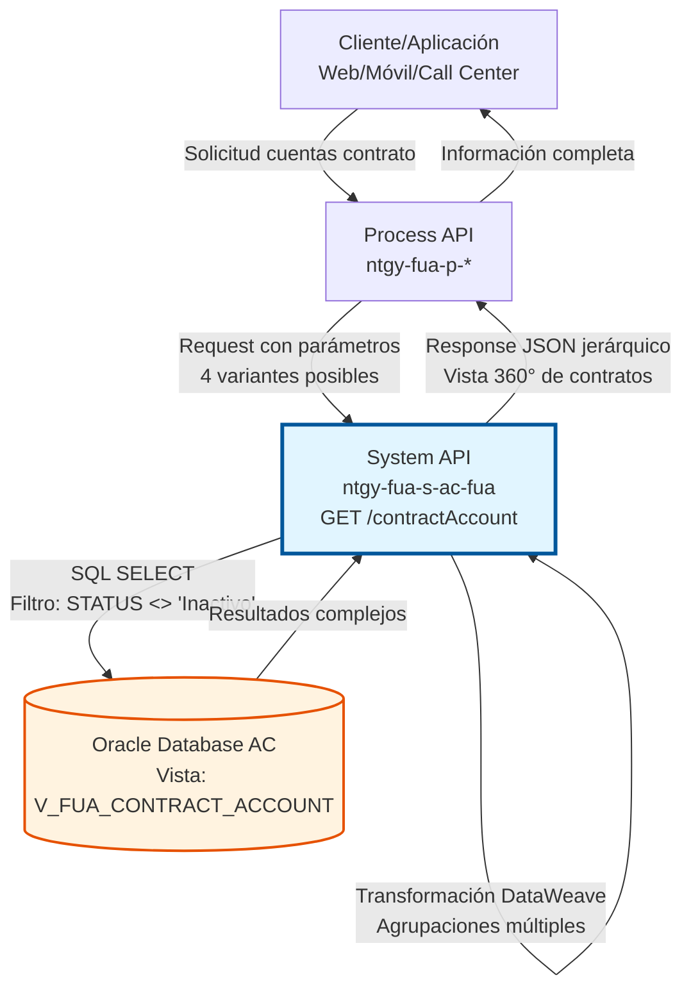
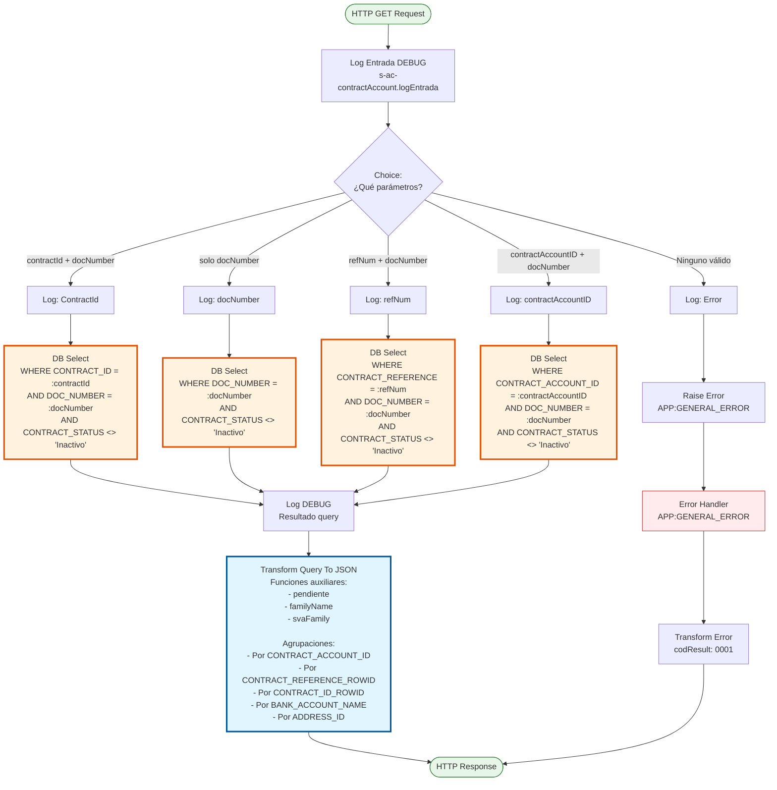
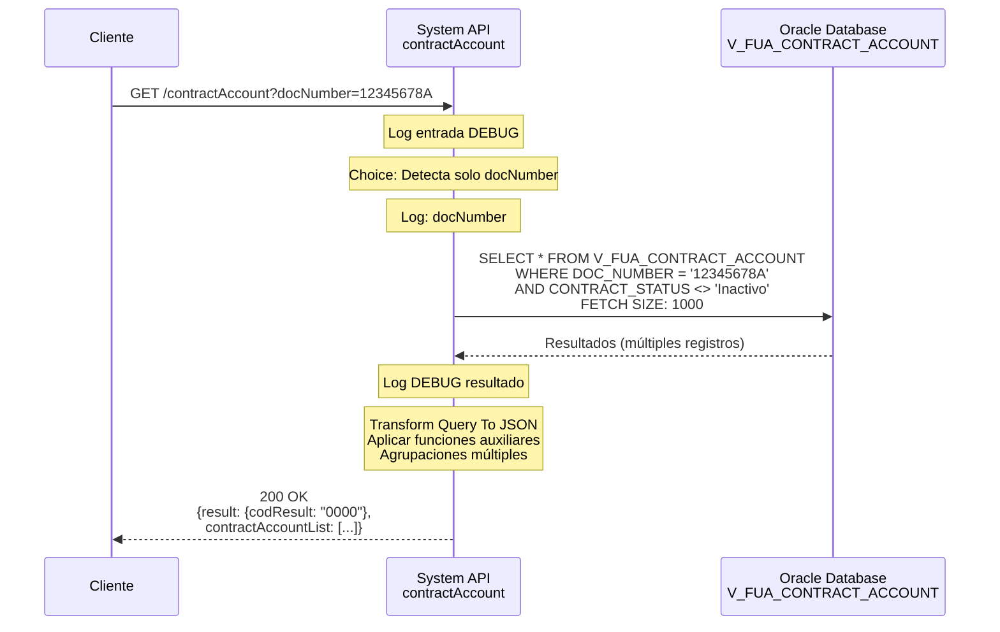
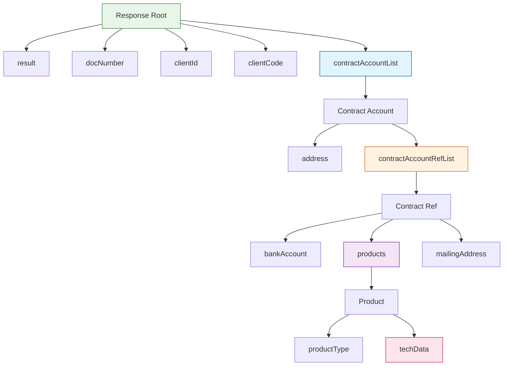

# GET /contractAccount

## 📌 Descripción General

### Propósito del Endpoint

Consulta información completa de cuentas contrato de un cliente desde la base de datos del Área de Clientes. Este endpoint proporciona una vista 360° de las cuentas contrato, incluyendo productos contratados, direcciones de suministro y envío, información de pago, datos técnicos (CUPS, potencias, tarifas) y estado de contratos.

El endpoint soporta:
- **Consulta por Contract ID**: Obtiene cuenta contrato específica por ID de contrato y documento
- **Consulta por Document Number**: Obtiene todas las cuentas contrato de un cliente
- **Consulta por Reference Number**: Obtiene cuenta contrato por número de referencia y documento
- **Consulta por Contract Account ID**: Obtiene cuenta contrato por ID de cuenta contrato y documento
- **Filtrado Automático**: Excluye contratos inactivos de los resultados
- **Estructura Jerárquica**: Respuesta con 4 niveles de anidación (cuenta → referencia → productos → datos técnicos)

### Tipo de API

**Capa:** System API (API-Led Connectivity)

**Función:** Integración directa con base de datos Oracle del Área de Clientes para consulta completa de cuentas contrato con información de productos, pagos y datos técnicos.

### Patrón de Integración

**Tipo:** Request-Reply Síncrono con Database Query Compleja

**Descripción:** Recibe parámetros de búsqueda (4 variantes posibles), ejecuta query SQL en vista consolidada `V_FUA_CONTRACT_ACCOUNT`, aplica transformación DataWeave compleja con agrupaciones múltiples y retorna estructura jerárquica con información completa de cuentas contrato.

### Arquitectura API-Led Connectivity



---

## 💼 Propósito del Negocio

### Casos de Uso Principales

1. **Vista 360° del Cliente**
   - Agente de call center consulta información completa del cliente
   - Sistema retorna todas las cuentas contrato con productos y servicios
   - Agente puede ver estado de cada contrato, direcciones y formas de pago
   - Facilita atención integral al cliente

2. **Gestión de Contratos en Portal Web**
   - Cliente accede a su portal y consulta sus contratos
   - Sistema muestra productos contratados (luz, gas, servicios)
   - Cliente puede ver datos técnicos (CUPS, potencias, tarifas)
   - Facilita autogestión de contratos

3. **Validación de Datos para Nuevas Contrataciones**
   - Sistema de ventas consulta contratos existentes del cliente
   - Verifica direcciones de suministro disponibles
   - Identifica productos ya contratados
   - Previene duplicados y facilita cross-selling

4. **Soporte a Procesos de Facturación**
   - Sistema de facturación consulta cuentas contrato activas
   - Obtiene información de domiciliación bancaria
   - Verifica direcciones de envío de facturas
   - Facilita proceso de facturación y cobro

### Contexto Empresarial

- **Dominio:** Gestión de Contratos y Cuentas Contrato
- **Sector:** Energía - Utilities
- **División:** Naturgy España - Área de Clientes
- **Proceso de Negocio:** Consulta de Información Contractual Completa
- **Base de Datos:** Oracle AC - Vista V_FUA_CONTRACT_ACCOUNT

### Stakeholders

- **Clientes Finales**: Usuarios que consultan sus contratos y productos
- **Agentes de Call Center**: Personal que requiere vista completa del cliente
- **Equipo de Ventas**: Agentes que necesitan información para nuevas contrataciones
- **Equipo de Facturación**: Responsables de procesos de facturación y cobro
- **Desarrolladores Frontend**: Implementan vistas de contratos y productos

### Valor de Negocio

- **Vista Integral**: Información completa de contratos en una sola consulta
- **Eficiencia Operativa**: Reduce tiempo de búsqueda de información
- **Experiencia de Usuario**: Cliente puede ver todos sus productos en un solo lugar
- **Soporte a Ventas**: Facilita identificación de oportunidades de cross-selling
- **Precisión de Datos**: Información actualizada de direcciones, pagos y datos técnicos

### Consumidores Potenciales

Este endpoint puede ser consumido por:
- Process APIs de gestión de contratos
- Portales web de autoservicio
- Aplicaciones móviles
- Sistemas de call center
- Sistemas de facturación
- Plataformas de ventas
- Sistemas de CRM

---

## 🔧 Especificación Técnica

### URLs por Ambiente

| Ambiente | URL Base | URL Completa |
|----------|----------|--------------|
| **Local** | `http://localhost:8081` | `http://localhost:8081/api/contractAccount` |
| **Development** | `https://ntgy-fua-s-ac-fua-dev.us-e2.cloudhub.io` | `https://ntgy-fua-s-ac-fua-dev.us-e2.cloudhub.io/api/contractAccount` |
| **UAT** | `https://ntgy-fua-s-ac-fua-uat.us-e2.cloudhub.io` | `https://ntgy-fua-s-ac-fua-uat.us-e2.cloudhub.io/api/contractAccount` |
| **Production** | `https://ntgy-fua-s-ac-fua-pro.us-e2.cloudhub.io` | `https://ntgy-fua-s-ac-fua-pro.us-e2.cloudhub.io/api/contractAccount` |

### Método HTTP

```
GET /api/contractAccount
```

### Parámetros de Entrada

#### Headers HTTP

| Header | Tipo | Requerido | Descripción | Ejemplo |
|--------|------|-----------|-------------|---------|
| `Accept` | string | ❌ No | Tipo de contenido esperado en response | `application/json` |

#### Query Parameters

**⚠️ IMPORTANTE:** Se debe proporcionar **UNA** de las siguientes combinaciones de parámetros:

**Opción 1: Por Contract ID**
| Parámetro | Tipo | Requerido | Descripción | Ejemplo |
|-----------|------|-----------|-------------|---------|
| `contractId` | string | ✅ Sí | ID del contrato | `"8001234567"` |
| `docNumber` | string | ✅ Sí | Número de documento del cliente | `"12345678A"` |

**Opción 2: Por Document Number (solo)**
| Parámetro | Tipo | Requerido | Descripción | Ejemplo |
|-----------|------|-----------|-------------|---------|
| `docNumber` | string | ✅ Sí | Número de documento del cliente | `"12345678A"` |

**Opción 3: Por Reference Number**
| Parámetro | Tipo | Requerido | Descripción | Ejemplo |
|-----------|------|-----------|-------------|---------|
| `refNum` | string | ✅ Sí | Número de referencia del contrato | `"REF123456"` |
| `docNumber` | string | ✅ Sí | Número de documento del cliente | `"12345678A"` |

**Opción 4: Por Contract Account ID**
| Parámetro | Tipo | Requerido | Descripción | Ejemplo |
|-----------|------|-----------|-------------|---------|
| `contractAccountID` | string | ✅ Sí | ID de cuenta contrato | `"200012345678"` |
| `docNumber` | string | ✅ Sí | Número de documento del cliente | `"12345678A"` |

**Reglas de Validación:**
- Si no se proporciona ningún parámetro válido, se retorna error `APP:GENERAL_ERROR`
- La opción 2 (solo docNumber) requiere que NO estén presentes `refNum`, `contractId` ni `contractAccountID`
- Todas las queries filtran contratos con estado "Inactivo"

### Respuestas

#### Respuesta Exitosa (200 OK)

```json
{
  "result": {
    "codResult": "0000",
    "msgResult": "No hay error"
  },
  "docNumber": "12345678A",
  "clientId": "CLI123456",
  "clientCode": "C001234",
  "contractAccountList": [
    {
      "supplyPointId": "200012345678",
      "contractAccountId": "200012345678",
      "clientId": "CLI123456",
      "address": {
        "fullAddress": "CALLE MAYOR 123 1 A 28001 MADRID MADRID",
        "addressId": "ADDR001",
        "zipCode": "28001",
        "province": "MADRID",
        "city": "MADRID",
        "town": "MADRID",
        "way": "CALLE MAYOR",
        "wayId": "",
        "wayType": "CALLE",
        "number": "123",
        "floor": "1",
        "door": "A",
        "portal": "",
        "stairs": ""
      },
      "contractAccountRefList": [
        {
          "refNum": "REF123456",
          "contractRefNum": "REF123456",
          "isDirectPayment": true,
          "isOnlineBill": true,
          "bankAccount": [
            {
              "bankAccountId": "BANK001",
              "contactId": "",
              "holderName": "JUAN PEREZ GARCIA",
              "holderType": "Titular",
              "iban": "ES1234567890123456789012"
            }
          ],
          "products": [
            {
              "contractId": "8001234567",
              "contractNumber": "8001234567",
              "isActive": true,
              "startDate": "2024-01-15",
              "endDate": "",
              "dropOutDate": "",
              "contractSignatureDate": "",
              "isPending": false,
              "productType": {
                "isEco": false,
                "productTypeId": "PROD001",
                "productTypeName": "Tarifa Estable Luz",
                "svaFamily": "luz",
                "productTypeFamily": "luz",
                "productTypeRealName": "Electricidad"
              },
              "adviseGas": false,
              "techData": {
                "cups": "ES0021000000000001AA",
                "distribution": "",
                "rate": "2.0TD",
                "rateId": "2.0TD",
                "voltage": "",
                "selfConsumption": null,
                "installation": "",
                "changePower": null,
                "isValidCIE": null,
                "powerPlain": "3.45",
                "powerValley": "3.45",
                "powerP3": "",
                "powerP4": "",
                "powerP5": "",
                "powerP6": "",
                "recommendedPowerPlain": "",
                "recommendedPowerValley": "",
                "IPDate": "",
                "remoteManagement": null,
                "cnae": "9820"
              }
            },
            {
              "contractId": "8001234568",
              "contractNumber": "8001234568",
              "isActive": true,
              "startDate": "2024-01-15",
              "endDate": "",
              "dropOutDate": "",
              "contractSignatureDate": "",
              "isPending": false,
              "productType": {
                "isEco": true,
                "productTypeId": "PROD002",
                "productTypeName": "Gas Natural Eco",
                "svaFamily": "gas",
                "productTypeFamily": "gas",
                "productTypeRealName": "Gas"
              },
              "adviseGas": true,
              "techData": {
                "cups": "ES0021000000000002AA",
                "distribution": "",
                "rate": "RL.1",
                "rateId": "RL.1",
                "voltage": "",
                "selfConsumption": null,
                "installation": "",
                "changePower": null,
                "isValidCIE": null,
                "powerPlain": "",
                "powerValley": "",
                "powerP3": "",
                "powerP4": "",
                "powerP5": "",
                "powerP6": "",
                "recommendedPowerPlain": "",
                "recommendedPowerValley": "",
                "IPDate": "",
                "remoteManagement": null,
                "cnae": "9820"
              }
            }
          ],
          "mailingAddress": [
            {
              "addressId": "MAIL001",
              "zipCode": "28002",
              "province": "MADRID",
              "city": "MADRID",
              "town": "MADRID",
              "way": "AVENIDA PRINCIPAL",
              "wayId": "",
              "wayType": "AVENIDA",
              "number": "456",
              "floor": "2",
              "door": "B",
              "portal": "1",
              "stairs": "A"
            }
          ]
        }
      ]
    }
  ]
}
```

**Descripción de Campos Principales:**

**Nivel 1: Información del Cliente**
- `docNumber`: Documento del cliente (NIF/NIE)
- `clientId`: Identificador único del cliente
- `clientCode`: Código del cliente

**Nivel 2: Contract Account List (Cuentas Contrato)**
- `supplyPointId`: Identificador del punto de suministro
- `contractAccountId`: Identificador de la cuenta contrato
- `address`: Dirección del punto de suministro (objeto completo)

**Nivel 3: Contract Account Ref List (Referencias de Contrato)**
- `refNum`: Número de referencia del contrato
- `isDirectPayment`: Indica si tiene domiciliación bancaria
- `isOnlineBill`: Indica si tiene factura electrónica
- `bankAccount`: Array de cuentas bancarias asociadas
- `products`: Array de productos contratados
- `mailingAddress`: Array de direcciones de envío

**Nivel 4: Products (Productos Contratados)**
- `contractId`: ID del contrato
- `isActive`: Indica si el contrato está activo
- `isPending`: Indica si el contrato está pendiente
- `productType`: Información del tipo de producto
  - `productTypeFamily`: Familia del producto (luz/gas/servicios)
  - `svaFamily`: Familia SVA (luz/gas/hogar/seguros)
  - `isEco`: Indica si es producto ecológico
- `techData`: Datos técnicos del suministro
  - `cups`: Código CUPS del punto de suministro
  - `rate`: Tarifa contratada
  - `powerPlain`, `powerValley`, etc.: Potencias contratadas
  - `cnae`: Código CNAE de actividad

#### Respuesta de Error (200 OK)

```json
{
  "result": {
    "codResult": "0001",
    "msgResult": "KO"
  }
}
```

**Interpretación:**
- Código `0001` indica error en la consulta
- Se retorna cuando no se proporcionan parámetros válidos
- Error type: `APP:GENERAL_ERROR`

### Autenticación y Autorización

- **Tipo:** Client ID & Client Secret (Anypoint Platform)
- **Autorización DB:** El usuario de base de datos debe tener permisos de:
  - SELECT en vista `V_FUA_CONTRACT_ACCOUNT`
  - Acceso al schema `OVPRO_DELTA`

### Timeouts

| Tipo | Valor | Descripción |
|------|-------|-------------|
| **Query Timeout** | `${dbAC.queryTimeout}` | Tiempo máximo de ejecución de query SQL |
| **Connection Timeout** | 3600 segundos | Tiempo máximo para obtener conexión del pool |
| **Fetch Size** | 1000 registros | Tamaño de lote para recuperación de datos |

---

## 🏗️ Implementación Técnica

### Arquitectura del Flow



### Componentes del Flow

#### 1. Flow Principal: `contractAccountFlow`

**Ubicación:** `src/main/mule/implementation/s-ac-contractAccount.xml`

**Responsabilidades:**
- Recibir solicitud con parámetros de búsqueda
- Determinar tipo de consulta (4 variantes)
- Ejecutar query SQL apropiada
- Aplicar transformación DataWeave compleja
- Manejar errores de parámetros inválidos

#### 2. Choice: Determinación de Variante de Consulta

**Lógica de Decisión (5 ramas):**

```xml
<!-- Rama 1: Por Contract ID + Document -->
<when expression='#[!isEmpty(attributes.queryParams["contractId"])]'>
    <logger level="DEBUG" message="ContractId" />
    <!-- Query 1 -->
</when>

<!-- Rama 2: Por Document Number (solo) -->
<when expression='#[!isEmpty(attributes.queryParams["docNumber"]) 
                   and isEmpty(attributes.queryParams["refNum"]) 
                   and isEmpty(attributes.queryParams["contractId"]) 
                   and isEmpty(attributes.queryParams["contractAccountID"])]'>
    <logger level="DEBUG" message="docNumber" />
    <!-- Query 2 -->
</when>

<!-- Rama 3: Por Reference Number + Document -->
<when expression='#[!isEmpty(attributes.queryParams["refNum"])]'>
    <logger level="DEBUG" message="refNum" />
    <!-- Query 3 -->
</when>

<!-- Rama 4: Por Contract Account ID + Document -->
<when expression='#[!isEmpty(attributes.queryParams["contractAccountID"])]'>
    <logger level="DEBUG" message="contractAccountID" />
    <!-- Query 4 -->
</when>

<!-- Rama 5: Error - Sin parámetros válidos -->
<otherwise>
    <logger level="DEBUG" message="Error, no se ha definido la variable" />
    <raise-error type="APP:GENERAL_ERROR"/>
</otherwise>
```

#### 3. Queries SQL (4 Variantes)

**Configuración Común:**
- **Config Reference:** `Database_Config`
- **Query Timeout:** `${dbAC.queryTimeout}`
- **Fetch Size:** 1000 registros
- **Repeatable File Store Iterable:** inMemoryObjects=1000

**Query 1: Por Contract ID**
```sql
SELECT * 
FROM V_FUA_CONTRACT_ACCOUNT 
WHERE CONTRACT_ID = :contractId 
  AND DOC_NUMBER = :docNumber 
  AND CONTRACT_STATUS <> 'Inactivo'
```

**Query 2: Por Document Number**
```sql
SELECT * 
FROM V_FUA_CONTRACT_ACCOUNT 
WHERE DOC_NUMBER = :docNumber
  AND CONTRACT_STATUS <> 'Inactivo'
```

**Query 3: Por Reference Number**
```sql
SELECT * 
FROM V_FUA_CONTRACT_ACCOUNT 
WHERE CONTRACT_REFERENCE = :refNum 
  AND DOC_NUMBER = :docNumber
  AND CONTRACT_STATUS <> 'Inactivo'
```

**Query 4: Por Contract Account ID**
```sql
SELECT * 
FROM V_FUA_CONTRACT_ACCOUNT 
WHERE CONTRACT_ACCOUNT_ID = :contractAccountID 
  AND DOC_NUMBER = :docNumber
  AND CONTRACT_STATUS <> 'Inactivo'
```

**Características Comunes:**
- Filtro de contratos inactivos en todas las queries
- Uso de prepared statements para prevenir SQL injection
- Fetch size optimizado para grandes volúmenes

#### 4. Transformación DataWeave Compleja

**Funciones Auxiliares:**

```dataweave
%dw 2.0
output application/json

// Función 1: Determina si un contrato está pendiente
fun pendiente(astring) = if(
    astring == "Pte recibir doc" 
    or astring == "Documentación recibida" 
    or astring == "Solicitud aceptada"
    or astring == "Solicitud enviada"
    or astring == "Pendiente"
    or astring == "Pte. Instalación"
    or astring == "Pendiente Energía"
    or astring == "Solicitud ATR"
    or astring == "Alta Activa"
    or astring == "Completar"
    or astring == "Pte. Validación"
) true else false

// Función 2: Mapea tipo de producto a familia
fun familyName(aString) = aString match {
    case literalMatch: "Electricidad" -> "luz"
    case literalMatch: "Gas" -> "gas"
    else -> "servicios"
}

// Función 3: Mapea código SVA a familia
fun svaFamily(aString) = aString match {
    case literalMatch: "SVG" -> "gas"
    case literalMatch: "SVE" -> "luz"
    case literalMatch: "SHD" -> "hogar"
    case literalMatch: "SPF" -> "seguros"
    case literalMatch: "Others" -> "servicios"
    else -> ""
}
```

**Estructura de Agrupaciones:**

```dataweave
---
{
    result: {
        codResult: "0000",
        msgResult: "No hay error"
    },
    docNumber: payload[0].DOC_NUMBER,
    clientId: payload[0].CLIENT_ID,
    clientCode: payload[0].CLIENT_CODE,
    
    // NIVEL 1: Agrupar por CONTRACT_ACCOUNT_ID
    contractAccountList: payload groupBy $.CONTRACT_ACCOUNT_ID pluck {
        supplyPointId: $$,
        contractAccountId: $$,
        clientId: $.CLIENT_ID distinctBy $ reduce $ + $$,
        
        // Dirección del punto de suministro
        address: {
            fullAddress: (concatenación de campos de dirección),
            addressId: $.S_ADDRESS_ID distinctBy $ reduce $ + $$,
            zipCode: $.M_ZIPCODE distinctBy $ reduce $ + $$,
            // ... más campos de dirección
        },
        
        // NIVEL 2: Agrupar por CONTRACT_REFERENCE_ROWID
        contractAccountRefList: $ groupBy $.CONTRACT_REFERENCE_ROWID pluck {
            refNum: $.CONTRACT_REFERENCE distinctBy $ reduce $ + $$,
            contractRefNum: $.CONTRACT_REFERENCE distinctBy $ reduce $ + $$,
            isDirectPayment: if (($.PAYMENT_METHOD distinctBy $ reduce $ + $$) == "Domiciliacion") (true) else (false),
            isOnlineBill: if (($.ONLINE_BILL distinctBy $ reduce $ + $$) == "Y") (true) else (false),
            
            // NIVEL 3a: Agrupar por BANK_ACCOUNT_NAME
            bankAccount: ($ groupBy $.BANK_ACCOUNT_NAME pluck {
                bankAccountId: $.BANK_ACCOUNT_ID distinctBy $ reduce $ + $$,
                holderName: $$,
                holderType: $.HOLDER_TYPE distinctBy $ reduce $ + $$,
                iban: ($.BANK_ACCOUNT_IBAN distinctBy $ reduce $ + $$) default "",
            }) default "",
            
            // NIVEL 3b: Agrupar por CONTRACT_ID_ROWID
            products: $ groupBy $.CONTRACT_ID_ROWID pluck {
                contractId: $.CONTRACT_ID distinctBy $ reduce $ + $$,
                contractNumber: $.CONTRACT_ID distinctBy $ reduce $ + $$,
                isActive: if (($.CONTRACT_STATUS distinctBy $ reduce $ + $$) == "Activo") (true) else (false),
                isPending: pendiente($.CONTRACT_STATUS distinctBy $ reduce $ + $$),
                
                // Información del producto
                productType: {
                    isEco: if (($.IS_ECO distinctBy $ reduce $ + $$) == "Y") (true) else (false),
                    productTypeId: $.PRODUCT_CODE distinctBy $ reduce $ + $$,
                    productTypeName: $.PRODUCT_DESCRIPTION distinctBy $ reduce $ + $$,
                    svaFamily: svaFamily($.PRODUCT_GENERIC_NAME distinctBy $ reduce $ + $$),
                    productTypeFamily: familyName($.PRODUCT_GENERIC_NAME distinctBy $ reduce $ + $$),
                    productTypeRealName: $.PRODUCT_GENERIC_NAME distinctBy $ reduce $ + $$
                },
                
                // Datos técnicos
                techData: {
                    cups: $.CUPS_ID distinctBy $ reduce $ + $$,
                    rate: $.RATE distinctBy $ reduce $ + $$,
                    powerPlain: $.POW1 distinctBy $ reduce $ + $$,
                    powerValley: $.POW2 distinctBy $ reduce $ + $$,
                    // ... más campos técnicos
                }
            },
            
            // NIVEL 3c: Agrupar por ADDRESS_ID (direcciones de envío)
            mailingAddress: $ filter ($.ADDRESS_ID != null) groupBy $.ADDRESS_ID pluck {
                addressId: $$,
                zipCode: $.ZIPCODE distinctBy $ reduce $ + $$,
                // ... más campos de dirección
            }
        }
    }
}
```

**Técnicas DataWeave Utilizadas:**
- `groupBy`: Agrupa registros por campo específico
- `pluck`: Transforma objeto agrupado en array
- `distinctBy`: Elimina duplicados
- `reduce`: Combina valores (concatenación)
- `filter`: Filtra registros con condición
- `match/case`: Pattern matching para mapeo de valores

#### 5. Error Handler

**Tipo de Error Capturado:**
- `APP:GENERAL_ERROR`

**Respuesta de Error:**
```dataweave
%dw 2.0
output application/json
---
{
    result: {
        codResult: "0001",
        msgResult: "KO"
    }
}
```

### Diagrama de Secuencia



### Diagrama de Estructura de Datos



### Configuración de Base de Datos

**Database Config:**
- **Driver:** Oracle JDBC 19.13.0.0.1
- **Connection Type:** Oracle Connection
- **Schema:** OVPRO_DELTA
- **Connection Pool:** MaxPoolSize=15
- **High Availability:** Dual host configuration

**Vista Utilizada:**
- **Nombre:** `V_FUA_CONTRACT_ACCOUNT`
- **Tipo:** Vista consolidada compleja
- **Propósito:** Unificar información de contratos, productos, direcciones y pagos
- **Complejidad:** Alta (múltiples joins internos)

### Logging

**Puntos de Logging:**

1. **Log Entrada:**
   - Level: DEBUG
   - Message: `s-ac-contractAccount.logEntrada ## attributes: #[attributes.queryParams]`
   - Propósito: Registrar parámetros de entrada

2. **Logs de Rama (4):**
   - Level: DEBUG
   - Messages: "ContractId", "docNumber", "refNum", "contractAccountID"
   - Propósito: Identificar qué rama del Choice se ejecutó

3. **Log de Error:**
   - Level: DEBUG
   - Message: "Error, no se ha definido la variable"
   - Propósito: Registrar cuando no hay parámetros válidos

4. **Log de Resultado:**
   - Level: DEBUG
   - Message: Payload en formato JSON
   - Propósito: Registrar resultado de query antes de transformar

---

## 💻 Ejemplos de Uso

### Ejemplo 1: Consulta por Document Number (Todas las Cuentas)

#### Request

```bash
curl -X GET "https://ntgy-fua-s-ac-fua-pro.us-e2.cloudhub.io/api/contractAccount?docNumber=12345678A" \
  -H "Accept: application/json" \
  -H "client_id: YOUR_CLIENT_ID" \
  -H "client_secret: YOUR_CLIENT_SECRET"
```

#### Response (200 OK) - Fragmento

```json
{
  "result": {
    "codResult": "0000",
    "msgResult": "No hay error"
  },
  "docNumber": "12345678A",
  "clientId": "CLI123456",
  "clientCode": "C001234",
  "contractAccountList": [
    {
      "supplyPointId": "200012345678",
      "contractAccountId": "200012345678",
      "clientId": "CLI123456",
      "address": {
        "fullAddress": "CALLE MAYOR 123 1 A 28001 MADRID MADRID",
        "zipCode": "28001",
        "province": "MADRID",
        "city": "MADRID"
      },
      "contractAccountRefList": [
        {
          "refNum": "REF123456",
          "isDirectPayment": true,
          "isOnlineBill": true,
          "products": [
            {
              "contractId": "8001234567",
              "isActive": true,
              "isPending": false,
              "productType": {
                "productTypeName": "Tarifa Estable Luz",
                "productTypeFamily": "luz"
              },
              "techData": {
                "cups": "ES0021000000000001AA",
                "rate": "2.0TD",
                "powerPlain": "3.45"
              }
            }
          ]
        }
      ]
    }
  ]
}
```

**Interpretación:**
- Cliente tiene 1 cuenta contrato
- Cuenta tiene 1 referencia de contrato
- Referencia tiene 1 producto activo (luz)
- Incluye datos técnicos completos (CUPS, tarifa, potencias)

---

### Ejemplo 2: Consulta por Contract ID

#### Request

```bash
curl -X GET "https://ntgy-fua-s-ac-fua-pro.us-e2.cloudhub.io/api/contractAccount?contractId=8001234567&docNumber=12345678A" \
  -H "Accept: application/json" \
  -H "client_id: YOUR_CLIENT_ID" \
  -H "client_secret: YOUR_CLIENT_SECRET"
```

#### Response (200 OK)

Retorna solo la cuenta contrato que contiene el contrato específico.

---

### Ejemplo 3: Consulta por Reference Number

#### Request

```bash
curl -X GET "https://ntgy-fua-s-ac-fua-pro.us-e2.cloudhub.io/api/contractAccount?refNum=REF123456&docNumber=12345678A" \
  -H "Accept: application/json" \
  -H "client_id: YOUR_CLIENT_ID" \
  -H "client_secret: YOUR_CLIENT_SECRET"
```

---

### Ejemplo 4: Error - Sin Parámetros Válidos

#### Request

```bash
curl -X GET "https://ntgy-fua-s-ac-fua-pro.us-e2.cloudhub.io/api/contractAccount" \
  -H "Accept: application/json" \
  -H "client_id: YOUR_CLIENT_ID" \
  -H "client_secret: YOUR_CLIENT_SECRET"
```

#### Response (200 OK)

```json
{
  "result": {
    "codResult": "0001",
    "msgResult": "KO"
  }
}
```

**Interpretación:**
- No se proporcionaron parámetros válidos
- Error `APP:GENERAL_ERROR` capturado
- Código `0001` indica error

---

### Ejemplo 5: Uso desde JavaScript

```javascript
async function obtenerCuentasContrato(docNumber, contractId = null) {
  const baseUrl = 'https://ntgy-fua-s-ac-fua-pro.us-e2.cloudhub.io/api/contractAccount';
  
  // Construir parámetros
  const params = new URLSearchParams({ docNumber });
  if (contractId) {
    params.append('contractId', contractId);
  }
  
  const url = `${baseUrl}?${params.toString()}`;
  
  try {
    const response = await fetch(url, {
      method: 'GET',
      headers: {
        'Accept': 'application/json',
        'client_id': 'YOUR_CLIENT_ID',
        'client_secret': 'YOUR_CLIENT_SECRET'
      }
    });
    
    const data = await response.json();
    
    if (data.result.codResult === '0000') {
      console.log(`Cliente: ${data.docNumber}`);
      console.log(`Cuentas contrato: ${data.contractAccountList.length}`);
      
      // Procesar cada cuenta contrato
      data.contractAccountList.forEach((account, idx) => {
        console.log(`\nCuenta ${idx + 1}:`);
        console.log(`  ID: ${account.contractAccountId}`);
        console.log(`  Dirección: ${account.address.fullAddress}`);
        
        // Procesar referencias de contrato
        account.contractAccountRefList.forEach((ref, refIdx) => {
          console.log(`  \n  Referencia ${refIdx + 1}: ${ref.refNum}`);
          console.log(`    Domiciliación: ${ref.isDirectPayment ? 'Sí' : 'No'}`);
          console.log(`    Factura electrónica: ${ref.isOnlineBill ? 'Sí' : 'No'}`);
          
          // Procesar productos
          ref.products.forEach((product, prodIdx) => {
            console.log(`    \n    Producto ${prodIdx + 1}:`);
            console.log(`      Contrato: ${product.contractId}`);
            console.log(`      Tipo: ${product.productType.productTypeName}`);
            console.log(`      Familia: ${product.productType.productTypeFamily}`);
            console.log(`      Activo: ${product.isActive ? 'Sí' : 'No'}`);
            console.log(`      CUPS: ${product.techData.cups}`);
            console.log(`      Tarifa: ${product.techData.rate}`);
          });
        });
      });
      
      return {
        success: true,
        data: data
      };
    } else {
      console.error('Error en consulta:', data.result.msgResult);
      return {
        success: false,
        message: data.result.msgResult
      };
    }
  } catch (error) {
    console.error('Error de red:', error);
    return {
      success: false,
      message: 'Error de conexión. Verifique su red.'
    };
  }
}

// Uso - Todas las cuentas del cliente
obtenerCuentasContrato('12345678A').then(resultado => {
  if (resultado.success) {
    // Mostrar en UI
    mostrarCuentasEnDashboard(resultado.data);
  }
});

// Uso - Cuenta específica por contrato
obtenerCuentasContrato('12345678A', '8001234567').then(resultado => {
  if (resultado.success) {
    // Mostrar detalle de contrato
    mostrarDetalleContrato(resultado.data);
  }
});
```

---

### Ejemplo 6: Uso desde Python

```python
import requests
from typing import Dict, List, Optional

def obtener_cuentas_contrato(
    doc_number: str,
    contract_id: Optional[str] = None,
    ref_num: Optional[str] = None,
    contract_account_id: Optional[str] = None
) -> Dict:
    """
    Obtiene cuentas contrato de un cliente con información completa
    
    Args:
        doc_number: Número de documento del cliente (obligatorio)
        contract_id: ID de contrato específico (opcional)
        ref_num: Número de referencia (opcional)
        contract_account_id: ID de cuenta contrato (opcional)
        
    Returns:
        dict: Resultado con cuentas contrato o mensaje de error
    """
    url = 'https://ntgy-fua-s-ac-fua-pro.us-e2.cloudhub.io/api/contractAccount'
    
    headers = {
        'Accept': 'application/json',
        'client_id': 'YOUR_CLIENT_ID',
        'client_secret': 'YOUR_CLIENT_SECRET'
    }
    
    # Construir parámetros según lo proporcionado
    params = {'docNumber': doc_number}
    
    if contract_id:
        params['contractId'] = contract_id
    elif ref_num:
        params['refNum'] = ref_num
    elif contract_account_id:
        params['contractAccountID'] = contract_account_id
    
    try:
        response = requests.get(url, headers=headers, params=params, timeout=30)
        data = response.json()
        
        if data['result']['codResult'] == '0000':
            # Procesar información
            num_cuentas = len(data['contractAccountList'])
            
            print(f"✓ Cliente: {data['docNumber']}")
            print(f"✓ Cuentas contrato encontradas: {num_cuentas}")
            
            for idx, account in enumerate(data['contractAccountList'], 1):
                print(f"\n  Cuenta {idx}:")
                print(f"    ID: {account['contractAccountId']}")
                print(f"    Dirección: {account['address']['fullAddress']}")
                
                for ref_idx, ref in enumerate(account['contractAccountRefList'], 1):
                    print(f"\n    Referencia {ref_idx}: {ref['refNum']}")
                    print(f"      Domiciliación: {'Sí' if ref['isDirectPayment'] else 'No'}")
                    print(f"      Productos: {len(ref['products'])}")
                    
                    for prod_idx, product in enumerate(ref['products'], 1):
                        print(f"\n      Producto {prod_idx}:")
                        print(f"        Contrato: {product['contractId']}")
                        print(f"        Tipo: {product['productType']['productTypeName']}")
                        print(f"        Familia: {product['productType']['productTypeFamily']}")
                        print(f"        Activo: {'Sí' if product['isActive'] else 'No'}")
                        print(f"        CUPS: {product['techData']['cups']}")
                        print(f"        Tarifa: {product['techData']['rate']}")
            
            return {
                'success': True,
                'data': data,
                'num_cuentas': num_cuentas
            }
        else:
            return {
                'success': False,
                'message': f"Error: {data['result']['msgResult']}"
            }
            
    except requests.exceptions.Timeout:
        return {
            'success': False,
            'message': 'Timeout: El servicio no respondió a tiempo'
        }
    except requests.exceptions.RequestException as e:
        return {
            'success': False,
            'message': f'Error de conexión: {str(e)}'
        }

# Uso - Todas las cuentas del cliente
resultado = obtener_cuentas_contrato(doc_number='12345678A')

if resultado['success']:
    print(f"\n✓ Total de cuentas: {resultado['num_cuentas']}")
else:
    print(f"\n✗ {resultado['message']}")

# Uso - Cuenta específica por contrato
resultado = obtener_cuentas_contrato(
    doc_number='12345678A',
    contract_id='8001234567'
)
```
