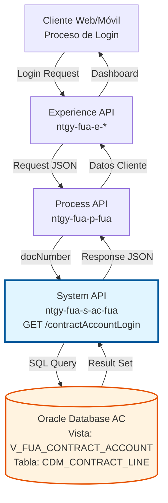
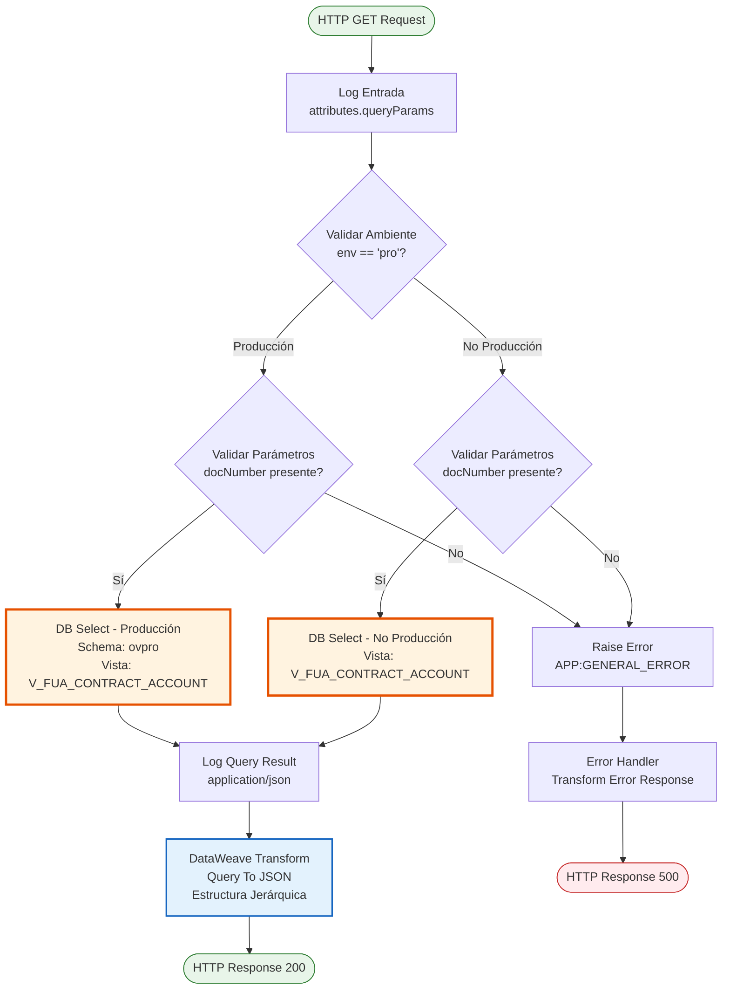
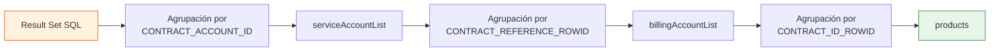
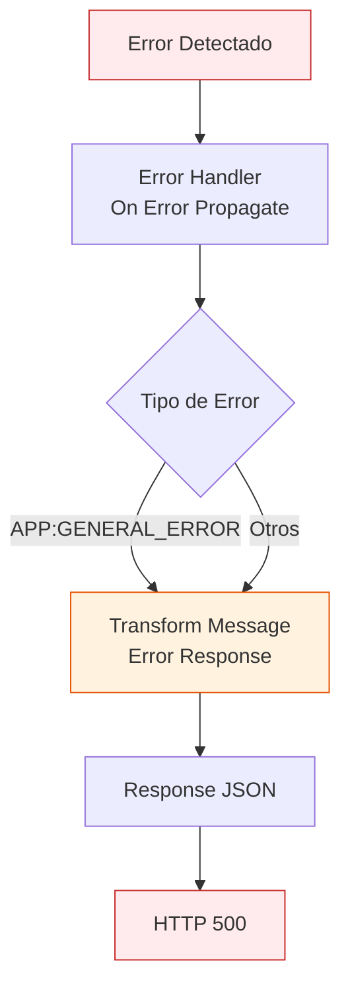

# GET /contractAccountLogin

## 📌 Descripción General

### Propósito del Endpoint

Este endpoint proporciona información completa de cuentas contrato, contratos y productos asociados a un cliente identificado por su número de documento (NIF/NIE), específicamente diseñado para el proceso de login y visualización inicial del área cliente.

El endpoint soporta:
- **Consulta por Documento**: Recupera todas las cuentas contrato activas asociadas a un documento de cliente
- **Filtrado de Portabilidad**: Excluye automáticamente contratos con portabilidad a NEWCO
- **Estructura Jerárquica**: Organiza datos en estructura cliente → cuentas contrato → contratos → productos
- **Información Completa**: Incluye direcciones de suministro, datos técnicos (CUPS, potencias, tarifas), información de facturación y domiciliación bancaria

### Tipo de API

**Capa:** System API (API-Led Connectivity)

**Función:** Integración directa con Oracle Database AC para consulta de información de cuentas contrato en proceso de autenticación.

### Patrón de Integración

**Tipo:** Request-Reply Síncrono con SQL Query

**Descripción:** Recibe el número de documento del cliente, ejecuta una consulta SQL sobre la vista consolidada V_FUA_CONTRACT_ACCOUNT, filtra contratos activos sin portabilidad, transforma los datos a una estructura JSON jerárquica y retorna la información completa de cuentas contrato, contratos y productos.

### Arquitectura API-Led Connectivity



---

## 💼 Propósito del Negocio

### Casos de Uso Principales

1. **Login y Visualización Inicial del Área Cliente**
   - Cliente se autentica en portal web o app móvil
   - Sistema recupera todas sus cuentas contrato activas
   - Se muestra dashboard con resumen de contratos y productos
   - **Beneficio**: Experiencia de usuario fluida con información completa al iniciar sesión

2. **Validación de Contratos Activos**
   - Sistema verifica qué contratos están activos (no "Inactivo")
   - Excluye contratos con portabilidad a NEWCO
   - Identifica contratos pendientes de activación
   - **Beneficio**: Solo se muestran contratos relevantes y gestionables

3. **Consulta de Información de Productos**
   - Cliente visualiza todos sus productos (luz, gas, servicios)
   - Accede a datos técnicos (CUPS, potencias, tarifas)
   - Consulta información de facturación y domiciliación
   - **Beneficio**: Vista 360° de todos los servicios contratados

### Contexto Empresarial

- **Dominio:** Gestión de Clientes y Contratos
- **Sector:** Energía - Utilities
- **División:** Naturgy España - Área Cliente
- **Proceso de Negocio:** Autenticación y consulta de información de cliente
- **Sistema Origen:** Oracle Database AC (Área Cliente)

### Stakeholders

- **Clientes Finales**: Necesitan acceder rápidamente a información de sus contratos al iniciar sesión
- **Equipo de Desarrollo Frontend**: Requieren endpoint optimizado para cargar dashboard inicial
- **Servicio al Cliente**: Utilizan esta información para atender consultas de clientes

### Valor de Negocio

- **Experiencia de Usuario Mejorada**: Carga rápida de información completa al login
- **Reducción de Llamadas al Call Center**: Clientes pueden autogestionar con información completa
- **Eficiencia Operativa**: Endpoint único para múltiples necesidades de información
- **Calidad de Datos**: Filtrado automático de contratos no relevantes

### Consumidores Potenciales

Este endpoint puede ser consumido por:
- Process APIs de gestión de clientes (ntgy-fua-p-fua)
- Experience APIs de portales web y móviles
- Aplicaciones de autoservicio de clientes
- Sistemas de agentes de call center

---

## 🔧 Especificación Técnica

### URLs por Ambiente

| Ambiente | URL Base | URL Completa |
|----------|----------|--------------|
| **Local** | `http://localhost:8081` | `http://localhost:8081/api/contractAccountLogin?docNumber=12345678A` |
| **Development** | `https://ntgy-fua-s-ac-fua-dev.us-e2.cloudhub.io` | `https://ntgy-fua-s-ac-fua-dev.us-e2.cloudhub.io/api/contractAccountLogin?docNumber=12345678A` |
| **Test** | `https://ntgy-fua-s-ac-fua-test.us-e2.cloudhub.io` | `https://ntgy-fua-s-ac-fua-test.us-e2.cloudhub.io/api/contractAccountLogin?docNumber=12345678A` |
| **Production** | `https://ntgy-fua-s-ac-fua-pro.us-e2.cloudhub.io` | `https://ntgy-fua-s-ac-fua-pro.us-e2.cloudhub.io/api/contractAccountLogin?docNumber=12345678A` |

### Método HTTP

```
GET /api/contractAccountLogin
```

### Parámetros de Entrada

#### Headers HTTP

| Header | Tipo | Requerido | Descripción | Ejemplo |
|--------|------|-----------|-------------|---------|
| `Accept` | string | ❌ No | Tipo de contenido esperado en response | `application/json` |

#### Query Parameters

| Parámetro | Tipo | Requerido | Descripción | Ejemplo | Validación |
|-----------|------|-----------|-------------|---------|------------|
| `docNumber` | string | ✅ Sí | Número de documento del cliente (NIF/NIE) | `"12345678A"` | Formato NIF/NIE español válido |

**Nota Importante**: Este endpoint solo acepta el parámetro `docNumber`. Aunque el código XML contiene lógica comentada para otros parámetros (`contractId`, `refNum`, `contractAccountID`), la implementación activa solo soporta búsqueda por documento.

### Respuestas

#### Respuesta Exitosa (200 OK)

```json
{
  "result": {
    "codResult": "0000",
    "msgResult": "No hay error"
  },
  "docNumber": "12345678A",
  "clientId": "CLI123456",
  "clientCode": "CC789012",
  "serviceAccountList": [
    {
      "supplyPointId": "SA001",
      "serviceAccountId": "SA001",
      "clientId": "CLI123456",
      "supplyAddress": {
        "fullAddress": "CALLE MAYOR 123 1 A 28001 MADRID MADRID",
        "addressId": "ADDR001",
        "zipCode": "28001",
        "province": "MADRID",
        "city": "MADRID",
        "town": "MADRID",
        "way": "CALLE MAYOR",
        "wayId": "",
        "wayType": "CALLE",
        "number": "123",
        "floor": "1",
        "door": "A",
        "portal": "",
        "stairs": ""
      },
      "billingAccountList": [
        {
          "refNum": "REF123456",
          "billingAccountId": "REF123456",
          "isDirectPayment": true,
          "isOnlineBill": true,
          "bankAccount": [
            {
              "bankAccountId": "BA001",
              "contactId": "",
              "holderName": "JUAN PEREZ GARCIA",
              "holderType": "Titular",
              "iban": "ES1234567890123456789012"
            }
          ],
          "products": [
            {
              "contractId": "CONT001",
              "contractNumber": "CONT001",
              "isActive": true,
              "startDate": "2023-01-15",
              "endDate": "",
              "dropOutDate": "",
              "contractSignatureDate": "",
              "isPending": false,
              "productType": {
                "isEco": false,
                "productTypeId": "PROD_LUZ_001",
                "productTypeName": "Tarifa Luz Estable",
                "svaFamily": "luz",
                "productTypeFamily": "luz",
                "productTypeRealName": "Electricidad"
              },
              "adviseGas": false,
              "techData": {
                "cups": "ES0021000000000001AA",
                "distribution": "",
                "rate": "2.0TD",
                "rateId": "2.0TD",
                "voltage": "",
                "selfConsumption": null,
                "installation": "",
                "changePower": null,
                "isValidCIE": null,
                "powerPlain": "3.45",
                "powerValley": "3.45",
                "powerP3": "",
                "powerP4": "",
                "powerP5": "",
                "powerP6": "",
                "recommendedPowerPlain": "",
                "recommendedPowerValley": "",
                "IPDate": "",
                "remoteManagement": null,
                "cnae": "9820"
              }
            }
          ],
          "mailingAddress": [
            {
              "addressId": "MAIL001",
              "zipCode": "28002",
              "province": "MADRID",
              "city": "MADRID",
              "town": "MADRID",
              "way": "CALLE PRINCIPAL",
              "wayId": "",
              "wayType": "CALLE",
              "number": "456",
              "floor": "2",
              "door": "B",
              "portal": "",
              "stairs": ""
            }
          ]
        }
      ]
    }
  ]
}
```

#### Respuesta Sin Resultados (200 OK)

```json
{
  "result": {
    "codResult": "0000",
    "msgResult": "No hay error"
  },
  "docNumber": "12345678A",
  "clientId": null,
  "clientCode": null,
  "serviceAccountList": []
}
```

#### Respuesta de Error - Parámetro Faltante (500)

```json
{
  "result": {
    "codResult": "0001",
    "msgResult": "KO"
  }
}
```

**Nota**: Este error se genera cuando no se proporciona el parámetro `docNumber` o cuando se intenta usar otros parámetros no soportados en la implementación activa.

### Códigos de Estado HTTP

| Código | Descripción | Escenario |
|--------|-------------|-----------|
| `200` | OK | Consulta exitosa (con o sin resultados) |
| `500` | Internal Server Error | Error en la consulta o parámetros inválidos |

### Autenticación y Autorización

- **Tipo:** Client ID & Client Secret (Anypoint Platform)
- **Autorización DB:** El usuario de base de datos debe tener permisos para:
  - Acceso de lectura a vista `V_FUA_CONTRACT_ACCOUNT`
  - Acceso de lectura a tabla `CDM_CONTRACT_LINE`

### Timeouts

| Tipo | Valor | Descripción |
|------|-------|-------------|
| **Query Timeout** | 15 segundos | Tiempo máximo de ejecución de la consulta SQL |
| **Connection Timeout** | 3600 segundos | Tiempo máximo para mantener conexión a base de datos |
| **Request Timeout** | 30 segundos | Tiempo máximo de espera para la respuesta completa |

---

## 🏗️ Implementación Técnica

### Arquitectura del Flow



### Operación de Base de Datos

#### Query SQL Principal

**Ambiente Producción:**
```sql
SELECT * FROM ovpro.V_FUA_CONTRACT_ACCOUNT a 
WHERE a.DOC_NUMBER = :docNumber 
AND a.CONTRACT_STATUS <> 'Inactivo' 
AND NOT EXISTS (
    SELECT * FROM ovpro.CDM_CONTRACT_LINE c
    WHERE c.col_contract_line_id = a.contract_id_rowid 
    AND c.COL_PORTABILIDAD_NEWCO = 'Y'
)
```

**Ambiente No Producción:**
```sql
SELECT * FROM V_FUA_CONTRACT_ACCOUNT a 
WHERE a.DOC_NUMBER = :docNumber 
AND a.CONTRACT_STATUS <> 'Inactivo' 
AND NOT EXISTS (
    SELECT * FROM CDM_CONTRACT_LINE c
    WHERE c.col_contract_line_id = a.contract_id_rowid 
    AND c.COL_PORTABILIDAD_NEWCO = 'Y'
)
```

#### Configuración de la Consulta

```xml
<db:select config-ref="Database_Config" 
           queryTimeout="${dbAC.queryTimeout}" 
           fetchSize="1000">
    <ee:repeatable-file-store-iterable inMemoryObjects="1000" />
    <db:sql><![CDATA[...]]></db:sql>
    <db:input-parameters>
        <![CDATA[#[{"docNumber" : attributes.queryParams["docNumber"]}]]]>
    </db:input-parameters>
</db:select>
```

**Parámetros de Configuración:**
- **queryTimeout**: 15 segundos (configurable vía `${dbAC.queryTimeout}`)
- **fetchSize**: 1000 registros por lote
- **inMemoryObjects**: 1000 objetos en memoria antes de usar almacenamiento en disco

### Lógica de Filtrado

El endpoint aplica los siguientes filtros automáticamente:

1. **Filtro por Documento**: `a.DOC_NUMBER = :docNumber`
   - Busca todas las cuentas contrato asociadas al documento proporcionado

2. **Filtro de Estado**: `a.CONTRACT_STATUS <> 'Inactivo'`
   - Excluye contratos con estado "Inactivo"
   - Incluye estados: "Activo", "Pendiente", "Pte. Instalación", etc.

3. **Filtro de Portabilidad**: `NOT EXISTS (SELECT * FROM CDM_CONTRACT_LINE c WHERE c.col_contract_line_id = a.contract_id_rowid AND c.COL_PORTABILIDAD_NEWCO = 'Y')`
   - Excluye contratos que tienen portabilidad a NEWCO marcada
   - Valida a nivel de línea de contrato

### Transformación DataWeave

#### Estructura de la Transformación



#### Funciones DataWeave Personalizadas

**1. Función `pendiente()`**
```dataweave
fun pendiente(astring) = if(
    astring == "Pte recibir doc" 
    or astring == "Documentación recibida" 
    or astring == "Solicitud aceptada"
    or astring == "Solicitud enviada"
    or astring == "Pendiente"
    or astring == "Pte. Instalación"
    or astring == "Pendiente Energía"
    or astring == "Solicitud ATR"
    or astring == "Alta Activa"
    or astring == "Completar"
    or astring == "Pte. Validación"
) true else false
```
**Propósito**: Determina si un contrato está en estado pendiente basándose en múltiples condiciones de estado.

**2. Función `familyName()`**
```dataweave
fun familyName(aString) = aString match {
    case literalMatch: "Electricidad" -> "luz"
    case literalMatch: "Gas" -> "gas"
    else -> "servicios"
}
```
**Propósito**: Mapea el nombre genérico del producto a su familia (luz, gas, servicios).

**3. Función `svaFamily()`**
```dataweave
fun svaFamily(aString) = aString match {
    case literalMatch: "SVG" -> "gas"
    case literalMatch: "SVE" -> "luz"
    case literalMatch: "SHD" -> "hogar"
    case literalMatch: "SPF" -> "seguros"
    case literalMatch: "Others" -> "servicios"
    else -> ""
}
```
**Propósito**: Mapea códigos de servicios de valor añadido (SVA) a su familia correspondiente.

#### Agrupaciones y Transformaciones

**Nivel 1: Service Account (Cuenta de Servicio)**
```dataweave
serviceAccountList: payload groupBy $.CONTRACT_ACCOUNT_ID pluck {
    supplyPointId: $$,
    serviceAccountId: $$,
    clientId: $.CLIENT_ID distinctBy $ reduce $ + $$,
    supplyAddress: { /* ... */ }
}
```

**Nivel 2: Billing Account (Cuenta de Facturación)**
```dataweave
billingAccountList: $ groupBy $.CONTRACT_REFERENCE_ROWID pluck {
    refNum: $.CONTRACT_REFERENCE distinctBy $ reduce $ + $$,
    billingAccountId: $.CONTRACT_REFERENCE distinctBy $ reduce $ + $$,
    isDirectPayment: if (($.PAYMENT_METHOD distinctBy $ reduce $ + $$) == "Domiciliacion") (true) else (false),
    isOnlineBill: if (($.ONLINE_BILL distinctBy $ reduce $ + $$) == "Y") (true) else (false)
}
```

**Nivel 3: Products (Productos)**
```dataweave
products: $ groupBy $.CONTRACT_ID_ROWID pluck {
    contractId: $.CONTRACT_ID distinctBy $ reduce $ + $$,
    contractNumber: $.CONTRACT_ID distinctBy $ reduce $ + $$,
    isActive: if (($.CONTRACT_STATUS distinctBy $ reduce $ + $$) == "Activo") (true) else (false),
    isPending: pendiente($.CONTRACT_STATUS distinctBy $ reduce $ + $$),
    productType: {
        isEco: if (($.IS_ECO distinctBy $ reduce $ + $$) == "Y") (true) else (false),
        productTypeFamily: familyName($.PRODUCT_GENERIC_NAME distinctBy $ reduce $ + $$),
        svaFamily: svaFamily($.PRODUCT_GENERIC_NAME distinctBy $ reduce $ + $$)
    }
}
```

### Manejo de Errores



**Error Handler Configuration:**
```xml
<on-error-propagate enableNotifications="true" 
                    logException="true" 
                    type="APP:GENERAL_ERROR">
    <ee:transform>
        <ee:set-payload><![CDATA[
            %dw 2.0
            output application/json
            ---
            {
                result: {
                    codResult: "0001",
                    msgResult: "KO"
                }
            }
        ]]></ee:set-payload>
    </ee:transform>
</on-error-propagate>
```

### Configuración de Base de Datos

**Connection Pool:**
- MaxPoolSize: 15 conexiones
- MaxWaitTime: 300 segundos
- MaxIdleTime: 300 segundos
- Connection Timeout: 3600 segundos

**Retry Policy:**
- Intentos: 3
- Frecuencia: 1000ms

---

## 💻 Ejemplos de Uso

### Ejemplo 1: Consulta Exitosa con Resultados

#### Request

```bash
curl -X GET "https://ntgy-fua-s-ac-fua-pro.us-e2.cloudhub.io/api/contractAccountLogin?docNumber=12345678A" \
  -H "Accept: application/json"
```

#### Response (200 OK)

```json
{
  "result": {
    "codResult": "0000",
    "msgResult": "No hay error"
  },
  "docNumber": "12345678A",
  "clientId": "CLI123456",
  "clientCode": "CC789012",
  "serviceAccountList": [
    {
      "supplyPointId": "SA001",
      "serviceAccountId": "SA001",
      "clientId": "CLI123456",
      "supplyAddress": {
        "fullAddress": "CALLE MAYOR 123 1 A 28001 MADRID MADRID",
        "addressId": "ADDR001",
        "zipCode": "28001",
        "province": "MADRID",
        "city": "MADRID",
        "town": "MADRID",
        "way": "CALLE MAYOR",
        "wayId": "",
        "wayType": "CALLE",
        "number": "123",
        "floor": "1",
        "door": "A",
        "portal": "",
        "stairs": ""
      },
      "billingAccountList": [
        {
          "refNum": "REF123456",
          "billingAccountId": "REF123456",
          "isDirectPayment": true,
          "isOnlineBill": true,
          "bankAccount": [
            {
              "bankAccountId": "BA001",
              "contactId": "",
              "holderName": "JUAN PEREZ GARCIA",
              "holderType": "Titular",
              "iban": "ES1234567890123456789012"
            }
          ],
          "products": [
            {
              "contractId": "CONT001",
              "contractNumber": "CONT001",
              "isActive": true,
              "startDate": "2023-01-15",
              "endDate": "",
              "dropOutDate": "",
              "contractSignatureDate": "",
              "isPending": false,
              "productType": {
                "isEco": false,
                "productTypeId": "PROD_LUZ_001",
                "productTypeName": "Tarifa Luz Estable",
                "svaFamily": "luz",
                "productTypeFamily": "luz",
                "productTypeRealName": "Electricidad"
              },
              "adviseGas": false,
              "techData": {
                "cups": "ES0021000000000001AA",
                "distribution": "",
                "rate": "2.0TD",
                "rateId": "2.0TD",
                "voltage": "",
                "selfConsumption": null,
                "installation": "",
                "changePower": null,
                "isValidCIE": null,
                "powerPlain": "3.45",
                "powerValley": "3.45",
                "powerP3": "",
                "powerP4": "",
                "powerP5": "",
                "powerP6": "",
                "recommendedPowerPlain": "",
                "recommendedPowerValley": "",
                "IPDate": "",
                "remoteManagement": null,
                "cnae": "9820"
              }
            }
          ],
          "mailingAddress": [
            {
              "addressId": "MAIL001",
              "zipCode": "28002",
              "province": "MADRID",
              "city": "MADRID",
              "town": "MADRID",
              "way": "CALLE PRINCIPAL",
              "wayId": "",
              "wayType": "CALLE",
              "number": "456",
              "floor": "2",
              "door": "B",
              "portal": "",
              "stairs": ""
            }
          ]
        }
      ]
    }
  ]
}
```

### Ejemplo 2: Cliente Sin Contratos Activos

#### Request

```bash
curl -X GET "https://ntgy-fua-s-ac-fua-pro.us-e2.cloudhub.io/api/contractAccountLogin?docNumber=98765432B" \
  -H "Accept: application/json"
```

#### Response (200 OK)

```json
{
  "result": {
    "codResult": "0000",
    "msgResult": "No hay error"
  },
  "docNumber": "98765432B",
  "clientId": null,
  "clientCode": null,
  "serviceAccountList": []
}
```

### Ejemplo 3: Error - Parámetro Faltante

#### Request

```bash
curl -X GET "https://ntgy-fua-s-ac-fua-pro.us-e2.cloudhub.io/api/contractAccountLogin" \
  -H "Accept: application/json"
```

#### Response (500 Internal Server Error)

```json
{
  "result": {
    "codResult": "0001",
    "msgResult": "KO"
  }
}
```

### Ejemplo 4: Uso desde JavaScript

```javascript
async function getContractAccountLogin(docNumber) {
  const baseUrl = 'https://ntgy-fua-s-ac-fua-pro.us-e2.cloudhub.io';
  const endpoint = '/api/contractAccountLogin';
  
  try {
    const response = await fetch(`${baseUrl}${endpoint}?docNumber=${docNumber}`, {
      method: 'GET',
      headers: {
        'Accept': 'application/json'
      }
    });
    
    if (!response.ok) {
      throw new Error(`HTTP error! status: ${response.status}`);
    }
    
    const data = await response.json();
    
    if (data.result.codResult === "0000") {
      console.log('Consulta exitosa');
      console.log(`Cliente: ${data.clientId}`);
      console.log(`Cuentas de servicio: ${data.serviceAccountList.length}`);
      return data;
    } else {
      console.error('Error en la consulta:', data.result.msgResult);
      return null;
    }
  } catch (error) {
    console.error('Error al consultar contractAccountLogin:', error);
    throw error;
  }
}

// Uso
getContractAccountLogin('12345678A')
  .then(data => {
    if (data && data.serviceAccountList.length > 0) {
      data.serviceAccountList.forEach(account => {
        console.log(`Cuenta: ${account.serviceAccountId}`);
        console.log(`Dirección: ${account.supplyAddress.fullAddress}`);
      });
    }
  });
```

### Ejemplo 5: Uso desde Python

```python
import requests
import json

def get_contract_account_login(doc_number):
    """
    Consulta información de cuentas contrato por documento de cliente.
    
    Args:
        doc_number (str): Número de documento del cliente (NIF/NIE)
        
    Returns:
        dict: Información de cuentas contrato o None si hay error
    """
    base_url = 'https://ntgy-fua-s-ac-fua-pro.us-e2.cloudhub.io'
    endpoint = '/api/contractAccountLogin'
    
    try:
        response = requests.get(
            f'{base_url}{endpoint}',
            params={'docNumber': doc_number},
            headers={'Accept': 'application/json'},
            timeout=30
        )
        
        response.raise_for_status()
        data = response.json()
        
        if data['result']['codResult'] == '0000':
            print(f'Consulta exitosa para documento: {doc_number}')
            print(f"Cliente ID: {data.get('clientId')}")
            print(f"Cuentas de servicio: {len(data.get('serviceAccountList', []))}")
            return data
        else:
            print(f"Error en la consulta: {data['result']['msgResult']}")
            return None
            
    except requests.exceptions.RequestException as e:
        print(f'Error al consultar contractAccountLogin: {e}')
        return None

# Uso
if __name__ == '__main__':
    result = get_contract_account_login('12345678A')
    
    if result and result.get('serviceAccountList'):
        for account in result['serviceAccountList']:
            print(f"\nCuenta: {account['serviceAccountId']}")
            print(f"Dirección: {account['supplyAddress']['fullAddress']}")
            
            for billing in account.get('billingAccountList', []):
                print(f"  Ref: {billing['refNum']}")
                print(f"  Domiciliación: {billing['isDirectPayment']}")
                
                for product in billing.get('products', []):
                    print(f"    Producto: {product['productType']['productTypeName']}")
                    print(f"    CUPS: {product['techData']['cups']}")
                    print(f"    Activo: {product['isActive']}")
```
