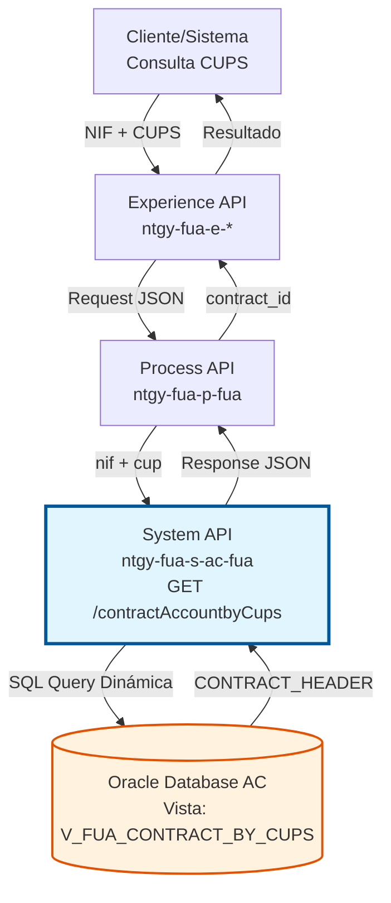
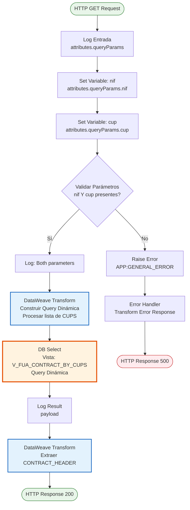
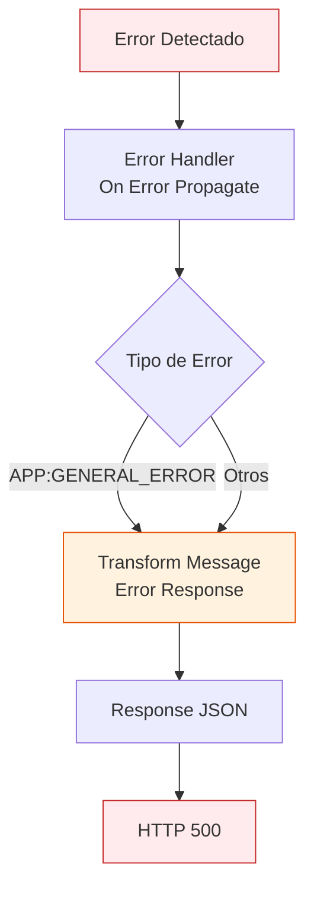

# GET /contractAccountbyCups

## 📌 Descripción General

### Propósito del Endpoint

Este endpoint permite consultar los identificadores de contratos (CONTRACT_HEADER) asociados a uno o múltiples CUPS (Código Universal de Punto de Suministro) para un cliente específico identificado por su documento (NIF/NIE).

El endpoint soporta:
- **Consulta por CUPS Único**: Búsqueda de contrato asociado a un CUPS específico
- **Consulta por Múltiples CUPS**: Búsqueda de contratos asociados a varios CUPS simultáneamente (separados por comas)
- **Validación de Cliente**: Verifica que el CUPS pertenezca al documento proporcionado
- **Respuesta Simplificada**: Retorna únicamente los identificadores de contrato (CONTRACT_HEADER)

### Tipo de API

**Capa:** System API (API-Led Connectivity)

**Función:** Integración directa con Oracle Database AC para consulta de relación CUPS-Contrato-Cliente.

### Patrón de Integración

**Tipo:** Request-Reply Síncrono con SQL Query Dinámica

**Descripción:** Recibe el documento del cliente y uno o varios CUPS, construye dinámicamente una consulta SQL con la lista de CUPS, ejecuta la búsqueda en la vista V_FUA_CONTRACT_BY_CUPS y retorna los identificadores de contrato encontrados.

### Arquitectura API-Led Connectivity



---

## 💼 Propósito del Negocio

### Casos de Uso Principales

1. **Validación de Propiedad de CUPS**
   - Sistema necesita verificar que un CUPS pertenece a un cliente específico
   - Se proporciona NIF y CUPS para validar la relación
   - Se obtiene el identificador de contrato si existe la relación
   - **Beneficio**: Prevención de acceso no autorizado a información de contratos

2. **Búsqueda de Contratos por Múltiples Suministros**
   - Cliente tiene varios puntos de suministro (CUPS)
   - Sistema necesita obtener todos los contratos asociados
   - Se envían múltiples CUPS en una sola petición
   - **Beneficio**: Eficiencia en consultas masivas, reducción de llamadas al API

3. **Integración con Sistemas de Facturación**
   - Sistema de facturación necesita identificar contratos por CUPS
   - Valida que el CUPS corresponde al cliente correcto
   - Obtiene CONTRACT_HEADER para operaciones posteriores
   - **Beneficio**: Trazabilidad y seguridad en procesos de facturación

### Contexto Empresarial

- **Dominio:** Gestión de Contratos y Suministros
- **Sector:** Energía - Utilities
- **División:** Naturgy España - Área Cliente
- **Proceso de Negocio:** Validación de relación Cliente-CUPS-Contrato
- **Sistema Origen:** Oracle Database AC (Área Cliente)

### Stakeholders

- **Sistemas de Facturación**: Requieren identificar contratos por CUPS para procesos de facturación
- **Sistemas de Validación**: Necesitan verificar propiedad de CUPS antes de operaciones
- **Equipos de Desarrollo**: Utilizan este endpoint para validaciones en flujos de negocio
- **Sistemas de Integración**: Consumen este endpoint para sincronización de datos

### Valor de Negocio

- **Seguridad**: Validación de propiedad de CUPS antes de operaciones sensibles
- **Eficiencia**: Consulta de múltiples CUPS en una sola petición
- **Simplicidad**: Respuesta ligera con solo identificadores de contrato
- **Trazabilidad**: Relación clara entre Cliente-CUPS-Contrato

### Consumidores Potenciales

Este endpoint puede ser consumido por:
- Process APIs de gestión de contratos y facturación
- Sistemas de validación de operaciones
- Flujos de sincronización de datos
- Sistemas de integración con terceros autorizados

---

## 🔧 Especificación Técnica

### URLs por Ambiente

| Ambiente | URL Base | URL Completa |
|----------|----------|--------------|
| **Local** | `http://localhost:8081` | `http://localhost:8081/api/contractAccountbyCups?nif=12345678A&cup=ES0021000000000001AA` |
| **Development** | `https://ntgy-fua-s-ac-fua-dev.us-e2.cloudhub.io` | `https://ntgy-fua-s-ac-fua-dev.us-e2.cloudhub.io/api/contractAccountbyCups?nif=12345678A&cup=ES0021000000000001AA` |
| **Test** | `https://ntgy-fua-s-ac-fua-test.us-e2.cloudhub.io` | `https://ntgy-fua-s-ac-fua-test.us-e2.cloudhub.io/api/contractAccountbyCups?nif=12345678A&cup=ES0021000000000001AA` |
| **Production** | `https://ntgy-fua-s-ac-fua-pro.us-e2.cloudhub.io` | `https://ntgy-fua-s-ac-fua-pro.us-e2.cloudhub.io/api/contractAccountbyCups?nif=12345678A&cup=ES0021000000000001AA` |

### Método HTTP

```
GET /api/contractAccountbyCups
```

### Parámetros de Entrada

#### Headers HTTP

| Header | Tipo | Requerido | Descripción | Ejemplo |
|--------|------|-----------|-------------|---------|
| `Accept` | string | ❌ No | Tipo de contenido esperado en response | `application/json` |

#### Query Parameters

| Parámetro | Tipo | Requerido | Descripción | Ejemplo | Validación |
|-----------|------|-----------|-------------|---------|------------|
| `nif` | string | ✅ Sí | Número de documento del cliente (NIF/NIE) | `"12345678A"` | Formato NIF/NIE español válido |
| `cup` | string | ✅ Sí | CUPS (uno o varios separados por comas) | `"ES0021000000000001AA"` o `"ES0021000000000001AA,ES0021000000000002BB"` | Formato CUPS español válido (20 caracteres) |

**Nota Importante**: Ambos parámetros son obligatorios. Si falta alguno, el endpoint retorna error.

### Respuestas

#### Respuesta Exitosa - Un CUPS (200 OK)

```json
{
  "result": {
    "codResult": "0000",
    "msgResult": "No hay error"
  },
  "contract_id": ["CONTRACT_HEADER_001"]
}
```

#### Respuesta Exitosa - Múltiples CUPS (200 OK)

```json
{
  "result": {
    "codResult": "0000",
    "msgResult": "No hay error"
  },
  "contract_id": [
    "CONTRACT_HEADER_001",
    "CONTRACT_HEADER_002",
    "CONTRACT_HEADER_003"
  ]
}
```

#### Respuesta Sin Resultados (200 OK)

```json
{
  "result": {
    "codResult": "0000",
    "msgResult": "No hay error"
  },
  "contract_id": []
}
```

**Nota**: Este escenario ocurre cuando:
- El NIF no tiene contratos asociados a los CUPS proporcionados
- Los CUPS no existen en el sistema
- Los CUPS pertenecen a otro cliente

#### Respuesta de Error - Parámetros Faltantes (500)

```json
{
  "result": {
    "codResult": "0001",
    "msgResult": "KO"
  }
}
```

**Nota**: Este error se genera cuando falta el parámetro `nif` o `cup`.

### Códigos de Estado HTTP

| Código | Descripción | Escenario |
|--------|-------------|-----------|
| `200` | OK | Consulta exitosa (con o sin resultados) |
| `500` | Internal Server Error | Error en la consulta o parámetros faltantes |

### Autenticación y Autorización

- **Tipo:** Client ID & Client Secret (Anypoint Platform)
- **Autorización DB:** El usuario de base de datos debe tener permisos para:
  - Acceso de lectura a vista `V_FUA_CONTRACT_BY_CUPS`

### Timeouts

| Tipo | Valor | Descripción |
|------|-------|-------------|
| **Query Timeout** | 15 segundos | Tiempo máximo de ejecución de la consulta SQL (configurable vía `${dbAC.queryTimeout}`) |
| **Connection Timeout** | 3600 segundos | Tiempo máximo para mantener conexión a base de datos |
| **Request Timeout** | 30 segundos | Tiempo máximo de espera para la respuesta completa |

---

## 🏗️ Implementación Técnica

### Arquitectura del Flow



### Operación de Base de Datos

#### Construcción Dinámica del Query

El endpoint construye el query SQL dinámicamente usando DataWeave para soportar múltiples CUPS:

**DataWeave de Construcción:**
```dataweave
%dw 2.0
output application/json
var query = "SELECT DISTINCT CONTRACT_HEADER FROM V_FUA_CONTRACT_BY_CUPS WHERE CLI_DOCUMENT = '" 
    ++ vars.nif 
    ++ "' AND PRO_CUPS IN ('" 
    ++ (vars.cup replace "," with "','") 
    ++ "')"
---
query
```

**Ejemplo de Query Generado (Un CUPS):**
```sql
SELECT DISTINCT CONTRACT_HEADER 
FROM V_FUA_CONTRACT_BY_CUPS 
WHERE CLI_DOCUMENT = '12345678A' 
AND PRO_CUPS IN ('ES0021000000000001AA')
```

**Ejemplo de Query Generado (Múltiples CUPS):**
```sql
SELECT DISTINCT CONTRACT_HEADER 
FROM V_FUA_CONTRACT_BY_CUPS 
WHERE CLI_DOCUMENT = '12345678A' 
AND PRO_CUPS IN ('ES0021000000000001AA','ES0021000000000002BB','ES0021000000000003CC')
```

#### Configuración de la Consulta

```xml
<db:select config-ref="Database_Config" 
           queryTimeout="${dbAC.queryTimeout}">
    <db:sql><![CDATA[#[vars.query]]]></db:sql>
    <db:input-parameters>
        <![CDATA[#[{
            "variableNif": attributes.queryParams['nif'], 
            "variableCup": attributes.queryParams["cup"]
        }]]]>
    </db:input-parameters>
</db:select>
```

**Parámetros de Configuración:**
- **queryTimeout**: 15 segundos (configurable vía `${dbAC.queryTimeout}`)
- **Query Dinámica**: Construida en tiempo de ejecución según número de CUPS

### Lógica de Validación

El endpoint aplica las siguientes validaciones:

1. **Validación de Parámetros Obligatorios**
   ```dataweave
   !isEmpty(attributes.queryParams["cup"]) and !isEmpty(attributes.queryParams["nif"])
   ```
   - Si falta algún parámetro → Error `APP:GENERAL_ERROR`

2. **Procesamiento de Múltiples CUPS**
   ```dataweave
   vars.cup replace "," with "','"
   ```
   - Convierte: `"CUPS1,CUPS2,CUPS3"` → `"'CUPS1','CUPS2','CUPS3'"`
   - Permite búsqueda con operador SQL `IN`

3. **Uso de DISTINCT**
   - Elimina duplicados en caso de que un cliente tenga múltiples relaciones con el mismo contrato

### Transformación DataWeave

#### Transformación de Respuesta

**Input (Result Set SQL):**
```json
[
  { "CONTRACT_HEADER": "CONTRACT_001" },
  { "CONTRACT_HEADER": "CONTRACT_002" }
]
```

**DataWeave de Transformación:**
```dataweave
%dw 2.0
output application/json
---
{
    result: {
        codResult: "0000",
        msgResult: "No hay error"
    },
    contract_id: payload.CONTRACT_HEADER
}
```

**Output (Response JSON):**
```json
{
  "result": {
    "codResult": "0000",
    "msgResult": "No hay error"
  },
  "contract_id": ["CONTRACT_001", "CONTRACT_002"]
}
```

### Manejo de Errores



**Error Handler Configuration:**
```xml
<on-error-propagate enableNotifications="true" 
                    logException="true" 
                    type="APP:GENERAL_ERROR">
    <ee:transform>
        <ee:set-payload><![CDATA[
            %dw 2.0
            output application/json
            ---
            {
                result: {
                    codResult: "0001",
                    msgResult: "KO"
                }
            }
        ]]></ee:set-payload>
    </ee:transform>
</on-error-propagate>
```

### Configuración de Base de Datos

**Connection Pool:**
- MaxPoolSize: 15 conexiones
- MaxWaitTime: 300 segundos
- MaxIdleTime: 300 segundos
- Connection Timeout: 3600 segundos

**Retry Policy:**
- Intentos: 3
- Frecuencia: 1000ms

---

## 💻 Ejemplos de Uso

### Ejemplo 1: Consulta con Un CUPS

#### Request

```bash
curl -X GET "https://ntgy-fua-s-ac-fua-pro.us-e2.cloudhub.io/api/contractAccountbyCups?nif=12345678A&cup=ES0021000000000001AA" \
  -H "Accept: application/json"
```

#### Response (200 OK)

```json
{
  "result": {
    "codResult": "0000",
    "msgResult": "No hay error"
  },
  "contract_id": ["CONTRACT_HEADER_001"]
}
```

### Ejemplo 2: Consulta con Múltiples CUPS

#### Request

```bash
curl -X GET "https://ntgy-fua-s-ac-fua-pro.us-e2.cloudhub.io/api/contractAccountbyCups?nif=12345678A&cup=ES0021000000000001AA,ES0021000000000002BB,ES0021000000000003CC" \
  -H "Accept: application/json"
```

#### Response (200 OK)

```json
{
  "result": {
    "codResult": "0000",
    "msgResult": "No hay error"
  },
  "contract_id": [
    "CONTRACT_HEADER_001",
    "CONTRACT_HEADER_002",
    "CONTRACT_HEADER_003"
  ]
}
```

### Ejemplo 3: Sin Resultados (CUPS no pertenece al NIF)

#### Request

```bash
curl -X GET "https://ntgy-fua-s-ac-fua-pro.us-e2.cloudhub.io/api/contractAccountbyCups?nif=98765432B&cup=ES0021000000000001AA" \
  -H "Accept: application/json"
```

#### Response (200 OK)

```json
{
  "result": {
    "codResult": "0000",
    "msgResult": "No hay error"
  },
  "contract_id": []
}
```

### Ejemplo 4: Error - Parámetro Faltante

#### Request (falta el parámetro 'cup')

```bash
curl -X GET "https://ntgy-fua-s-ac-fua-pro.us-e2.cloudhub.io/api/contractAccountbyCups?nif=12345678A" \
  -H "Accept: application/json"
```

#### Response (500 Internal Server Error)

```json
{
  "result": {
    "codResult": "0001",
    "msgResult": "KO"
  }
}
```

### Ejemplo 5: Uso desde JavaScript

```javascript
async function getContractsByCups(nif, cupsArray) {
  const baseUrl = 'https://ntgy-fua-s-ac-fua-pro.us-e2.cloudhub.io';
  const endpoint = '/api/contractAccountbyCups';
  
  // Convertir array de CUPS a string separado por comas
  const cupsParam = Array.isArray(cupsArray) ? cupsArray.join(',') : cupsArray;
  
  try {
    const response = await fetch(
      `${baseUrl}${endpoint}?nif=${nif}&cup=${cupsParam}`,
      {
        method: 'GET',
        headers: {
          'Accept': 'application/json'
        }
      }
    );
    
    if (!response.ok) {
      throw new Error(`HTTP error! status: ${response.status}`);
    }
    
    const data = await response.json();
    
    if (data.result.codResult === "0000") {
      console.log('Consulta exitosa');
      console.log(`Contratos encontrados: ${data.contract_id.length}`);
      return data.contract_id;
    } else {
      console.error('Error en la consulta:', data.result.msgResult);
      return null;
    }
  } catch (error) {
    console.error('Error al consultar contractAccountbyCups:', error);
    throw error;
  }
}

// Uso con un CUPS
getContractsByCups('12345678A', 'ES0021000000000001AA')
  .then(contracts => {
    console.log('Contratos:', contracts);
  });

// Uso con múltiples CUPS
getContractsByCups('12345678A', [
  'ES0021000000000001AA',
  'ES0021000000000002BB',
  'ES0021000000000003CC'
])
  .then(contracts => {
    console.log('Contratos encontrados:', contracts);
    contracts.forEach(contract => {
      console.log(`- ${contract}`);
    });
  });
```

### Ejemplo 6: Uso desde Python

```python
import requests
from typing import List, Union, Optional

def get_contracts_by_cups(nif: str, cups: Union[str, List[str]]) -> Optional[List[str]]:
    """
    Consulta contratos por NIF y CUPS.
    
    Args:
        nif (str): Número de documento del cliente (NIF/NIE)
        cups (str or List[str]): CUPS único o lista de CUPS
        
    Returns:
        List[str]: Lista de identificadores de contrato o None si hay error
    """
    base_url = 'https://ntgy-fua-s-ac-fua-pro.us-e2.cloudhub.io'
    endpoint = '/api/contractAccountbyCups'
    
    # Convertir lista de CUPS a string separado por comas
    if isinstance(cups, list):
        cups_param = ','.join(cups)
    else:
        cups_param = cups
    
    try:
        response = requests.get(
            f'{base_url}{endpoint}',
            params={
                'nif': nif,
                'cup': cups_param
            },
            headers={'Accept': 'application/json'},
            timeout=30
        )
        
        response.raise_for_status()
        data = response.json()
        
        if data['result']['codResult'] == '0000':
            contracts = data.get('contract_id', [])
            print(f'Consulta exitosa para NIF: {nif}')
            print(f'Contratos encontrados: {len(contracts)}')
            return contracts
        else:
            print(f"Error en la consulta: {data['result']['msgResult']}")
            return None
            
    except requests.exceptions.RequestException as e:
        print(f'Error al consultar contractAccountbyCups: {e}')
        return None

# Uso con un CUPS
if __name__ == '__main__':
    # Ejemplo 1: Un CUPS
    contracts = get_contracts_by_cups(
        nif='12345678A',
        cups='ES0021000000000001AA'
    )
    
    if contracts:
        print(f"\nContratos encontrados: {contracts}")
    
    # Ejemplo 2: Múltiples CUPS
    contracts_multiple = get_contracts_by_cups(
        nif='12345678A',
        cups=[
            'ES0021000000000001AA',
            'ES0021000000000002BB',
            'ES0021000000000003CC'
        ]
    )
    
    if contracts_multiple:
        print(f"\nContratos encontrados ({len(contracts_multiple)}):")
        for i, contract in enumerate(contracts_multiple, 1):
            print(f"  {i}. {contract}")
```

### Ejemplo 7: Validación de Propiedad de CUPS

```javascript
/**
 * Valida si un CUPS pertenece a un cliente específico
 */
async function validateCupsOwnership(nif, cups) {
  try {
    const contracts = await getContractsByCups(nif, cups);
    
    if (contracts && contracts.length > 0) {
      console.log(`✅ CUPS ${cups} pertenece al cliente ${nif}`);
      console.log(`Contratos asociados: ${contracts.join(', ')}`);
      return true;
    } else {
      console.log(`❌ CUPS ${cups} NO pertenece al cliente ${nif}`);
      return false;
    }
  } catch (error) {
    console.error('Error en validación:', error);
    return false;
  }
}

// Uso
validateCupsOwnership('12345678A', 'ES0021000000000001AA');
```

### Ejemplo 8: Procesamiento por Lotes

```python
def process_cups_batch(nif: str, cups_list: List[str], batch_size: int = 10) -> dict:
    """
    Procesa una lista grande de CUPS en lotes para evitar URLs muy largas.
    
    Args:
        nif: Documento del cliente
        cups_list: Lista completa de CUPS
        batch_size: Tamaño de cada lote (default: 10)
        
    Returns:
        dict: Diccionario con todos los contratos encontrados
    """
    all_contracts = []
    
    # Dividir en lotes
    for i in range(0, len(cups_list), batch_size):
        batch = cups_list[i:i + batch_size]
        print(f"Procesando lote {i//batch_size + 1}: {len(batch)} CUPS")
        
        contracts = get_contracts_by_cups(nif, batch)
        if contracts:
            all_contracts.extend(contracts)
    
    # Eliminar duplicados
    unique_contracts = list(set(all_contracts))
    
    return {
        'nif': nif,
        'total_cups_consulted': len(cups_list),
        'total_contracts_found': len(unique_contracts),
        'contracts': unique_contracts
    }

# Uso
cups_list = [f'ES002100000000000{i:02d}AA' for i in range(1, 51)]  # 50 CUPS
result = process_cups_batch('12345678A', cups_list, batch_size=10)
print(f"\nResultado: {result['total_contracts_found']} contratos encontrados")