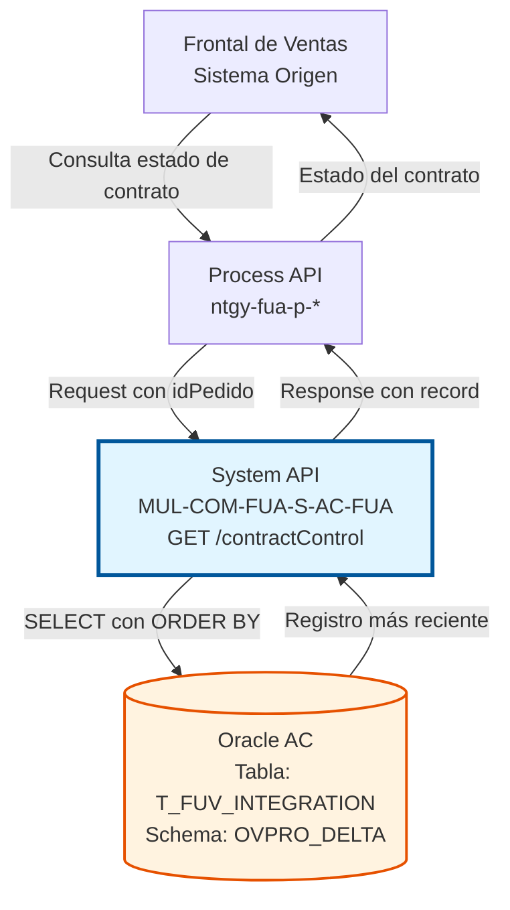
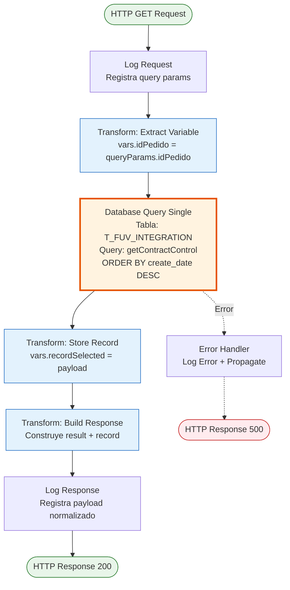
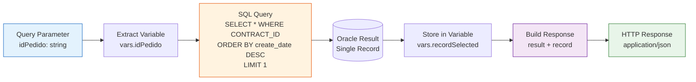

# GET /contractControl

## 📌 Descripción General

### Propósito del Endpoint

Este endpoint consulta el registro más reciente de un contrato específico en la tabla de control de integración `T_FUV_INTEGRATION`. Permite obtener el estado actual, historial de intentos, mensajes de error y toda la información de auditoría asociada a un contrato procesado por el sistema FUA (Frontal Único de Alta).

El endpoint soporta:
- **Consulta por ID de Contrato**: Busca registros por `CONTRACT_ID` (idPedido)
- **Registro Más Reciente**: Retorna el último registro ordenado por fecha de creación descendente
- **Información Completa**: Incluye todos los campos de auditoría y control
- **Trazabilidad**: Permite seguimiento del estado actual del contrato

### Tipo de API

**Capa:** System API (API-Led Connectivity)

**Función:** Integración directa con Oracle Database AC para consulta de estado de contratos.

### Patrón de Integración

**Tipo:** Request-Reply Síncrono con SQL SELECT

**Descripción:** Recibe el ID del pedido como query parameter, ejecuta una consulta SQL que retorna el registro más reciente del contrato ordenado por fecha de creación descendente, y devuelve la información completa del registro en formato JSON.

### Arquitectura API-Led Connectivity



---

## 💼 Propósito del Negocio

### Casos de Uso Principales

1. **Consulta de Estado Actual de Contrato**
   - Un usuario necesita conocer el estado actual de un contrato
   - El sistema consulta el registro más reciente en la tabla de control
   - Obtiene información de estado, código, mensaje y respuesta
   - **Beneficio:** Visibilidad inmediata del estado actual del contrato

2. **Verificación de Último Intento de Procesamiento**
   - El sistema necesita verificar si un contrato fue procesado correctamente
   - Consulta el registro para ver el número de intentos y errores
   - Determina si necesita reintentar el procesamiento
   - **Beneficio:** Control de reintentos y gestión de errores automatizada

3. **Auditoría y Diagnóstico de Problemas**
   - El equipo de soporte necesita diagnosticar un problema con un contrato
   - Consulta el registro completo con mensaje original, respuesta y error
   - Analiza la información para identificar la causa del problema
   - **Beneficio:** Diagnóstico rápido y preciso de problemas de integración

4. **Seguimiento de Ciclo de Vida**
   - El sistema de monitoreo consulta periódicamente el estado de contratos
   - Identifica contratos en estados específicos (received, processing, completed, error)
   - Genera alertas o reportes según el estado
   - **Beneficio:** Monitoreo proactivo del procesamiento de contratos

### Contexto Empresarial

- **Dominio:** Gestión de Contratos y Control de Integraciones
- **Sector:** Energía - Utilities
- **División:** Naturgy España - Frontal de Ventas (FUV)
- **Proceso de Negocio:** Consulta y seguimiento de contratos en proceso de alta
- **Sistema Backend:** Oracle Database AC (Área Cliente)

### Stakeholders

- **Agentes de Ventas**: Consultan el estado de sus contratos en tiempo real
- **Equipo de Operaciones**: Monitorean contratos en proceso y detectan problemas
- **Equipo de Soporte**: Diagnostican problemas consultando información de auditoría
- **Sistemas Automatizados**: Verifican estado antes de continuar con siguiente paso del proceso
- **Auditores**: Verifican trazabilidad y cumplimiento de procesos

### Valor de Negocio

- **Visibilidad**: Acceso inmediato al estado actual de cualquier contrato
- **Diagnóstico**: Información completa para resolución rápida de problemas
- **Automatización**: Permite decisiones automáticas basadas en estado del contrato
- **Auditoría**: Cumplimiento de requisitos de trazabilidad y compliance

### Consumidores Potenciales

Este endpoint puede ser consumido por:
- Process APIs de gestión de contratos
- Frontal de Ventas (FUV) para mostrar estado a usuarios
- Sistemas de monitoreo y supervisión
- Dashboards de operaciones
- Procesos de orquestación que necesitan verificar estado
- Herramientas de diagnóstico y soporte

---

## 🔧 Especificación Técnica

### URLs por Ambiente

| Ambiente | URL Base | URL Completa |
|----------|----------|--------------|
| **Local** | `http://localhost:8081` | `http://localhost:8081/api/contractControl?idPedido=ORD-2026-001234` |
| **Development** | `https://mul-com-fua-s-ac-fua-dev.us-e2.cloudhub.io` | `https://mul-com-fua-s-ac-fua-dev.us-e2.cloudhub.io/api/contractControl?idPedido=ORD-2026-001234` |
| **UAT** | `https://mul-com-fua-s-ac-fua-uat.us-e2.cloudhub.io` | `https://mul-com-fua-s-ac-fua-uat.us-e2.cloudhub.io/api/contractControl?idPedido=ORD-2026-001234` |
| **Production** | `https://mul-com-fua-s-ac-fua-pro.us-e2.cloudhub.io` | `https://mul-com-fua-s-ac-fua-pro.us-e2.cloudhub.io/api/contractControl?idPedido=ORD-2026-001234` |

### Método HTTP

```
GET /api/contractControl
```

### Parámetros de Entrada

#### Headers HTTP

| Header | Tipo | Requerido | Descripción | Ejemplo |
|--------|------|-----------|-------------|---------|
| `Accept` | string | ❌ No | Tipo de contenido esperado en response | `application/json` |

#### Query Parameters

| Parámetro | Tipo | Requerido | Descripción | Ejemplo |
|-----------|------|-----------|-------------|---------|
| `idPedido` | string | ✅ Sí | Identificador único del pedido/contrato a consultar | `"ORD-2026-001234"` |

**Notas sobre el parámetro `idPedido`:**
- Se mapea al campo `CONTRACT_ID` en la base de datos
- Debe coincidir exactamente con el ID usado al crear el registro (POST /contractControl)
- La query retorna el registro más reciente si existen múltiples registros para el mismo contrato

### Respuestas

#### Respuesta Exitosa con Registro (200 OK)

Cuando se encuentra el registro del contrato:

```json
{
  "result": {
    "codResult": "0000",
    "msgResult": "No hay error"
  },
  "record": {
    "T_FUV_INTEGRATION_ID": 12345,
    "CONTRACT_ID": "ORD-2026-001234",
    "SYSTEM_MESSAGE": "Frontal",
    "CODE": "received",
    "MESSAGE": "{\"contractType\":\"NEW\",\"customerId\":\"12345\",\"serviceType\":\"ELECTRICITY\"}",
    "STATE": "received",
    "RESPONSE": null,
    "ERROR": null,
    "CONTRACT_ATR": 0,
    "CREATE_DATE": "2026-07-20T14:30:15",
    "UPDATE_DATE": "2026-07-20T14:30:15",
    "UPDATE_USER": "mulesoft",
    "UPDATE_PROGRAM": "mulesoft",
    "ATTEMPTS_NUMBER": 0,
    "OPTIMIST_LOCK": 1,
    "VIEWABLE": 1
  }
}
```

**Estructura del objeto `record`:**

| Campo | Tipo | Nullable | Descripción | Ejemplo |
|-------|------|----------|-------------|---------|
| `T_FUV_INTEGRATION_ID` | number | Sí | ID único del registro (PK) | `12345` |
| `CONTRACT_ID` | string | Sí | ID del contrato/pedido | `"ORD-2026-001234"` |
| `SYSTEM_MESSAGE` | string | Sí | Sistema origen del mensaje | `"Frontal"` |
| `CODE` | string | Sí | Código de estado | `"received"`, `"processing"`, `"completed"` |
| `MESSAGE` | string | Sí | Mensaje completo en JSON string | `"{...}"` |
| `STATE` | string | Sí | Estado actual del contrato | `"received"`, `"error"`, `"completed"` |
| `RESPONSE` | string | Sí | Respuesta del procesamiento | `null` o JSON string |
| `ERROR` | string | Sí | Mensaje de error si aplica | `null` o descripción del error |
| `CONTRACT_ATR` | number | Sí | Atributo de contrato | `0` |
| `CREATE_DATE` | string | Sí | Fecha/hora de creación | `"2026-07-20T14:30:15"` |
| `UPDATE_DATE` | string | Sí | Fecha/hora de última actualización | `"2026-07-20T14:30:15"` |
| `UPDATE_USER` | string | Sí | Usuario que actualizó | `"mulesoft"` |
| `UPDATE_PROGRAM` | string | Sí | Programa que actualizó | `"mulesoft"` |
| `ATTEMPTS_NUMBER` | number | Sí | Número de intentos de procesamiento | `0`, `1`, `2`, etc. |
| `OPTIMIST_LOCK` | number | Sí | Control de concurrencia optimista | `1` |
| `VIEWABLE` | number | Sí | Flag de visibilidad del registro | `1` (visible), `0` (oculto) |

#### Respuesta Sin Registro (200 OK)

Cuando no se encuentra el contrato (comportamiento esperado según el código):

```json
{
  "result": {
    "codResult": "0000",
    "msgResult": "No hay error"
  },
  "record": null
}
```

**Nota:** El endpoint retorna `codResult: "0000"` incluso si no encuentra el registro. El campo `record` será `null` o un objeto vacío.

#### Respuesta de Error Técnico (500)

```json
{
  "result": {
    "codResult": "0001",
    "msgResult": "Error interno del servidor"
  }
}
```

### Autenticación y Autorización

- **Tipo:** Client ID & Client Secret (Anypoint Platform)
- **Autorización Oracle:** El usuario de base de datos debe tener permisos para:
  - Ejecutar SELECT en tabla `T_FUV_INTEGRATION`
  - Acceso al schema `OVPRO_DELTA`

### Timeouts

| Tipo | Valor | Descripción |
|------|-------|-------------|
| **Query Timeout** | 15 segundos | Tiempo máximo de ejecución de la query SQL |
| **Connection Timeout** | 3600 segundos | Tiempo máximo para mantener conexión a BD |

---

## 🏗️ Implementación Técnica

### Arquitectura del Flow



### Componentes del Flow

#### 1. Logger Request (Entrada)

```xml
<logger level="INFO" doc:name="request" 
        message="#[%dw 2.0
output application/java
var payloadStr = write(attributes.queryParams,'application/json')
var request = common::commonFunctions::normalizeJSON(payloadStr)
---

'STARTING getContractControl METHOD. REQUEST: '  ++ request]"/>
```

**Propósito:** Registrar el inicio de la ejecución con los query parameters

**Detalles:**
- **Nivel:** INFO
- **Función:** `common::commonFunctions::normalizeJSON` para formatear JSON
- **Contenido:** Query parameters del request (`attributes.queryParams`)

#### 2. Transform: Extract Variable

```xml
<ee:transform doc:name="var idPedido">
    <ee:variables>
        <ee:set-variable variableName="idPedido"><![CDATA[%dw 2.0
output application/java
---
attributes.queryParams.idPedido
]]></ee:set-variable>
    </ee:variables>
</ee:transform>
```

**Propósito:** Extraer el ID del pedido de los query parameters

**Variable Creada:**
- `vars.idPedido`: ID del pedido extraído de `attributes.queryParams.idPedido`

**Transformación DataWeave:**
```dataweave
%dw 2.0
output application/java
---
attributes.queryParams.idPedido
```

#### 3. Database Query Single

```xml
<db:query-single doc:name="Query single" 
                 config-ref="Database_Config">
    <db:sql><![CDATA[${queries.getContractControl}]]></db:sql>
    <db:input-parameters><![CDATA[#[{contractId: vars.idPedido}]]]></db:input-parameters>
</db:query-single>
```

**Query SQL:**
```sql
SELECT * FROM t_fuv_integration 
WHERE CONTRACT_ID = :contractId 
ORDER BY create_date DESC
```

**Detalles:**
- **Config:** `Database_Config` (Oracle connection pool)
- **Operación:** `query-single` (retorna UN solo registro)
- **Parámetro:** `:contractId` = `vars.idPedido`
- **Ordenamiento:** `ORDER BY create_date DESC` (más reciente primero)
- **Resultado:** Si hay múltiples registros, retorna solo el más reciente

**Comportamiento:**
- Si encuentra registro(s): Retorna el más reciente
- Si no encuentra registros: Retorna `null` o estructura vacía
- Si hay error de BD: Lanza excepción

#### 4. Transform: Store Record

```xml
<ee:transform doc:name="var recordSelected">
    <ee:variables>
        <ee:set-variable variableName="recordSelected"><![CDATA[%dw 2.0
output application/json
---
payload]]></ee:set-variable>
    </ee:variables>
</ee:transform>
```

**Propósito:** Almacenar el resultado de la query en una variable

**Variable Creada:**
- `vars.recordSelected`: Registro completo en formato JSON

**Transformación DataWeave:**
```dataweave
%dw 2.0
output application/json
---
payload
```

#### 5. Transform: Build Response

```xml
<ee:transform doc:name="response">
    <ee:message>
        <ee:set-payload><![CDATA[%dw 2.0
output application/json
---
{
    "result": {
        "codResult": "0000",
        "msgResult": "No hay error"
    },
    "record": vars.recordSelected
}]]></ee:set-payload>
    </ee:message>
</ee:transform>
```

**Lógica de Respuesta:**

```dataweave
%dw 2.0
output application/json
---
{
  result: {
    codResult: "0000",
    msgResult: "No hay error"
  },
  record: vars.recordSelected
}
```

**Características:**
- El `result` siempre es exitoso (`"0000"`)
- No hay validación de si el registro existe
- Si no hay registro, `record` será `null`
- La validación de existencia debe hacerse en el consumidor

#### 6. Logger Response (Salida)

```xml
<logger level="INFO" doc:name="response" 
        message="#[%dw 2.0
output application/java

var payloadStr = write(payload,'application/json')
var response = common::commonFunctions::normalizeJSON(payloadStr)
---

'FINISHED getContractControl METHOD. RESPONSE: '  ++ response]" />
```

**Propósito:** Registrar la respuesta final normalizada

**Detalles:**
- **Nivel:** INFO
- **Función:** `common::commonFunctions::normalizeJSON` para formatear JSON
- **Contenido:** Payload de respuesta completo

### Configuración de Base de Datos

#### Connection Pool

```yaml
dbAC:
  host1: "oc-pro-exa-04-clu-02-hdfdi-scan.prodb03.ocpro.oraclevcn.com"
  host2: "oc-pro-exa-03-clu-02-dfhl9-scan.prodb03.ocpro.oraclevcn.com"
  port: "1521"
  serviceName: "s_areapriv_online_pro.prodb03.ocpro.oraclevcn.com"
  user: "OVPRO_DELTA"
  MaxPoolSize: "15"
  MaxWaitTime: "300"
  MaxIdleTime: "300"
  queryTimeout: "15"
```

**Características:**
- **High Availability:** Configuración dual host para failover
- **Pool Size:** Máximo 15 conexiones simultáneas
- **Wait Time:** 300 segundos para obtener conexión del pool
- **Idle Time:** 300 segundos antes de cerrar conexión inactiva
- **Query Timeout:** 15 segundos máximo por query

### Tabla de Base de Datos

#### T_FUV_INTEGRATION

**Propósito:** Tabla de control y auditoría de integraciones de contratos FUV

**Schema:** OVPRO_DELTA

**Estructura de Campos:**

| Campo | Tipo | Nullable | Descripción |
|-------|------|----------|-------------|
| `T_FUV_INTEGRATION_ID` | NUMBER | NO | ID único (PK), auto-generado por secuencia |
| `CONTRACT_ID` | VARCHAR2 | NO | ID del contrato/pedido |
| `SYSTEM_MESSAGE` | VARCHAR2 | YES | Sistema origen del mensaje |
| `CODE` | VARCHAR2 | YES | Código de estado |
| `MESSAGE` | CLOB | YES | Mensaje completo en JSON |
| `STATE` | VARCHAR2 | YES | Estado actual del contrato |
| `RESPONSE` | CLOB | YES | Respuesta del procesamiento |
| `ERROR` | CLOB | YES | Mensaje de error si aplica |
| `CONTRACT_ATR` | NUMBER | YES | Atributo de contrato |
| `CREATE_DATE` | DATE | NO | Fecha de creación |
| `UPDATE_DATE` | DATE | NO | Fecha de última actualización |
| `UPDATE_USER` | VARCHAR2 | YES | Usuario que actualizó |
| `UPDATE_PROGRAM` | VARCHAR2 | YES | Programa que actualizó |
| `ATTEMPTS_NUMBER` | NUMBER | YES | Número de intentos de procesamiento |
| `OPTIMIST_LOCK` | NUMBER | YES | Control de concurrencia optimista |
| `VIEWABLE` | NUMBER | YES | Flag de visibilidad del registro |

**Índices:**
- Primary Key: `T_FUV_INTEGRATION_ID`
- Índice recomendado: `CONTRACT_ID` (para búsquedas por contrato)
- Índice recomendado: `CREATE_DATE` (para ordenamiento eficiente)
- Índice compuesto recomendado: `(CONTRACT_ID, CREATE_DATE DESC)` (para esta query específica)

### Diagrama de Transformación de Datos



### Manejo de Errores

#### Errores Posibles

1. **Database Connection Error**
   - **Causa:** No se puede conectar a Oracle
   - **Código:** DB:CONNECTIVITY
   - **Acción:** Error propagado al caller
   - **Response:** 500 Internal Server Error

2. **Query Timeout**
   - **Causa:** SELECT excede 15 segundos
   - **Código:** DB:QUERY_TIMEOUT
   - **Acción:** Cancelar query y retornar error
   - **Response:** 500 Internal Server Error

3. **Missing Query Parameter**
   - **Causa:** No se proporciona `idPedido` en query params
   - **Código:** MULE:EXPRESSION
   - **Acción:** Error al evaluar `attributes.queryParams.idPedido`
   - **Response:** 500 Internal Server Error

4. **Invalid SQL**
   - **Causa:** Error en la query SQL
   - **Código:** DB:BAD_SQL_SYNTAX
   - **Acción:** Error propagado con detalles
   - **Response:** 500 Internal Server Error

#### Error Handler

```xml
<error-handler>
    <on-error-propagate enableNotifications="true" 
                        logException="true" 
                        doc:name="On Error Propagate" 
                        type="ANY">
        <logger level="ERROR" doc:name="Logger Error" 
                message="Error in getContractControl"/>
    </on-error-propagate>
</error-handler>
```

**Características:**
- **Tipo:** `on-error-propagate` (propaga error al caller)
- **Logging:** Registra error con nivel ERROR
- **Notificaciones:** Habilitadas para alertas
- **Exception:** Se registra la excepción completa

---

## 💻 Ejemplos de Uso

### Ejemplo 1: Consulta Exitosa de Contrato

#### Request

```bash
curl -X GET "https://mul-com-fua-s-ac-fua-pro.us-e2.cloudhub.io/api/contractControl?idPedido=ORD-2026-001234" \
  -H "Accept: application/json" \
  -H "client_id: YOUR_CLIENT_ID" \
  -H "client_secret: YOUR_CLIENT_SECRET"
```

#### Response (200 OK)

```json
{
  "result": {
    "codResult": "0000",
    "msgResult": "No hay error"
  },
  "record": {
    "T_FUV_INTEGRATION_ID": 12345,
    "CONTRACT_ID": "ORD-2026-001234",
    "SYSTEM_MESSAGE": "Frontal",
    "CODE": "received",
    "MESSAGE": "{\"contractType\":\"NEW\",\"customerId\":\"12345\",\"serviceType\":\"ELECTRICITY\",\"requestDate\":\"2026-07-20T14:30:00\",\"channel\":\"WEB\"}",
    "STATE": "received",
    "RESPONSE": null,
    "ERROR": null,
    "CONTRACT_ATR": 0,
    "CREATE_DATE": "2026-07-20T14:30:15",
    "UPDATE_DATE": "2026-07-20T14:30:15",
    "UPDATE_USER": "mulesoft",
    "UPDATE_PROGRAM": "mulesoft",
    "ATTEMPTS_NUMBER": 0,
    "OPTIMIST_LOCK": 1,
    "VIEWABLE": 1
  }
}
```

### Ejemplo 2: Contrato No Encontrado

#### Request

```bash
curl -X GET "https://mul-com-fua-s-ac-fua-pro.us-e2.cloudhub.io/api/contractControl?idPedido=ORD-9999-NOEXISTE" \
  -H "Accept: application/json" \
  -H "client_id: YOUR_CLIENT_ID" \
  -H "client_secret: YOUR_CLIENT_SECRET"
```

#### Response (200 OK)

```json
{
  "result": {
    "codResult": "0000",
    "msgResult": "No hay error"
  },
  "record": null
}
```

**Nota:** El consumidor debe verificar si `record` es `null` para determinar si el contrato existe.

### Ejemplo 3: Integración con JavaScript

```javascript
// Función para consultar estado de contrato
async function getContractStatus(orderId) {
  const endpoint = `https://mul-com-fua-s-ac-fua-pro.us-e2.cloudhub.io/api/contractControl?idPedido=${orderId}`;
  
  try {
    const response = await fetch(endpoint, {
      method: 'GET',
      headers: {
        'Accept': 'application/json',
        'client_id': process.env.CLIENT_ID,
        'client_secret': process.env.CLIENT_SECRET
      }
    });
    
    const result = await response.json();
    
    if (result.result.codResult === '0000') {
      if (result.record) {
        console.log(`✅ Contrato ${orderId} encontrado`);
        console.log(`   Estado: ${result.record.STATE}`);
        console.log(`   Código: ${result.record.CODE}`);
        console.log(`   Intentos: ${result.record.ATTEMPTS_NUMBER}`);
        
        return {
          success: true,
          exists: true,
          record: result.record
        };
      } else {
        console.log(`⚠️ Contrato ${orderId} no encontrado`);
        return {
          success: true,
          exists: false,
          record: null
        };
      }
    } else {
      console.error(`❌ Error al consultar contrato ${orderId}: ${result.result.msgResult}`);
      return {
        success: false,
        error: result.result.msgResult
      };
    }
    
  } catch (error) {
    console.error(`❌ Error de conexión: ${error.message}`);
    return {
      success: false,
      error: error.message
    };
  }
}

// Ejemplo de uso
getContractStatus('ORD-2026-001234')
  .then(result => {
    if (result.success && result.exists) {
      console.log('Contrato encontrado:', result.record);
      
      // Verificar si hay errores
      if (result.record.ERROR) {
        console.log('⚠️ El contrato tiene errores:', result.record.ERROR);
      }
      
      // Verificar número de intentos
      if (result.record.ATTEMPTS_NUMBER > 3) {
        console.log('⚠️ El contrato ha sido reintentado múltiples veces');
      }
    } else if (result.success && !result.exists) {
      console.log('El contrato no existe en el sistema');
    } else {
      console.log('Error al consultar:', result.error);
    }
  });
```

### Ejemplo 4: Integración con Python

```python
import requests
from typing import Dict, Any, Optional

class ContractControlClient:
    def __init__(self, base_url: str, client_id: str, client_secret: str):
        self.base_url = base_url
        self.headers = {
            'Accept': 'application/json',
            'client_id': client_id,
            'client_secret': client_secret
        }
    
    def get_contract_status(self, order_id: str) -> Dict[str, Any]:
        """
        Consulta el estado de un contrato
        
        Args:
            order_id: ID único del pedido/contrato
            
        Returns:
            Diccionario con resultado de la consulta
        """
        endpoint = f"{self.base_url}/api/contractControl"
        params = {'idPedido': order_id}
        
        try:
            response = requests.get(
                endpoint,
                headers=self.headers,
                params=params,
                timeout=30
            )
            response.raise_for_status()
            
            result = response.json()
            
            if result['result']['codResult'] == '0000':
                if result['record']:
                    print(f"✅ Contrato {order_id} encontrado")
                    print(f"   Estado: {result['record']['STATE']}")
                    print(f"   Código: {result['record']['CODE']}")
                    print(f"   Intentos: {result['record']['ATTEMPTS_NUMBER']}")
                    
                    return {
                        'success': True,
                        'exists': True,
                        'record': result['record']
                    }
                else:
                    print(f"⚠️ Contrato {order_id} no encontrado")
                    return {
                        'success': True,
                        'exists': False,
                        'record': None
                    }
            else:
                print(f"❌ Error: {result['result']['msgResult']}")
                return {
                    'success': False,
                    'error': result['result']['msgResult']
                }
                
        except requests.exceptions.RequestException as e:
            print(f"❌ Error de conexión: {e}")
            return {
                'success': False,
                'error': str(e)
            }

# Ejemplo de uso
if __name__ == "__main__":
    client = ContractControlClient(
        base_url="https://mul-com-fua-s-ac-fua-pro.us-e2.cloudhub.io",
        client_id="YOUR_CLIENT_ID",
        client_secret="YOUR_CLIENT_SECRET"
    )
    
    # Consultar estado de contrato
    result = client.get_contract_status("ORD-2026-001234")
    
    if result['success'] and result['exists']:
        record = result['record']
        print(f"\n📋 Información del Contrato:")
        print(f"   ID: {record['CONTRACT_ID']}")
        print(f"   Estado: {record['STATE']}")
        print(f"   Código: {record['CODE']}")
        print(f"   Intentos: {record['ATTEMPTS_NUMBER']}")
        print(f"   Creado: {record['CREATE_DATE']}")
        
        # Verificar si hay errores
        if record['ERROR']:
            print(f"\n⚠️ Error registrado: {record['ERROR']}")
        
        # Verificar si necesita reintento
        if record['ATTEMPTS_NUMBER'] > 3:
            print(f"\n⚠️ Alerta: El contrato ha sido reintentado {record['ATTEMPTS_NUMBER']} veces")
    
    elif result['success'] and not result['exists']:
        print(f"\n⚠️ El contrato no existe en el sistema")
    
    else:
        print(f"\n❌ Error al consultar: {result['error']}")
```

### Ejemplo 5: Flujo Completo - Crear y Consultar

```javascript
// Flujo completo: Crear contrato y luego consultar su estado
async function createAndTrackContract(orderId, contractData) {
  const baseUrl = 'https://mul-com-fua-s-ac-fua-pro.us-e2.cloudhub.io';
  const headers = {
    'Content-Type': 'application/json',
    'Accept': 'application/json',
    'client_id': process.env.CLIENT_ID,
    'client_secret': process.env.CLIENT_SECRET
  };
  
  try {
    // Paso 1: Crear registro de control
    console.log(`📝 Creando registro de control para ${orderId}...`);
    const createResponse = await fetch(`${baseUrl}/api/contractControl`, {
      method: 'POST',
      headers: headers,
      body: JSON.stringify({
        orderId: orderId,
        message: contractData
      })
    });
    
    const createResult = await createResponse.json();
    
    if (createResult.result.codResult !== '0000') {
      throw new Error(`Error al crear registro: ${createResult.result.msgResult}`);
    }
    
    console.log(`✅ Registro creado exitosamente`);
    
    // Paso 2: Esperar un momento (simulando procesamiento)
    await new Promise(resolve => setTimeout(resolve, 1000));
    
    // Paso 3: Consultar estado del contrato
    console.log(`🔍 Consultando estado del contrato...`);
    const queryResponse = await fetch(
      `${baseUrl}/api/contractControl?idPedido=${orderId}`,
      {
        method: 'GET',
        headers: headers
      }
    );
    
    const queryResult = await queryResponse.json();
    
    if (queryResult.result.codResult === '0000' && queryResult.record) {
      console.log(`✅ Contrato encontrado y verificado`);
      console.log(`   Estado: ${queryResult.record.STATE}`);
      console.log(`   Código: ${queryResult.record.CODE}`);
      console.log(`   Fecha creación: ${queryResult.record.CREATE_DATE}`);
      
      return {
        success: true,
        created: true,
        verified: true,
        record: queryResult.record
      };
    } else {
      console.log(`⚠️ Contrato creado pero no encontrado en consulta`);
      return {
        success: true,
        created: true,
        verified: false
      };
    }
    
  } catch (error) {
    console.error(`❌ Error en el flujo: ${error.message}`);
    return {
      success: false,
      error: error.message
    };
  }
}

// Ejemplo de uso
const contractData = {
  contractType: 'NEW',
  customerId: '12345',
  serviceType: 'ELECTRICITY',
  requestDate: new Date().toISOString(),
  channel: 'WEB'
};

createAndTrackContract('ORD-2026-001240', contractData)
  .then(result => {
    if (result.success && result.verified) {
      console.log('\n✅ Flujo completado exitosamente');
      console.log('El contrato fue creado y verificado correctamente');
    } else if (result.success && result.created) {
      console.log('\n⚠️ Contrato creado pero no verificado');
      console.log('Puede necesitar más tiempo para estar disponible');
    } else {
      console.log('\n❌ Error en el flujo:', result.error);
    }
  });
```

### Ejemplo 6: Monitoreo de Estado con Polling

```python
import requests
import time
from datetime import datetime
from typing import Dict, Any, List

class ContractMonitor:
    def __init__(self, base_url: str, client_id: str, client_secret: str):
        self.base_url = base_url
        self.headers = {
            'Accept': 'application/json',
            'client_id': client_id,
            'client_secret': client_secret
        }
    
    def wait_for_state(self, order_id: str, expected_state: str, 
                       max_attempts: int = 10, interval: int = 5) -> Dict[str, Any]:
        """
        Espera hasta que el contrato alcance un estado específico
        
        Args:
            order_id: ID del contrato
            expected_state: Estado esperado (ej: 'completed', 'error')
            max_attempts: Número máximo de intentos
            interval: Segundos entre intentos
            
        Returns:
            Diccionario con resultado del monitoreo
        """
        print(f"🔄 Monitoreando contrato {order_id} hasta estado '{expected_state}'")
        print(f"   Máximo {max_attempts} intentos, intervalo {interval}s")
        
        for attempt in range(1, max_attempts + 1):
            print(f"\n📊 Intento {attempt}/{max_attempts} - {datetime.now().strftime('%H:%M:%S')}")
            
            try:
                response = requests.get(
                    f"{self.base_url}/api/contractControl",
                    headers=self.headers,
                    params={'idPedido': order_id},
                    timeout=30
                )
                response.raise_for_status()
                
                result = response.json()
                
                if result['result']['codResult'] == '0000' and result['record']:
                    current_state = result['record']['STATE']
                    attempts_number = result['record']['ATTEMPTS_NUMBER']
                    
                    print(f"   Estado actual: {current_state}")
                    print(f"   Intentos: {attempts_number}")
                    
                    if current_state == expected_state:
                        print(f"\n✅ Estado '{expected_state}' alcanzado!")
                        return {
                            'success': True,
                            'state_reached': True,
                            'attempts': attempt,
                            'record': result['record']
                        }
                    
                    # Verificar si hay error
                    if result['record']['ERROR']:
                        print(f"   ⚠️ Error detectado: {result['record']['ERROR']}")
                    
                else:
                    print(f"   ⚠️ Contrato no encontrado")
                
                # Esperar antes del siguiente intento
                if attempt < max_attempts:
                    time.sleep(interval)
                    
            except Exception as e:
                print(f"   ❌ Error en consulta: {e}")
                if attempt < max_attempts:
                    time.sleep(interval)
        
        print(f"\n⏱️ Timeout: Estado '{expected_state}' no alcanzado en {max_attempts} intentos")
        return {
            'success': False,
            'state_reached': False,
            'attempts': max_attempts
        }

# Ejemplo de uso
if __name__ == "__main__":
    monitor = ContractMonitor(
        base_url="https://mul-com-fua-s-ac-fua-pro.us-e2.cloudhub.io",
        client_id="YOUR_CLIENT_ID",
        client_secret="YOUR_CLIENT_SECRET"
    )
    
    # Monitorear hasta que el contrato esté completado
    result = monitor.wait_for_state(
        order_id="ORD-2026-001234",
        expected_state="completed",
        max_attempts=10,
        interval=5
    )
    
    if result['success'] and result['state_reached']:
        print(f"\n🎉 Contrato procesado exitosamente en {result['attempts']} intentos")
    else:
        print(f"\n⚠️ El contrato no alcanzó el estado esperado")
```
