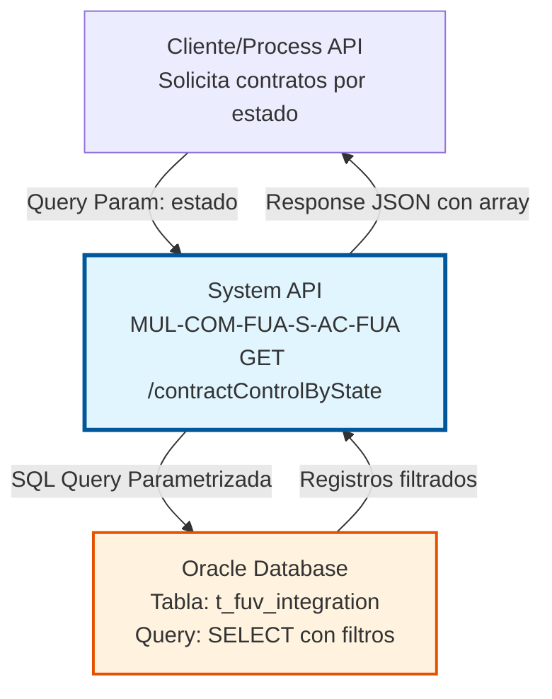
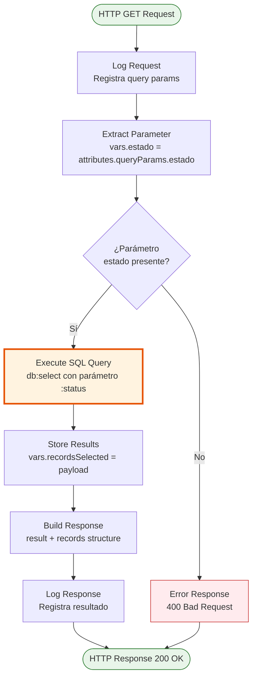
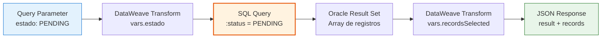

# GET /contractControlByState

## 📌 Descripción General

### Propósito del Endpoint

Este endpoint consulta registros de la tabla de control de integración de contratos FUA (`t_fuv_integration`) filtrados por estado específico. Está diseñado para monitorear y gestionar el proceso de integración de contratos, permitiendo identificar contratos que requieren reprocesamiento o seguimiento.

El endpoint soporta:
- **Filtrado por Estado**: Consulta registros en un estado específico (ej: PENDING, ERROR, PROCESSING)
- **Ventana Temporal**: Solo retorna registros actualizados en los últimos 10 días
- **Control de Reintentos**: Filtra registros con menos de 4 intentos fallidos
- **Ordenamiento Cronológico**: Ordena resultados por fecha de actualización ascendente para procesamiento FIFO

### Tipo de API

**Capa:** System API (API-Led Connectivity)

**Función:** Acceso directo a base de datos Oracle para consulta de registros de control de integración de contratos FUA.

### Patrón de Integración

**Tipo:** Request-Reply Síncrono con Query SQL

**Descripción:** Recibe un parámetro de estado vía query parameter, ejecuta una consulta SQL parametrizada contra la tabla `t_fuv_integration`, y retorna los registros que cumplen los criterios de filtrado (estado, fecha de actualización reciente, y número de intentos).

### Arquitectura API-Led Connectivity



---

## 💼 Propósito del Negocio

### Casos de Uso Principales

1. **Monitoreo de Contratos Pendientes**
   - Identificar contratos en estado PENDING que requieren procesamiento
   - Permite a sistemas downstream procesar contratos en cola
   - Facilita la gestión de backlog de integraciones

2. **Gestión de Reintentos Automáticos**
   - Consultar contratos en estado ERROR con intentos fallidos < 4
   - Habilita lógica de retry automático para contratos con errores transitorios
   - Evita reprocesamiento infinito limitando a 3 intentos

3. **Auditoría y Seguimiento**
   - Rastrear el estado de integración de contratos en tiempo real
   - Identificar patrones de error o cuellos de botella
   - Generar reportes de contratos en diferentes estados

### Contexto Empresarial

- **Dominio:** Gestión de Contratos - Factura Única Automática (FUA)
- **Sector:** Energía - Utilities
- **División:** Naturgy España - NewCo
- **Proceso de Negocio:** Control y monitoreo de integración de contratos entre sistemas
- **Sistema Backend:** Oracle Database (tabla de control de integración)

### Stakeholders

- **Equipos de Integración**: Monitorean el estado de sincronización de contratos
- **Operaciones IT**: Gestionan reintentos y resolución de errores
- **Analistas de Negocio**: Auditan el flujo de contratos a través del sistema

### Valor de Negocio

- **Visibilidad Operacional**: Proporciona transparencia sobre el estado de integración de contratos
- **Automatización de Reintentos**: Facilita el reprocesamiento automático de contratos con errores transitorios
- **Prevención de Pérdida de Datos**: Asegura que ningún contrato quede sin procesar mediante seguimiento activo
- **Optimización de Recursos**: Permite priorizar el procesamiento de contratos más antiguos (FIFO)

### Consumidores Potenciales

Este endpoint puede ser consumido por:
- Process APIs de orquestación de contratos FUA
- Jobs programados de reprocesamiento automático
- Dashboards de monitoreo operacional
- Sistemas de alertas y notificaciones
- Herramientas de auditoría y reporting

---

## 🔧 Especificación Técnica

### URLs por Ambiente

| Ambiente | URL Base | URL Completa |
|----------|----------|--------------|
| **Local** | `http://localhost:8081` | `http://localhost:8081/api/contractControlByState?estado=PENDING` |
| **Development** | `https://mul-com-fua-s-ac-fua-dev.us-e2.cloudhub.io` | `https://mul-com-fua-s-ac-fua-dev.us-e2.cloudhub.io/api/contractControlByState?estado=PENDING` |
| **UAT** | `https://mul-com-fua-s-ac-fua-uat.us-e2.cloudhub.io` | `https://mul-com-fua-s-ac-fua-uat.us-e2.cloudhub.io/api/contractControlByState?estado=PENDING` |
| **Production** | `https://mul-com-fua-s-ac-fua-pro.us-e2.cloudhub.io` | `https://mul-com-fua-s-ac-fua-pro.us-e2.cloudhub.io/api/contractControlByState?estado=PENDING` |

### Método HTTP

```
GET /api/contractControlByState
```

### Parámetros de Entrada

#### Headers HTTP

| Header | Tipo | Requerido | Descripción | Ejemplo |
|--------|------|-----------|-------------|---------|
| `Accept` | string | ❌ No | Tipo de contenido esperado en response | `application/json` |

#### Query Parameters

| Parámetro | Tipo | Requerido | Descripción | Ejemplo |
|-----------|------|-----------|-------------|---------|
| `estado` | string | ✅ Sí | Estado de los registros a consultar. Valores comunes: PENDING, ERROR, PROCESSING, COMPLETED | `"PENDING"` |

**Validaciones:**
- El parámetro `estado` es obligatorio
- El valor debe corresponder a un estado válido en la tabla `t_fuv_integration`

### Respuestas

#### Respuesta Exitosa (200 OK)

> **Nota:** La estructura de campos en `records` está basada en el RAML como referencia. El código ejecuta `SELECT *` sobre la tabla `t_fuv_integration`, por lo que retorna todas las columnas de la tabla. Los campos pueden ser `null` según el RAML.

```json
{
  "result": {
    "codResult": "0000",
    "msgResult": "No hay error"
  },
  "records": [
    {
      "T_FUV_INTEGRATION_ID": 12345,
      "CONTRACT_ID": 98765,
      "SYSTEM_MESSAGE": "Contrato pendiente de procesamiento",
      "CODE": "PEND001",
      "MESSAGE": "En cola de procesamiento",
      "STATE": "PENDING",
      "RESPONSE": null,
      "ERROR": null,
      "CONTRACT_ATR": 1,
      "CREATE_DATE": "2026-07-20T15:45:00Z",
      "UPDATE_DATE": "2026-07-21T08:30:00Z",
      "UPDATE_USER": "SYSTEM",
      "UPDATE_PROGRAM": "FUA_INTEGRATION",
      "OPTIMIST_LOCK": 1,
      "VIEWABLE": 1
    },
    {
      "T_FUV_INTEGRATION_ID": 12346,
      "CONTRACT_ID": 98766,
      "SYSTEM_MESSAGE": "Reintento de procesamiento",
      "CODE": "PEND002",
      "MESSAGE": "Segundo intento",
      "STATE": "PENDING",
      "RESPONSE": null,
      "ERROR": "Timeout en sistema externo",
      "CONTRACT_ATR": 1,
      "CREATE_DATE": "2026-07-20T16:20:00Z",
      "UPDATE_DATE": "2026-07-21T09:15:00Z",
      "UPDATE_USER": "SYSTEM",
      "UPDATE_PROGRAM": "FUA_INTEGRATION",
      "OPTIMIST_LOCK": 2,
      "VIEWABLE": 1
    }
  ]
}
```

**Estructura de Campos (basada en RAML):**
- `result.codResult`: Código de resultado ("0000" = éxito)
- `result.msgResult`: Mensaje descriptivo del resultado
- `records`: Array de registros que cumplen los criterios de filtrado
  - `T_FUV_INTEGRATION_ID`: Identificador único del registro de integración
  - `CONTRACT_ID`: Identificador del contrato
  - `SYSTEM_MESSAGE`: Mensaje del sistema sobre el estado del contrato
  - `CODE`: Código de estado o error
  - `MESSAGE`: Mensaje descriptivo del estado
  - `STATE`: Estado actual del registro (PENDING, ERROR, PROCESSING, COMPLETED)
  - `RESPONSE`: Respuesta del sistema externo (si aplica)
  - `ERROR`: Mensaje de error detallado (si aplica)
  - `CONTRACT_ATR`: Atributo del contrato
  - `CREATE_DATE`: Fecha de creación del registro
  - `UPDATE_DATE`: Fecha de última actualización
  - `UPDATE_USER`: Usuario que realizó la última actualización
  - `UPDATE_PROGRAM`: Programa que realizó la última actualización
  - `OPTIMIST_LOCK`: Versión para control de concurrencia optimista
  - `VIEWABLE`: Indicador de visibilidad (1 = visible, 0 = oculto)

**Nota sobre Campos Nullable:**
Según el RAML, todos los campos pueden ser `null`. El código ejecuta `SELECT *`, por lo que la estructura exacta depende del schema de la tabla `t_fuv_integration` en Oracle.

#### Respuesta Sin Registros (200 OK)

```json
{
  "result": {
    "codResult": "0000",
    "msgResult": "No hay error"
  },
  "records": []
}
```

#### Respuesta de Error - Parámetro Faltante (400 Bad Request)

```json
{
  "result": {
    "codResult": "0001",
    "msgResult": "Parámetro 'estado' es requerido"
  }
}
```

#### Respuesta de Error Técnico (500 Internal Server Error)

```json
{
  "result": {
    "codResult": "0002",
    "msgResult": "Error al consultar base de datos: Connection timeout"
  }
}
```

### Autenticación y Autorización

- **Tipo:** Client ID & Client Secret (Anypoint Platform)
- **Autorización DB:** El usuario de base de datos debe tener permisos para:
  - Ejecutar SELECT en tabla `t_fuv_integration`
  - Acceso de lectura al schema FUA

### Timeouts

| Tipo | Valor | Descripción |
|------|-------|-------------|
| **Request Timeout** | 30 segundos | Tiempo máximo de espera para la respuesta |
| **Connection Timeout** | 10 segundos | Tiempo máximo para establecer conexión con Oracle |
| **Query Timeout** | 20 segundos | Tiempo máximo de ejecución de la query SQL |

---

## 🏗️ Implementación Técnica

### Arquitectura del Flow



### Query SQL Ejecutada

**Query Real del Código:**
```sql
SELECT * 
FROM t_fuv_integration 
WHERE state = :status 
  AND update_date > sysdate - 10 
  AND attempts_number < 4 
ORDER BY update_date ASC
```

> **Nota Importante:** El código ejecuta `SELECT *`, lo que significa que retorna **todas las columnas** de la tabla `t_fuv_integration`. La estructura de campos documentada en este documento está basada en el RAML como referencia, pero la estructura real depende del schema de la tabla en Oracle. Todos los campos pueden ser `null` según el RAML.

**Análisis de la Query:**

| Componente | Descripción | Propósito |
|------------|-------------|-----------|
| `state = :status` | Filtro por estado parametrizado | Permite consultar registros en un estado específico |
| `update_date > sysdate - 10` | Ventana temporal de 10 días | Limita resultados a registros actualizados recientemente |
| `attempts_number < 4` | Máximo 3 intentos | Evita reprocesamiento infinito de registros con errores persistentes |
| `ORDER BY update_date ASC` | Ordenamiento FIFO | Procesa primero los registros más antiguos |

**Parámetros de la Query:**
- `:status` → Valor del query parameter `estado`

### Transformaciones DataWeave

#### 1. Extracción del Parámetro de Estado

**Ubicación en Flow:** Después del log inicial

```dataweave
%dw 2.0
output application/java
---
attributes.queryParams.estado
```

**Propósito:** Extrae el valor del query parameter `estado` y lo almacena en la variable `vars.estado` para uso en la query SQL.

#### 2. Almacenamiento de Resultados

**Ubicación en Flow:** Después de la ejecución de la query

```dataweave
%dw 2.0
output application/java
---
payload
```

**Propósito:** Almacena el resultado de la query SQL en la variable `vars.recordsSelected` para construcción de la respuesta.

#### 3. Construcción de Respuesta

**Ubicación en Flow:** Antes del log final

```dataweave
%dw 2.0
output application/json
---
{
  "result": {
    "codResult": "0000",
    "msgResult": "No hay error"
  },
  "records": vars.recordsSelected
}
```

**Propósito:** Construye la estructura de respuesta estándar con código de resultado y array de registros.

### Diagrama de Transformación de Datos



### Configuración de Base de Datos

**Database Config Reference:** `Database_Config`

**Propiedades de Conexión:**
- **Driver:** Oracle JDBC Driver
- **Connection String:** Configurado en properties file por ambiente
- **Pool de Conexiones:** Configurado para alta disponibilidad
- **Timeout de Query:** 20 segundos

### Manejo de Errores

**Estrategia de Error Handling:**

1. **Error de Parámetro Faltante:**
   - Validación en flow
   - Response 400 Bad Request
   - Mensaje descriptivo

2. **Error de Conexión a Base de Datos:**
   - Retry automático (configurado en Database Config)
   - Timeout después de 10 segundos
   - Response 500 con mensaje de error

3. **Error de Ejecución de Query:**
   - Captura de SQLException
   - Log detallado del error
   - Response 500 con mensaje genérico (sin exponer detalles internos)

### Logging

**Puntos de Log:**

1. **Log de Request:**
   ```
   STARTING getContractControlByState METHOD. REQUEST: {"estado":"PENDING"}
   ```

2. **Log de Response:**
   ```
   FINISHED getContractControlByState METHOD. RESPONSE: {"result":{"codResult":"0000","msgResult":"No hay error"},"records":[...]}
   ```

**Nivel de Log:** INFO

**Función de Normalización:** `common::commonFunctions::normalizeJSON()` para sanitizar datos sensibles.

---

## 💻 Ejemplos de Uso

### Ejemplo 1: Consulta de Contratos Pendientes

**Request:**
```bash
curl -X GET "https://mul-com-fua-s-ac-fua-dev.us-e2.cloudhub.io/api/contractControlByState?estado=PENDING" \
  -H "Accept: application/json" \
  -H "client_id: your-client-id" \
  -H "client_secret: your-client-secret"
```

**Response (200 OK):**
```json
{
  "result": {
    "codResult": "0000",
    "msgResult": "No hay error"
  },
  "records": [
    {
      "T_FUV_INTEGRATION_ID": 12345,
      "CONTRACT_ID": 98765,
      "SYSTEM_MESSAGE": "Contrato pendiente de procesamiento",
      "CODE": "PEND001",
      "MESSAGE": "En cola de procesamiento",
      "STATE": "PENDING",
      "RESPONSE": null,
      "ERROR": null,
      "CONTRACT_ATR": 1,
      "CREATE_DATE": "2026-07-20T15:45:00Z",
      "UPDATE_DATE": "2026-07-21T08:30:00Z",
      "UPDATE_USER": "SYSTEM",
      "UPDATE_PROGRAM": "FUA_INTEGRATION",
      "OPTIMIST_LOCK": 1,
      "VIEWABLE": 1
    },
    {
      "T_FUV_INTEGRATION_ID": 12350,
      "CONTRACT_ID": 98770,
      "SYSTEM_MESSAGE": "Nuevo contrato recibido",
      "CODE": "PEND002",
      "MESSAGE": "Primer intento de procesamiento",
      "STATE": "PENDING",
      "RESPONSE": null,
      "ERROR": null,
      "CONTRACT_ATR": 1,
      "CREATE_DATE": "2026-07-21T09:00:00Z",
      "UPDATE_DATE": "2026-07-21T09:00:00Z",
      "UPDATE_USER": "SYSTEM",
      "UPDATE_PROGRAM": "FUA_INTEGRATION",
      "OPTIMIST_LOCK": 1,
      "VIEWABLE": 1
    }
  ]
}
```

### Ejemplo 2: Consulta de Contratos con Error

**Request:**
```bash
curl -X GET "https://mul-com-fua-s-ac-fua-dev.us-e2.cloudhub.io/api/contractControlByState?estado=ERROR" \
  -H "Accept: application/json" \
  -H "client_id: your-client-id" \
  -H "client_secret: your-client-secret"
```

**Response (200 OK):**
```json
{
  "result": {
    "codResult": "0000",
    "msgResult": "No hay error"
  },
  "records": [
    {
      "T_FUV_INTEGRATION_ID": 12347,
      "CONTRACT_ID": 98767,
      "SYSTEM_MESSAGE": "Error en procesamiento",
      "CODE": "ERR001",
      "MESSAGE": "Timeout al conectar con sistema externo",
      "STATE": "ERROR",
      "RESPONSE": null,
      "ERROR": "Connection timeout after 30 seconds",
      "CONTRACT_ATR": 1,
      "CREATE_DATE": "2026-07-20T18:30:00Z",
      "UPDATE_DATE": "2026-07-21T07:45:00Z",
      "UPDATE_USER": "SYSTEM",
      "UPDATE_PROGRAM": "FUA_INTEGRATION",
      "OPTIMIST_LOCK": 2,
      "VIEWABLE": 1
    },
    {
      "T_FUV_INTEGRATION_ID": 12348,
      "CONTRACT_ID": 98768,
      "SYSTEM_MESSAGE": "Error de validación",
      "CODE": "ERR002",
      "MESSAGE": "Validación de datos fallida",
      "STATE": "ERROR",
      "RESPONSE": null,
      "ERROR": "Campo requerido 'customer_id' faltante",
      "CONTRACT_ATR": 1,
      "CREATE_DATE": "2026-07-20T19:00:00Z",
      "UPDATE_DATE": "2026-07-21T08:15:00Z",
      "UPDATE_USER": "SYSTEM",
      "UPDATE_PROGRAM": "FUA_INTEGRATION",
      "OPTIMIST_LOCK": 3,
      "VIEWABLE": 1
    }
  ]
}
```

### Ejemplo 3: Sin Registros Encontrados

**Request:**
```bash
curl -X GET "https://mul-com-fua-s-ac-fua-dev.us-e2.cloudhub.io/api/contractControlByState?estado=COMPLETED" \
  -H "Accept: application/json" \
  -H "client_id: your-client-id" \
  -H "client_secret: your-client-secret"
```

**Response (200 OK):**
```json
{
  "result": {
    "codResult": "0000",
    "msgResult": "No hay error"
  },
  "records": []
}
```

### Ejemplo 4: Error - Parámetro Faltante

**Request:**
```bash
curl -X GET "https://mul-com-fua-s-ac-fua-dev.us-e2.cloudhub.io/api/contractControlByState" \
  -H "Accept: application/json" \
  -H "client_id: your-client-id" \
  -H "client_secret: your-client-secret"
```

**Response (400 Bad Request):**
```json
{
  "result": {
    "codResult": "0001",
    "msgResult": "Parámetro 'estado' es requerido"
  }
}
```

### Ejemplo 5: Uso en JavaScript (Node.js)

```javascript
const axios = require('axios');

async function getContractsByState(estado) {
  try {
    const response = await axios.get(
      'https://mul-com-fua-s-ac-fua-dev.us-e2.cloudhub.io/api/contractControlByState',
      {
        params: { estado },
        headers: {
          'Accept': 'application/json',
          'client_id': process.env.CLIENT_ID,
          'client_secret': process.env.CLIENT_SECRET
        }
      }
    );
    
    console.log(`Encontrados ${response.data.records.length} contratos en estado ${estado}`);
    return response.data.records;
  } catch (error) {
    console.error('Error al consultar contratos:', error.message);
    throw error;
  }
}

// Uso
getContractsByState('PENDING')
  .then(records => {
    records.forEach(record => {
      console.log(`Contrato ID: ${record.CONTRACT_ID}, Estado: ${record.STATE}`);
      console.log(`  Mensaje: ${record.MESSAGE}`);
      console.log(`  Última actualización: ${record.UPDATE_DATE}`);
      if (record.ERROR) {
        console.log(`  Error: ${record.ERROR}`);
      }
    });
  });
```

### Ejemplo 6: Uso en Python

```python
import requests
import os

def get_contracts_by_state(estado):
    url = "https://mul-com-fua-s-ac-fua-dev.us-e2.cloudhub.io/api/contractControlByState"
    
    headers = {
        "Accept": "application/json",
        "client_id": os.getenv("CLIENT_ID"),
        "client_secret": os.getenv("CLIENT_SECRET")
    }
    
    params = {"estado": estado}
    
    try:
        response = requests.get(url, headers=headers, params=params)
        response.raise_for_status()
        
        data = response.json()
        records = data.get("records", [])
        
        print(f"Encontrados {len(records)} contratos en estado {estado}")
        return records
    except requests.exceptions.RequestException as e:
        print(f"Error al consultar contratos: {e}")
        raise

# Uso
if __name__ == "__main__":
    pending_contracts = get_contracts_by_state("PENDING")
    
    for record in pending_contracts:
        print(f"Contrato ID: {record['CONTRACT_ID']}, Estado: {record['STATE']}")
        print(f"  Mensaje: {record['MESSAGE']}")
        print(f"  Última actualización: {record['UPDATE_DATE']}")
        if record.get('ERROR'):
            print(f"  Error: {record['ERROR']}")
```
