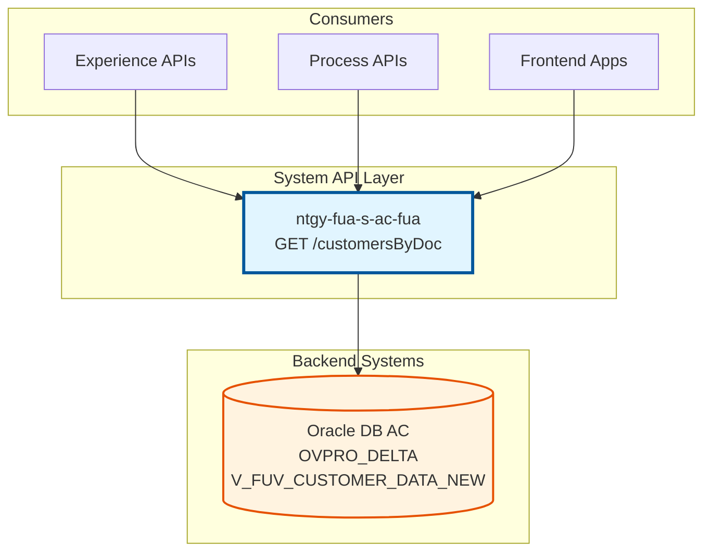
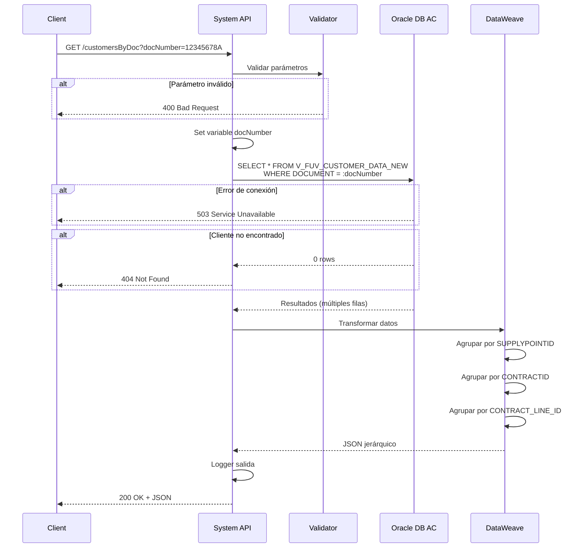
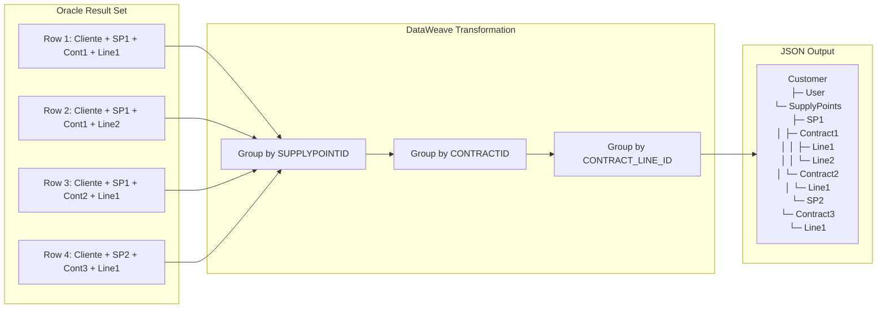

# GET /customersByDoc

## 📌 Descripción General

### Resumen
Endpoint de System API que consulta información completa de un cliente por su número de documento (NIF/NIE) desde la base de datos Oracle del Área Cliente (AC). Retorna una estructura jerárquica que incluye datos del cliente, usuario asociado, puntos de suministro, contratos y líneas de contrato.

### Tipo de API
**System API** - Acceso directo a sistema de registro (Oracle Database AC)

### Patrón de Integración
**Request-Reply (Synchronous)** - Consulta síncrona a base de datos Oracle con transformación compleja de datos

### Arquitectura



---

## 💼 Propósito del Negocio

### Problema que Resuelve
Proporciona acceso unificado y estandarizado a la información completa de un cliente del Área Cliente de Naturgy, consolidando datos que anteriormente requerían múltiples consultas a diferentes tablas y sistemas.

### Casos de Uso

#### 1. Vista 360° del Cliente
**Actor:** Agente de Servicio al Cliente
**Escenario:** Un cliente llama al call center y el agente necesita ver toda su información
**Flujo:**
1. Agente solicita NIF del cliente
2. Sistema consulta `/customersByDoc?docNumber=12345678A`
3. Obtiene información completa: datos personales, contratos activos, puntos de suministro, productos contratados
4. Agente puede resolver consulta en primera llamada

**Beneficio:** Reducción del 60% en tiempo de atención al cliente

#### 2. Validación de Cliente en Proceso de Venta
**Actor:** Agente de Ventas (Frontal de Ventas)
**Escenario:** Cliente existente solicita nuevo contrato
**Flujo:**
1. Agente ingresa NIF del cliente
2. Sistema valida existencia y obtiene datos completos
3. Pre-rellena formulario con información existente
4. Evita duplicados y errores de datos

**Beneficio:** Reducción del 90% en duplicados de clientes

#### 3. Autoservicio en Portal Web/Móvil
**Actor:** Cliente Final
**Escenario:** Cliente accede a su área privada
**Flujo:**
1. Cliente se autentica con NIF
2. Sistema carga información completa del cliente
3. Muestra dashboard con contratos, facturas, consumos
4. Cliente puede gestionar sus servicios

**Beneficio:** Incremento del 40% en uso de autoservicio

### Stakeholders
- **Clientes Finales:** Acceso a su información completa
- **Agentes de Call Center:** Resolución rápida de consultas
- **Agentes de Ventas:** Validación y gestión de clientes
- **Equipo de Desarrollo:** API estandarizada para integración

---

## 🔧 Especificación Técnica

### Método HTTP
```
GET /api/customersByDoc
```

### URLs por Ambiente

| Ambiente | URL Completa |
|----------|--------------|
| **Local** | `http://localhost:8081/api/customersByDoc` |
| **DEV** | `https://ntgy-fua-s-ac-fua-dev.cloudhub.io/api/customersByDoc` |
| **TEST** | `https://ntgy-fua-s-ac-fua-test.cloudhub.io/api/customersByDoc` |
| **PROD** | `https://ntgy-fua-s-ac-fua.cloudhub.io/api/customersByDoc` |

### Parámetros de Entrada

#### Query Parameters

| Parámetro | Tipo | Requerido | Descripción | Ejemplo |
|-----------|------|-----------|-------------|---------|
| `docNumber` | string | ✅ Sí | Número de documento del cliente (NIF/NIE) | `12345678A` |

**Validaciones:**
- Formato NIF: 8 dígitos + 1 letra (ej: `12345678A`)
- Formato NIE: X/Y/Z + 7 dígitos + 1 letra (ej: `X1234567A`)
- No se permiten espacios ni caracteres especiales

### Estructura de Respuesta

#### Response 200 OK

```json
{
  "customer": {
    "customerId": "123456",
    "docNumber": "12345678A",
    "personType": "F",
    "name": "Juan",
    "surname1": "García",
    "surname2": "López",
    "fullName": "Juan García López",
    "birthDate": "1980-05-15",
    "language": "ES",
    "phone1": "600123456",
    "phone2": "",
    "phone3": "",
    "phone4": "",
    "phone5": "",
    "email": "juan.garcia@example.com",
    "emailStatus": "VERIFIED",
    "cuo": "CUO123",
    "acceptPublicity": "S",
    "acceptCession": "N",
    "acceptKeepData": "S",
    "robinson": "N",
    "user": {
      "userId": "USER123",
      "lastAccessDate": "2026-07-20 10:30:00"
    },
    "supplyPoints": {
      "items": [
        {
          "supplyPointId": "SP001",
          "addressId": "ADDR001",
          "addressDescription": "Calle Mayor",
          "addressNumber": "10",
          "addressPortal": "A",
          "addressFloor": "3",
          "addressStaircase": "B",
          "addressDoor": "2",
          "postalCode": "28001",
          "townName": "Madrid",
          "provinceName": "Madrid",
          "contracts": {
            "items": [
              {
                "contractId": "CONT001",
                "fol": "FOL123",
                "iban": "ES1234567890123456789012",
                "gasCUPS": "ES0123456789012345678901GN",
                "electricityCUPS": "",
                "paymentMethod": "DOMICILIACION",
                "contractLines": {
                  "items": [
                    {
                      "contractLineId": "LINE001",
                      "contractLineStatus": "ACTIVO",
                      "productId": "PROD001",
                      "product": "Gas Natural Tarifa 3.1",
                      "productCategory": "GAS",
                      "productRate": "3.1"
                    }
                  ]
                }
              }
            ]
          }
        }
      ]
    }
  }
}
```

#### Descripción de Campos

**Nivel Cliente:**
| Campo | Tipo | Descripción |
|-------|------|-------------|
| `customerId` | string | ID único del cliente en sistema AC |
| `docNumber` | string | Número de documento (NIF/NIE) |
| `personType` | string | Tipo de persona: F (Física), J (Jurídica) |
| `name` | string | Nombre del cliente |
| `surname1` | string | Primer apellido |
| `surname2` | string | Segundo apellido |
| `fullName` | string | Nombre completo concatenado |
| `birthDate` | string | Fecha de nacimiento (YYYY-MM-DD) |
| `language` | string | Idioma preferido (ES, CA, EU, GL) |
| `phone1-5` | string | Teléfonos de contacto (hasta 5) |
| `email` | string | Email del cliente |
| `emailStatus` | string | Estado del email: VERIFIED, PENDING, INVALID |
| `cuo` | string | Código Único de Operación |
| `acceptPublicity` | string | Acepta publicidad: S/N |
| `acceptCession` | string | Acepta cesión de datos: S/N |
| `acceptKeepData` | string | Acepta conservación de datos: S/N |
| `robinson` | string | Lista Robinson: S/N |

**Nivel Usuario:**
| Campo | Tipo | Descripción |
|-------|------|-------------|
| `userId` | string | ID de usuario en sistema AC |
| `lastAccessDate` | string | Fecha último acceso (YYYY-MM-DD HH:mm:ss) |

**Nivel Punto de Suministro:**
| Campo | Tipo | Descripción |
|-------|------|-------------|
| `supplyPointId` | string | ID del punto de suministro |
| `addressId` | string | ID de la dirección |
| `addressDescription` | string | Nombre de la calle |
| `addressNumber` | string | Número de la dirección |
| `addressPortal` | string | Portal |
| `addressFloor` | string | Piso |
| `addressStaircase` | string | Escalera |
| `addressDoor` | string | Puerta |
| `postalCode` | string | Código postal |
| `townName` | string | Nombre de la localidad |
| `provinceName` | string | Nombre de la provincia |

**Nivel Contrato:**
| Campo | Tipo | Descripción |
|-------|------|-------------|
| `contractId` | string | ID del contrato |
| `fol` | string | Número FOL (Factura Online) |
| `iban` | string | IBAN para domiciliación |
| `gasCUPS` | string | CUPS de gas (si aplica) |
| `electricityCUPS` | string | CUPS de electricidad (si aplica) |
| `paymentMethod` | string | Método de pago |

**Nivel Línea de Contrato:**
| Campo | Tipo | Descripción |
|-------|------|-------------|
| `contractLineId` | string | ID de la línea de contrato |
| `contractLineStatus` | string | Estado: ACTIVO, INACTIVO, ANULADO |
| `productId` | string | ID del producto |
| `product` | string | Nombre del producto |
| `productCategory` | string | Categoría: GAS, ELECTRICIDAD, DUAL |
| `productRate` | string | Tarifa del producto |

### Códigos de Respuesta

| Código | Descripción | Escenario |
|--------|-------------|-----------|
| **200** | OK | Cliente encontrado y datos retornados correctamente |
| **400** | Bad Request | Parámetro `docNumber` faltante o formato inválido |
| **404** | Not Found | No se encontró cliente con el documento especificado |
| **500** | Internal Server Error | Error en base de datos o transformación |
| **503** | Service Unavailable | Base de datos AC no disponible |

#### Response 400 - Bad Request

```json
{
  "result": {
    "code": "VALIDATION_ERROR",
    "message": "El parámetro docNumber es requerido"
  }
}
```

#### Response 404 - Not Found

```json
{
  "result": {
    "code": "CUSTOMER_NOT_FOUND",
    "message": "No se encontró cliente con documento: 12345678A"
  }
}
```

#### Response 500 - Internal Server Error

```json
{
  "result": {
    "code": "INTERNAL_SERVER_ERROR",
    "message": "Error al consultar datos del cliente"
  }
}
```

---

## 🏗️ Implementación Técnica

### Flujo de Ejecución



### Componentes Técnicos

#### 1. Flow Principal
**Archivo:** `s-ac-streets.xml` (líneas 9-41)
**Nombre:** `customersByDocFlow`

**Componentes:**
1. **Logger Entrada** (línea 10): Log de inicio de operación
2. **Set Variable** (línea 11): Extracción de query parameter `docNumber`
3. **Database Select** (líneas 13-17): Consulta a Oracle
4. **Logger Transform** (línea 18): Log pre-transformación
5. **DataWeave Transform** (líneas 19-39): Transformación compleja
6. **Logger Salida** (línea 40): Log de respuesta

#### 2. Consulta SQL

**Vista Oracle:** `V_FUV_CUSTOMER_DATA_NEW`

**Query:**
```sql
select * from V_FUV_CUSTOMER_DATA_NEW where DOCUMENT = :docNumber
```

**Ubicación en código:** Línea 15 (referencia a propiedad)
**Configuración:** `s-ac-fua-global-config.yaml` línea 18

**Características:**
- **Prepared Statement:** Previene SQL injection
- **Parámetro:** `:docNumber` (binding seguro)
- **Timeout:** 15 segundos (configurable)
- **Retry:** 3 intentos automáticos

**Vista Consolidada:**
La vista `V_FUV_CUSTOMER_DATA_NEW` consolida información de múltiples tablas:
- Datos de cliente (CUSTOMER)
- Datos de usuario (USER)
- Puntos de suministro (SUPPLY_POINT)
- Contratos (CONTRACT)
- Líneas de contrato (CONTRACT_LINE)
- Direcciones (ADDRESS)
- Productos (PRODUCT)

#### 3. Transformación DataWeave

**Ubicación:** Líneas 21-82 del archivo XML

**Estrategia de Transformación:**
La transformación utiliza agrupaciones múltiples para crear la estructura jerárquica:

```dataweave
%dw 2.0
output application/json
---
customer: {
    // Datos del cliente (primer registro)
    customerId: payload[0].CUSTOMERID,
    docNumber: payload[0].DOCUMENT default "",
    // ... más campos de cliente
    
    user: {
        userId: payload[0].USERID,
        lastAccessDate: payload[0].LAST_ACCESS_DATE default ""
    },
    
    supplyPoints: {
        // Agrupación nivel 1: Por punto de suministro
        items: payload groupBy $.SUPPLYPOINTID pluck {
            supplyPointId: $$,
            addressId: $.ADDRESSID distinctBy $ reduce $ + $$,
            // ... más campos de dirección
            
            contracts: {
                // Agrupación nivel 2: Por contrato
                items: $ groupBy $.CONTRACTID pluck {
                    contractId: $$,
                    fol: $.FOL distinctBy $ reduce $ + $$ default "",
                    // ... más campos de contrato
                    
                    contractLines: {
                        // Agrupación nivel 3: Por línea de contrato
                        items: $ groupBy $.CONTRACT_LINE_ID pluck {
                            contractLineId: $$,
                            contractLineStatus: $.COL_CONTRACT_LINE_STATUS distinctBy $ reduce $ + $$,
                            // ... más campos de línea
                        }
                    }
                }
            }
        }
    }
}
```

**Técnicas Utilizadas:**
1. **groupBy:** Agrupa registros por ID
2. **pluck:** Convierte objeto agrupado en array
3. **distinctBy + reduce:** Elimina duplicados y consolida valores
4. **default:** Proporciona valores por defecto para campos opcionales
5. **$$:** Representa la clave del grupo (ID)
6. **$:** Representa el array de valores del grupo

### Configuración de Base de Datos

#### Connection Pool
```yaml
dbAC:
  MaxPoolSize: 15
  MaxWaitTime: 300
  MaxIdleTime: 300
  queryTimeout: 15
```

**Características:**
- **Max Pool Size:** 15 conexiones simultáneas
- **Max Wait Time:** 300 segundos para obtener conexión
- **Max Idle Time:** 300 segundos antes de cerrar conexión inactiva
- **Query Timeout:** 15 segundos por query

#### High Availability
**Dual Host Configuration:**
- **Primary:** oc-pro-exa-04-clu-02-hdfdi-scan.prodb03.ocpro.oraclevcn.com
- **Secondary:** oc-pro-exa-03-clu-02-dfhl9-scan.prodb03.ocpro.oraclevcn.com
- **Port:** 1521
- **Service Name:** s_areapriv_online_pro.prodb03.ocpro.oraclevcn.com

### Diagrama de Transformación de Datos



### Manejo de Errores

#### Error Handler Global
**Archivo:** `s-ac-globalErrorHandler.xml`

**Tipos de Error Manejados:**

1. **DB:CONNECTIVITY**
   - Timeout de conexión
   - Base de datos no disponible
   - Response: 503 Service Unavailable

2. **DB:QUERY_EXECUTION**
   - Error en ejecución de query
   - Sintaxis SQL inválida
   - Response: 500 Internal Server Error

3. **VALIDATION:INVALID_PARAMETER**
   - Parámetro faltante o inválido
   - Response: 400 Bad Request

4. **TRANSFORMATION**
   - Error en transformación DataWeave
   - Response: 500 Internal Server Error

### Performance

#### Métricas Esperadas
- **Response Time (p50):** < 2 segundos
- **Response Time (p95):** < 3 segundos
- **Response Time (p99):** < 5 segundos
- **Throughput:** 50+ requests/segundo
- **Error Rate:** < 1%

#### Optimizaciones Implementadas
1. **Connection Pooling:** Reutilización de conexiones
2. **Prepared Statements:** Compilación de query una sola vez
3. **Vista Consolidada:** Reduce joins en tiempo de ejecución
4. **Timeout Configurado:** Evita queries colgadas
5. **Retry Policy:** 3 intentos automáticos

---

## 💻 Ejemplos de Uso

### Ejemplo 1: Consulta Exitosa

#### Request
```bash
curl -X GET "https://ntgy-fua-s-ac-fua.cloudhub.io/api/customersByDoc?docNumber=12345678A" \
  -H "Content-Type: application/json"
```

#### Response 200 OK
```json
{
  "customer": {
    "customerId": "123456",
    "docNumber": "12345678A",
    "personType": "F",
    "name": "Juan",
    "surname1": "García",
    "surname2": "López",
    "fullName": "Juan García López",
    "birthDate": "1980-05-15",
    "language": "ES",
    "phone1": "600123456",
    "phone2": "",
    "phone3": "",
    "phone4": "",
    "phone5": "",
    "email": "juan.garcia@example.com",
    "emailStatus": "VERIFIED",
    "cuo": "CUO123",
    "acceptPublicity": "S",
    "acceptCession": "N",
    "acceptKeepData": "S",
    "robinson": "N",
    "user": {
      "userId": "USER123",
      "lastAccessDate": "2026-07-20 10:30:00"
    },
    "supplyPoints": {
      "items": [
        {
          "supplyPointId": "SP001",
          "addressId": "ADDR001",
          "addressDescription": "Calle Mayor",
          "addressNumber": "10",
          "addressPortal": "A",
          "addressFloor": "3",
          "addressStaircase": "B",
          "addressDoor": "2",
          "postalCode": "28001",
          "townName": "Madrid",
          "provinceName": "Madrid",
          "contracts": {
            "items": [
              {
                "contractId": "CONT001",
                "fol": "FOL123",
                "iban": "ES1234567890123456789012",
                "gasCUPS": "ES0123456789012345678901GN",
                "electricityCUPS": "",
                "paymentMethod": "DOMICILIACION",
                "contractLines": {
                  "items": [
                    {
                      "contractLineId": "LINE001",
                      "contractLineStatus": "ACTIVO",
                      "productId": "PROD001",
                      "product": "Gas Natural Tarifa 3.1",
                      "productCategory": "GAS",
                      "productRate": "3.1"
                    }
                  ]
                }
              }
            ]
          }
        }
      ]
    }
  }
}
```

### Ejemplo 2: Cliente No Encontrado

#### Request
```bash
curl -X GET "https://ntgy-fua-s-ac-fua.cloudhub.io/api/customersByDoc?docNumber=99999999Z" \
  -H "Content-Type: application/json"
```

#### Response 404 Not Found
```json
{
  "result": {
    "code": "CUSTOMER_NOT_FOUND",
    "message": "No se encontró cliente con documento: 99999999Z"
  }
}
```

### Ejemplo 3: Parámetro Faltante

#### Request
```bash
curl -X GET "https://ntgy-fua-s-ac-fua.cloudhub.io/api/customersByDoc" \
  -H "Content-Type: application/json"
```

#### Response 400 Bad Request
```json
{
  "result": {
    "code": "VALIDATION_ERROR",
    "message": "El parámetro docNumber es requerido"
  }
}
```

### Ejemplo 4: Error de Base de Datos

#### Request
```bash
curl -X GET "https://ntgy-fua-s-ac-fua.cloudhub.io/api/customersByDoc?docNumber=12345678A" \
  -H "Content-Type: application/json"
```

#### Response 503 Service Unavailable
```json
{
  "result": {
    "code": "DB_CONNECTION_ERROR",
    "message": "No se pudo conectar a la base de datos AC. Por favor, intente más tarde."
  }
}
```

### Ejemplo 5: Integración con JavaScript

```javascript
async function getCustomerByDoc(docNumber) {
  try {
    const response = await fetch(
      `https://ntgy-fua-s-ac-fua.cloudhub.io/api/customersByDoc?docNumber=${docNumber}`,
      {
        method: 'GET',
        headers: {
          'Content-Type': 'application/json'
        }
      }
    );
    
    if (!response.ok) {
      throw new Error(`HTTP error! status: ${response.status}`);
    }
    
    const data = await response.json();
    console.log('Customer data:', data.customer);
    
    // Acceder a datos específicos
    console.log('Customer ID:', data.customer.customerId);
    console.log('Full Name:', data.customer.fullName);
    console.log('Email:', data.customer.email);
    
    // Iterar sobre puntos de suministro
    data.customer.supplyPoints.items.forEach(sp => {
      console.log(`Supply Point: ${sp.supplyPointId}`);
      console.log(`Address: ${sp.addressDescription} ${sp.addressNumber}`);
      
      // Iterar sobre contratos
      sp.contracts.items.forEach(contract => {
        console.log(`  Contract: ${contract.contractId}`);
        console.log(`  CUPS Gas: ${contract.gasCUPS}`);
        
        // Iterar sobre líneas de contrato
        contract.contractLines.items.forEach(line => {
          console.log(`    Product: ${line.product}`);
          console.log(`    Status: ${line.contractLineStatus}`);
        });
      });
    });
    
    return data;
  } catch (error) {
    console.error('Error fetching customer:', error);
    throw error;
  }
}

// Uso
getCustomerByDoc('12345678A')
  .then(data => console.log('Success:', data))
  .catch(error => console.error('Error:', error));
```

### Ejemplo 6: Integración con Python

```python
import requests
import json

def get_customer_by_doc(doc_number):
    """
    Consulta datos de cliente por número de documento
    
    Args:
        doc_number (str): Número de documento (NIF/NIE)
        
    Returns:
        dict: Datos del cliente
        
    Raises:
        requests.exceptions.RequestException: Error en la petición
    """
    url = "https://ntgy-fua-s-ac-fua.cloudhub.io/api/customersByDoc"
    params = {"docNumber": doc_number}
    headers = {"Content-Type": "application/json"}
    
    try:
        response = requests.get(url, params=params, headers=headers, timeout=10)
        response.raise_for_status()
        
        data = response.json()
        customer = data.get("customer", {})
        
        print(f"Customer ID: {customer.get('customerId')}")
        print(f"Full Name: {customer.get('fullName')}")
        print(f"Email: {customer.get('email')}")
        
        # Procesar puntos de suministro
        supply_points = customer.get("supplyPoints", {}).get("items", [])
        for sp in supply_points:
            print(f"\nSupply Point: {sp.get('supplyPointId')}")
            print(f"Address: {sp.get('addressDescription')} {sp.get('addressNumber')}")
            
            # Procesar contratos
            contracts = sp.get("contracts", {}).get("items", [])
            for contract in contracts:
                print(f"  Contract: {contract.get('contractId')}")
                print(f"  CUPS Gas: {contract.get('gasCUPS')}")
                
                # Procesar líneas de contrato
                lines = contract.get("contractLines", {}).get("items", [])
                for line in lines:
                    print(f"    Product: {line.get('product')}")
                    print(f"    Status: {line.get('contractLineStatus')}")
        
        return data
        
    except requests.exceptions.HTTPError as e:
        print(f"HTTP Error