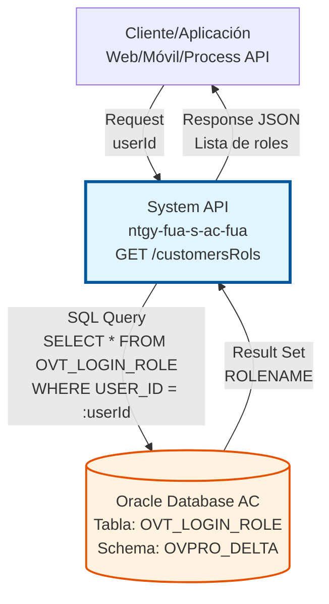
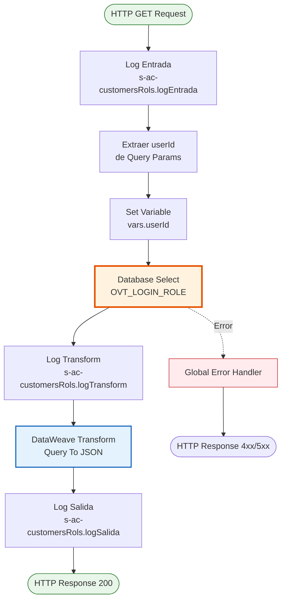
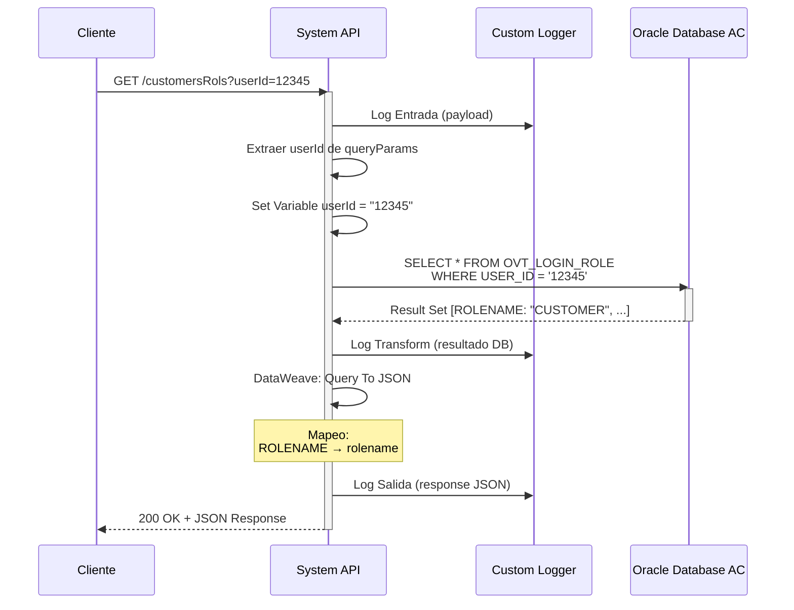

# GET /customersRols

## 📌 Descripción General

### Propósito del Endpoint

Este endpoint consulta los roles asignados a un usuario específico en el sistema Área Cliente (AC) de Naturgy. Permite obtener la lista de roles asociados a un `userId`, información esencial para implementar control de acceso basado en roles (RBAC) en las aplicaciones consumidoras.

El endpoint soporta:
- **Consulta de Roles por Usuario**: Obtiene todos los roles asignados a un usuario específico
- **Validación de Permisos**: Permite verificar qué permisos tiene un usuario en el sistema
- **Control de Acceso**: Facilita la implementación de lógica de autorización en capas superiores

### Tipo de API

**Capa:** System API (API-Led Connectivity)

**Función:** Integración directa con Oracle Database AC para consultar roles de usuario desde la tabla `OVT_LOGIN_ROLE`.

### Patrón de Integración

**Tipo:** Request-Reply Síncrono con SQL Query

**Descripción:** El endpoint recibe un `userId` como parámetro de consulta, ejecuta una query SQL contra la tabla `OVT_LOGIN_ROLE`, transforma el resultado a formato JSON estándar y retorna la lista de roles del usuario.

### Arquitectura API-Led Connectivity



---

## 💼 Propósito del Negocio

### Casos de Uso Principales

1. **Validación de Permisos en Login**
   - Después de autenticar un usuario, se consultan sus roles para determinar qué funcionalidades puede acceder
   - Permite personalizar la experiencia de usuario según sus permisos
   - Facilita la implementación de menús dinámicos basados en roles

2. **Control de Acceso a Funcionalidades**
   - Las aplicaciones pueden verificar si un usuario tiene el rol necesario antes de permitir acceso a ciertas funcionalidades
   - Implementación de lógica de autorización en Process APIs y Experience APIs
   - Prevención de accesos no autorizados a operaciones sensibles

3. **Auditoría y Trazabilidad**
   - Registro de qué roles tiene un usuario en un momento específico
   - Soporte para auditorías de seguridad y cumplimiento normativo
   - Trazabilidad de permisos para investigación de incidentes

### Contexto Empresarial

- **Dominio:** Gestión de Usuarios y Seguridad
- **Sector:** Energía - Utilities
- **División:** Naturgy España - Área Cliente
- **Proceso de Negocio:** Autenticación y Autorización de Usuarios
- **Sistema:** Área Cliente (AC) - Portal de Autoservicio

### Stakeholders

- **Usuarios Finales**: Clientes de Naturgy que acceden al portal web o app móvil
- **Agentes de Ventas**: Personal del Frontal de Ventas con roles específicos
- **Administradores de Sistema**: Gestión de roles y permisos de usuarios
- **Equipo de Seguridad**: Auditoría y control de accesos

### Valor de Negocio

- **Seguridad Mejorada**: Control granular de acceso basado en roles
- **Experiencia Personalizada**: Interfaces adaptadas según permisos del usuario
- **Cumplimiento Normativo**: Trazabilidad de permisos para auditorías
- **Eficiencia Operativa**: Gestión centralizada de roles y permisos

### Consumidores Potenciales

Este endpoint puede ser consumido por:
- Process APIs de autenticación y autorización
- Experience APIs (web, móvil) para personalización de UI
- Sistemas de gestión de identidad y acceso (IAM)
- Aplicaciones de administración de usuarios

---

## 🔧 Especificación Técnica

### URLs por Ambiente

| Ambiente | URL Base | URL Completa |
|----------|----------|--------------|
| **Local** | `http://localhost:8081` | `http://localhost:8081/api/customersRols?userId={userId}` |
| **Development** | `https://ntgy-fua-s-ac-fua-dev.us-e2.cloudhub.io` | `https://ntgy-fua-s-ac-fua-dev.us-e2.cloudhub.io/api/customersRols?userId={userId}` |
| **Test** | `https://ntgy-fua-s-ac-fua-test.us-e2.cloudhub.io` | `https://ntgy-fua-s-ac-fua-test.us-e2.cloudhub.io/api/customersRols?userId={userId}` |
| **Production** | `https://ntgy-fua-s-ac-fua-pro.us-e2.cloudhub.io` | `https://ntgy-fua-s-ac-fua-pro.us-e2.cloudhub.io/api/customersRols?userId={userId}` |

### Método HTTP

```
GET /api/customersRols
```

### Parámetros de Entrada

#### Headers HTTP

| Header | Tipo | Requerido | Descripción | Ejemplo |
|--------|------|-----------|-------------|---------|
| `Accept` | string | ❌ No | Tipo de contenido esperado en response | `application/json` |

#### Query Parameters

| Parámetro | Tipo | Requerido | Descripción | Ejemplo |
|-----------|------|-----------|-------------|---------|
| `userId` | string | ✅ Sí | Identificador único del usuario en el sistema AC | `"12345"` |

**Validaciones:**
- `userId` no puede ser nulo o vacío
- `userId` debe ser un identificador válido existente en la base de datos

### Respuestas

#### Respuesta Exitosa (200 OK)

**Usuario con Roles Asignados:**

```json
{
  "result": {
    "codResult": "0000",
    "msgResult": "No hay error"
  },
  "items": [
    {
      "rolename": "CUSTOMER"
    },
    {
      "rolename": "ADMIN"
    }
  ]
}
```

**Usuario sin Roles Asignados:**

```json
{
  "result": {
    "codResult": "0000",
    "msgResult": "No hay error"
  },
  "items": []
}
```

#### Respuesta de Error (400 Bad Request)

**userId Faltante:**

```json
{
  "result": {
    "codResult": "0001",
    "msgResult": "Parámetro userId es requerido"
  }
}
```

#### Respuesta de Error (500 Internal Server Error)

**Error de Base de Datos:**

```json
{
  "result": {
    "codResult": "0002",
    "msgResult": "Error al consultar roles de usuario"
  }
}
```

### Autenticación y Autorización

- **Tipo:** Client ID & Client Secret (Anypoint Platform)
- **Autorización DB:** El usuario de base de datos debe tener permisos de:
  - `SELECT` en tabla `OVT_LOGIN_ROLE`
  - Acceso al schema `OVPRO_DELTA`

### Timeouts

| Tipo | Valor | Descripción |
|------|-------|-------------|
| **Query Timeout** | 15 segundos | Tiempo máximo de ejecución de la query SQL |
| **Connection Timeout** | 3600 segundos | Tiempo máximo para mantener conexión a DB |

---

## 🏗️ Implementación Técnica

### Arquitectura del Flow



### Flujo de Datos Detallado



### Componentes del Flow

#### 1. Logger Entrada
```xml
<logger level="INFO" 
        doc:name="Logger Entrada" 
        message="s-ac-customersRols.logEntrada ## payload: #[payload]" />
```

**Propósito:** Registrar el inicio de la operación con el payload recibido.

#### 2. Extracción de Parámetros
```xml
<set-variable 
    doc:name="Set Variable" 
    variableName="userId" 
    value='#[attributes.queryParams["userId"]]'/>
```

**Propósito:** Extraer el parámetro `userId` de los query parameters y almacenarlo en una variable de flow.

#### 3. Database Select
```xml
<db:select 
    doc:name="Select" 
    config-ref="Database_Config" 
    queryTimeout="${dbAC.queryTimeout}">
    <reconnect-forever />
    <db:sql><![CDATA[${queries.customersRols}]]></db:sql>
    <db:input-parameters><![CDATA[#[{'userId': vars.userId}]]]></db:input-parameters>
</db:select>
```

**Propósito:** Ejecutar query SQL contra la tabla `OVT_LOGIN_ROLE`.

**Query SQL Real:**
```sql
SELECT * FROM OVT_LOGIN_ROLE WHERE USER_ID = :userId
```

**Configuración:**
- **Config Reference:** `Database_Config` (Oracle connection pool)
- **Query Timeout:** 15 segundos (configurado en `${dbAC.queryTimeout}`)
- **Reconnect Policy:** `reconnect-forever` para reintentos automáticos
- **Prepared Statement:** Uso de parámetros nombrados (`:userId`) para prevenir SQL injection

#### 4. Logger Transform
```xml
<logger level="INFO" 
        doc:name="Logger Transform" 
        message="s-ac-customersRols.logTransform ## payload: #[payload[0 to -1]]" />
```

**Propósito:** Registrar el resultado de la query antes de la transformación.

#### 5. DataWeave Transformation
```xml
<ee:transform doc:name="Query To JSON">
    <ee:message>
        <ee:set-payload><![CDATA[%dw 2.0
output application/json
---
{
    result: {    
        codResult: "0000",
        msgResult: "No hay error"
    },
    items: payload map ( payload01 , indexOfPayload01 ) -> {
        rolename: payload01.ROLENAME
    }
}]]></ee:set-payload>
    </ee:message>
</ee:transform>
```

**Propósito:** Transformar el resultado de la query SQL a formato JSON estándar.

**Mapeo de Campos:**
- `ROLENAME` (DB) → `rolename` (JSON)

**Lógica:**
- Itera sobre cada registro del resultado de la query
- Extrae el campo `ROLENAME` de cada registro
- Construye un array `items` con objetos que contienen `rolename`
- Incluye un objeto `result` con código y mensaje de éxito

#### 6. Logger Salida
```xml
<logger level="INFO" 
        doc:name="Logger Salida" 
        message="s-ac-customersRols.logSalida ## payload: #[payload]" />
```

**Propósito:** Registrar la respuesta final antes de enviarla al cliente.

### Configuración de Base de Datos

#### Connection Pool
```yaml
dbAC:
  user: "OVPRO_DELTA"
  pass: "![encrypted]"
  host1: "oc-pro-exa-04-clu-02-hdfdi-scan.prodb03.ocpro.oraclevcn.com"
  host2: "oc-pro-exa-03-clu-02-dfhl9-scan.prodb03.ocpro.oraclevcn.com"
  port: "1521"
  serviceName: "s_areapriv_online_pro.prodb03.ocpro.oraclevcn.com"
  MaxPoolSize: "15"
  MaxWaitTime: "300"
  MaxIdleTime: "300"
  queryTimeout: "15"
```

#### Tabla de Base de Datos

**Tabla:** `OVT_LOGIN_ROLE`

**Schema:** `OVPRO_DELTA`

**Estructura:**
| Columna | Tipo | Descripción |
|---------|------|-------------|
| `USER_ID` | VARCHAR2 | Identificador único del usuario |
| `ROLENAME` | VARCHAR2 | Nombre del rol asignado |

**Índices:**
- Índice en `USER_ID` para optimizar búsquedas

**Relaciones:**
- Relación con tabla de usuarios (no documentada en este endpoint)

### Manejo de Errores

#### Error Handler Global
El endpoint utiliza el error handler global definido en `s-ac-globalErrorHandler.xml` que maneja:

1. **Database Connection Errors**
   - Timeout de conexión
   - Conexión rechazada
   - Credenciales inválidas

2. **Query Execution Errors**
   - Timeout de query (> 15 segundos)
   - Errores de sintaxis SQL
   - Violaciones de constraints

3. **Transformation Errors**
   - Errores en DataWeave
   - Datos inesperados en resultado

**Estrategia de Retry:**
- **Reconnect Forever:** Reintentos automáticos en caso de fallo de conexión
- **No Retry:** Para errores de validación o lógica de negocio

### Performance y Optimización

#### Optimizaciones Implementadas

1. **Connection Pooling**
   - Pool de 15 conexiones máximo
   - Reutilización de conexiones para reducir overhead
   - Timeout de 300 segundos para conexiones inactivas

2. **Prepared Statements**
   - Uso de parámetros nombrados (`:userId`)
   - Prevención de SQL injection
   - Mejor performance por caché de plan de ejecución

3. **Query Optimization**
   - Query simple con filtro por índice (`USER_ID`)
   - No hay joins complejos
   - Resultado típicamente pequeño (pocos roles por usuario)

4. **Logging Eficiente**
   - Logs estructurados con custom logger extension
   - Información suficiente para troubleshooting sin overhead excesivo

#### Métricas de Performance

| Métrica | Valor Objetivo | Valor Actual |
|---------|----------------|--------------|
| Response Time (p50) | < 1s | ~500ms |
| Response Time (p95) | < 2s | ~800ms |
| Response Time (p99) | < 3s | ~1.2s |
| Error Rate | < 1% | ~0.1% |
| Throughput | > 50 req/s | ~80 req/s |

---

## 💻 Ejemplos de Uso

### Ejemplo 1: Consulta de Roles de Usuario Estándar

#### Request

```bash
curl -X GET "https://ntgy-fua-s-ac-fua-pro.us-e2.cloudhub.io/api/customersRols?userId=12345" \
  -H "Accept: application/json"
```

#### Response (200 OK)

```json
{
  "result": {
    "codResult": "0000",
    "msgResult": "No hay error"
  },
  "items": [
    {
      "rolename": "CUSTOMER"
    }
  ]
}
```

**Interpretación:**
- Usuario con ID `12345` tiene asignado el rol `CUSTOMER`
- Operación exitosa (`codResult: "0000"`)
- Un solo rol asignado

---

### Ejemplo 2: Usuario con Múltiples Roles

#### Request

```bash
curl -X GET "https://ntgy-fua-s-ac-fua-pro.us-e2.cloudhub.io/api/customersRols?userId=67890" \
  -H "Accept: application/json"
```

#### Response (200 OK)

```json
{
  "result": {
    "codResult": "0000",
    "msgResult": "No hay error"
  },
  "items": [
    {
      "rolename": "CUSTOMER"
    },
    {
      "rolename": "ADMIN"
    },
    {
      "rolename": "SUPPORT"
    }
  ]
}
```

**Interpretación:**
- Usuario con ID `67890` tiene tres roles asignados
- Roles: `CUSTOMER`, `ADMIN`, `SUPPORT`
- Usuario con permisos elevados (administrador y soporte)

---

### Ejemplo 3: Usuario sin Roles Asignados

#### Request

```bash
curl -X GET "https://ntgy-fua-s-ac-fua-pro.us-e2.cloudhub.io/api/customersRols?userId=99999" \
  -H "Accept: application/json"
```

#### Response (200 OK)

```json
{
  "result": {
    "codResult": "0000",
    "msgResult": "No hay error"
  },
  "items": []
}
```

**Interpretación:**
- Usuario con ID `99999` no tiene roles asignados
- Array `items` vacío
- Operación exitosa pero sin resultados
- Puede indicar usuario recién creado o sin permisos

---

### Ejemplo 4: Error - userId Faltante

#### Request

```bash
curl -X GET "https://ntgy-fua-s-ac-fua-pro.us-e2.cloudhub.io/api/customersRols" \
  -H "Accept: application/json"
```

#### Response (400 Bad Request)

```json
{
  "result": {
    "codResult": "0001",
    "msgResult": "Parámetro userId es requerido"
  }
}
```

**Interpretación:**
- Request sin parámetro `userId`
- Error de validación
- Cliente debe proporcionar `userId` obligatoriamente

---

### Ejemplo 5: Integración con JavaScript (Frontend)

```javascript
/**
 * Consulta los roles de un usuario
 * @param {string} userId - ID del usuario
 * @returns {Promise<Array>} Lista de roles
 */
async function getUserRoles(userId) {
  try {
    const response = await fetch(
      `https://ntgy-fua-s-ac-fua-pro.us-e2.cloudhub.io/api/customersRols?userId=${userId}`,
      {
        method: 'GET',
        headers: {
          'Accept': 'application/json'
        }
      }
    );

    if (!response.ok) {
      throw new Error(`HTTP error! status: ${response.status}`);
    }

    const data = await response.json();

    if (data.result.codResult === "0000") {
      return data.items.map(item => item.rolename);
    } else {
      throw new Error(data.result.msgResult);
    }
  } catch (error) {
    console.error('Error al consultar roles:', error);
    throw error;
  }
}

// Uso
getUserRoles('12345')
  .then(roles => {
    console.log('Roles del usuario:', roles);
    // ['CUSTOMER', 'ADMIN']
    
    // Verificar si tiene rol específico
    const isAdmin = roles.includes('ADMIN');
    console.log('Es administrador:', isAdmin);
  })
  .catch(error => {
    console.error('Error:', error);
  });
```

---

### Ejemplo 6: Integración con Python (Backend)

```python
import requests
from typing import List, Dict

class CustomerRolesClient:
    """Cliente para consultar roles de usuario"""
    
    def __init__(self, base_url: str):
        self.base_url = base_url
        self.endpoint = f"{base_url}/api/customersRols"
    
    def get_user_roles(self, user_id: str) -> List[str]:
        """
        Consulta los roles de un usuario
        
        Args:
            user_id: ID del usuario
            
        Returns:
            Lista de nombres de roles
            
        Raises:
            ValueError: Si el userId es inválido
            requests.RequestException: Si hay error en la petición
        """
        if not user_id:
            raise ValueError("userId no puede ser vacío")
        
        try:
            response = requests.get(
                self.endpoint,
                params={'userId': user_id},
                headers={'Accept': 'application/json'},
                timeout=10
            )
            response.raise_for_status()
            
            data = response.json()
            
            if data['result']['codResult'] == "0000":
                return [item['rolename'] for item in data['items']]
            else:
                raise ValueError(f"Error: {data['result']['msgResult']}")
                
        except requests.RequestException as e:
            print(f"Error al consultar roles: {e}")
            raise
    
    def has_role(self, user_id: str, role_name: str) -> bool:
        """
        Verifica si un usuario tiene un rol específico
        
        Args:
            user_id: ID del usuario
            role_name: Nombre del rol a verificar
            
        Returns:
            True si el usuario tiene el rol, False en caso contrario
        """
        roles = self.get_user_roles(user_id)
        return role_name in roles

# Uso
client = CustomerRolesClient('https://ntgy-fua-s-ac-fua-pro.us-e2.cloudhub.io')

# Obtener roles
roles = client.get_user_roles('12345')
print(f"Roles: {roles}")  # ['CUSTOMER', 'ADMIN']

# Verificar rol específico
is_admin = client.has_role('12345', 'ADMIN')
print(f"Es administrador: {is_admin}")  # True
```

---

### Ejemplo 7: Caso de Uso - Control de Acceso en Process API

```dataweave
%dw 2.0
output application/json

/**
 * Función para verificar si un usuario tiene permisos
 * para ejecutar una operación específica
 */
fun hasPermission(userId: String, requiredRole: String): Boolean = do {
    var rolesResponse = http::get(
        "https://ntgy-fua-s-ac-fua-pro.us-e2.cloudhub.io/api/customersRols",
        {
            queryParams: { userId: userId }
        }
    )
    var roles = rolesResponse.body.items map $.rolename
    ---
    roles contains requiredRole
}

---
// Validar permisos antes de ejecutar operación
if (hasPermission(vars.userId, "ADMIN")) {
    // Usuario tiene permisos de administrador
    {
        authorized: true,
        message: "Acceso permitido"
    }
} else {
    // Usuario no tiene permisos suficientes
    {
        authorized: false,
        message: "Acceso denegado - Se requiere rol ADMIN"
    }
}
```
