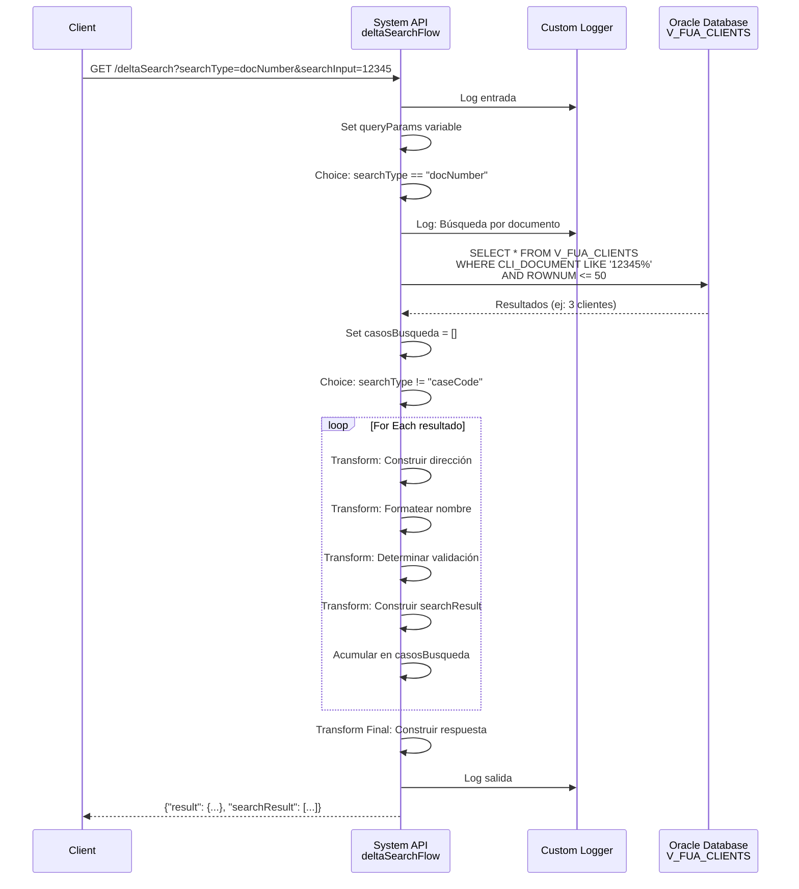
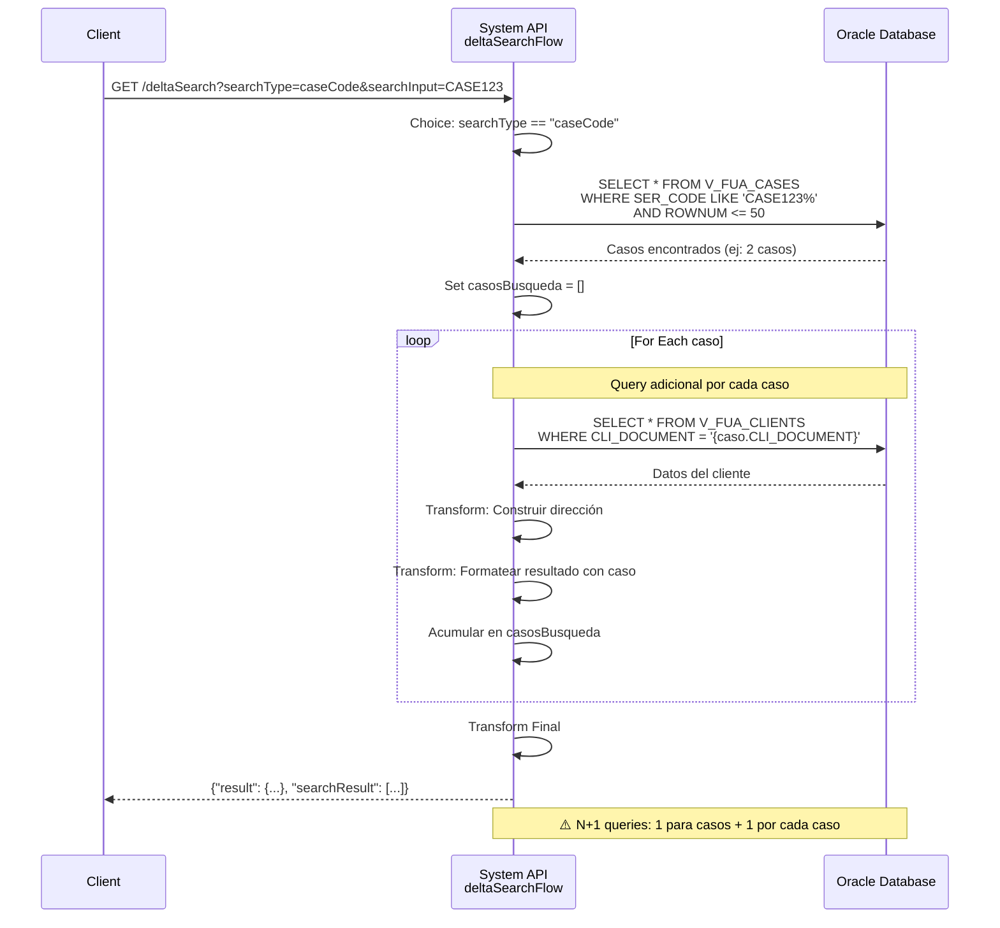

# GET /deltaSearch

## 📌 Descripción General

### Propósito del Endpoint

Este endpoint proporciona funcionalidad de **búsqueda incremental (delta search)** de clientes y casos en la base de datos Oracle AC. Permite realizar búsquedas flexibles utilizando tres criterios diferentes: número de documento, nombre completo o código de caso. Los resultados se formatean de manera específica según el tipo de búsqueda realizada.

El endpoint soporta:
- **Búsqueda por Documento**: Localiza clientes por NIF/NIE con coincidencia al inicio
- **Búsqueda por Nombre**: Encuentra clientes por nombre completo con coincidencia parcial
- **Búsqueda por Código de Caso**: Busca casos y recupera información del cliente asociado
- **Resultados Formateados**: Devuelve información consolidada con dirección completa
- **Límite de Resultados**: Máximo 50 resultados por búsqueda para optimizar performance

### Tipo de API

**Capa:** System API (API-Led Connectivity)

**Función:** Integración directa con Oracle Database AC para búsquedas flexibles de clientes y casos con múltiples criterios.

### Patrón de Integración

**Tipo:** Request-Reply Síncrono con SQL Queries Condicionales

**Descripción:** El endpoint recibe parámetros de búsqueda, determina el tipo de búsqueda mediante un Choice router, ejecuta la query SQL apropiada, transforma los resultados con DataWeave complejo (construcción de direcciones y formateo), y retorna una lista de resultados formateados.

### Arquitectura API-Led Connectivity

```mermaid
graph TB
    Client[Cliente/Consumidor<br/>Portal Web/Móvil]
    S[System API<br/>ntgy-fua-s-ac-fua<br/>GET /deltaSearch]
    DB[(Oracle Database AC<br/>Vistas: V_FUA_CLIENTS, V_FUA_CASES<br/>Schema: OVPRO_DELTA)]
    
    Client -->|Request con searchType + searchInput| S
    S -->|Choice: Determinar tipo de búsqueda| S
    
    S -->|searchType=docNumber<br/>SELECT WHERE CLI_DOCUMENT LIKE| DB
    S -->|searchType=name<br/>SELECT WHERE CLI_FULL_NAME LIKE| DB
    S -->|searchType=caseCode<br/>SELECT FROM V_FUA_CASES + V_FUA_CLIENTS| DB
    
    DB -->|Resultados (max 50)| S
    S -->|DataWeave: Formatear resultados| S
    S -->|Lista de resultados formateados| Client
    
    style S fill:#e1f5ff,stroke:#01579b,stroke-width:3px
    style DB fill:#fff3e0,stroke:#e65100,stroke-width:2px
```

---

## 💼 Propósito del Negocio

### Casos de Uso Principales

1. **Búsqueda Rápida de Clientes en Call Center**
   - Agentes buscan clientes por documento o nombre durante llamadas
   - Resultados instantáneos con información completa (dirección, validación)
   - Facilita identificación rápida del cliente correcto

2. **Autocompletado en Formularios Web/Móvil**
   - Búsqueda incremental mientras el usuario escribe
   - Sugerencias de clientes existentes para evitar duplicados
   - Mejora experiencia de usuario en procesos de registro

3. **Seguimiento de Casos por Código**
   - Localizar casos específicos por código de servicio
   - Recuperar información del cliente asociado al caso
   - Facilitar gestión y seguimiento de solicitudes

4. **Validación de Clientes Existentes**
   - Verificar si un cliente ya existe antes de crear nuevo registro
   - Prevenir duplicados en la base de datos
   - Mantener integridad de datos maestros

### Contexto Empresarial

- **Dominio:** Gestión de Clientes - Búsqueda y Consulta
- **Sector:** Energía - Utilities
- **División:** Naturgy España - Área Cliente (AC)
- **Proceso de Negocio:** Búsqueda incremental de clientes y casos
- **Sistema Backend:** Oracle Database AC

### Stakeholders

- **Agentes de Call Center**: Necesitan búsqueda rápida de clientes durante atención telefónica
- **Equipos de Desarrollo Frontend**: Implementan autocompletado en formularios
- **Agentes de Ventas**: Buscan clientes existentes antes de crear nuevos registros
- **Equipos de Soporte**: Localizan casos por código para seguimiento
- **Sistemas de Gestión de Casos**: Automatizan búsqueda de información de clientes

### Valor de Negocio

- **Eficiencia Operativa**: Reduce tiempo de búsqueda de clientes de minutos a segundos
- **Calidad de Datos**: Previene duplicados mediante búsqueda previa
- **Experiencia de Usuario**: Autocompletado mejora usabilidad de formularios
- **Productividad de Agentes**: Acceso rápido a información completa del cliente
- **Trazabilidad**: Facilita seguimiento de casos por código de servicio

### Consumidores Potenciales

Este endpoint puede ser consumido por:
- Experience APIs de portales web y aplicaciones móviles
- Sistemas de call center y CRM
- Process APIs de gestión de clientes
- Aplicaciones de agentes de ventas
- Sistemas de gestión de casos y solicitudes
- Herramientas de administración y soporte

---

## 🔧 Especificación Técnica

### URLs por Ambiente

| Ambiente | URL Completa |
|----------|--------------|
| **Local** | `http://localhost:8081/api/deltaSearch?searchType={tipo}&searchInput={valor}` |
| **Development** | `https://ntgy-fua-s-ac-fua-dev.us-e2.cloudhub.io/api/deltaSearch?searchType={tipo}&searchInput={valor}` |
| **UAT** | `https://ntgy-fua-s-ac-fua-uat.us-e2.cloudhub.io/api/deltaSearch?searchType={tipo}&searchInput={valor}` |
| **Production** | `https://ntgy-fua-s-ac-fua-pro.us-e2.cloudhub.io/api/deltaSearch?searchType={tipo}&searchInput={valor}` |

### Método HTTP

```
GET /api/deltaSearch
```

### Parámetros de Entrada

#### Headers HTTP

| Header | Tipo | Requerido | Descripción | Ejemplo |
|--------|------|-----------|-------------|---------|
| `Accept` | string | ❌ No | Tipo de contenido esperado en response | `application/json` |
| `client_id` | string | ✅ Sí | Client ID de Anypoint Platform | `abc123...` |
| `client_secret` | string | ✅ Sí | Client Secret de Anypoint Platform | `xyz789...` |

#### Query Parameters

| Parámetro | Tipo | Requerido | Descripción | Valores Permitidos | Ejemplo |
|-----------|------|-----------|-------------|-------------------|---------|
| `searchType` | string | ✅ Sí | Tipo de búsqueda a realizar | `docNumber`, `name`, `caseCode` | `"docNumber"` |
| `searchInput` | string | ✅ Sí | Valor a buscar según el tipo | Texto libre | `"12345678"` |

**Detalles de searchType:**

1. **`docNumber`** - Búsqueda por Número de Documento
   - Busca en campo `CLI_DOCUMENT` de `V_FUA_CLIENTS`
   - Patrón LIKE: `searchInput%` (comienza con)
   - Ejemplo: `searchInput=12345` encuentra "12345678A", "12345679B", etc.

2. **`name`** - Búsqueda por Nombre
   - Busca en campo `CLI_FULL_NAME` de `V_FUA_CLIENTS`
   - Patrón LIKE: `%searchInput%` (contiene)
   - Ejemplo: `searchInput=Garcia` encuentra "Juan Garcia Lopez", "Maria Garcia", etc.

3. **`caseCode`** - Búsqueda por Código de Caso
   - Busca en campo `SER_CODE` de `V_FUA_CASES`
   - Patrón LIKE: `searchInput%` (comienza con)
   - Luego busca cliente asociado en `V_FUA_CLIENTS`
   - Ejemplo: `searchInput=CASE123` encuentra "CASE12345", "CASE12399", etc.

**Validaciones:**
- Ambos parámetros son obligatorios
- `searchType` debe ser uno de los 3 valores permitidos
- `searchInput` no puede estar vacío
- Máximo 50 resultados por búsqueda

### Respuestas

#### Respuesta Exitosa (200 OK)

```json
{
  "result": {
    "codResult": "0000",
    "msgResult": "OK"
  },
  "searchResult": [
    {
      "clientCode": "12345678A",
      "searchResult": "12345678A - Juan Garcia Lopez - Validado - Calle Mayor, 10 1 A 28001 Madrid"
    },
    {
      "clientCode": "12345679B",
      "searchResult": "12345679B - Maria Garcia Sanchez - No validado - Avenida Libertad, 25 2 B 28002 Madrid"
    }
  ]
}
```

**Campos de la respuesta:**

| Campo | Tipo | Descripción |
|-------|------|-------------|
| `result` | object | Objeto de resultado de la operación |
| `result.codResult` | string | Código de resultado ("0000" = éxito) |
| `result.msgResult` | string | Mensaje de resultado ("OK" = éxito) |
| `searchResult` | array | Lista de resultados encontrados (máximo 50) |
| `searchResult[].clientCode` | string | Código/documento del cliente |
| `searchResult[].searchResult` | string | Resultado formateado con toda la información |
| `searchResult[].caseCode` | string | Código de caso (solo para searchType=caseCode) |

**Formato de searchResult según tipo de búsqueda:**

1. **searchType=docNumber:**
   ```
   "{documento} - {nombre} - {validación} - {dirección}"
   Ejemplo: "12345678A - Juan Garcia Lopez - Validado - Calle Mayor, 10 1 A 28001 Madrid"
   ```

2. **searchType=name:**
   ```
   "{nombre} - {documento} - {validación} - {dirección}"
   Ejemplo: "Juan Garcia Lopez - 12345678A - Validado - Calle Mayor, 10 1 A 28001 Madrid"
   ```

3. **searchType=caseCode:**
   ```
   "{códigoCaso} - {nombre} - {documento} - {validación} - {dirección}"
   Ejemplo: "CASE12345 - Juan Garcia Lopez - 12345678A - Validado - Calle Mayor, 10 1 A 28001 Madrid"
   ```

**Componentes de la dirección:**
```
{tipoVía} {nombreVía}, {número} {portal} {escalera} {piso} {puerta} {códigoPostal} {municipio}
```

#### Respuesta Sin Resultados (200 OK)

```json
{
  "result": {
    "codResult": "0000",
    "msgResult": "OK"
  },
  "searchResult": []
}
```

#### Respuesta de Error - Parámetro Desconocido (200 OK)

```json
{
  "result": {
    "codResult": "-0002",
    "msgResult": "Parámetro de busqueda desconocido"
  }
}
```

#### Respuesta de Error Genérico (200 OK)

```json
{
  "result": {
    "codResult": "-0001",
    "msgResult": "KO"
  }
}
```

#### Respuesta de Error Técnico (500 Internal Server Error)

```json
{
  "result": {
    "codResult": "-0001",
    "msgResult": "Error interno del servidor"
  }
}
```

### Autenticación y Autorización

- **Tipo:** Client ID & Client Secret (Anypoint Platform)
- **Autorización Oracle:** El usuario de base de datos debe tener permisos para:
  - Acceso de lectura a la vista `V_FUA_CLIENTS`
  - Acceso de lectura a la vista `V_FUA_CASES`
  - Acceso al schema `OVPRO_DELTA`

### Timeouts

| Tipo | Valor | Descripción |
|------|-------|-------------|
| **Query Timeout** | 15 segundos | Tiempo máximo de ejecución de cada query SQL |
| **Connection Timeout** | 3600 segundos | Tiempo máximo para establecer conexión con Oracle |
| **Response Timeout** | 30 segundos | Tiempo máximo de espera para la respuesta completa |

### Límites y Restricciones

| Límite | Valor | Descripción |
|--------|-------|-------------|
| **Resultados Máximos** | 50 | Máximo de resultados por búsqueda (`ROWNUM <= 50`) |
| **Longitud searchInput** | Sin límite explícito | Recomendado: máximo 100 caracteres |
| **Queries Concurrentes** | 15 | Limitado por connection pool de Oracle |

---

## 🏗️ Implementación Técnica

### Arquitectura del Flow

```mermaid
flowchart TD
    Start([HTTP GET Request]) --> LogEntry[Log Entrada]
    LogEntry --> SetVars[Set Variables<br/>queryParams]
    SetVars --> Choice1{Choice: searchType}
    
    Choice1 -->|docNumber| LogDoc[Log: Búsqueda por documento]
    LogDoc --> QueryDoc[DB Select<br/>V_FUA_CLIENTS<br/>WHERE CLI_DOCUMENT LIKE]
    
    Choice1 -->|name| LogName[Log: Búsqueda por nombre]
    LogName --> QueryName[DB Select<br/>V_FUA_CLIENTS<br/>WHERE CLI_FULL_NAME LIKE]
    
    Choice1 -->|caseCode| LogCase[Log: Búsqueda por caso]
    LogCase --> QueryCase[DB Select<br/>V_FUA_CASES<br/>WHERE SER_CODE LIKE]
    
    Choice1 -->|other| LogUnknown[Log: Parámetro desconocido]
    LogUnknown --> RaiseError[Raise Error<br/>APP:UNKNOWN_PARAM]
    
    QueryDoc --> InitArray[Set Variable<br/>casosBusqueda = []]
    QueryName --> InitArray
    QueryCase --> InitArray
    
    InitArray --> Choice2{Choice: searchType}
    
    Choice2 -->|docNumber o name| ForEach1[For Each resultado]
    ForEach1 --> Transform1[Transform: Construir dirección<br/>y resultado formateado]
    Transform1 --> Accumulate1[Acumular en casosBusqueda]
    Accumulate1 -->|siguiente| ForEach1
    Accumulate1 -->|fin| FinalTransform
    
    Choice2 -->|caseCode| ForEach2[For Each caso]
    ForEach2 --> QueryClient[DB Select<br/>V_FUA_CLIENTS<br/>WHERE CLI_DOCUMENT =]
    QueryClient --> Transform2[Transform: Construir dirección<br/>y resultado con caso]
    Transform2 --> Accumulate2[Acumular en casosBusqueda]
    Accumulate2 -->|siguiente| ForEach2
    Accumulate2 -->|fin| FinalTransform
    
    Choice2 -->|sin resultados| NoResults[Log: Cliente no encontrado]
    NoResults --> FinalTransform
    
    FinalTransform[Transform Final<br/>Construir respuesta JSON]
    FinalTransform --> LogExit[Log Salida]
    LogExit --> End([HTTP Response])
    
    RaiseError --> ErrorHandler[Error Handler<br/>APP:UNKNOWN_PARAM]
    ErrorHandler --> ErrorResponse[Transform Error Response]
    ErrorResponse --> End
    
    style Start fill:#e8f5e9,stroke:#2e7d32
    style Choice1 fill:#fff3e0,stroke:#e65100,stroke-width:2px
    style Choice2 fill:#fff3e0,stroke:#e65100,stroke-width:2px
    style QueryDoc fill:#e1f5ff,stroke:#01579b,stroke-width:2px
    style QueryName fill:#e1f5ff,stroke:#01579b,stroke-width:2px
    style QueryCase fill:#e1f5ff,stroke:#01579b,stroke-width:2px
    style QueryClient fill:#e1f5ff,stroke:#01579b,stroke-width:2px
    style End fill:#e8f5e9,stroke:#2e7d32
```

### Componentes del Flow

#### 1. Logger de Entrada
```xml
<logger level="INFO" message="s-ac-consumptions.logEntrada ## payload: #[payload]"/>
```

**Propósito:** Registrar el inicio de la ejecución con el payload de entrada.

#### 2. Set Variables - Extracción de Query Params
```dataweave
%dw 2.0
---
vars.queryParams = attributes.queryParams
```

**Propósito:** Almacenar los query parameters en una variable para uso posterior.

#### 3. Choice Router - Determinar Tipo de Búsqueda

**Condiciones:**
1. `vars.queryParams.searchType == "docNumber"` → Búsqueda por documento
2. `vars.queryParams.searchType == "name"` → Búsqueda por nombre
3. `vars.queryParams.searchType == "caseCode"` → Búsqueda por caso
4. `otherwise` → Error de parámetro desconocido

### Queries SQL por Tipo de Búsqueda

#### A) Búsqueda por Documento (searchType=docNumber)

**Query SQL:**
```sql
SELECT * FROM V_FUA_CLIENTS 
WHERE CLI_DOCUMENT LIKE :clientId 
AND ROWNUM <= 50
```

**Parámetros:**
```dataweave
{
  'clientId': vars.queryParams.searchInput ++ "%"
}
```

**Patrón de búsqueda:** Comienza con (`searchInput%`)

**Ejemplo:**
- Input: `searchInput=12345`
- Patrón: `12345%`
- Encuentra: "12345678A", "12345679B", "123456789C"

**Campos utilizados de V_FUA_CLIENTS:**
- `CLI_DOCUMENT`: Documento del cliente
- `CLI_FULL_NAME`: Nombre completo
- `CLI_NAME`: Nombre (persona física)
- `CLI_LAST_NAME_1`: Primer apellido
- `CLI_LAST_NAME_2`: Segundo apellido
- `CLI_PERSON_TYPE`: Tipo de persona (H/M=física, J=jurídica)
- `VALIDATED`: Estado de validación (V=validado)
- `STS_STREET_TYPE_NAME`: Tipo de vía
- `STS_STREET_DESCRIPTION`: Nombre de la vía
- `ADR_NUMBER`: Número
- `ADR_PORTAL`: Portal
- `ADR_STAIRCASE`: Escalera
- `ADR_FLOOR`: Piso
- `ADR_DOOR`: Puerta
- `ADR_ZIPCODE`: Código postal
- `MUN_MUNICIPALITY_NAME`: Municipio

#### B) Búsqueda por Nombre (searchType=name)

**Query SQL:**
```sql
SELECT * FROM V_FUA_CLIENTS 
WHERE CLI_FULL_NAME LIKE :nombre 
AND ROWNUM <= 50
```

**Parámetros:**
```dataweave
{
  'nombre': "%" ++ vars.queryParams.searchInput ++ "%"
}
```

**Patrón de búsqueda:** Contiene (`%searchInput%`)

**Ejemplo:**
- Input: `searchInput=Garcia`
- Patrón: `%Garcia%`
- Encuentra: "Juan Garcia Lopez", "Maria Garcia", "Garcia Sanchez Pedro"

#### C) Búsqueda por Código de Caso (searchType=caseCode)

**Query SQL Paso 1 - Buscar Casos:**
```sql
SELECT * FROM V_FUA_CASES 
WHERE SER_CODE LIKE :caseCode 
AND ROWNUM <= 50
```

**Parámetros:**
```dataweave
{
  'caseCode': vars.queryParams.searchInput ++ "%"
}
```

**Query SQL Paso 2 - Buscar Cliente (por cada caso):**
```sql
SELECT * FROM V_FUA_CLIENTS 
WHERE CLI_DOCUMENT = :clientId
```

**Parámetros:**
```dataweave
{
  'clientId': payload.CLI_DOCUMENT
}
```

**Nota:** Esta búsqueda es más costosa porque ejecuta N+1 queries (1 para casos + 1 por cada caso encontrado).

### Transformaciones DataWeave

#### Función Auxiliar - Convertir a String
```dataweave
fun convertir(a) = if (a != null) a ++ " " else ""
```

**Propósito:** Convertir valores a string y agregar espacio, o retornar string vacío si es null.

#### Construcción de Dirección
```dataweave
var direccion = 
  convertir(payload.STS_STREET_TYPE_NAME) ++ " " ++ 
  convertir(payload.STS_STREET_DESCRIPTION) ++ ", " ++ 
  convertir(payload.ADR_NUMBER) ++ " " ++ 
  convertir(payload.ADR_PORTAL) ++ 
  convertir(payload.ADR_STAIRCASE) ++ 
  convertir(payload.ADR_FLOOR) ++ 
  convertir(payload.ADR_DOOR) ++ 
  convertir(payload.ADR_ZIPCODE) ++ " " ++ 
  convertir(payload.MUN_MUNICIPALITY_NAME)
```

**Resultado ejemplo:**
```
"Calle Mayor, 10 1 A 28001 Madrid"
```

#### Construcción de Nombre
```dataweave
var nombre = 
  if (payload.CLI_PERSON_TYPE == "H" or payload.CLI_PERSON_TYPE == "M")
    convertir(payload.CLI_NAME) ++ " " ++ 
    convertir(payload.CLI_LAST_NAME_1) ++ " " ++ 
    convertir(payload.CLI_LAST_NAME_2)
  else 
    convertir(payload.CLI_FULL_NAME)
```

**Lógica:**
- Persona física (H/M): Concatenar nombre + apellidos
- Persona jurídica (J): Usar nombre completo

#### Determinación de Estado de Validación
```dataweave
var validado = 
  if (payload.VALIDATED == "V") 
    "Validado" 
  else 
    "No validado"
```

#### Construcción de Resultado Formateado

**Para searchType=docNumber:**
```dataweave
payload.CLI_DOCUMENT ++ " - " ++ nombre ++ " - " ++ validado ++ " - " ++ direccion
```

**Para searchType=name:**
```dataweave
nombre ++ " - " ++ payload.CLI_DOCUMENT ++ " - " ++ validado ++ " - " ++ direccion
```

**Para searchType=caseCode:**
```dataweave
payload.SER_CODE ++ " - " ++ nombre ++ " - " ++ payload.CLI_DOCUMENT ++ " - " ++ validado ++ " - " ++ direccion
```

#### Acumulación de Resultados
```dataweave
vars.casosBusqueda << payload
```

**Propósito:** Agregar cada resultado transformado al array de resultados.

#### Transformación Final
```dataweave
%dw 2.0
output application/json
---
{
  result: {
    codResult: "0000",
    msgResult: "OK"
  },
  searchResult: vars.casosBusqueda
}
```

### Diagrama de Secuencia - Búsqueda por Documento



### Diagrama de Secuencia - Búsqueda por Caso



### Manejo de Errores

**Error Handler Global:** Configurado en el flow

**Tipos de Errores Manejados:**

1. **APP:UNKNOWN_PARAM**
   - Tipo de búsqueda no reconocido
   - Código: `-0002`
   - Mensaje: "Parámetro de busqueda desconocido"
   - HTTP Status: 200 OK (error de negocio)

2. **Error Genérico**
   - Cualquier otro error no capturado
   - Código: `-0001`
   - Mensaje: "KO"
   - HTTP Status: 200 OK

3. **DB:CONNECTIVITY**
   - Fallo de conexión a Oracle
   - Timeout de conexión
   - Manejado por error handler global

4. **DB:QUERY_EXECUTION**
   - Error en ejecución de query
   - Timeout de query (>15s)
   - Manejado por error handler global

### Configuración de Base de Datos

**Connection String:**
```yaml
dbAC:
  host1: "oc-pro-exa-04-clu-02-hdfdi-scan.prodb03.ocpro.oraclevcn.com"
  host2: "oc-pro-exa-03-clu-02-dfhl9-scan.prodb03.ocpro.oraclevcn.com"
  port: "1521"
  serviceName: "s_areapriv_online_pro.prodb03.ocpro.oraclevcn.com"
  user: "OVPRO_DELTA"
  queryTimeout: "15000"
```

**Connection Pool:**
- **Max Pool Size:** 15 conexiones
- **Max Wait Time:** 300 segundos
- **Max Idle Time:** 300 segundos

### Vistas de Base de Datos

#### Vista V_FUA_CLIENTS

**Schema:** `OVPRO_DELTA`

**Propósito:** Vista consolidada de clientes con información completa (datos personales, dirección, validación).

**Campos Principales:**

| Columna | Tipo | Descripción |
|---------|------|-------------|
| `CLI_DOCUMENT` | VARCHAR2 | Documento del cliente (NIF/NIE) |
| `CLI_FULL_NAME` | VARCHAR2 | Nombre completo del cliente |
| `CLI_NAME` | VARCHAR2 | Nombre (persona física) |
| `CLI_LAST_NAME_1` | VARCHAR2 | Primer apellido |
| `CLI_LAST_NAME_2` | VARCHAR2 | Segundo apellido |
| `CLI_PERSON_TYPE` | VARCHAR2(1) | Tipo de persona (H/M/J) |
| `VALIDATED` | VARCHAR2(1) | Estado de validación (V=validado) |
| `STS_STREET_TYPE_NAME` | VARCHAR2 | Tipo de vía (Calle, Avenida, etc.) |
| `STS_STREET_DESCRIPTION` | VARCHAR2 | Nombre de la vía |
| `ADR_NUMBER` | VARCHAR2 | Número de la dirección |
| `ADR_PORTAL` | VARCHAR2 | Portal |
| `ADR_STAIRCASE` | VARCHAR2 | Escalera |
| `ADR_FLOOR` | VARCHAR2 | Piso |
| `ADR_DOOR` | VARCHAR2 | Puerta |
| `ADR_ZIPCODE` | VARCHAR2 | Código postal |
| `MUN_MUNICIPALITY_NAME` | VARCHAR2 | Nombre del municipio |

#### Vista V_FUA_CASES

**Schema:** `OVPRO_DELTA`

**Propósito:** Vista de casos/solicitudes de clientes con código de servicio.

**Campos Principales:**

| Columna | Tipo | Descripción |
|---------|------|-------------|
| `SER_CODE` | VARCHAR2 | Código del caso/servicio |
| `CLI_DOCUMENT` | VARCHAR2 | Documento del cliente asociado |

### Logging

**Niveles de Log:**
- **INFO:** Entrada y salida del flow
- **DEBUG:** Detalles de ejecución por tipo de búsqueda
- **ERROR:** Errores y excepciones

**Información Registrada:**
- Timestamp de entrada y salida
- Tipo de búsqueda (searchType)
- Valor de búsqueda (searchInput)
- Número de resultados encontrados
- Duración de ejecución
- Errores y stack traces

---

## 💻 Ejemplos de Uso

### Ejemplo 1: Búsqueda por Documento

#### Request

```bash
curl -X GET "https://ntgy-fua-s-ac-fua-pro.us-e2.cloudhub.io/api/deltaSearch?searchType=docNumber&searchInput=12345" \
  -H "Accept: application/json" \
  -H "client_id: YOUR_CLIENT_ID" \
  -H "client_secret: YOUR_CLIENT_SECRET"
```

#### Response (200 OK)

```json
{
  "result": {
    "codResult": "0000",
    "msgResult": "OK"
  },
  "searchResult": [
    {
      "clientCode": "12345678A",
      "searchResult": "12345678A - Juan Garcia Lopez - Validado - Calle Mayor, 10 1 A 28001 Madrid"
    },
    {
      "clientCode": "12345679B",
      "searchResult": "12345679B - Maria Garcia Sanchez - No validado - Avenida Libertad, 25 2 B 28002 Madrid"
    },
    {
      "clientCode": "12345680C",
      "searchResult": "12345680C - Pedro Martinez Rodriguez - Validado - Plaza España, 5 3 C 28003 Madrid"
    }
  ]
}
```

### Ejemplo 2: Búsqueda por Nombre

#### Request

```bash
curl -X GET "https://ntgy-fua-s-ac-fua-pro.us-e2.cloudhub.io/api/deltaSearch?searchType=name&searchInput=Garcia" \
  -H "Accept: application/json" \
  -H "client_id: YOUR_CLIENT_ID" \
  -H "client_secret: YOUR_CLIENT_SECRET"
```

#### Response (200 OK)

```json
{
  "result": {
    "codResult": "0000",
    "msgResult": "OK"
  },
  "searchResult": [
    {
      "clientCode": "12345678A",
      "searchResult": "Juan Garcia Lopez - 12345678A - Validado - Calle Mayor, 10 1 A 28001 Madrid"
    },
    {
      "clientCode": "98765432B",
      "searchResult": "Maria Garcia Sanchez - 98765432B - No validado - Avenida Libertad, 25 2 B 28002 Madrid"
    },
    {
      "clientCode": "11223344C",
      "searchResult": "Garcia Perez SL - 11223344C - Validado - Calle Comercio, 15 28004 Madrid"
    }
  ]
}
```

### Ejemplo 3: Búsqueda por Código de Caso

#### Request

```bash
curl -X GET "https://ntgy-fua-s-ac-fua-pro.us-e2.cloudhub.io/api/deltaSearch?searchType=caseCode&searchInput=CASE123" \
  -H "Accept: application/json" \
  -H "client_id: YOUR_CLIENT_ID" \
  -H "client_secret: YOUR_CLIENT_SECRET"
```

#### Response (200 OK)

```json
{
  "result": {
    "codResult": "0000",
    "msgResult": "OK"
  },
  "searchResult": [
    {
      "clientCode": "12345678A",
      "searchResult": "CASE12345 - Juan Garcia Lopez - 12345678A - Validado - Calle Mayor, 10 1 A 28001 Madrid",
      "caseCode": "CASE12345"
    },
    {
      "clientCode": "98765432B",
      "searchResult": "CASE12399 - Maria Garcia Sanchez - 98765432B - No validado - Avenida Libertad, 25 2 B 28002 Madrid",
      "caseCode": "CASE12399"
    }
  ]
}
```

### Ejemplo 4: Sin Resultados

#### Request

```bash
curl -X GET "https://ntgy-fua-s-ac-fua-pro.us-e2.cloudhub.io/api/deltaSearch?searchType=docNumber&searchInput=99999999" \
  -H "Accept: application/json" \
  -H "client_id: YOUR_CLIENT_ID" \
  -H "client_secret: YOUR_CLIENT_SECRET"
```

#### Response (200 OK)

```json
{
  "result": {
    "codResult": "0000",
    "msgResult": "OK"
  },
  "searchResult": []
}
```

### Ejemplo 5: Error - Parámetro Desconocido

#### Request

```bash
curl -X GET "https://ntgy-fua-s-ac-fua-pro.us-e2.cloudhub.io/api/deltaSearch?searchType=invalidType&searchInput=test" \
  -H "Accept: application/json" \
  -H "client_id: YOUR_CLIENT_ID" \
  -H "client_secret: YOUR_CLIENT_SECRET"
```

#### Response (200 OK)

```json
{
  "result": {
    "codResult": "-0002",
    "msgResult": "Parámetro de busqueda desconocido"
  }
}
```

### Ejemplo 6: Uso desde JavaScript

```javascript
const deltaSearch = async (searchType, searchInput) => {
  const url = `https://ntgy-fua-s-ac-fua-pro.us-e2.cloudhub.io/api/deltaSearch`;
  
  const params = new URLSearchParams({
    searchType: searchType,
    searchInput: searchInput
  });
  
  try {
    const response = await fetch(`${url}?${params}`, {
      method: 'GET',
      headers: {
        'Accept': 'application/json',
        'client_id': 'YOUR_CLIENT_ID',
        'client_secret': 'YOUR_CLIENT_SECRET'
      }
    });
    
    if (!response.ok) {
      throw new Error(`HTTP error! status: ${response.status}`);
    }
    
    const data = await response.json();
    
    if (data.result.codResult === "0000") {
      console.log(`Encontrados ${data.searchResult.length} resultados`);
      return data.searchResult;
    } else {
      console.error('Error en búsqueda:', data.result.msgResult);
      return [];
    }
  } catch (error) {
    console.error('Error al realizar búsqueda:', error);
    throw error;
  }
};

// Uso - Búsqueda por documento
deltaSearch('docNumber', '12345')
  .then(results => {
    results.forEach(result => {
      console.log(`Cliente: ${result.clientCode}`);
      console.log(`Info: ${result.searchResult}`);
    });
  })
  .catch(error => console.error('Error:', error));

// Uso - Búsqueda por nombre
deltaSearch('name', 'Garcia')
  .then(results => console.log('Resultados:', results))
  .catch(error => console.error('Error:', error));

// Uso - Búsqueda por caso
deltaSearch('caseCode', 'CASE123')
  .then(results => {
    results.forEach(result => {
      console.log(`Caso: ${result.caseCode}`);
      console.log(`Cliente: ${result.clientCode}`);
    });
  })
  .catch(error => console.error('Error:', error));
```

### Ejemplo 7: Uso desde Python

```python
import requests
from typing import List, Dict, Optional

def delta_search(
    search_type: str, 
    search_input: str,
    client_id: str,
    client_secret: str
) -> List[Dict]:
    """
    Realiza búsqueda incremental de clientes y casos.
    
    Args:
        search_type: Tipo de búsqueda ('docNumber', 'name', 'caseCode')
        search_input: Valor a buscar
        client_id: Client ID de Anypoint Platform
        client_secret: Client Secret de Anypoint Platform
        
    Returns:
        Lista de resultados encontrados
        
    Raises:
        ValueError: Si el tipo de búsqueda no es válido
        requests.exceptions.RequestException: Si hay error en la petición
    """
    # Validar tipo de búsqueda
    valid_types = ['docNumber', 'name', 'caseCode']
    if search_type not in valid_types:
        raise ValueError(f"search_type debe ser uno de: {valid_types}")
    
    url = "https://ntgy-fua-s-ac-fua-pro.us-e2.cloudhub.io/api/deltaSearch"
    
    params = {
        'searchType': search_type,
        'searchInput': search_input
    }
    
    headers = {
        'Accept': 'application/json',
        'client_id': client_id,
        'client_secret': client_secret
    }
    
    try:
        response = requests.get(
            url, 
            params=params, 
            headers=headers, 
            timeout=30
        )
        response.raise_for_status()
        
        data = response.json()
        
        if data['result']['codResult'] == '0000':
            print(f"✓ Encontrados {len(data['searchResult'])} resultados")
            return data['searchResult']
        else:
            print(f"✗ Error: {data['result']['msgResult']}")
            return []
            
    except requests.exceptions.RequestException as e:
        print(f"✗ Error en la petición: {e}")
        raise

# Ejemplo de uso
if __name__ == "__main__":
    CLIENT_ID = "YOUR_CLIENT_ID"
    CLIENT_SECRET = "YOUR_CLIENT_SECRET"
    
    # Búsqueda por documento
    print("\n=== Búsqueda por Documento ===")
    results = delta_search('docNumber', '12345', CLIENT_ID, CLIENT_SECRET)
    for result in results:
        print(f"Cliente: {result['clientCode']}")
        print(f"Info: {result['searchResult']}\n")
    
    # Búsqueda por nombre
    print("\n=== Búsqueda por Nombre ===")
    results = delta_search('name', 'Garcia', CLIENT_ID, CLIENT_SECRET)
    for result in results:
        print(f"Info: {result['searchResult']}\n")
    
    # Búsqueda por caso
    print("\n=== Búsqueda por Caso ===")
    results = delta_search('caseCode', 'CASE123', CLIENT_ID, CLIENT_SECRET)
    for result in results:
        print(f"Caso: {result.get('caseCode', 'N/A')}")
        print(f"Cliente: {result['clientCode']}")
        print(f"Info: {result['searchResult']}\n")
```

### Ejemplo 8: Implementación de Autocompletado

```javascript
// Componente React para autocompletado
import React, { useState, useEffect } from 'react';
import debounce from 'lodash/debounce';

const ClientSearchAutocomplete = () => {
  const [searchInput, setSearchInput] = useState('');
  const [searchType, setSearchType] = useState('docNumber');
  const [results, setResults] = useState([]);
  const [loading, setLoading] = useState(false);

  // Función de búsqueda con debounce
  const performSearch = debounce(async (type, input) => {
    if (input.length < 3) {
      setResults([]);
      return;
    }

    setLoading(true);
    try {
      const response = await fetch(
        `https://ntgy-fua-s-ac-fua-pro.us-e2.cloudhub.io/api/deltaSearch?searchType=${type}&searchInput=${input}`,
        {
          headers: {
            'Accept': 'application/json',
            'client_id': process.env.REACT_APP_CLIENT_ID,
            'client_secret': process.env.REACT_APP_CLIENT_SECRET
          }
        }
      );

      const data = await response.json();
      
      if (data.result.codResult === '0000') {
        setResults(data.searchResult);
      } else {
        setResults([]);
      }
    } catch (error) {
      console.error('Error en búsqueda:', error);
      setResults([]);
    } finally {
      setLoading(false);
    }
  }, 500); // Esperar 500ms después de que el usuario deje de escribir

  useEffect(() => {
    performSearch(searchType, searchInput);
  }, [searchInput, searchType]);

  return (
    <div className="search-container">
      <div className="search-type-selector">
        <label>
          <input
            type="radio"
            value="docNumber"
            checked={searchType === 'docNumber'}
            onChange={(e) => setSearchType(e.target.value)}
          />
          Documento
        </label>
        <label>
          <input
            type="radio"
            value="name"
            checked={searchType === 'name'}
            onChange={(e) => setSearchType(e.target.value)}
          />
          Nombre
        </label>
        <label>
          <input
            type="radio"
            value="caseCode"
            checked={searchType === 'caseCode'}
            onChange={(e) => setSearchType(e.target.value)}
          />
          Código de Caso
        </label>
      </div>

      <input
        type="text"
        value={searchInput}
        onChange={(e) => setSearchInput(e.target.value)}
        placeholder={`Buscar por ${searchType === 'docNumber' ? 'documento' : searchType === 'name' ? 'nombre' : 'código de caso'}...`}
        className="search-input"
      />

      {loading && <div className="loading">Buscando...</div>}

      {results.length > 0 && (
        <ul className="results-list">
          {results.map((result, index) => (
            <li key={index} className="result-item">
              <strong>{result.clientCode}</strong>
              <br />
              <small>{result.searchResult}</small>
            </li>
          ))}
        </ul>
      )}

      {!loading && searchInput.length >= 3 && results.length === 0 && (
        <div className="no-results">No se encontraron resultados</div>
      )}
    </div>
  );
};

export default ClientSearchAutocomplete;
```
