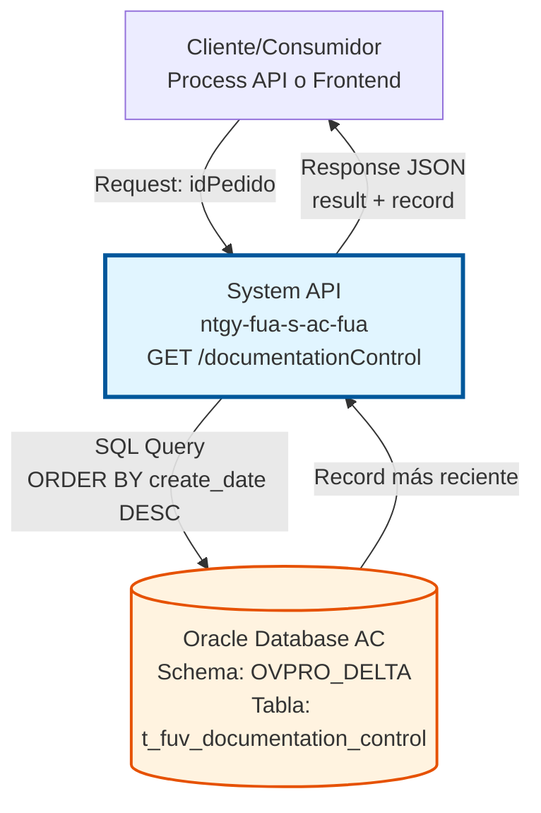
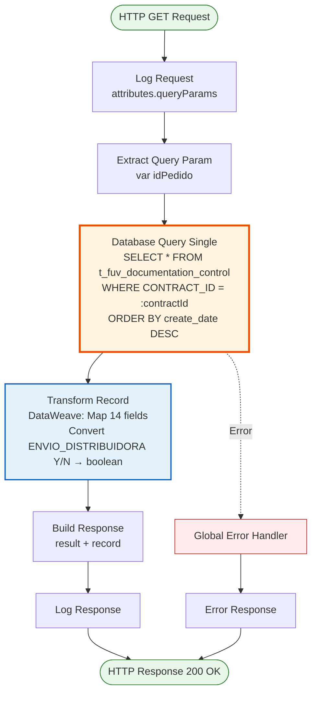
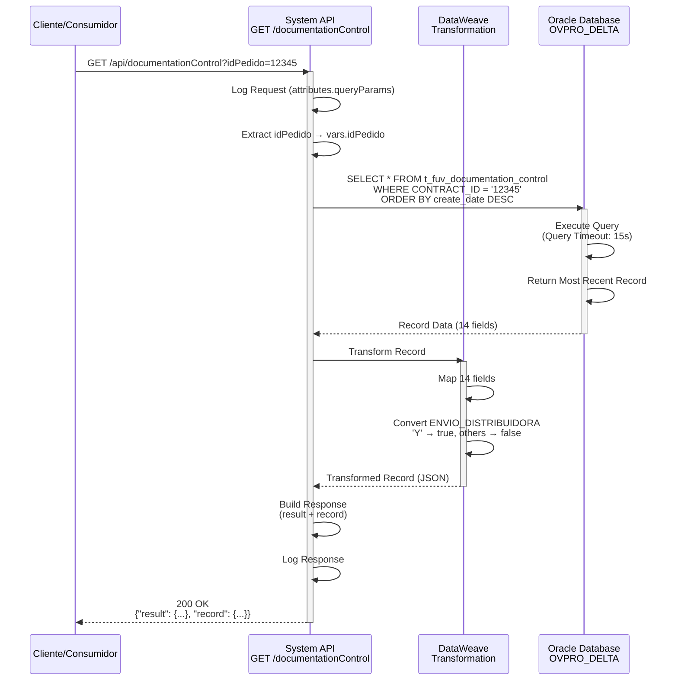

# GET /documentationControl

## 📌 Descripción General

### Propósito del Endpoint

Este endpoint consulta el registro más reciente de control de documentación asociado a un contrato del Frontal de Ventas (FUV) desde la base de datos Oracle AC. Permite obtener información completa sobre el estado de la documentación, intentos de envío, y trazabilidad de cambios.

El endpoint soporta:
- **Consulta por ID de Pedido**: Recupera el registro más reciente basándose en el CONTRACT_ID
- **Ordenamiento Temporal**: Retorna el registro con la fecha de creación más reciente (ORDER BY create_date DESC)
- **Transformación de Datos**: Convierte el campo ENVIO_DISTRIBUIDORA de formato Y/N a boolean
- **Trazabilidad Completa**: Incluye información de auditoría (fechas, usuario, programa)

### Tipo de API

**Capa:** System API (API-Led Connectivity)

**Función:** Integración directa con Oracle Database AC para consulta de registros de control de documentación de contratos FUV.

### Patrón de Integración

**Tipo:** Request-Reply Síncrono con Query SQL

**Descripción:** El endpoint recibe un query parameter con el ID del pedido, ejecuta una consulta SQL en la tabla `t_fuv_documentation_control` ordenada por fecha de creación descendente, transforma los datos mediante DataWeave (incluyendo conversión de Y/N a boolean), y retorna el registro más reciente en formato JSON.

### Arquitectura API-Led Connectivity



---

## 💼 Propósito del Negocio

### Casos de Uso Principales

1. **Consulta de Estado de Documentación**
   - Un agente de ventas necesita verificar el estado actual de la documentación de un contrato
   - El sistema consulta el registro más reciente para mostrar información actualizada
   - Beneficio: Visibilidad inmediata del estado de documentación

2. **Verificación de Intentos de Envío**
   - El sistema necesita validar cuántos intentos de envío se han realizado
   - Se consulta el campo ATTEMPTS_NUMBER del registro más reciente
   - Beneficio: Control de reintentos y prevención de envíos excesivos

3. **Validación de Envío a Distribuidora**
   - Se requiere confirmar si un documento fue marcado para envío a la distribuidora
   - El campo ENVIO_DISTRIBUIDORA (boolean) indica el estado de envío
   - Beneficio: Trazabilidad del flujo de documentos hacia distribuidoras

4. **Auditoría de Cambios**
   - Se necesita revisar quién y cuándo se modificó el registro de documentación
   - Los campos CREATE_DATE, UPDATE_DATE, UPDATE_USER y UPDATE_PROGRAM proporcionan trazabilidad
   - Beneficio: Cumplimiento de requisitos de auditoría y trazabilidad

### Contexto Empresarial

- **Dominio:** Gestión Documental - Frontal de Ventas (FUV)
- **Sector:** Energía - Utilities
- **División:** Naturgy España - Área Cliente
- **Proceso de Negocio:** Control y seguimiento de documentación de contratos de suministro
- **Sistema Backend:** Oracle Database AC (Área Cliente)

### Stakeholders

- **Agentes de Ventas**: Necesitan consultar el estado de documentación de contratos en proceso
- **Equipo de Operaciones**: Monitorean intentos de envío y estados de documentación
- **Equipo de Auditoría**: Requieren trazabilidad completa de cambios en documentación
- **Distribuidoras**: Reciben documentación marcada con ENVIO_DISTRIBUIDORA = true

### Valor de Negocio

- **Visibilidad en Tiempo Real**: Acceso inmediato al estado actual de documentación de contratos
- **Control de Calidad**: Seguimiento de intentos de envío para identificar problemas
- **Trazabilidad**: Registro completo de cambios para auditoría y cumplimiento normativo
- **Eficiencia Operativa**: Reducción de consultas manuales a base de datos

### Consumidores Potenciales

Este endpoint puede ser consumido por:
- Process APIs de gestión de contratos FUV
- Experience APIs de portales web y aplicaciones móviles
- Sistemas de workflow de documentación
- Herramientas de monitoreo y reporting
- Integraciones con sistemas de distribuidoras

---

## 🔧 Especificación Técnica

### URLs por Ambiente

| Ambiente | URL Base | URL Completa |
|----------|----------|--------------|
| **Local** | `http://localhost:8081` | `http://localhost:8081/api/documentationControl?idPedido={id}` |
| **Development** | `https://ntgy-fua-s-ac-fua-dev.us-e2.cloudhub.io` | `https://ntgy-fua-s-ac-fua-dev.us-e2.cloudhub.io/api/documentationControl?idPedido={id}` |
| **UAT** | `https://ntgy-fua-s-ac-fua-uat.us-e2.cloudhub.io` | `https://ntgy-fua-s-ac-fua-uat.us-e2.cloudhub.io/api/documentationControl?idPedido={id}` |
| **Production** | `https://ntgy-fua-s-ac-fua-pro.us-e2.cloudhub.io` | `https://ntgy-fua-s-ac-fua-pro.us-e2.cloudhub.io/api/documentationControl?idPedido={id}` |

### Método HTTP

```
GET /api/documentationControl
```

### Parámetros de Entrada

#### Headers HTTP

| Header | Tipo | Requerido | Descripción | Ejemplo |
|--------|------|-----------|-------------|---------|
| `Accept` | string | ❌ No | Tipo de contenido esperado en response | `application/json` |

#### Query Parameters

| Parámetro | Tipo | Requerido | Descripción | Ejemplo |
|-----------|------|-----------|-------------|---------|
| `idPedido` | string | ✅ Sí | ID del contrato/pedido (CONTRACT_ID) para el cual se consulta el control de documentación | `"12345"` |

**Validaciones:**
- `idPedido` no puede estar vacío
- `idPedido` debe corresponder a un CONTRACT_ID válido en la tabla

### Respuestas

#### Respuesta Exitosa (200 OK)

```json
{
  "result": {
    "codResult": "0000",
    "msgResult": "No hay error"
  },
  "record": {
    "NUM_DOCUMENTO": "12345678A",
    "T_FUV_DOCUMENTATION_CONTROL_ID": 1001,
    "CONTRACT_ID": "12345",
    "DOCUMENT_NAME": "Contrato_Suministro_Gas.pdf",
    "DOCUMENT_STATUS": "ENVIADO",
    "ATTEMPTS_NUMBER": 1,
    "CREATE_DATE": "2026-07-20T10:30:00",
    "UPDATE_DATE": "2026-07-20T10:35:00",
    "UPDATE_USER": "mulesoft",
    "UPDATE_PROGRAM": "mulesoft",
    "CABECERA_CONTRATO": "HEADER_DATA_JSON",
    "TIPO_DOCUMENTAL": "CONTRATO",
    "ENVIO_DISTRIBUIDORA": true,
    "LINEAS_CONTRATO": "LINES_DATA_JSON"
  }
}
```

**Descripción de Campos del Record:**

| Campo | Tipo | Descripción |
|-------|------|-------------|
| `NUM_DOCUMENTO` | string \| null | Número de documento del cliente (NIF/NIE) |
| `T_FUV_DOCUMENTATION_CONTROL_ID` | number \| null | ID único del registro de control (clave primaria) |
| `CONTRACT_ID` | string \| null | ID del contrato/pedido asociado |
| `DOCUMENT_NAME` | string \| null | Nombre del archivo de documento |
| `DOCUMENT_STATUS` | string \| null | Estado del documento (ej: PENDIENTE, ENVIADO, ERROR) |
| `ATTEMPTS_NUMBER` | number \| null | Número de intentos de envío realizados |
| `CREATE_DATE` | string \| null | Fecha y hora de creación del registro |
| `UPDATE_DATE` | string \| null | Fecha y hora de última actualización |
| `UPDATE_USER` | string \| null | Usuario que realizó la última actualización |
| `UPDATE_PROGRAM` | string \| null | Programa/sistema que realizó la actualización |
| `CABECERA_CONTRATO` | string \| null | Datos de cabecera del contrato en formato JSON |
| `TIPO_DOCUMENTAL` | string \| null | Tipo de documento (ej: CONTRATO, FACTURA, ANEXO) |
| `ENVIO_DISTRIBUIDORA` | boolean \| null | Indica si el documento debe enviarse a distribuidora (true/false) |
| `LINEAS_CONTRATO` | string \| null | Datos de líneas del contrato en formato JSON |

**Nota sobre ENVIO_DISTRIBUIDORA:** Este campo se transforma de 'Y'/'N' en base de datos a boolean en la respuesta JSON (Y → true, otros → false).

#### Respuesta cuando No se Encuentra Registro (200 OK)

Si no existe ningún registro para el `idPedido` proporcionado, la base de datos retornará un resultado vacío y el endpoint podría generar un error o retornar null en el campo record.

```json
{
  "result": {
    "codResult": "0001",
    "msgResult": "No se encontró registro de documentación para el pedido especificado"
  }
}
```

#### Respuesta de Error Técnico (500)

```json
{
  "result": {
    "codResult": "0001",
    "msgResult": "Error interno del servidor al consultar control de documentación"
  }
}
```

### Autenticación y Autorización

- **Tipo:** Client ID & Client Secret (Anypoint Platform)
- **Autorización Oracle:** El usuario de base de datos debe tener permisos para:
  - Ejecutar SELECT en tabla `t_fuv_documentation_control`
  - Acceso al schema `OVPRO_DELTA`

### Timeouts

| Tipo | Valor | Descripción |
|------|-------|-------------|
| **Query Timeout** | 15 segundos | Tiempo máximo de ejecución de la query SQL |
| **Connection Timeout** | 3600 segundos | Tiempo máximo para establecer conexión con Oracle |
| **Response Timeout** | 30 segundos | Tiempo máximo de espera para la respuesta completa |

---

## 🏗️ Implementación Técnica

### Arquitectura del Flow



### Detalles de Implementación

#### 1. Extracción de Parámetros (Líneas 140-149)

```dataweave
%dw 2.0
output application/java
---
attributes.queryParams.idPedido
```

**Propósito:** Extraer el parámetro `idPedido` del query string y almacenarlo en la variable `idPedido`.

#### 2. Query SQL a Oracle Database (Líneas 151-154)

```sql
SELECT * FROM t_fuv_documentation_control 
WHERE CONTRACT_ID = :contractId 
ORDER BY create_date DESC
```

**Características:**
- **Operación:** `db:query-single` (retorna un único registro)
- **Filtro:** Por CONTRACT_ID usando prepared statement
- **Ordenamiento:** ORDER BY create_date DESC (más reciente primero)
- **Parámetro:** `:contractId` mapeado desde `vars.idPedido`

**Configuración de Base de Datos:**
- **Config:** `Database_Config`
- **Driver:** Oracle JDBC 19.13.0.0.1
- **Schema:** OVPRO_DELTA
- **Connection Pool:** MaxPoolSize=15, MaxWaitTime=300s
- **Query Timeout:** 15 segundos

#### 3. Transformación de Datos (Líneas 155-179)

```dataweave
%dw 2.0
output application/json
---
{
    "NUM_DOCUMENTO": payload.'NUM_DOCUMENTO',
    "T_FUV_DOCUMENTATION_CONTROL_ID": payload.'T_FUV_DOCUMENTATION_CONTROL_ID',
    "CONTRACT_ID": payload.'CONTRACT_ID',
    "DOCUMENT_NAME": payload.'DOCUMENT_NAME',
    "DOCUMENT_STATUS": payload.'DOCUMENT_STATUS',
    "ATTEMPTS_NUMBER": payload.'ATTEMPTS_NUMBER',
    "CREATE_DATE": payload.'CREATE_DATE',
    "UPDATE_DATE": payload.'UPDATE_DATE',
    "UPDATE_USER": payload.'UPDATE_USER',
    "UPDATE_PROGRAM": payload.'UPDATE_PROGRAM',
    "CABECERA_CONTRATO": payload.'CABECERA_CONTRATO',
    "TIPO_DOCUMENTAL": payload.'TIPO_DOCUMENTAL',
    "ENVIO_DISTRIBUIDORA": if(payload.'ENVIO_DISTRIBUIDORA' == 'Y') true else false,
    "LINEAS_CONTRATO": payload.'LINEAS_CONTRATO'
}
```

**Transformaciones Aplicadas:**
- Mapeo directo de 13 campos desde Oracle a JSON
- **Conversión especial:** `ENVIO_DISTRIBUIDORA` de 'Y'/'N' a boolean
  - 'Y' → `true`
  - Cualquier otro valor → `false`

#### 4. Construcción de Respuesta (Líneas 180-192)

```dataweave
%dw 2.0
output application/json
---
{
    "result": {
        "codResult": "0000",
        "msgResult": "No hay error"
    },
    "record": vars.recordSelected
}
```

**Estructura:**
- `result`: Objeto con código y mensaje de resultado
- `record`: Objeto con los 14 campos transformados

### Diagrama de Secuencia Detallado



### Manejo de Errores

El endpoint utiliza el **Global Error Handler** (`s-ac-globalErrorHandler.xml`) para manejar excepciones:

**Errores Comunes:**

1. **Database Connection Error**
   - Causa: No se puede conectar a Oracle Database
   - Código: DB_CONNECTION_ERROR
   - Acción: Retry automático (3 intentos)

2. **Query Timeout**
   - Causa: Query excede 15 segundos
   - Código: DB_QUERY_TIMEOUT
   - Acción: Retornar error al cliente

3. **No Record Found**
   - Causa: No existe registro para el idPedido
   - Código: RECORD_NOT_FOUND
   - Acción: Retornar respuesta con record null o error

4. **Invalid Parameter**
   - Causa: idPedido vacío o inválido
   - Código: INVALID_PARAMETER
   - Acción: Retornar error 400

### Logging

**Puntos de Logging:**

1. **Request Log (Línea 139):**
   ```
   STARTING getDocumentationControl METHOD. REQUEST: {"idPedido": "12345"}
   ```

2. **Response Log (Línea 193):**
   ```
   FINISHED getDocumentationControl METHOD. RESPONSE: {"result": {...}, "record": {...}}
   ```

**Información Logged:**
- Query parameters normalizados
- Payload de respuesta normalizado
- Correlation ID (si está disponible)
- Timestamp de inicio y fin

### Configuración de Base de Datos

```xml
<db:config name="Database_Config">
    <db:oracle-connection 
        host="${dbAC.host1}" 
        port="${dbAC.port}"
        user="${dbAC.user}"
        password="${dbAC.pass}"
        serviceName="${dbAC.serviceName}">
        <db:pooling-profile 
            maxPoolSize="15"
            maxWait="300000"
            maxIdle="300000"/>
        <db:connection-properties>
            <db:connection-property key="oracle.net.CONNECT_TIMEOUT" value="6000000"/>
        </db:connection-properties>
    </db:oracle-connection>
</db:config>
```

**Parámetros Clave:**
- **MaxPoolSize:** 15 conexiones simultáneas
- **MaxWaitTime:** 300 segundos para obtener conexión
- **MaxIdleTime:** 300 segundos antes de cerrar conexión inactiva
- **Connection Timeout:** 6000 segundos (100 minutos)
- **Query Timeout:** 15 segundos

---

## 💻 Ejemplos de Uso

### Ejemplo 1: Consulta Exitosa con curl

```bash
curl -X GET "https://ntgy-fua-s-ac-fua-pro.us-e2.cloudhub.io/api/documentationControl?idPedido=12345" \
  -H "Accept: application/json"
```

**Response (200 OK):**

```json
{
  "result": {
    "codResult": "0000",
    "msgResult": "No hay error"
  },
  "record": {
    "NUM_DOCUMENTO": "12345678A",
    "T_FUV_DOCUMENTATION_CONTROL_ID": 1001,
    "CONTRACT_ID": "12345",
    "DOCUMENT_NAME": "Contrato_Suministro_Gas.pdf",
    "DOCUMENT_STATUS": "ENVIADO",
    "ATTEMPTS_NUMBER": 1,
    "CREATE_DATE": "2026-07-20T10:30:00",
    "UPDATE_DATE": "2026-07-20T10:35:00",
    "UPDATE_USER": "mulesoft",
    "UPDATE_PROGRAM": "mulesoft",
    "CABECERA_CONTRATO": "{\"cliente\":\"Juan Pérez\",\"direccion\":\"Calle Mayor 1\"}",
    "TIPO_DOCUMENTAL": "CONTRATO",
    "ENVIO_DISTRIBUIDORA": true,
    "LINEAS_CONTRATO": "{\"linea1\":{\"producto\":\"Gas Natural\",\"tarifa\":\"3.1\"}}"
  }
}
```

### Ejemplo 2: Consulta con JavaScript (Fetch API)

```javascript
const idPedido = '12345';

fetch(`https://ntgy-fua-s-ac-fua-pro.us-e2.cloudhub.io/api/documentationControl?idPedido=${idPedido}`, {
  method: 'GET',
  headers: {
    'Accept': 'application/json'
  }
})
  .then(response => response.json())
  .then(data => {
    console.log('Resultado:', data.result);
    console.log('Estado del documento:', data.record.DOCUMENT_STATUS);
    console.log('Intentos de envío:', data.record.ATTEMPTS_NUMBER);
    console.log('Envío a distribuidora:', data.record.ENVIO_DISTRIBUIDORA);
  })
  .catch(error => {
    console.error('Error al consultar documentación:', error);
  });
```

### Ejemplo 3: Consulta con Python (requests)

```python
import requests

url = "https://ntgy-fua-s-ac-fua-pro.us-e2.cloudhub.io/api/documentationControl"
params = {
    "idPedido": "12345"
}
headers = {
    "Accept": "application/json"
}

response = requests.get(url, params=params, headers=headers)

if response.status_code == 200:
    data = response.json()
    print(f"Código resultado: {data['result']['codResult']}")
    print(f"Mensaje: {data['result']['msgResult']}")
    
    record = data['record']
    print(f"\nID Control: {record['T_FUV_DOCUMENTATION_CONTROL_ID']}")
    print(f"Estado: {record['DOCUMENT_STATUS']}")
    print(f"Intentos: {record['ATTEMPTS_NUMBER']}")
    print(f"Envío distribuidora: {record['ENVIO_DISTRIBUIDORA']}")
else:
    print(f"Error: {response.status_code}")
    print(response.text)
```

### Ejemplo 4: Respuesta con Documento Pendiente

```bash
curl -X GET "https://ntgy-fua-s-ac-fua-pro.us-e2.cloudhub.io/api/documentationControl?idPedido=67890" \
  -H "Accept: application/json"
```

**Response (200 OK):**

```json
{
  "result": {
    "codResult": "0000",
    "msgResult": "No hay error"
  },
  "record": {
    "NUM_DOCUMENTO": "98765432B",
    "T_FUV_DOCUMENTATION_CONTROL_ID": 1002,
    "CONTRACT_ID": "67890",
    "DOCUMENT_NAME": "Contrato_Suministro_Electricidad.pdf",
    "DOCUMENT_STATUS": "PENDIENTE",
    "ATTEMPTS_NUMBER": 3,
    "CREATE_DATE": "2026-07-19T14:20:00",
    "UPDATE_DATE": "2026-07-20T09:15:00",
    "UPDATE_USER": "mulesoft",
    "UPDATE_PROGRAM": "mulesoft",
    "CABECERA_CONTRATO": "{\"cliente\":\"María García\",\"direccion\":\"Avenida Principal 25\"}",
    "TIPO_DOCUMENTAL": "CONTRATO",
    "ENVIO_DISTRIBUIDORA": false,
    "LINEAS_CONTRATO": "{\"linea1\":{\"producto\":\"Electricidad\",\"tarifa\":\"2.0TD\"}}"
  }
}
```

**Nota:** En este ejemplo, el documento está en estado PENDIENTE con 3 intentos de envío y NO está marcado para envío a distribuidora.

### Ejemplo 5: Error - Registro No Encontrado

```bash
curl -X GET "https://ntgy-fua-s-ac-fua-pro.us-e2.cloudhub.io/api/documentationControl?idPedido=99999" \
  -H "Accept: application/json"
```

**Response (200 OK o 404):**

```json
{
  "result": {
    "codResult": "0001",
    "msgResult": "No se encontró registro de documentación para el pedido 99999"
  }
}
```

### Ejemplo 6: Error - Parámetro Faltante

```bash
curl -X GET "https://ntgy-fua-s-ac-fua-pro.us-e2.cloudhub.io/api/documentationControl" \
  -H "Accept: application/json"
```

**Response (400 Bad Request):**

```json
{
  "result": {
    "codResult": "0001",
    "msgResult": "El parámetro idPedido es requerido"
  }
}
```

### Ejemplo 7: Integración con Postman

**Request:**
- **Method:** GET
- **URL:** `{{baseUrl}}/api/documentationControl`
- **Query Params:**
  - `idPedido`: `12345`
- **Headers:**
  - `Accept`: `application/json`

**Tests (Postman):**

```javascript
pm.test("Status code is 200", function () {
    pm.response.to.have.status(200);
});

pm.test("Response has result and record", function () {
    var jsonData = pm.response.json();
    pm.expect(jsonData).to.have.property('result');
    pm.expect(jsonData).to.have.property('record');
});

pm.test("Result code is success", function () {
    var jsonData = pm.response.json();
    pm.expect(jsonData.result.codResult).to.eql("0000");
});

pm.test("Record has required fields", function () {
    var jsonData = pm.response.json();
    var record = jsonData.record;
    pm.expect(record).to.have.property('CONTRACT_ID');
    pm.expect(record).to.have.property('DOCUMENT_STATUS');
    pm.expect(record).to.have.property('ATTEMPTS_NUMBER');
    pm.expect(record).to.have.property('ENVIO_DISTRIBUIDORA');
});

pm.test("ENVIO_DISTRIBUIDORA is boolean", function () {
    var jsonData = pm.response.json();
    pm.expect(typeof jsonData.record.ENVIO_DISTRIBUIDORA).to.eql("boolean");
});
```
