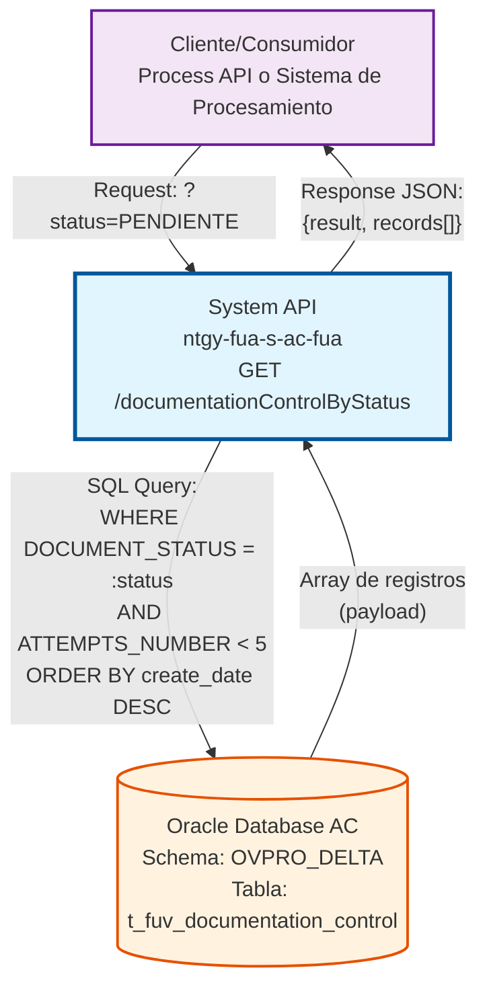
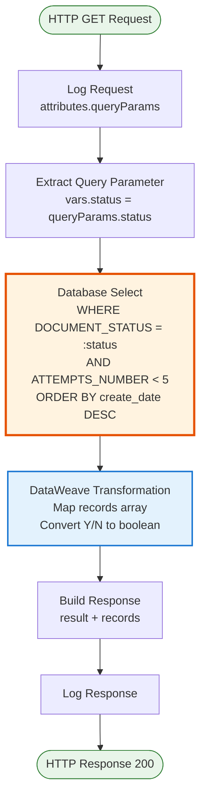
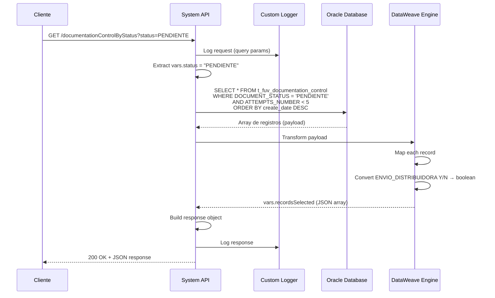

# GET /documentationControlByStatus

## 📌 Descripción General

### Propósito del Endpoint

Este endpoint consulta registros de control de documentación filtrados por estado desde la base de datos Oracle AC, implementando una lógica de control de reintentos que limita los resultados a documentos con menos de 5 intentos de procesamiento. Es fundamental para la gestión de flujos de documentación del Frontal de Ventas (FUV).

El endpoint soporta:
- **Filtrado por Estado**: Consulta documentos según su DOCUMENT_STATUS (PENDIENTE, PROCESSING, COMPLETED, ERROR, etc.)
- **Control de Reintentos**: Filtra automáticamente documentos con ATTEMPTS_NUMBER < 5 para evitar procesamiento de documentos problemáticos
- **Ordenamiento Temporal**: Retorna registros ordenados por fecha de creación descendente (más recientes primero)
- **Transformación de Datos**: Convierte el campo ENVIO_DISTRIBUIDORA de formato Y/N a boolean
- **Múltiples Registros**: Retorna array de registros que cumplen los criterios de filtrado

### Tipo de API

**Capa:** System API (API-Led Connectivity)

**Función:** Integración directa con Oracle Database AC para consulta masiva de registros de control de documentación con lógica de reintentos.

### Patrón de Integración

**Tipo:** Request-Reply Síncrono con Query SQL Filtrada

**Descripción:** El endpoint recibe un query parameter con el estado deseado, ejecuta una consulta SQL en la tabla `t_fuv_documentation_control` con doble filtro (estado + reintentos < 5), transforma los datos mediante DataWeave, y retorna un array de registros en formato JSON.

### Arquitectura API-Led Connectivity



---

## 💼 Propósito del Negocio

### Casos de Uso Principales

1. **Procesamiento Batch de Documentación Pendiente**
   - Un sistema de procesamiento necesita obtener todos los documentos en estado PENDIENTE
   - Se consultan solo documentos con menos de 5 intentos para evitar documentos problemáticos
   - El sistema procesa el lote y actualiza estados según resultado
   - Beneficio: Procesamiento eficiente de documentación pendiente con control de reintentos

2. **Monitoreo de Documentos con Error**
   - El equipo de operaciones necesita identificar documentos en estado ERROR
   - Se filtran documentos con error que aún tienen intentos disponibles (< 5)
   - Se priorizan por fecha de creación para atender los más recientes primero
   - Beneficio: Identificación rápida de documentos que requieren intervención manual

3. **Reintento Automático de Documentos Fallidos**
   - Un job programado consulta documentos en estado RETRY
   - Solo procesa documentos con menos de 5 intentos para evitar loops infinitos
   - Incrementa el contador de intentos tras cada procesamiento
   - Beneficio: Recuperación automática de fallos transitorios sin sobrecarga del sistema

4. **Auditoría de Documentos en Procesamiento**
   - Se requiere monitorear documentos en estado PROCESSING
   - Se identifican documentos que llevan mucho tiempo en procesamiento
   - Se detectan posibles bloqueos o procesos colgados
   - Beneficio: Detección proactiva de problemas en el flujo de documentación

### Contexto Empresarial

- **Dominio:** Gestión Documental - Frontal de Ventas (FUV)
- **Sector:** Energía - Utilities
- **División:** Naturgy España - Área Cliente
- **Proceso de Negocio:** Control y seguimiento masivo de documentación de contratos con gestión de reintentos
- **Sistema Backend:** Oracle Database AC (Área Cliente)

### Stakeholders

- **Sistemas de Procesamiento Batch**: Consumen este endpoint para obtener lotes de documentos a procesar
- **Equipo de Operaciones**: Monitorean documentos con error o en procesamiento prolongado
- **Sistemas de Monitoreo**: Alertan sobre documentos que alcanzan el límite de reintentos
- **Equipo de Desarrollo**: Analizan patrones de fallo en documentos con múltiples intentos

### Valor de Negocio

- **Prevención de Loops Infinitos**: El límite de 5 intentos evita procesamiento infinito de documentos problemáticos
- **Optimización de Recursos**: Solo se procesan documentos con probabilidad de éxito
- **Priorización Inteligente**: Ordenamiento por fecha permite atender documentos más recientes primero
- **Escalabilidad**: Permite procesamiento batch eficiente de grandes volúmenes de documentación
- **Trazabilidad**: Facilita auditoría y análisis de patrones de fallo

### Consumidores Potenciales

Este endpoint puede ser consumido por:
- Process APIs de procesamiento de documentación
- Jobs programados de procesamiento batch
- Sistemas de monitoreo y alertas
- Dashboards de operaciones
- Sistemas de integración con distribuidoras

---

## 🔧 Especificación Técnica

### URLs por Ambiente

| Ambiente | URL Base | URL Completa |
|----------|----------|--------------|
| **Local** | `http://localhost:8081` | `http://localhost:8081/api/documentationControlByStatus?status=PENDIENTE` |
| **Development** | `https://ntgy-fua-s-ac-fua-dev.us-e2.cloudhub.io` | `https://ntgy-fua-s-ac-fua-dev.us-e2.cloudhub.io/api/documentationControlByStatus?status=PENDIENTE` |
| **UAT** | `https://ntgy-fua-s-ac-fua-uat.us-e2.cloudhub.io` | `https://ntgy-fua-s-ac-fua-uat.us-e2.cloudhub.io/api/documentationControlByStatus?status=PENDIENTE` |
| **Production** | `https://ntgy-fua-s-ac-fua-pro.us-e2.cloudhub.io` | `https://ntgy-fua-s-ac-fua-pro.us-e2.cloudhub.io/api/documentationControlByStatus?status=PENDIENTE` |

### Método HTTP

```
GET /api/documentationControlByStatus
```

### Parámetros de Entrada

#### Headers HTTP

| Header | Tipo | Requerido | Descripción | Ejemplo |
|--------|------|-----------|-------------|---------|
| `Content-Type` | string | ❌ No | Tipo de contenido del request | `application/json` |
| `Accept` | string | ❌ No | Tipo de contenido esperado en response | `application/json` |

#### Query Parameters

| Parámetro | Tipo | Requerido | Descripción | Valores Posibles | Ejemplo |
|-----------|------|-----------|-------------|------------------|---------|
| `status` | string | ✅ Sí | Estado del documento a filtrar | PENDIENTE, PROCESSING, COMPLETED, ERROR, RETRY | `"PENDIENTE"` |

**Valores de Status Comunes:**
- `PENDIENTE`: Documentos pendientes de procesamiento inicial
- `PROCESSING`: Documentos actualmente en procesamiento
- `COMPLETED`: Documentos procesados exitosamente
- `ERROR`: Documentos con error en procesamiento
- `RETRY`: Documentos marcados para reintento

### Respuestas

#### Respuesta Exitosa (200 OK)

**Estructura:**
```json
{
  "result": {
    "codResult": "0000",
    "msgResult": "No hay error"
  },
  "records": [
    {
      "NUM_DOCUMENTO": "12345678A",
      "T_FUV_DOCUMENTATION_CONTROL_ID": 1001,
      "CONTRACT_ID": "CTR-2024-001",
      "DOCUMENT_NAME": "contrato_suministro.pdf",
      "DOCUMENT_STATUS": "PENDIENTE",
      "ATTEMPTS_NUMBER": 1,
      "CREATE_DATE": "2024-01-15T10:30:00",
      "UPDATE_DATE": "2024-01-15T10:30:00",
      "UPDATE_USER": "mulesoft",
      "UPDATE_PROGRAM": "mulesoft",
      "CABECERA_CONTRATO": "Contrato de Suministro Eléctrico",
      "TIPO_DOCUMENTAL": "CONTRATO",
      "ENVIO_DISTRIBUIDORA": true,
      "LINEAS_CONTRATO": "Línea 1: Tarifa 2.0TD"
    }
  ]
}
```

**Descripción de Campos:**

| Campo | Tipo | Descripción |
|-------|------|-------------|
| `result.codResult` | string | Código de resultado ("0000" = éxito) |
| `result.msgResult` | string | Mensaje descriptivo del resultado |
| `records` | array | Array de registros que cumplen los criterios de filtrado |
| `records[].NUM_DOCUMENTO` | string | Número de documento del cliente (NIF/NIE) |
| `records[].T_FUV_DOCUMENTATION_CONTROL_ID` | number | ID único del registro de control |
| `records[].CONTRACT_ID` | string | ID del contrato asociado |
| `records[].DOCUMENT_NAME` | string | Nombre del documento |
| `records[].DOCUMENT_STATUS` | string | Estado actual del documento |
| `records[].ATTEMPTS_NUMBER` | number | Número de intentos de procesamiento (1-4) |
| `records[].CREATE_DATE` | timestamp | Fecha de creación del registro |
| `records[].UPDATE_DATE` | timestamp | Fecha de última actualización |
| `records[].UPDATE_USER` | string | Usuario que realizó la última actualización |
| `records[].UPDATE_PROGRAM` | string | Programa que realizó la última actualización |
| `records[].CABECERA_CONTRATO` | string | Cabecera del contrato |
| `records[].TIPO_DOCUMENTAL` | string | Tipo de documento |
| `records[].ENVIO_DISTRIBUIDORA` | boolean | Indica si debe enviarse a distribuidora |
| `records[].LINEAS_CONTRATO` | string | Líneas del contrato |

#### Respuesta Sin Datos (200 OK)

```json
{
  "result": {
    "codResult": "0000",
    "msgResult": "No hay error"
  },
  "records": []
}
```

**Descripción:** Se retorna cuando no existen documentos con el estado especificado que cumplan el criterio de reintentos < 5.

#### Respuesta de Error Técnico (500)

```json
{
  "result": {
    "codResult": "0001",
    "msgResult": "Error interno del servidor"
  }
}
```

### Autenticación y Autorización

- **Tipo:** Client ID & Client Secret (Anypoint Platform)
- **Autorización Oracle:** El usuario de conexión debe tener permisos para:
  - Ejecutar SELECT en tabla `t_fuv_documentation_control`
  - Acceso al schema `OVPRO_DELTA`

### Timeouts

| Tipo | Valor | Descripción |
|------|-------|-------------|
| **Request Timeout** | 30 segundos | Tiempo máximo de espera para la respuesta |
| **Connection Timeout** | 10 segundos | Tiempo máximo para establecer conexión con Oracle |
| **Query Timeout** | 15 segundos | Tiempo máximo de ejecución de la query SQL |

### Consideraciones de Performance

- **Índices Recomendados**: 
  - Índice compuesto en (DOCUMENT_STATUS, ATTEMPTS_NUMBER, CREATE_DATE)
  - Mejora significativa en tiempo de respuesta para queries frecuentes
- **Volumen Esperado**: Hasta 1000 registros por consulta en escenarios normales
- **Paginación**: No implementada (considerar para volúmenes > 1000 registros)

---

## 🏗️ Implementación Técnica

### Arquitectura del Flow



### Flujo de Datos Detallado



### Query SQL Implementada

**Ubicación en Código:** `s-ac-documentationControl.xml` (línea 256)

```sql
SELECT * 
FROM t_fuv_documentation_control 
WHERE DOCUMENT_STATUS = :status 
  AND ATTEMPTS_NUMBER < 5 
ORDER BY create_date DESC
```

**Análisis de la Query:**

1. **Filtro Principal**: `DOCUMENT_STATUS = :status`
   - Filtra por el estado proporcionado en el query parameter
   - Usa prepared statement para prevenir SQL injection

2. **Filtro de Reintentos**: `ATTEMPTS_NUMBER < 5`
   - **Lógica de Circuit Breaker**: Excluye documentos con 5 o más intentos
   - Previene procesamiento infinito de documentos problemáticos
   - Permite hasta 4 reintentos antes de marcar como "definitivamente fallido"

3. **Ordenamiento**: `ORDER BY create_date DESC`
   - Prioriza documentos más recientes
   - Facilita procesamiento LIFO (Last In, First Out)
   - Útil para atender solicitudes urgentes primero

**Parámetros de Entrada:**
```dataweave
{
  status: vars.status  // Extraído de attributes.queryParams.status
}
```

### Transformación DataWeave

**Ubicación en Código:** `s-ac-documentationControl.xml` (líneas 263-281)

#### Transformación de Array de Registros

```dataweave
%dw 2.0
output application/json
---
payload map (record, findex) -> {
    "NUM_DOCUMENTO": record.'NUM_DOCUMENTO',
    "T_FUV_DOCUMENTATION_CONTROL_ID": record.'T_FUV_DOCUMENTATION_CONTROL_ID',
    "CONTRACT_ID": record.'CONTRACT_ID',
    "DOCUMENT_NAME": record.'DOCUMENT_NAME',
    "DOCUMENT_STATUS": record.'DOCUMENT_STATUS',
    "ATTEMPTS_NUMBER": record.'ATTEMPTS_NUMBER',
    "CREATE_DATE": record.'CREATE_DATE',
    "UPDATE_DATE": record.'UPDATE_DATE',
    "UPDATE_USER": record.'UPDATE_USER',
    "UPDATE_PROGRAM": record.'UPDATE_PROGRAM',
    "CABECERA_CONTRATO": record.'CABECERA_CONTRATO',
    "TIPO_DOCUMENTAL": record.'TIPO_DOCUMENTAL',
    "ENVIO_DISTRIBUIDORA": if(record.'ENVIO_DISTRIBUIDORA' == 'Y') true else false,
    "LINEAS_CONTRATO": record.'LINEAS_CONTRATO'
}
```

**Lógica de Transformación:**

1. **Mapeo de Array**: Itera sobre cada registro del resultado SQL
2. **Conversión de Tipos**: 
   - Campos numéricos y strings se mantienen tal cual
   - Timestamps se preservan en formato ISO
3. **Conversión Especial**: `ENVIO_DISTRIBUIDORA`
   - Input: 'Y' o 'N' (char de Oracle)
   - Output: true o false (boolean JSON)
   - Facilita consumo por sistemas modernos

#### Construcción de Respuesta Final

```dataweave
%dw 2.0
output application/json
---
{
    "result": {
        "codResult": "0000",
        "msgResult": "No hay error"
    },
    "records": vars.recordsSelected
}
```

### Configuración de Base de Datos

**Archivo:** `global.xml` (líneas 24-29)

```xml
<db:config name="Database_Config">
    <db:generic-connection 
        url="jdbc:oracle:thin:${dbAC.user}/${secure::dbAC.pass}@(DESCRIPTION_LIST=(LOAD_BALANCE=off)(FAILOVER=on)...)"
        driverClassName="oracle.jdbc.driver.OracleDriver">
        <db:pooling-profile 
            maxPoolSize="${dbAC.MaxPoolSize}"
            maxWait="${dbAC.MaxWaitTime}"
            maxIdleTime="${dbAC.MaxIdleTime}"/>
    </db:generic-connection>
</db:config>
```

**Parámetros de Configuración:**
- **MaxPoolSize**: 15 conexiones simultáneas
- **MaxWaitTime**: 300 segundos
- **MaxIdleTime**: 300 segundos
- **Query Timeout**: 15 segundos
- **High Availability**: Dual host con failover automático

### Manejo de Errores

**Error Handler Global:** `s-ac-globalErrorHandler.xml`

**Escenarios de Error:**

1. **Database Connection Error**
   ```json
   {
     "result": {
       "codResult": "DB_CONNECTION_ERROR",
       "msgResult": "No se pudo conectar a la base de datos AC"
     }
   }
   ```

2. **Query Timeout**
   ```json
   {
     "result": {
       "codResult": "DB_TIMEOUT_ERROR",
       "msgResult": "La consulta excedió el tiempo máximo de ejecución"
     }
   }
   ```

3. **Invalid Parameter**
   ```json
   {
     "result": {
       "codResult": "VALIDATION_ERROR",
       "msgResult": "El parámetro 'status' es requerido"
     }
   }
   ```

### Logging

**Ubicación:** `s-ac-documentationControl.xml` (líneas 237-243, 297-304)

#### Log de Request
```dataweave
'STARTING getDocumentationControlByStatus METHOD. REQUEST: ' ++ 
normalizeJSON(write(attributes.queryParams, 'application/json'))
```

#### Log de Response
```dataweave
'FINISHED getDocumentationControlByStatus METHOD. RESPONSE: ' ++ 
normalizeJSON(write(payload, 'application/json'))
```

**Información Registrada:**
- Timestamp de inicio y fin
- Query parameters recibidos
- Número de registros retornados
- Tiempo de ejecución
- Errores si ocurren

---

## 💻 Ejemplos de Uso

### Ejemplo 1: Consultar Documentos Pendientes

#### Request

```bash
curl -X GET "http://localhost:8081/api/documentationControlByStatus?status=PENDIENTE" \
  -H "Accept: application/json"
```

#### Response (200 OK)

```json
{
  "result": {
    "codResult": "0000",
    "msgResult": "No hay error"
  },
  "records": [
    {
      "NUM_DOCUMENTO": "12345678A",
      "T_FUV_DOCUMENTATION_CONTROL_ID": 1001,
      "CONTRACT_ID": "CTR-2024-001",
      "DOCUMENT_NAME": "contrato_suministro.pdf",
      "DOCUMENT_STATUS": "PENDIENTE",
      "ATTEMPTS_NUMBER": 1,
      "CREATE_DATE": "2024-01-15T10:30:00",
      "UPDATE_DATE": "2024-01-15T10:30:00",
      "UPDATE_USER": "mulesoft",
      "UPDATE_PROGRAM": "mulesoft",
      "CABECERA_CONTRATO": "Contrato de Suministro Eléctrico",
      "TIPO_DOCUMENTAL": "CONTRATO",
      "ENVIO_DISTRIBUIDORA": true,
      "LINEAS_CONTRATO": "Línea 1: Tarifa 2.0TD"
    },
    {
      "NUM_DOCUMENTO": "87654321B",
      "T_FUV_DOCUMENTATION_CONTROL_ID": 1002,
      "CONTRACT_ID": "CTR-2024-002",
      "DOCUMENT_NAME": "anexo_tecnico.pdf",
      "DOCUMENT_STATUS": "PENDIENTE",
      "ATTEMPTS_NUMBER": 2,
      "CREATE_DATE": "2024-01-15T09:15:00",
      "UPDATE_DATE": "2024-01-15T09:45:00",
      "UPDATE_USER": "system",
      "UPDATE_PROGRAM": "batch_processor",
      "CABECERA_CONTRATO": "Anexo Técnico Gas Natural",
      "TIPO_DOCUMENTAL": "ANEXO",
      "ENVIO_DISTRIBUIDORA": false,
      "LINEAS_CONTRATO": "Línea 1: Tarifa 3.1"
    }
  ]
}
```

### Ejemplo 2: Consultar Documentos con Error

#### Request

```bash
curl -X GET "http://localhost:8081/api/documentationControlByStatus?status=ERROR" \
  -H "Accept: application/json"
```

#### Response (200 OK)

```json
{
  "result": {
    "codResult": "0000",
    "msgResult": "No hay error"
  },
  "records": [
    {
      "NUM_DOCUMENTO": "11223344C",
      "T_FUV_DOCUMENTATION_CONTROL_ID": 1003,
      "CONTRACT_ID": "CTR-2024-003",
      "DOCUMENT_NAME": "documento_corrupto.pdf",
      "DOCUMENT_STATUS": "ERROR",
      "ATTEMPTS_NUMBER": 4,
      "CREATE_DATE": "2024-01-14T16:20:00",
      "UPDATE_DATE": "2024-01-15T11:00:00",
      "UPDATE_USER": "error_handler",
      "UPDATE_PROGRAM": "retry_service",
      "CABECERA_CONTRATO": "Contrato Dual",
      "TIPO_DOCUMENTAL": "CONTRATO",
      "ENVIO_DISTRIBUIDORA": true,
      "LINEAS_CONTRATO": "Línea 1: Electricidad, Línea 2: Gas"
    }
  ]
}
```

**Nota:** Este documento tiene 4 intentos, por lo que aún puede ser reprocesado. Si alcanza 5 intentos, ya no aparecerá en los resultados.

### Ejemplo 3: Sin Resultados

#### Request

```bash
curl -X GET "http://localhost:8081/api/documentationControlByStatus?status=COMPLETED" \
  -H "Accept: application/json"
```

#### Response (200 OK)

```json
{
  "result": {
    "codResult": "0000",
    "msgResult": "No hay error"
  },
  "records": []
}
```

**Interpretación:** No hay documentos en estado COMPLETED con menos de 5 intentos, o todos los documentos completados ya fueron procesados.

### Ejemplo 4: Procesamiento Batch con JavaScript

```javascript
// Función para obtener documentos pendientes
async function getDocumentsPendingProcessing() {
  const response = await fetch(
    'https://ntgy-fua-s-ac-fua-pro.us-e2.cloudhub.io/api/documentationControlByStatus?status=PENDIENTE',
    {
      method: 'GET',
      headers: {
        'Accept': 'application/json'
      }
    }
  );
  
  const data = await response.json();
  
  if (data.result.codResult === '0000') {
    console.log(`Found ${data.records.length} pending documents`);
    
    // Procesar cada documento
    for (const doc of data.records) {
      console.log(`Processing document: ${doc.DOCUMENT_NAME}`);
      console.log(`  Contract ID: ${doc.CONTRACT_ID}`);
      console.log(`  Attempts: ${doc.ATTEMPTS_NUMBER}/5`);
      console.log(`  Send to distributor: ${doc.ENVIO_DISTRIBUIDORA}`);
      
      // Lógica de procesamiento aquí
      await processDocument(doc);
    }
  } else {
    console.error('Error fetching documents:', data.result.msgResult);
  }
}

// Función para monitorear documentos con múltiples intentos
async function monitorHighAttemptDocuments() {
  const response = await fetch(
    'https://ntgy-fua-s-ac-fua-pro.us-e2.cloudhub.io/api/documentationControlByStatus?status=ERROR',
    {
      method: 'GET',
      headers: {
        'Accept': 'application/json'
      }
    }
  );
  
  const data = await response.json();
  
  if (data.result.codResult === '0000') {
    // Filtrar documentos con 4 intentos (último intento antes del límite)
    const criticalDocs = data.records.filter(doc => doc.ATTEMPTS_NUMBER === 4);
    
    if (criticalDocs.length > 0) {
      console.warn(`⚠️ ${criticalDocs.length} documents at critical attempt level (4/5)`);
      
      // Enviar alerta
      criticalDocs.forEach(doc => {
        sendAlert({
          level: 'WARNING',
          message: `Document ${doc.DOCUMENT_NAME} has 4 failed attempts`,
          contractId: doc.CONTRACT_ID,
          documentId: doc.T_FUV_DOCUMENTATION_CONTROL_ID
        });
      });
    }
  }
}
```

### Ejemplo 5: Integración con Python para Análisis

```python
import requests
import pandas as pd
from datetime import datetime

def analyze_documentation_status():
    """
    Analiza el estado de la documentación y genera métricas
    """
    base_url = "https://ntgy-fua-s-ac-fua-pro.us-e2.cloudhub.io/api"
    statuses = ['PENDIENTE', 'PROCESSING', 'ERROR', 'RETRY']
    
    all_documents = []
    
    # Obtener documentos por cada estado
    for status in statuses:
        response = requests.get(
            f"{base_url}/documentationControlByStatus",
            params={'status': status},
            headers={'Accept': 'application/json'}
        )
        
        if response.status_code == 200:
            data = response.json()
            if data['result']['codResult'] == '0000':
                documents = data['records']
                print(f"Status {status}: {len(documents)} documents")
                all_documents.extend(documents)
    
    # Crear DataFrame para análisis
    df = pd.DataFrame(all_documents)
    
    # Análisis de reintentos
    print("\n📊 Análisis de Reintentos:")
    print(df.groupby('ATTEMPTS_NUMBER').size())
    
    # Documentos críticos (4 intentos)
    critical = df[df['ATTEMPTS_NUMBER'] == 4]
    print(f"\n⚠️ Documentos críticos (4 intentos): {len(critical)}")
    
    # Documentos para distribuidora
    to_distributor = df[df['ENVIO_DISTRIBUIDORA'] == True]
    print(f"\n📤 Documentos para distribuidora: {len(to_distributor)}")
    
    # Tipos documentales más comunes
    print("\n📄 Tipos Documentales:")
    print(df['TIPO_DOCUMENTAL'].value_counts())
    
    return df

# Ejecutar análisis
df_analysis = analyze_documentation_status()
```

---

**Última Actualización:** 2024-01-15  
**Versión del API:** 2.0.0  
**Mantenido por:** Equipo de Integración Naturgy