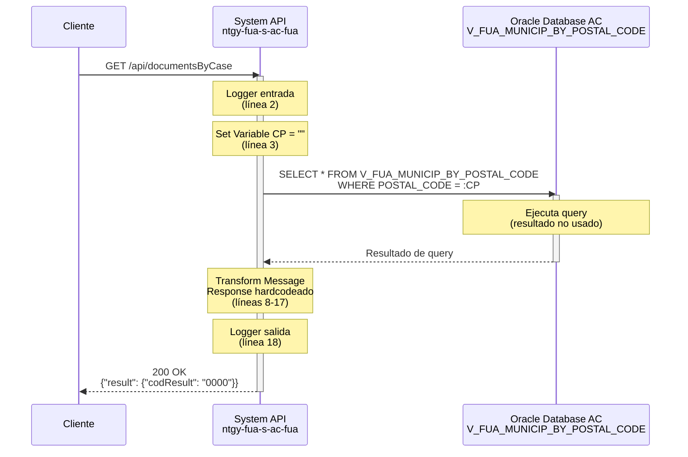
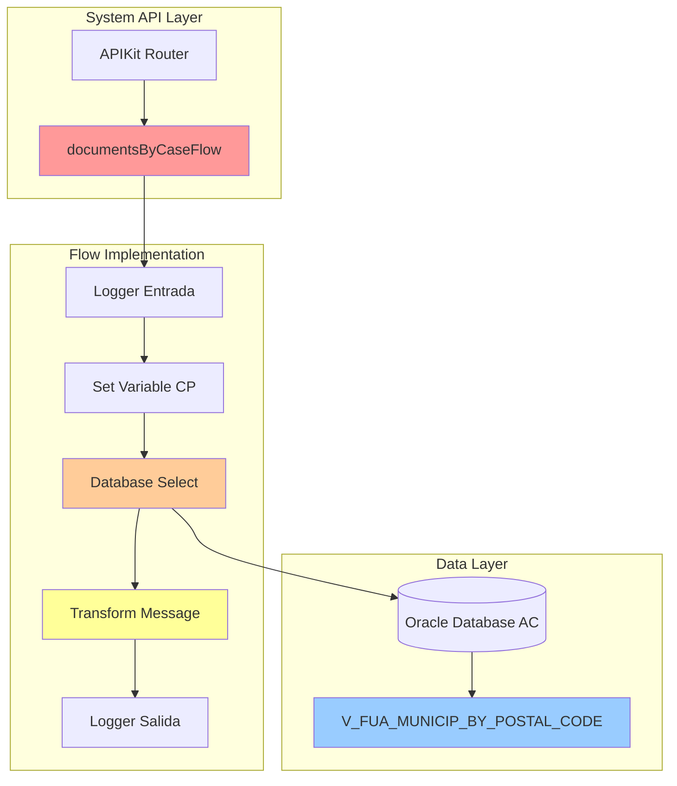
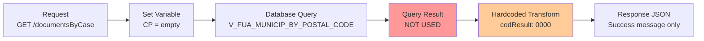

# GET /documentsByCase

## ⚠️ ADVERTENCIA CRÍTICA - INCONSISTENCIA DE IMPLEMENTACIÓN

:::danger IMPLEMENTATION MISMATCH
**Este endpoint tiene una inconsistencia grave entre su nombre y su implementación real:**

- **Nombre del endpoint:** `documentsByCase` (sugiere consulta de documentos por caso)
- **Implementación real:** Consulta de municipios por código postal
- **Tabla consultada:** `V_FUA_MUNICIP_BY_POSTAL_CODE`
- **Response:** JSON hardcodeado sin datos reales

**Esta documentación refleja la implementación ACTUAL del código, no lo que el nombre sugiere.**

**Acción requerida:** Este endpoint requiere revisión y corrección por parte del equipo de desarrollo.
:::

---

## 📌 Descripción General

### Información Básica

| Atributo | Valor |
|----------|-------|
| **Método HTTP** | GET |
| **Endpoint** | `/api/documentsByCase` |
| **Tipo de API** | System API |
| **Patrón de Integración** | Request-Reply (Synchronous) |
| **Backend** | Oracle Database AC |
| **Autenticación** | Requerida (headers estándar) |

### URLs por Ambiente

| Ambiente | URL Completa |
|----------|--------------|
| **Local** | `http://localhost:8081/api/documentsByCase` |
| **Desarrollo** | `https://dev-ntgy-fua-s-ac-fua.cloudhub.io/api/documentsByCase` |
| **Testing** | `https://test-ntgy-fua-s-ac-fua.cloudhub.io/api/documentsByCase` |
| **Producción** | `https://ntgy-fua-s-ac-fua.cloudhub.io/api/documentsByCase` |

### Arquitectura API-Led

```
┌─────────────────────────────────────────────────────────┐
│                    Experience APIs                       │
│              (Web, Mobile, Voice, etc.)                  │
└────────────────────┬────────────────────────────────────┘
                     │
                     ↓
┌─────────────────────────────────────────────────────────┐
│                    Process APIs                          │
│           (Orchestration & Business Logic)               │
└────────────────────┬────────────────────────────────────┘
                     │
                     ↓
┌─────────────────────────────────────────────────────────┐
│  ⭐ System API: ntgy-fua-s-ac-fua (ESTE ENDPOINT)       │
│              GET /documentsByCase                        │
└────────────────────┬────────────────────────────────────┘
                     │
                     ↓
┌─────────────────────────────────────────────────────────┐
│              Oracle Database AC                          │
│         V_FUA_MUNICIP_BY_POSTAL_CODE                    │
└─────────────────────────────────────────────────────────┘
```

---

## 💼 Propósito del Negocio

### ⚠️ Discrepancia entre Nombre y Funcionalidad

#### Lo que el Nombre Sugiere
Basándose en el nombre `documentsByCase`, este endpoint **debería**:
- Consultar documentos adjuntos a un caso específico
- Recibir un identificador de caso como parámetro
- Retornar una lista de documentos asociados al caso
- Ser útil para gestión documental de casos de clientes

#### Lo que Realmente Hace
La implementación **actual** del endpoint:
- Consulta municipios por código postal
- Usa la vista `V_FUA_MUNICIP_BY_POSTAL_CODE`
- Retorna un JSON hardcodeado sin datos reales
- No consulta ninguna tabla de documentos o casos

### Funcionalidad Real Implementada

**Propósito Actual:** Consulta de información geográfica (municipios) filtrada por código postal.

**Caso de Uso Real:**
- Obtener datos de municipios basándose en un código postal
- Validación de códigos postales
- Autocompletado de direcciones

### Impacto en el Negocio

:::warning RIESGO DE CONFUSIÓN
**Riesgo Alto:** Los consumidores del API pueden intentar usar este endpoint para consultar documentos de casos, cuando en realidad consulta datos geográficos.

**Recomendación:** 
1. Renombrar el endpoint a algo como `/municipalitiesByPostalCode`
2. O implementar la funcionalidad correcta de documentos por caso
3. Actualizar la documentación RAML
:::

---

## 🔧 Especificación Técnica

### Método HTTP

```
GET /api/documentsByCase
```

### Headers Requeridos

| Header | Tipo | Requerido | Descripción |
|--------|------|-----------|-------------|
| `x-client-id` | string | Opcional | Identificador del cliente |
| `x-client-code` | string | Opcional | Código del cliente |
| `x-client-doc-number` | string | Opcional | Número de documento del cliente |

### Query Parameters

:::caution PARÁMETROS NO DOCUMENTADOS
El código usa un parámetro `CP` (Código Postal) internamente, pero no está documentado en la interfaz del endpoint. El parámetro se establece como vacío en el código.
:::

| Parámetro | Tipo | Requerido | Descripción | Ejemplo |
|-----------|------|-----------|-------------|---------|
| `CP` | string | No | Código Postal (usado internamente pero no expuesto) | `28001` |

### Estructura de Response

#### Response Exitoso (200 OK)

```json
{
  "result": {
    "codResult": "0000",
    "msgResult": "No hay error"
  }
}
```

:::info RESPONSE HARDCODEADO
El response está hardcodeado en el código y **no contiene datos reales** de la consulta a la base de datos. La query se ejecuta pero su resultado no se utiliza.
:::

#### Campos del Response

| Campo | Tipo | Descripción |
|-------|------|-------------|
| `result` | object | Objeto contenedor del resultado |
| `result.codResult` | string | Código de resultado (siempre "0000") |
| `result.msgResult` | string | Mensaje de resultado (siempre "No hay error") |

### Códigos de Estado HTTP

| Código | Descripción | Escenario |
|--------|-------------|-----------|
| `200` | OK | Consulta ejecutada exitosamente (siempre retorna este código) |
| `400` | Bad Request | Error de validación en parámetros |
| `401` | Unauthorized | Falta autenticación |
| `500` | Internal Server Error | Error en base de datos o sistema |

---

## 🏗️ Implementación Técnica

### Flujo de Ejecución



### Arquitectura de Componentes



### Código de Implementación

#### Flow Principal (ntgy-fua-s-ac-fua.xml)

**Ubicación:** Líneas 281-284

```xml
<flow name="get:\documentsByCase:ntgy-fua-s-ac-fua-config">
    <logger level="DEBUG" doc:name="Logger" doc:id="24216834-f0cf-4ca8-93dd-293c7d457977" />
    <flow-ref doc:name="documentsByCaseFlow" doc:id="adde3535-b645-483a-b9c5-13277b0418e4" name="documentsByCaseFlow" />
</flow>
```

#### Flow de Implementación (documentsByCaseFlow)

**Archivo:** `s-ac-documentsByCase.xml`

```xml
<flow name="documentsByCaseFlow" doc:id="4989b3f6-0e65-40c9-a924-eb25532b5e3e">
    <!-- Línea 2: Logger de entrada -->
    <logger level="INFO" doc:name="Logger entrada" doc:id="41377aab-0b3f-40bd-91c1-0858a9836748" 
            message="s-ac-consumptions.logEntrada ## payload: #[payload]"/>
    
    <!-- Línea 3: Set Variable - Establece CP como vacío -->
    <set-variable value="" doc:name="Set Variable" doc:id="019de9f0-3bbf-4051-a9c0-680a627be64a" 
                  variableName='attributes.queryParams["**"]'/>
    
    <!-- Líneas 4-7: Database Select - Query a vista de municipios -->
    <db:select doc:name="Select" doc:id="3220ebda-3c31-4c56-9954-80c46b1d1ed8" 
               config-ref="Database_Config" 
               queryTimeout="${dbAC.queryTimeout}">
        <db:sql><![CDATA[SELECT * FROM V_FUA_MUNICIP_BY_POSTAL_CODE where POSTAL_CODE = :CP]]></db:sql>
    </db:select>
    
    <!-- Líneas 8-17: Transform Message - Response hardcodeado -->
    <ee:transform doc:name="Transform Message" doc:id="b93cdce4-9297-4ac0-85d0-1a555a9ed01d">
        <ee:message>
            <ee:set-payload><![CDATA[%dw 2.0
output application/json
---
{
    result: {
        codResult: "0000",
        msgResult: "No hay error"
    }
}]]></ee:set-payload>
        </ee:message>
    </ee:transform>
    
    <!-- Línea 18: Logger de salida -->
    <logger level="INFO" doc:name="Logger salida" doc:id="4440b0ca-5952-490f-bc70-eaa47548c03f" 
            message="s-ac-consumptions.logSalida ## payload: #[payload]"/>
</flow>
```

### Análisis de la Query SQL

#### Query Ejecutada

```sql
SELECT * FROM V_FUA_MUNICIP_BY_POSTAL_CODE 
WHERE POSTAL_CODE = :CP
```

#### Tabla/Vista Consultada

| Elemento | Descripción |
|----------|-------------|
| **Vista** | `V_FUA_MUNICIP_BY_POSTAL_CODE` |
| **Schema** | `OVPRO_DELTA` (Oracle AC) |
| **Propósito** | Vista consolidada de municipios por código postal |
| **Operación** | `SELECT` (READ) |

#### Parámetros de la Query

| Parámetro | Tipo | Valor | Descripción |
|-----------|------|-------|-------------|
| `:CP` | string | `""` (vacío) | Código Postal - establecido como vacío en línea 3 |

:::warning QUERY INEFECTIVA
La query se ejecuta con el parámetro `CP` vacío (`""`), lo que probablemente no retorna resultados útiles. Además, el resultado de la query no se utiliza en el response.
:::

### Transformación de Datos



### Configuración de Base de Datos

**Database Config:** `Database_Config`

```yaml
dbAC:
  host1: "oc-pro-exa-04-clu-02-hdfdi-scan.prodb03.ocpro.oraclevcn.com"
  host2: "oc-pro-exa-03-clu-02-dfhl9-scan.prodb03.ocpro.oraclevcn.com"
  port: "1521"
  serviceName: "s_areapriv_online_pro.prodb03.ocpro.oraclevcn.com"
  user: "OVPRO_DELTA"
  queryTimeout: "15000"
  MaxPoolSize: "15"
  MaxWaitTime: "300000"
  MaxIdleTime: "300000"
```

### Manejo de Errores

El endpoint utiliza el error handler global del proyecto:

**Archivo:** `s-ac-globalErrorHandler.xml`

**Tipos de errores manejados:**
- `DB:CONNECTIVITY` - Errores de conexión a base de datos
- `DB:QUERY_EXECUTION` - Errores en ejecución de query
- `APIKIT:BAD_REQUEST` - Request malformado
- `APIKIT:NOT_FOUND` - Recurso no encontrado

### Logging

#### Logger de Entrada (Línea 2)

```
Level: INFO
Message: "s-ac-consumptions.logEntrada ## payload: #[payload]"
```

:::note MENSAJE DE LOG INCORRECTO
El mensaje de log hace referencia a "s-ac-consumptions" en lugar de "s-ac-documentsByCase", lo que sugiere que el código fue copiado de otro endpoint.
:::

#### Logger de Salida (Línea 18)

```
Level: INFO
Message: "s-ac-consumptions.logSalida ## payload: #[payload]"
```

### Performance

| Métrica | Valor Esperado | Notas |
|---------|----------------|-------|
| **Response Time** | < 2 segundos | Query simple a vista |
| **Query Timeout** | 15 segundos | Configurado en `dbAC.queryTimeout` |
| **Connection Pool** | Max 15 conexiones | Compartido con otros endpoints |

---

## 💻 Ejemplos de Uso

### Ejemplo 1: Request Básico

#### cURL

```bash
curl -X GET "http://localhost:8081/api/documentsByCase" \
  -H "Content-Type: application/json" \
  -H "x-client-id: 12345"
```

#### Response

```json
{
  "result": {
    "codResult": "0000",
    "msgResult": "No hay error"
  }
}
```

### Ejemplo 2: Request con Headers Completos

#### cURL

```bash
curl -X GET "https://ntgy-fua-s-ac-fua.cloudhub.io/api/documentsByCase" \
  -H "Content-Type: application/json" \
  -H "x-client-id: 12345" \
  -H "x-client-code: CLI001" \
  -H "x-client-doc-number: 12345678A"
```

#### Response

```json
{
  "result": {
    "codResult": "0000",
    "msgResult": "No hay error"
  }
}
```

:::info RESPONSE IDÉNTICO
Independientemente de los parámetros enviados, el response siempre será el mismo JSON hardcodeado.
:::

### Ejemplo 3: JavaScript/TypeScript

```typescript
const getDocumentsByCase = async () => {
  try {
    const response = await fetch('https://ntgy-fua-s-ac-fua.cloudhub.io/api/documentsByCase', {
      method: 'GET',
      headers: {
        'Content-Type': 'application/json',
        'x-client-id': '12345',
        'x-client-code': 'CLI001',
        'x-client-doc-number': '12345678A'
      }
    });

    if (!response.ok) {
      throw new Error(`HTTP error! status: ${response.status}`);
    }

    const data = await response.json();
    console.log('Response:', data);
    // Output: { result: { codResult: "0000", msgResult: "No hay error" } }
    
    return data;
  } catch (error) {
    console.error('Error fetching documents:', error);
    throw error;
  }
};

// Uso
getDocumentsByCase()
  .then(data => console.log('Success:', data))
  .catch(error => console.error('Error:', error));
```

### Ejemplo 4: Python

```python
import requests
import json

def get_documents_by_case():
    """
    Consulta el endpoint documentsByCase
    
    Nota: Este endpoint actualmente retorna un response hardcodeado
    """
    url = "https://ntgy-fua-s-ac-fua.cloudhub.io/api/documentsByCase"
    
    headers = {
        "Content-Type": "application/json",
        "x-client-id": "12345",
        "x-client-code": "CLI001",
        "x-client-doc-number": "12345678A"
    }
    
    try:
        response = requests.get(url, headers=headers, timeout=10)
        response.raise_for_status()
        
        data = response.json()
        print(f"Response: {json.dumps(data, indent=2)}")
        
        return data
        
    except requests.exceptions.RequestException as e:
        print(f"Error: {e}")
        raise

# Uso
if __name__ == "__main__":
    result = get_documents_by_case()
    print(f"Result Code: {result['result']['codResult']}")
    print(f"Result Message: {result['result']['msgResult']}")
```

### Ejemplo 5: Postman Collection

```json
{
  "info": {
    "name": "GET documentsByCase",
    "description": "⚠️ Endpoint con implementación inconsistente - Retorna response hardcodeado",
    "schema": "https://schema.getpostman.com/json/collection/v2.1.0/collection.json"
  },
  "item": [
    {
      "name": "Get Documents By Case",
      "request": {
        "method": "GET",
        "header": [
          {
            "key": "Content-Type",
            "value": "application/json"
          },
          {
            "key": "x-client-id",
            "value": "{{clientId}}"
          },
          {
            "key": "x-client-code",
            "value": "{{clientCode}}"
          },
          {
            "key": "x-client-doc-number",
            "value": "{{docNumber}}"
          }
        ],
        "url": {
          "raw": "{{baseUrl}}/api/documentsByCase",
          "host": ["{{baseUrl}}"],
          "path": ["api", "documentsByCase"]
        }
      },
      "response": []
    }
  ]
}
```

---

## 🔍 Notas Adicionales

### Problemas Identificados

1. **Inconsistencia de Nombre vs Implementación**
   - El nombre sugiere documentos por caso
   - La implementación consulta municipios por código postal
   - **Severidad:** Alta
   - **Impacto:** Confusión para consumidores del API

2. **Response Hardcodeado**
   - El resultado de la query no se utiliza
   - Siempre retorna el mismo JSON
   - **Severidad:** Alta
   - **Impacto:** Endpoint no funcional

3. **Parámetro CP Vacío**
   - El parámetro `CP` se establece como vacío
   - La query probablemente no retorna resultados útiles
   - **Severidad:** Media
   - **Impacto:** Query inefectiva

4. **Mensajes de Log Incorrectos**
   - Los logs hacen referencia a "s-ac-consumptions"
   - Sugiere código copiado de otro endpoint
   - **Severidad:** Baja
   - **Impacto:** Confusión en troubleshooting

