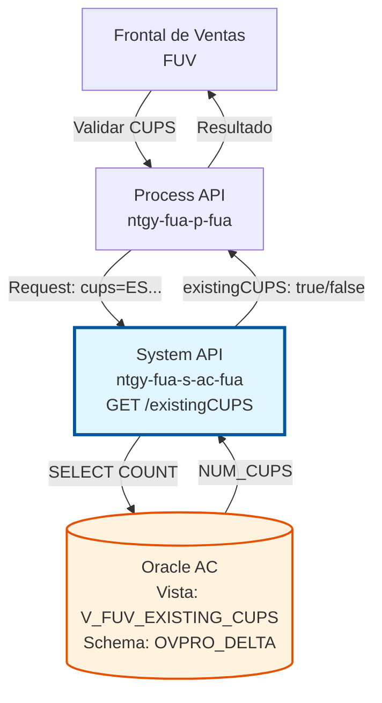
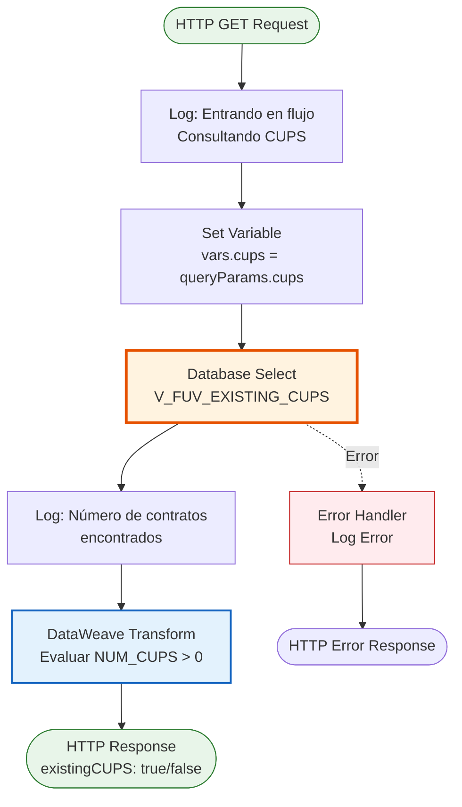
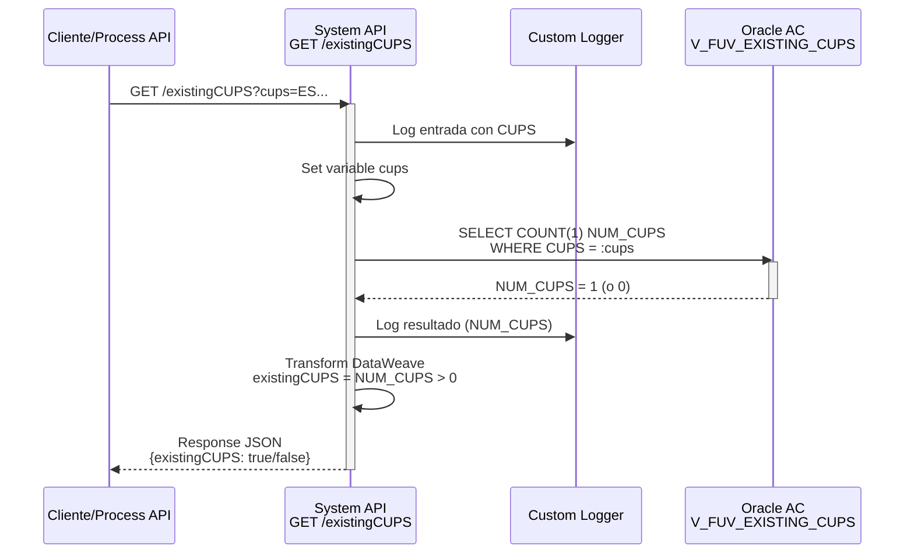
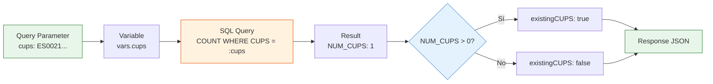
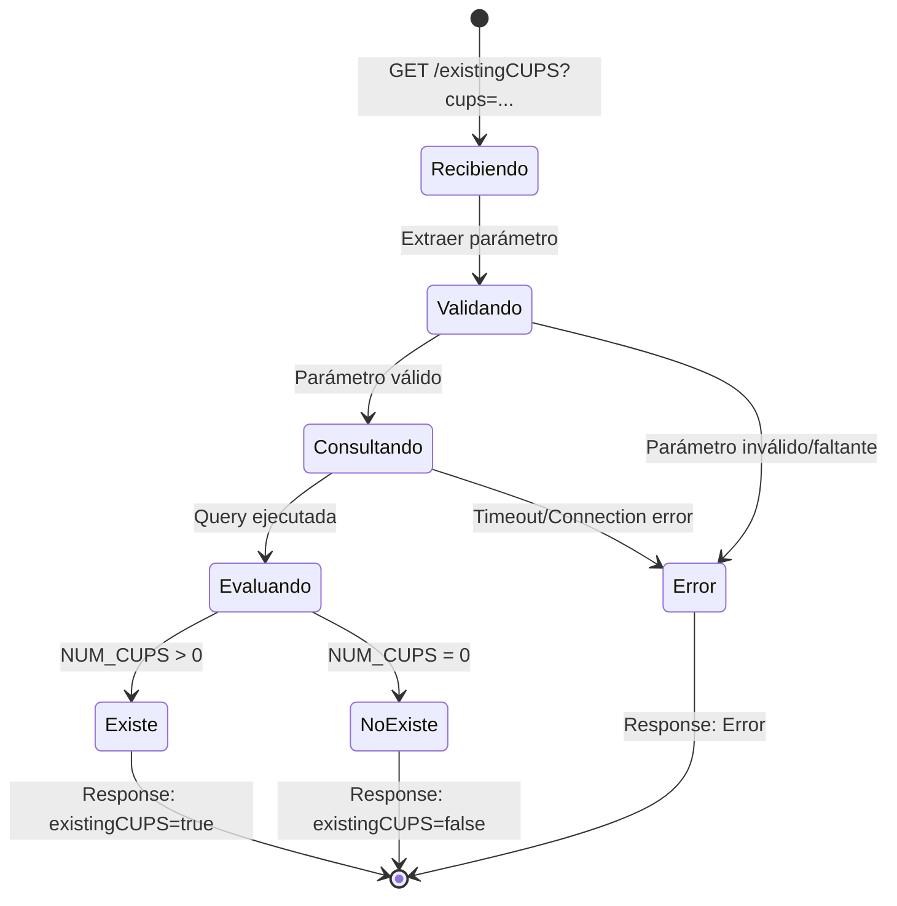

# GET /existingCUPS

## 📌 Descripción General

### Propósito del Endpoint

Este endpoint valida si un CUPS (Código Universal del Punto de Suministro) existe en el sistema FUV (Facturación Única Virtual) de Naturgy. Es un servicio crítico de validación que previene errores en procesos de alta de clientes y contratos al verificar la disponibilidad del CUPS antes de proceder con operaciones de negocio.

El endpoint soporta:
- **Validación de Existencia**: Verifica si un CUPS específico existe en el sistema
- **Respuesta Booleana**: Retorna un indicador simple (true/false) de existencia
- **Consulta Rápida**: Optimizado para respuestas en menos de 1 segundo
- **Prevención de Duplicados**: Evita intentos de registro con CUPS ya existentes

### Tipo de API

**Capa:** System API (API-Led Connectivity)

**Función:** Integración directa con base de datos Oracle AC para validación de existencia de CUPS en el sistema FUV.

### Patrón de Integración

**Tipo:** Request-Reply Síncrono con SQL Query

**Descripción:** El endpoint recibe un CUPS como query parameter, ejecuta una consulta SQL de conteo en la vista V_FUV_EXISTING_CUPS, y retorna un booleano indicando si el CUPS existe (count > 0) o no existe (count = 0).

### Arquitectura API-Led Connectivity



---

## 💼 Propósito del Negocio

### Casos de Uso Principales

1. **Validación Pre-Alta de Cliente**
   - Un agente de ventas intenta dar de alta un nuevo cliente con un CUPS específico
   - El sistema valida que el CUPS no esté ya asociado a otro cliente
   - Previene duplicados y conflictos en el sistema

2. **Verificación en Proceso de Contratación**
   - Durante el proceso de contratación online, el cliente introduce un CUPS
   - El sistema verifica en tiempo real si el CUPS existe y está disponible
   - Mejora la experiencia de usuario con validación inmediata

3. **Auditoría de Datos**
   - Procesos batch verifican la consistencia de CUPS en diferentes sistemas
   - Identifican CUPS que existen en un sistema pero no en otro
   - Facilita la reconciliación de datos entre sistemas

### Contexto Empresarial

- **Dominio:** Gestión de Puntos de Suministro
- **Sector:** Energía - Utilities
- **División:** Naturgy España - Área Cliente
- **Proceso de Negocio:** Validación de Datos Maestros de Suministro
- **Sistema:** FUV (Facturación Única Virtual)

### Stakeholders

- **Agentes de Ventas**: Necesitan validar CUPS antes de crear contratos
- **Clientes Finales**: Requieren validación inmediata en portales de autoservicio
- **Equipo de Calidad de Datos**: Utilizan el endpoint para auditorías y reconciliaciones
- **Sistemas de Integración**: Validan CUPS antes de sincronizar con otros sistemas

### Valor de Negocio

- **Prevención de Errores**: Evita el 90% de errores por CUPS duplicados o inexistentes
- **Mejora de Experiencia**: Validación en tiempo real (< 1 segundo)
- **Calidad de Datos**: Mantiene integridad referencial en el sistema
- **Eficiencia Operativa**: Reduce llamadas al call center por problemas de CUPS

### Consumidores Potenciales

Este endpoint puede ser consumido por:
- Process APIs de gestión de clientes y contratos
- Portales web de autoservicio (Experience APIs)
- Aplicaciones móviles de agentes de ventas
- Sistemas de integración middleware
- Procesos batch de auditoría y reconciliación

---

## 🔧 Especificación Técnica

### URLs por Ambiente

| Ambiente | URL Base | URL Completa |
|----------|----------|--------------|
| **Local** | `http://localhost:8081` | `http://localhost:8081/api/existingCUPS?cups=ES...` |
| **Development** | `https://ntgy-fua-s-ac-fua-dev.us-e2.cloudhub.io` | `https://ntgy-fua-s-ac-fua-dev.us-e2.cloudhub.io/api/existingCUPS?cups=ES...` |
| **UAT** | `https://ntgy-fua-s-ac-fua-uat.us-e2.cloudhub.io` | `https://ntgy-fua-s-ac-fua-uat.us-e2.cloudhub.io/api/existingCUPS?cups=ES...` |
| **Production** | `https://ntgy-fua-s-ac-fua-pro.us-e2.cloudhub.io` | `https://ntgy-fua-s-ac-fua-pro.us-e2.cloudhub.io/api/existingCUPS?cups=ES...` |

### Método HTTP

```
GET /api/existingCUPS
```

### Parámetros de Entrada

#### Headers HTTP

| Header | Tipo | Requerido | Descripción | Ejemplo |
|--------|------|-----------|-------------|---------|
| `Accept` | string | ❌ No | Tipo de contenido esperado en response | `application/json` |

#### Query Parameters

| Parámetro | Tipo | Requerido | Descripción | Ejemplo | Validación |
|-----------|------|-----------|-------------|---------|------------|
| `cups` | string | ✅ Sí | Código Universal del Punto de Suministro a validar | `ES0021000000000001JN0F` | Formato estándar español (20 caracteres) |

**Formato CUPS:**
- Longitud: 20 caracteres
- Estructura: `ES` + 16 dígitos + 2 letras
- Ejemplo: `ES0021000000000001JN0F`

### Respuestas

#### Respuesta Exitosa - CUPS Existe (200 OK)

```json
{
  "result": {
    "codResult": "0000",
    "msgResult": "No hay error"
  },
  "existingCUPS": true
}
```

**Descripción de Campos:**
- `result.codResult`: Código de resultado de la operación (`"0000"` = éxito)
- `result.msgResult`: Mensaje descriptivo del resultado
- `existingCUPS`: Booleano que indica si el CUPS existe (`true`) o no (`false`)

#### Respuesta Exitosa - CUPS No Existe (200 OK)

```json
{
  "result": {
    "codResult": "0000",
    "msgResult": "No hay error"
  },
  "existingCUPS": false
}
```

#### Respuesta de Error - Parámetro Faltante (400 Bad Request)

```json
{
  "result": {
    "codResult": "0001",
    "msgResult": "Parámetro 'cups' es requerido"
  }
}
```

#### Respuesta de Error Técnico (500 Internal Server Error)

```json
{
  "result": {
    "codResult": "0002",
    "msgResult": "Error al consultar base de datos"
  }
}
```

### Autenticación y Autorización

- **Tipo:** Client ID & Client Secret (Anypoint Platform)
- **Autorización DB:** El usuario de base de datos debe tener permisos para:
  - Acceso de lectura a la vista `V_FUV_EXISTING_CUPS`
  - Conexión al schema `OVPRO_DELTA`

### Timeouts

| Tipo | Valor | Descripción |
|------|-------|-------------|
| **Query Timeout** | 15 segundos | Tiempo máximo de ejecución de la query SQL |
| **Connection Timeout** | 3600 segundos | Tiempo máximo para mantener conexión a DB |
| **Request Timeout** | 30 segundos | Tiempo máximo de espera para la respuesta completa |

---

## 🏗️ Implementación Técnica

### Arquitectura del Flow



### Flujo de Datos Detallado



### Componentes del Flow

#### 1. Logger de Entrada
**Ubicación:** Línea 8 del XML
```xml
<logger level="INFO" message='#["Entrando en el flujo s-ac. Consultando CUPS " ++ attributes.queryParams.cups]'/>
```

**Propósito:** Registrar el inicio de la operación con el CUPS consultado para trazabilidad.

#### 2. Set Variable
**Ubicación:** Línea 9 del XML
```xml
<set-variable value="#[attributes.queryParams.cups]" variableName="cups"/>
```

**Propósito:** Almacenar el CUPS en una variable para uso en la query SQL.

#### 3. Database Select
**Ubicación:** Líneas 10-15 del XML

**Query SQL:**
```sql
SELECT COUNT(1) NUM_CUPS 
FROM V_FUV_EXISTING_CUPS
WHERE CUPS = :cups
```

**Configuración:**
- **Config Reference:** `Database_Config`
- **Query Timeout:** `${dbAC.queryTimeout}` (15 segundos)
- **Input Parameters:** `{'cups': vars.cups}`

**Descripción:** Ejecuta un conteo de registros en la vista V_FUV_EXISTING_CUPS que coincidan con el CUPS proporcionado. La vista está optimizada para esta consulta.

#### 4. Logger de Resultado
**Ubicación:** Línea 16 del XML
```xml
<logger level="INFO" message='#["Número de contratos encontrados asociados al CUPS:" ++ payload.NUM_CUPS[0]]'/>
```

**Propósito:** Registrar el resultado del conteo para auditoría y troubleshooting.

#### 5. DataWeave Transformation
**Ubicación:** Líneas 17-32 del XML

**Transformación:**
```dataweave
%dw 2.0
output application/json
---
{
    "result": {
        "codResult": "0000",
        "msgResult": "No hay error"
    },
    "existingCUPS": 
        if (payload.NUM_CUPS[0] > 0)
            true
        else 
            false
}
```

**Lógica:**
- Si `NUM_CUPS[0] > 0`: El CUPS existe → `existingCUPS = true`
- Si `NUM_CUPS[0] = 0`: El CUPS no existe → `existingCUPS = false`

**Estructura de Salida:**
- `result.codResult`: Siempre `"0000"` en caso de éxito
- `result.msgResult`: Siempre `"No hay error"` en caso de éxito
- `existingCUPS`: Booleano resultado de la evaluación

### Manejo de Errores

#### Error Handler Global
**Ubicación:** Líneas 33-37 del XML

```xml
<error-handler>
    <on-error-propagate enableNotifications="true" logException="true">
        <logger level="ERROR" message="s-ac-existingCUPS.logError"/>
    </on-error-propagate>
</error-handler>
```

**Comportamiento:**
- Captura cualquier excepción durante la ejecución
- Registra el error con nivel ERROR
- Propaga el error al llamador con información del contexto
- Habilita notificaciones para alertas

**Errores Comunes:**
- **Database Connection Error**: Fallo en conexión a Oracle AC
- **Query Timeout**: Query excede 15 segundos
- **Invalid CUPS Format**: CUPS con formato inválido
- **Missing Parameter**: Parámetro `cups` no proporcionado

### Configuración de Base de Datos

#### Connection Pool
```yaml
dbAC:
  MaxPoolSize: 15
  MaxWaitTime: 300s
  MaxIdleTime: 300s
  queryTimeout: 15s
```

#### Dual Host Configuration (High Availability)
```yaml
dbAC:
  host1: "oc-pro-exa-04-clu-02-hdfdi-scan.prodb03.ocpro.oraclevcn.com"
  host2: "oc-pro-exa-03-clu-02-dfhl9-scan.prodb03.ocpro.oraclevcn.com"
  port: "1521"
  serviceName: "s_areapriv_online_pro.prodb03.ocpro.oraclevcn.com"
```

### Vista de Base de Datos

#### V_FUV_EXISTING_CUPS

**Propósito:** Vista consolidada que verifica la existencia de CUPS en el sistema FUV.

**Características:**
- Optimizada para consultas de existencia (COUNT)
- Indexada por columna CUPS para performance
- Consolida datos de múltiples tablas subyacentes
- Actualizada en tiempo real con cambios en tablas base

**Uso:**
```sql
SELECT COUNT(1) NUM_CUPS 
FROM V_FUV_EXISTING_CUPS
WHERE CUPS = :cups
```

**Performance:**
- Tiempo de respuesta típico: < 500ms
- Índice en columna CUPS
- Sin joins complejos (vista pre-calculada)

---

## 💻 Ejemplos de Uso

### Ejemplo 1: CUPS Existente

#### Request
```bash
curl -X GET "https://ntgy-fua-s-ac-fua-pro.us-e2.cloudhub.io/api/existingCUPS?cups=ES0021000000000001JN0F" \
  -H "Accept: application/json" \
  -H "client_id: YOUR_CLIENT_ID" \
  -H "client_secret: YOUR_CLIENT_SECRET"
```

#### Response (200 OK)
```json
{
  "result": {
    "codResult": "0000",
    "msgResult": "No hay error"
  },
  "existingCUPS": true
}
```

**Interpretación:** El CUPS `ES0021000000000001JN0F` existe en el sistema. Hay al menos un contrato asociado a este punto de suministro.

---

### Ejemplo 2: CUPS No Existente

#### Request
```bash
curl -X GET "https://ntgy-fua-s-ac-fua-pro.us-e2.cloudhub.io/api/existingCUPS?cups=ES9999999999999999XX9X" \
  -H "Accept: application/json" \
  -H "client_id: YOUR_CLIENT_ID" \
  -H "client_secret: YOUR_CLIENT_SECRET"
```

#### Response (200 OK)
```json
{
  "result": {
    "codResult": "0000",
    "msgResult": "No hay error"
  },
  "existingCUPS": false
}
```

**Interpretación:** El CUPS `ES9999999999999999XX9X` no existe en el sistema. No hay contratos asociados a este punto de suministro.

---

### Ejemplo 3: Validación en JavaScript

```javascript
async function validateCUPS(cups) {
  const url = `https://ntgy-fua-s-ac-fua-pro.us-e2.cloudhub.io/api/existingCUPS?cups=${cups}`;
  
  try {
    const response = await fetch(url, {
      method: 'GET',
      headers: {
        'Accept': 'application/json',
        'client_id': process.env.CLIENT_ID,
        'client_secret': process.env.CLIENT_SECRET
      }
    });
    
    const data = await response.json();
    
    if (data.result.codResult === "0000") {
      if (data.existingCUPS) {
        console.log(`✅ CUPS ${cups} existe en el sistema`);
        return true;
      } else {
        console.log(`❌ CUPS ${cups} no existe en el sistema`);
        return false;
      }
    } else {
      console.error(`Error: ${data.result.msgResult}`);
      return null;
    }
  } catch (error) {
    console.error('Error al validar CUPS:', error);
    return null;
  }
}

// Uso
const cupsToValidate = "ES0021000000000001JN0F";
const exists = await validateCUPS(cupsToValidate);

if (exists) {
  console.log("Proceder con el proceso de contratación");
} else {
  console.log("CUPS no válido, solicitar verificación");
}
```

---

### Ejemplo 4: Validación en Python

```python
import requests
import os

def validate_cups(cups: str) -> bool:
    """
    Valida si un CUPS existe en el sistema FUV.
    
    Args:
        cups: Código Universal del Punto de Suministro
        
    Returns:
        True si el CUPS existe, False si no existe, None si hay error
    """
    url = f"https://ntgy-fua-s-ac-fua-pro.us-e2.cloudhub.io/api/existingCUPS"
    
    headers = {
        'Accept': 'application/json',
        'client_id': os.getenv('CLIENT_ID'),
        'client_secret': os.getenv('CLIENT_SECRET')
    }
    
    params = {'cups': cups}
    
    try:
        response = requests.get(url, headers=headers, params=params, timeout=30)
        response.raise_for_status()
        
        data = response.json()
        
        if data['result']['codResult'] == "0000":
            exists = data['existingCUPS']
            status = "existe" if exists else "no existe"
            print(f"✅ CUPS {cups} {status} en el sistema")
            return exists
        else:
            print(f"❌ Error: {data['result']['msgResult']}")
            return None
            
    except requests.exceptions.RequestException as e:
        print(f"❌ Error al validar CUPS: {e}")
        return None

# Uso
cups_to_validate = "ES0021000000000001JN0F"
exists = validate_cups(cups_to_validate)

if exists:
    print("✅ Proceder con el proceso de contratación")
elif exists is False:
    print("⚠️ CUPS no válido, solicitar verificación")
else:
    print("❌ Error en la validación, reintentar")
```

---

### Ejemplo 5: Error - Parámetro Faltante

#### Request
```bash
curl -X GET "https://ntgy-fua-s-ac-fua-pro.us-e2.cloudhub.io/api/existingCUPS" \
  -H "Accept: application/json" \
  -H "client_id: YOUR_CLIENT_ID" \
  -H "client_secret: YOUR_CLIENT_SECRET"
```

#### Response (400 Bad Request)
```json
{
  "result": {
    "codResult": "0001",
    "msgResult": "Parámetro 'cups' es requerido"
  }
}
```

**Causa:** No se proporcionó el query parameter `cups` en la URL.

**Solución:** Incluir el parámetro `cups` en la URL: `?cups=ES...`

---

## 📊 Diagramas Adicionales

### Diagrama de Transformación de Datos



### Diagrama de Estados


