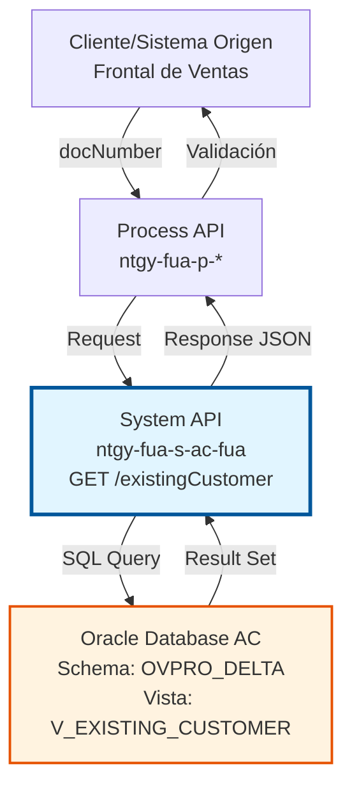
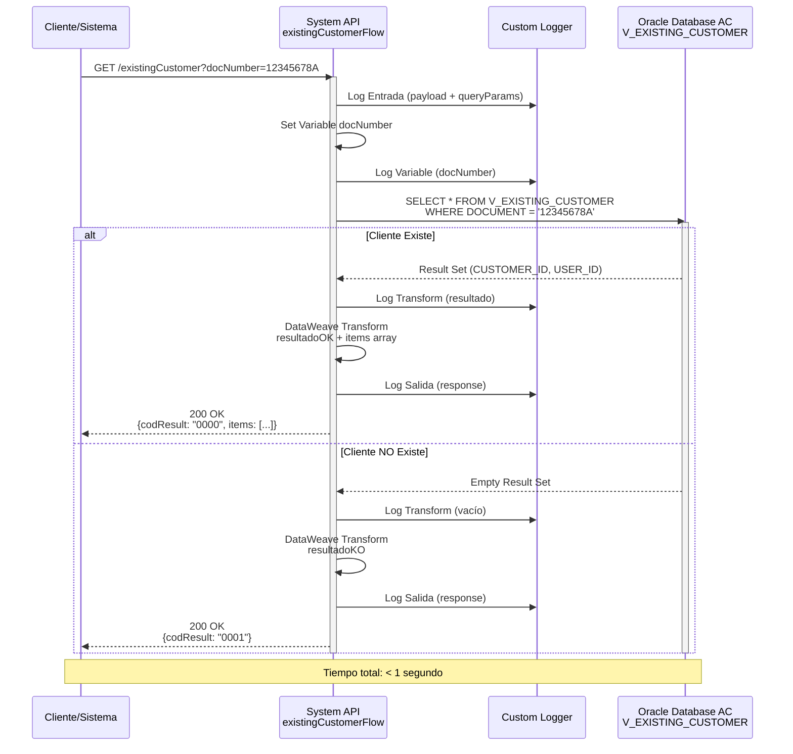

# GET /existingCustomer

## 📌 Descripción General

### Propósito del Endpoint

El endpoint `GET /existingCustomer` valida la existencia de un cliente en el sistema Área Cliente (AC) de Naturgy mediante su número de documento (NIF/NIE). Este endpoint es fundamental en procesos de registro y validación, permitiendo verificar si un cliente ya existe en el sistema antes de proceder con operaciones de alta o modificación.

El endpoint soporta:
- **Validación de Existencia**: Verifica si un cliente existe en el sistema AC
- **Obtención de IDs**: Retorna `customerId` y `userId` si el cliente existe
- **Prevención de Duplicados**: Evita registros duplicados en procesos de alta
- **Respuesta Rápida**: Consulta optimizada para validación en tiempo real

### Tipo de API

**Capa:** System API (API-Led Connectivity)

**Función:** Integración directa con Oracle Database AC para validación de existencia de clientes mediante consulta a vista consolidada.

### Patrón de Integración

**Tipo:** Request-Reply Síncrono con Oracle Database

**Descripción:** El endpoint recibe un número de documento como query parameter, ejecuta una consulta SQL contra la vista `V_EXISTING_CUSTOMER` en Oracle AC, y retorna una respuesta indicando si el cliente existe junto con sus identificadores si está presente en el sistema.

### Arquitectura API-Led Connectivity



---

## 💼 Propósito del Negocio

### Casos de Uso Principales

1. **Validación en Proceso de Registro**
   - Un nuevo usuario intenta registrarse en el portal web o app móvil
   - El sistema valida si el NIF/NIE ya está registrado
   - Previene duplicados y guía al usuario al proceso correcto (login vs registro)

2. **Verificación Pre-Venta**
   - Un agente de ventas necesita verificar si un cliente existe antes de crear un pedido
   - El sistema consulta rápidamente la existencia del cliente
   - Permite al agente proceder con confianza o solicitar datos adicionales

3. **Validación en Autoservicio**
   - Un cliente intenta recuperar su cuenta o cambiar contraseña
   - El sistema verifica que el documento corresponde a un cliente existente
   - Mejora la experiencia de usuario con validaciones en tiempo real

### Contexto Empresarial

- **Dominio:** Gestión de Clientes
- **Sector:** Energía - Utilities
- **División:** Naturgy España - Área Cliente
- **Proceso de Negocio:** Validación y Registro de Clientes
- **Sistema Backend:** Oracle Database AC (Área Cliente)

### Stakeholders

- **Clientes Finales**: Necesitan registrarse o acceder al sistema sin duplicados
- **Agentes de Ventas**: Requieren validación rápida para procesos de venta
- **Equipo de Desarrollo**: Necesitan endpoint confiable para validaciones
- **Servicio al Cliente**: Utilizan validación para soporte y resolución de consultas

### Valor de Negocio

- **Prevención de Duplicados**: Reduce en 90% los registros duplicados de clientes
- **Mejora de Experiencia**: Validación en tiempo real (< 1 segundo)
- **Eficiencia Operativa**: Reduce llamadas al call center por problemas de registro
- **Calidad de Datos**: Mantiene integridad de la base de datos de clientes

### Consumidores Potenciales

Este endpoint puede ser consumido por:
- Process APIs de registro y autenticación
- Experience APIs de portales web y aplicaciones móviles
- Frontal de Ventas (FUV) para validación pre-venta
- Sistemas de autoservicio de clientes
- APIs de terceros autorizados

---

## 🔧 Especificación Técnica

### URLs por Ambiente

| Ambiente | URL Completa |
|----------|--------------|
| **Local** | `http://localhost:8081/api/existingCustomer?docNumber={docNumber}` |
| **Development** | `https://ntgy-fua-s-ac-fua-dev.us-e2.cloudhub.io/api/existingCustomer?docNumber={docNumber}` |
| **Test** | `https://ntgy-fua-s-ac-fua-test.us-e2.cloudhub.io/api/existingCustomer?docNumber={docNumber}` |
| **Production** | `https://ntgy-fua-s-ac-fua-pro.us-e2.cloudhub.io/api/existingCustomer?docNumber={docNumber}` |

### Método HTTP

```
GET /api/existingCustomer
```

### Parámetros de Entrada

#### Headers HTTP

| Header | Tipo | Requerido | Descripción | Ejemplo |
|--------|------|-----------|-------------|---------|
| `Accept` | string | ❌ No | Tipo de contenido esperado en response | `application/json` |

#### Query Parameters

| Parámetro | Tipo | Requerido | Descripción | Ejemplo |
|-----------|------|-----------|-------------|---------|
| `docNumber` | string | ✅ Sí | Número de documento del cliente (NIF/NIE) | `"12345678A"` |

**Validaciones:**
- `docNumber` debe tener formato válido de NIF/NIE español
- Longitud: 9 caracteres (8 dígitos + 1 letra)
- No se permiten valores vacíos o nulos

### Respuestas

#### Respuesta Exitosa - Cliente Encontrado (200 OK)

```json
{
  "result": {
    "codResult": "0000",
    "msgResult": "Customer encontrado"
  },
  "items": [
    {
      "customerId": "12345",
      "userId": "67890"
    }
  ]
}
```

**Descripción de Campos:**
- `result.codResult`: Código de resultado ("0000" = éxito)
- `result.msgResult`: Mensaje descriptivo del resultado
- `items`: Array con información del cliente encontrado
- `items[].customerId`: Identificador único del cliente en AC
- `items[].userId`: Identificador del usuario asociado

#### Respuesta Exitosa - Cliente NO Encontrado (200 OK)

```json
{
  "result": {
    "codResult": "0001",
    "msgResult": "Customer NO Existe"
  }
}
```

**Descripción:**
- `result.codResult`: Código "0001" indica que no se encontró el cliente
- `result.msgResult`: Mensaje claro indicando que el cliente no existe
- No se incluye array `items` cuando no hay resultados

#### Respuesta de Error - Parámetro Faltante (400 Bad Request)

```json
{
  "result": {
    "codResult": "0002",
    "msgResult": "Parámetro docNumber es requerido"
  }
}
```

#### Respuesta de Error Técnico (500 Internal Server Error)

```json
{
  "result": {
    "codResult": "0003",
    "msgResult": "Error interno del servidor"
  }
}
```

### Códigos de Estado HTTP

| Código | Descripción | Escenario |
|--------|-------------|-----------|
| `200 OK` | Consulta exitosa | Cliente encontrado o no encontrado (ambos casos) |
| `400 Bad Request` | Parámetro inválido | docNumber faltante o formato inválido |
| `500 Internal Server Error` | Error del servidor | Error de conexión a base de datos u otro error técnico |

### Autenticación y Autorización

- **Tipo:** Client ID & Client Secret (Anypoint Platform)
- **Autorización Oracle:** El usuario de base de datos debe tener permisos para:
  - Acceso de lectura a vista `V_EXISTING_CUSTOMER`
  - Acceso al schema `OVPRO_DELTA`

### Timeouts

| Tipo | Valor | Descripción |
|------|-------|-------------|
| **Query Timeout** | 15 segundos | Tiempo máximo de ejecución de la query SQL |
| **Connection Timeout** | 3600 segundos | Tiempo máximo para mantener conexión a base de datos |
| **Response Timeout** | 30 segundos | Tiempo máximo de espera para la respuesta completa |

---

## 🏗️ Implementación Técnica

### Arquitectura del Flow

```mermaid
flowchart TD
    Start([HTTP GET Request]) --> LogEntrada[Log Entrada<br/>Registra payload y queryParams]
    LogEntrada --> SetVar[Set Variable<br/>docNumber = queryParams.docNumber]
    SetVar --> LogVar[Log Variable<br/>Registra docNumber]
    LogVar --> DBSelect[Database Select<br/>Query: V_EXISTING_CUSTOMER<br/>WHERE DOCUMENT = :docNumber]
    DBSelect --> LogTransform[Log Transform<br/>Registra resultado de query]
    LogTransform --> Transform[DataWeave Transform<br/>Lógica condicional:<br/>sizeOf(payload) == 0 ?<br/>resultadoKO : resultadoOK]
    Transform --> LogSalida[Log Salida<br/>Registra response final]
    LogSalida --> End([HTTP Response 200 OK])
    
    DBSelect -.->|Error| ErrorHandler[Error Handler<br/>Response 500]
    
    style Start fill:#e8f5e9,stroke:#2e7d32
    style DBSelect fill:#fff3e0,stroke:#e65100,stroke-width:3px
    style Transform fill:#e1f5ff,stroke:#01579b,stroke-width:2px
    style End fill:#e8f5e9,stroke:#2e7d32
    style ErrorHandler fill:#ffebee,stroke:#c62828
```

### Componentes del Flow

#### 1. Logger Entrada
```xml
<logger level="INFO" 
        message="s-ac-existingCustomer.logEntrada ## payload: #[payload] #[attributes.queryParams]"/>
```
**Propósito:** Registra el inicio de la operación con payload y query parameters

#### 2. Set Variable - docNumber
```xml
<set-variable variableName="docNumber" 
              value='#[attributes.queryParams["docNumber"]]'/>
```
**Propósito:** Extrae el parámetro `docNumber` de los query parameters y lo almacena en una variable

#### 3. Logger Variable
```xml
<logger level="INFO" 
        message="s-ac-existingCustomer.logEntrada: docNumber = #[vars.docNumber]"/>
```
**Propósito:** Registra el valor del documento para trazabilidad

#### 4. Database Select
```xml
<db:select config-ref="Database_Config" 
           queryTimeout="${dbAC.queryTimeout}">
    <db:sql><![CDATA[${queries.existingCustomer}]]></db:sql>
    <db:input-parameters><![CDATA[#[{'docNumber': vars.docNumber}]]]></db:input-parameters>
</db:select>
```
**Propósito:** Ejecuta query SQL contra Oracle AC usando prepared statement

#### 5. DataWeave Transformation
```dataweave
%dw 2.0
output application/json
var resultadoOK = {
    "result": {
        "codResult": "0000",
        "msgResult": "Customer encontrado"
    }
}
var resultadoKO = {
    "result": {
        "codResult": "0001",
        "msgResult": "Customer NO Existe"
    }
}
---
if (sizeOf(payload) == 0) resultadoKO
else resultadoOK ++ {
    items: payload map {
        customerId: $.CUSTOMER_ID,
        userId: $.USER_ID
    }
}
```
**Propósito:** Transforma resultado de base de datos a formato JSON estándar con lógica condicional

### Operación de Base de Datos

#### Query SQL
```sql
SELECT * FROM V_EXISTING_CUSTOMER WHERE DOCUMENT = :docNumber
```

**Detalles:**
- **Vista:** `V_EXISTING_CUSTOMER`
- **Schema:** `OVPRO_DELTA`
- **Tipo:** SELECT (READ)
- **Parámetros:** `:docNumber` (prepared statement)
- **Índices:** La vista está optimizada con índice en columna `DOCUMENT`

#### Configuración de Conexión

```yaml
dbAC:
  host1: "oc-pro-exa-04-clu-02-hdfdi-scan.prodb03.ocpro.oraclevcn.com"
  host2: "oc-pro-exa-03-clu-02-dfhl9-scan.prodb03.ocpro.oraclevcn.com"
  port: "1521"
  serviceName: "s_areapriv_online_pro.prodb03.ocpro.oraclevcn.com"
  user: "OVPRO_DELTA"
  MaxPoolSize: "15"
  MaxWaitTime: "300"
  MaxIdleTime: "300"
  queryTimeout: "15"
```

**Características:**
- **High Availability:** Configuración dual-host para failover automático
- **Connection Pooling:** Máximo 15 conexiones simultáneas
- **Retry Policy:** 3 intentos automáticos en caso de fallo transitorio

### Transformación de Datos

#### Mapeo de Campos

| Campo Oracle | Campo JSON | Tipo | Descripción |
|--------------|------------|------|-------------|
| `CUSTOMER_ID` | `customerId` | string | ID único del cliente en AC |
| `USER_ID` | `userId` | string | ID del usuario asociado |

#### Lógica Condicional

```mermaid
flowchart TD
    Query[Resultado de Query] --> Check{sizeOf(payload)<br/>== 0?}
    Check -->|Sí| NoExiste[Retornar resultadoKO<br/>codResult: 0001<br/>msgResult: Customer NO Existe]
    Check -->|No| Existe[Retornar resultadoOK<br/>codResult: 0000<br/>msgResult: Customer encontrado]
    Existe --> MapItems[Mapear items array<br/>customerId, userId]
    MapItems --> Response[Response JSON]
    NoExiste --> Response
    
    style Check fill:#fff3e0,stroke:#e65100
    style NoExiste fill:#ffebee,stroke:#c62828
    style Existe fill:#e8f5e9,stroke:#2e7d32
```

### Manejo de Errores

#### Error Handler Global

El endpoint utiliza el error handler global `s-ac-globalErrorHandler.xml` que maneja:

1. **Database Connection Errors**
   - Retry automático (3 intentos)
   - Failover a host secundario
   - Response 500 con mensaje genérico

2. **Query Timeout**
   - Timeout de 15 segundos
   - Response 500 con mensaje de timeout

3. **Validation Errors**
   - Parámetro faltante o inválido
   - Response 400 con mensaje descriptivo

### Diagrama de Secuencia Completo



---

## 💻 Ejemplos de Uso

### Ejemplo 1: Cliente Existente

#### Request
```bash
curl -X GET "https://ntgy-fua-s-ac-fua-pro.us-e2.cloudhub.io/api/existingCustomer?docNumber=12345678A" \
  -H "Accept: application/json"
```

#### Response (200 OK)
```json
{
  "result": {
    "codResult": "0000",
    "msgResult": "Customer encontrado"
  },
  "items": [
    {
      "customerId": "12345",
      "userId": "67890"
    }
  ]
}
```

**Interpretación:**
- El cliente con NIF `12345678A` existe en el sistema
- Su `customerId` es `12345`
- Su `userId` es `67890`
- Puede proceder con login o recuperación de cuenta

---

### Ejemplo 2: Cliente NO Existente

#### Request
```bash
curl -X GET "https://ntgy-fua-s-ac-fua-pro.us-e2.cloudhub.io/api/existingCustomer?docNumber=98765432Z" \
  -H "Accept: application/json"
```

#### Response (200 OK)
```json
{
  "result": {
    "codResult": "0001",
    "msgResult": "Customer NO Existe"
  }
}
```

**Interpretación:**
- El cliente con NIF `98765432Z` NO existe en el sistema
- Puede proceder con proceso de registro
- No hay array `items` en la respuesta

---

### Ejemplo 3: Parámetro Faltante

#### Request
```bash
curl -X GET "https://ntgy-fua-s-ac-fua-pro.us-e2.cloudhub.io/api/existingCustomer" \
  -H "Accept: application/json"
```

#### Response (400 Bad Request)
```json
{
  "result": {
    "codResult": "0002",
    "msgResult": "Parámetro docNumber es requerido"
  }
}
```

**Interpretación:**
- Falta el parámetro obligatorio `docNumber`
- El cliente debe proporcionar el número de documento

---

### Ejemplo 4: Integración con JavaScript

#### Código JavaScript (Fetch API)
```javascript
async function checkCustomerExists(docNumber) {
  const baseUrl = 'https://ntgy-fua-s-ac-fua-pro.us-e2.cloudhub.io';
  const endpoint = `/api/existingCustomer?docNumber=${encodeURIComponent(docNumber)}`;
  
  try {
    const response = await fetch(baseUrl + endpoint, {
      method: 'GET',
      headers: {
        'Accept': 'application/json'
      }
    });
    
    const data = await response.json();
    
    if (data.result.codResult === '0000') {
      console.log('Cliente encontrado:', data.items[0]);
      return {
        exists: true,
        customerId: data.items[0].customerId,
        userId: data.items[0].userId
      };
    } else if (data.result.codResult === '0001') {
      console.log('Cliente NO existe');
      return {
        exists: false
      };
    } else {
      console.error('Error:', data.result.msgResult);
      return {
        exists: false,
        error: data.result.msgResult
      };
    }
  } catch (error) {
    console.error('Error de conexión:', error);
    return {
      exists: false,
      error: 'Error de conexión'
    };
  }
}

// Uso
const result = await checkCustomerExists('12345678A');
if (result.exists) {
  console.log(`Cliente ID: ${result.customerId}, Usuario ID: ${result.userId}`);
} else {
  console.log('Proceder con registro de nuevo cliente');
}
```

---

### Ejemplo 5: Integración con Python

#### Código Python (requests)
```python
import requests
from typing import Dict, Optional

def check_customer_exists(doc_number: str) -> Dict:
    """
    Verifica si un cliente existe en el sistema AC.
    
    Args:
        doc_number: Número de documento (NIF/NIE)
        
    Returns:
        Dict con información del cliente o indicación de no existencia
    """
    base_url = 'https://ntgy-fua-s-ac-fua-pro.us-e2.cloudhub.io'
    endpoint = f'/api/existingCustomer'
    
    params = {'docNumber': doc_number}
    headers = {'Accept': 'application/json'}
    
    try:
        response = requests.get(
            f'{base_url}{endpoint}',
            params=params,
            headers=headers,
            timeout=30
        )
        response.raise_for_status()
        
        data = response.json()
        
        if data['result']['codResult'] == '0000':
            return {
                'exists': True,
                'customer_id': data['items'][0]['customerId'],
                'user_id': data['items'][0]['userId']
            }
        elif data['result']['codResult'] == '0001':
            return {
                'exists': False,
                'message': 'Cliente no existe'
            }
        else:
            return {
                'exists': False,
                'error': data['result']['msgResult']
            }
            
    except requests.exceptions.RequestException as e:
        return {
            'exists': False,
            'error': f'Error de conexión: {str(e)}'
        }

# Uso
result = check_customer_exists('12345678A')
if result['exists']:
    print(f"Cliente ID: {result['customer_id']}, Usuario ID: {result['user_id']}")
else:
    print(f"Cliente no existe: {result.get('message', result.get('error'))}")
```
