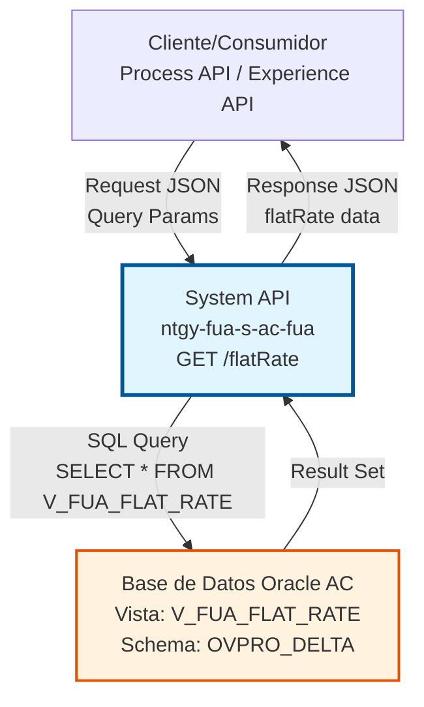
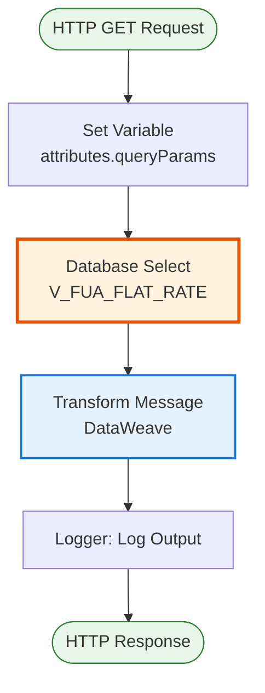
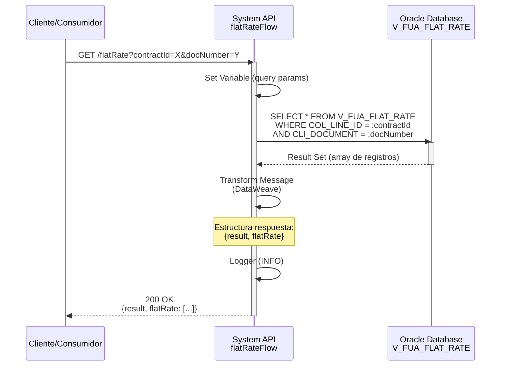

# GET /flatRate

## 📌 Descripción General

### Propósito del Endpoint

El endpoint `GET /flatRate` permite consultar información detallada sobre servicios de tarifa plana (flat rate) asociados a contratos de clientes en el sistema Área Cliente (AC) de Naturgy. Este servicio proporciona acceso directo a la vista `V_FUA_FLAT_RATE` de la base de datos Oracle, permitiendo recuperar datos específicos de tarifas planas mediante identificadores de contrato y documento del cliente.

El endpoint soporta:
- **Consulta de Tarifas Planas**: Recuperación de información de servicios de tarifa plana por contrato
- **Filtrado por Cliente**: Búsqueda mediante documento del cliente (NIF/NIE)
- **Filtrado por Contrato**: Búsqueda mediante identificador de línea de contrato
- **Respuesta Estructurada**: Formato JSON estandarizado con información de resultado y datos

### Tipo de API

**Capa:** System API (API-Led Connectivity)

**Función:** Integración directa con base de datos Oracle AC para consulta de información de tarifas planas asociadas a contratos de clientes.

### Patrón de Integración

**Tipo:** Request-Reply Síncrono con Query SQL

**Descripción:** El endpoint recibe parámetros de consulta (contractAccountId, contractId, docNumber), ejecuta una query SQL contra la vista V_FUA_FLAT_RATE en Oracle, transforma el resultado mediante DataWeave y retorna la información en formato JSON estandarizado.

### Arquitectura API-Led Connectivity



---

## 💼 Propósito del Negocio

### Casos de Uso Principales

1. **Consulta de Servicios de Tarifa Plana**
   - Permite a los sistemas consumidores obtener información sobre servicios de tarifa plana contratados
   - Facilita la visualización de detalles de tarifas planas en portales de cliente
   - Soporta procesos de facturación y gestión de servicios adicionales

2. **Validación de Servicios Contratados**
   - Verifica la existencia de servicios de tarifa plana para un contrato específico
   - Permite validar la elegibilidad de clientes para ciertos servicios
   - Facilita la gestión de servicios adicionales en el proceso de venta

3. **Soporte a Gestión de Clientes**
   - Proporciona información necesaria para atención al cliente
   - Permite consultar servicios adicionales asociados a contratos
   - Facilita la resolución de consultas sobre tarifas planas

### Contexto Empresarial

- **Dominio:** Gestión de Contratos y Servicios
- **Sector:** Energía - Utilities
- **División:** Naturgy España - Área Cliente
- **Proceso de Negocio:** Consulta de servicios adicionales y tarifas planas
- **Sistema Backend:** Oracle Database AC (OVPRO_DELTA schema)

### Stakeholders

- **Clientes Finales**: Consultan sus servicios de tarifa plana contratados
- **Agentes de Atención al Cliente**: Verifican servicios adicionales en gestiones
- **Sistemas de Facturación**: Obtienen información para cálculo de importes
- **Portales Web/Móvil**: Muestran servicios contratados a clientes

### Valor de Negocio

- **Transparencia**: Proporciona visibilidad completa de servicios contratados
- **Eficiencia Operativa**: Reduce tiempo de consulta de información de servicios
- **Mejora de Experiencia**: Facilita autoservicio de clientes
- **Soporte a Ventas**: Permite validar servicios en proceso de contratación

### Consumidores Potenciales

Este endpoint puede ser consumido por:
- Process APIs de gestión de contratos
- Experience APIs de portales web y móviles
- Sistemas de atención al cliente (call center)
- Aplicaciones de gestión comercial
- Sistemas de facturación y billing

---

## 🔧 Especificación Técnica

### URLs por Ambiente

| Ambiente | URL Base | URL Completa |
|----------|----------|--------------|
| **Local** | `http://localhost:8081` | `http://localhost:8081/api/flatRate` |
| **Development** | `https://ntgy-fua-s-ac-fua-dev.us-e2.cloudhub.io` | `https://ntgy-fua-s-ac-fua-dev.us-e2.cloudhub.io/api/flatRate` |
| **UAT** | `https://ntgy-fua-s-ac-fua-uat.us-e2.cloudhub.io` | `https://ntgy-fua-s-ac-fua-uat.us-e2.cloudhub.io/api/flatRate` |
| **Production** | `https://ntgy-fua-s-ac-fua-pro.us-e2.cloudhub.io` | `https://ntgy-fua-s-ac-fua-pro.us-e2.cloudhub.io/api/flatRate` |

### Método HTTP

```
GET /api/flatRate
```

### Parámetros de Entrada

#### Headers HTTP

| Header | Tipo | Requerido | Descripción | Ejemplo |
|--------|------|-----------|-------------|---------|
| `Content-Type` | string | ❌ No | Tipo de contenido del request | `application/json` |
| `Accept` | string | ❌ No | Tipo de contenido esperado en response | `application/json` |

#### Query Parameters

| Parámetro | Tipo | Requerido | Descripción | Ejemplo |
|-----------|------|-----------|-------------|---------|
| `contractAccountId` | string | ⚠️ Condicional | Identificador de cuenta contrato | `"1234567890"` |
| `contractId` | string | ⚠️ Condicional | Identificador de línea de contrato (COL_LINE_ID) | `"9876543210"` |
| `docNumber` | string | ⚠️ Condicional | Número de documento del cliente (NIF/NIE) | `"12345678A"` |

**Nota sobre Parámetros:**
- Se requiere al menos `contractId` y `docNumber` para ejecutar la consulta
- `contractAccountId` se establece como variable pero no se utiliza en la query SQL actual
- La query filtra por `COL_LINE_ID = :contractId` y `CLI_DOCUMENT = :docNumber`

### Respuestas

#### Respuesta Exitosa (200 OK)

```json
{
  "result": {
    "codResult": "0000",
    "msgResult": "No hay error"
  },
  "flatRate": [
    {
      "COL_LINE_ID": "9876543210",
      "CLI_DOCUMENT": "12345678A",
      "SERVICE_CODE": "FLAT_RATE_01",
      "SERVICE_NAME": "Tarifa Plana Mantenimiento",
      "START_DATE": "2024-01-01",
      "END_DATE": "2024-12-31",
      "MONTHLY_FEE": 9.99,
      "STATUS": "ACTIVE"
    }
  ]
}
```

**Campos de Respuesta:**

| Campo | Tipo | Descripción |
|-------|------|-------------|
| `result` | object | Objeto con información del resultado de la operación |
| `result.codResult` | string | Código de resultado ("0000" = éxito) |
| `result.msgResult` | string | Mensaje descriptivo del resultado |
| `flatRate` | array | Array con los registros de tarifas planas encontrados |

**Nota:** La estructura exacta de los objetos en el array `flatRate` depende de las columnas de la vista `V_FUA_FLAT_RATE`. Los campos mostrados son ejemplos representativos.

#### Respuesta Sin Datos (200 OK)

```json
{
  "result": {
    "codResult": "0000",
    "msgResult": "No hay error"
  },
  "flatRate": []
}
```

#### Respuesta de Error Técnico (500)

```json
{
  "result": {
    "codResult": "0001",
    "msgResult": "Error interno del servidor"
  }
}
```

### Códigos de Estado HTTP

| Código | Descripción | Escenario |
|--------|-------------|-----------|
| **200** | OK | Consulta ejecutada correctamente (con o sin datos) |
| **400** | Bad Request | Parámetros faltantes o inválidos |
| **500** | Internal Server Error | Error en la base de datos o error interno |

### Autenticación y Autorización

- **Tipo:** Client ID & Client Secret (Anypoint Platform)
- **Autorización Oracle:** El usuario de base de datos debe tener permisos para:
  - Ejecutar SELECT en la vista `V_FUA_FLAT_RATE`
  - Acceso al schema `OVPRO_DELTA`

### Timeouts

| Tipo | Valor | Descripción |
|------|-------|-------------|
| **Query Timeout** | 15 segundos | Tiempo máximo de ejecución de la query SQL |
| **Connection Timeout** | 3600 segundos | Tiempo máximo para establecer conexión con Oracle |
| **Response Timeout** | 30 segundos | Tiempo máximo de espera para la respuesta completa |

---

## 🏗️ Implementación Técnica

### Arquitectura del Flow



### Componentes del Flow

#### 1. Set Variable (Línea 7)
```xml
<set-variable 
    value="" 
    variableName='attributes.queryParams["**"]'/>
```
**Propósito:** Inicializa variable para query parameters (placeholder)

#### 2. Database Select (Líneas 8-17)
```xml
<db:select 
    config-ref="Database_Config" 
    queryTimeout="${dbAC.queryTimeout}">
    <db:sql>
        SELECT * FROM V_FUA_FLAT_RATE 
        WHERE COL_LINE_ID = :contractId 
        AND CLI_DOCUMENT = :docNumber
    </db:sql>
    <db:input-parameters>
        {
            contractAccountId: attributes.queryParams.contractAccountId,
            contractId: attributes.queryParams.contractId,
            docNumber: attributes.queryParams.docNumber
        }
    </db:input-parameters>
</db:select>
```

**Configuración:**
- **Config Reference:** `Database_Config` (Oracle 19c)
- **Query Timeout:** Configurado desde property `${dbAC.queryTimeout}` (15 segundos)
- **Parámetros:** Prepared statement con binding de parámetros

**Query SQL:**
```sql
SELECT * FROM V_FUA_FLAT_RATE 
WHERE COL_LINE_ID = :contractId 
AND CLI_DOCUMENT = :docNumber
```

**Tabla/Vista Consultada:**
- **Nombre:** `V_FUA_FLAT_RATE`
- **Schema:** `OVPRO_DELTA`
- **Tipo:** Vista (View)
- **Operación:** SELECT (READ)

#### 3. Transform Message (Líneas 18-28)
```dataweave
%dw 2.0
output application/json
---
{
    result: {
        codResult: "0000",
        msgResult: "No hay error"
    },
    flatRate: payload
}
```

**Transformación:**
- Envuelve el resultado de la query en estructura estándar
- Añade objeto `result` con código y mensaje de éxito
- Mantiene el payload original en el campo `flatRate`

#### 4. Logger (Línea 29)
```xml
<logger 
    level="INFO" 
    message="s-ac-consumptions.logSalida ## payload: #[payload]"/>
```
**Propósito:** Registra el payload de salida para trazabilidad

### Diagrama de Secuencia Detallado



### Configuración de Base de Datos

**Connection Configuration:**
```yaml
dbAC:
  user: "OVPRO_DELTA"
  pass: "![encrypted]"
  host1: "oc-pro-exa-04-clu-02-hdfdi-scan.prodb03.ocpro.oraclevcn.com"
  host2: "oc-pro-exa-03-clu-02-dfhl9-scan.prodb03.ocpro.oraclevcn.com"
  port: "1521"
  serviceName: "s_areapriv_online_pro.prodb03.ocpro.oraclevcn.com"
  MaxPoolSize: "15"
  MaxWaitTime: "300"
  MaxIdleTime: "300"
  queryTimeout: "15"
```

**Características:**
- **Driver:** Oracle JDBC 19.13.0.0.1
- **Connection Pooling:** Habilitado (MaxPoolSize=15)
- **High Availability:** Dual scan addresses
- **Retry Policy:** 3 intentos automáticos

### Manejo de Errores

**Error Handler Global:** `s-ac-globalErrorHandler.xml`

**Tipos de Errores Manejados:**
1. **Database Connection Error**: Fallo en conexión a Oracle
2. **Query Timeout**: Query excede 15 segundos
3. **SQL Exception**: Error en ejecución de query
4. **Transformation Error**: Error en DataWeave

**Respuesta de Error Estándar:**
```json
{
  "result": {
    "codResult": "0001",
    "msgResult": "Error interno del servidor"
  }
}
```

### Performance y Optimización

**Métricas Esperadas:**
- **Response Time:** < 2 segundos (promedio)
- **Query Execution:** < 1 segundo
- **Transformation Time:** < 100ms

**Optimizaciones Aplicadas:**
- Uso de prepared statements (prevención SQL injection)
- Connection pooling para reutilización de conexiones
- Query timeout para evitar bloqueos prolongados
- Índices en columnas de filtro (COL_LINE_ID, CLI_DOCUMENT)

---

## 💻 Ejemplos de Uso

### Ejemplo 1: Consulta Básica de Tarifa Plana

#### Request con cURL

```bash
curl -X GET "http://localhost:8081/api/flatRate?contractId=9876543210&docNumber=12345678A" \
  -H "Accept: application/json"
```

#### Request con JavaScript (Fetch)

```javascript
const response = await fetch(
  'http://localhost:8081/api/flatRate?contractId=9876543210&docNumber=12345678A',
  {
    method: 'GET',
    headers: {
      'Accept': 'application/json'
    }
  }
);

const data = await response.json();
console.log('Flat Rate Data:', data.flatRate);
```

#### Response Exitoso

```json
{
  "result": {
    "codResult": "0000",
    "msgResult": "No hay error"
  },
  "flatRate": [
    {
      "COL_LINE_ID": "9876543210",
      "CLI_DOCUMENT": "12345678A",
      "SERVICE_CODE": "FLAT_RATE_01",
      "SERVICE_NAME": "Tarifa Plana Mantenimiento",
      "START_DATE": "2024-01-01",
      "END_DATE": "2024-12-31",
      "MONTHLY_FEE": 9.99,
      "STATUS": "ACTIVE"
    }
  ]
}
```

### Ejemplo 2: Consulta Sin Resultados

#### Request

```bash
curl -X GET "http://localhost:8081/api/flatRate?contractId=0000000000&docNumber=00000000Z" \
  -H "Accept: application/json"
```

#### Response

```json
{
  "result": {
    "codResult": "0000",
    "msgResult": "No hay error"
  },
  "flatRate": []
}
```

**Interpretación:** La consulta se ejecutó correctamente pero no se encontraron registros que cumplan los criterios.

### Ejemplo 3: Consulta con Múltiples Parámetros

#### Request

```bash
curl -X GET "http://localhost:8081/api/flatRate?contractAccountId=1234567890&contractId=9876543210&docNumber=12345678A" \
  -H "Accept: application/json"
```

#### Response

```json
{
  "result": {
    "codResult": "0000",
    "msgResult": "No hay error"
  },
  "flatRate": [
    {
      "COL_LINE_ID": "9876543210",
      "CLI_DOCUMENT": "12345678A",
      "SERVICE_CODE": "FLAT_RATE_01",
      "SERVICE_NAME": "Tarifa Plana Mantenimiento",
      "START_DATE": "2024-01-01",
      "END_DATE": "2024-12-31",
      "MONTHLY_FEE": 9.99,
      "STATUS": "ACTIVE"
    }
  ]
}
```

**Nota:** Aunque se proporciona `contractAccountId`, la query actual solo utiliza `contractId` y `docNumber` para el filtrado.

### Ejemplo 4: Error - Parámetros Faltantes

#### Request

```bash
curl -X GET "http://localhost:8081/api/flatRate?contractId=9876543210" \
  -H "Accept: application/json"
```

#### Response

```json
{
  "result": {
    "codResult": "0001",
    "msgResult": "Error: Parámetros requeridos faltantes"
  }
}
```

**Causa:** Falta el parámetro `docNumber` requerido para la query.

### Ejemplo 5: Error de Base de Datos

#### Request

```bash
curl -X GET "http://localhost:8081/api/flatRate?contractId=INVALID&docNumber=12345678A" \
  -H "Accept: application/json"
```

#### Response

```json
{
  "result": {
    "codResult": "0001",
    "msgResult": "Error interno del servidor"
  }
}
```

**Causa:** Error en la ejecución de la query (ej: tipo de dato inválido, timeout, conexión perdida).

### Ejemplo 6: Integración desde Process API

```javascript
// Ejemplo de consumo desde un Process API
async function getFlatRateServices(contractId, docNumber) {
  try {
    const response = await fetch(
      `https://ntgy-fua-s-ac-fua-pro.us-e2.cloudhub.io/api/flatRate?contractId=${contractId}&docNumber=${docNumber}`,
      {
        method: 'GET',
        headers: {
          'Accept': 'application/json',
          'client_id': process.env.CLIENT_ID,
          'client_secret': process.env.CLIENT_SECRET
        }
      }
    );

    if (!response.ok) {
      throw new Error(`HTTP error! status: ${response.status}`);
    }

    const data = await response.json();
    
    if (data.result.codResult === "0000") {
      return {
        success: true,
        services: data.flatRate
      };
    } else {
      return {
        success: false,
        error: data.result.msgResult
      };
    }
  } catch (error) {
    console.error('Error fetching flat rate services:', error);
    return {
      success: false,
      error: error.message
    };
  }
}

// Uso
const result = await getFlatRateServices('9876543210', '12345678A');
if (result.success) {
  console.log('Services found:', result.services.length);
  result.services.forEach(service => {
    console.log(`- ${service.SERVICE_NAME}: ${service.MONTHLY_FEE}€/mes`);
  });
} else {
  console.error('Error:', result.error);
}
```
