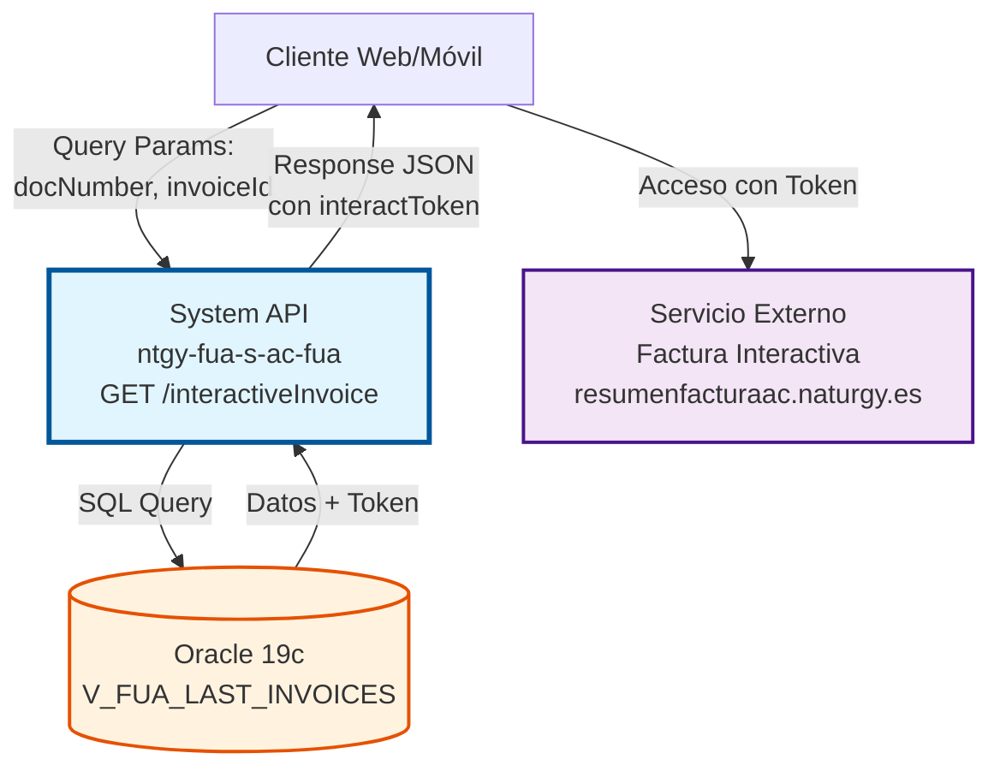
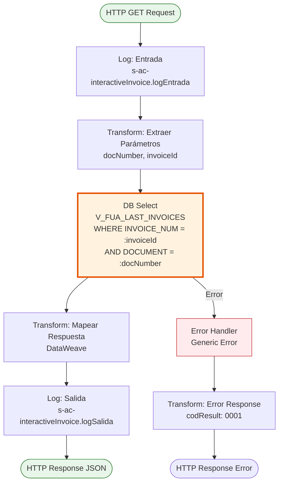
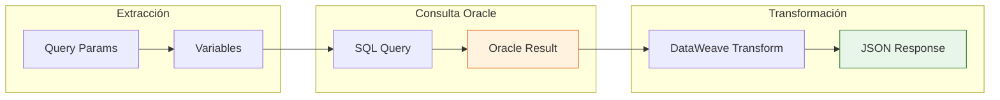

# GET /interactiveInvoice

## 📌 Descripción General

### Propósito del Endpoint

Este endpoint genera y retorna una factura interactiva en formato HTML que permite a los clientes visualizar de manera gráfica y detallada su consumo energético, importes y datos de facturación. La factura interactiva incluye gráficos, comparativas y una experiencia de usuario enriquecida para facilitar la comprensión de los datos de consumo.

El endpoint soporta:
- **Consulta de Factura**: Obtiene datos de factura desde la vista Oracle
- **Generación de Token**: Extrae token de interacción para acceso al servicio externo
- **Retorno de URL**: Proporciona URL de acceso a la factura interactiva HTML

### Tipo de API

**Capa:** System API (API-Led Connectivity)

**Función:** Integración con base de datos Oracle AC para obtener datos de factura y generar acceso a factura interactiva HTML mediante servicio externo.

### Patrón de Integración

**Tipo:** Request-Reply Síncrono con Query SQL + Servicio HTTP Externo

**Descripción:** El endpoint recibe parámetros de identificación de factura (número de factura y documento), consulta la vista Oracle para obtener el token de interacción, y retorna la información necesaria para acceder a la factura interactiva en el servicio externo de Naturgy.

### Arquitectura API-Led Connectivity



---

## 💼 Propósito del Negocio

### Casos de Uso Principales

1. **Visualización Interactiva de Factura**
   - Cliente accede a su factura desde portal web o app móvil
   - Sistema genera acceso a versión HTML interactiva con gráficos
   - Cliente puede explorar consumos, comparativas y detalles de forma visual

2. **Análisis de Consumo**
   - Cliente visualiza gráficos de consumo histórico
   - Comparativas con períodos anteriores
   - Desglose detallado de importes y conceptos

3. **Autoservicio Digital**
   - Reducción de llamadas al call center
   - Cliente puede entender su factura sin asistencia
   - Experiencia de usuario mejorada vs PDF estático

### Contexto Empresarial

- **Dominio:** Facturación y Atención al Cliente
- **Sector:** Energía - Utilities
- **División:** Naturgy España - Área Cliente
- **Proceso de Negocio:** Consulta y visualización de facturas
- **Sistema Backend:** Oracle Database AC (Área Cliente)

### Stakeholders

- **Clientes Finales**: Necesitan entender su factura de forma clara y visual
- **Equipo de Atención al Cliente**: Reducción de consultas sobre facturas
- **Equipo Digital**: Mejora de experiencia de usuario en canales digitales

### Valor de Negocio

- **Transparencia**: Cliente entiende mejor su consumo y facturación
- **Reducción de Costes**: Menos llamadas al call center por dudas de factura
- **Satisfacción del Cliente**: Experiencia digital mejorada
- **Diferenciación**: Servicio de valor añadido vs competencia

### Consumidores Potenciales

Este endpoint puede ser consumido por:
- Experience APIs de portales web de clientes
- Aplicaciones móviles de Naturgy
- Process APIs de gestión de facturas
- Sistemas de autoservicio digital

---

## 🔧 Especificación Técnica

### URLs por Ambiente

| Ambiente | URL Base | URL Completa |
|----------|----------|--------------|
| **Local** | `http://localhost:8081` | `http://localhost:8081/api/interactiveInvoice?docNumber={doc}&invoiceId={id}` |
| **Development** | `https://ntgy-fua-s-ac-fua-dev.us-e2.cloudhub.io` | `https://ntgy-fua-s-ac-fua-dev.us-e2.cloudhub.io/api/interactiveInvoice?docNumber={doc}&invoiceId={id}` |
| **Production** | `https://ntgy-fua-s-ac-fua-pro.us-e2.cloudhub.io` | `https://ntgy-fua-s-ac-fua-pro.us-e2.cloudhub.io/api/interactiveInvoice?docNumber={doc}&invoiceId={id}` |

### Método HTTP

```
GET /api/interactiveInvoice
```

### Parámetros de Entrada

#### Headers HTTP

| Header | Tipo | Requerido | Descripción | Ejemplo |
|--------|------|-----------|-------------|---------|
| `Accept` | string | ❌ No | Tipo de contenido esperado en response | `application/json` |

#### Query Parameters

| Parámetro | Tipo | Requerido | Descripción | Ejemplo |
|-----------|------|-----------|-------------|---------|
| `docNumber` | string | ✅ Sí | Número de documento del cliente (NIF/NIE) | `"12345678A"` |
| `invoiceId` | string | ✅ Sí | Número de factura a consultar | `"FAC123456"` |

### Respuestas

#### Respuesta Exitosa (200 OK)

```json
{
  "result": {
    "codResult": "0000",
    "msgResult": "No hay error"
  },
  "items": [
    {
      "invoiceId": "INV123456",
      "invoiceNum": "FAC123456",
      "issuedDate": "2026-06-15",
      "billingDate": "2026-07-15",
      "amount": 125.50,
      "interactToken": "eyJhbGciOiJIUzI1NiIsInR5cCI6IkpXVCJ9...",
      "pdfDocumentId": "DOC789012"
    }
  ]
}
```

**Descripción de Campos:**
- `invoiceId`: ID interno de la factura
- `invoiceNum`: Número de factura visible para el cliente
- `issuedDate`: Fecha de emisión de la factura
- `billingDate`: Fecha de vencimiento/cobro
- `amount`: Importe total de la factura
- `interactToken`: Token de acceso a la factura interactiva (usar con servicio externo)
- `pdfDocumentId`: ID del documento PDF asociado

#### Respuesta Sin Datos (200 OK)

```json
{
  "result": {
    "codResult": "0000",
    "msgResult": "No hay error"
  },
  "items": []
}
```

#### Respuesta de Error Técnico (500)

```json
{
  "result": {
    "codResult": "0001",
    "msgResult": "KO"
  }
}
```

### Autenticación y Autorización

- **Tipo:** Client ID & Client Secret (Anypoint Platform)
- **Autorización Oracle:** El usuario debe tener permisos para:
  - Acceso de lectura a vista `V_FUA_LAST_INVOICES`
  - Acceso al schema `OVPRO_DELTA`

### Timeouts

| Tipo | Valor | Descripción |
|------|-------|-------------|
| **Query Timeout** | 15 segundos | Tiempo máximo de ejecución de query Oracle |
| **Connection Timeout** | 3600 segundos | Tiempo máximo para mantener conexión a BD |

---

## 🏗️ Implementación Técnica

### Arquitectura del Flow



### Componentes del Flow

#### 1. Logger de Entrada (Línea 6)
```xml
<logger level="DEBUG" doc:name="Logger entrada" 
        message="s-ac-interactiveInvoice.logEntrada ## payload: #[payload]"/>
```
**Propósito:** Registrar entrada al flow con payload completo para trazabilidad.

#### 2. Extracción de Parámetros (Líneas 7-21)
```xml
<ee:transform doc:name="Transform Message">
    <ee:variables>
        <ee:set-variable variableName="document">
            <![CDATA[%dw 2.0
            output application/java
            ---
            attributes.queryParams.docNumber]]>
        </ee:set-variable>
        <ee:set-variable variableName="invoiceId">
            <![CDATA[%dw 2.0
            output application/java
            ---
            attributes.queryParams.invoiceId]]>
        </ee:set-variable>
    </ee:variables>
</ee:transform>
```
**Propósito:** Extraer query parameters a variables para uso en query SQL.

#### 3. Consulta a Base de Datos (Líneas 22-30)
```xml
<db:select doc:name="Select" config-ref="Database_Config" 
           queryTimeout="${dbAC.queryTimeout}">
    <db:sql>
        <![CDATA[SELECT * FROM V_FUA_LAST_INVOICES 
                 WHERE INVOICE_NUM = :invoiceId 
                 AND DOCUMENT = :docNumber]]>
    </db:sql>
    <db:input-parameters>
        <![CDATA[#[{
            'invoiceId': vars.invoiceId,
            'docNumber' : vars.document
        }]]]>
    </db:input-parameters>
</db:select>
```
**Propósito:** Consultar vista Oracle con prepared statement para obtener datos de factura.

#### 4. Transformación de Respuesta (Líneas 31-48)
```dataweave
%dw 2.0
output application/json
---
{
    result: {
        codResult: "0000",
        msgResult: "No hay error"
    },
    items: payload map (item, index) -> {
        invoiceId: item.INV_INVOICE_ID,
        invoiceNum: item.INVOICE_NUM,
        issuedDate: item.INVOICE_DATE,
        billingDate: item.INV_EXPIRATION_DATE,
        amount: item.INV_INVOICE_TOTAL,
        interactToken: item.INTERACT_TOKEN,
        pdfDocumentId: item.INV_SAP_OPBEL
    }
}
```
**Propósito:** Mapear campos de Oracle a estructura JSON de respuesta.

#### 5. Logger de Salida (Línea 49)
```xml
<logger level="DEBUG" doc:name="Logger salida" 
        message="s-ac-interactiveInvoice.logSalida ## payload: #[payload]"/>
```
**Propósito:** Registrar salida del flow con respuesta generada.

#### 6. Error Handler (Líneas 50-67)
```xml
<error-handler>
    <on-error-propagate enableNotifications="true" logException="true" 
                        doc:name="Generic Error">
        <logger level="ERROR" doc:name="Generic Error" 
                message="Generic Error"/>
        <ee:transform doc:name="Generic Error">
            <ee:message>
                <ee:set-payload>
                    <![CDATA[%dw 2.0
                    output application/json
                    ---
                    {
                        result: {
                            codResult: "0001",
                            msgResult: "KO"
                        }
                    }]]>
                </ee:set-payload>
            </ee:message>
        </ee:transform>
    </on-error-propagate>
</error-handler>
```
**Propósito:** Capturar cualquier error y retornar respuesta estándar de error.

### Configuración de Base de Datos

#### Connection Pool Oracle
```yaml
dbAC:
  user: "OVPRO_DELTA"
  pass: "![encrypted]"
  host1: "oc-pro-exa-04-clu-02-hdfdi-scan.prodb03.ocpro.oraclevcn.com"
  host2: "oc-pro-exa-03-clu-02-dfhl9-scan.prodb03.ocpro.oraclevcn.com"
  port: "1521"
  serviceName: "s_areapriv_online_pro.prodb03.ocpro.oraclevcn.com"
  MaxPoolSize: "15"
  MaxWaitTime: "300"
  MaxIdleTime: "300"
  queryTimeout: "15"
```

### Vista Oracle: V_FUA_LAST_INVOICES

**Campos Utilizados:**
- `INVOICE_NUM`: Número de factura (clave de búsqueda)
- `DOCUMENT`: Documento del cliente (clave de búsqueda)
- `INV_INVOICE_ID`: ID interno de factura
- `INVOICE_DATE`: Fecha de emisión
- `INV_EXPIRATION_DATE`: Fecha de vencimiento
- `INV_INVOICE_TOTAL`: Importe total
- `INTERACT_TOKEN`: Token de acceso a factura interactiva
- `INV_SAP_OPBEL`: ID de documento SAP (para PDF)

### Diagrama de Transformación de Datos



### Mapeo de Campos

| Campo Oracle | Campo JSON | Tipo | Descripción |
|--------------|------------|------|-------------|
| `INV_INVOICE_ID` | `invoiceId` | string | ID interno de factura |
| `INVOICE_NUM` | `invoiceNum` | string | Número de factura visible |
| `INVOICE_DATE` | `issuedDate` | date | Fecha de emisión |
| `INV_EXPIRATION_DATE` | `billingDate` | date | Fecha de vencimiento |
| `INV_INVOICE_TOTAL` | `amount` | number | Importe total |
| `INTERACT_TOKEN` | `interactToken` | string | Token de acceso |
| `INV_SAP_OPBEL` | `pdfDocumentId` | string | ID documento PDF |

---

## 💻 Ejemplos de Uso

### Ejemplo 1: Consulta Exitosa

#### Request
```bash
curl -X GET "https://ntgy-fua-s-ac-fua-pro.us-e2.cloudhub.io/api/interactiveInvoice?docNumber=12345678A&invoiceId=FAC123456" \
  -H "Accept: application/json"
```

#### Response (200 OK)
```json
{
  "result": {
    "codResult": "0000",
    "msgResult": "No hay error"
  },
  "items": [
    {
      "invoiceId": "INV123456",
      "invoiceNum": "FAC123456",
      "issuedDate": "2026-06-15",
      "billingDate": "2026-07-15",
      "amount": 125.50,
      "interactToken": "eyJhbGciOiJIUzI1NiIsInR5cCI6IkpXVCJ9.eyJpbnZvaWNlSWQiOiJJTlYxMjM0NTYiLCJkb2NOdW1iZXIiOiIxMjM0NTY3OEEifQ.signature",
      "pdfDocumentId": "DOC789012"
    }
  ]
}
```

### Ejemplo 2: Factura No Encontrada

#### Request
```bash
curl -X GET "https://ntgy-fua-s-ac-fua-pro.us-e2.cloudhub.io/api/interactiveInvoice?docNumber=99999999Z&invoiceId=FACXXXXXX" \
  -H "Accept: application/json"
```

#### Response (200 OK - Sin Datos)
```json
{
  "result": {
    "codResult": "0000",
    "msgResult": "No hay error"
  },
  "items": []
}
```

### Ejemplo 3: Error de Base de Datos

#### Request
```bash
curl -X GET "https://ntgy-fua-s-ac-fua-pro.us-e2.cloudhub.io/api/interactiveInvoice?docNumber=12345678A&invoiceId=FAC123456" \
  -H "Accept: application/json"
```

#### Response (500 Internal Server Error)
```json
{
  "result": {
    "codResult": "0001",
    "msgResult": "KO"
  }
}
```

### Ejemplo 4: Uso del Token Interactivo

Una vez obtenido el `interactToken`, el cliente puede acceder a la factura interactiva:

```javascript
// JavaScript - Construcción de URL de factura interactiva
const response = await fetch('/api/interactiveInvoice?docNumber=12345678A&invoiceId=FAC123456');
const data = await response.json();

if (data.items && data.items.length > 0) {
  const token = data.items[0].interactToken;
  const interactiveInvoiceUrl = `https://resumenfacturaac.naturgy.es/access/${token}`;
  
  // Abrir factura interactiva en nueva ventana
  window.open(interactiveInvoiceUrl, '_blank');
}
```

### Ejemplo 5: Integración en Portal Web

```html
<!-- HTML + JavaScript - Botón de Factura Interactiva -->
<button id="viewInteractiveInvoice" onclick="openInteractiveInvoice()">
  Ver Factura Interactiva
</button>

<script>
async function openInteractiveInvoice() {
  const docNumber = '12345678A'; // Obtenido de sesión
  const invoiceId = 'FAC123456';  // Seleccionado por usuario
  
  try {
    const response = await fetch(
      `/api/interactiveInvoice?docNumber=${docNumber}&invoiceId=${invoiceId}`
    );
    const data = await response.json();
    
    if (data.result.codResult === '0000' && data.items.length > 0) {
      const token = data.items[0].interactToken;
      window.open(`https://resumenfacturaac.naturgy.es/access/${token}`, '_blank');
    } else {
      alert('No se encontró la factura solicitada');
    }
  } catch (error) {
    console.error('Error al obtener factura interactiva:', error);
    alert('Error al cargar la factura interactiva');
  }
}
</script>
```

### Ejemplo 6: Manejo de Errores Completo

```python
# Python - Cliente con manejo de errores
import requests
from typing import Optional, Dict

def get_interactive_invoice(doc_number: str, invoice_id: str) -> Optional[Dict]:
    """
    Obtiene datos de factura interactiva desde el System API.
    
    Args:
        doc_number: Número de documento del cliente
        invoice_id: ID de la factura
        
    Returns:
        Diccionario con datos de factura o None si hay error
    """
    url = "https://ntgy-fua-s-ac-fua-pro.us-e2.cloudhub.io/api/interactiveInvoice"
    params = {
        "docNumber": doc_number,
        "invoiceId": invoice_id
    }
    
    try:
        response = requests.get(url, params=params, timeout=30)
        response.raise_for_status()
        
        data = response.json()
        
        if data.get('result', {}).get('codResult') == '0000':
            items = data.get('items', [])
            if items:
                return items[0]
            else:
                print(f"No se encontró factura para {invoice_id}")
                return None
        else:
            print(f"Error en respuesta: {data.get('result', {}).get('msgResult')}")
            return None
            
    except requests.exceptions.Timeout:
        print("Timeout al consultar factura interactiva")
        return None
    except requests.exceptions.RequestException as e:
        print(f"Error de conexión: {e}")
        return None
    except ValueError as e:
        print(f"Error al parsear JSON: {e}")
        return None

# Uso
invoice_data = get_interactive_invoice("12345678A", "FAC123456")
if invoice_data:
    print(f"Token: {invoice_data['interactToken']}")
    print(f"Importe: {invoice_data['amount']} €")