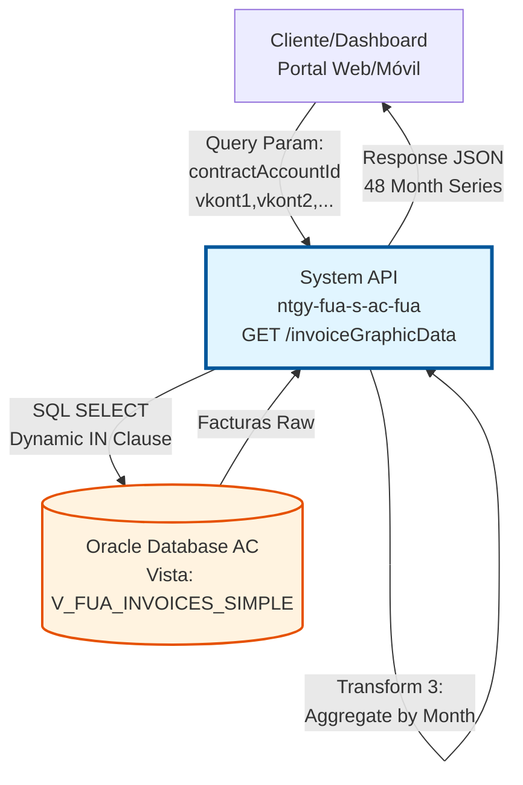
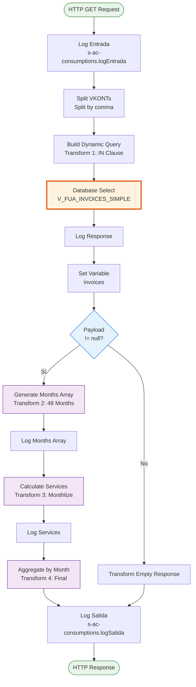
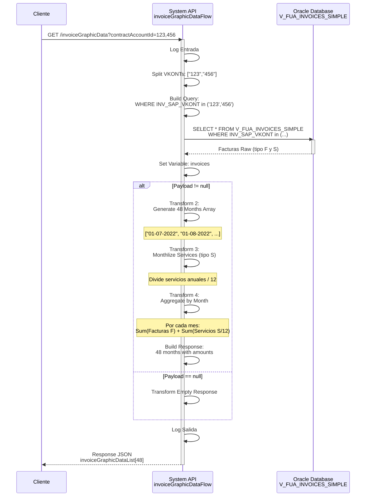
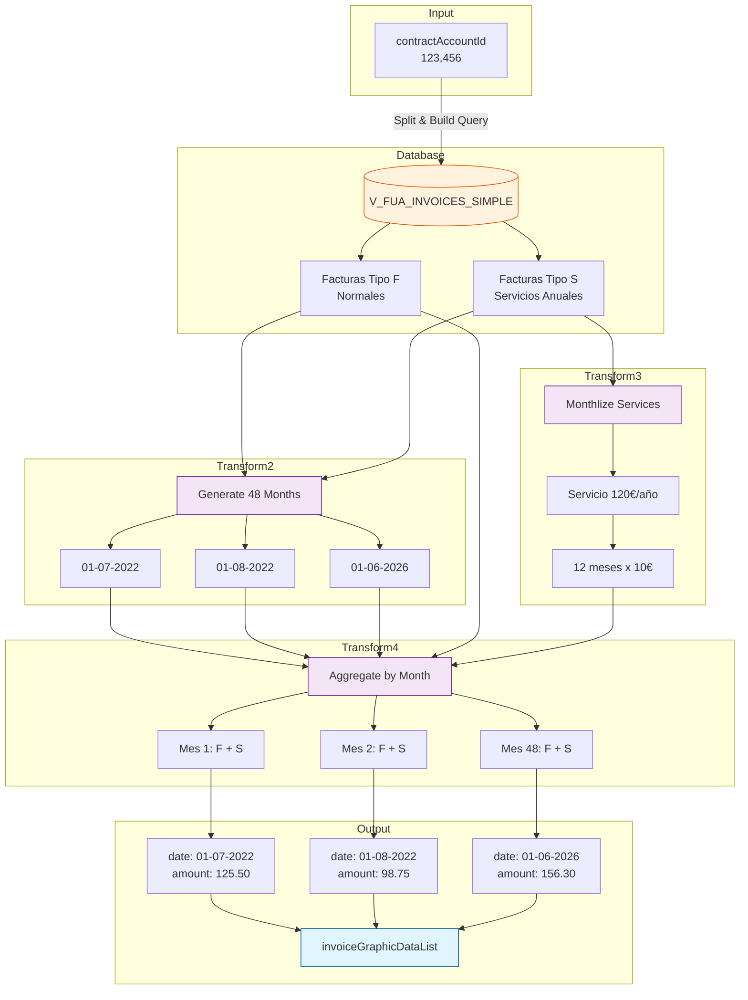

# GET /invoiceGraphicData

## 📌 Descripción General

### Propósito del Endpoint

Este endpoint obtiene datos agregados de facturas para generar visualizaciones gráficas del histórico de facturación. Procesa facturas de los últimos 48 meses, aplicando lógica de negocio compleja para mensualizar servicios anuales y agregar importes por período.

El endpoint soporta:
- **Histórico de 48 Meses**: Genera serie temporal de 4 años de facturación
- **Mensualización de Servicios**: Divide servicios anuales en cuotas mensuales
- **Agregación Multi-Cuenta**: Procesa múltiples cuentas contrato simultáneamente
- **Datos para Gráficos**: Formato optimizado para visualización en dashboards

### Tipo de API

**Capa:** System API (API-Led Connectivity)

**Función:** Integración directa con base de datos Oracle AC para consultar y agregar datos de facturas con lógica de negocio compleja para visualización gráfica.

### Patrón de Integración

**Tipo:** Request-Reply Síncrono con SQL Query + Transformación Compleja

**Descripción:** Recibe lista de cuentas contrato, ejecuta query SQL dinámica, aplica tres transformaciones DataWeave complejas (generación de serie temporal, mensualización de servicios, agregación de importes), y retorna array de 48 meses con importes totales.

### Arquitectura API-Led Connectivity



---

## 💼 Propósito del Negocio

### Casos de Uso Principales

1. **Dashboard de Cliente - Histórico de Facturación**
   - Cliente accede a su portal web/móvil
   - Visualiza gráfico de evolución de facturación de últimos 4 años
   - Identifica tendencias de consumo y patrones estacionales
   - Compara períodos para tomar decisiones de ahorro

2. **Análisis de Tendencias de Consumo**
   - Sistema de analytics procesa datos históricos
   - Identifica picos de consumo y períodos de bajo uso
   - Genera alertas de consumo anómalo
   - Recomienda planes tarifarios más adecuados

3. **Reportes de Gestión Comercial**
   - Agentes comerciales analizan comportamiento de clientes
   - Identifican oportunidades de venta cruzada
   - Detectan clientes con riesgo de fuga
   - Generan reportes de evolución de cartera

4. **Auditoría y Control de Facturación**
   - Sistemas de auditoría verifican consistencia de facturación
   - Detectan anomalías en importes facturados
   - Validan correcta mensualización de servicios
   - Generan reportes de control de calidad

### Contexto Empresarial

- **Dominio:** Analytics de Facturación - Business Intelligence
- **Sector:** Energía - Utilities
- **División:** Naturgy España - Área Cliente
- **Proceso de Negocio:** Visualización y análisis de datos de facturación
- **Módulo SAP:** FI-CA (Financial Contract Accounting)

### Stakeholders

- **Clientes Finales**: Necesitan visualizar su histórico de facturación de forma clara
- **Agentes Comerciales**: Analizan comportamiento de clientes para acciones comerciales
- **Equipo de Analytics**: Procesan datos para insights de negocio
- **Auditoría Interna**: Verifican consistencia y calidad de datos de facturación
- **Producto Digital**: Diseñan dashboards y visualizaciones para portales

### Valor de Negocio

- **Transparencia**: Clientes ven evolución clara de su facturación
- **Autoservicio**: Reduce consultas al call center sobre histórico
- **Insights de Negocio**: Datos para toma de decisiones comerciales
- **Detección Temprana**: Identifica anomalías y patrones de riesgo
- **Experiencia de Usuario**: Visualizaciones atractivas mejoran satisfacción

### Consumidores Potenciales

Este endpoint puede ser consumido por:
- Experience APIs de portales web y móviles
- Process APIs de analytics y reporting
- Sistemas de Business Intelligence
- Dashboards de gestión comercial
- Herramientas de auditoría y control

---

## 🔧 Especificación Técnica

### URLs por Ambiente

| Ambiente | URL Base | URL Completa |
|----------|----------|--------------|
| **Local** | `http://localhost:8081` | `http://localhost:8081/api/invoiceGraphicData?contractAccountId=1234567890,0987654321` |
| **Development** | `https://ntgy-fua-s-ac-fua-dev.us-e2.cloudhub.io` | `https://ntgy-fua-s-ac-fua-dev.us-e2.cloudhub.io/api/invoiceGraphicData?contractAccountId=1234567890` |
| **UAT** | `https://ntgy-fua-s-ac-fua-uat.us-e2.cloudhub.io` | `https://ntgy-fua-s-ac-fua-uat.us-e2.cloudhub.io/api/invoiceGraphicData?contractAccountId=1234567890` |
| **Production** | `https://ntgy-fua-s-ac-fua-pro.us-e2.cloudhub.io` | `https://ntgy-fua-s-ac-fua-pro.us-e2.cloudhub.io/api/invoiceGraphicData?contractAccountId=1234567890` |

### Método HTTP

```
GET /api/invoiceGraphicData
```

### Parámetros de Entrada

#### Headers HTTP

| Header | Tipo | Requerido | Descripción | Ejemplo |
|--------|------|-----------|-------------|---------|
| `Accept` | string | ❌ No | Tipo de contenido esperado en response | `application/json` |

#### Query Parameters

| Parámetro | Tipo | Requerido | Descripción | Ejemplo | Formato |
|-----------|------|-----------|-------------|---------|---------|
| `contractAccountId` | string | ✅ Sí | Lista de VKONTs (cuentas contrato SAP) separados por comas | `"1234567890,0987654321"` | Números de 10 dígitos separados por comas |

**⚠️ Notas Importantes:**
- Se pueden enviar múltiples VKONTs separados por comas
- El endpoint agregará datos de todas las cuentas proporcionadas
- Máximo recomendado: 10 VKONTs por request (por performance)

### Respuestas

#### Respuesta Exitosa (200 OK)

```json
{
  "result": {
    "codResult": "0000",
    "msgResult": "No hay error"
  },
  "invoiceGraphicDataList": [
    {
      "date": "01-07-2022",
      "amount": 125.50
    },
    {
      "date": "01-08-2022",
      "amount": 98.75
    },
    {
      "date": "01-09-2022",
      "amount": null
    },
    {
      "date": "01-10-2022",
      "amount": 156.30
    }
    // ... 44 meses más (total 48 meses)
  ]
}
```

**Descripción de Campos:**

| Campo | Tipo | Descripción |
|-------|------|-------------|
| `result.codResult` | string | Código de resultado: "0000" = éxito |
| `result.msgResult` | string | Mensaje descriptivo del resultado |
| `invoiceGraphicDataList` | array | Array de 48 objetos (4 años de histórico) |
| `invoiceGraphicDataList[].date` | string | Fecha del mes en formato "01-MM-yyyy" |
| `invoiceGraphicDataList[].amount` | number\|null | Importe total facturado en ese mes (null si no hay facturas) |

**⚠️ Características de la Respuesta:**
- **Siempre 48 elementos**: Desde mes actual hacia atrás 47 meses
- **Orden cronológico**: Del más antiguo al más reciente
- **Importes agregados**: Suma de facturas normales + servicios mensualizados
- **Valores null**: Meses sin facturación (no se omiten, se incluyen con null)

#### Respuesta Sin Datos (200 OK)

```json
{
  "result": {
    "codResult": "0000",
    "msgResult": "No hay error"
  },
  "pendingAmount": "",
  "invoicesPDS": {}
}
```

**Descripción:**
- Se retorna cuando no hay facturas para los VKONTs proporcionados
- HTTP Status: 200 OK (no es error, simplemente sin datos)

#### Respuesta de Error Técnico (400/500)

```json
{
  "result": {
    "codResult": "0002",
    "msgResult": "Error al consultar base de datos"
  }
}
```

### Códigos de Resultado

| Código | Tipo | Descripción | HTTP Status |
|--------|------|-------------|-------------|
| `0000` | Éxito | Datos obtenidos correctamente | 200 |
| `0002` | Error Técnico | Error de base de datos | 500 |
| `0003` | Error Validación | Parámetros inválidos | 400 |

### Lógica de Negocio Especial

#### Mensualización de Servicios

**Concepto:** Los servicios anuales (tipo "S") se dividen en 12 cuotas mensuales para distribuir el coste a lo largo del año.

**Fórmula:**
```
Importe Mensual = Importe Total Anual / 12
```

**Ejemplo:**
- Servicio anual: 120€
- Importe mensual: 120€ / 12 = 10€/mes
- Se suma 10€ a cada uno de los 12 meses siguientes a la fecha de factura

#### Agregación de Importes

**Por cada mes se suman:**
1. **Facturas Normales (tipo "F")**: Importes de facturas con vencimiento en ese mes
2. **Servicios Mensualizados (tipo "S")**: Cuota mensual de servicios activos en ese mes

**Resultado:** Importe total = Facturas + Servicios mensualizados

### Autenticación y Autorización

- **Tipo:** Client ID & Client Secret (Anypoint Platform)
- **Autorización DB:** El usuario de base de datos debe tener permisos para:
  - Ejecutar SELECT en vista `V_FUA_INVOICES_SIMPLE`
  - Acceso al schema `OVPRO_DELTA`

### Timeouts

| Tipo | Valor | Descripción |
|------|-------|-------------|
| **Query Timeout** | 15 segundos | Tiempo máximo de ejecución de query SQL |
| **Request Timeout** | 30 segundos | Tiempo máximo de espera para la respuesta |
| **Connection Timeout** | 10 segundos | Tiempo máximo para establecer conexión a DB |

---

## 🏗️ Implementación Técnica

### Arquitectura del Flow



### Componentes del Flow

#### 1. Logger de Entrada (Línea 9)
```xml
<logger level="INFO" doc:name="Logger entrada" 
        message="s-ac-consumptions.logEntrada ## payload: #[payload]"/>
```
**Propósito:** Registra inicio de ejecución

#### 2. Split VKONTs (Línea 10)
```xml
<set-variable value='#[attributes.queryParams.contractAccountId splitBy(",")]' 
              variableName="sapVkont"/>
```
**Propósito:** Convierte string de VKONTs separados por comas en array

**Ejemplo:**
- Input: `"1234567890,0987654321"`
- Output: `["1234567890", "0987654321"]`

#### 3. Build Dynamic Query - Transform 1 (Líneas 11-20)
```dataweave
%dw 2.0
output application/json
var query = "SELECT * FROM V_FUA_INVOICES_SIMPLE WHERE INV_SAP_VKONT in ('" 
            ++ (vars.sapVkont joinBy "','") 
            ++ "')"
---
query
```

**Query SQL Generada:**
```sql
SELECT * FROM V_FUA_INVOICES_SIMPLE 
WHERE INV_SAP_VKONT in ('1234567890','0987654321')
```

**Campos de la Vista V_FUA_INVOICES_SIMPLE:**

| Campo DB | Tipo | Descripción |
|----------|------|-------------|
| `INV_SAP_VKONT` | string | Cuenta contrato SAP (VKONT) |
| `INV_DOCUMENT_TYPE` | string | Tipo de documento: "F"=Factura, "S"=Servicio, "08"=Otros |
| `INV_INVOICE_DATE` | date | Fecha de emisión de la factura |
| `INV_EXPIRATION_DATE` | date | Fecha de vencimiento de la factura |
| `INV_INVOICE_TOTAL` | number | Importe total de la factura |

#### 4. Database Select (Líneas 21-23)
```xml
<db:select config-ref="Database_Config" queryTimeout="${dbAC.queryTimeout}">
    <db:sql><![CDATA[#[vars.query]]]></db:sql>
</db:select>
```

**Propósito:** Ejecuta query SQL dinámica construida en paso anterior

#### 5. Set Variable Invoices (Líneas 28-32)
```xml
<set-variable value="#[%dw 2.0 output application/json --- payload]" 
              variableName="invoices"/>
```
**Propósito:** Almacena resultado de query para uso en transformaciones posteriores

#### 6. Generate 48 Months Array - Transform 2 (Líneas 36-47)
```dataweave
%dw 2.0
import * from dw::core::Periods
output application/json

fun prepareList(list:Array, maxSize: Number) = 
    if(sizeOf(list) >= maxSize)
        list
    else (
        prepareList(
            list ++ [(now() - period({months:(sizeOf(list))})) as String {format: "01-MM-uuuu"}],
            maxSize
        )
    )
---
prepareList([],48)
```

**Lógica:**
1. Función recursiva que genera array de 48 elementos
2. Cada elemento es una fecha: "01-MM-yyyy"
3. Comienza desde mes actual y retrocede 47 meses
4. Usa `period({months:N})` para restar meses

**Ejemplo de Output:**
```json
[
  "01-07-2022",
  "01-08-2022",
  "01-09-2022",
  // ... 45 meses más
]
```

#### 7. Calculate Monthly Services - Transform 3 (Líneas 52-73)
```dataweave
%dw 2.0
import * from dw::core::Periods
import * from dw::core::Strings
output application/json

var getMonthlyServicesAmount = (vars.invoices filter (item, index) ->
    (item.INV_DOCUMENT_TYPE == "S" and item.INV_DOCUMENT_TYPE != "08"))

fun divideFormatAmount (imp) = 
    replaceAll((imp/12) as String {format: "#.##"},",",".") as Number

fun prepareList(list:Array, maxSize: Number, idx) = 
    if(sizeOf(list) >= maxSize)
        list
    else (
        prepareList(list ++ [{
            fecha: (getMonthlyServicesAmount[idx].INV_INVOICE_DATE 
                   + period({months:(sizeOf(list))})) as String {format: "MM-uuuu"}, 
            importe: divideFormatAmount(getMonthlyServicesAmount[idx].INV_INVOICE_TOTAL)
        }], maxSize, idx)
    )

---
getMonthlyServicesAmount map prepareList([],12,$$)
```

**Lógica Compleja:**

1. **Filtrar Servicios:**
   ```dataweave
   vars.invoices filter (item.INV_DOCUMENT_TYPE == "S" and item.INV_DOCUMENT_TYPE != "08")
   ```
   - Solo facturas tipo "S" (servicios)
   - Excluye tipo "08" (otros documentos)

2. **Dividir Importe Anual:**
   ```dataweave
   fun divideFormatAmount (imp) = replaceAll((imp/12) as String {format: "#.##"},",",".") as Number
   ```
   - Divide importe total entre 12 meses
   - Formatea a 2 decimales
   - Convierte comas a puntos para formato numérico

3. **Generar 12 Meses por Servicio:**
   - Para cada servicio, crea array de 12 objetos
   - Cada objeto tiene fecha (mes) e importe mensual
   - Fechas incrementan mes a mes desde fecha de factura

**Ejemplo de Output:**
```json
[
  [
    {"fecha": "07-2022", "importe": 10.00},
    {"fecha": "08-2022", "importe": 10.00},
    // ... 10 meses más
  ],
  [
    {"fecha": "01-2023", "importe": 15.50},
    // ... 11 meses más
  ]
]
```

#### 8. Aggregate by Month - Transform 4 (Líneas 76-106)
```dataweave
%dw 2.0
import * from dw::core::Periods
import * from dw::core::Strings
output application/json

fun getMonthlyAmount (mes) = 
    (vars.invoices filter (item, index) ->
        (substring(item.INV_EXPIRATION_DATE,0,7) == mes) and item.INV_DOCUMENT_TYPE == "F")
        reduce (it, ac=0) -> ac + it.INV_INVOICE_TOTAL

fun getMonthlyServicesAmount (mes) = 
    (vars.servicesInvoice map (it, idx) ->
        it filter ($.fecha == mes) reduce ((item, acc=0) -> acc + item.importe)) 
        reduce ($ + $$)
    
fun cero(aNumber) = if (aNumber <= 0) null else aNumber

---
{
    result: {
        codResult: "0000",
        msgResult: "No hay error"
    },
    "invoiceGraphicDataList": vars.monthsArray map {
        date: $,
        amount: cero( 
            if (sizeOf(vars.servicesInvoice) > 0) 
                getMonthlyAmount(substring($,6,10) ++ "-" ++ substring($,3,5)) 
                + getMonthlyServicesAmount (substring($,3,5) ++ "-" ++ substring($,6,10))
            else
                getMonthlyAmount(substring($,6,10) ++ "-" ++ substring($,3,5))
        )
    }
}
```

**Lógica de Agregación:**

1. **getMonthlyAmount(mes):**
   - Filtra facturas tipo "F" con vencimiento en el mes especificado
   - Suma todos los importes usando `reduce`
   - Retorna total de facturas normales del mes

2. **getMonthlyServicesAmount(mes):**
   - Busca en array de servicios mensualizados
   - Filtra por mes especificado
   - Suma importes de todos los servicios activos en ese mes
   - Retorna total de servicios del mes

3. **Agregación Final:**
   ```dataweave
   amount: cero(
       getMonthlyAmount(mes) + getMonthlyServicesAmount(mes)
   )
   ```
   - Suma facturas normales + servicios mensualizados
   - Aplica función `cero()` que convierte valores ≤ 0 en null

4. **Conversión de Formato de Fecha:**
   ```dataweave
   substring($,6,10) ++ "-" ++ substring($,3,5)
   ```
   - Convierte "01-MM-yyyy" a "yyyy-MM" para comparación
   - Ejemplo: "01-07-2022" → "2022-07"

### Diagrama de Secuencia Completo



### Diagrama de Transformación de Datos



### Configuración de Base de Datos

**Connection Config:** `Database_Config`

```yaml
dbAC:
  host1: "oc-pro-exa-04-clu-02-hdfdi-scan.prodb03.ocpro.oraclevcn.com"
  host2: "oc-pro-exa-03-clu-02-dfhl9-scan.prodb03.ocpro.oraclevcn.com"
  port: "1521"
  serviceName: "s_areapriv_online_pro.prodb03.ocpro.oraclevcn.com"
  user: "OVPRO_DELTA"
  queryTimeout: "15000"
  MaxPoolSize: "15"
  MaxWaitTime: "300000"
  MaxIdleTime: "300000"
```

### Manejo de Errores

**Global Error Handler:** `s-ac-globalErrorHandler.xml`

**Tipos de Error:**

1. **Database Connection Error**
   - Código: `DB_CONNECTION_ERROR`
   - HTTP Status: 500
   - Retry: 3 intentos automáticos

2. **Query Timeout**
   - Código: `DB_TIMEOUT_ERROR`
   - HTTP Status: 500
   - Timeout: 15 segundos

3. **Transformation Error**
   - Código: `TRANSFORMATION_ERROR`
   - HTTP Status: 500
   - Causa: Error en funciones DataWeave recursivas

---

## 💻 Ejemplos de Uso

### Ejemplo 1: Consulta Simple - Un VKONT

#### Request con curl

```bash
curl -X GET "https://ntgy-fua-s-ac-fua-pro.us-e2.cloudhub.io/api/invoiceGraphicData?contractAccountId=1234567890" \
  -H "Accept: application/json" \
  -H "client_id: YOUR_CLIENT_ID" \
  -H "client_secret: YOUR_CLIENT_SECRET"
```

#### Response (200 OK) - Extracto

```json
{
  "result": {
    "codResult": "0000",
    "msgResult": "No hay error"
  },
  "invoiceGraphicDataList": [
    {
      "date": "01-07-2022",
      "amount": 125.50
    },
    {
      "date": "01-08-2022",
      "amount": 98.75
    },
    {
      "date": "01-09-2022",
      "amount": null
    },
    {
      "date": "01-10-2022",
      "amount": 156.30
    }
    // ... 44 meses más hasta 01-06-2026
  ]
}
```

**Interpretación:**
- ✅ Datos de 48 meses obtenidos correctamente
- ℹ️ Mes 09-2022 sin facturas (amount: null)
- ℹ️ Importes incluyen facturas normales + servicios mensualizados

---

### Ejemplo 2: Consulta Múltiple - Varios VKONTs

#### Request con curl

```bash
curl -X GET "https://ntgy-fua-s-ac-fua-pro.us-e2.cloudhub.io/api/invoiceGraphicData?contractAccountId=1234567890,0987654321,1111111111" \
  -H "Accept: application/json" \
  -H "client_id: YOUR_CLIENT_ID" \
  -H "client_secret: YOUR_CLIENT_SECRET"
```

#### Response (200 OK)

```json
{
  "result": {
    "codResult": "0000",
    "msgResult": "No hay error"
  },
  "invoiceGraphicDataList": [
    {
      "date": "01-07-2022",
      "amount": 325.75
    },
    {
      "date": "01-08-2022",
      "amount": 298.50
    }
    // ... 46 meses más
  ]
}
```

**Interpretación:**
- ✅ Datos agregados de 3 cuentas contrato
- ℹ️ Importes suman facturas de todas las cuentas
- ℹ️ Útil para clientes con múltiples contratos

---

### Ejemplo 3: Visualización en Gráfico con JavaScript

```javascript
/**
 * Obtener y visualizar datos gráficos de facturación
 */
const getInvoiceGraphicData = async (contractAccountIds) => {
  const baseUrl = 'https://ntgy-fua-s-ac-fua-pro.us-e2.cloudhub.io';
  const endpoint = '/api/invoiceGraphicData';
  
  // Convertir array a string separado por comas
  const vkonts = Array.isArray(contractAccountIds) 
    ? contractAccountIds.join(',') 
    : contractAccountIds;
  
  const params = new URLSearchParams({
    contractAccountId: vkonts
  });
  
  try {
    const response = await fetch(`${baseUrl}${endpoint}?${params}`, {
      method: 'GET',
      headers: {
        'Accept': 'application/json',
        'client_id': 'YOUR_CLIENT_ID',
        'client_secret': 'YOUR_CLIENT_SECRET'
      }
    });
    
    const data = await response.json();
    
    if (data.result.codResult === '0000') {
      console.log('✅ Datos obtenidos:', data.invoiceGraphicDataList.length, 'meses');
      return {
        success: true,
        data: data.invoiceGraphicDataList
      };
    } else {
      console.error('❌ Error:', data.result.msgResult);
      return { success: false, error: data.result.msgResult };
    }
  } catch (error) {
    console.error('❌ Error técnico:', error);
    return { success: false, error: 'TECHNICAL_ERROR' };
  }
};

/**
 * Preparar datos para Chart.js
 */
const prepareChartData = (invoiceGraphicDataList) => {
  // Filtrar meses con datos (amount != null)
  const dataWithValues = invoiceGraphicDataList.filter(item => item.amount !== null);
  
  return {
    labels: dataWithValues.map(item => {
      // Convertir "01-MM-yyyy" a "MMM yyyy"
      const [day, month, year] = item.date.split('-');
      const date = new Date(year, parseInt(month) - 1, day);
      return date.toLocaleDateString('es-ES', { month: 'short', year: 'numeric' });
    }),
    datasets: [{
      label: 'Facturación Mensual (€)',
      data: dataWithValues.map(item => item.amount),
      borderColor: 'rgb(75, 192, 192)',
      backgroundColor: 'rgba(75, 192, 192, 0.2)',
      tension: 0.1
    }]
  };
};

/**
 * Renderizar gráfico con Chart.js
 */
const renderInvoiceChart = async (contractAccountIds, canvasId) => {
  const result = await getInvoiceGraphicData(contractAccountIds);
  
  if (!result.success) {
    console.error('No se pudieron obtener los datos');
    return;
  }
  
  const chartData = prepareChartData(result.data);
  
  const ctx = document.getElementById(canvasId).getContext('2d');
  new Chart(ctx, {
    type: 'line',
    data: chartData,
    options: {
      responsive: true,
      plugins: {
        title: {
          display: true,
          text: 'Histórico de Facturación - Últimos 48 Meses'
        },
        tooltip: {
          callbacks: {
            label: function(context) {
              return `Importe: ${context.parsed.y.toFixed(2)}€`;
            }
          }
        }
      },
      scales: {
        y: {
          beginAtZero: true,
          ticks: {
            callback: function(value) {
              return value + '€';
            }
          }
        }
      }
    }
  });
};

// Uso
renderInvoiceChart(['1234567890', '0987654321'], 'invoiceChart');
```

---

### Ejemplo 4: Análisis de Tendencias

```javascript
/**
 * Analizar tendencias de facturación
 */
const analyzeInvoiceTrends = (invoiceGraphicDataList) => {
  // Filtrar solo meses con datos
  const dataWithValues = invoiceGraphicDataList.filter(item => item.amount !== null);
  
  if (dataWithValues.length === 0) {
    return {
      hasData: false,
      message: 'No hay datos de facturación'
    };
  }
  
  // Calcular estadísticas
  const amounts = dataWithValues.map(item => item.amount);
  const total = amounts.reduce((sum, amount) => sum + amount, 0);
  const average = total / amounts.length;
  const max = Math.max(...amounts);
  const min = Math.min(...amounts);
  
  // Encontrar mes con mayor y menor facturación
  const maxMonth = dataWithValues.find(item => item.amount === max);
  const minMonth = dataWithValues.find(item => item.amount === min);
  
  // Calcular tendencia (últimos 12 meses vs anteriores)
  const last12Months = dataWithValues.slice(-12);
  const previous12Months = dataWithValues.slice(-24, -12);
  
  const avgLast12 = last12Months.reduce((sum, item) => sum + item.amount, 0) / last12Months.length;
  const avgPrevious12 = previous12Months.length > 0 
    ? previous12Months.reduce((sum, item) => sum + item.amount, 0) / previous12Months.length 
    : avgLast12;
  
  const trend = ((avgLast12 - avgPrevious12) / avgPrevious12) * 100;
  
  return {
    hasData: true,
    statistics: {
      totalMonths: dataWithValues.length,
      totalAmount: total.toFixed(2),
      averageAmount: average.toFixed(2),
      maxAmount: max.toFixed(2),
      minAmount: min.toFixed(2),
      maxMonth: maxMonth.date,
      minMonth: minMonth.date
    },
    trend: {
      percentage: trend.toFixed(2),
      direction: trend > 0 ? 'AUMENTO' : trend < 0 ? 'DISMINUCIÓN' : 'ESTABLE',
      avgLast12Months: avgLast12.toFixed(2),
      avgPrevious12Months: avgPrevious12.toFixed(2)
    }
  };
};

// Uso
getInvoiceGraphicData('1234567890').then(result => {
  if (result.success) {
    const analysis = analyzeInvoiceTrends(result.data);
    
    if (analysis.hasData) {
      console.log('📊 Análisis de Facturación:');
      console.log(`   Total facturado: ${analysis.statistics.totalAmount}€`);
      console.log(`   Promedio mensual: ${analysis.statistics.averageAmount}€`);
      console.log(`   Mes más alto: ${analysis.statistics.maxMonth} (${analysis.statistics.maxAmount}€)`);
      console.log(`   Mes más bajo: ${analysis.statistics.minMonth} (${analysis.statistics.minAmount}€)`);
      console.log(`   Tendencia: ${analysis.trend.direction} (${analysis.trend.percentage}%)`);
    }
  }
});
```

---

### Ejemplo 5: Dashboard de Cliente Completo

```javascript
/**
 * Componente de Dashboard de Cliente
 */
class CustomerDashboard {
  constructor(customerId, contractAccountIds) {
    this.customerId = customerId;
    this.contractAccountIds = contractAccountIds;
    this.data = null;
  }
  
  async loadData() {
    const result = await getInvoiceGraphicData(this.contractAccountIds);
    
    if (result.success) {
      this.data = result.data;
      return true;
    }
    return false;
  }
  
  renderSummaryCards() {
    if (!this.data) return;
    
    const analysis = analyzeInvoiceTrends(this.data);
    
    if (!analysis.hasData) {
      console.log('⚠️ No hay datos de facturación disponibles');
      return;
    }
    
    // Card 1: Facturación Promedio
    console.log('┌─────────────────────────────┐');
    console.log('│ 💰 Facturación Promedio    │');
    console.log(`│    ${analysis.statistics.averageAmount}€/mes           │`);
    console.log('└─────────────────────────────┘');
    
    // Card 2: Tendencia
    const trendIcon = analysis.trend.direction === 'AUMENTO' ? '📈' : 
                      analysis.trend.direction === 'DISMINUCIÓN' ? '📉' : '➡️';
    console.log('┌─────────────────────────────┐');
    console.log(`│ ${trendIcon} Tendencia              │`);
    console.log(`│    ${analysis.trend.direction}           │`);
    console.log(`│    ${analysis.trend.percentage}%                │`);
    console.log('└─────────────────────────────┘');
    
    // Card 3: Último Mes
    const lastMonth = this.data[this.data.length - 1];
    console.log('┌─────────────────────────────┐');
    console.log('│ 📅 Último Mes              │');
    console.log(`│    ${lastMonth.date}          │`);
    console.log(`│    ${lastMonth.amount ? lastMonth.amount.toFixed(2) + '€' : 'Sin datos'}     │`);
    console.log('└─────────────────────────────┘');
  }
  
  async render() {
    console.log(`\n🏠 Dashboard de Cliente: ${this.customerId}\n`);
    
    const loaded = await this.loadData();
    
    if (!loaded) {
      console.log('❌ Error al cargar datos del dashboard');
      return;
    }
    
    this.renderSummaryCards();
    console.log('\n📊 Gráfico de facturación renderizado\n');
  }
}

// Uso
const dashboard = new CustomerDashboard('CUST123456', ['1234567890', '0987654321']);
dashboard.render();
```

---

### Ejemplo 6: Detección de Anomalías

```javascript
/**
 * Detectar anomalías en facturación
 */
const detectAnomalies = (invoiceGraphicDataList, threshold = 1.5) => {
  const dataWithValues = invoiceGraphicDataList.filter(item => item.amount !== null);
  
  if (dataWithValues.length < 3) {
    return { hasAnomalies: false, message: 'Datos insuficientes' };
  }
  
  // Calcular promedio y desviación estándar
  const amounts = dataWithValues.map(item => item.amount);
  const average = amounts.reduce((sum, val) => sum + val, 0) / amounts.length;
  
  const variance = amounts.reduce((sum, val) => sum + Math.pow(val - average, 2), 0) / amounts.length;
  const stdDev = Math.sqrt(variance);
  
  // Detectar valores atípicos
  const anomalies = dataWithValues.filter(item => {
    const zScore = Math.abs((item.amount - average) / stdDev);
    return zScore > threshold;
  });
  
  return {
    hasAnomalies: anomalies.length > 0,
    count: anomalies.length,
    anomalies: anomalies.map(item => ({
      date: item.date,
      amount: item.amount.toFixed(2),
      deviation: ((item.amount - average) / average * 100).toFixed(2) + '%'
    })),
    statistics: {
      average: average.toFixed(2),
      stdDev: stdDev.toFixed(2),
      threshold: threshold
    }
  };
};

// Uso
getInvoiceGraphicData('1234567890').then(result => {
  if (result.success) {
    const anomalyReport = detectAnomalies(result.data);
    
    if (anomalyReport.hasAnomalies) {
      console.log('⚠️ Anomalías detectadas en facturación:');
      anomalyReport.anomalies.forEach(anomaly => {
        console.log(`   ${anomaly.date}: ${anomaly.amount}€ (${anomaly.deviation} del promedio)`);
      });
    } else {
      console.log('✅ No se detectaron anomalías en la facturación');
    }
  }
});
```
