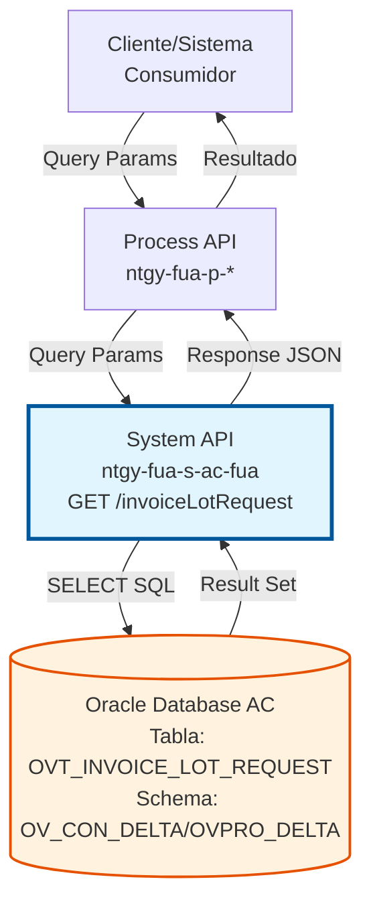
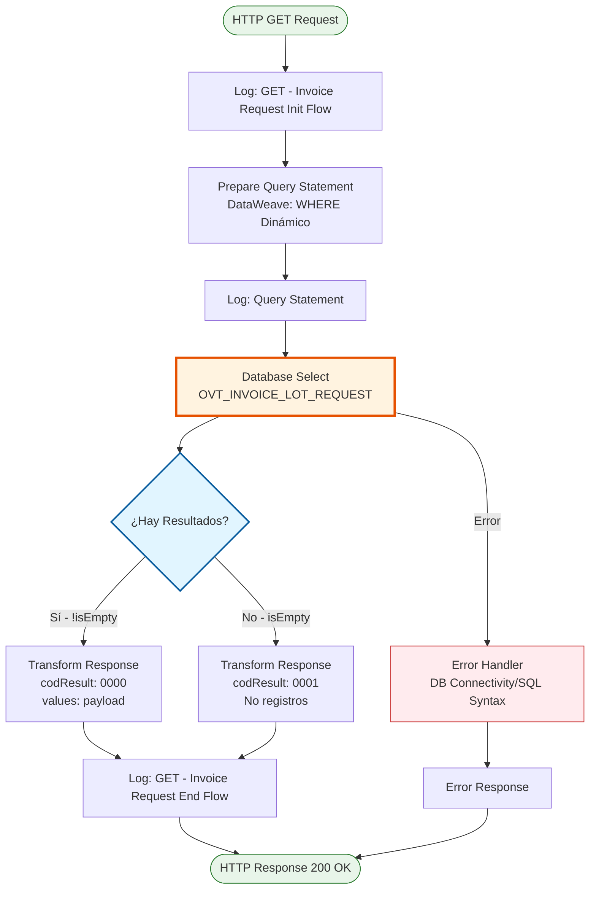
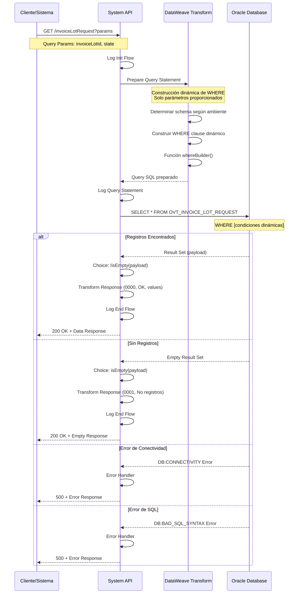
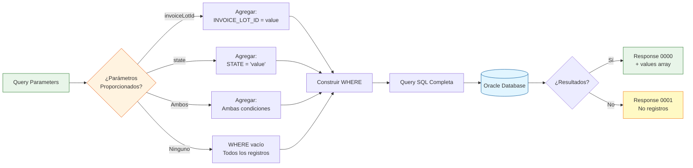
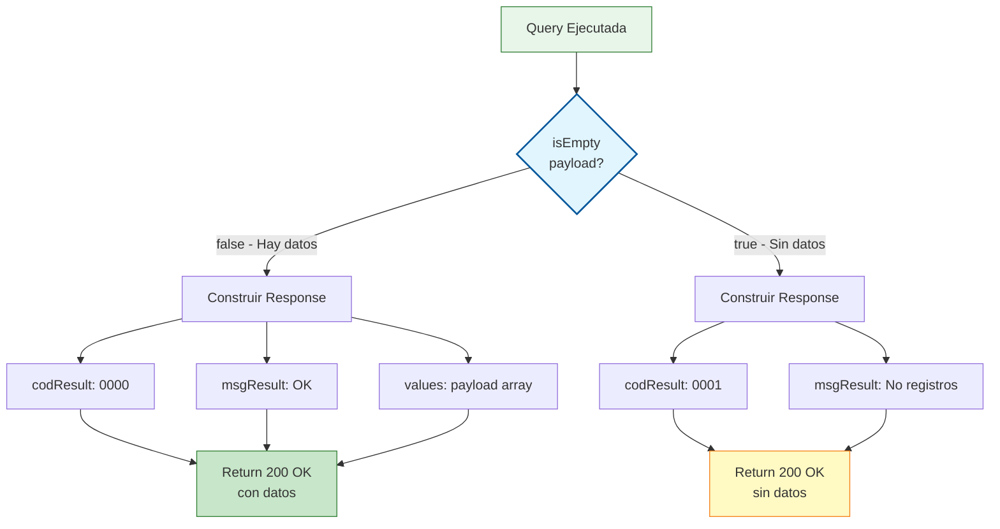
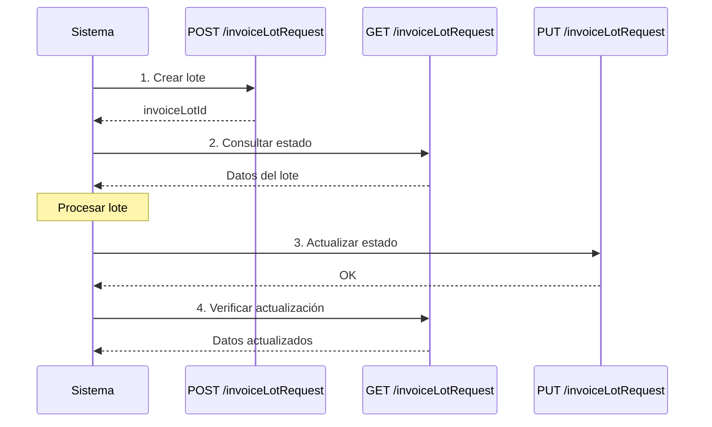

# GET /invoiceLotRequest

## 📌 Descripción General

### Propósito del Endpoint

Este endpoint consulta solicitudes de lotes de facturas almacenadas en la base de datos Oracle del Área Cliente (AC). Permite buscar registros de manera flexible utilizando filtros opcionales por ID de lote o estado, facilitando el seguimiento y monitoreo de lotes de facturas.

El endpoint soporta:
- **Consulta por ID de Lote**: Búsqueda específica por identificador único del lote
- **Consulta por Estado**: Filtrado de lotes según su estado de procesamiento
- **Consulta Combinada**: Búsqueda utilizando ambos criterios simultáneamente
- **Consulta Total**: Sin filtros, retorna todos los registros de la tabla

### Tipo de API

**Capa:** System API (API-Led Connectivity)

**Función:** Integración directa con Oracle Database AC para consulta de registros de control de lotes de facturas.

### Patrón de Integración

**Tipo:** Request-Reply Síncrono con SQL SELECT

**Descripción:** Recibe parámetros de búsqueda opcionales, construye dinámicamente una query SELECT con cláusula WHERE basándose en los parámetros proporcionados, ejecuta la consulta en la base de datos Oracle y retorna los resultados encontrados o un mensaje indicando que no hay registros.

### Arquitectura API-Led Connectivity



---

## 💼 Propósito del Negocio

### Casos de Uso Principales

1. **Seguimiento de Lote Específico**
   - Un sistema necesita verificar el estado de un lote de facturas específico
   - Se consulta por `invoiceLotId` para obtener toda la información del lote
   - Permite conocer fechas de procesamiento, envío y descarga

2. **Monitoreo de Lotes por Estado**
   - Un proceso batch necesita identificar lotes en un estado específico
   - Se consulta por `state` para obtener todos los lotes en ese estado
   - Facilita procesamiento masivo de lotes pendientes o con errores

3. **Auditoría y Reporting**
   - El equipo de auditoría necesita revisar lotes procesados
   - Se consulta con filtros combinados para análisis específicos
   - Permite generar reportes de gestión de lotes

4. **Validación de Existencia**
   - Antes de crear un nuevo lote, verificar si ya existe
   - Se consulta por `invoiceLotId` para validar unicidad
   - Previene duplicados en el sistema

### Contexto Empresarial

- **Dominio:** Gestión de Facturas
- **Sector:** Energía - Utilities
- **División:** Naturgy España - Área Cliente
- **Proceso de Negocio:** Consulta y seguimiento de lotes de facturas
- **Módulo:** Facturación y Comunicaciones

### Stakeholders

- **Equipo de Facturación**: Necesita consultar estado de lotes generados
- **Equipo de Operaciones**: Requiere monitoreo de lotes en procesamiento
- **Equipo de Auditoría**: Necesita acceso a histórico de lotes
- **Sistemas Automatizados**: Procesos batch que consultan lotes pendientes

### Valor de Negocio

- **Visibilidad Completa**: Acceso a toda la información de lotes de facturas
- **Flexibilidad de Búsqueda**: Múltiples criterios de consulta
- **Eficiencia Operativa**: Consultas rápidas para toma de decisiones
- **Soporte a Auditoría**: Trazabilidad completa de lotes procesados

### Consumidores Potenciales

Este endpoint puede ser consumido por:
- Process APIs de gestión de facturas
- Procesos batch de monitoreo y procesamiento
- Sistemas de reporting y analytics
- Portales de administración
- Herramientas de auditoría y compliance

---

## 🔧 Especificación Técnica

### URLs por Ambiente

| Ambiente | URL Base | URL Completa |
|----------|----------|--------------|
| **Local** | `http://localhost:8081` | `http://localhost:8081/api/invoiceLotRequest` |
| **Development** | `https://ntgy-fua-s-ac-fua-dev.us-e2.cloudhub.io` | `https://ntgy-fua-s-ac-fua-dev.us-e2.cloudhub.io/api/invoiceLotRequest` |
| **UAT** | `https://ntgy-fua-s-ac-fua-uat.us-e2.cloudhub.io` | `https://ntgy-fua-s-ac-fua-uat.us-e2.cloudhub.io/api/invoiceLotRequest` |
| **Production** | `https://ntgy-fua-s-ac-fua-pro.us-e2.cloudhub.io` | `https://ntgy-fua-s-ac-fua-pro.us-e2.cloudhub.io/api/invoiceLotRequest` |

### Método HTTP

```
GET /api/invoiceLotRequest
```

### Parámetros de Entrada

#### Headers HTTP

| Header | Tipo | Requerido | Descripción | Ejemplo |
|--------|------|-----------|-------------|---------|
| `Accept` | string | ❌ No | Tipo de contenido esperado en response | `application/json` |

#### Query Parameters

| Parámetro | Tipo | Requerido | Descripción | Ejemplo |
|-----------|------|-----------|-------------|---------|
| `invoiceLotId` | string | ❌ No | Identificador único del lote de facturas | `"LOT-2026-001234"` |
| `state` | string | ❌ No | Estado del lote de facturas | `"ENVIADO"` |

**Nota:** Ambos parámetros son opcionales. Se pueden usar individualmente, combinados, o ninguno (para obtener todos los registros).

#### Ejemplos de URLs con Query Parameters

```bash
# Consulta por ID de lote
GET /api/invoiceLotRequest?invoiceLotId=LOT-2026-001234

# Consulta por estado
GET /api/invoiceLotRequest?state=ENVIADO

# Consulta combinada
GET /api/invoiceLotRequest?invoiceLotId=LOT-2026-001234&state=ENVIADO

# Consulta sin filtros (todos los registros)
GET /api/invoiceLotRequest
```

### Respuestas

#### Respuesta Exitosa con Datos (200 OK)

```json
{
  "result": {
    "codResult": "0000",
    "msgResult": "OK"
  },
  "values": [
    {
      "INVOICE_LOT_ID": "LOT-2026-001234",
      "STATE": "ENVIADO",
      "DATE_SEND_EMAIL": "2026-08-10T10:30:00",
      "DATE_DOWNLOAD": null,
      "CREATE_DATE": "2026-08-10T09:00:00",
      "UPDATE_DATE": "2026-08-10T10:30:45"
    }
  ]
}
```

#### Respuesta Sin Registros (200 OK)

```json
{
  "result": {
    "codResult": "0001",
    "msgResult": "No se han encontrado registros"
  }
}
```

#### Respuesta de Error de Base de Datos (500 Internal Server Error)

```json
{
  "result": {
    "codResult": "0002",
    "msgResult": "Error al consultar la base de datos"
  }
}
```

### Estructura de Datos de Respuesta

#### Objeto en Array "values"

| Campo | Tipo | Descripción | Ejemplo |
|-------|------|-------------|---------|
| `INVOICE_LOT_ID` | string | Identificador único del lote | `"LOT-2026-001234"` |
| `STATE` | string | Estado actual del lote | `"ENVIADO"` |
| `DATE_SEND_EMAIL` | datetime | Fecha de envío del email | `"2026-08-10T10:30:00"` |
| `DATE_DOWNLOAD` | datetime | Fecha de descarga del lote | `"2026-08-10T11:45:00"` |
| `CREATE_DATE` | datetime | Fecha de creación del registro | `"2026-08-10T09:00:00"` |
| `UPDATE_DATE` | datetime | Fecha de última actualización | `"2026-08-10T10:30:45"` |

**Nota:** Los campos de fecha pueden ser `null` si no se han registrado aún.

### Autenticación y Autorización

- **Tipo:** Client ID & Client Secret (Anypoint Platform)
- **Autorización DB:** El usuario de base de datos debe tener permisos para:
  - Ejecutar SELECT en tabla `OVT_INVOICE_LOT_REQUEST`
  - Acceso al schema `OV_CON_DELTA` (dev/uat) o `OVPRO_DELTA` (prod)

### Timeouts

| Tipo | Valor | Descripción |
|------|-------|-------------|
| **Request Timeout** | 30 segundos | Tiempo máximo de espera para la respuesta |
| **Database Query Timeout** | 15 segundos | Tiempo máximo para ejecutar la query SELECT |
| **Connection Timeout** | 10 segundos | Tiempo máximo para establecer conexión con DB |

---

## 🏗️ Implementación Técnica

### Arquitectura del Flow



### Flujo de Datos Detallado



### Componentes del Flow

#### 1. Logger de Inicio
**Ubicación:** Línea 2 del código
```xml
<logger level="INFO" doc:name="GET - Invoice Request Init Flow" 
        message="GET - Invoice Request Init Flow"/>
```
**Propósito:** Registrar el inicio del procesamiento del request

#### 2. Transformación DataWeave - Preparación de Query
**Ubicación:** Líneas 3-30 del código
**Archivo:** Inline en el flow

**Lógica de Construcción Dinámica:**

```dataweave
%dw 2.0
output application/json

// Determinar schema según ambiente
var env = p('env')
var schema = if(env == 'local' or env == 'dev' or env == 'uat') 'OV_CON_DELTA.' 
else if(env == 'pro') 'OVPRO_DELTA.'
else ''

// Extraer query parameters
var invoiceLotId = attributes.queryParams.invoiceLotId
var state = attributes.queryParams.state

// Función para construir WHERE clause dinámicamente
fun whereBuilder()= do {
    var mapping = {
        INVOICE_LOT_ID : if(!isEmpty(invoiceLotId)) " =" ++ invoiceLotId else null,
        STATE :  if(!isEmpty(state)) "='"++ state ++"'" else null
    } filterObject ((value, key, index) -> value != null)
    ---
    "where " ++ (mapping pluck ((value, key, index) -> key ++ " " ++ value) joinBy " AND ")
}
---
{
    query: "SELECT * FROM " ++ schema ++ "OVT_INVOICE_LOT_REQUEST oirl " ++ whereBuilder()
}
```

**Características Clave:**
- **WHERE Dinámico**: Solo incluye condiciones para parámetros proporcionados
- **Schema Dinámico**: Selecciona schema según ambiente (dev/uat vs prod)
- **Flexibilidad**: Soporta 0, 1 o 2 parámetros de búsqueda
- **Formato SQL**: Construye sintaxis SQL válida para Oracle
- **Alias de Tabla**: Usa alias `oirl` para la tabla

#### 3. Logger de Query
**Ubicación:** Línea 31 del código
```xml
<logger level="INFO" doc:name="log prepared statement" 
        message="Query statement: #[vars.queryJson.query]"/>
```
**Propósito:** Registrar la query SQL que se va a ejecutar (para debugging)

#### 4. Database Select
**Ubicación:** Líneas 32-37 del código
```xml
<db:select doc:name="Select invoice lot request" 
           config-ref="Database_Config">
    <error-mapping sourceType="DB:CONNECTIVITY" 
                   targetType="APP:DB_CONNECTIVITY_ERROR" />
    <error-mapping sourceType="DB:BAD_SQL_SYNTAX" 
                   targetType="APP:SQL_SYNTAX_ERROR" />
    <error-mapping sourceType="DB:QUERY_EXECUTION" 
                   targetType="APP:SQL_SYNTAX_ERROR" />
    <db:sql><![CDATA[#[vars.queryJson.query]]]></db:sql>
</db:select>
```

**Configuración:**
- **Config:** `Database_Config` (conexión Oracle)
- **Query:** Dinámica desde variable `vars.queryJson.query`
- **Error Mapping:** Mapeo de errores de DB a errores de aplicación

#### 5. Choice - Validación de Resultados
**Ubicación:** Líneas 38-62 del código
```xml
<choice doc:name="Choice">
    <when expression="#[!isEmpty(payload)]">
        <!-- Respuesta con datos -->
    </when>
    <otherwise>
        <!-- Respuesta sin registros -->
    </otherwise>
</choice>
```

**Lógica:**
- **Condición:** `!isEmpty(payload)` - Verifica si hay resultados
- **When (True):** Retorna código `0000` con array de valores
- **Otherwise (False):** Retorna código `0001` con mensaje de no registros

#### 6. Transformación de Respuesta con Datos
**Ubicación:** Líneas 40-52 del código
```xml
<ee:transform doc:name="json response">
    <ee:message>
        <ee:set-payload><![CDATA[%dw 2.0
output application/json
---
{
    "result": {
        "codResult": "0000",
        "msgResult": "OK"
    },
    "values" : payload 
}
        ]]></ee:set-payload>
    </ee:message>
</ee:transform>
```

**Respuesta con Datos:**
- Código `0000` indica éxito
- Mensaje `OK` confirma operación exitosa
- Array `values` contiene los registros encontrados

#### 7. Transformación de Respuesta Sin Datos
**Ubicación:** Líneas 54-61 del código
```xml
<ee:transform doc:name="nor records">
    <ee:message>
        <ee:set-payload><![CDATA[%dw 2.0
output application/json
---
{
    result: {
        codResult: "0001",
        msgResult: "No se han encontrado registros"
    }
}
        ]]></ee:set-payload>
    </ee:message>
</ee:transform>
```

**Respuesta Sin Datos:**
- Código `0001` indica no hay registros
- Mensaje descriptivo para el usuario
- No incluye array `values`

#### 8. Logger de Fin
**Ubicación:** Línea 63 del código
```xml
<logger level="INFO" doc:name="GET - Invoice Request End Flow" 
        message="GET - Invoice Request End Flow" />
```
**Propósito:** Registrar la finalización exitosa del procesamiento

### Operación de Base de Datos

#### Query SELECT Dinámica

**Estructura Base:**
```sql
SELECT * FROM [SCHEMA].OVT_INVOICE_LOT_REQUEST oirl 
WHERE [CONDICIONES_DINAMICAS]
```

**Ejemplo 1 - Consulta por ID:**
```sql
SELECT * FROM OV_CON_DELTA.OVT_INVOICE_LOT_REQUEST oirl 
WHERE INVOICE_LOT_ID = LOT-2026-001234
```

**Ejemplo 2 - Consulta por Estado:**
```sql
SELECT * FROM OVPRO_DELTA.OVT_INVOICE_LOT_REQUEST oirl 
WHERE STATE='ENVIADO'
```

**Ejemplo 3 - Consulta Combinada:**
```sql
SELECT * FROM OVPRO_DELTA.OVT_INVOICE_LOT_REQUEST oirl 
WHERE INVOICE_LOT_ID = LOT-2026-001234 AND STATE='ENVIADO'
```

**Ejemplo 4 - Sin Filtros (Todos los Registros):**
```sql
SELECT * FROM OV_CON_DELTA.OVT_INVOICE_LOT_REQUEST oirl 
WHERE 
```
**Nota:** Si no se proporcionan parámetros, el WHERE queda vacío y retorna todos los registros.

#### Tabla: OVT_INVOICE_LOT_REQUEST

**Campos Consultados:**

| Campo | Tipo | Descripción |
|-------|------|-------------|
| `INVOICE_LOT_ID` | VARCHAR2 | Identificador único del lote (PK) |
| `STATE` | VARCHAR2 | Estado del lote de facturas |
| `DATE_SEND_EMAIL` | DATE | Fecha de envío del email |
| `DATE_DOWNLOAD` | DATE | Fecha de descarga del lote |
| `CREATE_DATE` | DATE | Fecha de creación del registro |
| `UPDATE_DATE` | DATE | Fecha de última actualización |

**Campos de Búsqueda:**

| Campo | Operador | Descripción |
|-------|----------|-------------|
| `INVOICE_LOT_ID` | `=` | Igualdad exacta |
| `STATE` | `=` | Igualdad exacta |

### Manejo de Errores

#### Errores Mapeados

| Error Origen | Error Mapeado | Descripción |
|--------------|---------------|-------------|
| `DB:CONNECTIVITY` | `APP:DB_CONNECTIVITY_ERROR` | Error de conexión a base de datos |
| `DB:BAD_SQL_SYNTAX` | `APP:SQL_SYNTAX_ERROR` | Error de sintaxis SQL |
| `DB:QUERY_EXECUTION` | `APP:SQL_SYNTAX_ERROR` | Error en ejecución de query |

#### Estrategia de Retry

**Configuración:**
- **Reintentos:** 3 intentos automáticos
- **Intervalo:** Exponential backoff
- **Condiciones:** Solo para errores de conectividad

### Configuración de Base de Datos

**Connection Pool:**
- **MaxPoolSize:** 15 conexiones
- **MaxWaitTime:** 300 segundos
- **MaxIdleTime:** 300 segundos
- **Query Timeout:** 15 segundos

**Hosts (Alta Disponibilidad):**
- **Primary:** oc-pro-exa-04-clu-02-hdfdi-scan.prodb03.ocpro.oraclevcn.com
- **Secondary:** oc-pro-exa-03-clu-02-dfhl9-scan.prodb03.ocpro.oraclevcn.com
- **Port:** 1521
- **Service Name:** s_areapriv_online_pro.prodb03.ocpro.oraclevcn.com

---

## 💻 Ejemplos de Uso

### Ejemplo 1: Consulta por ID de Lote

#### Request

```bash
curl -X GET "https://ntgy-fua-s-ac-fua-pro.us-e2.cloudhub.io/api/invoiceLotRequest?invoiceLotId=LOT-2026-001234" \
  -H "Accept: application/json" \
  -H "client_id: YOUR_CLIENT_ID" \
  -H "client_secret: YOUR_CLIENT_SECRET"
```

#### Response

```json
{
  "result": {
    "codResult": "0000",
    "msgResult": "OK"
  },
  "values": [
    {
      "INVOICE_LOT_ID": "LOT-2026-001234",
      "STATE": "ENVIADO",
      "DATE_SEND_EMAIL": "2026-08-10T10:30:00",
      "DATE_DOWNLOAD": null,
      "CREATE_DATE": "2026-08-10T09:00:00",
      "UPDATE_DATE": "2026-08-10T10:30:45"
    }
  ]
}
```

### Ejemplo 2: Consulta por Estado

#### Request

```bash
curl -X GET "https://ntgy-fua-s-ac-fua-pro.us-e2.cloudhub.io/api/invoiceLotRequest?state=PROCESADO" \
  -H "Accept: application/json" \
  -H "client_id: YOUR_CLIENT_ID" \
  -H "client_secret: YOUR_CLIENT_SECRET"
```

#### Response

```json
{
  "result": {
    "codResult": "0000",
    "msgResult": "OK"
  },
  "values": [
    {
      "INVOICE_LOT_ID": "LOT-2026-001230",
      "STATE": "PROCESADO",
      "DATE_SEND_EMAIL": null,
      "DATE_DOWNLOAD": null,
      "CREATE_DATE": "2026-08-09T15:00:00",
      "UPDATE_DATE": "2026-08-09T16:30:00"
    },
    {
      "INVOICE_LOT_ID": "LOT-2026-001231",
      "STATE": "PROCESADO",
      "DATE_SEND_EMAIL": null,
      "DATE_DOWNLOAD": null,
      "CREATE_DATE": "2026-08-09T16:00:00",
      "UPDATE_DATE": "2026-08-09T17:15:00"
    }
  ]
}
```

### Ejemplo 3: Consulta Combinada (ID + Estado)

#### Request

```bash
curl -X GET "https://ntgy-fua-s-ac-fua-pro.us-e2.cloudhub.io/api/invoiceLotRequest?invoiceLotId=LOT-2026-001234&state=ENVIADO" \
  -H "Accept: application/json" \
  -H "client_id: YOUR_CLIENT_ID" \
  -H "client_secret: YOUR_CLIENT_SECRET"
```

#### Response

```json
{
  "result": {
    "codResult": "0000",
    "msgResult": "OK"
  },
  "values": [
    {
      "INVOICE_LOT_ID": "LOT-2026-001234",
      "STATE": "ENVIADO",
      "DATE_SEND_EMAIL": "2026-08-10T10:30:00",
      "DATE_DOWNLOAD": null,
      "CREATE_DATE": "2026-08-10T09:00:00",
      "UPDATE_DATE": "2026-08-10T10:30:45"
    }
  ]
}
```

### Ejemplo 4: Sin Resultados

#### Request

```bash
curl -X GET "https://ntgy-fua-s-ac-fua-pro.us-e2.cloudhub.io/api/invoiceLotRequest?invoiceLotId=LOT-INEXISTENTE" \
  -H "Accept: application/json" \
  -H "client_id: YOUR_CLIENT_ID" \
  -H "client_secret: YOUR_CLIENT_SECRET"
```

#### Response

```json
{
  "result": {
    "codResult": "0001",
    "msgResult": "No se han encontrado registros"
  }
}
```

### Ejemplo 5: Consulta Sin Filtros (Todos los Registros)

#### Request

```bash
curl -X GET "https://ntgy-fua-s-ac-fua-pro.us-e2.cloudhub.io/api/invoiceLotRequest" \
  -H "Accept: application/json" \
  -H "client_id: YOUR_CLIENT_ID" \
  -H "client_secret: YOUR_CLIENT_SECRET"
```

#### Response

```json
{
  "result": {
    "codResult": "0000",
    "msgResult": "OK"
  },
  "values": [
    {
      "INVOICE_LOT_ID": "LOT-2026-001230",
      "STATE": "PROCESADO",
      "DATE_SEND_EMAIL": null,
      "DATE_DOWNLOAD": null,
      "CREATE_DATE": "2026-08-09T15:00:00",
      "UPDATE_DATE": "2026-08-09T16:30:00"
    },
    {
      "INVOICE_LOT_ID": "LOT-2026-001234",
      "STATE": "ENVIADO",
      "DATE_SEND_EMAIL": "2026-08-10T10:30:00",
      "DATE_DOWNLOAD": null,
      "CREATE_DATE": "2026-08-10T09:00:00",
      "UPDATE_DATE": "2026-08-10T10:30:45"
    }
  ]
}
```

### Ejemplo 6: Integración con JavaScript

```javascript
async function getInvoiceLotRequests(lotId = null, state = null) {
  const baseUrl = 'https://ntgy-fua-s-ac-fua-pro.us-e2.cloudhub.io/api/invoiceLotRequest';
  
  // Construir query params
  const params = new URLSearchParams();
  if (lotId) params.append('invoiceLotId', lotId);
  if (state) params.append('state', state);
  
  const url = params.toString() ? `${baseUrl}?${params.toString()}` : baseUrl;
  
  try {
    const response = await fetch(url, {
      method: 'GET',
      headers: {
        'Accept': 'application/json',
        'client_id': 'YOUR_CLIENT_ID',
        'client_secret': 'YOUR_CLIENT_SECRET'
      }
    });
    
    const data = await response.json();
    
    if (data.result.codResult === '0000') {
      console.log(`Encontrados ${data.values.length} registros`);
      return data.values;
    } else if (data.result.codResult === '0001') {
      console.log('No se encontraron registros');
      return [];
    } else {
      console.error('Error en consulta:', data.result.msgResult);
      return null;
    }
  } catch (error) {
    console.error('Error de red:', error);
    return null;
  }
}

// Ejemplos de uso
// Consulta por ID
getInvoiceLotRequests('LOT-2026-001234', null);

// Consulta por estado
getInvoiceLotRequests(null, 'ENVIADO');

// Consulta combinada
getInvoiceLotRequests('LOT-2026-001234', 'ENVIADO');

// Todos los registros
getInvoiceLotRequests();
```

### Ejemplo 7: Integración con Python

```python
import requests
from typing import List, Dict, Optional

def get_invoice_lot_requests(
    lot_id: Optional[str] = None, 
    state: Optional[str] = None
) -> Optional[List[Dict]]:
    """
    Consulta solicitudes de lotes de facturas
    
    Args:
        lot_id (str, optional): ID del lote de facturas
        state (str, optional): Estado del lote
    
    Returns:
        List[Dict]: Lista de registros encontrados, [] si no hay, None si error
    """
    url = 'https://ntgy-fua-s-ac-fua-pro.us-e2.cloudhub.io/api/invoiceLotRequest'
    
    headers = {
        'Accept': 'application/json',
        'client_id': 'YOUR_CLIENT_ID',
        'client_secret': 'YOUR_CLIENT_SECRET'
    }
    
    # Construir query params
    params = {}
    if lot_id:
        params['invoiceLotId'] = lot_id
    if state:
        params['state'] = state
    
    try:
        response = requests.get(url, params=params, headers=headers, timeout=30)
        response.raise_for_status()
        
        data = response.json()
        
        if data['result']['codResult'] == '0000':
            print(f"Encontrados {len(data['values'])} registros")
            return data['values']
        elif data['result']['codResult'] == '0001':
            print('No se encontraron registros')
            return []
        else:
            print(f"Error: {data['result']['msgResult']}")
            return None
            
    except requests.exceptions.RequestException as e:
        print(f'Error de red: {e}')
        return None

# Ejemplos de uso
# Consulta por ID
results = get_invoice_lot_requests(lot_id='LOT-2026-001234')

# Consulta por estado
results = get_invoice_lot_requests(state='ENVIADO')

# Consulta combinada
results = get_invoice_lot_requests(
    lot_id='LOT-2026-001234',
    state='ENVIADO'
)

# Todos los registros
results = get_invoice_lot_requests()
```

### Diagrama de Construcción Dinámica de WHERE



### Diagrama de Decisión de Respuesta



---

## 📊 Consideraciones de Performance

### Métricas Esperadas

- **Tiempo de Respuesta Promedio:** < 2 segundos
- **Tiempo de Respuesta p95:** < 3 segundos
- **Tiempo de Respuesta p99:** < 5 segundos
- **Throughput:** > 100 requests/segundo
- **Tasa de Error:** < 0.5%

### Optimizaciones Implementadas

1. **Connection Pooling**: Reutilización de conexiones a base de datos
2. **Query Dinámica**: Solo se construyen condiciones necesarias
3. **Índices en DB**: Campos `INVOICE_LOT_ID` y `STATE` indexados
4. **Timeout Configurado**: Previene queries de larga duración

### Recomendaciones de Uso

#### Para Consultas Frecuentes
- Usar filtro por `invoiceLotId` cuando sea posible (más específico)
- Evitar consultas sin filtros en producción (puede retornar muchos registros)
- Implementar paginación en el consumidor si se esperan muchos resultados

#### Para Procesos Batch
- Consultar por `state` para procesar lotes en estados específicos
- Ejecutar en horarios de baja carga
- Implementar procesamiento por lotes pequeños

#### Para Auditoría
- Usar filtros combinados para búsquedas específicas
- Considerar implementar caché para consultas repetitivas
- Exportar resultados para análisis offline si son muchos registros

---

## 🔗 Relación con Otros Endpoints

### Endpoints Relacionados

| Endpoint | Método | Relación |
|----------|--------|----------|
| `POST /invoiceLotRequest` | POST | Crea nuevos registros que luego se consultan con GET |
| `PUT /invoiceLotRequest` | PUT | Actualiza registros consultados con GET |
| `DELETE /invoiceLotRequest` | DELETE | Elimina registros consultados con GET |

### Flujo Típico de Operaciones


