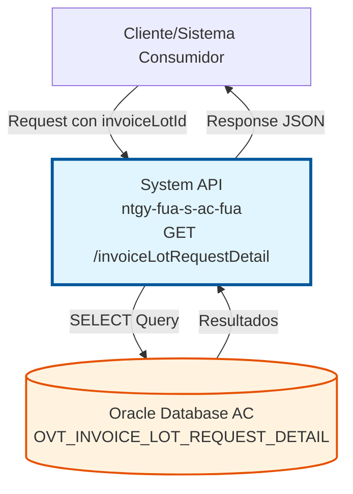
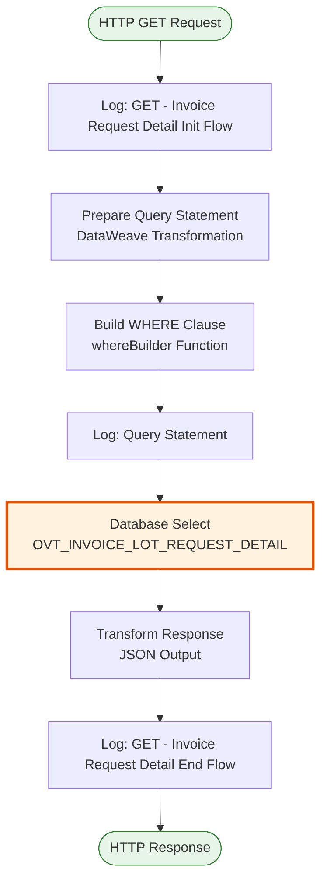
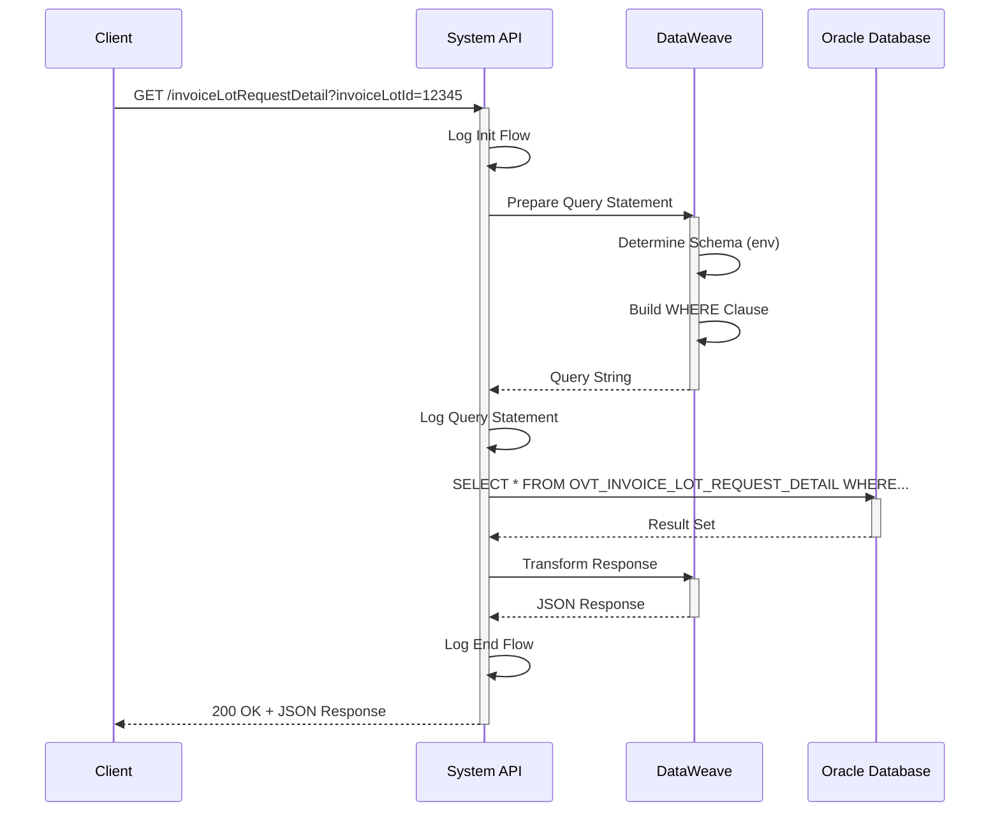
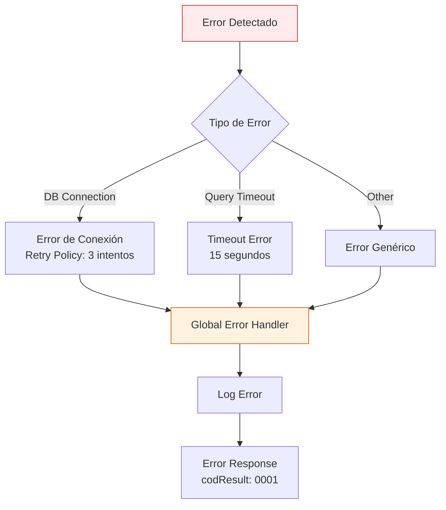

# GET /invoiceLotRequestDetail

## 📌 Descripción General

### Propósito del Endpoint

Este endpoint consulta los detalles de las solicitudes de lotes de facturación almacenados en la base de datos Oracle del sistema Área Cliente (AC). Permite obtener información detallada de las líneas o items que componen un lote de facturación específico, proporcionando trazabilidad completa del proceso de facturación.

El endpoint soporta:
- **Consulta por ID de Lote**: Recupera todos los detalles asociados a un lote de facturación específico
- **Respuesta Estructurada**: Devuelve datos en formato JSON con estructura estándar
- **Manejo Multi-Ambiente**: Adapta el schema de base de datos según el ambiente (dev/uat/pro)

### Tipo de API

**Capa:** System API (API-Led Connectivity)

**Función:** Integración directa con Oracle Database AC para consulta de detalles de solicitudes de lotes de facturación.

### Patrón de Integración

**Tipo:** Request-Reply Síncrono con SQL Query

**Descripción:** El endpoint recibe un ID de lote de facturación como parámetro, construye dinámicamente una query SQL con el schema apropiado según el ambiente, ejecuta la consulta en la base de datos Oracle, y retorna los resultados en formato JSON estructurado.

### Arquitectura API-Led Connectivity



---

## 💼 Propósito del Negocio

### Casos de Uso Principales

1. **Auditoría de Lotes de Facturación**
   - Permite revisar todos los detalles de un lote de facturación específico
   - Facilita la trazabilidad de solicitudes de facturación
   - Soporta procesos de auditoría y control de calidad

2. **Seguimiento de Solicitudes**
   - Consulta el estado y detalles de solicitudes de facturación
   - Permite verificar la completitud de un lote
   - Facilita la identificación de discrepancias

3. **Reportes y Análisis**
   - Proporciona datos para generación de reportes de facturación
   - Permite análisis de volúmenes de facturación
   - Soporta métricas de negocio relacionadas con facturación

### Contexto Empresarial

- **Dominio:** Facturación y Cobros
- **Sector:** Energía - Utilities
- **División:** Naturgy España - Área Cliente
- **Proceso de Negocio:** Gestión de Lotes de Facturación
- **Sistema:** Oracle Database AC (Área Cliente)

### Stakeholders

- **Equipo de Facturación**: Necesita consultar detalles de lotes para validación y control
- **Equipo de Auditoría**: Requiere trazabilidad completa de solicitudes de facturación
- **Sistemas de Integración**: Consumen estos datos para procesos downstream
- **Equipo de Soporte**: Utiliza la información para resolución de incidencias

### Valor de Negocio

- **Trazabilidad**: Visibilidad completa de los detalles de cada lote de facturación
- **Control de Calidad**: Facilita la validación de solicitudes de facturación
- **Eficiencia Operativa**: Reduce tiempo de consulta de información de lotes
- **Auditoría**: Soporta procesos de auditoría y cumplimiento normativo

### Consumidores Potenciales

Este endpoint puede ser consumido por:
- Process APIs de facturación y cobros
- Sistemas de reporting y analytics
- Aplicaciones de auditoría y control
- Herramientas de monitorización de procesos de facturación

---

## 🔧 Especificación Técnica

### URLs por Ambiente

| Ambiente | URL Base | URL Completa |
|----------|----------|--------------|
| **Local** | `http://localhost:8081` | `http://localhost:8081/api/invoiceLotRequestDetail?invoiceLotId=:id` |
| **Development** | `https://ntgy-fua-s-ac-fua-dev.us-e2.cloudhub.io` | `https://ntgy-fua-s-ac-fua-dev.us-e2.cloudhub.io/api/invoiceLotRequestDetail?invoiceLotId=:id` |
| **UAT** | `https://ntgy-fua-s-ac-fua-uat.us-e2.cloudhub.io` | `https://ntgy-fua-s-ac-fua-uat.us-e2.cloudhub.io/api/invoiceLotRequestDetail?invoiceLotId=:id` |
| **Production** | `https://ntgy-fua-s-ac-fua-pro.us-e2.cloudhub.io` | `https://ntgy-fua-s-ac-fua-pro.us-e2.cloudhub.io/api/invoiceLotRequestDetail?invoiceLotId=:id` |

### Método HTTP

```
GET /api/invoiceLotRequestDetail
```

### Parámetros de Entrada

#### Headers HTTP

| Header | Tipo | Requerido | Descripción | Ejemplo |
|--------|------|-----------|-------------|---------|
| `Accept` | string | ❌ No | Tipo de contenido esperado en response | `application/json` |

#### Query Parameters

| Parámetro | Tipo | Requerido | Descripción | Ejemplo |
|-----------|------|-----------|-------------|---------|
| `invoiceLotId` | string | ✅ Sí | ID del lote de facturación a consultar | `"12345"` |

### Respuestas

#### Respuesta Exitosa (200 OK)

```json
{
  "result": {
    "codResult": "0000",
    "msgResult": "OK"
  },
  "values": [
    {
      "INVOICE_LOT_ID": "12345",
      "DETAIL_ID": "1",
      "FIELD1": "value1",
      "FIELD2": "value2"
    }
  ]
}
```

**Nota sobre Estructura de Datos:** La query ejecuta `SELECT oilrd.*` lo que significa que devuelve todas las columnas de la tabla `OVT_INVOICE_LOT_REQUEST_DETAIL`. Los campos específicos de esta tabla no están documentados en el código fuente y dependen del esquema de la base de datos Oracle AC. Para obtener la lista completa de campos, consultar la documentación de la base de datos o ejecutar un `DESCRIBE OVT_INVOICE_LOT_REQUEST_DETAIL` en el ambiente correspondiente.

#### Respuesta Sin Resultados (200 OK)

```json
{
  "result": {
    "codResult": "0000",
    "msgResult": "OK"
  },
  "values": []
}
```

#### Respuesta de Error Técnico (500)

```json
{
  "result": {
    "codResult": "0001",
    "msgResult": "Error interno del servidor"
  }
}
```

### Autenticación y Autorización

- **Tipo:** Client ID & Client Secret (Anypoint Platform)
- **Autorización DB:** El usuario de base de datos debe tener permisos para:
  - Acceso de lectura a la tabla `OVT_INVOICE_LOT_REQUEST_DETAIL`
  - Acceso al schema `OV_CON_DELTA` (dev/uat) o `OVPRO_DELTA` (producción)

### Timeouts

| Tipo | Valor | Descripción |
|------|-------|-------------|
| **Query Timeout** | 15 segundos | Tiempo máximo de ejecución de la query SQL |
| **Connection Timeout** | 3600 segundos | Tiempo máximo para mantener conexión a base de datos |

---

## 🏗️ Implementación Técnica

### Arquitectura del Flow



### Componentes Principales

#### 1. Preparación de Query (DataWeave)

**Ubicación en el código:** Transformación inline en el flow

**Función:** Construye dinámicamente la query SQL con el schema apropiado según el ambiente

**Lógica:**
```dataweave
var env = p('env')
var schema = if ( env == 'local' or env == 'dev' or env == 'uat' ) 'OV_CON_DELTA.' 
else if ( env == 'pro' ) 'OVPRO_DELTA.'
else ''
```

**Construcción de WHERE:**
```dataweave
fun whereBuilder()= do {
    var mapping = {
        INVOICE_LOT_ID: if ( !isEmpty(invoiceLotId) ) " =" ++ invoiceLotId else null
    } filterObject ((value, key, index) -> value != null)
    ---
    " where " ++ (mapping pluck ((value, key, index) -> key ++ " " ++  value) joinBy " AND ")
}
```

#### 2. Consulta a Base de Datos

**Operación:** `<db:select>`

**Query SQL Generada:**
```sql
SELECT oilrd.* 
FROM [schema]OVT_INVOICE_LOT_REQUEST_DETAIL oilrd 
WHERE INVOICE_LOT_ID = [invoiceLotId]
```

**Configuración:**
- **Config Reference:** `Database_Config`
- **Connection Pool:** MaxPoolSize=15, MaxWaitTime=300s
- **Query Timeout:** 15 segundos

#### 3. Transformación de Respuesta

**Formato de Salida:**
```json
{
  "result": {
    "codResult": "0000",
    "msgResult": "OK"
  },
  "values": [payload]
}
```

### Diagrama de Secuencia



### Manejo de Errores



### Configuración de Base de Datos

**Schemas por Ambiente:**
- **Local/Dev/UAT:** `OV_CON_DELTA.OVT_INVOICE_LOT_REQUEST_DETAIL`
- **Producción:** `OVPRO_DELTA.OVT_INVOICE_LOT_REQUEST_DETAIL`

**Connection Pool:**
- MaxPoolSize: 15 conexiones
- MaxWaitTime: 300 segundos
- MaxIdleTime: 300 segundos

**Tabla Consultada:**
- **Nombre:** `OVT_INVOICE_LOT_REQUEST_DETAIL`
- **Operación:** SELECT (READ)
- **Descripción:** Tabla de detalles de solicitudes de lotes de facturación

### Logging

**Puntos de Log:**
1. **Inicio del Flow:** "GET - Invoice Request Detail Init Flow"
2. **Query Preparada:** "Query statement: [query]"
3. **Fin del Flow:** "GET - Invoice Request Detail End Flow"

---

## 💻 Ejemplos de Uso

### Ejemplo 1: Consulta Exitosa

**Request:**
```bash
curl -X GET "https://ntgy-fua-s-ac-fua-dev.us-e2.cloudhub.io/api/invoiceLotRequestDetail?invoiceLotId=12345" \
  -H "Accept: application/json"
```

**Response (200 OK):**
```json
{
  "result": {
    "codResult": "0000",
    "msgResult": "OK"
  },
  "values": [
    {
      "INVOICE_LOT_ID": "12345",
      "DETAIL_ID": "1",
      "CREATED_DATE": "2026-08-01",
      "STATUS": "PROCESSED"
    },
    {
      "INVOICE_LOT_ID": "12345",
      "DETAIL_ID": "2",
      "CREATED_DATE": "2026-08-01",
      "STATUS": "PROCESSED"
    }
  ]
}
```

### Ejemplo 2: Sin Resultados

**Request:**
```bash
curl -X GET "https://ntgy-fua-s-ac-fua-dev.us-e2.cloudhub.io/api/invoiceLotRequestDetail?invoiceLotId=99999" \
  -H "Accept: application/json"
```

**Response (200 OK):**
```json
{
  "result": {
    "codResult": "0000",
    "msgResult": "OK"
  },
  "values": []
}
```

### Ejemplo 3: Error de Parámetro Faltante

**Request:**
```bash
curl -X GET "https://ntgy-fua-s-ac-fua-dev.us-e2.cloudhub.io/api/invoiceLotRequestDetail" \
  -H "Accept: application/json"
```

**Response (400 Bad Request):**
```json
{
  "result": {
    "codResult": "0001",
    "msgResult": "Parámetro invoiceLotId es requerido"
  }
}
```

### Ejemplo 4: Uso desde JavaScript

**Código:**
```javascript
const axios = require('axios');

async function getInvoiceLotRequestDetail(invoiceLotId) {
  try {
    const response = await axios.get(
      'https://ntgy-fua-s-ac-fua-dev.us-e2.cloudhub.io/api/invoiceLotRequestDetail',
      {
        params: {
          invoiceLotId: invoiceLotId
        },
        headers: {
          'Accept': 'application/json'
        }
      }
    );
    
    console.log('Detalles del lote:', response.data.values);
    return response.data;
  } catch (error) {
    console.error('Error al consultar detalles:', error.message);
    throw error;
  }
}

// Uso
getInvoiceLotRequestDetail('12345')
  .then(data => console.log('Éxito:', data))
  .catch(err => console.error('Error:', err));
```

### Ejemplo 5: Uso desde Python

**Código:**
```python
import requests

def get_invoice_lot_request_detail(invoice_lot_id):
    """
    Consulta los detalles de un lote de facturación
    """
    url = "https://ntgy-fua-s-ac-fua-dev.us-e2.cloudhub.io/api/invoiceLotRequestDetail"
    
    params = {
        'invoiceLotId': invoice_lot_id
    }
    
    headers = {
        'Accept': 'application/json'
    }
    
    try:
        response = requests.get(url, params=params, headers=headers)
        response.raise_for_status()
        
        data = response.json()
        print(f"Detalles encontrados: {len(data['values'])}")
        return data
        
    except requests.exceptions.RequestException as e:
        print(f"Error al consultar detalles: {e}")
        raise

# Uso
if __name__ == "__main__":
    result = get_invoice_lot_request_detail('12345')
    print(f"Resultado: {result}")
```

### Ejemplo 6: Integración con Postman

**Configuración de Request:**

1. **Método:** GET
2. **URL:** `{{baseUrl}}/api/invoiceLotRequestDetail`
3. **Query Params:**
   - Key: `invoiceLotId`
   - Value: `12345`
4. **Headers:**
   - Key: `Accept`
   - Value: `application/json`

**Variables de Ambiente:**
```json
{
  "baseUrl": "https://ntgy-fua-s-ac-fua-dev.us-e2.cloudhub.io"
}
```

**Test Script:**
```javascript
pm.test("Status code is 200", function () {
    pm.response.to.have.status(200);
});

pm.test("Response has result object", function () {
    var jsonData = pm.response.json();
    pm.expect(jsonData).to.have.property('result');
    pm.expect(jsonData.result.codResult).to.eql('0000');
});

pm.test("Response has values array", function () {
    var jsonData = pm.response.json();
    pm.expect(jsonData).to.have.property('values');
    pm.expect(jsonData.values).to.be.an('array');
});