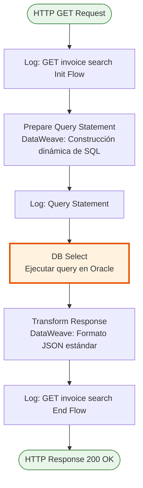
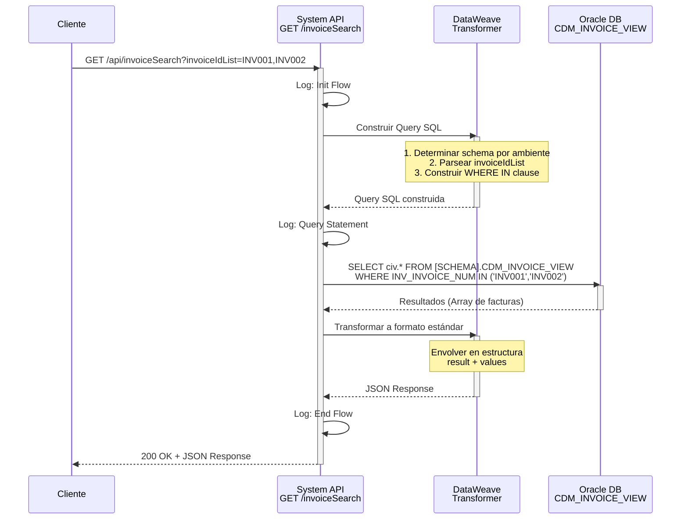
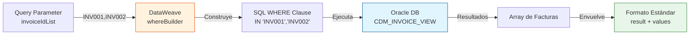

# GET /invoiceSearch

## 📌 Descripción General

### Propósito del Endpoint

Este endpoint permite realizar búsquedas de facturas en la vista consolidada `CDM_INVOICE_VIEW` de Oracle mediante una lista de identificadores de factura. Proporciona acceso directo a los datos de facturación almacenados en la base de datos Oracle, retornando todos los campos disponibles en la vista para las facturas solicitadas.

El endpoint soporta:
- **Búsqueda por Lista de IDs**: Permite consultar múltiples facturas en una sola petición mediante una lista de identificadores separados por comas
- **Acceso a Vista Consolidada**: Consulta directa a la vista `CDM_INVOICE_VIEW` que centraliza información de facturas
- **Schema Dinámico por Ambiente**: Utiliza diferentes schemas según el ambiente (dev/uat vs production)

### Tipo de API

**Capa:** System API (API-Led Connectivity)

**Función:** Integración directa con base de datos Oracle para consulta de información de facturas desde la vista consolidada CDM.

### Patrón de Integración

**Tipo:** Request-Reply Síncrono con Query SQL

**Descripción:** El endpoint recibe una lista de IDs de facturas como query parameter, construye dinámicamente una query SQL con cláusula WHERE IN, ejecuta la consulta contra la vista Oracle y retorna los resultados en formato JSON estándar.

### Arquitectura API-Led Connectivity

```mermaid
graph TB
    Client[Cliente/Process API]
    S[System API<br/>MUL-COM-FUA-S-AC-FUA<br/>GET /invoiceSearch]
    Oracle[Base de Datos Oracle<br/>Vista: CDM_INVOICE_VIEW<br/>Schema: OV_CON_DELTA/OVPRO_DELTA]
    
    Client -->|Query Param: invoiceIdList| S
    S -->|SELECT * FROM CDM_INVOICE_VIEW<br/>WHERE INV_INVOICE_NUM IN (...)| Oracle
    Oracle -->|Resultados| S
    S -->|Response JSON| Client
    
    style S fill:#e1f5ff,stroke:#01579b,stroke-width:3px
    style Oracle fill:#fff3e0,stroke:#e65100,stroke-width:2px
```

---

## 💼 Propósito del Negocio

### Casos de Uso Principales

1. **Consulta de Facturas Específicas**
   - Permite a los sistemas consumidores obtener información detallada de facturas específicas
   - Útil para procesos de consulta de estado de facturación
   - Soporta búsqueda de múltiples facturas en una sola petición

2. **Integración con Procesos de Facturación**
   - Proporciona datos de facturas para procesos downstream
   - Facilita la sincronización de información de facturación entre sistemas
   - Permite validación de existencia de facturas

3. **Soporte a Consultas de Clientes**
   - Habilita la búsqueda de facturas para portales de autoservicio
   - Proporciona información para agentes de atención al cliente
   - Facilita procesos de reclamaciones y consultas

### Contexto Empresarial

- **Dominio:** Facturación y Cobros
- **Sector:** Energía - Utilities
- **División:** Naturgy España - NewCo
- **Proceso de Negocio:** Consulta y gestión de información de facturas
- **Sistema Backend:** Oracle Database (Vista CDM)

### Stakeholders

- **Equipos de Facturación**: Necesitan acceso a información consolidada de facturas
- **Atención al Cliente**: Requieren consultar facturas de clientes para resolver incidencias
- **Sistemas de Integración**: Consumen datos de facturas para procesos downstream

### Valor de Negocio

- **Acceso Centralizado**: Proporciona un punto único de acceso a información de facturas
- **Eficiencia Operativa**: Permite búsqueda de múltiples facturas en una sola petición
- **Datos Consolidados**: Accede a vista que centraliza información de diferentes fuentes

### Consumidores Potenciales

Este endpoint puede ser consumido por:
- Process APIs de facturación y cobros
- Portales web de autoservicio de clientes
- Aplicaciones móviles de consulta de facturas
- Sistemas de atención al cliente (CRM)
- Herramientas de reporting y análisis

---

## 🔧 Especificación Técnica

### URLs por Ambiente

| Ambiente | URL Base | URL Completa |
|----------|----------|--------------|
| **Local** | `http://localhost:8081` | `http://localhost:8081/api/invoiceSearch` |
| **Development** | `https://mul-com-fua-s-ac-fua-dev.us-e2.cloudhub.io` | `https://mul-com-fua-s-ac-fua-dev.us-e2.cloudhub.io/api/invoiceSearch` |
| **UAT** | `https://mul-com-fua-s-ac-fua-uat.us-e2.cloudhub.io` | `https://mul-com-fua-s-ac-fua-uat.us-e2.cloudhub.io/api/invoiceSearch` |
| **Production** | `https://mul-com-fua-s-ac-fua-pro.us-e2.cloudhub.io` | `https://mul-com-fua-s-ac-fua-pro.us-e2.cloudhub.io/api/invoiceSearch` |

### Método HTTP

```
GET /api/invoiceSearch
```

### Parámetros de Entrada

#### Headers HTTP

| Header | Tipo | Requerido | Descripción | Ejemplo |
|--------|------|-----------|-------------|---------|
| `Accept` | string | ❌ No | Tipo de contenido esperado en response | `application/json` |

#### Query Parameters

| Parámetro | Tipo | Requerido | Descripción | Ejemplo |
|-----------|------|-----------|-------------|---------|
| `invoiceIdList` | string | ✅ Sí | Lista de identificadores de facturas separados por comas. Se utiliza para construir la cláusula WHERE IN de la query SQL | `"INV001,INV002,INV003"` |

**Nota sobre invoiceIdList:**
- Los IDs deben estar separados por comas sin espacios
- El endpoint construye automáticamente la cláusula SQL: `WHERE INV_INVOICE_NUM IN ('INV001','INV002','INV003')`
- No hay límite explícito en el número de IDs, pero se recomienda mantener listas razonables para evitar timeouts

### Respuestas

#### Respuesta Exitosa (200 OK)

```json
{
  "result": {
    "codResult": "0000",
    "msgResult": "OK"
  },
  "values": [
    {
      "INV_INVOICE_NUM": "INV001",
      "CUSTOMER_ID": "12345",
      "INVOICE_DATE": "2024-01-15",
      "AMOUNT": 150.50,
      "STATUS": "PAID",
      "DUE_DATE": "2024-02-15"
    },
    {
      "INV_INVOICE_NUM": "INV002",
      "CUSTOMER_ID": "12345",
      "INVOICE_DATE": "2024-02-15",
      "AMOUNT": 175.25,
      "STATUS": "PENDING",
      "DUE_DATE": "2024-03-15"
    }
  ]
}
```

**Estructura de Respuesta:**
- `result`: Objeto con información del resultado de la operación
  - `codResult`: Código de resultado ("0000" para éxito)
  - `msgResult`: Mensaje descriptivo del resultado
- `values`: Array con los registros de facturas encontradas (todos los campos de la vista CDM_INVOICE_VIEW)

#### Respuesta Sin Resultados (200 OK)

```json
{
  "result": {
    "codResult": "0000",
    "msgResult": "OK"
  },
  "values": []
}
```

#### Respuesta de Error Técnico (500)

```json
{
  "result": {
    "codResult": "0001",
    "msgResult": "Error al ejecutar query en base de datos"
  }
}
```

### Autenticación y Autorización

- **Tipo:** Client ID & Client Secret (Anypoint Platform)
- **Autorización Oracle:** El usuario de conexión debe tener permisos para:
  - Acceso de lectura (SELECT) a la vista `CDM_INVOICE_VIEW`
  - Acceso al schema `OV_CON_DELTA` (dev/uat) o `OVPRO_DELTA` (production)

### Timeouts

| Tipo | Valor | Descripción |
|------|-------|-------------|
| **Request Timeout** | 30 segundos | Tiempo máximo de espera para la respuesta de la base de datos |
| **Connection Timeout** | 10 segundos | Tiempo máximo para establecer conexión con Oracle |

---

## 🏗️ Implementación Técnica

### Arquitectura del Flow



### Componentes del Flow

#### 1. Logger de Inicio (Línea 9)
```xml
<logger level="INFO" message="GET - invoice search Init Flow"/>
```
Registra el inicio de la ejecución del flow.

#### 2. Transformación de Query (Líneas 10-23)
**Archivo:** Inline DataWeave en el flow

**Propósito:** Construir dinámicamente la query SQL con cláusula WHERE IN basada en el parámetro `invoiceIdList`.

**Lógica de Construcción:**
```dataweave
%dw 2.0
output application/json
import * from dw::core::Strings

var env = p('env')
var schema = if ( env == 'local' or env == 'dev' or env == 'uat' ) 'OV_CON_DELTA.' 
             else if ( env == 'pro' ) 'OVPRO_DELTA.'
             else ''

var invoiceIdList = attributes.queryParams.invoiceIdList

fun whereBuilder() = do {
    var mapping = {
        INV_INVOICE_NUM: if ( !isEmpty(invoiceIdList) ) 
                         " in ('" ++ (replaceAll(invoiceIdList,",","','")) ++ "')" 
                         else null
    } filterObject ((value, key, index) -> value != null)
    ---
    " where " ++ (mapping pluck ((value, key, index) -> key ++ " " ++ value) joinBy " AND ")
}
---
{
    query: "SELECT civ.* FROM " ++ schema ++ "CDM_INVOICE_VIEW civ " ++ whereBuilder()
}
```

**Características Clave:**
- **Schema Dinámico**: Selecciona el schema según el ambiente (dev/uat/pro)
- **Función whereBuilder()**: Construye la cláusula WHERE dinámicamente
- **Transformación de Lista**: Convierte `"INV001,INV002"` en `"IN ('INV001','INV002')"`
- **Filtrado de Nulos**: Solo incluye condiciones con valores no nulos

**Query SQL Generada (Ejemplo):**
```sql
SELECT civ.* 
FROM OV_CON_DELTA.CDM_INVOICE_VIEW civ 
WHERE INV_INVOICE_NUM in ('INV001','INV002','INV003')
```

#### 3. Logger de Query (Línea 24)
```xml
<logger level="INFO" message="Query statement: #[vars.queryJson.query]"/>
```
Registra la query SQL construida para trazabilidad.

#### 4. Ejecución de Query (Líneas 25-27)
```xml
<db:select config-ref="Database_Config">
    <db:sql><![CDATA[#[vars.queryJson.query]]]></db:sql>
</db:select>
```

**Configuración:**
- **Connector:** Database Connector (Oracle)
- **Config Reference:** `Database_Config`
- **Query:** Dinámica, construida en paso anterior
- **Operación:** SELECT (solo lectura)

#### 5. Transformación de Respuesta (Líneas 28-39)
**Archivo:** Inline DataWeave en el flow

**Propósito:** Transformar el resultado de la base de datos al formato JSON estándar.

```dataweave
%dw 2.0
output application/json
---
{
    "result": {
        "codResult": "0000",
        "msgResult": "OK"
    },
    "values": payload 
}
```

**Características:**
- Envuelve el resultado en estructura estándar
- `result`: Información del estado de la operación
- `values`: Array con los registros de facturas (payload directo de la DB)

#### 6. Logger de Fin (Línea 40)
```xml
<logger level="INFO" message="GET - invoice search End Flow"/>
```
Registra la finalización exitosa del flow.

### Diagrama de Secuencia Completo



### Transformación de Datos



### Configuración de Base de Datos

**Database Config Reference:** `Database_Config`

**Propiedades por Ambiente:**
- **Schema Dev/UAT:** `OV_CON_DELTA`
- **Schema Production:** `OVPRO_DELTA`
- **Vista:** `CDM_INVOICE_VIEW`
- **Operación:** SELECT (solo lectura)

### Manejo de Errores

El endpoint maneja errores a través del manejo estándar de MuleSoft:

1. **Error de Conexión a BD**: Timeout o fallo de conexión
2. **Error de Query SQL**: Sintaxis incorrecta o permisos insuficientes
3. **Error de Transformación**: Fallo en DataWeave

Todos los errores se propagan al error handler global del API que retorna respuesta estándar con código de error.

---

## 💻 Ejemplos de Uso

### Ejemplo 1: Búsqueda de Múltiples Facturas

#### Request

```bash
curl -X GET "https://mul-com-fua-s-ac-fua-dev.us-e2.cloudhub.io/api/invoiceSearch?invoiceIdList=INV001,INV002,INV003" \
  -H "Accept: application/json" \
  -H "client_id: your-client-id" \
  -H "client_secret: your-client-secret"
```

#### Response (200 OK)

```json
{
  "result": {
    "codResult": "0000",
    "msgResult": "OK"
  },
  "values": [
    {
      "INV_INVOICE_NUM": "INV001",
      "CUSTOMER_ID": "12345",
      "INVOICE_DATE": "2024-01-15",
      "AMOUNT": 150.50,
      "STATUS": "PAID",
      "DUE_DATE": "2024-02-15",
      "INVOICE_TYPE": "ELECTRICITY",
      "PERIOD": "2024-01"
    },
    {
      "INV_INVOICE_NUM": "INV002",
      "CUSTOMER_ID": "12345",
      "INVOICE_DATE": "2024-02-15",
      "AMOUNT": 175.25,
      "STATUS": "PENDING",
      "DUE_DATE": "2024-03-15",
      "INVOICE_TYPE": "GAS",
      "PERIOD": "2024-02"
    },
    {
      "INV_INVOICE_NUM": "INV003",
      "CUSTOMER_ID": "67890",
      "INVOICE_DATE": "2024-01-20",
      "AMOUNT": 200.00,
      "STATUS": "OVERDUE",
      "DUE_DATE": "2024-02-20",
      "INVOICE_TYPE": "ELECTRICITY",
      "PERIOD": "2024-01"
    }
  ]
}
```

### Ejemplo 2: Búsqueda de Una Sola Factura

#### Request

```bash
curl -X GET "https://mul-com-fua-s-ac-fua-uat.us-e2.cloudhub.io/api/invoiceSearch?invoiceIdList=INV12345" \
  -H "Accept: application/json" \
  -H "client_id: your-client-id" \
  -H "client_secret: your-client-secret"
```

#### Response (200 OK)

```json
{
  "result": {
    "codResult": "0000",
    "msgResult": "OK"
  },
  "values": [
    {
      "INV_INVOICE_NUM": "INV12345",
      "CUSTOMER_ID": "98765",
      "INVOICE_DATE": "2024-03-01",
      "AMOUNT": 225.75,
      "STATUS": "PENDING",
      "DUE_DATE": "2024-04-01",
      "INVOICE_TYPE": "ELECTRICITY",
      "PERIOD": "2024-03",
      "CONTRACT_ID": "CTR-001",
      "BILLING_ADDRESS": "Calle Principal 123"
    }
  ]
}
```

### Ejemplo 3: Sin Resultados

#### Request

```bash
curl -X GET "https://mul-com-fua-s-ac-fua-dev.us-e2.cloudhub.io/api/invoiceSearch?invoiceIdList=NONEXISTENT" \
  -H "Accept: application/json" \
  -H "client_id: your-client-id" \
  -H "client_secret: your-client-secret"
```

#### Response (200 OK)

```json
{
  "result": {
    "codResult": "0000",
    "msgResult": "OK"
  },
  "values": []
}
```

### Ejemplo 4: Error de Base de Datos

#### Request

```bash
curl -X GET "https://mul-com-fua-s-ac-fua-dev.us-e2.cloudhub.io/api/invoiceSearch?invoiceIdList=INV001" \
  -H "Accept: application/json" \
  -H "client_id: your-client-id" \
  -H "client_secret: your-client-secret"
```

#### Response (500 Internal Server Error)

```json
{
  "result": {
    "codResult": "0001",
    "msgResult": "Error al ejecutar query en base de datos: Connection timeout"
  }
}
```

### Ejemplo 5: Integración desde JavaScript

```javascript
async function searchInvoices(invoiceIds) {
  const invoiceIdList = invoiceIds.join(',');
  
  const response = await fetch(
    `https://mul-com-fua-s-ac-fua-pro.us-e2.cloudhub.io/api/invoiceSearch?invoiceIdList=${invoiceIdList}`,
    {
      method: 'GET',
      headers: {
        'Accept': 'application/json',
        'client_id': process.env.CLIENT_ID,
        'client_secret': process.env.CLIENT_SECRET
      }
    }
  );
  
  const data = await response.json();
  
  if (data.result.codResult === '0000') {
    console.log(`Encontradas ${data.values.length} facturas`);
    return data.values;
  } else {
    throw new Error(`Error: ${data.result.msgResult}`);
  }
}

// Uso
const invoices = await searchInvoices(['INV001', 'INV002', 'INV003']);
console.log(invoices);
```

### Ejemplo 6: Integración desde Python

```python
import requests
import os

def search_invoices(invoice_ids):
    """
    Busca facturas por lista de IDs
    
    Args:
        invoice_ids (list): Lista de IDs de facturas
        
    Returns:
        list: Lista de facturas encontradas
    """
    invoice_id_list = ','.join(invoice_ids)
    
    url = f"https://mul-com-fua-s-ac-fua-pro.us-e2.cloudhub.io/api/invoiceSearch"
    params = {'invoiceIdList': invoice_id_list}
    headers = {
        'Accept': 'application/json',
        'client_id': os.getenv('CLIENT_ID'),
        'client_secret': os.getenv('CLIENT_SECRET')
    }
    
    response = requests.get(url, params=params, headers=headers)
    response.raise_for_status()
    
    data = response.json()
    
    if data['result']['codResult'] == '0000':
        print(f"Encontradas {len(data['values'])} facturas")
        return data['values']
    else:
        raise Exception(f"Error: {data['result']['msgResult']}")

# Uso
invoices = search_invoices(['INV001', 'INV002', 'INV003'])
for invoice in invoices:
    print(f"Factura: {invoice['INV_INVOICE_NUM']} - Monto: {invoice['AMOUNT']}")