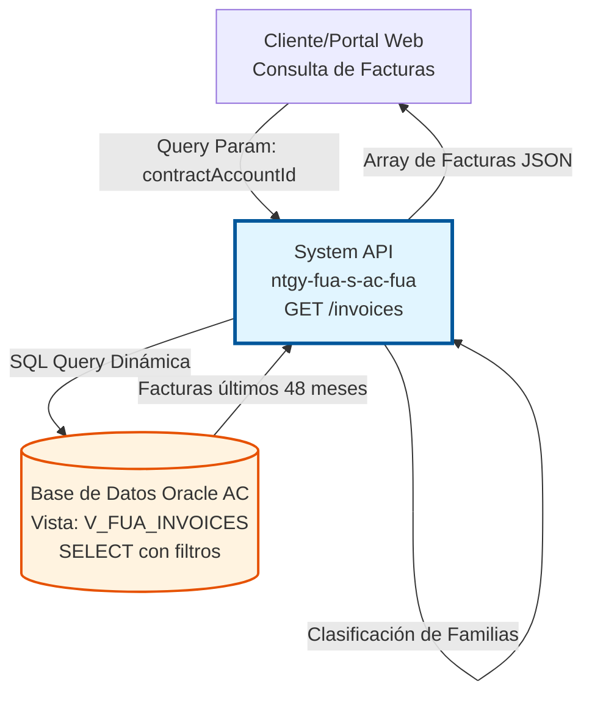
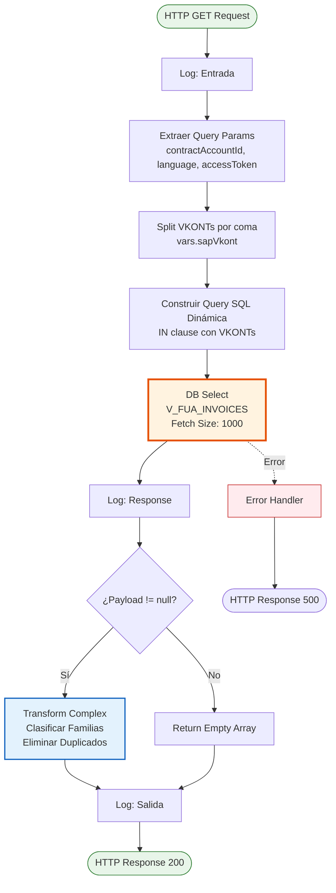
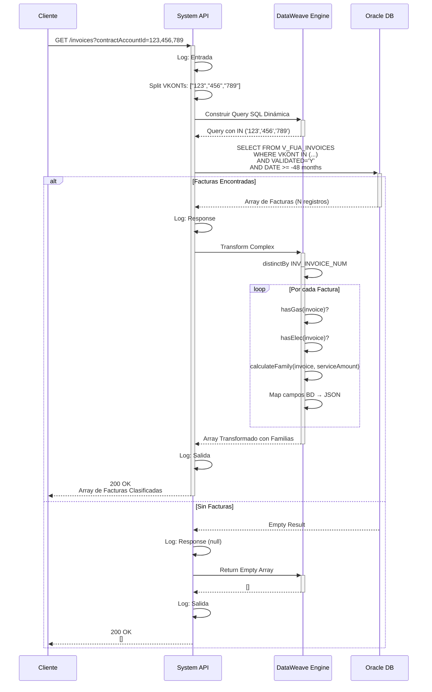

# GET /invoices

## 📌 Descripción General

### Propósito del Endpoint

Este endpoint consulta las facturas de uno o múltiples contratos (VKONTs) de clientes, proporcionando información detallada de facturación con clasificación automática por familias de productos (gas, electricidad, dual, servicios). Retorna el histórico de los últimos 48 meses de facturas validadas, ordenadas por fecha descendente.

El endpoint soporta:
- **Consulta Multi-Contrato**: Permite consultar facturas de múltiples VKONTs en una sola petición
- **Clasificación Automática**: Identifica automáticamente el tipo de suministro (gas, electricidad, dual)
- **Detección de Servicios**: Identifica facturas con servicios adicionales contratados
- **Disponibilidad de PDF**: Indica si la factura tiene PDF disponible para descarga
- **Estado de Deuda**: Incluye información sobre el estado de pago de cada factura
- **Histórico Limitado**: Últimos 48 meses para optimizar performance

### Tipo de API

**Capa:** System API (API-Led Connectivity)

**Función:** Integración directa con base de datos Oracle AC para consulta de facturas con lógica de clasificación de productos.

### Patrón de Integración

**Tipo:** Request-Reply Síncrono con SQL Query + Transformación Compleja

**Descripción:** Recibe lista de VKONTs como query parameter, construye query SQL dinámica con IN clause, ejecuta SELECT en vista consolidada, aplica lógica de negocio para clasificar familias de productos, y retorna array de facturas transformadas.

### Arquitectura API-Led Connectivity



---

## 💼 Propósito del Negocio

### Casos de Uso Principales

1. **Consulta de Facturas en Portal Cliente**
   - Cliente accede a su área personal
   - Visualiza listado de facturas de todos sus contratos
   - Identifica facturas pendientes de pago
   - **Beneficio**: Transparencia y autoservicio

2. **Descarga de Facturas en PDF**
   - Sistema identifica qué facturas tienen PDF disponible
   - Cliente puede descargar facturas para gestiones
   - Histórico completo de 4 años disponible
   - **Beneficio**: Acceso inmediato a documentación

3. **Análisis de Consumo por Tipo de Suministro**
   - Sistema clasifica automáticamente facturas por tipo
   - Cliente visualiza consumos de gas, electricidad o dual
   - Identifica servicios adicionales contratados
   - **Beneficio**: Comprensión clara de consumos

4. **Gestión de Pagos Pendientes**
   - Identificación de facturas con deuda pendiente
   - Priorización de pagos por fecha de vencimiento
   - Visualización de importes totales
   - **Beneficio**: Control financiero

5. **Consulta Multi-Contrato**
   - Clientes con múltiples suministros ven todas sus facturas
   - Vista unificada de todos los contratos
   - Ordenación cronológica descendente
   - **Beneficio**: Gestión centralizada

### Contexto Empresarial

- **Dominio:** Facturación y Cobros
- **Sector:** Energía - Utilities
- **División:** Naturgy España - Área Cliente
- **Proceso de Negocio:** Gestión de Facturas y Cobros
- **Sistema:** Área Cliente (AC) - Facturación

### Stakeholders

- **Clientes Finales**: Necesitan consultar y descargar sus facturas
- **Equipo de Cobros**: Requiere visibilidad de facturas pendientes
- **Servicio al Cliente**: Necesita acceso rápido a información de facturación
- **Equipo de Facturación**: Monitorea facturas emitidas y validadas

### Valor de Negocio

- **Transparencia**: Acceso completo al histórico de facturación
- **Autoservicio**: Reducción de llamadas al call center
- **Eficiencia**: Consulta multi-contrato en una sola petición
- **Clasificación Automática**: Identificación inteligente de tipos de suministro
- **Optimización**: Límite de 48 meses mejora performance

### Consumidores Potenciales

Este endpoint puede ser consumido por:
- Process APIs de facturación
- Portales web de clientes
- Aplicaciones móviles de Naturgy
- Sistemas de call center
- Integraciones con sistemas de pago
- Dashboards de análisis de consumo

---

## 🔧 Especificación Técnica

### URLs por Ambiente

| Ambiente | URL Base | URL Completa |
|----------|----------|--------------|
| **Local** | `http://localhost:8081` | `http://localhost:8081/api/invoices?contractAccountId=123,456` |
| **Development** | `https://ntgy-fua-s-ac-fua-dev.us-e2.cloudhub.io` | `https://ntgy-fua-s-ac-fua-dev.us-e2.cloudhub.io/api/invoices?contractAccountId=123,456` |
| **UAT** | `https://ntgy-fua-s-ac-fua-uat.us-e2.cloudhub.io` | `https://ntgy-fua-s-ac-fua-uat.us-e2.cloudhub.io/api/invoices?contractAccountId=123,456` |
| **Production** | `https://ntgy-fua-s-ac-fua-pro.us-e2.cloudhub.io` | `https://ntgy-fua-s-ac-fua-pro.us-e2.cloudhub.io/api/invoices?contractAccountId=123,456` |

### Método HTTP

```
GET /api/invoices
```

### Parámetros de Entrada

#### Headers HTTP

| Header | Tipo | Requerido | Descripción | Ejemplo |
|--------|------|-----------|-------------|---------|
| `Accept` | string | ❌ No | Tipo de contenido esperado en response | `application/json` |

#### Query Parameters

| Parámetro | Tipo | Requerido | Descripción | Ejemplo |
|-----------|------|-----------|-------------|---------|
| `contractAccountId` | string | ✅ Sí | Lista de VKONTs (cuentas contrato SAP) separados por comas | `"123456,789012,345678"` |
| `language` | string | ❌ No | Idioma para respuesta (almacenado pero no usado actualmente) | `"es"` |
| `accessToken` | string | ❌ No | Token de acceso (almacenado pero no usado actualmente) | `"token123"` |

**Validaciones:**
- `contractAccountId` es obligatorio
- Formato: números separados por comas sin espacios
- Mínimo 1 VKONT, sin límite máximo (pero considerar performance)

**Nota:** Los parámetros `language` y `accessToken` se almacenan en variables pero no se utilizan en la query actual. Pueden ser para uso futuro o logging.

### Respuestas

#### Respuesta Exitosa con Datos (200 OK)

```json
[
  {
    "invoiceId": "1234567890",
    "invoiceNum": "1234567890",
    "pdfDownload": true,
    "issuedDate": "2026-06-15T00:00:00",
    "billingDate": "2026-07-15T00:00:00",
    "amount": 125.50,
    "pdfDocumentId": "1234567890",
    "statusDebt": "PAID",
    "productInvoiceRelationList": [
      {
        "productFamilyId": "gas"
      },
      {
        "productFamilyId": "luz"
      }
    ]
  },
  {
    "invoiceId": "0987654321",
    "invoiceNum": "0987654321",
    "pdfDownload": false,
    "issuedDate": "2026-05-15T00:00:00",
    "billingDate": "2026-06-15T00:00:00",
    "amount": 89.30,
    "pdfDocumentId": "0987654321",
    "statusDebt": "PENDING",
    "productInvoiceRelationList": [
      {
        "productFamilyId": "luz"
      },
      {
        "productFamilyId": "servicios"
      }
    ]
  }
]
```

**Descripción de Campos:**
- `invoiceId`: Identificador único de la factura
- `invoiceNum`: Número de factura (mismo que invoiceId)
- `pdfDownload`: Indica si hay PDF disponible para descarga
- `issuedDate`: Fecha de emisión de la factura
- `billingDate`: Fecha de vencimiento/cobro
- `amount`: Importe total de la factura
- `pdfDocumentId`: ID del documento PDF (mismo que invoiceId)
- `statusDebt`: Estado de la deuda (PAID, PENDING, etc.)
- `productInvoiceRelationList`: Array de familias de productos en la factura

**Familias de Productos Posibles:**
- `"gas"`: Suministro de gas natural
- `"luz"`: Suministro de electricidad
- `"servicios"`: Servicios adicionales contratados

#### Respuesta Sin Datos (200 OK)

```json
[]
```

**Casos:**
- No hay facturas para los VKONTs proporcionados
- Todas las facturas son anteriores a 48 meses
- VKONTs no existen en el sistema

#### Respuesta de Error Técnico (500)

```json
{
  "result": {
    "codResult": "-0001",
    "msgResult": "Error técnico"
  }
}
```

**Casos de Error:**
- Error de conexión a base de datos
- Timeout en la query
- Error en transformación DataWeave
- Error interno del sistema

### Autenticación y Autorización

- **Tipo:** Client ID & Client Secret (Anypoint Platform)
- **Autorización DB:** El usuario de base de datos debe tener permisos para:
  - Ejecutar SELECT en vista `V_FUA_INVOICES`
  - Acceso al schema `OVPRO_DELTA`

### Timeouts

| Tipo | Valor | Descripción |
|------|-------|-------------|
| **Request Timeout** | 30 segundos | Tiempo máximo de espera para la respuesta |
| **Connection Timeout** | 10 segundos | Tiempo máximo para establecer conexión con DB |
| **Query Timeout** | Configurado en `${dbAC.queryTimeout}` | Tiempo máximo de ejecución de la query SQL |

### Performance

| Métrica | Valor | Descripción |
|---------|-------|-------------|
| **Fetch Size** | 1000 registros | Número de registros recuperados por lote |
| **In-Memory Objects** | 1000 | Objetos mantenidos en memoria |
| **Histórico** | 48 meses | Límite temporal para optimizar performance |

---

## 🏗️ Implementación Técnica

### Arquitectura del Flow



### Operación de Base de Datos

#### Query SQL Dinámica

```sql
SELECT DISTINCT 
    INV_INVOICE_NUM, 
    SAP_CONS_BELZART_CHZ1,
    INV_EXISTS_PDF_DCMT,
    INV_INVOICE_DATE,
    INV_EXPIRATION_DATE,
    INV_INVOICE_TOTAL,
    IMPORTE_SERVICIO, 
    PGOL_INOVICE_AUGRD 
FROM V_FUA_INVOICES 
WHERE INV_SAP_VKONT IN ('123456','789012','345678')
  AND INV_VALIDATED_INVOICE = 'Y' 
  AND INV_INVOICE_DATE >= ADD_MONTHS(SYSDATE, -48) 
ORDER BY INV_INVOICE_DATE DESC
```

**Detalles de la Operación:**
- **Tipo:** SELECT
- **Vista:** `V_FUA_INVOICES` (vista consolidada)
- **Schema:** `OVPRO_DELTA`
- **DISTINCT:** Elimina duplicados a nivel de BD
- **Filtros Automáticos:**
  - Solo facturas validadas (`INV_VALIDATED_INVOICE = 'Y'`)
  - Últimos 48 meses (`ADD_MONTHS(SYSDATE, -48)`)
  - Lista de VKONTs (dinámica según parámetro)
- **Ordenación:** Por fecha de factura descendente

#### Construcción Dinámica de Query

```dataweave
%dw 2.0
output application/json
var query = "SELECT DISTINCT INV_INVOICE_NUM, SAP_CONS_BELZART_CHZ1,INV_EXISTS_PDF_DCMT,INV_INVOICE_DATE,INV_EXPIRATION_DATE,INV_INVOICE_TOTAL,IMPORTE_SERVICIO, PGOL_INOVICE_AUGRD FROM V_FUA_INVOICES WHERE INV_SAP_VKONT in ('" ++ (vars.sapVkont joinBy "','") ++ "') AND INV_VALIDATED_INVOICE='Y' AND INV_INVOICE_DATE >= ADD_MONTHS(SYSDATE, -48) order by INV_INVOICE_DATE DESC"
---
query
```

**Lógica:**
1. Toma array de VKONTs: `["123456", "789012", "345678"]`
2. Une con `','`: `"123456','789012','345678"`
3. Construye IN clause: `IN ('123456','789012','345678')`

#### Configuración de Base de Datos

```xml
<db:select config-ref="Database_Config" 
           queryTimeout="${dbAC.queryTimeout}" 
           fetchSize="1000">
    <ee:repeatable-file-store-iterable inMemoryObjects="1000" />
    <db:sql><![CDATA[#[vars.query]]]></db:sql>
</db:select>
```

**Características:**
- Query timeout configurable
- Fetch size: 1000 registros por lote
- Repeatable file store para grandes volúmenes
- In-memory objects: 1000 para performance

### Lógica de Clasificación de Familias de Productos

#### Funciones DataWeave

```dataweave
%dw 2.0
output application/json

// Función: Detecta si la factura tiene suministro de GAS
fun hasGas(inv) = 
    sizeOf(payload filter (value, index) -> 
        ((value.INV_INVOICE_NUM == inv) and 
         (value.SAP_CONS_BELZART_CHZ1 contains("ZG")))) > 0

// Función: Detecta si la factura tiene suministro de ELECTRICIDAD
fun hasElec(inv) = 
    sizeOf(payload filter (value, index) -> 
        ((value.INV_INVOICE_NUM == inv) and 
         (value.SAP_CONS_BELZART_CHZ1 contains("ZE")))) > 0

// Función: Calcula las familias de productos según combinación
fun calculateFamily(inv, serviceAmount) = 
    if (hasGas(inv) and !hasElec(inv) and serviceAmount == 0) 
        [{productFamilyId: "gas"}]
    else if (hasGas(inv) and !hasElec(inv) and serviceAmount > 0) 
        [{productFamilyId: "gas"}, {productFamilyId: "servicios"}]
    else if (!hasGas(inv) and hasElec(inv) and serviceAmount == 0) 
        [{productFamilyId: "luz"}]
    else if (!hasGas(inv) and hasElec(inv) and serviceAmount > 0) 
        [{productFamilyId: "luz"},{productFamilyId: "servicios"}]
    else if (hasGas(inv) and hasElec(inv) and serviceAmount == 0) 
        [{productFamilyId: "luz"},{productFamilyId: "gas"}]
    else if (hasGas(inv) and hasElec(inv) and serviceAmount > 0) 
        [{productFamilyId: "gas"},{productFamilyId: "luz"},{productFamilyId: "servicios"}]
    else if (!hasGas(inv) and !hasElec(inv) and serviceAmount == 0) 
        []
    else if (!hasGas(inv) and !hasElec(inv) and serviceAmount > 0) 
        [{productFamilyId: "servicios"}]
    else 
        []
```

#### Tabla de Combinaciones de Familias

| Gas | Electricidad | Servicios | Resultado |
|-----|--------------|-----------|-----------|
| ✅ | ❌ | ❌ | `["gas"]` |
| ✅ | ❌ | ✅ | `["gas", "servicios"]` |
| ❌ | ✅ | ❌ | `["luz"]` |
| ❌ | ✅ | ✅ | `["luz", "servicios"]` |
| ✅ | ✅ | ❌ | `["luz", "gas"]` |
| ✅ | ✅ | ✅ | `["gas", "luz", "servicios"]` |
| ❌ | ❌ | ❌ | `[]` (vacío) |
| ❌ | ❌ | ✅ | `["servicios"]` |

**Códigos SAP:**
- `ZG`: Indica suministro de Gas
- `ZE`: Indica suministro de Electricidad
- Campo: `SAP_CONS_BELZART_CHZ1`

### Transformación de Respuesta

#### DataWeave - Response Completo

```dataweave
%dw 2.0
output application/json
---
payload distinctBy $.INV_INVOICE_NUM map ((item,index) -> {
    "invoiceId": item.INV_INVOICE_NUM,
    "invoiceNum": item.INV_INVOICE_NUM,
    "pdfDownload": if(item.INV_EXISTS_PDF_DCMT=="Y") true else false,
    "issuedDate": item.INV_INVOICE_DATE,
    "billingDate": item.INV_EXPIRATION_DATE,
    "amount": item.INV_INVOICE_TOTAL,
    "pdfDocumentId": item.INV_INVOICE_NUM,
    "statusDebt": item.PGOL_INOVICE_AUGRD,
    "productInvoiceRelationList": calculateFamily(item.INV_INVOICE_NUM, item.IMPORTE_SERVICIO)
})
```

**Lógica de Transformación:**
1. **Eliminar Duplicados:** `distinctBy $.INV_INVOICE_NUM`
2. **Mapear Campos:** BD → JSON
3. **Calcular pdfDownload:** Convertir "Y"/"N" a boolean
4. **Calcular Familias:** Invocar `calculateFamily()` por cada factura

### Diagrama de Secuencia Completo



### Estructura de Vista V_FUA_INVOICES

#### Campos Principales

| Campo | Tipo | Descripción | Ejemplo |
|-------|------|-------------|---------|
| `INV_INVOICE_NUM` | VARCHAR2 | Número de factura (PK) | `"1234567890"` |
| `INV_SAP_VKONT` | VARCHAR2 | Cuenta contrato SAP | `"123456"` |
| `SAP_CONS_BELZART_CHZ1` | VARCHAR2 | Código de tipo de suministro | `"ZG"`, `"ZE"` |
| `INV_EXISTS_PDF_DCMT` | CHAR(1) | Indica si existe PDF | `"Y"`, `"N"` |
| `INV_INVOICE_DATE` | DATE | Fecha de emisión | `2026-06-15` |
| `INV_EXPIRATION_DATE` | DATE | Fecha de vencimiento | `2026-07-15` |
| `INV_INVOICE_TOTAL` | NUMBER | Importe total | `125.50` |
| `IMPORTE_SERVICIO` | NUMBER | Importe de servicios | `15.00` |
| `PGOL_INOVICE_AUGRD` | VARCHAR2 | Estado de deuda | `"PAID"`, `"PENDING"` |
| `INV_VALIDATED_INVOICE` | CHAR(1) | Factura validada | `"Y"`, `"N"` |

**Índices:**
- Primary Key en `INV_INVOICE_NUM`
- Index en `INV_SAP_VKONT`
- Index en `INV_INVOICE_DATE`

### Manejo de Errores

#### Estrategia de Error Handling

El endpoint utiliza el error handler global del proyecto (`s-ac-globalErrorHandler.xml`).

**Tipos de Errores Manejados:**
- `DB:CONNECTIVITY`: Error de conexión a base de datos
- `DB:QUERY_EXECUTION`: Error en ejecución de query
- `DB:TIMEOUT`: Timeout de query
- `EXPRESSION`: Error en expresiones DataWeave
- `ANY`: Cualquier otro error no esperado

**Response de Error Estándar:**
```json
{
  "result": {
    "codResult": "-0001",
    "msgResult": "Error técnico"
  }
}
```

### Logging

#### Puntos de Log

1. **Entrada del Flow** (DEBUG)
   ```
   s-ac-invoices.logEntrada ## payload: #[payload]
   ```

2. **Response de BD** (DEBUG)
   ```
   #[payload]
   ```

3. **Salida del Flow** (DEBUG)
   ```
   s-ac-invoices.logSalida ## payload: #[payload]
   ```

**Información Logueada:**
- Query parameters recibidos
- VKONTs procesados
- Número de facturas recuperadas
- Resultado de transformación
- Errores con stack trace completo

---

## 💻 Ejemplos de Uso

### Ejemplo 1: Consulta de Facturas de Un Contrato

#### Request

```bash
curl -X GET "https://ntgy-fua-s-ac-fua-pro.us-e2.cloudhub.io/api/invoices?contractAccountId=123456" \
  -H "Accept: application/json" \
  -H "client_id: your-client-id" \
  -H "client_secret: your-client-secret"
```

#### Response (200 OK)

```json
[
  {
    "invoiceId": "1234567890",
    "invoiceNum": "1234567890",
    "pdfDownload": true,
    "issuedDate": "2026-06-15T00:00:00",
    "billingDate": "2026-07-15T00:00:00",
    "amount": 125.50,
    "pdfDocumentId": "1234567890",
    "statusDebt": "PAID",
    "productInvoiceRelationList": [
      {
        "productFamilyId": "gas"
      }
    ]
  },
  {
    "invoiceId": "1234567891",
    "invoiceNum": "1234567891",
    "pdfDownload": true,
    "issuedDate": "2026-05-15T00:00:00",
    "billingDate": "2026-06-15T00:00:00",
    "amount": 118.30,
    "pdfDocumentId": "1234567891",
    "statusDebt": "PAID",
    "productInvoiceRelationList": [
      {
        "productFamilyId": "gas"
      }
    ]
  }
]
```

**Interpretación:**
- ✅ 2 facturas encontradas para el contrato
- ✅ Ambas son solo de gas
- ✅ Ambas tienen PDF disponible
- ✅ Ambas están pagadas

---

### Ejemplo 2: Consulta Multi-Contrato (Dual)

#### Request

```bash
curl -X GET "https://ntgy-fua-s-ac-fua-pro.us-e2.cloudhub.io/api/invoices?contractAccountId=123456,789012" \
  -H "Accept: application/json" \
  -H "client_id: your-client-id" \
  -H "client_secret: your-client-secret"
```

#### Response (200 OK)

```json
[
  {
    "invoiceId": "2000000001",
    "invoiceNum": "2000000001",
    "pdfDownload": true,
    "issuedDate": "2026-06-15T00:00:00",
    "billingDate": "2026-07-15T00:00:00",
    "amount": 185.75,
    "pdfDocumentId": "2000000001",
    "statusDebt": "PENDING",
    "productInvoiceRelationList": [
      {
        "productFamilyId": "luz"
      },
      {
        "productFamilyId": "gas"
      }
    ]
  },
  {
    "invoiceId": "2000000002",
    "invoiceNum": "2000000002",
    "pdfDownload": false,
    "issuedDate": "2026-05-15T00:00:00",
    "billingDate": "2026-06-15T00:00:00",
    "amount": 175.20,
    "pdfDocumentId": "2000000002",
    "statusDebt": "PAID",
    "productInvoiceRelationList": [
      {
        "productFamilyId": "luz"
      },
      {
        "productFamilyId": "gas"
      }
    ]
  }
]
```

**Interpretación:**
- ✅ Facturas de múltiples contratos combinadas
- ✅ Cliente tiene suministro dual (gas + electricidad)
- ✅ Una factura pendiente de pago
- ⚠️ Una factura sin PDF disponible

---

### Ejemplo 3: Factura con Servicios Adicionales

#### Request

```bash
curl -X GET "https://ntgy-fua-s-ac-fua-pro.us-e2.cloudhub.io/api/invoices?contractAccountId=555666" \
  -H "Accept: application/json" \
  -H "client_id: your-client-id" \
  -H "client_secret: your-client-secret"
```

#### Response (200 OK)

```json
[
  {
    "invoiceId": "3000000001",
    "invoiceNum": "3000000001",
    "pdfDownload": true,
    "issuedDate": "2026-06-15T00:00:00",
    "billingDate": "2026-07-15T00:00:00",
    "amount": 215.90,
    "pdfDocumentId": "3000000001",
    "statusDebt": "PENDING",
    "productInvoiceRelationList": [
      {
        "productFamilyId": "gas"
      },
      {
        "productFamilyId": "luz"
      },
      {
        "productFamilyId": "servicios"
      }
    ]
  }
]
```

**Interpretación:**
- ✅ Factura con suministro dual + servicios
- ✅ Importe incluye gas, electricidad y servicios adicionales
- ⚠️ Factura pendiente de pago
- ✅ PDF disponible para descarga

---

### Ejemplo 4: Sin Facturas Disponibles

#### Request

```bash
curl -X GET "https://ntgy-fua-s-ac-fua-pro.us-e2.cloudhub.io/api/invoices?contractAccountId=999999" \
  -H "Accept: application/json" \
  -H "client_id: your-client-id" \
  -H "client_secret: your-client-secret"
```

#### Response (200 OK)

```json
[]
```

**Interpretación:**
- ⚠️ No hay facturas para el VKONT proporcionado
- ⚠️ Puede ser contrato nuevo sin facturas emitidas
- ⚠️ O todas las facturas son anteriores a 48 meses

---

### Ejemplo 5: Integración con JavaScript

```javascript
async function getInvoices(contractAccountIds) {
  const url = 'https://ntgy-fua-s-ac-fua-pro.us-e2.cloudhub.io/api/invoices';
  const vkonts = Array.isArray(contractAccountIds) 
    ? contractAccountIds.join(',') 
    : contractAccountIds;
  
  try {
    const response = await fetch(`${url}?contractAccountId=${vkonts}`, {
      method: 'GET',
      headers: {
        'Accept': 'application/json',
        'client_id': 'your-client-id',
        'client_secret': 'your-client-secret'
      }
    });
    
    const invoices = await response.json();
    
    // Clasificar facturas por estado
    const pending = invoices.filter(inv => inv.statusDebt === 'PENDING');
    const paid = invoices.filter(inv => inv.statusDebt === 'PAID');
    
    // Calcular total pendiente
    const totalPending = pending.reduce((sum, inv) => sum + inv.amount, 0);
    
    // Agrupar por tipo de suministro
    const byType = {
      gas: invoices.filter(inv => 
        inv.productInvoiceRelationList.some(p => p.productFamilyId === 'gas')
      ),
      luz: invoices.filter(inv => 
        inv.productInvoiceRelationList.some(p => p.productFamilyId === 'luz')
      ),
      dual: invoices.filter(inv => 
        inv.productInvoiceRelationList.some(p => p.productFamilyId === 'gas') &&
        inv.productInvoiceRelationList.some(p => p.productFamilyId === 'luz')
      )
    };
    
    return {
      total: invoices.length,
      pending: pending.length,
      paid: paid.length,
      totalPending: totalPending,
      byType: byType,
      invoices: invoices
    };
  } catch (error) {
    console.error('Error fetching invoices:', error);
    throw error;
  }
}

// Uso
getInvoices(['123456', '789012'])
  .then(result => {
    console.log(`Total facturas: ${result.total}`);
    console.log(`Pendientes: ${result.pending} (${result.totalPending}€)`);
    console.log(`Pagadas: ${result.paid}`);
    console.log(`Facturas dual: ${result.byType.dual.length}`);
  });
```

---

### Ejemplo 6: Análisis de Familias de Productos

```javascript
function analyzeInvoiceProducts(invoice) {
  const families = invoice.productInvoiceRelationList.map(p => p.productFamilyId);
  
  const analysis = {
    invoiceNum: invoice.invoiceNum,
    amount: invoice.amount,
    type: 'unknown'
  };
  
  // Determinar tipo de suministro
  const hasGas = families.includes('gas');
  const hasElec = families.includes('luz');
  const hasServices = families.includes('servicios');
  
  if (hasGas && hasElec) {
    analysis.type = 'dual';
    analysis.description = 'Suministro dual (gas + electricidad)';
  } else if (hasGas) {
    analysis.type = 'gas';
    analysis.description = 'Solo gas natural';
  } else if (hasElec) {
    analysis.type = 'electricidad';
    analysis.description = 'Solo electricidad';
  }
  
  if (hasServices) {
    analysis.hasServices = true;
    analysis.description += ' + servicios adicionales';
  }
  
  return analysis;
}

// Ejemplo de uso
const invoice = {
  "invoiceNum": "1234567890",
  "amount": 185.75,
  "productInvoiceRelationList": [
    { "productFamilyId": "luz" },
    { "productFamilyId": "gas" },
    { "productFamilyId": "servicios" }
  ]
};

const analysis = analyzeInvoiceProducts(invoice);
console.log(analysis);
// Output:
// {
//   invoiceNum: "1234567890",
//   amount: 185.75,
//   type: "dual",
//   description: "Suministro dual (gas + electricidad) + servicios adicionales",
//   hasServices: true
// }
```
