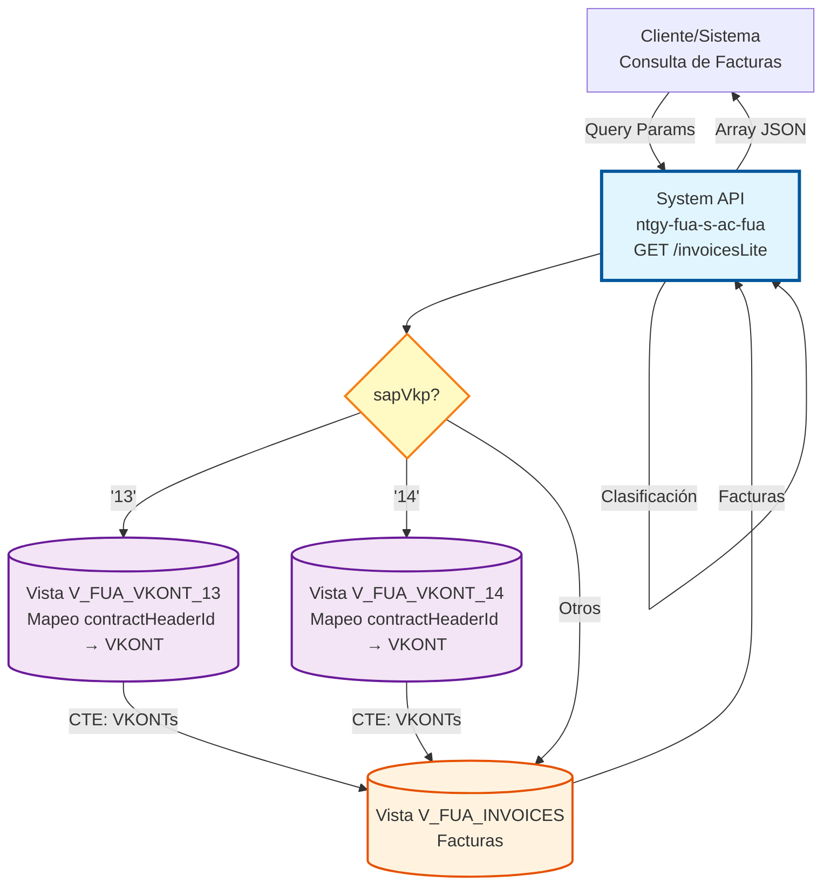
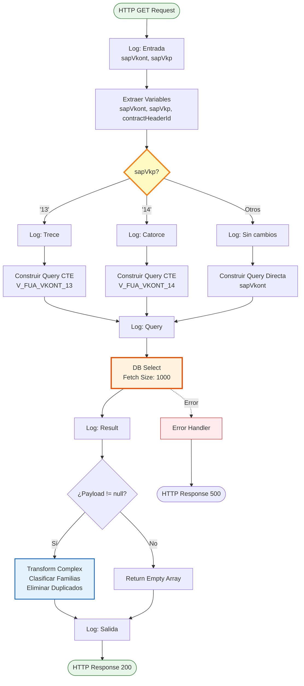
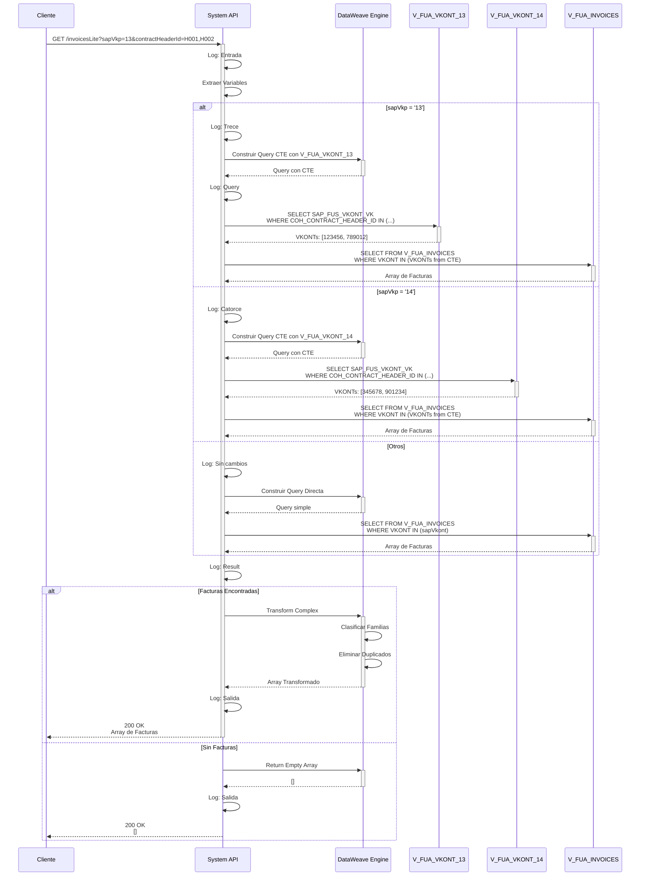

# GET /invoicesLite

## 📌 Descripción General

### Propósito del Endpoint

Este endpoint es una **versión especializada** de `/invoices` que consulta facturas con lógica condicional según el tipo de contrato (`sapVkp`). Soporta tres modos de operación: resolución indirecta de VKONTs para contratos tipo 13 y 14 mediante `contractHeaderId`, o consulta directa por VKONTs para otros tipos. Retorna el mismo formato de respuesta que `/invoices` con clasificación automática por familias de productos.

El endpoint soporta:
- **Lógica Condicional por Tipo**: Diferentes queries según `sapVkp` (13, 14, u otros)
- **Resolución Indirecta de VKONTs**: Para tipos 13 y 14 usa CTEs con vistas de mapeo
- **Consulta Directa**: Para otros tipos funciona como `/invoices` estándar
- **Clasificación Automática**: Identifica tipo de suministro (gas, electricidad, dual, servicios)
- **Histórico Limitado**: Últimos 48 meses para optimizar performance
- **Mismo Output**: Estructura de respuesta idéntica a `/invoices`

### Tipo de API

**Capa:** System API (API-Led Connectivity)

**Función:** Integración directa con base de datos Oracle AC para consulta de facturas con lógica condicional por tipo de contrato y clasificación de productos.

### Patrón de Integración

**Tipo:** Request-Reply Síncrono con SQL Query Condicional + CTEs + Transformación Compleja

**Descripción:** Recibe parámetros según tipo de contrato, evalúa `sapVkp` para determinar la estrategia de query (CTE con lookup o directa), ejecuta SELECT en vistas correspondientes, aplica lógica de clasificación de familias de productos, y retorna array de facturas transformadas.

### Arquitectura API-Led Connectivity



---

## 💼 Propósito del Negocio

### Casos de Uso Principales

1. **Consulta de Facturas con Estructura de Contrato Tipo 13**
   - Sistema tiene `contractHeaderId` pero no VKONTs directos
   - Requiere lookup en vista especializada `V_FUA_VKONT_13`
   - Resuelve VKONTs mediante CTE antes de consultar facturas
   - **Beneficio**: Flexibilidad para diferentes estructuras de datos

2. **Consulta de Facturas con Estructura de Contrato Tipo 14**
   - Similar a tipo 13 pero usa vista `V_FUA_VKONT_14`
   - Estructura de contrato diferente requiere mapeo específico
   - CTE resuelve la relación contractHeaderId → VKONT
   - **Beneficio**: Soporte para múltiples modelos de contrato

3. **Consulta Estándar para Otros Tipos de Contrato**
   - Cuando se tienen VKONTs directamente disponibles
   - Funciona exactamente como `/invoices` estándar
   - No requiere lookup adicional
   - **Beneficio**: Compatibilidad con casos simples

4. **Integración con Sistemas Legacy**
   - Sistemas antiguos que usan `contractHeaderId` en lugar de VKONT
   - Abstracción de la complejidad de mapeo
   - Migración gradual entre modelos de datos
   - **Beneficio**: Facilita modernización de sistemas

5. **Unificación de Consultas Multi-Tipo**
   - Un solo endpoint para diferentes estructuras de contrato
   - Lógica condicional transparente para el consumidor
   - Respuesta consistente independiente del tipo
   - **Beneficio**: Simplificación de integraciones

### Contexto Empresarial

- **Dominio:** Facturación y Cobros
- **Sector:** Energía - Utilities
- **División:** Naturgy España - Área Cliente
- **Proceso de Negocio:** Gestión de Facturas con Múltiples Modelos de Contrato
- **Sistema:** Área Cliente (AC) - Facturación Multi-Estructura

### Stakeholders

- **Equipo de Integración**: Necesita endpoint flexible para diferentes sistemas
- **Clientes Finales**: Acceso transparente independiente del tipo de contrato
- **Sistemas Legacy**: Requieren soporte para estructuras antiguas
- **Equipo de Migración**: Facilita transición entre modelos de datos

### Valor de Negocio

- **Flexibilidad**: Soporte para múltiples estructuras de contrato
- **Abstracción**: Oculta complejidad de mapeo al consumidor
- **Compatibilidad**: Funciona con sistemas legacy y modernos
- **Unificación**: Un solo endpoint para todos los tipos
- **Migración Gradual**: Permite coexistencia de modelos

### Consumidores Potenciales

Este endpoint puede ser consumido por:
- Process APIs que manejan múltiples tipos de contrato
- Sistemas legacy que usan `contractHeaderId`
- Portales web con diferentes modelos de cliente
- Aplicaciones móviles con lógica unificada
- Sistemas de migración de datos
- Integraciones con sistemas externos

---

## 🔧 Especificación Técnica

### URLs por Ambiente

| Ambiente | URL Base | URL Completa (Tipo 13) |
|----------|----------|------------------------|
| **Local** | `http://localhost:8081` | `http://localhost:8081/api/invoicesLite?sapVkp=13&contractHeaderId=H001,H002` |
| **Development** | `https://ntgy-fua-s-ac-fua-dev.us-e2.cloudhub.io` | `https://ntgy-fua-s-ac-fua-dev.us-e2.cloudhub.io/api/invoicesLite?sapVkp=13&contractHeaderId=H001,H002` |
| **UAT** | `https://ntgy-fua-s-ac-fua-uat.us-e2.cloudhub.io` | `https://ntgy-fua-s-ac-fua-uat.us-e2.cloudhub.io/api/invoicesLite?sapVkp=13&contractHeaderId=H001,H002` |
| **Production** | `https://ntgy-fua-s-ac-fua-pro.us-e2.cloudhub.io` | `https://ntgy-fua-s-ac-fua-pro.us-e2.cloudhub.io/api/invoicesLite?sapVkp=13&contractHeaderId=H001,H002` |

### Método HTTP

```
GET /api/invoicesLite
```

### Parámetros de Entrada

#### Headers HTTP

| Header | Tipo | Requerido | Descripción | Ejemplo |
|--------|------|-----------|-------------|---------|
| `Accept` | string | ❌ No | Tipo de contenido esperado en response | `application/json` |

#### Query Parameters

| Parámetro | Tipo | Requerido | Descripción | Ejemplo |
|-----------|------|-----------|-------------|---------|
| `sapVkp` | string | ✅ Sí | Tipo de contrato ('13', '14', u otro) | `"13"` |
| `contractHeaderId` | string | ⚠️ Condicional | Lista de IDs de cabecera de contrato (CSV). **Requerido si sapVkp='13' o '14'** | `"H001,H002,H003"` |
| `sapVkont` | string | ⚠️ Condicional | Lista de VKONTs (CSV). **Requerido si sapVkp != '13' y != '14'** | `"123456,789012"` |

**Validaciones por Tipo:**

**Para sapVkp = '13':**
- ✅ Requerido: `contractHeaderId`
- ❌ No usado: `sapVkont`
- Query: CTE con `V_FUA_VKONT_13`

**Para sapVkp = '14':**
- ✅ Requerido: `contractHeaderId`
- ❌ No usado: `sapVkont`
- Query: CTE con `V_FUA_VKONT_14`

**Para otros valores de sapVkp:**
- ✅ Requerido: `sapVkont`
- ❌ No usado: `contractHeaderId`
- Query: Directa como `/invoices`

### Respuestas

#### Respuesta Exitosa con Datos (200 OK)

```json
[
  {
    "invoiceId": "1234567890",
    "invoiceNum": "1234567890",
    "pdfDownload": true,
    "issuedDate": "2026-06-15T00:00:00",
    "billingDate": "2026-07-15T00:00:00",
    "amount": 125.50,
    "pdfDocumentId": "1234567890",
    "statusDebt": "PAID",
    "productInvoiceRelationList": [
      {
        "productFamilyId": "gas"
      },
      {
        "productFamilyId": "luz"
      }
    ]
  }
]
```

**Nota:** La estructura de respuesta es **idéntica** a `/invoices`. Ver documentación de `/invoices` para detalles completos de campos.

#### Respuesta Sin Datos (200 OK)

```json
[]
```

#### Respuesta de Error Técnico (500)

```json
{
  "result": {
    "codResult": "-0001",
    "msgResult": "Error técnico"
  }
}
```

### Autenticación y Autorización

- **Tipo:** Client ID & Client Secret (Anypoint Platform)
- **Autorización DB:** El usuario de base de datos debe tener permisos para:
  - Ejecutar SELECT en vista `V_FUA_INVOICES`
  - Ejecutar SELECT en vista `V_FUA_VKONT_13` (si sapVkp='13')
  - Ejecutar SELECT en vista `V_FUA_VKONT_14` (si sapVkp='14')
  - Acceso al schema `OVPRO_DELTA`

### Timeouts

| Tipo | Valor | Descripción |
|------|-------|-------------|
| **Request Timeout** | 30 segundos | Tiempo máximo de espera para la respuesta |
| **Connection Timeout** | 10 segundos | Tiempo máximo para establecer conexión con DB |
| **Query Timeout** | Configurado en `${dbAC.queryTimeout}` | Tiempo máximo de ejecución de la query SQL |

### Performance

| Métrica | Valor | Descripción |
|---------|-------|-------------|
| **Fetch Size** | 1000 registros | Número de registros recuperados por lote |
| **In-Memory Objects** | 1000 | Objetos mantenidos en memoria |
| **Histórico** | 48 meses | Límite temporal para optimizar performance |
| **CTEs** | 1 por query (tipos 13/14) | Common Table Expression para lookup |

---

## 🏗️ Implementación Técnica

### Arquitectura del Flow



### Operaciones de Base de Datos

#### Query Tipo 13 (con CTE)

```sql
WITH vkont AS (
    SELECT SAP_FUS_VKONT_VK
    FROM V_FUA_VKONT_13 
    WHERE COH_CONTRACT_HEADER_ID IN ('H001','H002','H003')
)
SELECT DISTINCT 
    INV_INVOICE_NUM, 
    SAP_CONS_BELZART_CHZ1,
    INV_EXISTS_PDF_DCMT,
    INV_INVOICE_DATE,
    INV_EXPIRATION_DATE,
    INV_INVOICE_TOTAL,
    IMPORTE_SERVICIO, 
    PGOL_INOVICE_AUGRD 
FROM V_FUA_INVOICES 
WHERE INV_SAP_VKONT IN (SELECT SAP_FUS_VKONT_VK FROM vkont) 
  AND INV_VALIDATED_INVOICE = 'Y' 
  AND INV_INVOICE_DATE >= ADD_MONTHS(SYSDATE, -48) 
ORDER BY INV_INVOICE_DATE DESC
```

**Detalles:**
- **CTE `vkont`**: Resuelve contractHeaderId → VKONT usando `V_FUA_VKONT_13`
- **Subquery**: Usa resultado del CTE en WHERE clause
- **Vista de Mapeo**: `V_FUA_VKONT_13` contiene relación específica para tipo 13

#### Query Tipo 14 (con CTE)

```sql
WITH vkont AS (
    SELECT SAP_FUS_VKONT_VK
    FROM V_FUA_VKONT_14 
    WHERE COH_CONTRACT_HEADER_ID IN ('H001','H002','H003')
)
SELECT DISTINCT 
    INV_INVOICE_NUM, 
    SAP_CONS_BELZART_CHZ1,
    INV_EXISTS_PDF_DCMT,
    INV_INVOICE_DATE,
    INV_EXPIRATION_DATE,
    INV_INVOICE_TOTAL,
    IMPORTE_SERVICIO, 
    PGOL_INOVICE_AUGRD 
FROM V_FUA_INVOICES 
WHERE INV_SAP_VKONT IN (SELECT SAP_FUS_VKONT_VK FROM vkont) 
  AND INV_VALIDATED_INVOICE = 'Y' 
  AND INV_INVOICE_DATE >= ADD_MONTHS(SYSDATE, -48) 
ORDER BY INV_INVOICE_DATE DESC
```

**Detalles:**
- **CTE `vkont`**: Resuelve contractHeaderId → VKONT usando `V_FUA_VKONT_14`
- **Vista de Mapeo**: `V_FUA_VKONT_14` contiene relación específica para tipo 14
- **Resto idéntico**: Misma query principal que tipo 13

#### Query Otros Tipos (Directa)

```sql
SELECT DISTINCT 
    INV_INVOICE_NUM, 
    SAP_CONS_BELZART_CHZ1,
    INV_EXISTS_PDF_DCMT,
    INV_INVOICE_DATE,
    INV_EXPIRATION_DATE,
    INV_INVOICE_TOTAL,
    IMPORTE_SERVICIO, 
    PGOL_INOVICE_AUGRD 
FROM V_FUA_INVOICES 
WHERE INV_SAP_VKONT IN ('123456','789012','345678')
  AND INV_VALIDATED_INVOICE = 'Y' 
  AND INV_INVOICE_DATE >= ADD_MONTHS(SYSDATE, -48) 
ORDER BY INV_INVOICE_DATE DESC
```

**Detalles:**
- **Sin CTE**: Query directa como `/invoices`
- **VKONTs directos**: Usa parámetro `sapVkont`
- **Más simple**: No requiere lookup adicional

### Construcción Dinámica de Queries

#### DataWeave - Query Tipo 13

```dataweave
%dw 2.0
output application/java
var query = "	
WITH vkont AS (
	SELECT SAP_FUS_VKONT_VK
  		FROM V_FUA_VKONT_13 
 	WHERE COH_CONTRACT_HEADER_ID IN ('" ++ (vars.contractHeaderId replace "," with "','" ) ++ "')
	)
	SELECT DISTINCT INV_INVOICE_NUM, SAP_CONS_BELZART_CHZ1,INV_EXISTS_PDF_DCMT,INV_INVOICE_DATE,INV_EXPIRATION_DATE,INV_INVOICE_TOTAL,IMPORTE_SERVICIO, PGOL_INOVICE_AUGRD 
		FROM V_FUA_INVOICES 
	WHERE INV_SAP_VKONT in (SELECT SAP_FUS_VKONT_VK FROM vkont) 
  	  AND INV_VALIDATED_INVOICE='Y' 
      AND INV_INVOICE_DATE >= ADD_MONTHS(SYSDATE, -48) 
	order by INV_INVOICE_DATE DESC"
---
query
```

**Lógica:**
1. Toma `contractHeaderId`: `"H001,H002,H003"`
2. Reemplaza comas: `"H001','H002','H003"`
3. Construye IN clause: `IN ('H001','H002','H003')`

#### DataWeave - Query Otros Tipos

```dataweave
%dw 2.0
output application/java
var query = "	
SELECT DISTINCT INV_INVOICE_NUM, SAP_CONS_BELZART_CHZ1,INV_EXISTS_PDF_DCMT,INV_INVOICE_DATE,INV_EXPIRATION_DATE,INV_INVOICE_TOTAL,IMPORTE_SERVICIO, PGOL_INOVICE_AUGRD 
	FROM V_FUA_INVOICES 
WHERE INV_SAP_VKONT in ('" ++ (vars.sapVkont replace "," with "','" ) ++ "')
  AND INV_VALIDATED_INVOICE='Y' 
  AND INV_INVOICE_DATE >= ADD_MONTHS(SYSDATE, -48) 
order by INV_INVOICE_DATE DESC"
---
query
```

### Lógica de Clasificación de Familias

**Nota:** La lógica de clasificación es **idéntica** a `/invoices`.

Ver documentación de `/invoices` para detalles completos de:
- Funciones `hasGas()`, `hasElec()`, `calculateFamily()`
- Tabla de combinaciones de familias
- Códigos SAP (ZG, ZE)

### Diagrama de Secuencia Completo



### Estructura de Vistas de Mapeo

#### Vista V_FUA_VKONT_13

| Campo | Tipo | Descripción | Ejemplo |
|-------|------|-------------|---------|
| `COH_CONTRACT_HEADER_ID` | VARCHAR2 | ID de cabecera de contrato | `"H001"` |
| `SAP_FUS_VKONT_VK` | VARCHAR2 | VKONT (cuenta contrato SAP) | `"123456"` |

**Propósito:** Mapea IDs de cabecera de contrato tipo 13 a VKONTs

#### Vista V_FUA_VKONT_14

| Campo | Tipo | Descripción | Ejemplo |
|-------|------|-------------|---------|
| `COH_CONTRACT_HEADER_ID` | VARCHAR2 | ID de cabecera de contrato | `"H002"` |
| `SAP_FUS_VKONT_VK` | VARCHAR2 | VKONT (cuenta contrato SAP) | `"789012"` |

**Propósito:** Mapea IDs de cabecera de contrato tipo 14 a VKONTs

### Logging

#### Puntos de Log

1. **Entrada del Flow** (DEBUG)
   ```
   invoicesLite - mensaje de entrada | sapVkont: #[...] sapVkp: #[...]
   ```

2. **Decisión de Tipo** (INFO)
   - `"sapVkp es 13"` (si tipo 13)
   - `"sapVkp es 14"` (si tipo 14)
   - `"Sin cambios"` (otros tipos)

3. **Query Construida** (DEBUG)
   ```
   invoicesLite - query: #[vars.query]
   ```

4. **Resultado de Query** (DEBUG)
   ```
   invoicesLite - salida query: #[payload]
   ```

5. **Salida del Flow** (DEBUG)
   ```
   invoicesLite - mensaje salida: #[payload]
   ```

---

## 💻 Ejemplos de Uso

### Ejemplo 1: Consulta Tipo 13 (con contractHeaderId)

#### Request

```bash
curl -X GET "https://ntgy-fua-s-ac-fua-pro.us-e2.cloudhub.io/api/invoicesLite?sapVkp=13&contractHeaderId=H001,H002,H003" \
  -H "Accept: application/json" \
  -H "client_id: your-client-id" \
  -H "client_secret: your-client-secret"
```

#### Response (200 OK)

```json
[
  {
    "invoiceId": "1000000001",
    "invoiceNum": "1000000001",
    "pdfDownload": true,
    "issuedDate": "2026-06-15T00:00:00",
    "billingDate": "2026-07-15T00:00:00",
    "amount": 145.80,
    "pdfDocumentId": "1000000001",
    "statusDebt": "PAID",
    "productInvoiceRelationList": [
      {
        "productFamilyId": "gas"
      }
    ]
  },
  {
    "invoiceId": "1000000002",
    "invoiceNum": "1000000002",
    "pdfDownload": true,
    "issuedDate": "2026-05-15T00:00:00",
    "billingDate": "2026-06-15T00:00:00",
    "amount": 132.50,
    "pdfDocumentId": "1000000002",
    "statusDebt": "PENDING",
    "productInvoiceRelationList": [
      {
        "productFamilyId": "gas"
      }
    ]
  }
]
```

**Interpretación:**
- ✅ Query ejecutada con CTE usando `V_FUA_VKONT_13`
- ✅ contractHeaderIds resueltos a VKONTs internamente
- ✅ Facturas recuperadas de esos VKONTs
- ✅ Clasificación automática aplicada

**Flujo Interno:**
1. `sapVkp='13'` → Usa CTE con `V_FUA_VKONT_13`
2. CTE resuelve: `H001,H002,H003` → `[123456, 789012, 345678]`
3. Query principal usa esos VKONTs
4. Retorna facturas clasificadas

---

### Ejemplo 2: Consulta Tipo 14 (con contractHeaderId)

#### Request

```bash
curl -X GET "https://ntgy-fua-s-ac-fua-pro.us-e2.cloudhub.io/api/invoicesLite?sapVkp=14&contractHeaderId=H101,H102" \
  -H "Accept: application/json" \
  -H "client_id: your-client-id" \
  -H "client_secret: your-client-secret"
```

#### Response (200 OK)

```json
[
  {
    "invoiceId": "2000000001",
    "invoiceNum": "2000000001",
    "pdfDownload": true,
    "issuedDate": "2026-06-15T00:00:00",
    "billingDate": "2026-07-15T00:00:00",
    "amount": 198.40,
    "pdfDocumentId": "2000000001",
    "statusDebt": "PAID",
    "productInvoiceRelationList": [
      {
        "productFamilyId": "luz"
      },
      {
        "productFamilyId": "gas"
      }
    ]
  }
]
```

**Interpretación:**
- ✅ Query ejecutada con CTE usando `V_FUA_VKONT_14`
- ✅ Estructura de contrato tipo 14 manejada correctamente
- ✅ Facturas dual (gas + electricidad)

---

### Ejemplo 3: Consulta Otros Tipos (con sapVkont)

#### Request

```bash
curl -X GET "https://ntgy-fua-s-ac-fua-pro.us-e2.cloudhub.io/api/invoicesLite?sapVkp=99&sapVkont=123456,789012" \
  -H "Accept: application/json" \
  -H "client_id: your-client-id" \
  -H "client_secret: your-client-secret"
```

#### Response (200 OK)

```json
[
  {
    "invoiceId": "3000000001",
    "invoiceNum": "3000000001",
    "pdfDownload": false,
    "issuedDate": "2026-06-15T00:00:00",
    "billingDate": "2026-07-15T00:00:00",
    "amount": 89.90,
    "pdfDocumentId": "3000000001",
    "statusDebt": "PENDING",
    "productInvoiceRelationList": [
      {
        "productFamilyId": "luz"
      }
    ]
  }
]
```

**Interpretación:**
- ✅ Query directa sin CTE (como `/invoices`)
- ✅ Usa `sapVkont` directamente
- ✅ Funciona para cualquier tipo no 13 ni 14

---

### Ejemplo 4: Comparación con /invoices

```javascript
// Escenario: Tienes VKONTs directamente

// Opción 1: Usar /invoices (recomendado)
const response1 = await fetch(
  'https://api.example.com/invoices?contractAccountId=123456,789012'
);

// Opción 2: Usar /invoicesLite con sapVkp != 13 y != 14
const response2 = await fetch(
  'https://api.example.com/invoicesLite?sapVkp=99&sapVkont=123456,789012'
);

// Ambos retornan el mismo resultado
// Usar /invoices es más directo y claro
```

```javascript
// Escenario: Tienes contractHeaderId y tipo 13

// Solo /invoicesLite puede manejar esto
const response = await fetch(
  'https://api.example.com/invoicesLite?sapVkp=13&contractHeaderId=H001,H002'
);

// /invoices NO puede manejar contractHeaderId
// Requiere VKONTs directamente
```

---

### Ejemplo 5: Integración con JavaScript - Lógica Condicional

```javascript
async function getInvoicesByContractType(contractType, identifiers) {
  const baseUrl = 'https://ntgy-fua-s-ac-fua-pro.us-e2.cloudhub.io/api/invoicesLite';
  
  let url;
  
  switch(contractType) {
    case '13':
      // Tipo 13: Usa contractHeaderId
      url = `${baseUrl}?sapVkp=13&contractHeaderId=${identifiers.join(',')}`;
      break;
      
    case '14':
      // Tipo 14: Usa contractHeaderId
      url = `${baseUrl}?sapVkp=14&contractHeaderId=${identifiers.join(',')}`;
      break;
      
    default:
      // Otros: Usa sapVkont
      url = `${baseUrl}?sapVkp=${contractType}&sapVkont=${identifiers.join(',')}`;
      break;
  }
  
  try {
    const response = await fetch(url, {
      method: 'GET',
      headers: {
        'Accept': 'application/json',
        'client_id': 'your-client-id',
        'client_secret': 'your-client-secret'
      }
    });
    
    const invoices = await response.json();
    
    return {
      success: true,
      contractType: contractType,
      count: invoices.length,
      invoices: invoices
    };
  } catch (error) {
    console.error('Error fetching invoices:', error);
    return {
      success: false,
      error: error.message
    };
  }
}

// Uso
// Tipo 13
getInvoicesByContractType('13', ['H001', 'H002'])
  .then(result => console.log(`Tipo 13: ${result.count} facturas`));

// Tipo 14
getInvoicesByContractType('14', ['H101', 'H102'])
  .then(result => console.log(`Tipo 14: ${result.count} facturas`));

// Otros
getInvoicesByContractType('99', ['123456', '789012'])
  .then(result => console.log(`Tipo 99: ${result.count} facturas`));
```

---

## 📊 Comparación: /invoices vs /invoicesLite

### Tabla Comparativa

| Característica | /invoices | /invoicesLite |
|----------------|-----------|---------------|
| **Parámetros** | `contractAccountId` (VKONTs) | `sapVkp` + `contractHeaderId` o `sapVkont` |
| **Lógica** | Query directa | Condicional por tipo |
| **CTEs** | No | Sí (tipos 13 y 14) |
| **Vistas Adicionales** | Solo `V_FUA_INVOICES` | + `V_FUA_VKONT_13/14` |
| **Complejidad** | ⭐⭐⭐ Media | ⭐⭐⭐⭐⭐ Muy Alta |
| **Performance** | Más rápido | Ligeramente más lento (CTEs) |
| **Casos de Uso** | VKONTs conocidos | Múltiples estructuras de contrato |
| **Response** | Idéntico | Idéntico |
| **Clasificación** | Sí | Sí (misma lógica) |

### Cuándo Usar Cada Uno

**Usar `/invoices` cuando:**
- ✅ Tienes VKONTs directamente disponibles
- ✅ Estructura de contrato es estándar
- ✅ Necesitas máxima performance
- ✅ Integración simple y directa

**Usar `/invoicesLite` cuando:**
- ✅ Tienes `contractHeaderId` en lugar de VKONTs
- ✅ Trabajas con contratos tipo 13 o 14
- ✅ Necesitas flexibilidad para múltiples tipos
- ✅ Migración entre modelos de datos
- ✅ Integración con sistemas legacy
