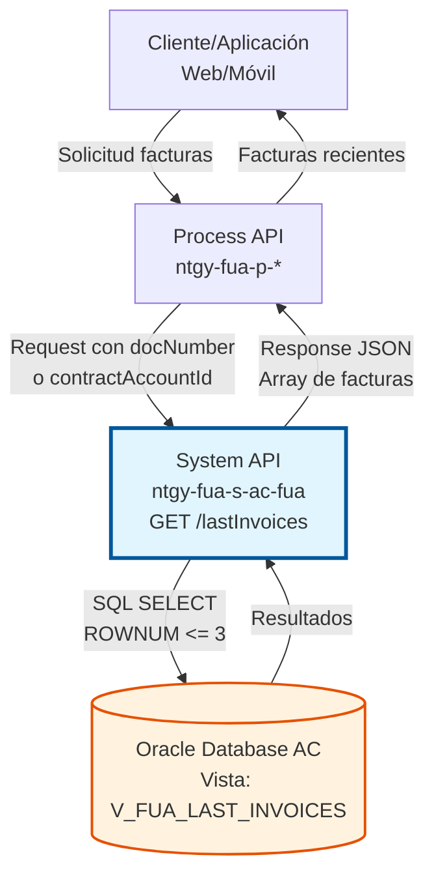
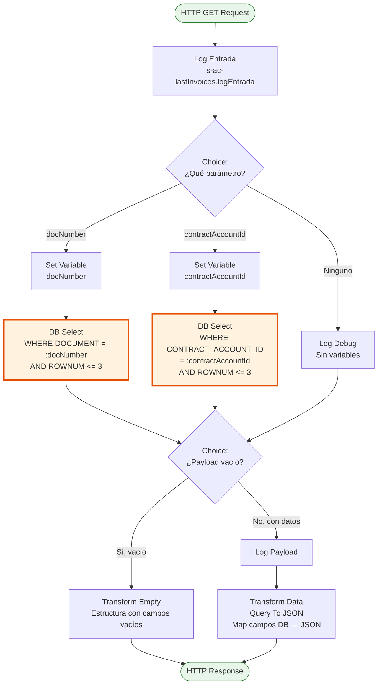
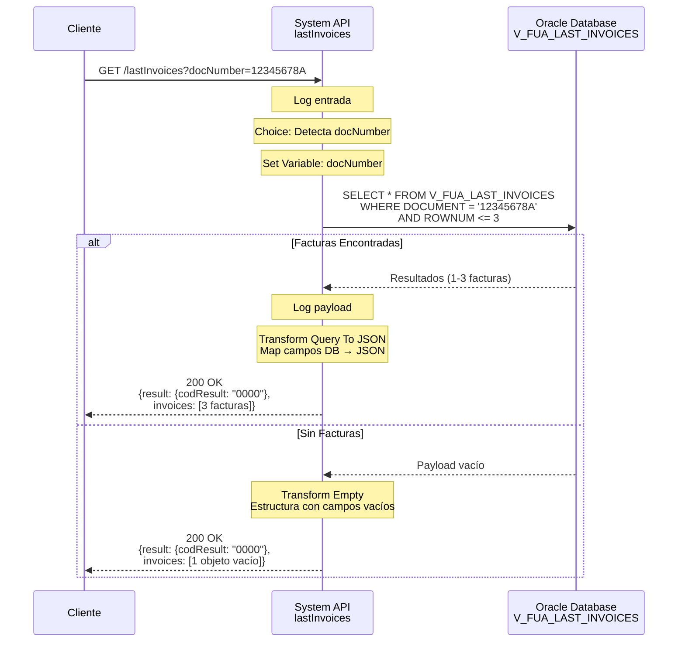
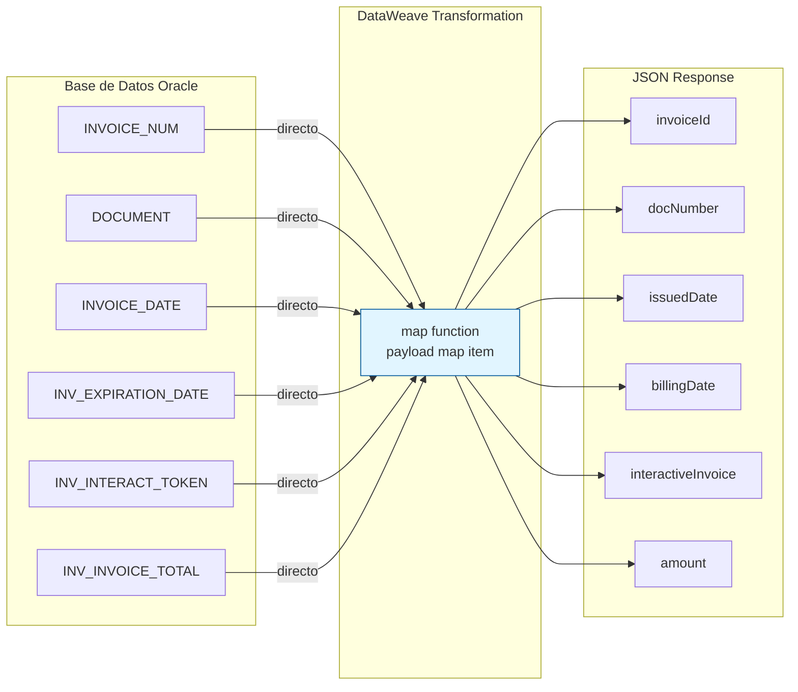

# GET /lastInvoices

## 📌 Descripción General

### Propósito del Endpoint

Consulta las últimas 3 facturas de un cliente o cuenta contrato desde la base de datos del Área de Clientes. El endpoint proporciona acceso rápido a la información de facturación más reciente, soportando búsqueda por documento de identidad (NIF/NIE) o por identificador de cuenta contrato.

El endpoint soporta:
- **Consulta por Documento**: Obtiene las 3 facturas más recientes del cliente identificado por NIF/NIE
- **Consulta por Cuenta Contrato**: Obtiene las 3 facturas más recientes de una cuenta contrato específica
- **Límite Automático**: Retorna máximo 3 facturas ordenadas por fecha
- **Respuesta Estructurada**: Formato JSON consistente incluso cuando no hay resultados

### Tipo de API

**Capa:** System API (API-Led Connectivity)

**Función:** Integración directa con base de datos Oracle del Área de Clientes para consulta de facturas recientes.

### Patrón de Integración

**Tipo:** Request-Reply Síncrono con Database Query

**Descripción:** Recibe parámetro de búsqueda (documento o cuenta contrato), ejecuta query SQL en vista consolidada `V_FUA_LAST_INVOICES`, transforma resultados a JSON y retorna las últimas 3 facturas.

### Arquitectura API-Led Connectivity



---

## 💼 Propósito del Negocio

### Casos de Uso Principales

1. **Dashboard de Cliente**
   - Usuario accede a su portal web o app móvil
   - Sistema muestra las últimas 3 facturas en el dashboard
   - Cliente puede ver estado y montos rápidamente
   - Facilita acceso a facturas más relevantes

2. **Consulta Rápida de Facturación**
   - Agente de call center consulta facturas recientes del cliente
   - Sistema retorna información actualizada en menos de 2 segundos
   - Agente puede responder consultas sin navegar múltiples pantallas
   - Mejora tiempo de atención al cliente

3. **Validación de Pagos Recientes**
   - Sistema de pagos necesita verificar facturas pendientes
   - Consulta las últimas facturas por cuenta contrato
   - Identifica facturas con saldo pendiente
   - Facilita proceso de pago

### Contexto Empresarial

- **Dominio:** Gestión de Facturas y Facturación
- **Sector:** Energía - Utilities
- **División:** Naturgy España - Área de Clientes
- **Proceso de Negocio:** Consulta de Información de Facturación
- **Base de Datos:** Oracle AC - Vista V_FUA_LAST_INVOICES

### Stakeholders

- **Clientes Finales**: Usuarios que consultan sus facturas recientes
- **Agentes de Call Center**: Personal que asiste en consultas de facturación
- **Equipo de Facturación**: Responsables de gestión de facturas
- **Desarrolladores Frontend**: Implementan dashboards y vistas de facturas

### Valor de Negocio

- **Acceso Rápido**: Información de facturas recientes en menos de 2 segundos
- **Reducción de Carga**: Limita resultados a 3 facturas más relevantes
- **Experiencia de Usuario**: Dashboard con información actualizada
- **Eficiencia Operativa**: Menos consultas al call center por información de facturas

### Consumidores Potenciales

Este endpoint puede ser consumido por:
- Process APIs de gestión de facturas
- Portales web de autoservicio
- Aplicaciones móviles
- Sistemas de call center
- Dashboards de clientes
- Sistemas de notificaciones

---

## 🔧 Especificación Técnica

### URLs por Ambiente

| Ambiente | URL Base | URL Completa |
|----------|----------|--------------|
| **Local** | `http://localhost:8081` | `http://localhost:8081/api/lastInvoices` |
| **Development** | `https://ntgy-fua-s-ac-fua-dev.us-e2.cloudhub.io` | `https://ntgy-fua-s-ac-fua-dev.us-e2.cloudhub.io/api/lastInvoices` |
| **UAT** | `https://ntgy-fua-s-ac-fua-uat.us-e2.cloudhub.io` | `https://ntgy-fua-s-ac-fua-uat.us-e2.cloudhub.io/api/lastInvoices` |
| **Production** | `https://ntgy-fua-s-ac-fua-pro.us-e2.cloudhub.io` | `https://ntgy-fua-s-ac-fua-pro.us-e2.cloudhub.io/api/lastInvoices` |

### Método HTTP

```
GET /api/lastInvoices
```

### Parámetros de Entrada

#### Headers HTTP

| Header | Tipo | Requerido | Descripción | Ejemplo |
|--------|------|-----------|-------------|---------|
| `Accept` | string | ❌ No | Tipo de contenido esperado en response | `application/json` |

#### Query Parameters

**⚠️ IMPORTANTE:** Se debe proporcionar **UNO** de los siguientes parámetros (excluyentes):

| Parámetro | Tipo | Requerido | Descripción | Ejemplo |
|-----------|------|-----------|-------------|---------|
| `docNumber` | string | ⚠️ Condicional | Número de documento del cliente (NIF/NIE) | `"12345678A"` |
| `contractAccountId` | string | ⚠️ Condicional | Identificador de cuenta contrato | `"200012345678"` |

**Reglas de Validación:**
- Proporcionar `docNumber` **O** `contractAccountId`, no ambos
- Si no se proporciona ninguno, se retorna estructura vacía

### Respuestas

#### Respuesta Exitosa con Facturas (200 OK)

```json
{
  "result": {
    "codResult": "0000",
    "msgResult": "No hay error"
  },
  "invoices": [
    {
      "invoiceId": "9012345678",
      "docNumber": "12345678A",
      "invoiceNum": "9012345678",
      "issuedDate": "2026-06-15",
      "billingDate": "2026-07-15",
      "status": "",
      "interactiveInvoice": "abc123token",
      "amount": "125.50",
      "pdfDocumentId": "9012345678",
      "productInvoiceRelationList": ""
    },
    {
      "invoiceId": "9012345677",
      "docNumber": "12345678A",
      "invoiceNum": "9012345677",
      "issuedDate": "2026-05-15",
      "billingDate": "2026-06-15",
      "status": "",
      "interactiveInvoice": "def456token",
      "amount": "118.75",
      "pdfDocumentId": "9012345677",
      "productInvoiceRelationList": ""
    },
    {
      "invoiceId": "9012345676",
      "docNumber": "12345678A",
      "invoiceNum": "9012345676",
      "issuedDate": "2026-04-15",
      "billingDate": "2026-05-15",
      "status": "",
      "interactiveInvoice": "ghi789token",
      "amount": "132.20",
      "pdfDocumentId": "9012345676",
      "productInvoiceRelationList": ""
    }
  ]
}
```

**Descripción de Campos:**
- `invoiceId`: Identificador único de la factura
- `docNumber`: Documento del cliente (NIF/NIE)
- `invoiceNum`: Número de factura
- `issuedDate`: Fecha de emisión de la factura
- `billingDate`: Fecha de vencimiento/cobro
- `status`: Estado de la factura (campo vacío en esta versión)
- `interactiveInvoice`: Token para acceso a factura interactiva
- `amount`: Importe total de la factura
- `pdfDocumentId`: Identificador para descarga de PDF
- `productInvoiceRelationList`: Relación de productos (campo vacío en esta versión)

#### Respuesta Sin Facturas (200 OK)

```json
{
  "result": {
    "codResult": "0000",
    "msgResult": "No hay error"
  },
  "invoices": [
    {
      "invoiceId": "",
      "docNumber": "",
      "invoiceNum": "",
      "issuedDate": "",
      "billingDate": "",
      "status": "",
      "interactiveInvoice": "",
      "amount": "",
      "pdfDocumentId": "",
      "productInvoiceRelationList": ""
    }
  ]
}
```

**Interpretación:**
- Array con un objeto con campos vacíos indica que no se encontraron facturas
- Código `0000` indica que la consulta fue exitosa (sin errores técnicos)
- Cliente/cuenta contrato no tiene facturas o no existe

### Autenticación y Autorización

- **Tipo:** Client ID & Client Secret (Anypoint Platform)
- **Autorización DB:** El usuario de base de datos debe tener permisos de:
  - SELECT en vista `V_FUA_LAST_INVOICES`
  - Acceso al schema `OVPRO_DELTA`

### Timeouts

| Tipo | Valor | Descripción |
|------|-------|-------------|
| **Query Timeout** | `${dbAC.queryTimeout}` | Tiempo máximo de ejecución de query SQL |
| **Connection Timeout** | 3600 segundos | Tiempo máximo para obtener conexión del pool |

---

## 🏗️ Implementación Técnica

### Arquitectura del Flow



### Componentes del Flow

#### 1. Flow Principal: `lastInvoicesFlow`

**Ubicación:** `src/main/mule/implementation/s-ac-lastInvoices.xml`

**Responsabilidades:**
- Recibir solicitud con parámetro de búsqueda
- Determinar tipo de consulta (por documento o cuenta contrato)
- Ejecutar query SQL apropiada
- Transformar resultados a JSON
- Manejar caso de sin resultados

#### 2. Choice 1: Determinación de Parámetro

**Lógica de Decisión:**

```xml
<!-- Rama 1: Búsqueda por Documento -->
<when expression='#[!isEmpty(attributes.queryParams["docNumber"])]'>
    <set-variable variableName="docNumber" value='#[attributes.queryParams["docNumber"]]' />
    <!-- Query por documento -->
</when>

<!-- Rama 2: Búsqueda por Cuenta Contrato -->
<when expression='#[!isEmpty(attributes.queryParams["contractAccountId"])]'>
    <set-variable variableName="contractAccountId" value='#[attributes.queryParams["contractAccountId"]]' />
    <!-- Query por cuenta contrato -->
</when>

<!-- Rama 3: Sin parámetros -->
<otherwise>
    <logger level="DEBUG" message="Sin variables" />
</otherwise>
```

#### 3. Query SQL por Documento

**Configuración:**
- **Config Reference:** `Database_Config`
- **Query Timeout:** `${dbAC.queryTimeout}`
- **Reconnect:** Forever (reintentos automáticos)

**SQL Query:**
```sql
SELECT * 
FROM V_FUA_LAST_INVOICES 
WHERE DOCUMENT = :docNumber 
AND ROWNUM <= 3
```

**Parámetros:**
```dataweave
#[{'docNumber': vars.docNumber}]
```

**Características:**
- Usa prepared statement para prevenir SQL injection
- Limita resultados a 3 facturas con `ROWNUM <= 3`
- Consulta vista consolidada optimizada

#### 4. Query SQL por Cuenta Contrato

**SQL Query:**
```sql
SELECT * 
FROM V_FUA_LAST_INVOICES 
WHERE CONTRACT_ACCOUNT_ID = :contractAccountId 
AND ROWNUM <= 3
```

**Parámetros:**
```dataweave
#[{'contractAccountId': vars.contractAccountId}]
```

#### 5. Choice 2: Validación de Resultados

**Lógica:**
```xml
<when expression="#[isEmpty(payload)]">
    <!-- Transformación para payload vacío -->
</when>
<otherwise>
    <!-- Transformación para payload con datos -->
</otherwise>
```

#### 6. Transformación para Payload Vacío (DataWeave)

**Propósito:** Retornar estructura consistente cuando no hay resultados

```dataweave
%dw 2.0
output application/json
---
{
    result: {
        codResult: "0000",
        msgResult: "No hay error"
    },
    invoices: [{
        "invoiceId": "",
        "docNumber":"",
        "invoiceNum": "",
        "issuedDate": "",
        "billingDate": "",
        "status": "",
        "interactiveInvoice": "",
        "amount": "",
        "pdfDocumentId": "",
        "productInvoiceRelationList": ""
    }]
}
```

#### 7. Transformación Query To JSON (DataWeave)

**Propósito:** Mapear resultados de base de datos a estructura JSON

```dataweave
%dw 2.0
output application/json
---
{
    result: {
        codResult: "0000",
        msgResult: "No hay error"
    },
    invoices: payload map((item,index) -> {
        "invoiceId": item.INVOICE_NUM,
        "docNumber": item.DOCUMENT,
        "invoiceNum": item.INVOICE_NUM,
        "issuedDate": item.INVOICE_DATE,
        "billingDate": item.INV_EXPIRATION_DATE,
        "status": "",
        "interactiveInvoice": item.INV_INTERACT_TOKEN,
        "amount": item.INV_INVOICE_TOTAL,
        "pdfDocumentId": item.INVOICE_NUM,
        "productInvoiceRelationList": ""
    })
}
```

**Mapeo de Campos:**

| Campo DB | Campo JSON | Descripción |
|----------|------------|-------------|
| `INVOICE_NUM` | `invoiceId` | Identificador de factura |
| `DOCUMENT` | `docNumber` | Documento del cliente |
| `INVOICE_NUM` | `invoiceNum` | Número de factura |
| `INVOICE_DATE` | `issuedDate` | Fecha de emisión |
| `INV_EXPIRATION_DATE` | `billingDate` | Fecha de vencimiento |
| `INV_INTERACT_TOKEN` | `interactiveInvoice` | Token factura interactiva |
| `INV_INVOICE_TOTAL` | `amount` | Importe total |
| `INVOICE_NUM` | `pdfDocumentId` | ID para descarga PDF |

**Campos Vacíos:**
- `status`: No disponible en esta versión
- `productInvoiceRelationList`: No disponible en esta versión

### Configuración de Base de Datos

**Database Config:**
- **Driver:** Oracle JDBC 19.13.0.0.1
- **Connection Type:** Oracle Connection
- **Schema:** OVPRO_DELTA
- **Connection Pool:** MaxPoolSize=15
- **High Availability:** Dual host configuration

**Vista Utilizada:**
- **Nombre:** `V_FUA_LAST_INVOICES`
- **Tipo:** Vista consolidada
- **Propósito:** Optimizar consulta de facturas recientes
- **Ordenamiento:** Implícito por fecha (más recientes primero)

### Logging

**Puntos de Logging:**

1. **Log Entrada:**
   - Level: INFO
   - Message: `s-ac-lastInvoices.logEntrada ## payload: #[payload]`
   - Propósito: Registrar inicio de operación

2. **Log Debug (Sin Variables):**
   - Level: DEBUG
   - Message: Sin mensaje específico
   - Propósito: Registrar cuando no se proporcionan parámetros

3. **Log Intermedio (Con Datos):**
   - Level: INFO
   - Message: `#[payload]`
   - Propósito: Registrar resultados de query antes de transformar

### Diagrama de Secuencia



### Diagrama de Transformación de Datos



---

## 💻 Ejemplos de Uso

### Ejemplo 1: Consulta por Documento (NIF)

#### Request

```bash
curl -X GET "https://ntgy-fua-s-ac-fua-pro.us-e2.cloudhub.io/api/lastInvoices?docNumber=12345678A" \
  -H "Accept: application/json" \
  -H "client_id: YOUR_CLIENT_ID" \
  -H "client_secret: YOUR_CLIENT_SECRET"
```

#### Response (200 OK)

```json
{
  "result": {
    "codResult": "0000",
    "msgResult": "No hay error"
  },
  "invoices": [
    {
      "invoiceId": "9012345678",
      "docNumber": "12345678A",
      "invoiceNum": "9012345678",
      "issuedDate": "2026-06-15",
      "billingDate": "2026-07-15",
      "status": "",
      "interactiveInvoice": "abc123token",
      "amount": "125.50",
      "pdfDocumentId": "9012345678",
      "productInvoiceRelationList": ""
    },
    {
      "invoiceId": "9012345677",
      "docNumber": "12345678A",
      "invoiceNum": "9012345677",
      "issuedDate": "2026-05-15",
      "billingDate": "2026-06-15",
      "status": "",
      "interactiveInvoice": "def456token",
      "amount": "118.75",
      "pdfDocumentId": "9012345677",
      "productInvoiceRelationList": ""
    },
    {
      "invoiceId": "9012345676",
      "docNumber": "12345678A",
      "invoiceNum": "9012345676",
      "issuedDate": "2026-04-15",
      "billingDate": "2026-05-15",
      "status": "",
      "interactiveInvoice": "ghi789token",
      "amount": "132.20",
      "pdfDocumentId": "9012345676",
      "productInvoiceRelationList": ""
    }
  ]
}
```

**Interpretación:**
- Cliente tiene 3 facturas recientes
- Facturas ordenadas de más reciente a más antigua
- Cada factura incluye token para factura interactiva
- Incluye ID para descarga de PDF

---

### Ejemplo 2: Consulta por Cuenta Contrato

#### Request

```bash
curl -X GET "https://ntgy-fua-s-ac-fua-pro.us-e2.cloudhub.io/api/lastInvoices?contractAccountId=200012345678" \
  -H "Accept: application/json" \
  -H "client_id: YOUR_CLIENT_ID" \
  -H "client_secret: YOUR_CLIENT_SECRET"
```

#### Response (200 OK)

```json
{
  "result": {
    "codResult": "0000",
    "msgResult": "No hay error"
  },
  "invoices": [
    {
      "invoiceId": "9012345680",
      "docNumber": "87654321B",
      "invoiceNum": "9012345680",
      "issuedDate": "2026-06-20",
      "billingDate": "2026-07-20",
      "status": "",
      "interactiveInvoice": "xyz789token",
      "amount": "95.30",
      "pdfDocumentId": "9012345680",
      "productInvoiceRelationList": ""
    }
  ]
}
```

**Interpretación:**
- Cuenta contrato tiene solo 1 factura reciente
- Array contiene un único elemento
- Formato consistente con respuesta de múltiples facturas

---

### Ejemplo 3: Cliente Sin Facturas

#### Request

```bash
curl -X GET "https://ntgy-fua-s-ac-fua-pro.us-e2.cloudhub.io/api/lastInvoices?docNumber=99999999Z" \
  -H "Accept: application/json" \
  -H "client_id: YOUR_CLIENT_ID" \
  -H "client_secret: YOUR_CLIENT_SECRET"
```

#### Response (200 OK)

```json
{
  "result": {
    "codResult": "0000",
    "msgResult": "No hay error"
  },
  "invoices": [
    {
      "invoiceId": "",
      "docNumber": "",
      "invoiceNum": "",
      "issuedDate": "",
      "billingDate": "",
      "status": "",
      "interactiveInvoice": "",
      "amount": "",
      "pdfDocumentId": "",
      "productInvoiceRelationList": ""
    }
  ]
}
```

**Interpretación:**
- Cliente no tiene facturas o no existe
- Array contiene un objeto con campos vacíos
- Código `0000` indica consulta exitosa (sin errores técnicos)
- Frontend debe validar campos vacíos para mostrar mensaje apropiado

---

### Ejemplo 4: Uso desde JavaScript

```javascript
async function obtenerUltimasFacturas(docNumber) {
  const url = `https://ntgy-fua-s-ac-fua-pro.us-e2.cloudhub.io/api/lastInvoices?docNumber=${docNumber}`;
  
  try {
    const response = await fetch(url, {
      method: 'GET',
      headers: {
        'Accept': 'application/json',
        'client_id': 'YOUR_CLIENT_ID',
        'client_secret': 'YOUR_CLIENT_SECRET'
      }
    });
    
    const data = await response.json();
    
    if (data.result.codResult === '0000') {
      // Verificar si hay facturas
      const tieneFacturas = data.invoices[0].invoiceId !== '';
      
      if (tieneFacturas) {
        console.log(`Encontradas ${data.invoices.length} facturas`);
        
        // Procesar facturas
        data.invoices.forEach((factura, index) => {
          console.log(`Factura ${index + 1}:`);
          console.log(`  Número: ${factura.invoiceNum}`);
          console.log(`  Fecha: ${factura.issuedDate}`);
          console.log(`  Importe: ${factura.amount}€`);
          console.log(`  Vencimiento: ${factura.billingDate}`);
        });
        
        return {
          success: true,
          facturas: data.invoices
        };
      } else {
        console.log('Cliente sin facturas');
        return {
          success: true,
          facturas: [],
          message: 'No se encontraron facturas para este cliente'
        };
      }
    } else {
      console.error('Error en consulta:', data.result.msgResult);
      return {
        success: false,
        message: data.result.msgResult
      };
    }
  } catch (error) {
    console.error('Error de red:', error);
    return {
      success: false,
      message: 'Error de conexión. Verifique su red.'
    };
  }
}

// Uso
obtenerUltimasFacturas('12345678A').then(resultado => {
  if (resultado.success && resultado.facturas.length > 0) {
    // Mostrar facturas en UI
    mostrarFacturasEnDashboard(resultado.facturas);
  } else {
    // Mostrar mensaje de sin facturas
    mostrarMensajeSinFacturas();
  }
});
```

---

### Ejemplo 5: Uso desde Python

```python
import requests
from typing import Dict, List, Optional

def obtener_ultimas_facturas(
    doc_number: Optional[str] = None,
    contract_account_id: Optional[str] = None
) -> Dict:
    """
    Obtiene las últimas 3 facturas de un cliente o cuenta contrato
    
    Args:
        doc_number: Número de documento del cliente (NIF/NIE)
        contract_account_id: ID de cuenta contrato
        
    Returns:
        dict: Resultado con facturas o mensaje de error
    """
    url = 'https://ntgy-fua-s-ac-fua-pro.us-e2.cloudhub.io/api/lastInvoices'
    
    # Validar que se proporcione al menos un parámetro
    if not doc_number and not contract_account_id:
        return {
            'success': False,
            'message': 'Debe proporcionar doc_number o contract_account_id'
        }
    
    headers = {
        'Accept': 'application/json',
        'client_id': 'YOUR_CLIENT_ID',
        'client_secret': 'YOUR_CLIENT_SECRET'
    }
    
    # Construir parámetros de query
    params = {}
    if doc_number:
        params['docNumber'] = doc_number
    elif contract_account_id:
        params['contractAccountId'] = contract_account_id
    
    try:
        response = requests.get(url, headers=headers, params=params, timeout=30)
        data = response.json()
        
        if data['result']['codResult'] == '0000':
            # Verificar si hay facturas
            tiene_facturas = data['invoices'][0]['invoiceId'] != ''
            
            if tiene_facturas:
                return {
                    'success': True,
                    'facturas': data['invoices'],
                    'total': len(data['invoices'])
                }
            else:
                return {
                    'success': True,
                    'facturas': [],
                    'message': 'No se encontraron facturas'
                }
        else:
            return {
                'success': False,
                'message': f"Error: {data['result']['msgResult']}"
            }
            
    except requests.exceptions.Timeout:
        return {
            'success': False,
            'message': 'Timeout: El servicio no respondió a tiempo'
        }
    except requests.exceptions.RequestException as e:
        return {
            'success': False,
            'message': f'Error de conexión: {str(e)}'
        }

# Uso - Ejemplo 1: Por documento
resultado = obtener_ultimas_facturas(doc_number='12345678A')

if resultado['success']:
    if resultado.get('facturas'):
        print(f"✓ Encontradas {resultado['total']} facturas:")
        for i, factura in enumerate(resultado['facturas'], 1):
            print(f"\n  Factura {i}:")
            print(f"    Número: {factura['invoiceNum']}")
            print(f"    Fecha: {factura['issuedDate']}")
            print(f"    Importe: {factura['amount']}€")
            print(f"    Vencimiento: {factura['billingDate']}")
    else:
        print('✓', resultado['message'])
else:
    print('✗', resultado['message'])

# Uso - Ejemplo 2: Por cuenta contrato
resultado = obtener_ultimas_facturas(contract_account_id='200012345678')
```
