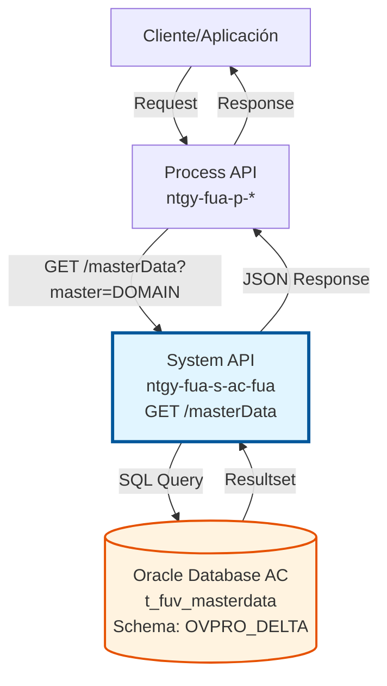
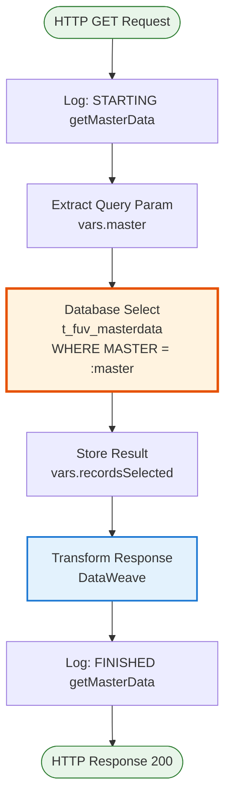
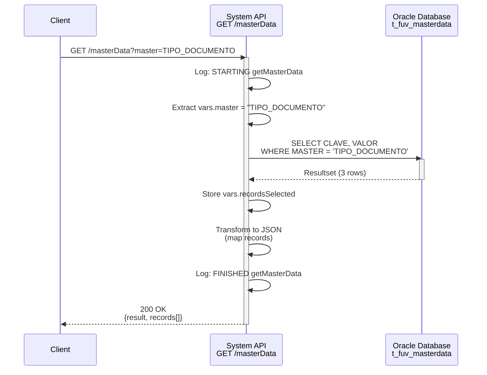
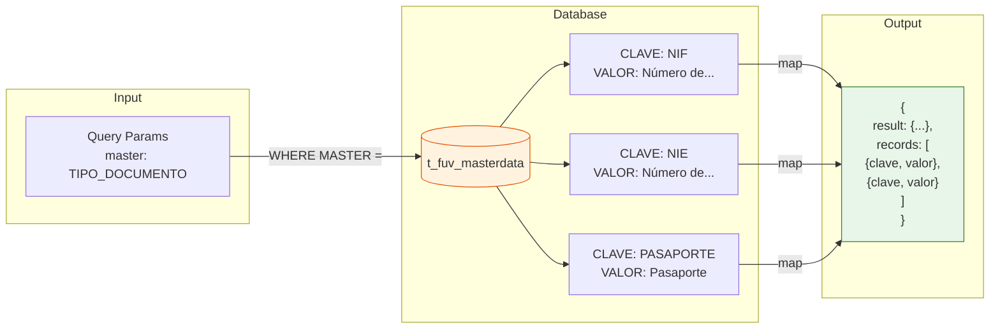

# GET /masterData

## 📌 Descripción General

### Propósito del Endpoint

Consulta datos maestros de configuración almacenados en la tabla `t_fuv_masterdata` filtrando por dominio (MASTER). Este endpoint permite obtener todos los pares clave-valor asociados a un dominio específico, facilitando la gestión de catálogos dinámicos y datos de configuración.

El endpoint soporta:
- **Consulta por Dominio**: Recupera todos los registros de un dominio específico
- **Datos de Configuración**: Acceso a catálogos y parámetros de configuración
- **Respuesta Estructurada**: Retorna array de objetos con clave y valor

### Tipo de API

**Capa:** System API (API-Led Connectivity)

**Función:** Integración directa con Oracle Database AC para consulta de datos maestros de configuración y catálogos.

### Patrón de Integración

**Tipo:** Request-Reply Síncrono con SQL Query

**Descripción:** Recibe el parámetro de dominio (master), ejecuta query SQL contra la tabla t_fuv_masterdata, transforma el resultado a formato JSON estándar y retorna el array de registros.

### Arquitectura API-Led Connectivity



---

## 💼 Propósito del Negocio

### Casos de Uso Principales

1. **Catálogos Dinámicos en Formularios**
   - Poblar listas desplegables con valores de configuración
   - Tipos de documento, estados, categorías, etc.
   - Evitar hardcodear valores en aplicaciones frontend

2. **Validación de Datos**
   - Validar que valores ingresados existen en catálogos
   - Verificar códigos y valores permitidos
   - Mantener consistencia de datos

3. **Configuración de Aplicaciones**
   - Obtener parámetros de configuración por dominio
   - Configuración dinámica sin redespliegue
   - Centralización de datos de configuración

### Contexto Empresarial

- **Dominio:** Gestión de Configuración y Datos Maestros
- **Sector:** Energía - Utilities
- **División:** Naturgy España - NewCo
- **Proceso de Negocio:** Gestión de catálogos y configuración centralizada
- **Sistema:** Área Cliente (AC) - Oracle Database

### Stakeholders

- **Desarrolladores Frontend**: Necesitan catálogos para formularios dinámicos
- **Analistas de Negocio**: Definen y mantienen catálogos de datos maestros
- **Administradores de Sistema**: Gestionan configuración centralizada

### Valor de Negocio

- **Flexibilidad**: Modificar catálogos sin cambios en código
- **Consistencia**: Única fuente de verdad para datos maestros
- **Mantenibilidad**: Gestión centralizada de configuración
- **Escalabilidad**: Fácil adición de nuevos dominios y valores

### Consumidores Potenciales

Este endpoint puede ser consumido por:
- Process APIs que requieren datos de configuración
- Experience APIs para poblar formularios
- Aplicaciones frontend (web, móvil)
- Sistemas de validación de datos

---

## 🔧 Especificación Técnica

### URLs por Ambiente

| Ambiente | URL Base | URL Completa |
|----------|----------|--------------|
| **Local** | `http://localhost:8081` | `http://localhost:8081/api/masterData?master=DOMAIN` |
| **Development** | `https://ntgy-fua-s-ac-fua-dev.us-e2.cloudhub.io` | `https://ntgy-fua-s-ac-fua-dev.us-e2.cloudhub.io/api/masterData?master=DOMAIN` |
| **UAT** | `https://ntgy-fua-s-ac-fua-uat.us-e2.cloudhub.io` | `https://ntgy-fua-s-ac-fua-uat.us-e2.cloudhub.io/api/masterData?master=DOMAIN` |
| **Production** | `https://ntgy-fua-s-ac-fua-pro.us-e2.cloudhub.io` | `https://ntgy-fua-s-ac-fua-pro.us-e2.cloudhub.io/api/masterData?master=DOMAIN` |

### Método HTTP

```
GET /api/masterData
```

### Parámetros de Entrada

#### Headers HTTP

| Header | Tipo | Requerido | Descripción | Ejemplo |
|--------|------|-----------|-------------|---------|
| `Accept` | string | ❌ No | Tipo de contenido esperado en response | `application/json` |

#### Query Parameters

| Parámetro | Tipo | Requerido | Descripción | Ejemplo |
|-----------|------|-----------|-------------|---------|
| `master` | string | ✅ Sí | Dominio de datos maestros a consultar | `"TIPO_DOCUMENTO"` |

**Dominios Comunes:**
- `TIPO_DOCUMENTO`: Tipos de documento (NIF, NIE, Pasaporte, etc.)
- `ESTADO_PEDIDO`: Estados de pedidos
- `TIPO_CLIENTE`: Tipos de cliente
- `CATEGORIA_PRODUCTO`: Categorías de productos
- *(Otros dominios según configuración)*

### Respuestas

#### Respuesta Exitosa (200 OK)

```json
{
  "result": {
    "codResult": "0000",
    "msgResult": "No hay error"
  },
  "records": [
    {
      "clave": "NIF",
      "valor": "Número de Identificación Fiscal"
    },
    {
      "clave": "NIE",
      "valor": "Número de Identidad de Extranjero"
    },
    {
      "clave": "PASAPORTE",
      "valor": "Pasaporte"
    }
  ]
}
```

#### Respuesta Sin Resultados (200 OK)

```json
{
  "result": {
    "codResult": "0000",
    "msgResult": "No hay error"
  },
  "records": []
}
```

#### Respuesta de Error Técnico (500)

```json
{
  "result": {
    "codResult": "0001",
    "msgResult": "Error interno del servidor"
  }
}
```

### Autenticación y Autorización

- **Tipo:** Client ID & Client Secret (Anypoint Platform)
- **Autorización DB:** El usuario de base de datos debe tener permisos de:
  - SELECT en tabla `t_fuv_masterdata`
  - Acceso al schema `OVPRO_DELTA`

### Timeouts

| Tipo | Valor | Descripción |
|------|-------|-------------|
| **Query Timeout** | 15 segundos | Tiempo máximo de ejecución de query SQL |
| **Connection Timeout** | 3600 segundos | Tiempo máximo para establecer conexión a DB |

---

## 🏗️ Implementación Técnica

### Arquitectura del Flow



### Componentes del Flow

#### 1. Logging Inicial
**Propósito:** Registrar inicio de operación con parámetros de entrada

```xml
<logger level="INFO" message="STARTING getMasterData METHOD. REQUEST: ..." />
```

#### 2. Extracción de Parámetros
**Propósito:** Extraer parámetro `master` de query params

```dataweave
%dw 2.0
output application/java
---
attributes.queryParams.master
```

**Variable:** `vars.master`

#### 3. Consulta a Base de Datos
**Propósito:** Ejecutar query SQL para obtener registros del dominio

**Query SQL:**
```sql
SELECT CLAVE, VALOR 
FROM t_fuv_masterdata 
WHERE MASTER = :master
```

**Configuración:**
- **Config:** `Database_Config`
- **Query Timeout:** 15 segundos
- **Input Parameters:** `{master: vars.master}`

#### 4. Almacenamiento de Resultado
**Propósito:** Guardar resultado de query en variable

```dataweave
%dw 2.0
output application/json
---
payload
```

**Variable:** `vars.recordsSelected`

#### 5. Transformación de Respuesta
**Propósito:** Construir respuesta JSON estándar

```dataweave
%dw 2.0
output application/json
---
{
  "result": {
    "codResult": "0000",
    "msgResult": "No hay error"
  },
  records: vars.recordsSelected map ( record , indexOfRecord ) -> {
    clave: record.CLAVE,
    valor: record.VALOR
  }
}
```

#### 6. Logging Final
**Propósito:** Registrar finalización exitosa con respuesta

```xml
<logger level="INFO" message="FINISHED getMasterData METHOD. RESPONSE: ..." />
```

### Diagrama de Secuencia



### Diagrama de Transformación de Datos



### Estructura de la Tabla

**Tabla:** `t_fuv_masterdata`

| Columna | Tipo | Descripción |
|---------|------|-------------|
| `MASTER` | VARCHAR2 | Dominio o categoría de datos maestros |
| `CLAVE` | VARCHAR2 | Código o clave del registro |
| `VALOR` | VARCHAR2 | Descripción o valor del registro |

**Ejemplo de Datos:**

| MASTER | CLAVE | VALOR |
|--------|-------|-------|
| TIPO_DOCUMENTO | NIF | Número de Identificación Fiscal |
| TIPO_DOCUMENTO | NIE | Número de Identidad de Extranjero |
| TIPO_DOCUMENTO | PASAPORTE | Pasaporte |
| ESTADO_PEDIDO | PENDIENTE | Pedido Pendiente |
| ESTADO_PEDIDO | PROCESADO | Pedido Procesado |

### Manejo de Errores

**Errores Posibles:**

1. **Database Connection Error**
   - Código: `DB_CONNECTION_ERROR`
   - HTTP Status: 500
   - Causa: No se puede conectar a la base de datos

2. **Query Timeout**
   - Código: `DB_QUERY_TIMEOUT`
   - HTTP Status: 500
   - Causa: Query excede 15 segundos

3. **Invalid Parameter**
   - Código: `INVALID_PARAMETER`
   - HTTP Status: 400
   - Causa: Parámetro `master` no proporcionado

**Estrategia de Retry:**
- Reintentos automáticos: 3 intentos
- Intervalo: Exponential backoff
- Solo para errores de conectividad

---

## 💻 Ejemplos de Uso

### Ejemplo 1: Consulta de Tipos de Documento

#### Request con curl

```bash
curl -X GET "https://ntgy-fua-s-ac-fua-pro.us-e2.cloudhub.io/api/masterData?master=TIPO_DOCUMENTO" \
  -H "Accept: application/json" \
  -H "client_id: your-client-id" \
  -H "client_secret: your-client-secret"
```

#### Response Exitoso (200 OK)

```json
{
  "result": {
    "codResult": "0000",
    "msgResult": "No hay error"
  },
  "records": [
    {
      "clave": "NIF",
      "valor": "Número de Identificación Fiscal"
    },
    {
      "clave": "NIE",
      "valor": "Número de Identidad de Extranjero"
    },
    {
      "clave": "PASAPORTE",
      "valor": "Pasaporte"
    },
    {
      "clave": "CIF",
      "valor": "Código de Identificación Fiscal"
    }
  ]
}
```

### Ejemplo 2: Consulta de Estados de Pedido

#### Request con curl

```bash
curl -X GET "https://ntgy-fua-s-ac-fua-pro.us-e2.cloudhub.io/api/masterData?master=ESTADO_PEDIDO" \
  -H "Accept: application/json" \
  -H "client_id: your-client-id" \
  -H "client_secret: your-client-secret"
```

#### Response Exitoso (200 OK)

```json
{
  "result": {
    "codResult": "0000",
    "msgResult": "No hay error"
  },
  "records": [
    {
      "clave": "PENDIENTE",
      "valor": "Pedido Pendiente de Procesamiento"
    },
    {
      "clave": "EN_PROCESO",
      "valor": "Pedido en Proceso"
    },
    {
      "clave": "COMPLETADO",
      "valor": "Pedido Completado"
    },
    {
      "clave": "CANCELADO",
      "valor": "Pedido Cancelado"
    }
  ]
}
```

### Ejemplo 3: Dominio Sin Registros

#### Request con curl

```bash
curl -X GET "https://ntgy-fua-s-ac-fua-pro.us-e2.cloudhub.io/api/masterData?master=DOMINIO_INEXISTENTE" \
  -H "Accept: application/json" \
  -H "client_id: your-client-id" \
  -H "client_secret: your-client-secret"
```

#### Response Sin Resultados (200 OK)

```json
{
  "result": {
    "codResult": "0000",
    "msgResult": "No hay error"
  },
  "records": []
}
```

### Ejemplo 4: Error de Conexión a Base de Datos

#### Response de Error (500)

```json
{
  "result": {
    "codResult": "DB_CONNECTION_ERROR",
    "msgResult": "No se pudo conectar a la base de datos AC"
  }
}
```

### Ejemplo 5: Uso en JavaScript

```javascript
// Función para obtener datos maestros
async function getMasterData(domain) {
  const baseUrl = 'https://ntgy-fua-s-ac-fua-pro.us-e2.cloudhub.io';
  const endpoint = `/api/masterData?master=${encodeURIComponent(domain)}`;
  
  try {
    const response = await fetch(baseUrl + endpoint, {
      method: 'GET',
      headers: {
        'Accept': 'application/json',
        'client_id': 'your-client-id',
        'client_secret': 'your-client-secret'
      }
    });
    
    if (!response.ok) {
      throw new Error(`HTTP error! status: ${response.status}`);
    }
    
    const data = await response.json();
    
    if (data.result.codResult === "0000") {
      return data.records;
    } else {
      throw new Error(data.result.msgResult);
    }
  } catch (error) {
    console.error('Error fetching master data:', error);
    throw error;
  }
}

// Uso
getMasterData('TIPO_DOCUMENTO')
  .then(records => {
    console.log('Tipos de documento:', records);
    // Poblar select dropdown
    const select = document.getElementById('tipoDocumento');
    records.forEach(record => {
      const option = document.createElement('option');
      option.value = record.clave;
      option.textContent = record.valor;
      select.appendChild(option);
    });
  })
  .catch(error => {
    console.error('Error:', error);
  });
```

### Ejemplo 6: Uso en Python

```python
import requests
from typing import List, Dict

def get_master_data(domain: str) -> List[Dict[str, str]]:
    """
    Obtiene datos maestros por dominio
    
    Args:
        domain: Dominio de datos maestros (ej: 'TIPO_DOCUMENTO')
    
    Returns:
        Lista de diccionarios con clave y valor
    
    Raises:
        requests.exceptions.RequestException: Error en la petición HTTP
        ValueError: Error en la respuesta del API
    """
    base_url = 'https://ntgy-fua-s-ac-fua-pro.us-e2.cloudhub.io'
    endpoint = f'/api/masterData'
    
    headers = {
        'Accept': 'application/json',
        'client_id': 'your-client-id',
        'client_secret': 'your-client-secret'
    }
    
    params = {
        'master': domain
    }
    
    try:
        response = requests.get(
            f'{base_url}{endpoint}',
            headers=headers,
            params=params,
            timeout=30
        )
        response.raise_for_status()
        
        data = response.json()
        
        if data['result']['codResult'] == '0000':
            return data['records']
        else:
            raise ValueError(f"API Error: {data['result']['msgResult']}")
            
    except requests.exceptions.RequestException as e:
        print(f"Error fetching master data: {e}")
        raise

# Uso
if __name__ == '__main__':
    try:
        tipos_documento = get_master_data('TIPO_DOCUMENTO')
        print(f"Tipos de documento disponibles: {len(tipos_documento)}")
        for tipo in tipos_documento:
            print(f"  - {tipo['clave']}: {tipo['valor']}")
    except Exception as e:
        print(f"Error: {e}")
```
