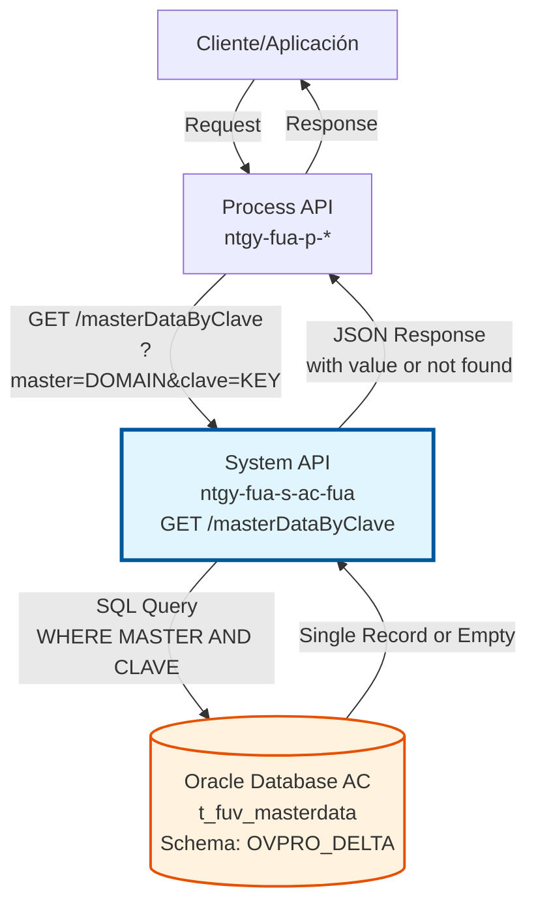
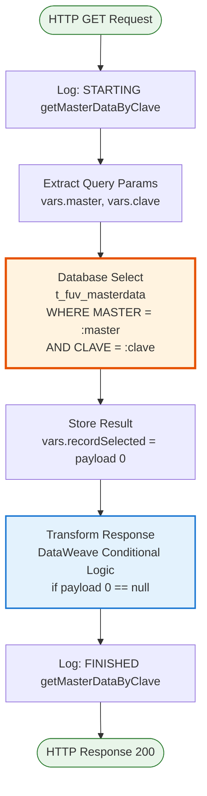
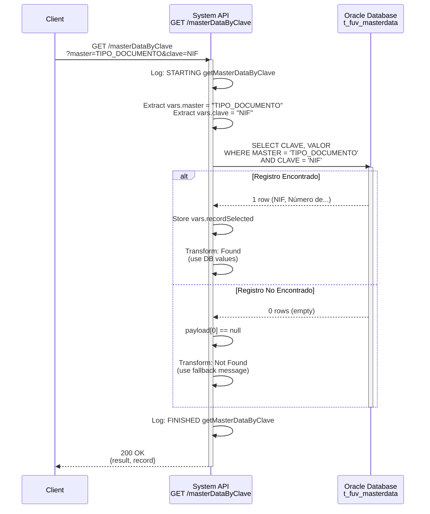
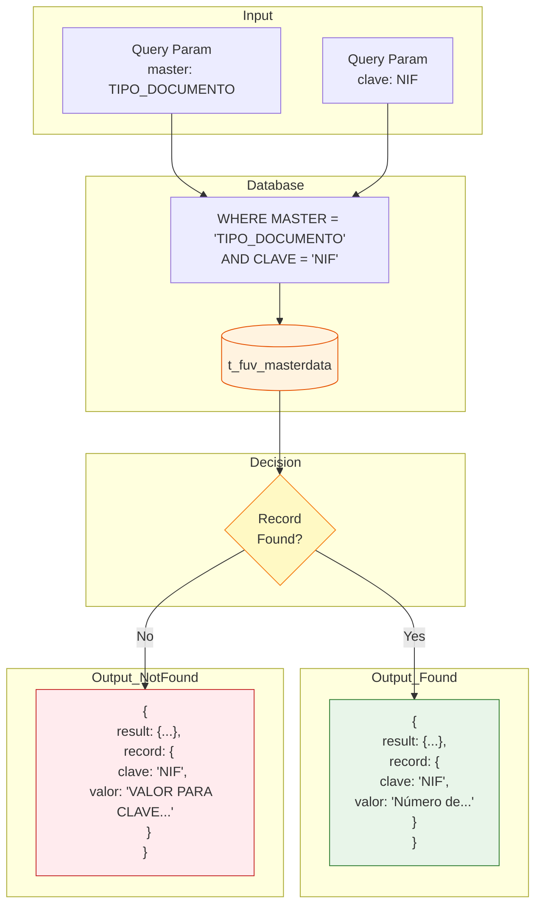

# GET /masterDataByClave

## 📌 Descripción General

### Propósito del Endpoint

Consulta un dato maestro específico de la tabla `t_fuv_masterdata` filtrando por dominio (MASTER) y clave (CLAVE). Este endpoint permite obtener el valor asociado a una clave específica dentro de un dominio, facilitando la búsqueda directa de configuraciones o valores de catálogo.

El endpoint soporta:
- **Búsqueda Específica**: Recupera un único registro por dominio y clave
- **Validación de Existencia**: Indica si la clave existe en el dominio
- **Respuesta con Fallback**: Retorna mensaje específico si no se encuentra el valor
- **Lookup Directo**: Ideal para validaciones y búsquedas puntuales

### Tipo de API

**Capa:** System API (API-Led Connectivity)

**Función:** Integración directa con Oracle Database AC para consulta de un dato maestro específico por dominio y clave.

### Patrón de Integración

**Tipo:** Request-Reply Síncrono con SQL Query

**Descripción:** Recibe los parámetros de dominio (master) y clave (clave), ejecuta query SQL contra la tabla t_fuv_masterdata, valida si existe el registro, y retorna el valor encontrado o un mensaje indicando que no se localizó.

### Arquitectura API-Led Connectivity



---

## 💼 Propósito del Negocio

### Casos de Uso Principales

1. **Validación de Valores**
   - Verificar que un código o clave existe en un dominio
   - Validar valores ingresados por usuarios
   - Obtener descripción de un código específico

2. **Lookup de Configuración**
   - Obtener un valor de configuración específico
   - Buscar descripción de un código
   - Resolver referencias de catálogo

3. **Traducción de Códigos**
   - Convertir códigos técnicos a descripciones legibles
   - Mostrar etiquetas amigables en interfaces
   - Internacionalización de valores

### Contexto Empresarial

- **Dominio:** Gestión de Configuración y Datos Maestros
- **Sector:** Energía - Utilities
- **División:** Naturgy España - NewCo
- **Proceso de Negocio:** Validación y lookup de datos maestros
- **Sistema:** Área Cliente (AC) - Oracle Database

### Stakeholders

- **Desarrolladores Frontend**: Necesitan validar y traducir códigos
- **Sistemas de Validación**: Verifican existencia de valores
- **Aplicaciones de Negocio**: Requieren descripciones de códigos

### Valor de Negocio

- **Validación Inmediata**: Verificar existencia de valores en tiempo real
- **Experiencia de Usuario**: Mostrar descripciones legibles en lugar de códigos
- **Integridad de Datos**: Asegurar que solo se usen valores válidos
- **Performance**: Búsqueda directa más eficiente que obtener todo el dominio

### Consumidores Potenciales

Este endpoint puede ser consumido por:
- Process APIs que requieren validación de valores
- Experience APIs para traducción de códigos
- Formularios que necesitan validar inputs
- Sistemas de validación de datos

---

## 🔧 Especificación Técnica

### URLs por Ambiente

| Ambiente | URL Base | URL Completa |
|----------|----------|--------------|
| **Local** | `http://localhost:8081` | `http://localhost:8081/api/masterDataByClave?master=DOMAIN&clave=KEY` |
| **Development** | `https://ntgy-fua-s-ac-fua-dev.us-e2.cloudhub.io` | `https://ntgy-fua-s-ac-fua-dev.us-e2.cloudhub.io/api/masterDataByClave?master=DOMAIN&clave=KEY` |
| **UAT** | `https://ntgy-fua-s-ac-fua-uat.us-e2.cloudhub.io` | `https://ntgy-fua-s-ac-fua-uat.us-e2.cloudhub.io/api/masterDataByClave?master=DOMAIN&clave=KEY` |
| **Production** | `https://ntgy-fua-s-ac-fua-pro.us-e2.cloudhub.io` | `https://ntgy-fua-s-ac-fua-pro.us-e2.cloudhub.io/api/masterDataByClave?master=DOMAIN&clave=KEY` |

### Método HTTP

```
GET /api/masterDataByClave
```

### Parámetros de Entrada

#### Headers HTTP

| Header | Tipo | Requerido | Descripción | Ejemplo |
|--------|------|-----------|-------------|---------|
| `Accept` | string | ❌ No | Tipo de contenido esperado en response | `application/json` |

#### Query Parameters

| Parámetro | Tipo | Requerido | Descripción | Ejemplo |
|-----------|------|-----------|-------------|---------|
| `master` | string | ✅ Sí | Dominio de datos maestros | `"TIPO_DOCUMENTO"` |
| `clave` | string | ✅ Sí | Clave específica a buscar dentro del dominio | `"NIF"` |

**Ejemplos de Combinaciones:**
- `master=TIPO_DOCUMENTO&clave=NIF`
- `master=ESTADO_PEDIDO&clave=PENDIENTE`
- `master=TIPO_CLIENTE&clave=RESIDENCIAL`

### Respuestas

#### Respuesta Exitosa - Valor Encontrado (200 OK)

```json
{
  "result": {
    "codResult": "0000",
    "msgResult": "No hay error"
  },
  "record": {
    "clave": "NIF",
    "valor": "Número de Identificación Fiscal"
  }
}
```

#### Respuesta Exitosa - Valor No Encontrado (200 OK)

```json
{
  "result": {
    "codResult": "0000",
    "msgResult": "No hay error"
  },
  "record": {
    "clave": "CLAVE_INEXISTENTE",
    "valor": "VALOR PARA CLAVE NO LOCALIZADO"
  }
}
```

**Nota:** Cuando no se encuentra el registro, el endpoint retorna un mensaje específico en el campo `valor` indicando que la clave no fue localizada.

#### Respuesta de Error Técnico (500)

```json
{
  "result": {
    "codResult": "0001",
    "msgResult": "Error interno del servidor"
  }
}
```

### Autenticación y Autorización

- **Tipo:** Client ID & Client Secret (Anypoint Platform)
- **Autorización DB:** El usuario de base de datos debe tener permisos de:
  - SELECT en tabla `t_fuv_masterdata`
  - Acceso al schema `OVPRO_DELTA`

### Timeouts

| Tipo | Valor | Descripción |
|------|-------|-------------|
| **Query Timeout** | 15 segundos | Tiempo máximo de ejecución de query SQL |
| **Connection Timeout** | 3600 segundos | Tiempo máximo para establecer conexión a DB |

---

## 🏗️ Implementación Técnica

### Arquitectura del Flow



**Nota sobre la Transformación:** El paso de transformación DataWeave contiene la lógica condicional completa:
- **Si `payload[0] == null`**: Construye respuesta con `valor: "VALOR PARA CLAVE NO LOCALIZADO"`
- **Si `payload[0] != null`**: Construye respuesta con valores de `vars.recordSelected`

### Componentes del Flow

#### 1. Logging Inicial
**Propósito:** Registrar inicio de operación con parámetros de entrada

```xml
<logger level="INFO" message="STARTING getMasterDataByClave METHOD. REQUEST: ..." />
```

#### 2. Extracción de Parámetros
**Propósito:** Extraer parámetros `master` y `clave` de query params

```dataweave
%dw 2.0
output application/java
---
attributes.queryParams.master
```

```dataweave
%dw 2.0
output application/java
---
attributes.queryParams.clave
```

**Variables:** `vars.master`, `vars.clave`

#### 3. Consulta a Base de Datos
**Propósito:** Ejecutar query SQL para obtener registro específico

**Query SQL:**
```sql
SELECT CLAVE, VALOR 
FROM t_fuv_masterdata 
WHERE MASTER = :master 
  AND CLAVE = :clave
```

**Configuración:**
- **Config:** `Database_Config`
- **Query Timeout:** 15 segundos
- **Input Parameters:** `{master: vars.master, clave: vars.clave}`

#### 4. Almacenamiento de Resultado
**Propósito:** Guardar primer registro (o null) en variable

```dataweave
%dw 2.0
output application/json
---
payload[0]
```

**Variable:** `vars.recordSelected`

#### 5. Validación y Transformación Condicional
**Propósito:** Construir respuesta según si se encontró o no el registro

**Lógica Condicional:**

```dataweave
%dw 2.0
output application/json
---
if (payload[0] == null)
{
  "result": {
    "codResult": "0000",
    "msgResult": "No hay error"
  },
  record: {
    clave: vars.clave,
    valor: "VALOR PARA CLAVE NO LOCALIZADO"
  }	
}
else
{
  "result": {
    "codResult": "0000",
    "msgResult": "No hay error"
  },
  record: {
    clave: vars.recordSelected.CLAVE,
    valor: vars.recordSelected.VALOR
  }
}
```

**Casos:**
- **Registro encontrado:** Retorna clave y valor de la base de datos
- **Registro no encontrado:** Retorna clave solicitada con mensaje "VALOR PARA CLAVE NO LOCALIZADO"

#### 6. Logging Final
**Propósito:** Registrar finalización con respuesta

```xml
<logger level="INFO" message="FINISHED getMasterDataByClave METHOD. RESPONSE: ..." />
```

### Diagrama de Secuencia



### Diagrama de Transformación de Datos



### Estructura de la Tabla

**Tabla:** `t_fuv_masterdata`

| Columna | Tipo | Descripción |
|---------|------|-------------|
| `MASTER` | VARCHAR2 | Dominio o categoría de datos maestros |
| `CLAVE` | VARCHAR2 | Código o clave del registro |
| `VALOR` | VARCHAR2 | Descripción o valor del registro |

**Ejemplo de Datos:**

| MASTER | CLAVE | VALOR |
|--------|-------|-------|
| TIPO_DOCUMENTO | NIF | Número de Identificación Fiscal |
| TIPO_DOCUMENTO | NIE | Número de Identidad de Extranjero |
| TIPO_DOCUMENTO | PASAPORTE | Pasaporte |

### Manejo de Errores

**Errores Posibles:**

1. **Database Connection Error**
   - Código: `DB_CONNECTION_ERROR`
   - HTTP Status: 500
   - Causa: No se puede conectar a la base de datos

2. **Query Timeout**
   - Código: `DB_QUERY_TIMEOUT`
   - HTTP Status: 500
   - Causa: Query excede 15 segundos

3. **Invalid Parameters**
   - Código: `INVALID_PARAMETER`
   - HTTP Status: 400
   - Causa: Parámetros `master` o `clave` no proporcionados

**Estrategia de Retry:**
- Reintentos automáticos: 3 intentos
- Intervalo: Exponential backoff
- Solo para errores de conectividad

---

## 💻 Ejemplos de Uso

### Ejemplo 1: Búsqueda Exitosa - Tipo de Documento NIF

#### Request con curl

```bash
curl -X GET "https://ntgy-fua-s-ac-fua-pro.us-e2.cloudhub.io/api/masterDataByClave?master=TIPO_DOCUMENTO&clave=NIF" \
  -H "Accept: application/json" \
  -H "client_id: your-client-id" \
  -H "client_secret: your-client-secret"
```

#### Response Exitoso (200 OK)

```json
{
  "result": {
    "codResult": "0000",
    "msgResult": "No hay error"
  },
  "record": {
    "clave": "NIF",
    "valor": "Número de Identificación Fiscal"
  }
}
```

### Ejemplo 2: Búsqueda Exitosa - Estado de Pedido

#### Request con curl

```bash
curl -X GET "https://ntgy-fua-s-ac-fua-pro.us-e2.cloudhub.io/api/masterDataByClave?master=ESTADO_PEDIDO&clave=PENDIENTE" \
  -H "Accept: application/json" \
  -H "client_id: your-client-id" \
  -H "client_secret: your-client-secret"
```

#### Response Exitoso (200 OK)

```json
{
  "result": {
    "codResult": "0000",
    "msgResult": "No hay error"
  },
  "record": {
    "clave": "PENDIENTE",
    "valor": "Pedido Pendiente de Procesamiento"
  }
}
```

### Ejemplo 3: Clave No Encontrada

#### Request con curl

```bash
curl -X GET "https://ntgy-fua-s-ac-fua-pro.us-e2.cloudhub.io/api/masterDataByClave?master=TIPO_DOCUMENTO&clave=CLAVE_INEXISTENTE" \
  -H "Accept: application/json" \
  -H "client_id: your-client-id" \
  -H "client_secret: your-client-secret"
```

#### Response - Valor No Localizado (200 OK)

```json
{
  "result": {
    "codResult": "0000",
    "msgResult": "No hay error"
  },
  "record": {
    "clave": "CLAVE_INEXISTENTE",
    "valor": "VALOR PARA CLAVE NO LOCALIZADO"
  }
}
```

### Ejemplo 4: Error de Conexión a Base de Datos

#### Response de Error (500)

```json
{
  "result": {
    "codResult": "DB_CONNECTION_ERROR",
    "msgResult": "No se pudo conectar a la base de datos AC"
  }
}
```

### Ejemplo 5: Uso en JavaScript - Validación de Tipo de Documento

```javascript
// Función para validar y obtener descripción de un tipo de documento
async function validateDocumentType(documentType) {
  const baseUrl = 'https://ntgy-fua-s-ac-fua-pro.us-e2.cloudhub.io';
  const endpoint = `/api/masterDataByClave`;
  const params = new URLSearchParams({
    master: 'TIPO_DOCUMENTO',
    clave: documentType
  });
  
  try {
    const response = await fetch(`${baseUrl}${endpoint}?${params}`, {
      method: 'GET',
      headers: {
        'Accept': 'application/json',
        'client_id': 'your-client-id',
        'client_secret': 'your-client-secret'
      }
    });
    
    if (!response.ok) {
      throw new Error(`HTTP error! status: ${response.status}`);
    }
    
    const data = await response.json();
    
    if (data.result.codResult === "0000") {
      const isValid = data.record.valor !== "VALOR PARA CLAVE NO LOCALIZADO";
      return {
        valid: isValid,
        description: data.record.valor,
        code: data.record.clave
      };
    } else {
      throw new Error(data.result.msgResult);
    }
  } catch (error) {
    console.error('Error validating document type:', error);
    throw error;
  }
}

// Uso en formulario
document.getElementById('tipoDocumento').addEventListener('change', async (e) => {
  const selectedType = e.target.value;
  const resultDiv = document.getElementById('validationResult');
  
  try {
    const validation = await validateDocumentType(selectedType);
    
    if (validation.valid) {
      resultDiv.innerHTML = `
        <div class="success">
          ✓ Tipo válido: ${validation.description}
        </div>
      `;
      resultDiv.className = 'success';
    } else {
      resultDiv.innerHTML = `
        <div class="error">
          ✗ Tipo de documento no válido
        </div>
      `;
      resultDiv.className = 'error';
    }
  } catch (error) {
    resultDiv.innerHTML = `
      <div class="error">
        Error al validar: ${error.message}
      </div>
    `;
    resultDiv.className = 'error';
  }
});
```

### Ejemplo 6: Uso en Python - Traducción de Códigos

```python
import requests
from typing import Optional, Dict

def get_master_data_value(domain: str, key: str) -> Dict[str, str]:
    """
    Obtiene el valor de un dato maestro específico
    
    Args:
        domain: Dominio de datos maestros (ej: 'TIPO_DOCUMENTO')
        key: Clave específica a buscar (ej: 'NIF')
    
    Returns:
        Diccionario con clave, valor y flag de existencia
    
    Raises:
        requests.exceptions.RequestException: Error en la petición HTTP
        ValueError: Error en la respuesta del API
    """
    base_url = 'https://ntgy-fua-s-ac-fua-pro.us-e2.cloudhub.io'
    endpoint = f'/api/masterDataByClave'
    
    headers = {
        'Accept': 'application/json',
        'client_id': 'your-client-id',
        'client_secret': 'your-client-secret'
    }
    
    params = {
        'master': domain,
        'clave': key
    }
    
    try:
        response = requests.get(
            f'{base_url}{endpoint}',
            headers=headers,
            params=params,
            timeout=30
        )
        response.raise_for_status()
        
        data = response.json()
        
        if data['result']['codResult'] == '0000':
            record = data['record']
            is_found = record['valor'] != 'VALOR PARA CLAVE NO LOCALIZADO'
            
            return {
                'clave': record['clave'],
                'valor': record['valor'],
                'found': is_found
            }
        else:
            raise ValueError(f"API Error: {data['result']['msgResult']}")
            
    except requests.exceptions.RequestException as e:
        print(f"Error fetching master data: {e}")
        raise

def translate_code(domain: str, code: str) -> str:
    """
    Traduce un código a su descripción legible
    
    Args:
        domain: Dominio del código
        code: Código a traducir
    
    Returns:
        Descripción del código o el código original si no se encuentra
    """
    try:
        result = get_master_data_value(domain, code)
        if result['found']:
            return result['valor']
        else:
            return code  # Retornar código original si no se encuentra
    except Exception as e:
        print(f"Error translating code: {e}")
        return code

# Uso - Traducir códigos en un reporte
if __name__ == '__main__':
    # Lista de pedidos con códigos
    pedidos = [
        {'id': 1, 'estado': 'PENDIENTE'},
        {'id': 2, 'estado': 'COMPLETADO'},
        {'id': 3, 'estado': 'CANCELADO'}
    ]
    
    # Traducir estados
    print("Reporte de Pedidos:")
    print("-" * 50)
    for pedido in pedidos:
        estado_traducido = translate_code('ESTADO_PEDIDO', pedido['estado'])
        print(f"Pedido #{pedido['id']}: {estado_traducido}")
```

### Ejemplo 7: Uso en Python - Validación Masiva

```python
from typing import List, Dict
import asyncio
import aiohttp

async def validate_codes_batch(domain: str, codes: List[str]) -> Dict[str, bool]:
    """
    Valida múltiples códigos de forma asíncrona
    
    Args:
        domain: Dominio de datos maestros
        codes: Lista de códigos a validar
    
    Returns:
        Diccionario con código como key y boolean indicando si es válido
    """
    base_url = 'https://ntgy-fua-s-ac-fua-pro.us-e2.cloudhub.io'
    endpoint = '/api/masterDataByClave'
    
    headers = {
        'Accept': 'application/json',
        'client_id': 'your-client-id',
        'client_secret': 'your-client-secret'
    }
    
    async def validate_single(session, code):
        params = {'master': domain, 'clave': code}
        try:
            async with session.get(
                f'{base_url}{endpoint}',
                headers=headers,
                params=params
            ) as response:
                data = await response.json()
                if data['result']['codResult'] == '0000':
                    is_valid = data['record']['valor'] != 'VALOR PARA CLAVE NO LOCALIZADO'
                    return code, is_valid
                return code, False
        except Exception as e:
            print(f"Error validating {code}: {e}")
            return code, False
    
    async with aiohttp.ClientSession() as session:
        tasks = [validate_single(session, code) for code in codes]
        results = await asyncio.gather(*tasks)
        return dict(results)

# Uso
if __name__ == '__main__':
    # Validar múltiples tipos de documento
    tipos_a_validar = ['NIF', 'NIE', 'PASAPORTE', 'INVALIDO', 'CIF']
    
    resultados = asyncio.run(
        validate_codes_batch('TIPO_DOCUMENTO', tipos_a_validar)
    )
    
    print("Resultados de Validación:")
    for tipo, es_valido in resultados.items():
        estado = "✓ Válido" if es_valido else "✗ Inválido"
        print(f"  {tipo}: {estado}")
```
