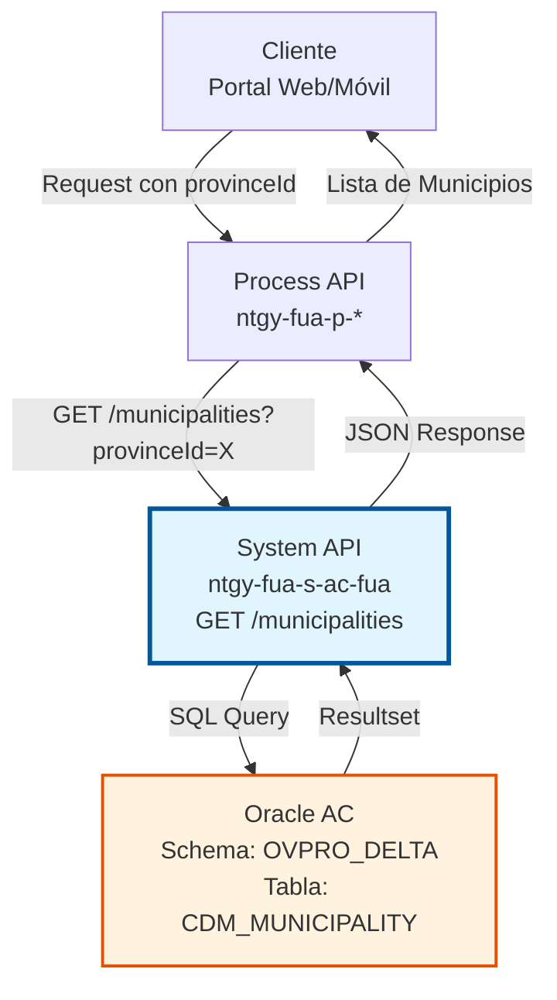
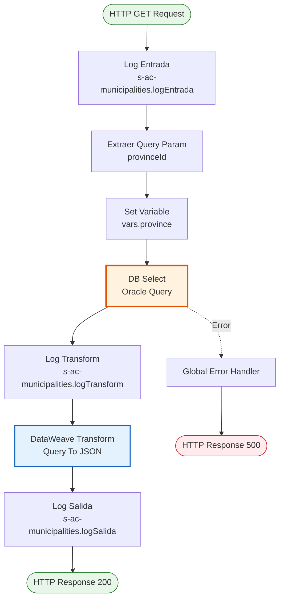
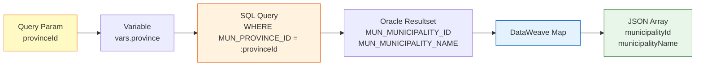

# GET /municipalities

## 📌 Descripción General

### Propósito del Endpoint

Este endpoint proporciona acceso al catálogo de municipios almacenado en la base de datos Oracle AC, permitiendo consultar todos los municipios asociados a una provincia específica. Es parte del sistema de datos maestros geográficos que soporta la validación y normalización de direcciones en toda la plataforma.

El endpoint soporta:
- **Consulta por Provincia**: Obtiene todos los municipios de una provincia específica mediante su ID
- **Datos de Referencia**: Proporciona información estática de catálogo geográfico
- **Integración con Formularios**: Alimenta selectores en cascada (Provincia → Municipio → Localidad)

### Tipo de API

**Capa:** System API (API-Led Connectivity)

**Función:** Integración directa con Oracle AC para acceso a datos maestros geográficos del catálogo CDM (Common Data Model).

### Patrón de Integración

**Tipo:** Request-Reply Síncrono con Query SQL

**Descripción:** Recibe el ID de provincia como query parameter, ejecuta una consulta SQL directa a la tabla CDM_MUNICIPALITY en Oracle, transforma el resultado a JSON y retorna el listado de municipios.

### Arquitectura API-Led Connectivity



---

## 💼 Propósito del Negocio

### Casos de Uso Principales

1. **Formularios de Alta de Cliente**
   - Usuario selecciona provincia en formulario
   - Sistema carga municipios de esa provincia
   - Usuario selecciona municipio de la lista
   - **Beneficio:** Validación de direcciones en tiempo real

2. **Normalización de Direcciones**
   - Sistema recibe dirección parcial
   - Consulta municipios para validar
   - Normaliza dirección con datos oficiales
   - **Beneficio:** Consistencia en datos de direcciones

3. **Búsquedas Geográficas**
   - Usuario filtra por ubicación geográfica
   - Sistema muestra municipios disponibles
   - Usuario refina búsqueda por municipio
   - **Beneficio:** Experiencia de búsqueda mejorada

### Contexto Empresarial

- **Dominio:** Datos Maestros - Geografía
- **Sector:** Energía - Utilities
- **División:** Naturgy España - Área Cliente (AC)
- **Proceso de Negocio:** Gestión de Datos de Referencia Geográfica
- **Módulo:** Common Data Model (CDM)

### Stakeholders

- **Equipos de Desarrollo Frontend**: Necesitan datos para selectores en cascada
- **Equipos de Validación de Datos**: Requieren catálogo oficial para normalización
- **Agentes de Ventas**: Utilizan formularios con datos geográficos precisos
- **Clientes Finales**: Experimentan formularios con datos correctos y actualizados

### Valor de Negocio

- **Calidad de Datos**: Garantiza direcciones válidas y normalizadas
- **Experiencia de Usuario**: Selectores dinámicos mejoran usabilidad
- **Eficiencia Operativa**: Reduce errores en captura de direcciones
- **Cumplimiento**: Utiliza catálogo oficial de municipios españoles

### Consumidores Potenciales

Este endpoint puede ser consumido por:
- Process APIs de gestión de clientes
- Process APIs de gestión de contratos
- Experience APIs de portales web y móviles
- Sistemas de validación de direcciones
- Herramientas de normalización de datos

---

## 🔧 Especificación Técnica

### URLs por Ambiente

| Ambiente | URL Base | URL Completa |
|----------|----------|--------------|
| **Local** | `http://localhost:8081` | `http://localhost:8081/api/municipalities?provinceId=:provinceId` |
| **Development** | `https://ntgy-fua-s-ac-fua-dev.us-e2.cloudhub.io` | `https://ntgy-fua-s-ac-fua-dev.us-e2.cloudhub.io/api/municipalities?provinceId=:provinceId` |
| **UAT** | `https://ntgy-fua-s-ac-fua-uat.us-e2.cloudhub.io` | `https://ntgy-fua-s-ac-fua-uat.us-e2.cloudhub.io/api/municipalities?provinceId=:provinceId` |
| **Production** | `https://ntgy-fua-s-ac-fua-pro.us-e2.cloudhub.io` | `https://ntgy-fua-s-ac-fua-pro.us-e2.cloudhub.io/api/municipalities?provinceId=:provinceId` |

### Método HTTP

```
GET /api/municipalities
```

### Parámetros de Entrada

#### Headers HTTP

| Header | Tipo | Requerido | Descripción | Ejemplo |
|--------|------|-----------|-------------|---------|
| `Accept` | string | ❌ No | Tipo de contenido esperado en response | `application/json` |

#### Query Parameters

| Parámetro | Tipo | Requerido | Descripción | Ejemplo | Validación |
|-----------|------|-----------|-------------|---------|------------|
| `provinceId` | string | ✅ Sí | ID de la provincia para filtrar municipios | `"28"` (Madrid) | Debe existir en CDM_PROVINCE |

**Notas sobre provinceId:**
- Corresponde al campo `MUN_PROVINCE_ID` en la tabla CDM_MUNICIPALITY
- Debe ser un ID válido de provincia existente en el catálogo
- Típicamente es un código numérico de 2 dígitos (ej: "08" para Barcelona, "28" para Madrid)

### Respuestas

#### Respuesta Exitosa (200 OK)

```json
{
  "result": {
    "codResult": "0000",
    "msgResult": "No hay error"
  },
  "items": [
    {
      "municipalityId": "28001",
      "municipalityName": "Acebeda (La)"
    },
    {
      "municipalityId": "28002",
      "municipalityName": "Ajalvir"
    },
    {
      "municipalityId": "28003",
      "municipalityName": "Alameda del Valle"
    }
  ]
}
```

**Descripción de Campos:**

| Campo | Tipo | Descripción |
|-------|------|-------------|
| `result.codResult` | string | Código de resultado ("0000" = éxito) |
| `result.msgResult` | string | Mensaje descriptivo del resultado |
| `items` | array | Lista de municipios de la provincia |
| `items[].municipalityId` | string | ID único del municipio (MUN_MUNICIPALITY_ID) |
| `items[].municipalityName` | string | Nombre oficial del municipio (MUN_MUNICIPALITY_NAME) |

#### Respuesta Sin Resultados (200 OK)

```json
{
  "result": {
    "codResult": "0000",
    "msgResult": "No hay error"
  },
  "items": []
}
```

**Escenario:** Cuando el `provinceId` no tiene municipios asociados o no existe.

#### Respuesta de Error de Validación (400 Bad Request)

```json
{
  "result": {
    "codResult": "0001",
    "msgResult": "Parámetro provinceId es requerido"
  }
}
```

#### Respuesta de Error Técnico (500 Internal Server Error)

```json
{
  "result": {
    "codResult": "0002",
    "msgResult": "Error al consultar base de datos Oracle"
  }
}
```

### Códigos de Estado HTTP

| Código | Descripción | Escenario |
|--------|-------------|-----------|
| `200` | OK | Consulta exitosa (con o sin resultados) |
| `400` | Bad Request | Parámetro provinceId faltante o inválido |
| `500` | Internal Server Error | Error de conexión a Oracle o error en query |
| `503` | Service Unavailable | Base de datos Oracle no disponible |

### Autenticación y Autorización

- **Tipo:** Client ID & Client Secret (Anypoint Platform)
- **Autorización Oracle:** El usuario de base de datos debe tener permisos para:
  - Acceso de lectura (SELECT) a la tabla `CDM_MUNICIPALITY`
  - Acceso al schema `OVPRO_DELTA`

### Timeouts

| Tipo | Valor | Descripción |
|------|-------|-------------|
| **Query Timeout** | 15 segundos | Tiempo máximo de ejecución de la query SQL |
| **Connection Timeout** | 3600 segundos | Tiempo máximo para establecer conexión con Oracle |
| **Response Timeout** | 30 segundos | Tiempo máximo total de respuesta del endpoint |

---

## 🏗️ Implementación Técnica

### Arquitectura del Flow



### Componentes del Flow

#### 1. Logger de Entrada (Línea 9)
```xml
<logger level="INFO" message="s-ac-municipalities.logEntrada ## payload: #[payload]"/>
```
**Propósito:** Registra el inicio de la ejecución con el payload recibido.

#### 2. Extracción de Parámetro (Línea 10)
```xml
<set-variable variableName="province" value='#[attributes.queryParams["provinceId"]]'/>
```
**Propósito:** Extrae el query parameter `provinceId` y lo almacena en variable `vars.province`.

#### 3. Consulta a Oracle (Líneas 11-15)
```xml
<db:select config-ref="Database_Config" queryTimeout="${dbAC.queryTimeout}">
    <reconnect-forever />
    <db:sql><![CDATA[${queries.municipalities}]]></db:sql>
    <db:input-parameters><![CDATA[#[{'provinceId': vars.province}]]]></db:input-parameters>
</db:select>
```

**Configuración:**
- **Config:** `Database_Config` (conexión Oracle)
- **Query Timeout:** 15 segundos (configurable)
- **Reconnect:** Forever (reintentos automáticos)
- **Query SQL:** Referencia a `${queries.municipalities}` en archivo de configuración

**Query SQL Real:**
```sql
SELECT * FROM CDM_MUNICIPALITY 
WHERE CDM_MUNICIPALITY.MUN_PROVINCE_ID = :provinceId
```

#### 4. Logger de Transformación (Línea 16)
```xml
<logger level="INFO" message="s-ac-municipalities.logTransform ## payload: #[payload]"/>
```
**Propósito:** Registra el resultado de la query antes de transformar.

#### 5. Transformación DataWeave (Líneas 17-34)
```dataweave
%dw 2.0
output application/json
---
{
    result: {
        codResult: "0000",
        msgResult: "No hay error"
    },
    items: payload map (payload01, indexOfPayload01) -> {
        municipalityId: payload01.MUN_MUNICIPALITY_ID,
        municipalityName: payload01.MUN_MUNICIPALITY_NAME default ""
    }
}
```

**Mapeo de Campos:**
- `MUN_MUNICIPALITY_ID` → `municipalityId`
- `MUN_MUNICIPALITY_NAME` → `municipalityName` (con default "" si es null)

#### 6. Logger de Salida (Línea 35)
```xml
<logger level="INFO" message="s-ac-municipalities.logSalida ## payload: #[payload]"/>
```
**Propósito:** Registra la respuesta final antes de enviarla al cliente.

### Configuración de Base de Datos Oracle

**Archivo:** `ntgy-fua-s-ac-fua-pro-config.yaml`

```yaml
dbAC:
  user: "OVPRO_DELTA"
  pass: "![encrypted]"
  host1: "oc-pro-exa-04-clu-02-hdfdi-scan.prodb03.ocpro.oraclevcn.com"
  host2: "oc-pro-exa-03-clu-02-dfhl9-scan.prodb03.ocpro.oraclevcn.com"
  port: "1521"
  serviceName: "s_areapriv_online_pro.prodb03.ocpro.oraclevcn.com"
  queryTimeout: "15"
  MaxPoolSize: "15"
  MaxWaitTime: "300"
  MaxIdleTime: "300"
```

**Características:**
- **Alta Disponibilidad:** Dual host configuration (host1 y host2)
- **Connection Pooling:** Máximo 15 conexiones simultáneas
- **Retry Policy:** 3 intentos automáticos en caso de fallo
- **Schema:** OVPRO_DELTA (usuario de base de datos)

### Tabla Oracle: CDM_MUNICIPALITY

**Schema:** OVPRO_DELTA  
**Nombre:** CDM_MUNICIPALITY

**Campos Principales:**

| Campo | Tipo | Descripción | Uso |
|-------|------|-------------|-----|
| `MUN_MUNICIPALITY_ID` | VARCHAR2 | ID único del municipio | Clave primaria, retornado como `municipalityId` |
| `MUN_MUNICIPALITY_NAME` | VARCHAR2 | Nombre oficial del municipio | Retornado como `municipalityName` |
| `MUN_PROVINCE_ID` | VARCHAR2 | ID de la provincia (FK) | Usado en WHERE clause para filtrar |

**Índices:**
- Primary Key en `MUN_MUNICIPALITY_ID`
- Foreign Key en `MUN_PROVINCE_ID` → `CDM_PROVINCE.PRO_PROVINCE_ID`
- Índice en `MUN_PROVINCE_ID` para optimizar búsquedas

### Diagrama de Transformación de Datos



### Manejo de Errores

**Global Error Handler:** `s-ac-globalErrorHandler.xml`

**Errores Manejados:**

1. **DB:CONNECTIVITY**
   - Escenario: No se puede conectar a Oracle
   - Response: 503 Service Unavailable
   - Acción: Retry automático (3 intentos)

2. **DB:QUERY_EXECUTION**
   - Escenario: Error en ejecución de query SQL
   - Response: 500 Internal Server Error
   - Acción: Log del error y respuesta estándar

3. **DB:TIMEOUT**
   - Escenario: Query excede 15 segundos
   - Response: 500 Internal Server Error
   - Acción: Cancelar query y retornar error

4. **VALIDATION**
   - Escenario: provinceId faltante o inválido
   - Response: 400 Bad Request
   - Acción: Retornar mensaje descriptivo

### Performance y Optimización

**Características de Performance:**

1. **Connection Pooling**
   - Pool size: 15 conexiones
   - Reutilización de conexiones
   - Reducción de overhead de conexión

2. **Query Optimizada**
   - Índice en `MUN_PROVINCE_ID`
   - SELECT específico (no SELECT *)
   - Filtro directo por clave foránea

3. **Timeout Configurado**
   - Query timeout: 15 segundos
   - Previene queries colgadas
   - Libera recursos rápidamente

4. **Logging Estratégico**
   - 3 puntos de logging (entrada, transform, salida)
   - Trazabilidad completa
   - Diagnóstico rápido de problemas

**Métricas Esperadas:**
- **Response Time:** < 1 segundo (p95)
- **Throughput:** > 100 requests/segundo
- **Error Rate:** < 0.1%

---

## 💻 Ejemplos de Uso

### Ejemplo 1: Consulta de Municipios de Madrid (Exitosa)

#### Request

```bash
curl -X GET "https://ntgy-fua-s-ac-fua-pro.us-e2.cloudhub.io/api/municipalities?provinceId=28" \
  -H "Accept: application/json"
```

#### Response (200 OK)

```json
{
  "result": {
    "codResult": "0000",
    "msgResult": "No hay error"
  },
  "items": [
    {
      "municipalityId": "28001",
      "municipalityName": "Acebeda (La)"
    },
    {
      "municipalityId": "28002",
      "municipalityName": "Ajalvir"
    },
    {
      "municipalityId": "28003",
      "municipalityName": "Alameda del Valle"
    },
    {
      "municipalityId": "28079",
      "municipalityName": "Madrid"
    }
  ]
}
```

**Nota:** La respuesta incluye todos los municipios de la provincia de Madrid (179 municipios en total, aquí se muestran solo algunos ejemplos).

---

### Ejemplo 2: Consulta de Municipios de Barcelona

#### Request

```bash
curl -X GET "https://ntgy-fua-s-ac-fua-pro.us-e2.cloudhub.io/api/municipalities?provinceId=08" \
  -H "Accept: application/json"
```

#### Response (200 OK)

```json
{
  "result": {
    "codResult": "0000",
    "msgResult": "No hay error"
  },
  "items": [
    {
      "municipalityId": "08001",
      "municipalityName": "Abrera"
    },
    {
      "municipalityId": "08002",
      "municipalityName": "Aguilar de Segarra"
    },
    {
      "municipalityId": "08019",
      "municipalityName": "Barcelona"
    }
  ]
}
```

---

### Ejemplo 3: Provincia Sin Municipios

#### Request

```bash
curl -X GET "https://ntgy-fua-s-ac-fua-pro.us-e2.cloudhub.io/api/municipalities?provinceId=99" \
  -H "Accept: application/json"
```

#### Response (200 OK)

```json
{
  "result": {
    "codResult": "0000",
    "msgResult": "No hay error"
  },
  "items": []
}
```

**Nota:** Retorna array vacío cuando no hay municipios para la provincia especificada.

---

### Ejemplo 4: Error - Parámetro Faltante

#### Request

```bash
curl -X GET "https://ntgy-fua-s-ac-fua-pro.us-e2.cloudhub.io/api/municipalities" \
  -H "Accept: application/json"
```

#### Response (400 Bad Request)

```json
{
  "result": {
    "codResult": "0001",
    "msgResult": "Parámetro provinceId es requerido"
  }
}
```

---

### Ejemplo 5: Uso en JavaScript (Frontend)

```javascript
// Función para cargar municipios de una provincia
async function loadMunicipalities(provinceId) {
  try {
    const response = await fetch(
      `https://ntgy-fua-s-ac-fua-pro.us-e2.cloudhub.io/api/municipalities?provinceId=${provinceId}`,
      {
        method: 'GET',
        headers: {
          'Accept': 'application/json'
        }
      }
    );
    
    if (!response.ok) {
      throw new Error(`HTTP error! status: ${response.status}`);
    }
    
    const data = await response.json();
    
    if (data.result.codResult === "0000") {
      return data.items;
    } else {
      throw new Error(data.result.msgResult);
    }
  } catch (error) {
    console.error('Error loading municipalities:', error);
    throw error;
  }
}

// Uso en selector en cascada
document.getElementById('province-select').addEventListener('change', async (event) => {
  const provinceId = event.target.value;
  const municipalitySelect = document.getElementById('municipality-select');
  
  // Limpiar selector de municipios
  municipalitySelect.innerHTML = '<option value="">Seleccione municipio...</option>';
  
  if (provinceId) {
    try {
      const municipalities = await loadMunicipalities(provinceId);
      
      municipalities.forEach(municipality => {
        const option = document.createElement('option');
        option.value = municipality.municipalityId;
        option.textContent = municipality.municipalityName;
        municipalitySelect.appendChild(option);
      });
      
      municipalitySelect.disabled = false;
    } catch (error) {
      alert('Error al cargar municipios: ' + error.message);
    }
  } else {
    municipalitySelect.disabled = true;
  }
});
```

---

### Ejemplo 6: Uso en Python (Backend Integration)

```python
import requests
from typing import List, Dict, Optional

class MunicipalityService:
    def __init__(self, base_url: str):
        self.base_url = base_url
        
    def get_municipalities(self, province_id: str) -> Optional[List[Dict]]:
        """
        Obtiene la lista de municipios de una provincia.
        
        Args:
            province_id: ID de la provincia
            
        Returns:
            Lista de municipios o None si hay error
        """
        try:
            response = requests.get(
                f"{self.base_url}/api/municipalities",
                params={"provinceId": province_id},
                headers={"Accept": "application/json"},
                timeout=30
            )
            
            response.raise_for_status()
            data = response.json()
            
            if data["result"]["codResult"] == "0000":
                return data["items"]
            else:
                print(f"Error: {data['result']['msgResult']}")
                return None
                
        except requests.exceptions.RequestException as e:
            print(f"Error en request: {e}")
            return None

# Uso
service = MunicipalityService("https://ntgy-fua-s-ac-fua-pro.us-e2.cloudhub.io")
municipalities = service.get_municipalities("28")

if municipalities:
    for municipality in municipalities:
        print(f"{municipality['municipalityId']}: {municipality['municipalityName']}")
```

---

### Ejemplo 7: Integración con Selector en Cascada (React)

```jsx
import React, { useState, useEffect } from 'react';

const AddressForm = () => {
  const [provinces, setProvinces] = useState([]);
  const [municipalities, setMunicipalities] = useState([]);
  const [selectedProvince, setSelectedProvince] = useState('');
  const [selectedMunicipality, setSelectedMunicipality] = useState('');
  const [loading, setLoading] = useState(false);

  const API_BASE_URL = 'https://ntgy-fua-s-ac-fua-pro.us-e2.cloudhub.io/api';

  // Cargar municipios cuando cambia la provincia
  useEffect(() => {
    if (selectedProvince) {
      loadMunicipalities(selectedProvince);
    } else {
      setMunicipalities([]);
      setSelectedMunicipality('');
    }
  }, [selectedProvince]);

  const loadMunicipalities = async (provinceId) => {
    setLoading(true);
    try {
      const response = await fetch(
        `${API_BASE_URL}/municipalities?provinceId=${provinceId}`
      );
      const data = await response.json();
      
      if (data.result.codResult === "0000") {
        setMunicipalities(data.items);
      } else {
        console.error('Error:', data.result.msgResult);
        setMunicipalities([]);
      }
    } catch (error) {
      console.error('Error loading municipalities:', error);
      setMunicipalities([]);
    } finally {
      setLoading(false);
    }
  };

  return (
    <div className="address-form">
      <div className="form-group">
        <label htmlFor="province">Provincia:</label>
        <select
          id="province"
          value={selectedProvince}
          onChange={(e) => setSelectedProvince(e.target.value)}
        >
          <option value="">Seleccione provincia...</option>
          {/* Provincias cargadas desde /provinces */}
        </select>
      </div>

      <div className="form-group">
        <label htmlFor="municipality">Municipio:</label>
        <select
          id="municipality"
          value={selectedMunicipality}
          onChange={(e) => setSelectedMunicipality(e.target.value)}
          disabled={!selectedProvince || loading}
        >
          <option value="">
            {loading ? 'Cargando...' : 'Seleccione municipio...'}
          </option>
          {municipalities.map((municipality) => (
            <option
              key={municipality.municipalityId}
              value={municipality.municipalityId}
            >
              {municipality.municipalityName}
            </option>
          ))}
        </select>
      </div>
    </div>
  );
};

export default AddressForm;
```
